# ConsoleCrypt guide

[Русский](ru.md) · [README](../README.md) · [Website](https://consolecrypt.dev/guide?lang=en)

Step-by-step instructions with the real application interface and demonstration data. Screenshots contain no user secrets. Their source versions are recorded in the [manifest](../assets/guide/manifest.json).

## Contents

**Getting started**

- [First launch and profiles](#first-start)
- [Linux installation: DEB, RPM and keyring](#linux-install)
- [Which password do I need?](#passwords)
- [Vault, recovery and biometrics](#vault)
- [Sync and trusted devices](#devices)
- [Protection against sign-ins from new devices](#device-protection)
- [Corporate sign-in: SSO and Active Directory](#enterprise-sign-in)

**Your workspace**

- [Hosts: add, find and connect](#hosts)
- [RDP: Windows remote desktop](#rdp)
- [RDP on a phone: touchpad and keyboard](#rdp-mobile)
- [Quick search and connect](#quick-connect)
- [Groups and jump hosts](#groups)
- [Passwords, keys and credentials](#credentials)
- [Known hosts and SSH-key verification](#host-keys)
- [Terminal, tabs and selection](#terminal)
- [Local terminals: zsh, PowerShell and WSL](#local-terminals)
- [Keyboard shortcuts](#shortcuts)
- [SFTP: transfers and file preview](#sftp)
- [SFTP: default editor](#sftp-editor)
- [SSH tunnels](#tunnels)
- [Snippets, variables and starter sets](#snippets)
- [AI chat and the context you send](#ai)
- [Local AI: three models and upgrades](#local-ai)
- [Notes, tasks and reminders](#notes)
- [Kubernetes: connections and access](#kubernetes-connections)
- [Kubernetes: resources and changes](#kubernetes-resources)
- [Kubernetes: logs, shell and tunnels](#kubernetes-logs-shell)
- [Kubernetes: GitOps and problems](#kubernetes-gitops)
- [Kubernetes: Helm](#kubernetes-helm)
- [Kubernetes: context terminal and AI](#kubernetes-terminal-ai)
- [Databases: connections and routes](#databases-connections)
- [Databases: SQLite, Cassandra and ScyllaDB](#databases-sqlite-cassandra)
- [Databases: structure, queries and results](#databases-queries)
- [Databases: production, changes, history and export](#databases-changes)
- [Databases: writing to production](#databases-production)
- [Databases: table designer and CSV import](#databases-designer)
- [Databases: AI assistant](#databases-ai)
- [Docker: hosts and containers](#docker-containers)
- [Docker: details, logs, volumes and forwards](#docker-details)
- [Docker: compose projects](#docker-compose)

**Working together**

- [Teams](#teams)
- [Sharing: getting started](#sharing-start)
- [Shared hosts, groups and secrets](#sharing-items)
- [Shared database connections](#databases-sharing)
- [Shared notes on shared objects](#shared-notes)
- [A colleague’s new personal devices](#sharing-devices)
- [Revocation, queues and trust recovery](#sharing-revoke)

**Settings and maintenance**

- [Settings: what is where](#settings-overview)
- [Colors, text size and glass effects](#appearance)
- [Right panel: bubbles or one workspace](#right-panel)
- [Screenshots, screen protection and clipboard](#screenshots)
- [Backups and restore](#backups)
- [Version, author and licenses](#about)
- [Client updates](#updates)
- [Account: password, disconnecting and the website account](#server-account)
- [Your own server: Kubernetes](#server-setup)
- [Your own server: Docker Compose](#server-docker)
- [Your own server: corporate sign-in and shared notes](#server-enterprise)
- [Your own server: features, flags and limits](#server-config)
- [Your own server: backups, upgrades and commands](#server-maintenance)

<a name="first-start"></a>

## 1. First launch and profiles

Start locally or connect encrypted sync. A profile contains its own vault and, when connected, an account on the chosen server.

1. Install the client from Downloads. On macOS, drag ConsoleCrypt to Applications; on Windows, run the installer; on Linux, install the DEB or RPM as described in the Linux installation chapter; on Android, confirm the APK installation in the system dialog.

2. On macOS and Windows, the app starts in a large window fitted to the available screen space. Resize it for your workflow so the terminal and side tools can stay alongside each other.

3. To work without a server, choose “Use locally”, name the profile and create a vault.

4. For multiple devices, choose “Connect to a server”, check its HTTPS address and sign in or create an account. Verify your email when required by the server.

5. Switch profiles at the top of the sidebar. Settings lets you add profiles or enable sync; data from different profiles stays separate.

6. When connecting a server, Check first shows the server version, protocol and whether registration is open. Enter a name for this device — it appears in your device list. “Forgot account password?” resets the account password by email, not the vault passphrase.

7. “Settings → Profiles” renames and deletes profiles. Deleting removes the profile from this device only and needs the “I understand that this cannot be undone” tick; a synced profile’s encrypted vault on the server is not touched, while a local vault can come back only from a backup. The “Open the last profile at startup” checkbox in Appearance opens the last profile right away (the system may ask for keychain access).

> **Keep in mind**
>
> The account portal serves public sync.consolecrypt.dev and retains consolecrypt.evsikov.net accounts. Use your existing email and password. The old domain is currently unavailable, and existing profile addresses do not change automatically. Save a backup before reconfiguring the server. Accounts from other servers do not appear here automatically.

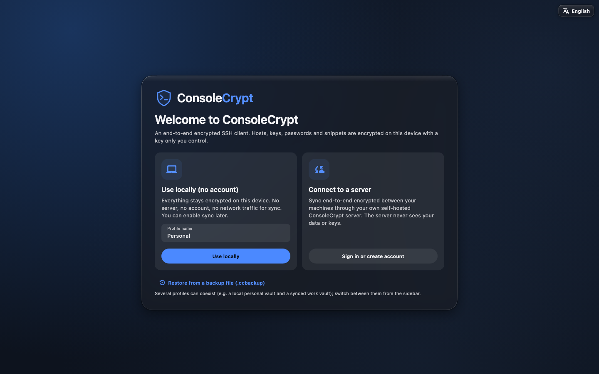

First launch: local use, server connection and restoring a backup.

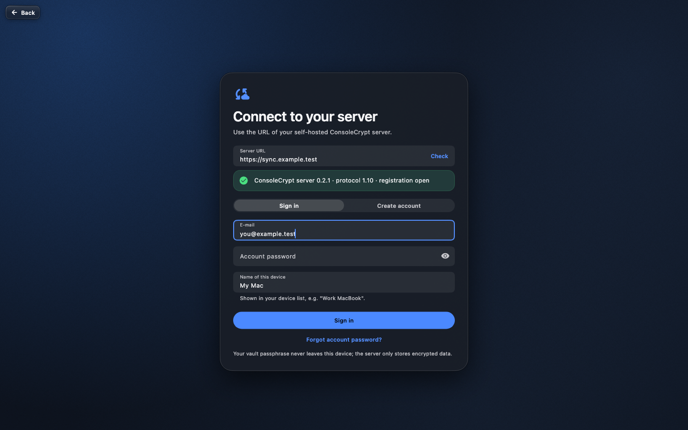

Connecting to your own server: Check shows its version and protocol, then sign in or register with an email and account password.

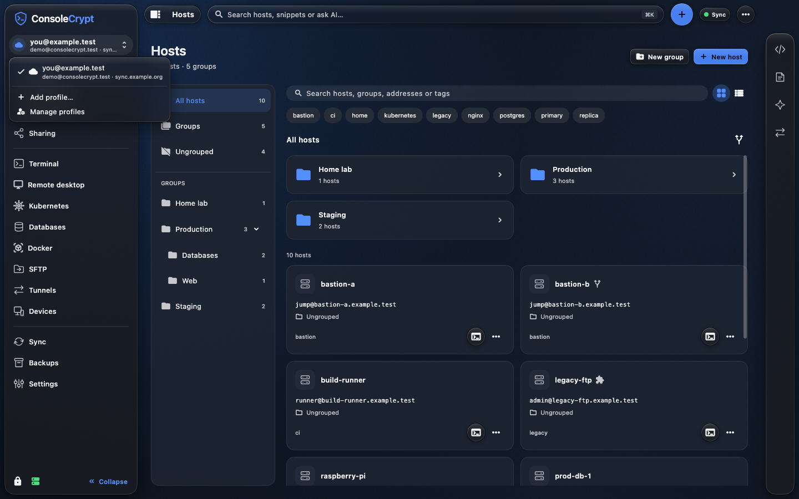

The profile switcher at the top of the sidebar: the active profile, “Add profile…” and “Manage profiles”.

<a name="linux-install"></a>

## 2. Linux installation: DEB, RPM and keyring

The client targets x86-64 (x64) graphical desktops: Ubuntu 22.04, Debian 12 and Fedora 43. Choose the package for your distribution; the package manager checks dependencies.

1. On Downloads, choose DEB for Ubuntu/Debian or RPM for Fedora. Check the supported system versions and architecture in the release notes, then compare the file’s SHA-256 with the published checksum.

2. Open a terminal in the folder containing the downloaded package. Replace consolecrypt.deb or consolecrypt.rpm below with your exact filename; run only the command for your package format.

3. After installation, open ConsoleCrypt from your application menu in your normal desktop session. Do not run the client with sudo: its keys and settings belong to your user.

4. Device keys require a running, unlocked system keyring with Secret Service, such as GNOME Keyring. Create and unlock the default keyring using your desktop tools before starting the client. The keyring password is separate from your ConsoleCrypt account password and vault passphrase.

5. Linux updates are installed manually: download the new DEB or RPM from Downloads and install it in the same way. Before updating, save an encrypted backup and finish important SSH sessions; keep your vault and keyring.

### Ubuntu / Debian — DEB package

The filename is an example. apt installs the local package and available dependencies from your configured repositories.

```text
sudo apt install ./consolecrypt.deb
```

### Fedora — RPM package

The filename is an example. dnf installs the local package and checks dependencies. Keep these checks enabled.

```text
sudo dnf install ./consolecrypt.rpm
```

> **Keep in mind**
>
> If Secret Service is unavailable or the keyring is locked, resolve its state in your desktop settings and retry. The client does not fall back to storing keys in a plain file. Do not delete your keyring to clear an error: doing so can remove this device’s access.

<a name="passwords"></a>

## 3. Which password do I need?

ConsoleCrypt has separate access layers. Resetting your account password by email does not unlock the encrypted vault.

| What | Purpose |
| --- | --- |
| Account password | Signing in to the server and website account; it can be reset by email. |
| Vault passphrase | Decrypting data on your device and confirming dangerous actions (where enabled, also with Touch ID, Windows Hello or a fingerprint). The server does not know it. |
| Recovery Kit | Recovering vault access after losing the passphrase. |
| macOS Keychain password | System permission to access a device key; usually your Mac user account password. |
| SSH password or key | Signing in to a remote host, separate from the sync server. |

1. If macOS asks for access to the login Keychain after a new build, check the application name and use that Keychain’s password. A changed app signature may require renewed permission.

2. After a Mac account password change, the Keychain may still use its previous password. Check it in Keychain Access without deleting ConsoleCrypt keys.

> **Keep in mind**
>
> Do not reset the Keychain just to remove a prompt: doing so may delete device keys. Preserve your Recovery Kit and an encrypted backup first.

<a name="vault"></a>

## 4. Vault, recovery and biometrics

Your vault unlocks on your device. Configure locking and unlocking after creating it.

1. Save the Recovery Kit offline and complete the word check. Its words and QR code grant vault access: do not send them by email, chat or AI.

2. On phones, Recovery Kit words remain whole. The column count follows the screen width and text size, with the QR code below the words. Scroll to save the complete kit.

3. A locked vault opens with its passphrase or, when enabled, Touch ID, Windows Hello or a fingerprint. The same screen offers “Forgot passphrase?”, Sign out, “Delete this profile…” and “Add profile”.

4. “Forgot passphrase?” opens recovery: enter the kit’s 24 words (or its QR-code text) or, on a trusted device with device unlock enabled, choose “This trusted device”. Then set a new passphrase.

5. In “Settings → Vault”, select the auto-lock interval. “Lock now” locks the vault; “Change passphrase…” changes the vault passphrase.

6. A new vault passphrase needs at least 12 characters. Existing vaults still open with their current passphrase; at the next passphrase unlock the key is re-wrapped with stronger Argon2id parameters (at least 64 MiB).

7. Dangerous actions are confirmed with the vault passphrase instead of typing a connection, context or resource name: changing database queries and cell edits, Unlock production, YAML apply, deletion, restart and scaling in Kubernetes. A wrong passphrase runs nothing, the field is cleared after every attempt and Enter confirms.

8. With device unlock on, these actions can be confirmed with Touch ID, Windows Hello or a fingerprint: “Confirm actions with biometrics” in “Settings → Vault” turns on together with it. The confirmation offers a button such as “Confirm with Touch ID” first and “Enter the vault passphrase” as the fallback; if the check is cancelled or fails, the passphrase field appears. A confirmation is single-use and covers only that action and object.

9. The vault passphrase is still always required to change the passphrase, create a new Recovery Kit, turn off device unlock, work with backups, approve devices and change account or organisation security. On Linux, where the key sits in the desktop keyring, biometric confirmation is not offered.

10. Unlocking with this device is off by default. To turn it on, unlock the vault with its passphrase and in “Settings → Vault” enable “Unlock with Touch ID”, “… Windows Hello” or “… fingerprint”. The system asks for confirmation once; set up biometrics in system settings first.

11. What it protects: on Mac and iPhone the unlock key is held by the Secure Enclave, on Windows by Windows Hello, on Android by the Keystore. The system releases it only after your fingerprint, face or device password, so another program cannot get the key without your confirmation. Adding a fingerprint or resetting Windows Hello switches device unlock off: unlock with the vault passphrase and turn it on again.

12. Linux has no such protection: the key sits in the desktop keyring, so unlocking without a passphrase is available to any program running under your user account. It is off by default there and can be turned on only after a warning.

13. Without device unlock, the local vault database opens only with the passphrase or the Recovery Kit. After the update, device unlock stays off until you unlock with the passphrase; the app then offers to turn it on again.

14. The device remembers the fingerprint of its vault key and checks every key it receives against it — on passphrase, Recovery Key or biometric unlock, device approval and enabling sync. If the server sends a different key, the “Different vault key” screen appears: data on the device stays unchanged, sync stops and there is no way to accept the “new” key. Do not enter secrets on that device; choose “Copy diagnostics” and tell the server administrator.

15. If the kit is lost while the vault is still unlocked, create and save a “New Recovery Kit…”. The previous kit will stop working.

> **Keep in mind**
>
> Device unlock is a setting of this device for this vault: it does not sync and does not replace your passphrase and Recovery Kit. The system dialog may offer your device password. Face ID on a physical iPhone still needs separate verification.

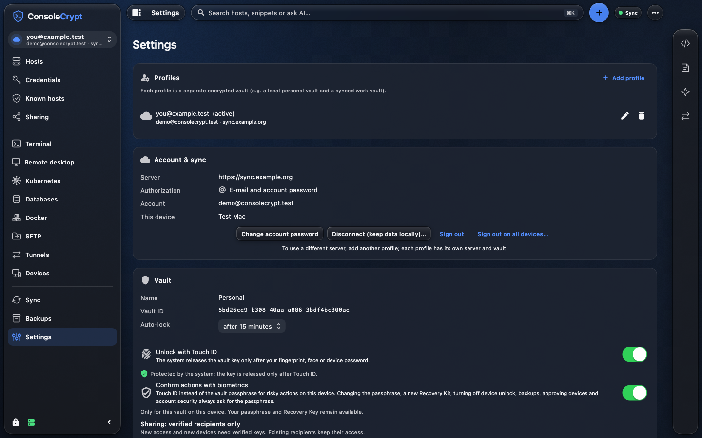

Unlock with Touch ID is on and protected by the system, next to “Confirm actions with biometrics”; no secrets are revealed.

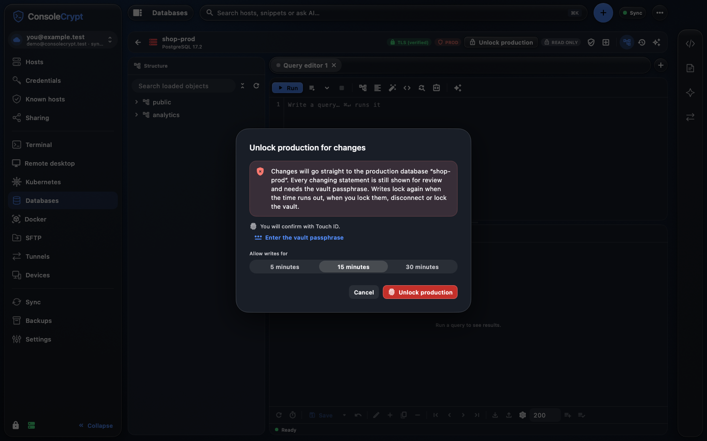

Unlocking production is confirmed with Touch ID; “Enter the vault passphrase” remains the fallback.

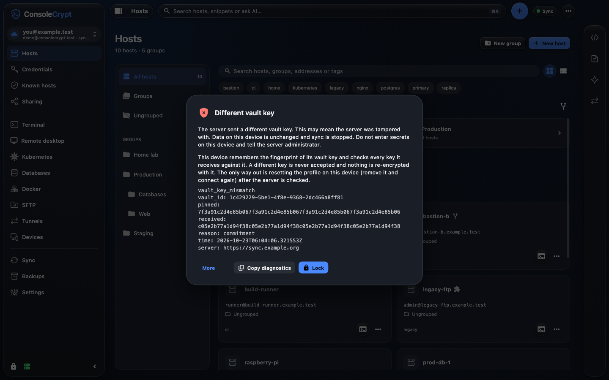

“Different vault key”: sync is stopped, and the only choices are Lock, Copy diagnostics and More; demo values.

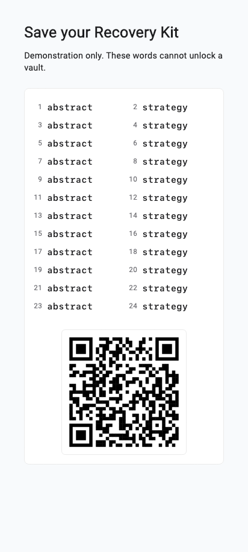

Recovery Kit on a phone: whole words with the QR code below. The illustration contains demonstration data only.

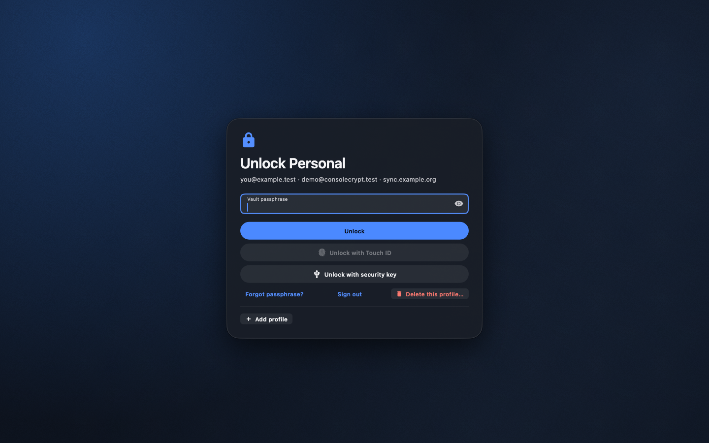

The unlock screen: passphrase, system unlock, “Forgot passphrase?” and profile actions.

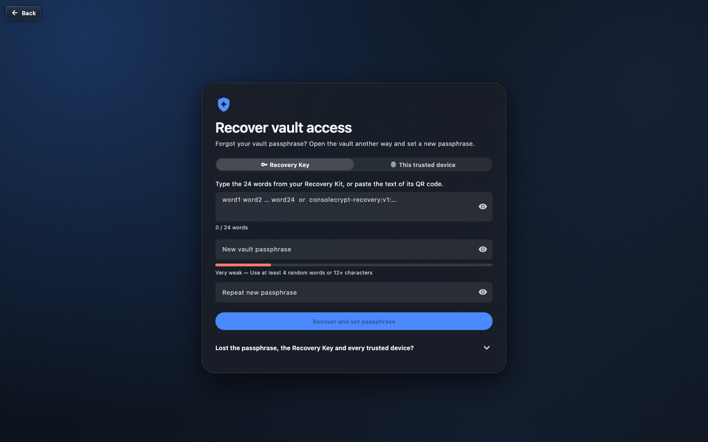

Recovering access: the 24-word Recovery Key or this trusted device, then a new passphrase.

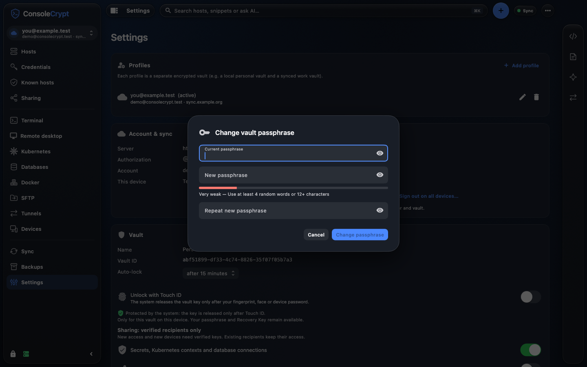

“Change passphrase…” in the vault settings.

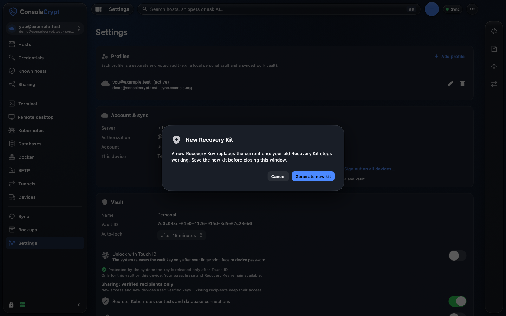

“New Recovery Kit…”: the old kit stops working.

<a name="devices"></a>

## 5. Sync and trusted devices

Signing in and being allowed to decrypt the vault are separate actions. A new device needs approval.

1. On the second device, select the same server and account. When approval is required, open “Devices” on an already trusted device.

2. Select the pending device, choose “Verify and approve” and compare the entire displayed code on both devices through an independent channel.

3. With server 0.2.2 and later, as soon as the request is opened on a trusted device, the new device shows that device’s name and the same pairing code, computed from both devices’ keys. On the new device, tick “The code matches the one on “…”” and choose “Codes match”; without the tick you cannot confirm. The approval signature covers the vault key, and the new device checks it with the key you confirmed.

4. With an older server, approval works as before and the vault key is marked “Vault key not confirmed”. Choose “Confirm with passphrase” in Devices or “Settings → Vault” and enter the vault passphrase once. If another device of the account reports a different key, Devices shows “A device received a different vault key” with a Revoke button.

5. Tick “All 6 groups exactly match…” and choose Approve. If any group differs, choose “Codes don’t match”: the request is rejected and no vault key is handed over.

6. In “Synchronization”, check the connection, pending changes and conflicts. Offline changes remain local and are sent when connectivity returns. The Sync indicator in the top bar shows the same at a glance: last sync, server, queue, “Sync now” and “Details”.

7. “Settings → Account &amp; sync → Disconnect (keep data locally)…” turns the profile into a local one: the data stays on the device and the encrypted copy on the server is unchanged. “Also revoke this device on the server” revokes it at the same time.

8. Revoke a lost device in the client or website account. Reconnecting it requires a new approval.

9. The server may limit sync. When it temporarily limits requests, the indicator and Sync show “The server temporarily limited sync; resuming at HH:MM”: changes stay on the device and go out by themselves. When the server refuses changes because of the vault’s object or storage limit, the “Changes not accepted by the server” card explains why — delete items you no longer need and choose Retry.

10. When you sign in from a new device, the server may answer “Device limit (N) reached — revoke devices you no longer use, then sign in again” or “Too many new devices today. Try again after …”. Colleague lookup, sharing and adding your own devices show how many seconds to wait when requests are limited.

> **Keep in mind**
>
> Revocation ends sessions and future sync, but cannot erase previously read data or change SSH-server passwords. After a compromise, replace the affected passwords and keys on the hosts themselves.

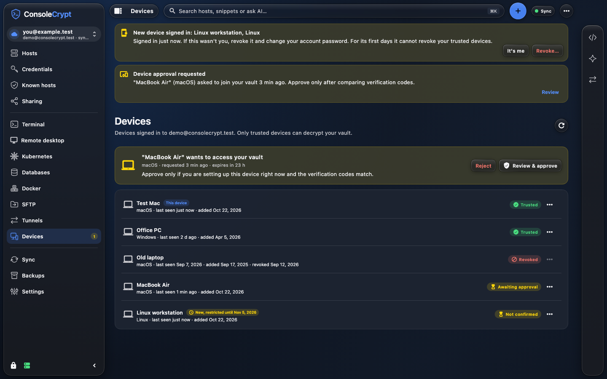

Demo device list; access approval is a separate step.

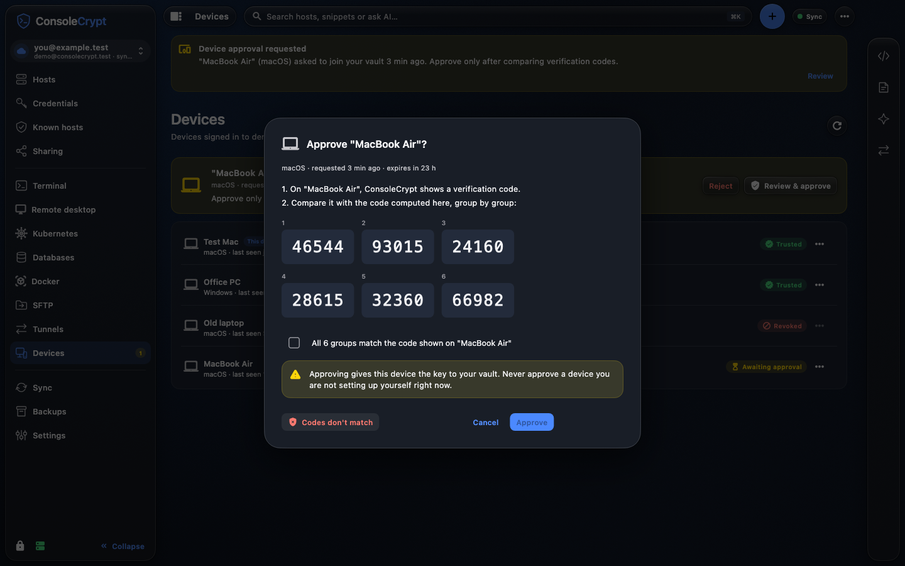

Approving a new device: the 6 code groups are compared with the new device’s screen; demo codes.

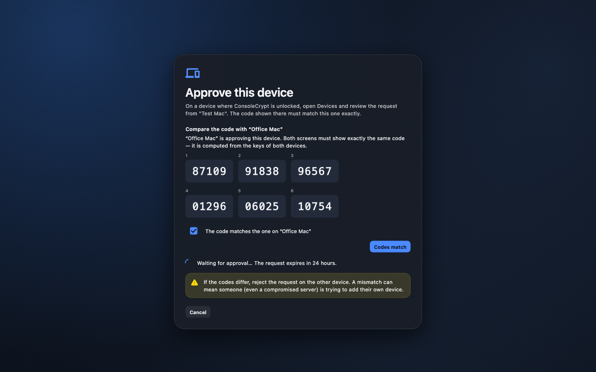

The new device: the pairing code with “Office Mac” and the mandatory match tick; demo codes.

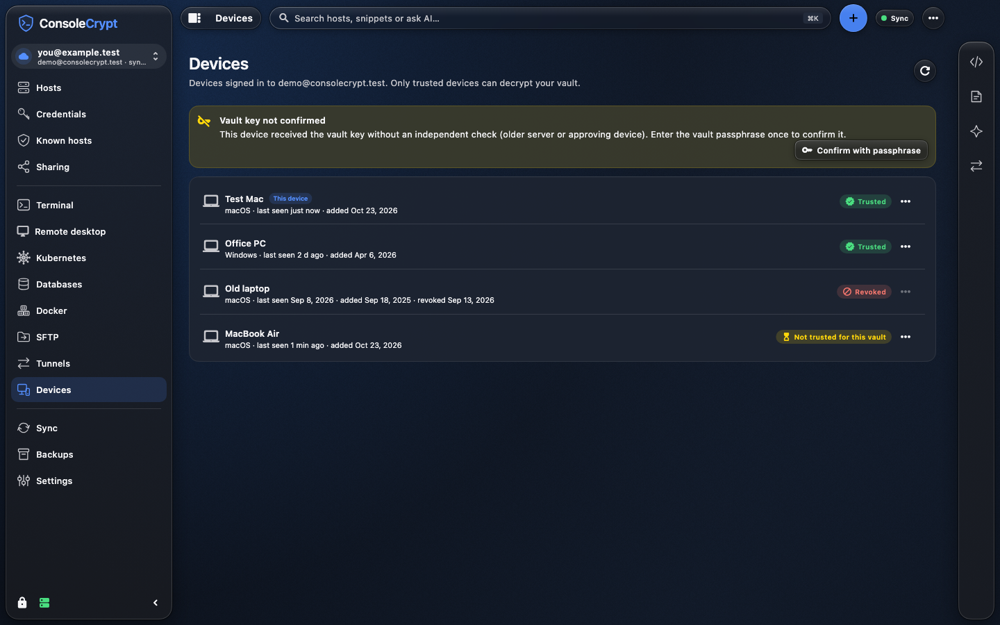

“Vault key not confirmed” in Devices with “Confirm with passphrase”.

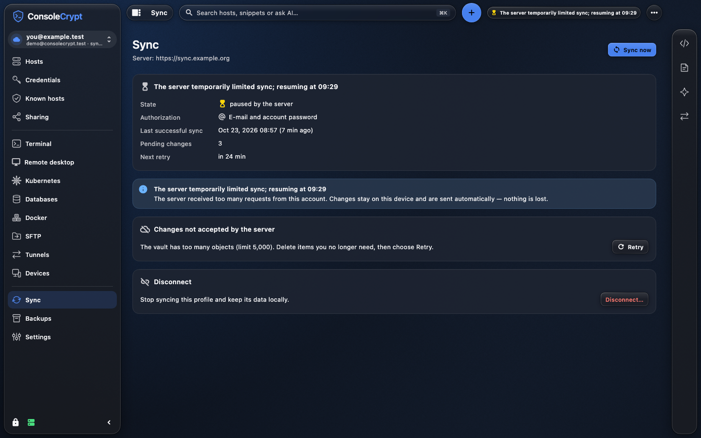

Sync paused by the server until the shown time; changes over the object limit wait for Retry.

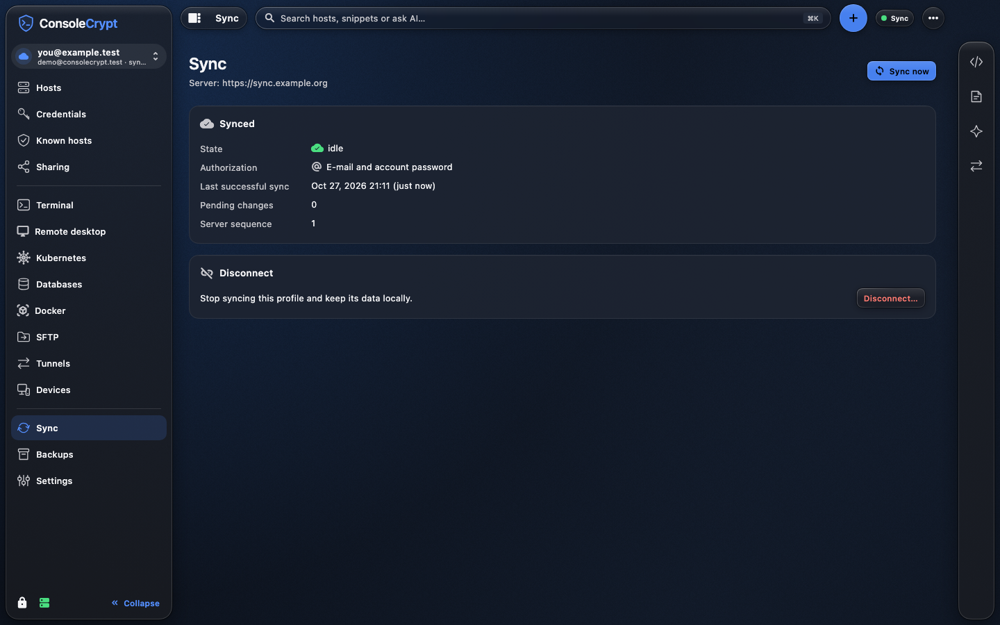

Sync status and queue for the demo profile.

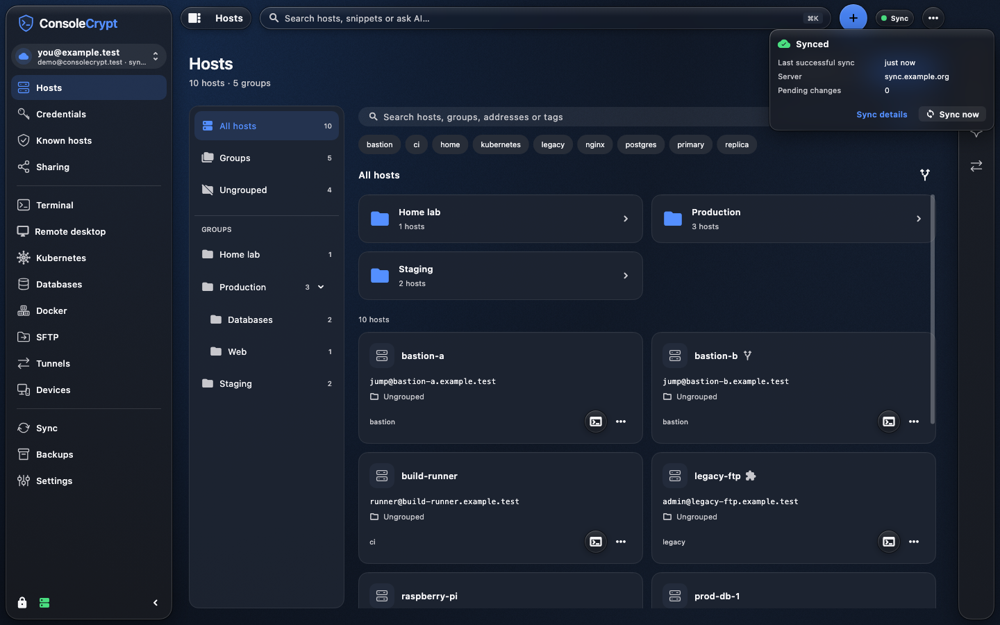

The Sync indicator in the top bar: last sync, server and queue.

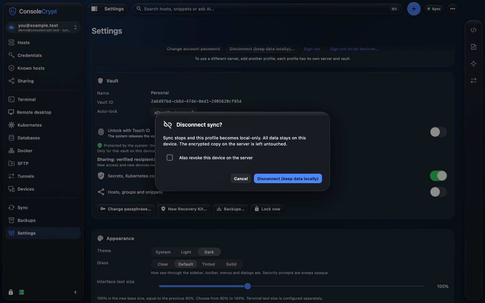

“Disconnect (keep data locally)…” with optional revocation of this device.

<a name="device-protection"></a>

## 6. Protection against sign-ins from new devices

If someone signs in to your account from a new device, you find out right away, and the device is restricted for a while. This protection needs sync server 0.1.16 or later.

1. For every new device, the server sends an email to your account address. The email contains a “This wasn’t me” link.

2. Your trusted devices show a “New device signed in” notice with the device name and system. If it was you, choose “It’s me” to dismiss the notice.

3. In Devices, such a device is marked “Not confirmed” and “New, restricted until …”. For its first 14 days it cannot revoke your trusted devices or end their sessions, and attempts to open the vault from new devices are rate-limited.

4. If it was not you, revoke the device: “Revoke…” in the notice, the device menu in Devices or the “This wasn’t me” link in the email, which opens your website account. Then change your account password: whoever signed in knows it.

5. “Settings → Account &amp; sync → Sign out on all devices…” ends every session of the account, including this one. Devices sign in again with the account password; their local data is kept.

> **Keep in mind**
>
> Signing in does not open the vault by itself: a new device still needs approval with a code check on a trusted device. Signing out everywhere or changing the password from a new device leaves trusted devices untouched during its first days.


The new sign-in notice and a new device marked “Not confirmed” and “New, restricted until …”; all devices are demo devices.

<a name="enterprise-sign-in"></a>

## 7. Corporate sign-in: SSO and Active Directory

Sync server 0.2.0 and later can admit accounts only through your organisation’s authorization server. Client 0.9.0 detects the server’s mode and shows the matching form. Only the account sign-in changes: your vault passphrase still opens the vault.

1. Choose “Connect to a server”, enter the HTTPS address from your administrator and press Check. A corporate server shows a “Corporate sign-in” block naming the authorization server; registration, the account password and “Forgot password” are not offered in this mode.

2. SSO (OIDC): optionally enter your e-mail and press “Sign in with …”. Your organisation’s sign-in page opens in the system browser and returns you to the app afterwards. While signing in, the app shows a waiting state with Cancel.

3. Active Directory: enter your login (e-mail, UPN or DOMAIN\\user) and domain password. The password goes to the server once over TLS, is never stored and is cleared from the field after every attempt.

4. A new user creates a vault after the first sign-in as usual. A known device opens the vault with the vault passphrase; a new device is approved with a code check, the Recovery Key or the vault passphrase.

5. The app remembers the sign-in method and login (never the password) for every server: next time they are prefilled, and the hint “Last time you signed in with …” offers Forget. Settings, Sync and Devices show the corporate server and when this device signed in under “Authorization”.

6. If your organisation disables your account, the app shows “Access disabled by the administrator” and locks the profile. Data on the device stays encrypted; you can delete the profile from the device or sign in again once access is restored.

[Account, sync and corporate sign-in ↗](../docs/public/SYNC_ACCOUNT.md)

> **Keep in mind**
>
> Your organisation’s password does not open the vault, and neither the authorization server nor the sync server receives vault keys. Sign-in errors — domain not allowed, group missing, second factor required, identity already linked to another account, sign-in service unavailable — are explained in plain words; contact your administrator about them.

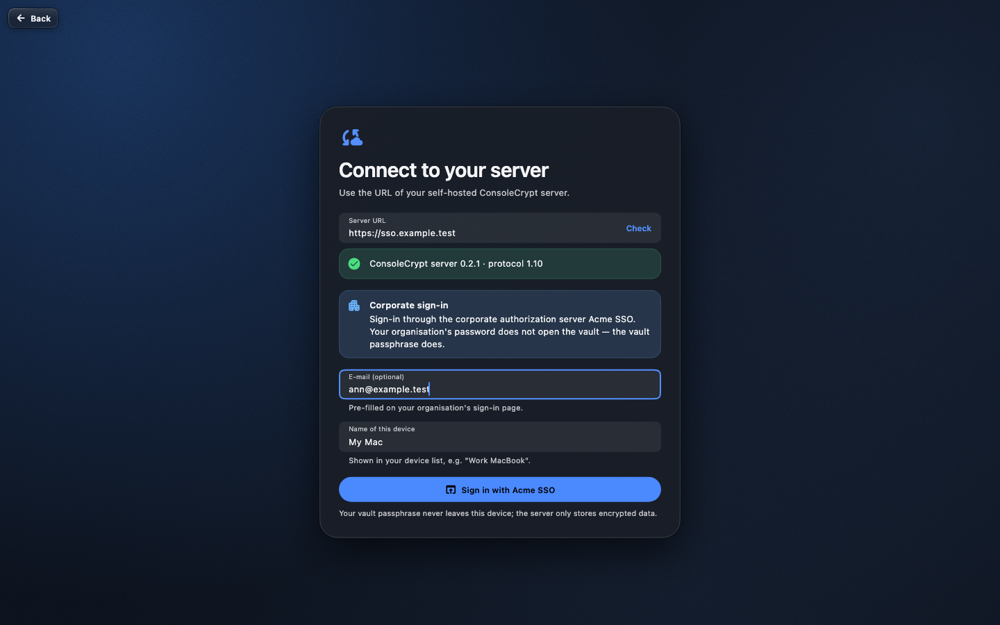

A server with SSO sign-in: the “Corporate sign-in” block, an optional e-mail and the “Sign in with Acme SSO” button; the server is a demo one.

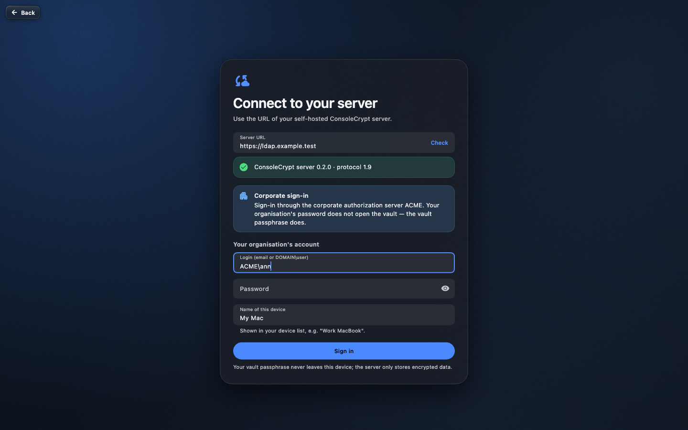

Active Directory sign-in: the domain login and the organisation’s password.

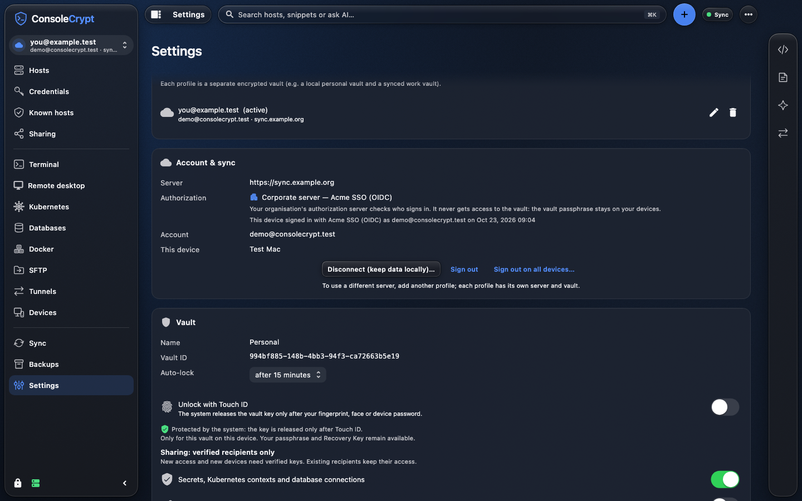

Settings: the Authorization row names the corporate server and shows when this device signed in.

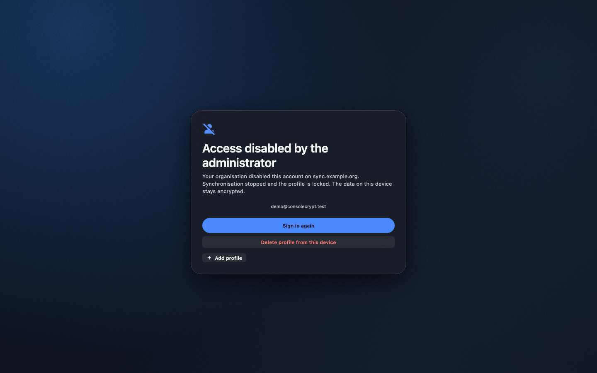

The account was disabled by the organisation: the profile is locked and the data stays encrypted.

<a name="hosts"></a>

## 8. Hosts: add, find and connect

A host stores SSH or RDP connection settings. Cards and list rows show its address, user and group.

1. Open “Hosts → New host” and first choose SSH or RDP. Enter a name, address, port, username and credential. SSH supports group defaults and jump hosts; RDP uses a password, an optional Windows domain and port 3389 by default.

2. On desktop, click Import in the new SSH-host form. It reads ~/.ssh/known\_hosts and /etc/ssh/ssh\_known\_hosts on Linux/macOS, or %USERPROFILE%\\\\.ssh\\\\known\_hosts on Windows. Review and select addresses; existing connections are excluded. Supply usernames and credentials separately.

3. Import creates connections without importing key trust. Hashed names, patterns, revoked keys and CA records are skipped. Verify the server key normally when first connecting.

4. “From ~/.ssh/config”, next to Import, reads your OpenSSH configuration (including Include files). Each Host entry becomes a host with its address, port and user; wildcard blocks such as Host \* apply as defaults. ProxyJump hosts are imported with the chosen host, and IdentityFile keys can be added to the vault at once — an encrypted key keeps its passphrase. ProxyCommand is not supported.

5. Search names, addresses, groups and tags. The grid/list toggle changes the view; opening a group card shows its contents.

6. Click the centre of a host card or its connect icon. A terminal or remote desktop tab opens according to the connection type.

7. The “…” menu offers connection, SFTP, editing, deletion and adding to an existing group. “Share…” appears when the server supports it, “Copy to team…” and “Move to team…” when you have teams (see Teams).

8. The host form is made of cards. Authentication: a password (saved in the vault or entered at connect time), an SSH key (pick, generate or import it right here), an agent (the system SSH agent or a socket path) or “Inherit from group”. “Choose credential…” assigns a saved one.

9. Security: the host-key policy — Ask (confirm unknown keys), Strict (only keys from known hosts) or Accept new (save unknown keys automatically); a changed key always blocks the connection. It also holds the SSH implementation (“Built-in (russh)” or “System OpenSSH (compatibility)” for old servers), the keepalive interval and “Agent forwarding” — enable it only for hosts you trust.

10. Organisation holds tags and free-text notes. At the bottom, “Effective settings” show what a connection will actually use — group, user, port, credential and route — and where each value comes from; problems such as a deleted jump host appear there too.

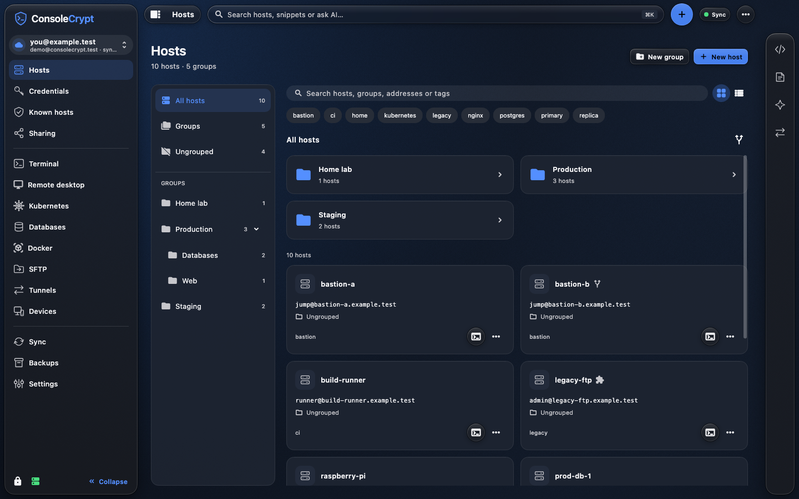

An overview of demo hosts and their connection details.

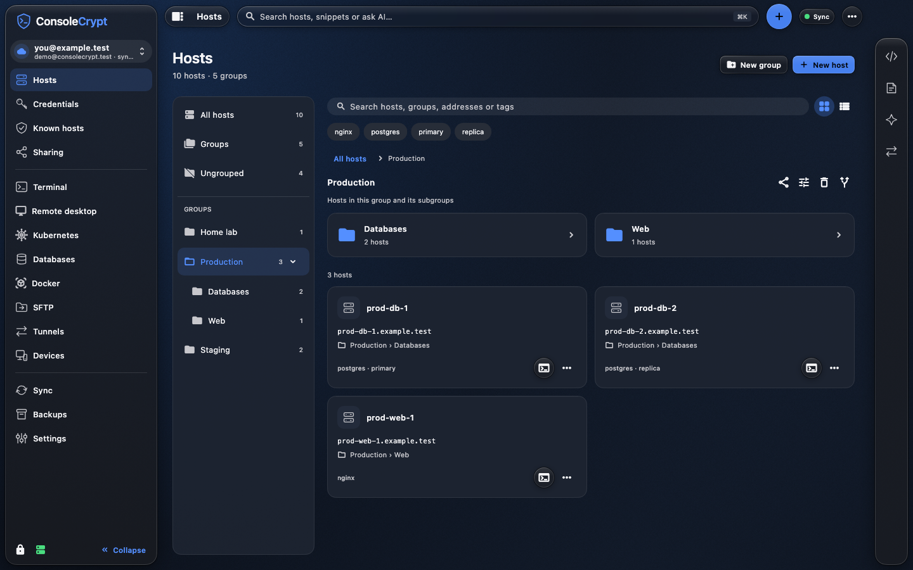

Hosts in a demo group: cards, search and connection actions.

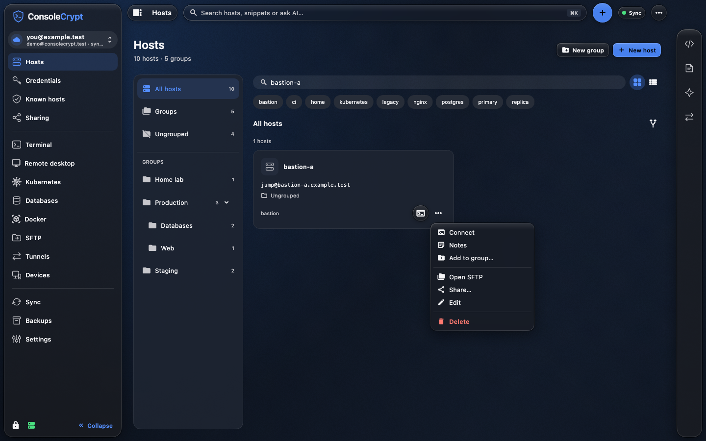

The selected host’s action menu: connect, notes, group, SFTP, sharing and edit.

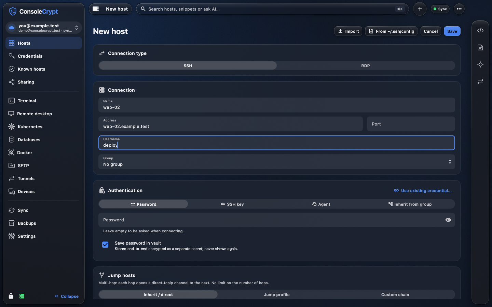

A new SSH host: connection type, address, user, group and authentication.

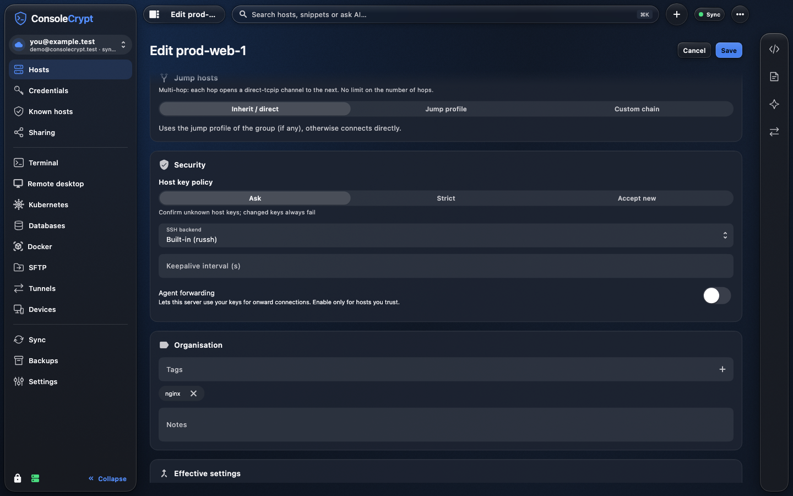

The Security card: host-key policy, SSH implementation, keepalive and agent forwarding.

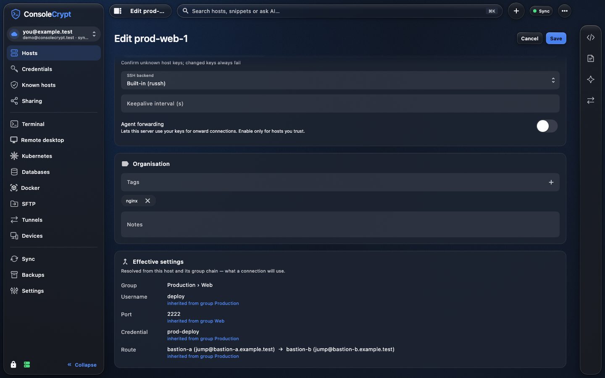

“Effective settings”: what a connection will use and where it comes from.

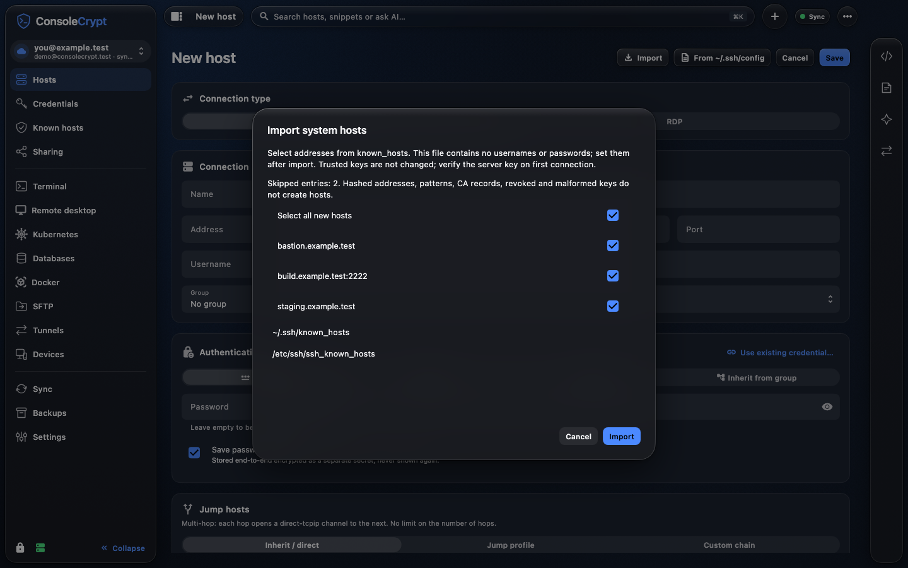

Importing addresses from a demo known\_hosts: select before saving.

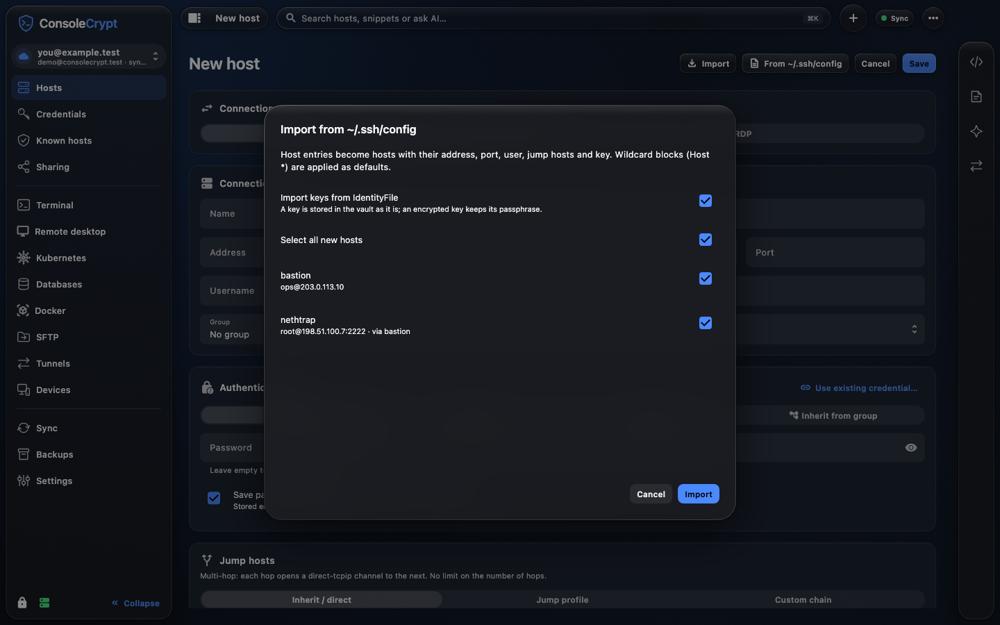

Importing from ~/.ssh/config: Host entries with documentation-range addresses.

<a name="rdp"></a>

## 9. RDP: Windows remote desktop

ConsoleCrypt now supports RDP connections. It connects directly to a standard Microsoft RDP server; no IronRDP add-on needs to be installed on Windows.

1. In “Hosts”, create an RDP connection. Enter the address, Windows username, password and optional domain. Save the password in the encrypted vault or enter it for each connection. SSH group defaults do not apply to RDP.

2. Before connecting, review the address, account and certificate fingerprint. Compare the fingerprint with the server administrator. Changed host details require a fresh confirmation.

3. Under “Remote desktop”, use the central connection button or the “+” beside the tabs to choose a saved RDP host. Open desktops appear in the tab strip. Switch between them, open new sessions and close sessions you no longer need. Up to four RDP sessions can run at once.

4. Click “Full screen” to use the entire screen. Reveal the top connection bar by moving to the blue indicator at the top edge or pressing Ctrl+Alt+Home. Pin the bar if needed. It lets you switch sessions, manage permissions, minimize the window, restore its previous size or disconnect the current session. Escape is sent to the remote computer.

5. Enable text clipboard access for the selected session. Ctrl+V (⌘V on macOS) in the active desktop now sends and pastes local text into Windows without first clicking “Send”. With sharing disabled, Ctrl+V uses the remote Windows clipboard only.

6. “Send” offers text without pasting, while “Receive” requests text from Windows. Changing the local clipboard alone does not send anything. Text up to 64 KiB is supported; images and files are not transferred through the clipboard.

7. On macOS, Windows and Linux, select one local folder in session permissions. Wait for “Folder connected”, then open ConsoleCrypt under redirected drives in Windows File Explorer. Access is read-only by default; enable writing separately. Other local folders and drives are not shared.

8. If the folder is unavailable, check the Windows server drive-redirection policy. The desktop remains usable independently of folder access. Replacing the folder interrupts operations on previously opened files.

9. File exchange supports files up to 256 MiB and up to 512 MiB of attempted writes per session. Reconnect after reaching the limit. Symbolic links, original timestamps and file locks are not transferred.

10. Turn off folder or clipboard access in the session panel when finished. Locking the vault or signing out closes connections and revokes temporary permissions.

> **Keep in mind**
>
> Before creating RDP hosts, update every workspace device to version 0.3 or later. Older clients cannot see RDP hosts but can change their related credentials and groups. RDP hosts sync between your devices running a current client. Sharing RDP hosts with colleagues is not available yet. Folder redirection is unavailable on mobile. Clipboard and drive availability also depends on Windows server policy.

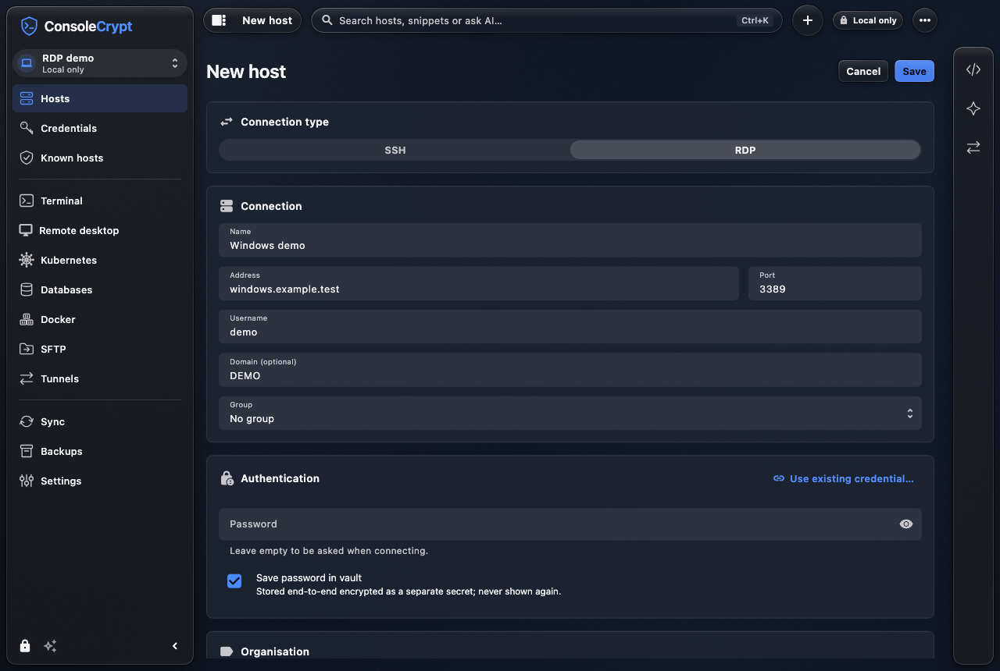

Creating an RDP host: Windows-specific fields and saving its password in the vault. Demo data.

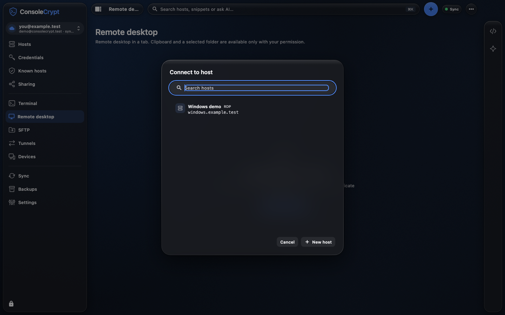

Choosing a saved RDP host from Remote desktop.

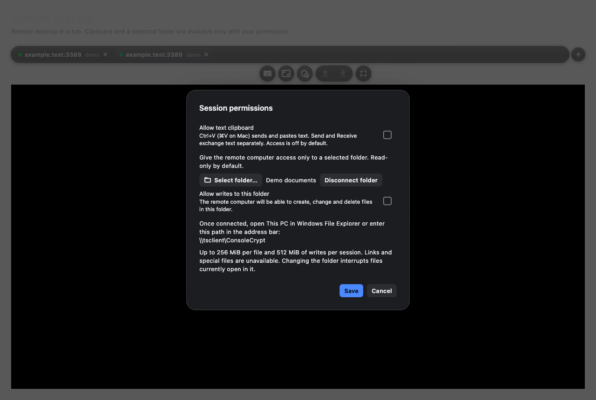

Demo session permissions: text clipboard and a selected folder with a separate write permission. The Windows desktop is not shown.


Full-screen connection bar: session switching, permissions and window controls. Demo data.

<a name="rdp-mobile"></a>

## 10. RDP on a phone: touchpad and keyboard

On a phone, the connected desktop automatically opens fullscreen. Touchpad is the default: your finger moves the pointer relative to its current position. One floating button opens the session controls.

| Touchpad gesture | Action |
| --- | --- |
| Move one finger | Move the pointer; lift and reposition your finger as needed. |
| Short tap | Left-click at the current pointer position. |
| Two quick taps | Double left-click. |
| Double-tap and hold the second tap, or hold for about 500 ms | Start dragging; lifting the finger releases the mouse button. |
| Two-finger tap | Right-click. |
| Move two fingers together | Scroll without moving the pointer. |
| Pinch | Zoom 1–4×; the view follows the pointer near an edge. |
| Two-finger double tap | Fit the desktop to the screen. |
| Three-finger tap | Show or hide the keyboard. |

1. Tap the floating button at the edge. A grid of tiles opens with the keyboard, touchpad or direct touch, extra keys, clipboard, sessions, orientation and minimize. Drag the button to a convenient edge; its position is remembered separately for both orientations.

2. In Direct touch mode, a tap acts under your finger. The selected mode for a host is remembered only on this device. An attached mouse works normally.

3. The keyboard overlays the desktop without shrinking it. An extra-key strip appears above it; a separate sheet provides F1–F12, arrows and shortcuts. Tap Ctrl, Alt, Win or Shift once for the next key, twice to lock the modifier, then again to release it.

4. If the keyboard is still composing a word, finish that input first. Extra keys do not send commands during composition. Switching sessions, going into the background and locking release held keys and mouse buttons.

5. Mobile RDP settings provide pointer speed and acceleration, cursor size, clarity, Windows scale, orientation and button hiding. Resolution follows the screen when the RDP server supports resizing; otherwise the session keeps its existing resolution.

6. On Android, Back first hides the keyboard. It then opens the controls; another press within two seconds minimizes without disconnecting. Switch among up to four sessions. Disconnect asks for confirmation.

> **Keep in mind**
>
> Tablets enter fullscreen manually, and automatic mode selects direct touch. With a screen reader enabled, direct touch is used and the button stays visible. Phone folder redirection is unavailable. The earlier iOS 0.5.6 preview is available for Simulator on Mac; iOS 0.6.3 is deferred. Screenshots use real widgets with a drawn, synthetic Windows desktop; the empty area is reserved for the system keyboard.

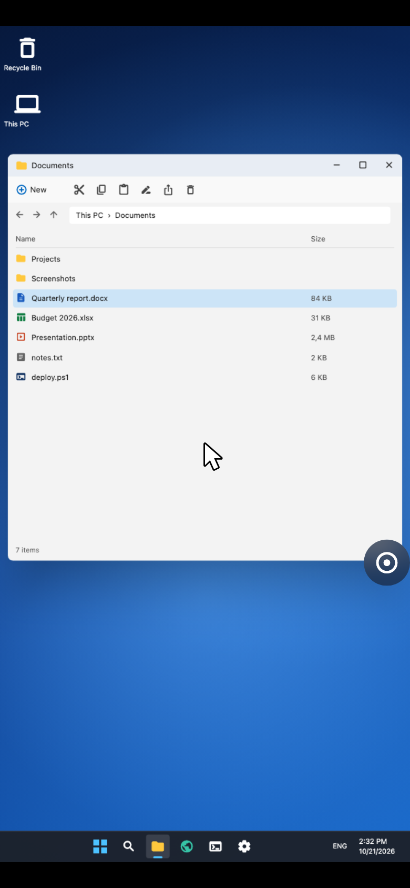

Desktop and floating button, with permanent panels hidden.

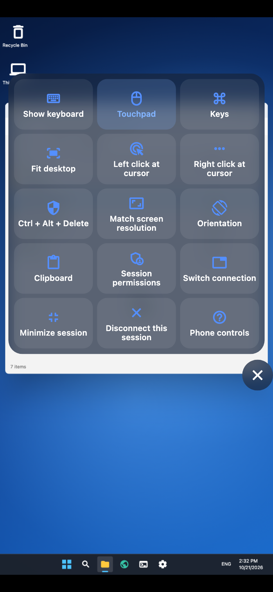

Session controls in portrait orientation.

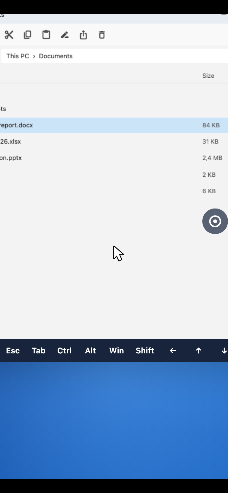

Extra-key strip above the reserved system-keyboard area.

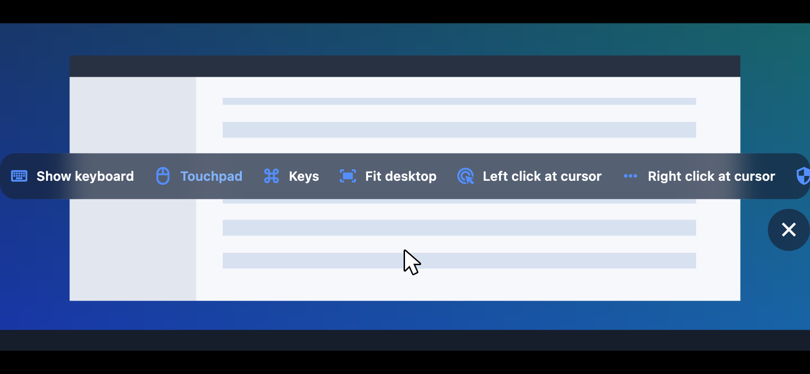

Landscape orientation and session controls.

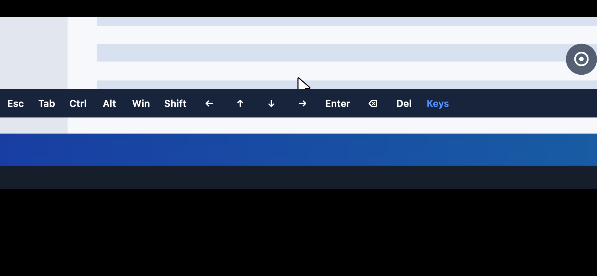

Keys in landscape orientation; the desktop size stays stable.

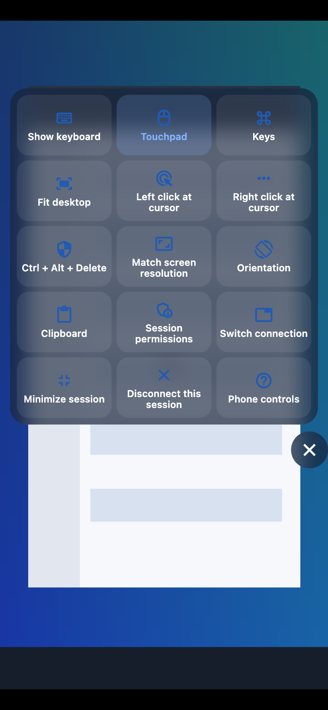

The same controls in the light theme.

<a name="quick-connect"></a>

## 11. Quick search and connect

Find a saved host from anywhere in the app and open an SSH or RDP session. The command palette brings together hosts, snippets and quick actions.

1. In the top bar, the round “+” button opens your saved SSH and RDP hosts. Find a host by name or address and select it to connect. If it is not saved yet, click “New host”. Search fills the available space between the section title and the “+” button; the compact “Sync” status appears on the right.

2. Press ⌘K on macOS or Ctrl+K on Windows/Linux. Type a host name or IP address; search also matches the address and username shown in its connection label.

3. Look in the Hosts group. The connection details appear below each name: check the address, username and port before choosing.

4. Choose a result with ↑ and ↓, then press Enter or click its row. The app opens an SSH terminal or RDP session according to the host type. On the first connection, verify the SSH host key or RDP certificate.

5. Esc closes the palette. If a host is not found, add it in Hosts and search again.

> **Keep in mind**
>
> Saved-host search runs locally. If the entered name or IP address is not found, Enter does not send an AI request. To use AI, explicitly click its row or select it with the arrow keys and confirm. Typing an address does not create a new host.

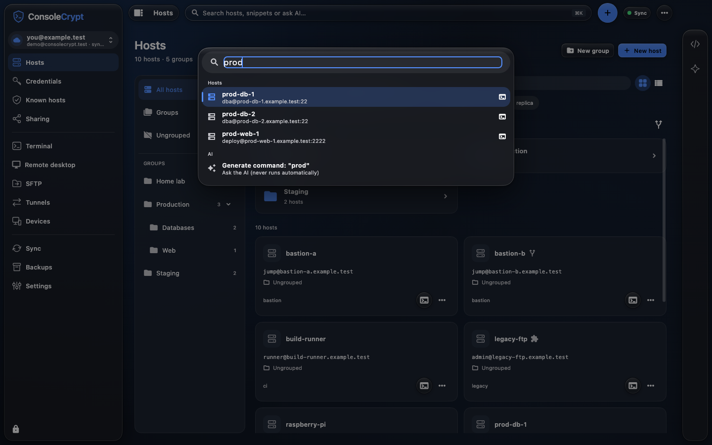

Local search for saved hosts in the command palette.

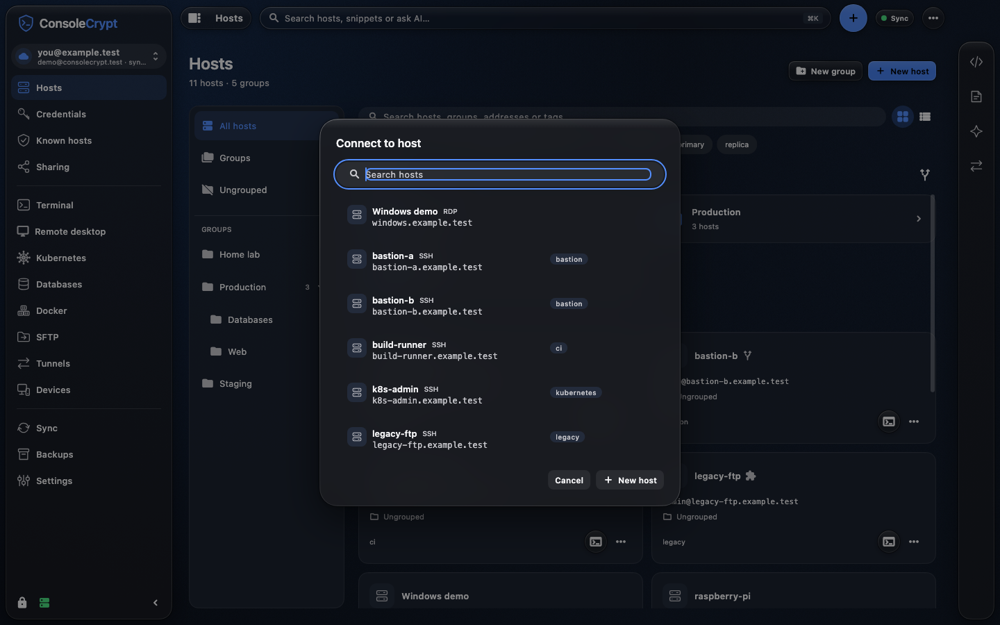

The global “+”: choosing saved SSH and RDP hosts.

<a name="groups"></a>

## 12. Groups and jump hosts

Groups organize your inventory and provide common settings. A jump-host chain reaches an SSH host through intermediate machines.

1. Open “Hosts” in the left menu and click “New group”. Hosts and groups share one inventory; use nested groups for environments and projects.

2. Set a group’s common username, port, credential and jump-host profile. A value set directly on a host overrides inheritance.

3. Create a jump-host profile and choose existing hosts in the required order. Assign the profile to a group or individual host.

4. In the host form’s Jump hosts card choose “Inherit / direct” (the group’s profile, if any), “Jump profile” or “Custom chain”. A custom chain is built from existing hosts with the add-hop button; there is no limit on hops, and the resulting route is shown below the chain.

5. Before moving or deleting a group, check the resulting inherited settings: changing its parent can change the connection.

> **Keep in mind**
>
> The client establishes SSH connections directly, including jump hosts. The sync server never relays SSH traffic. A private group and a shared collection are different objects; shared collections are explained below.

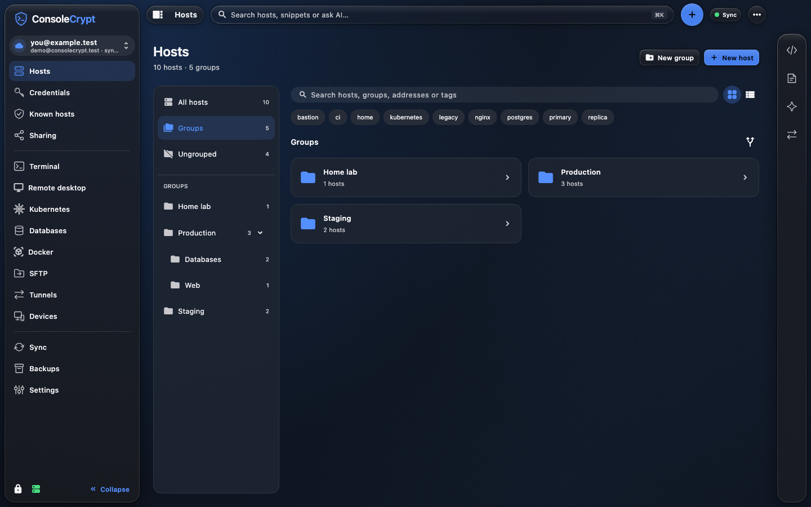

Demo group inventory and workspace navigation.

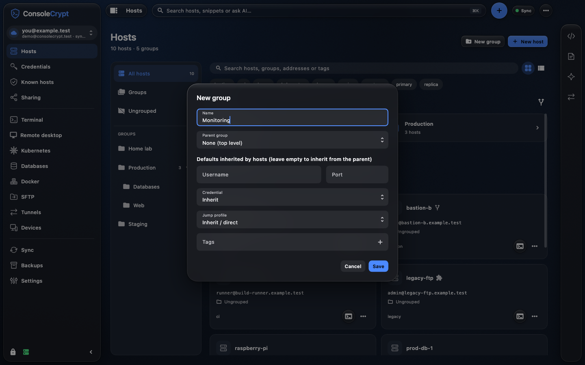

A new group: its name, parent and defaults for its hosts.

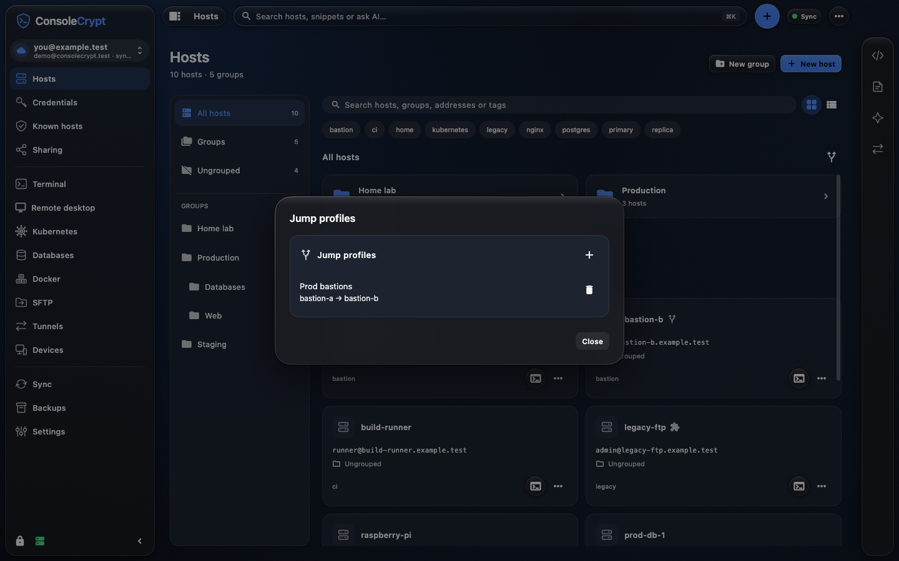

Jump profiles: named chains of intermediate hosts.

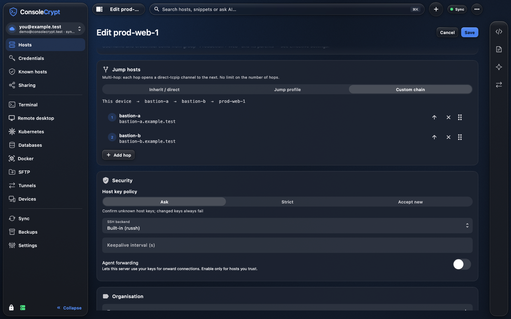

A custom chain of two jump hosts and the resulting route to the host.

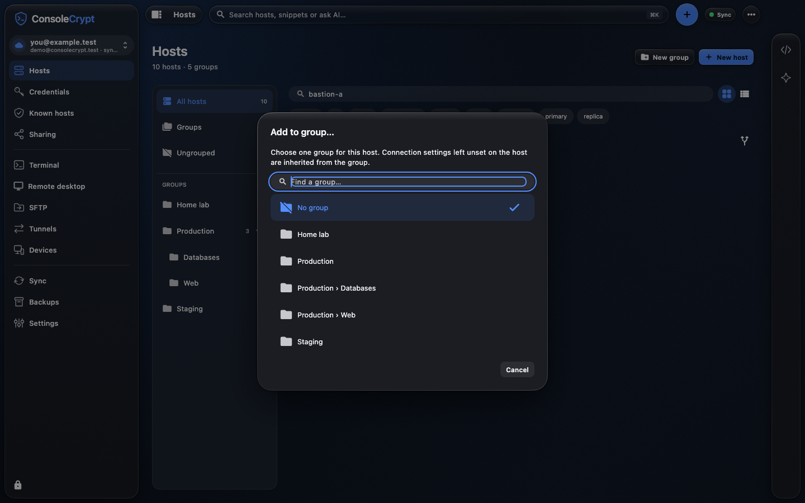

Adding a demo host to an existing group.

<a name="credentials"></a>

## 13. Passwords, keys and credentials

Credentials are separate from hosts: one credential can be assigned to multiple connections.

1. In “Credentials → New credential”, choose a type: a password, a new SSH key, an imported key, an SSH certificate (a private key plus its OpenSSH certificate) or an SSH agent — the system one or an external agent by socket or pipe path.

2. A new key is generated on the device as Ed25519, RSA 3072 or RSA 4096; the private part goes straight into the vault and the public key is shown for authorized\_keys. FIDO2 keys cannot be created yet.

3. Use a descriptive name. Assign the credential to a host or group; enter a key passphrase separately when required.

4. Open its card for metadata and the public key. A secret is revealed only after an explicit action; handle clipboard copies carefully.

5. A copied secret stays out of clipboard history and other devices and is cleared after the timeout in “Settings → Security” if the clipboard has not been replaced with another value. Changing the setting affects future copies; if the app closed before the deadline, the clear completes at the next start. See “Screenshots, screen protection and clipboard” for details.

> **Keep in mind**
>
> Do not put a password or private key into a host name, note or snippet. Use the separate protected sharing workflow to share a secret with a colleague, rather than AI chat.

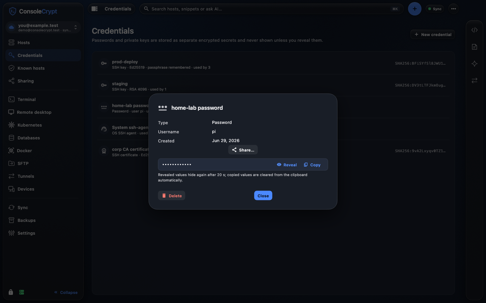

Credentials in a demo vault; values are masked.

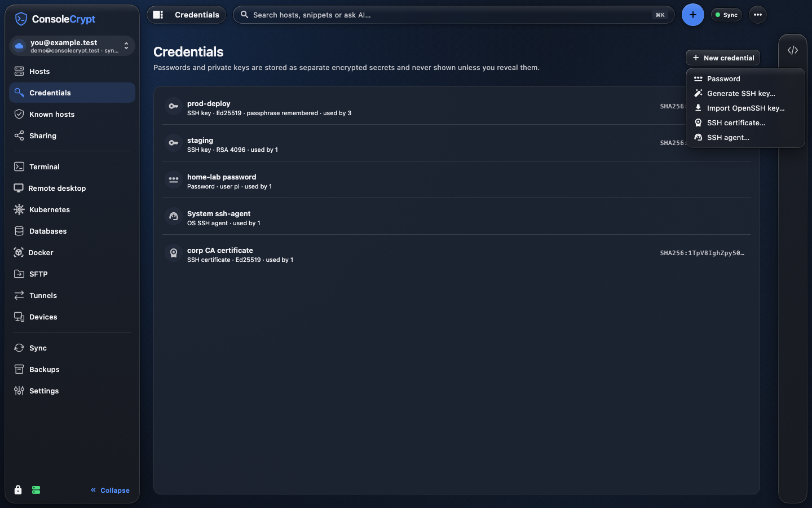

Choosing the type of a new credential.

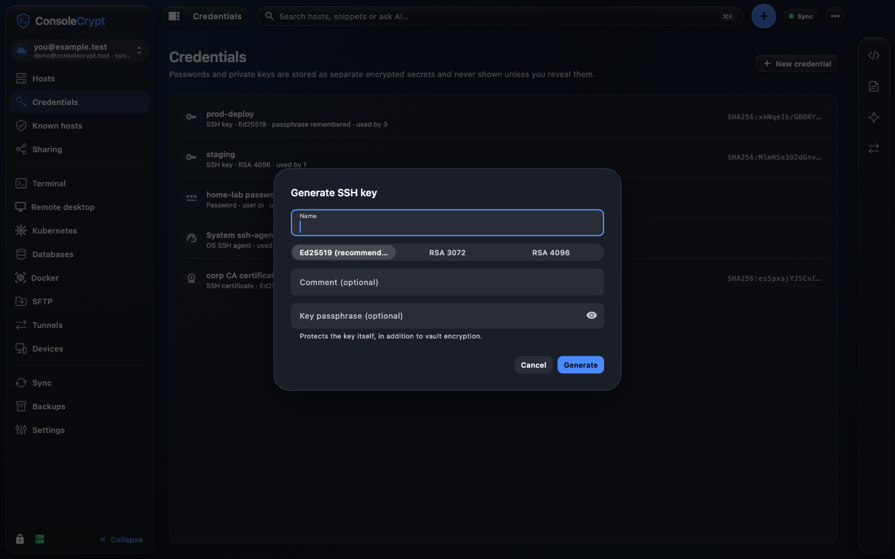

Generating an SSH key: name and algorithm.

<a name="host-keys"></a>

## 14. Known hosts and SSH-key verification

A server key identifies the SSH host you are connecting to. This is separate from trusting a ConsoleCrypt device.

1. On first connection, compare the key fingerprint with the administrator or another trusted source before accepting it.

2. Saved keys appear in the separate “Known hosts” sidebar section. Check the address, algorithm and fingerprint.

3. If the key changes, connection is blocked. Establish the reason first; remove the old entry only after independently verifying the new key.


A separate known-host list with demo fingerprints.

<a name="terminal"></a>

## 15. Terminal, tabs and selection

Each tab is one terminal session: SSH, plus local shells on macOS and Windows. Phones have a special-key bar; computers have shortcuts and a context menu.

1. Click inside the terminal to type. The “+” button opens another connection. When tabs overflow, scroll the strip with the mouse wheel or its edge arrows. The total number of open tabs appears in parentheses beside the arrows.

2. To select several screens of output, hold the mouse button and scroll the history with the wheel. Move the pointer beyond the terminal’s top or bottom edge to scroll automatically while extending the selection.

3. Select text and right-click for the menu. It offers Copy, Paste, Select all, Ask AI and saving the selection as a snippet. Shift+F10 opens it from the keyboard.

4. On a phone, use the keyboard icon and “…” below the terminal. Esc, Tab, Ctrl+C, Ctrl+D, Ctrl+L and arrows are also available in the scrollable bar.

5. Multiline paste and control characters require review. Check the target and text before confirming; execution remains your action.

6. Right-click a tab to rename, duplicate, close it, close others or close tabs to the right. A background tab with new output is highlighted, and the sidebar shows a separate count of such tabs next to the tab count. Settings → Terminal sets the font (from installed monospace fonts) and the tab subtitle: the list name, the address or computer name, or nothing.

7. After a disconnect, use reconnect in the tab’s banner. The output buffer stays until the tab closes; closing ends that session.

> **Keep in mind**
>
> Open a new SSH session after updating. Built-in SSH requests UTF-8 for entering and deleting Cyrillic text. If characters are still corrupted, check the remote host’s UTF-8 locale: its shell and SSH-server settings can override the client’s request.


Context menu over a selection in the demo terminal.


The tab menu on right-click: rename, duplicate and close.


“Settings → Terminal”: font, size, colour scheme and tab subtitle.


Text selected in the middle of the demo terminal’s scrollback history.


Eight open demo tabs: strip navigation and the tab count.


Demo Android terminal with its special-key bar.

<a name="local-terminals"></a>

## 16. Local terminals: zsh, PowerShell and WSL

On macOS and Windows you can open a shell on this computer alongside SSH tabs. It runs as your ordinary OS user and does not require a sync server.

1. In the Cmd+K / Ctrl+K palette, choose New local terminal. macOS opens zsh immediately; Windows offers PowerShell, cmd and individual WSL distributions.

2. Open Terminal and use its new-tab button, Cmd+T on macOS or Ctrl+T on Windows. Under Local shells choose zsh, Windows PowerShell, Command Prompt or installed PowerShell 7. The app’s global “+” still opens the SSH/RDP host picker.

3. Each installed WSL distribution appears separately. Choose Ubuntu, Debian or another available distribution; you can open several tabs for one shell. The client does not install WSL itself.

4. Check the This computer label and WSL distribution name when switching between local and SSH tabs. Input, resizing, Ctrl+C and interactive programs use a real PTY/ConPTY. SFTP is an SSH-host action and is absent from the local tab.

5. AI receives the active shell dialect and only explicitly selected context. AI commands and snippets can be inserted into a local tab without Enter; automatic execution is disabled. Review the text and press Enter yourself if you want to run it.

6. Closing a tab ends its process. Restart shell starts a new session. Vault lock, profile switch and quit close the shell and its current foreground process group. Detached/background processes such as nohup are not searched for, and the entire WSL distribution is not stopped.

> **Keep in mind**
>
> Local shells in 0.5 support macOS and Windows. The macOS package runs without App Sandbox and reuses existing storage in place; keep the 0.4.1 container, models, vault and Keychain. Conflicting or unreadable storage stops startup before creating a new profile. The screenshots below use widgets with synthetic profiles, not a native WSL run.


New local terminal in the command palette.


Choosing local zsh and SSH hosts: real interface with demo profiles.


SSH and local zsh side by side. Terminal text is synthetic; no user commands ran.


Windows-style picker for PowerShell, cmd and two WSL distributions in a macOS-hosted widget test. No shells ran.

<a name="shortcuts"></a>

## 17. Keyboard shortcuts

The main modifier is ⌘ on macOS and Ctrl on Windows/Linux. Copy on Windows does not use Ctrl+C, which interrupts a command. App shortcuts can be remapped in Settings → Keyboard shortcuts: choose Change and press a new combination with ⌘/Ctrl or Alt. If another command has it, that command loses it; if the system or terminal uses it, you are warned. Restore defaults brings back the table below.

| Action | macOS | Windows / Linux |
| --- | --- | --- |
| Find a host, snippet or action | ⌘K | Ctrl+K |
| New SSH tab | ⌘T | Ctrl+T |
| Close active tab | ⌘W | Ctrl+W |
| New host | ⌘N | Ctrl+N |
| Lock vault | ⌘L | Ctrl+L |
| Settings | ⌘, | Ctrl+, |
| Snippets | ⌘. | Ctrl+. |
| Copy in terminal | ⌘C | Ctrl+Shift+C |
| Paste in terminal | ⌘V | Ctrl+V; also Shift+Insert on Windows |

> **Keep in mind**
>
> Application shortcuts take priority over terminal input. To send Ctrl+L to the remote shell on a phone, use its special-key button.


“Settings → Keyboard shortcuts”: every action can be remapped or restored to its default.

<a name="sftp"></a>

## 18. SFTP: transfers and file preview

Open SFTP from a host’s menu or the sidebar. Files travel directly between your device and the SSH host.

1. Select a host and connect. On a computer, use the local and remote panes; on a phone, switch areas and use the system file picker.

2. Select a file and choose upload or download. The activity panel shows transfer progress and cancellation.

3. For reading, open “Quick Look”. Line numbers are in a separate gutter and are excluded from text selection and copying.

4. A folder the SSH user cannot read is marked as inaccessible instead of looking empty. From Docker, a volume or mount path on an SSH host opens straight in SFTP.

5. The actions menu (toolbar button or right-click) gathers everything for the selected files: open, open with, Quick Look, download, upload here, new folder and new file, rename, duplicate, delete, Get Info, copy path or name and refresh.

6. Get Info shows the size, location, owner and permissions. Change permissions with the Read, Write and Execute checkboxes for owner, group and others or with an octal code; Apply saves them on the server. For a symbolic link, permissions apply to the item it points to.

7. The path bar can be edited or copied; search filters the current folder. Columns, “Folders first” and showing hidden files are set in the list header, and failed transfers can be retried from the activity panel.


Quick Look for a demo file with a separate line-number gutter.


The actions menu for a selected file on a demo host.


Get Info for a file: size, owner and permissions with the octal code.


The local pane on the left and the remote host on the right; a demo “disk” /Users/demo is shown.


The Transfers panel: downloads and an upload are done, and a failed transfer has a retry button.

<a name="sftp-editor"></a>

## 19. SFTP: default editor

On a computer, files can open in an external editor. ConsoleCrypt remembers the chosen application on that device.

1. In “Settings → SFTP → Default editor”, choose “Choose Application” and select an installed VS Code, Zed or another editor.

2. “Open” and “Open in editor” use that choice. “Open with…” selects another application for one file; “System default” resets the preference.

3. ConsoleCrypt never runs files whose default action would execute code (scripts, shortcuts, .exe, .command, .desktop and similar). “Open” first warns “This file can run code”, then “Open as Text” opens the file in a text editor. When no editor is found, “Choose an Editor…” is offered. Downloaded files are marked as coming from the Internet (Windows) and quarantined (macOS).

4. Read the first-use notice: a working copy is stored locally, and each save uploads it to the remote server automatically.

5. If another user changes the remote file, resolve the conflict in the editing panel. Stop editing through ConsoleCrypt to complete the upload and remove the working copy.

> **Keep in mind**
>
> External-editor autosave, backups and cloud features are outside ConsoleCrypt’s control. This preference is for desktop systems; mobile file handling depends on system capabilities.


The remembered-editor local preference in the demo client.


Open on a script: the file opens as text and never runs.

<a name="tunnels"></a>

## 20. SSH tunnels

A tunnel uses an SSH connection to the chosen host. Local forwarding, remote forwarding and dynamic SOCKS5 are available.

1. Open “Tunnels” and create one. Select the host, type, listening address and port; for local or remote forwarding, specify a destination address and port.

2. Prefer 127.0.0.1 for a local service needed only by you. A non-loopback address (such as 0.0.0.0) shows a “Not bound to loopback” warning, and the tunnel can be saved only after ticking “I understand this tunnel is reachable from the network”. For remote forwarding such an address works only if the SSH server allows GatewayPorts.

3. Start the tunnel with its switch and check its status: the row shows active connections and uptime, or the reason after an error. Stop it when finished. “Start automatically after unlock” brings the tunnel up every time the vault is unlocked on this device.

> **Keep in mind**
>
> A tunnel definition can sync with the vault; a running tunnel belongs to the device where it was started. On phones, background operation depends on OS restrictions.


Demo tunnel definitions and statuses.


Remote forwarding on 0.0.0.0: the warning and the required acknowledgement.

<a name="snippets"></a>

## 21. Snippets, variables and starter sets

A snippet is a saved command or template. Open the tool with the &lt;/&gt; icon on the right or its shortcut.

1. Choose “New snippet” and enter its name, command, type, tags and optional set. Use variables such as {{service}} in the template; each can have a description and a default value.

2. The risk level — Read-only, Modifying, Destructive or Unknown — decides how strictly a run is confirmed: modifying and destructive commands run only after you tick that you checked the command. On team hosts with the “Ask before running risky commands” policy the tick is always required.

3. “Starter packages” offers Linux diagnostics, Docker, Kubernetes and database sets: SQL · PostgreSQL, SQL · MySQL/MariaDB and SQL · ClickHouse (20 queries each), Redis and MongoDB (15 each), Cassandra / ScyllaDB (17) — active and long-running queries, locks, sizes, indexes, replication and top queries. Add the sets explicitly; their commands become ordinary vault objects.

4. Database snippets also run inside psql, mysql, clickhouse-client, redis-cli and mongosh in an SSH session: a multi-line query is sent as one paste, and changing commands need confirmation. In a database workspace, the Snippets button (⌘J / Ctrl+J) inserts a snippet for that engine into the editor without running it.

5. Edit commands, move them to another set or delete them. Deleting a set deletes its snippets after confirmation and syncs the change; examples do not reappear automatically.

6. Fill variables and inspect the rendered command before using it: the variables dialog shows a preview. “Insert” puts it in the terminal without Enter; “Run” opens a confirmation with the host, the command and the risk level. “Run in multiple terminals…” in the snippet menu runs the command in the open terminal tabs you select after a separate confirmation.

> **Keep in mind**
>
> Snippet changes sync in a server-connected profile. They stay local in a local profile. A snippet received from a colleague never executes automatically either.


Starter packages: Linux, Docker, Kubernetes and the database sets.


The snippet editor: a template with variables, their defaults and the risk level.


Before running: variable values and a preview of the final command.


Confirming a destructive command: the host, the command and the required tick.


Filtering and managing snippet sets.

<a name="ai"></a>

## 22. AI chat and the context you send

You choose the provider, context and subsequent action. A model’s answer does not execute commands.

1. In “Settings → AI providers”, choose “Add provider”: pick the type, address, model and, if needed, an API key (kept in the vault), then “Save &amp; test”. One provider is marked as the default. For a remote provider, check its address and data-handling policy.

2. “Default privacy” sets the redaction profile; the provider dialog can set a different profile for that provider.

3. The Strict profile hides secrets, addresses, hostnames, usernames and database names. Standard keeps host metadata; Local provides more context while still hiding secrets.

4. Select the required terminal text and choose “Ask AI”, or enable attaching the selection in chat. Review the context before Send; do not paste secrets into free text.

5. Before “Insert” or “Execute…”, review the proposed command and target host. Execution requires confirmation; assess the command yourself.

6. Answers render Markdown: headings, lists, emphasis and code; commands in code blocks appear as cards with actions. The icon at the bottom of the sidebar shows who answers by default: the built-in model (chip), a local server (server) or a cloud API (globe); clicking it opens Settings. The chip is green only while the built-in model is actually running: blue while it starts, red after an error and grey when it is not running yet; it starts with the first request.

> **Keep in mind**
>
> The AI subsystem has no API access to the vault passphrase or private keys. The current chat is held in session memory: do not rely on conversation persistence or sync. Locking the vault or switching profiles clears the chat and cancels the current response; this does not erase context already sent to the provider.


AI chat with selected context from the demo terminal.


“Settings → AI providers”: local and remote providers, the default provider and default privacy.


Adding a provider: address, model, an API key kept in the vault and the privacy profile.

<a name="local-ai"></a>

## 23. Local AI: three models and upgrades

On macOS and Windows, the model answers on your computer. Choose Light Qwen2.5-Coder 1.5B, Medium Qwen3.5 4B or Strong Qwen3.5 9B and preserves downloaded models across updates.

| Tier | Model and download | Total RAM guidance |
| --- | --- | --- |
| Light | Qwen2.5-Coder 1.5B Q4\_K\_M · 1.1 GB | 4 GiB |
| Medium | Qwen3.5 4B Q4\_K\_M · 2.7 GB | 8 GiB |
| Heavy | Qwen3.5 9B Q4\_K\_M · 5.7 GB | 16 GiB |

1. In Settings, open Built-in local AI and select a model. The star recommends a tier based on total system RAM but never changes your choice automatically. Unknown RAM or less than 4 GiB shows no star. RAM guidance is not a speed guarantee.

2. Choose Install local AI. Files are checked by exact size and SHA-256; progress is visible and downloads can be cancelled and resumed. Windows installs a separate runtime; macOS includes the small runtime in its package. Large model files are not bundled in the app installer.

3. Use by default after installation is saved only on this device. Turning it off returns to your usual provider. After a local model is installed with local default enabled, selecting another model that is not downloaded asks for installation instead of silently sending the request to the cloud.

4. Switching models stops the current process and retains the other GGUF files. Remove deletes only the selected model and its partial downloads. Updating or repairing the runtime reuses a verified model; the original Qwen2.5-Coder 1.5B and default preference are preserved.

5. The model starts on the first request or with Start. It stops after 15 idle minutes, vault lock, profile switch or quit. Apple Silicon uses Metal; Intel Mac and Windows x64 use CPU. Built-in installation is unavailable on Linux and mobile platforms.

6. Open Model sources and licenses: Qwen publishes the 1.5B GGUF, and Unsloth provides GGUF quantizations of Qwen 4B/9B; all three use Apache-2.0. License text is available offline.

> **Keep in mind**
>
> Local requests use only 127.0.0.1 with a random token; context filtering remains active. In local terminals, AI commands are inserted without Enter and executed manually after your review. On macOS, keep the previous data container when upgrading 0.4.1 to 0.5: the profile and model are reused in place. Screenshots show synthetic states, not real downloads or response speeds.


Three models, sizes and RAM guidance. The 9B star uses synthetic 16 GiB hardware, not a measurement of the user’s computer.


Local model selection and the default preference. Demo profile.


Download and verification progress with cancellation; progress is synthetic.


The selected model is ready with stop and remove actions; the process state is simulated.

<a name="notes"></a>

## 24. Notes, tasks and reminders

Notes is a right-panel tool next to Snippets and AI. Open it with the note icon, from the command palette or from the phone header. Notes are encrypted on the device and sync with the vault.

1. The Object tab shows notes about what is open now: the SSH host of the active terminal tab, the RDP host, the SFTP host, the database connection, the Kubernetes resource or context, the selected Docker container. “+” creates a note already attached to that object.

2. “All” lists every note and what it is attached to; “Tasks” lists only tasks, with overdue ones first and highlighted, and completed ones grouped separately. Search covers titles, text and tags.

3. Write the text in Markdown; the Preview tab shows the result. Add comma-separated tags. A note’s “…” menu pins it, snoozes it for an hour (“Remind in an hour”), attaches it to the current object or to any host (“Attach to…”) or detaches it, and deletes it. The Task switch adds a due time and a Done mark.

4. Changes save themselves a moment after you type; Save (⌘S / Ctrl+S) saves at once. The status below reads “Saved” or “Unsaved changes”. If the note could not be saved, leaving the editor asks “Leave without saving?”.

5. A host card in Hosts shows how many notes the host has. The button with the number, or Notes in the host’s “…” menu, opens its notes without connecting. On the Object tab, pick a host with the search icon or clear it with the cross; the editor’s “Attached to” field offers “Choose a host…”.

6. Reminder offers in an hour, today at 18:00, tomorrow at 09:00, in a week or a time of your choice. While the app is open a notice with Open appears on time; the Notes icon counts overdue tasks and reminders that went off.

7. The host card’s free-text notes move into a regular note with “Move to notes”. When a note’s object is deleted, leaves with a share or a team, or was attached by a newer app version, the note stays, marked “Not linked” with the object’s former name. In All, “Show → Not linked (N)” collects such notes, and “Attach to…” in their menu attaches them again.

8. New notes are always personal, also about team hosts: only you see them, and they stay after you leave the team.

> **Keep in mind**
>
> There are no system notifications while the app is closed yet: a reminder fires when the app is open again.


Notes about the SSH host of the active tab: an overdue task, a tagged note and the host’s shared notes; all data is demo data.


The Tasks tab: overdue first, each task with its due time, reminder and attachment.


A task with Markdown, a tag, a due time and a reminder, with Save and the “Saved” status.


Edited text: the status reads “Unsaved changes” until the autosave or Save.


The note count on a host card opens its notes without connecting.


The “Not linked” filter: a note of the removed host old-db-1 and “Attach to…”.


A note’s menu: pin, remind in an hour, detach from the object and delete.

<a name="teams"></a>

## 25. Teams

A team is a vault shared by several accounts on the same server. All members see its hosts, groups, credentials and snippets; roles decide who may change them. Team names, settings and resources are end-to-end encrypted: the server only sees who is a member. Teams are available in a synced profile on server 0.2.1 or later (public sync.consolecrypt.dev supports them); a local profile has no Teams section.

| Server limit | Default |
| --- | --- |
| Teams per account | 50 (CC\_MAX\_TEAMS\_PER\_ACCOUNT) |
| Members per team | 200 (CC\_MAX\_TEAM\_MEMBERS) |
| Invitation lifetime | 7 days |
| Invitations per team | at most 20 per hour |

1. Open “Settings → Teams”. It lists your teams with your role and the member count, incoming invitations and the “Create team” and Refresh buttons. Click a team to open its window.

2. “Create team”: set a name, a description and a colour from the palette or “Custom…”. The creator becomes the owner, and the team appears on all your devices after they unlock. If the server requires a verified email, verify your address first.

3. On “Members”, choose “Invite member”: enter the email, the role and, optionally, a note. The note is not encrypted — the server can read it. The server does not reveal whether such an account exists; an email is sent only if the account exists and the server has mail configured. An invitation is valid for 7 days; pending invitations can be cancelled.

4. The invitee sees the invitation in “Settings → Teams” and chooses Accept (or Decline). A code of 6 groups of 5 digits appears — read it to the admin in person, by phone or in a messenger.

5. The admin’s team window shows “… accepted the invitation” with “Compare code”. Compare every group with your colleague’s screen, tick the confirmation and choose “Add to team”. If the codes differ, choose “Codes don’t match”: nobody is added and the invitation is rejected.

6. Roles: there is one Owner, who can appoint admins and hand over ownership (“Make owner”). An Admin invites editors and viewers, changes their roles, removes members and edits settings. An Editor changes resources; a Viewer only views and connects, and their team is marked “Read only” in lists.

7. In Hosts, the sidebar shows Personal and each team with its colour and host count; team hosts carry a coloured label in lists. In a team section, “New team group” creates a group inside the team: everything created in a team group belongs to the team.

8. A host’s “…” menu offers “Copy to team…” and “Move to team…” (into teams you can edit), and “Move to personal” for a team host. The credentials the host needs are copied along. Terminal tabs of team hosts carry a stripe in the team colour.

9. The team’s Settings tab holds the name, description, colour and policies. “Mark new Kubernetes contexts and databases as production” makes the team’s new connections production right away. “Never send these resources to AI assistants” keeps team resources out of AI context. “Ask before running risky commands” runs snippet and AI commands on team hosts only after ticking “I checked this command…”, even read-only ones; text you type into the terminal yourself is not checked. Owners and admins change settings; everyone else sees them read-only.

10. “My colour for this team” changes the colour on your devices only. “Leave team” is available to everyone except the owner (hand over ownership first). “Rotate key” issues a new key generation manually; the generation number is shown at the bottom of the tab.

11. When a member leaves or is removed, the team key is rotated: new resources are encrypted with the next key generation and the former member cannot read them. If a rotation is still due, admins see a badge and a warning with “Rotate key”. The History tab shows the signed log: who added, removed or promoted whom, handed over ownership or rotated the key, and when.

> **Keep in mind**
>
> Every membership change is signed by an admin, and every client verifies the whole log itself. If the server shows a member nobody signed, or an older membership, the team is paused read-only with a warning and no keys are handed out. A removed member keeps only what they had already downloaded. The “Clear copied secrets after” policy shortens how long a team credential’s password stays in the clipboard; it never extends the local Security setting.


“Settings → Teams”: an incoming invitation with a note and two teams with your role and member count; all addresses are demo addresses.


Creating a team: name, description and colour.


The Members tab: a join request with “Compare code”, member roles and a sent invitation.


Inviting a member: email, role and a note the server can read.


The invitee accepted: the 6-group code to compare with the admin (a demo code).


The admin compares the same code, ticks the match and adds the member.


The Settings tab: the team’s name, description, colour and policies.


The History tab: the signed log of additions, a role change, a removal and a key rotation.


Hosts: Personal and team sections in their colours, with team labels on hosts.


A team section: only its groups and hosts, with “New team group”.


A personal host’s menu: “Copy to team…” and “Move to team…”.


Terminal tabs of team hosts carry stripes in the team colours.


The “Ask before running risky commands” policy: even a harmless snippet on a team host needs the tick.

<a name="sharing-start"></a>

## 26. Sharing: getting started

Share individual items with verified devices of people on the same server. Your private vault and its key are not shared.

1. Open “Sharing”. “Shared by me” and “Available to me” list created and received items. If unavailable, check server support and configuration.

2. The “Access on another device” card groups adding this device and confirming another. “Device requests” and “More actions” are below; the item-list tabs stay above the card.

3. Choose “Share…” in a host or snippet menu. Review the data: a host is shared without private credentials; pay particular attention to notes.

4. Find your colleague’s devices by email and tick “Give access to this device”: the device’s keys are pinned on your device as “Chosen (not verified)”. The email address and the server’s device list do not prove the keys on their own.

5. Choose Verify next to the device. The “Safety number” tab shows 12 groups of digits computed from both devices’ keys; your colleague opens the same check for your device and reads their number out by phone or in person, and you type it — pasting is disabled. In person, scan the colleague’s “QR code” or enter its text. Once it matches, the status becomes “Verified” with the date.

6. If the server later reports other keys for a known device, it is marked “Keys changed” and gets no new access until verified again. Secrets, Kubernetes contexts and database connections go only to verified devices by default — the “Sharing: verified recipients only” setting in “Settings → Vault” (it can also require verification for hosts, groups and snippets). It applies to new access and new devices; existing recipients keep theirs.

7. Keep “Read” for viewing, or explicitly choose “Edit”. Check recipients and publish. In “Verify and accept”, the recipient sees the owner and may verify them the same way; an item from an unverified owner is marked “Owner not verified” and its hosts never connect automatically. After updating to 0.9.2, a one-time list shows the recipients of secrets, Kubernetes contexts and databases worth verifying.

> **Keep in mind**
>
> Availability depends on a compatible server, verified email and device trust. Sharing, groups, secrets and verified enrollment of a colleague’s new devices are enabled on public sync.consolecrypt.dev. Each item is published only through an explicit action by its owner. On your own server sharing is off by default; the flags are described in “Your own server: features, flags and limits”.


Sharing: the device card, “My device key fingerprint” and received items marked “Owner not verified”.


The colleague’s device is chosen: “Chosen (not verified)”, the Verify button and the key fingerprint; demo data.


Verifying the colleague’s device: the 12-group safety number and the number typed as the colleague reads it; demo digits.


Selecting Reader or Editor access.


“Sharing: verified recipients only” in the Vault card: secrets, Kubernetes contexts and databases are on by default.


The one-time list of secret recipients worth verifying and the “Owner not verified” mark.

<a name="sharing-items"></a>

## 27. Shared hosts, groups and secrets

Each item has its own access rights. A group does not automatically grant access to all its children.

1. For a received host, create a private copy and assign your own credential. A new address or port needs a separate check, including its jump-host chain.

2. When publishing a group, explicitly select references to items already shared independently. Inaccessible children remain locked for the recipient; adding a private host to a group does not publish it.

3. Publish a secret separately from the credential card, with an explicit warning. The main password or key and an SSH-key passphrase are separate items; the masked preview reveals no value.

4. The recipient explicitly reveals or copies the secret after a fresh access check. Revealing is time-limited; locking, switching profiles and closing the dialog remove the revealed value.

> **Keep in mind**
>
> Reader permits viewing and saving accessible data, including a separately shared secret. It cannot prevent copying data that has already been read. Secrets are not put into ordinary host JSON, snippets or AI context.


The separate secret-publishing dialog: the value is masked and consent has not been given.


“Verify and accept”: the owner, their device, the key status and the Verify button; demo data.

<a name="databases-sharing"></a>

## 28. Shared database connections

A saved database connection can be shared with a colleague’s verified device, just like a host or a Kubernetes context. It needs sync server 0.1.15 or later with the feature enabled; sync.consolecrypt.dev has it on. With an older server the action is hidden. On your own server the CC\_SHARED\_DB\_CONNECTIONS\_ENABLED flag turns it on (see “Your own server: features, flags and limits”).

1. In Databases, open the connection’s “…” menu and choose “Sharing”. “What will be shared” lists everything the colleague receives: the name, engine, address, port, database, user, route type and production marker. The TLS mode and limits are shared too.

2. Groups, query history, AI settings and session permissions are never shared. The password and client key are sent only with “Include the saved password and client key” ticked, and only if the server supports shared secrets.

3. A route through an SSH host, jump profile, proxy or tunnel is not shared: the recipient picks their own. A Kubernetes forward keeps its namespace and workload while the recipient picks the context; a Docker forward keeps the container name while the recipient picks the engine. Such a connection cannot be saved as direct.

4. Find your colleague’s devices by email, compare the device code through an independent channel, choose the role and select Share.

5. For the recipient, the connection appears at the top of Databases under “Shared connections” with a “Shared” badge; your own published ones say “Shared by you”. “Verify and accept” confirms the owner, and “Details” opens saving a personal copy, members and revoking access. The password and client key are imported into the copy only when explicitly ticked.

6. A copy of a production connection stays a production connection and opens read-only. Connections can be added to shared groups.

7. Like secrets and Kubernetes contexts, database connections go only to verified colleague devices by default: choose Verify first and compare the safety number (see “Sharing: getting started”).

8. SQLite and Cassandra / ScyllaDB connections cannot be shared in 0.9.2: they stay on this device and have no Sharing item.

> **Keep in mind**
>
> Revoking access does not invalidate a password that has already been copied; change it on the database server.


Shared connections: received ones marked “Shared”, your own “Shared by you”, and an invitation awaiting verification.


Sharing a connection: what the colleague receives; the route is not shared, and the password only when ticked.

<a name="shared-notes"></a>

## 29. Shared notes on shared objects

A shared host, database connection or Kubernetes context has shared notes that every member sees. This needs sync server 0.2.0 or later with shared notes enabled by the administrator (CC\_SHARED\_NOTES\_ENABLED). An object holds up to 500 notes of up to 288 KiB each, encrypted.

1. Open the shared object and the Notes tool on the Object tab. Below your personal notes, a “Shared notes” block appears; its “+” creates a shared note.

2. Any member can write. Only the author edits a note; the author or the object’s owner deletes it. Each note shows its author: You, Owner or Member.

3. A note about a Docker container of a shared SSH host or a resource of a shared Kubernetes context shows only with that container or resource.

4. Until the owner has opened the notes panel for the object once, members see a waiting message. After a member is removed, the owner’s device moves the notes to a new key the next time the panel opens.

5. The link between an object and its share is remembered when you publish it or save a personal copy. For objects published before 0.9.0 (other than copied hosts), publish or copy the object again.

> **Keep in mind**
>
> The owner’s device issues and signs the shared-notes key, and the author’s device signs every note: the server can neither read the text, substitute the key nor pass someone else’s note off as yours.


The Shared notes block of a shared host: a member’s note and your own note with its delete button.

<a name="sharing-devices"></a>

## 30. A colleague’s new personal devices

A grant applies only to new devices belonging to an already verified colleague. It does not invite other people or elevate permissions.

1. The item owner opens “New personal devices” and chooses the colleague’s verified anchor device, role ceiling, expiry and admission limit. Manual approval is the default; Automatic must be explicitly enabled.

2. Forward the public grant package to the new device. Choose “Add this device” in the “Access on another device” card: it inspects the package and creates a request with Reader as the default.

3. On the colleague’s already verified device, choose “Confirm another device”, open the package and type the code (6 groups of 5 digits) from the new device’s screen — at this step the code is neither shown nor filled in. Then return the endorsed package; when continuing the enrollment, the new device likewise types the code shown on the confirming device.

4. The new device continues enrollment and responds to the key-possession challenge through “Device requests”. In Manual mode, the owner approves the request; Automatic acts only within the pre-authorized limits.

> **Keep in mind**
>
> Completing the workflow requires the owner to be online with an unlocked vault. Both modes require full code verification; importing a package alone grants no access. Public packages contain public keys and signatures, not recovery words or private keys. On your own server the CC\_SHARING\_OWNER\_ONLINE\_ENROLLMENT\_ENABLED flag turns this on.


Configuring a new-device grant: Manual approval remains the initial choice.


“Confirm another device”: the code is typed from the other device’s screen; pasting and autofill are off; demo data.

<a name="sharing-revoke"></a>

## 31. Revocation, queues and trust recovery

The owner manages participants. An editor changes content; participant access remains under the owner’s control.

1. Open an item’s access management and revoke the appropriate device. The key changes for future data; previously read copies remain with the recipient.

2. Revoke the new-device grant to stop future admissions. Devices already admitted must be revoked separately.

3. Check the outgoing queue: pending signed changes can be retried explicitly. Removing a queued operation does not undo a change already published.

4. When warned about stale state, use explicit trust recovery with the owner and the saved public package. Do not delete system keys to bypass the check.

5. Only the owner can delete a shared item: “Delete shared item” removes recipients’ access at once. For 30 days it can be restored from “Shared by me” → “Recently deleted” → “Restore”. A restored item is shared again with the same people except those who left, and they accept it again.

6. A recipient can leave with “Leave share” on the item or on an incoming invitation. The item stops arriving on all of their devices, saved personal copies stay, and the owner sees who left.

7. A shared entry that cannot be read is hidden, and a warning above the list says how many entries were skipped; the other items show as usual.

> **Keep in mind**
>
> If a secret may have leaked, revoking access in ConsoleCrypt does not replace changing the password or SSH key on the target server. Neither Manual nor Automatic enrollment erases a recipient’s saved data. Restoring deleted items and leaving a share need sync server 0.1.17 or later; with an older server these buttons are hidden.


Recently deleted: shared items can be restored for 30 days.


“Manage access”: a colleague’s verified device and its role; future changes are encrypted with a new key.

<a name="settings-overview"></a>

## 32. Settings: what is where

Settings open from the sidebar or with ⌘, / Ctrl+,. It is one scrolling page of cards; some cards appear only where the feature is available. Appearance, terminal, shortcut and editor preferences stay on the device, while vault data lives in the encrypted profile.

| Card | What it holds |
| --- | --- |
| Profiles | The profile list, “Add profile”, renaming and removing from this device. |
| Account &amp; sync (or Sync for a local profile) | Server, sign-in method, account, device; changing the account password, disconnecting, signing out. A local profile offers enabling sync. |
| Vault | Auto-lock, device unlock, confirming actions with biometrics, “Sharing: verified recipients only”, changing the passphrase, a new Recovery Kit, backups, “Lock now”. |
| Teams | The profile’s teams and invitations; only on a server with teams. |
| Appearance | Theme, glass effect, text size, colours, sidebar and right panel, language, opening the last profile. |
| Security | Clipboard clearing (on Android, also in the background) and screenshot and screen-recording protection. |
| Local AI and AI providers | The built-in model (where available), providers, default privacy. |
| Terminal | Command history, font size and family, colour theme, tab subtitle, scrollback. |
| Keyboard shortcuts and SFTP | Remapping shortcuts and the default editor — on computers. |
| Updates and About | Update checks, version, author and licences. |

1. Cards follow the order of the table. The chapters of this guide describe each one: “Vault, recovery and biometrics”, “Teams”, “Colors, text size and glass effects”, “Screenshots and screen protection”, “AI chat”, “Terminal”, “Keyboard shortcuts”, “Client updates”.

2. Terminal scrollback stays on this device and never syncs. The Remote desktop card appears on phones only.


The top of Settings: profiles, account and sync, the vault.


Terminal: command history, font, colour theme, tab subtitle and scrollback.


Security and AI providers: clipboard clearing, local and remote providers, default privacy.

<a name="appearance"></a>

## 33. Colors, text size and glass effects

Appearance preferences are stored on this device. Interface text size and terminal font size are adjusted separately.

1. In “Settings → Appearance”, choose System, Light or Dark and decrease or increase text scale relative to the 100% baseline.

2. Set accent and background using the spectrum or a color value; reset restores the original theme. The terminal section controls its font, size and scrollback buffer.

3. Choose a terminal preset or “Customize / import…”. ConsoleCrypt JSON and iTerm color presets are supported; background, text, cursor, selection and ANSI colors can be adjusted individually.

4. Choose Clear, Default, Tinted or Solid glass. If effects are simplified, check the performance message and system transparency settings.

5. Drop-down lists across the app use the same glass style with compact type. Menus, tooltips and dialogs take the background colour you choose.

> **Keep in mind**
>
> Security dialogs stay opaque. System transparency reduction and performance mode can limit glass effects; terminal palette selection is independent of the interface.


Theme, scale and glass settings in the demo interface.

<a name="right-panel"></a>

## 34. Right panel: bubbles or one workspace

Snippets, notes, AI and port forwards are in the right-side tool panel. Choose its behavior in appearance settings.

1. Bubbles opens the tool as a separate floating card. The close button dismisses it.

2. Unified panel expands a shared workspace on the right. On a wide display, resize it and continue using the terminal alongside it.

3. When finished with a tool, close it and click inside the active terminal to resume typing. This returns input to the SSH session after using the palette or right-panel fields.

4. Switch between the snippet, AI and port-forward icons. The forwards panel lists running Kubernetes and Docker forwards together and opens by itself when a new one starts. On a narrow screen, the tool opens over the workspace so its controls remain usable.


The two right-panel modes in settings.


The expanded snippets panel alongside a demo terminal.


The expanded AI panel alongside a demo terminal.

<a name="screenshots"></a>

## 35. Screenshots, screen protection and clipboard

Whether an app can block screen capture depends on the OS. Capture preferences are local to the current device. Copied secrets stay out of clipboard history and are removed after a timeout.

| Platform | Behavior |
| --- | --- |
| Android | Enable “Allow screenshots” in security settings. Capture is blocked by default; the toggle also affects recording and recent-app previews. |
| macOS | Screenshots are allowed. Modern macOS does not provide a reliable way for an app to block all screenshots and recording; there is no working block toggle. |
| iOS | There is no universal screenshot block. An app-switcher cover protects the preview when backgrounded; physical-iPhone checks remain separate. |
| Windows | “Settings → Security → Hide window from screen capture”: Never, While secrets are shown (default) or Always. While a password, key or recovery words are shown, the window stays out of screenshots, recordings and screen sharing. |

1. In the same section, “Clear clipboard” sets when a copied secret is removed from the clipboard: from 30 seconds (the default) to 1 day. A team policy can only shorten it. Clearing also completes after an app restart and never touches what you copied later in other apps.

2. Secrets — passwords, keys, revealed Kubernetes Secret and Docker environment values, sensitive database cells, recovery words — are copied in a protected way: they stay out of the Windows clipboard history and cloud clipboard (Win+V), are not sent to iPhone or iPad through Universal Clipboard, are marked as secret for clipboard managers and, on Linux, never land in the middle-click selection. Closing the window (Windows) or quitting the app (macOS, Linux) removes the secret.

3. Terminal and log selections and query results also stay out of clipboard history and other devices but are not removed by the timer; a selection that looks like a secret (password=…, a token, a private key) is copied as a secret. If the protected clipboard is unavailable, the app says “Couldn’t copy securely” and copies nothing.

4. Android does not let a background app read the clipboard, so “Clear the clipboard in the background even if the secret can’t be verified” (on by default) clears it at the deadline without a check, which may also erase text you copied in another app meanwhile. With it off, the secret stays until you return to ConsoleCrypt. In battery saver, the clear may come up to about 10 minutes later.

> **Keep in mind**
>
> Do not capture revealed secrets or your Recovery Kit. Every image in this guide uses demo data. An app that read the clipboard before it was cleared, or a clipboard manager that ignores the hints, may have kept the secret.


Android: the clipboard clearing time, clearing in the background and screenshot permission in the demo interface; this shows the UI, not enforcement on a physical phone.


“Clear clipboard”: from 30 seconds to 1 day after copying a secret.


The macOS security section: the clipboard clearing time and the OS limitation.


Windows: “Hide window from screen capture” — Never, While secrets are shown or Always.

<a name="backups"></a>

## 36. Backups and restore

Sync does not replace a backup. Keep the encrypted file apart from your device and the Recovery Kit apart from that file.

1. In “Backups”, export the vault as a .ccbackup file. On a computer, configure a folder and automatic-backup schedule; mobile capabilities depend on the system file picker.

2. To restore, choose the file from the welcome screen or backup section. Review its information first.

3. Unlock the backup with its passphrase, or with the Recovery Kit and a new passphrase. Restoring creates a new local profile on this device; existing profiles are not touched. To sync the data again, enable sync in that profile.

> **Keep in mind**
>
> When moving to another server, keep the original profile until you verify the restore. Editor and appearance preferences and terminal scrollback do not become synced vault data.


Encrypted backups and scheduling in the demo client.


Restoring from the welcome screen: a .ccbackup file opens into a new local profile.

<a name="about"></a>

## 37. Version, author and licenses

About shows details of the installed app: its version, build number, author and licenses.

1. Open “Settings → About”. On macOS, the same dialog is also available from the ConsoleCrypt app menu.

2. When contacting support, include the version and build number from this dialog along with your operating system. They identify the update you have installed.

3. Client and server licenses are listed separately; both are labelled AGPL-3.0 in the interface. Check for new versions in Updates.


About: version, author and the client and server license labels.

<a name="updates"></a>

## 38. Client updates

On Windows, macOS and Android, “Settings → Updates” offers startup checks and a manual check. A check does not install an update by itself. On Linux, download the new package from the website and install it manually.

1. Turn off automatic checks if you prefer manual checks. Choose “Check for updates” and review the new version and notes.

2. Save a backup and finish important sessions before installation. When downloaded through the app, the package is checked against signed metadata and a checksum; installation requires your action.

3. On Windows, “Download and install” downloads and verifies the installer; then ConsoleCrypt closes, the installer updates the app and starts it again. SSH sessions close; profiles and vaults are kept. A copy unpacked from the ZIP archive cannot update itself: download the installer or a new archive from Downloads. Android uses the system APK installer.

4. On Windows, updating from 0.8.5 or earlier through the app may fail. Download 0.8.6 from Downloads once and install it manually over the previous version; profiles and vaults are kept. Later updates install from the app.

5. On Linux, download the new DEB or RPM from Downloads and install it manually with your package manager. See the Linux installation chapter for instructions.

6. With ConsoleCrypt 0.2.2 or newer on macOS, choose a new DMG filename or folder in the system “Save and open” dialog after downloading. Once the DMG opens, quit the app, drag the new copy to Applications and confirm replacement.

7. Cancelling the dialog keeps the verified download ready for retry. Choose a new filename when saving: an existing file is never overwritten.

[Full client update instructions ↗](../docs/public/UPDATES.md)

> **Keep in mind**
>
> If ConsoleCrypt cannot open on macOS after an update from the old app, download the latest DMG once through your browser. Quit ConsoleCrypt and replace it in Applications. Downloading again through the old button will not clear the block. Keep your vault and Keychain. After the replaced app starts, later updates use the system “Save and open” dialog.


Update checking with a separate startup-check preference.

<a name="server-account"></a>

## 39. Account: password, disconnecting and the website account

The website account manages your public-server account. Decrypted hosts, keys and snippets remain in the application.

1. Open “Account” and use your public-server email and account password, including existing consolecrypt.evsikov.net accounts. You can verify email, change the account password and revoke devices here.

2. For a private environment, deploy a compatible server from the repository’s server component. Docker and Helm instructions are intended for administrators.

3. Create a client profile using your server’s HTTPS address and sign in, or register if the server allows registration; a corporate server signs you in through your organisation. The administrator configures email, server backups and sharing availability.

4. In the app, “Settings → Account &amp; sync” shows the server, the sign-in method, the account and this device’s name. “Change account password” asks for the current and a new password (at least 10 characters); the vault passphrase does not change. On a corporate server the password is changed in your organisation.

5. “Sign out” ends this device’s session; “Sign out on all devices…” ends every session of the account. “Disconnect (keep data locally)…” turns the profile into a local one and can also revoke this device on the server.

> **Keep in mind**
>
> The server sees accounts and operational metadata, stores encrypted objects and has no decryption key. Signing in to this website does not transfer an account from another server.


Settings: profiles, “Account &amp; sync” with the account actions, and the vault.


“Change account password”: the vault passphrase stays the same.

<a name="kubernetes-connections"></a>

## 40. Kubernetes: connections and access

Import existing contexts and keep credentials in your encrypted vault. Cluster requests originate from your device.

1. Open Kubernetes, choose kubeconfig import and select a file or paste YAML. Desktop supports multiple files and folder scanning.

2. Select contexts and review the server, user, namespace and authentication. Mark production clusters. The original file is unchanged.

3. For exec authentication, review the executable path, arguments and SHA-256. Import does not run the command; its first execution needs separate approval.

4. Configure SSH or a proxy when needed, then connect. Use token, client certificate or OIDC on mobile; external exec plugins require desktop.

5. To share with colleagues, open Shared access and select a context. Credentials are excluded by default and require explicit inclusion.

[Full Kubernetes instructions ↗](../docs/public/KUBERNETES.md)

> **Keep in mind**
>
> Cluster connections sync as encrypted objects. Exporting a kubeconfig creates a separate file that can contain secrets.


Kubernetes interface with demonstration data.


Kubernetes interface with demonstration data.


kubeconfig import: contexts of a demo file, their authentication, the Production switch and a certificate file that needs separate approval.

<a name="kubernetes-resources"></a>

## 41. Kubernetes: resources and changes

Live lists and details show objects from available APIs, including installed CRDs.

1. On desktop, the navigator on the left lists clusters and collapsible resource groups, custom resources by API group and favourites. A cluster opens on an overview with nodes, running Pods, problems, CPU and memory charts and Pod states. Without metrics-server the overview offers a basic one; turn on --kubelet-insecure-tls for local clusters. Right-click a cluster for rename, properties, test/production, colour label, sharing and kubeconfig export.

2. Select a namespace and resource kind. Use search, filtering and column settings; the list updates automatically.

3. Open an object for status, YAML, events and related resources. Supported workloads expose rollout history and revision comparisons.

4. To edit YAML, open the editor and choose Apply: the change is validated on the server first, then the diff and a vault passphrase confirmation follow. A refusal shows which controller owns a field or which fields were rejected. Field ownership conflicts require a separate decision.

5. Deletion, restart, scaling, cordon/drain and debug containers require confirmation with the vault passphrase; no resource name needs typing. Secret values are hidden and revealed separately.

6. A production context blocks writes. Desktop allows a 10-minute write window confirmed with the vault passphrase; bulk production mutations remain prohibited.

[Full Kubernetes instructions ↗](../docs/public/KUBERNETES.md)

> **Keep in mind**
>
> Kubernetes RBAC still applies. Metrics require an accessible metrics-server; missing data or permissions are reported explicitly.


Kubernetes interface with demonstration data.


Kubernetes interface with demonstration data.


Editing YAML: after “Validate on the server” the difference is shown, and applying needs a separate confirmation.


Rollout history: two Deployment revisions compared field by field.

<a name="kubernetes-logs-shell"></a>

## 42. Kubernetes: logs, shell and tunnels

Logs, shell and port forwarding are built into the client and require no external kubectl.

1. Select a container in Pod details and open Logs. Stream output, filter lines or inspect the previous container run.

2. Open related Pod logs from a workload. Save output to a file on desktop or use system sharing on mobile.

3. Running port forwards live in the right panel together with Docker forwards: each shows its status, local address with a copy button, Pod and port, traffic and a stop button. The panel opens after a forward starts, and the cluster header has a “Port forwards: N” button.

4. Open the Pod terminal. Automatic selection tries bash, ash and sh, or choose a command explicitly. Production requires the corresponding context permission.

5. Create a port forward for the desired port. Use the displayed local address and stop the tunnel when finished.

6. A Pod with a standard database port (PostgreSQL, MySQL, MariaDB, ClickHouse, Redis, MongoDB) has a “Connect to database” button. It opens a saved connection with the same route, or a Databases form with a Kubernetes route: to the Pod itself for a StatefulSet, otherwise to its only Service or Deployment, so the connection survives Pod restarts. The forward is restored on every connect.

7. On Android, active tunnels appear in a notification with a stop action. Kubernetes testing and a new build for iOS are deferred. Locking the vault closes sessions.

[Full Kubernetes instructions ↗](../docs/public/KUBERNETES.md)


Kubernetes interface with demonstration data.


Kubernetes interface with demonstration data.


A PostgreSQL Pod with the “Connect to database” button. Demonstration data.


Pod logs in the resource card: container choice, the previous run, following, filtering and levels.


The Pod terminal in the bottom panel: the container and Pod address in its header; the output is a demo.


A Pod port forward: the address on this device and the list of active forwards on the right.

<a name="kubernetes-gitops"></a>

## 43. Kubernetes: GitOps and problems

Flux and Argo CD are discovered from available CRDs. Overview combines status, dependencies and links to problematic objects.

1. Open GitOps and select sources, Kustomizations, HelmReleases or another available group. Search narrows the list.

2. Use resource flow and dependencies to navigate from a source to its workload. Status and events help explain failures.

3. For Flux, select Sync now, Sync with source or Pause/Resume sync — the tooltip explains what Flux will do. Review the object and confirm with the vault passphrase. Argo provides sync and refresh.

4. Set a suspension reason and reminder separately. A reminder never resumes an object automatically.

5. Optionally enable Flux alerts and event history for the context. History stays local for up to seven days; alerts operate within the running app.

6. Problems collects diagnostics for Pods, workloads, nodes and GitOps. Open the object, logs or an AI explanation from a finding.

[Full Kubernetes instructions ↗](../docs/public/KUBERNETES.md)

> **Keep in mind**
>
> Overview is marked partial when RBAC prevents some reads or a data limit is reached.


Kubernetes interface with demonstration data.


GitOps on a phone with demonstration data. The filter panel is scrolled; scroll it to the top to use search.

<a name="kubernetes-helm"></a>

## 44. Kubernetes: Helm

Inspect stored Helm releases and compare them with the current cluster.

1. Open Helm, choose a namespace and release. History shows status, chart and revision.

2. Inspect values and manifest. All string values and credential-named fields are masked. Computed values may be incomplete for chart dependencies.

3. Compare two revisions or select live comparison. Unavailable and masked data are indicated separately.

4. Desktop rollback requires installed helm and separate approval with the vault passphrase. Production restrictions apply to this operation too.

[Full Kubernetes instructions ↗](../docs/public/KUBERNETES.md)

> **Keep in mind**
>
> Live comparison reads the stored manifest and live objects; it does not perform dry-run or replace controller drift diagnostics.


Kubernetes interface with demonstration data.


Kubernetes interface with demonstration data.

<a name="kubernetes-terminal-ai"></a>

## 45. Kubernetes: context terminal and AI

The context remains explicit for both local commands and AI assistance.

1. On desktop, open a context terminal and choose a shell. Its title shows the cluster and default namespace; the tab keeps that context during navigation.

2. kubectl and Flux use a temporary kubeconfig for the local proxy. Actual cluster keys are not written to that file, and the proxy enforces production policy.

3. If a CLI is missing, review the installation option, exact command and installation method. Package sources follow the package manager configuration. Execution requires separate approval.

4. Open AI from the Kubernetes panel or a problem. Check the provider and consent to cluster data access.

5. Discuss resources, events and log tails. Suggested commands and YAML only execute after your action through the normal checks.

[Full Kubernetes instructions ↗](../docs/public/KUBERNETES.md)

> **Keep in mind**
>
> An external provider receives selected sanitized data. WSL requires access to the Windows loopback proxy; incompatible networking never exposes an external proxy listener.


AI in Kubernetes: a question about a failing Pod, the logs and events it read and the local model’s answer; the answer is a scripted demo.

<a name="databases-connections"></a>

## 46. Databases: connections and routes

The Databases section works with PostgreSQL, MySQL and MariaDB, ClickHouse, Redis, MongoDB, Cassandra and ScyllaDB, and with SQLite files. Drivers are built into the app, connections live in the encrypted vault, and queries go from your device straight to the database.

1. Open Databases in the sidebar and choose “New database connection”. Enter a name, engine, host, port, database (an index for Redis), username and password. “Test connection” shows the server version before you save.

2. Save the password in the vault or type it each time you open the connection; a typed password is used once and not kept. Under “TLS protection”, the certificate and hostname are verified by default; for a local address or a port forward the mode switches to “Prefer encryption” by itself.

3. Encryption is never dropped silently. “Prefer encryption” goes without TLS only inside a tunnel or forward (SSH host, jump profile, SSH tunnel, Kubernetes, Docker) and on this computer. A direct connection to another host without TLS fails and the password is not sent; if an unencrypted connection is acceptable, choose “Disable TLS” explicitly.

4. With “Require encryption”, PostgreSQL binds the password to the TLS connection (SCRAM-SHA-256-PLUS), so an interceptor with a forged certificate cannot obtain it. Servers that use md5 or password authentication need “Allow sign-in without TLS binding (less secure)”, which is off by default. Over the network without TLS, PostgreSQL never sends the password in plain text.

5. The actual protection shows in the workspace header and on the connection card: “TLS (verified)”, “TLS (certificate not verified)”, “No TLS — protected by a tunnel” or “No TLS”.

6. Under “Connection route”, choose how to reach the database: directly, through a saved SSH host or SSH jump profile, through a saved SSH tunnel, a Kubernetes port forward (Pod, Service, Deployment or StatefulSet) or a Docker container. Tunnels and forwards start by themselves on connect; running ones are reused. A saved tunnel with a network bind address starts on 127.0.0.1 only when a database connection uses it.

7. When the host is localhost and the port matches a saved tunnel’s local port, the form offers to use that tunnel. Through any route, TLS still verifies the original database hostname.

8. “Import connection” accepts a connection string (postgres://, mysql://, clickhouse://, redis://, mongodb://, mongodb+srv://) or a .pgpass file. Review the connections found before saving: for each one, mark production, pick a route and decide whether to keep the password.

9. Turn on “Production — read only, writes only in a temporary window” for live databases. Under “Group”, set the group, tags and colour; the colour shows on the card and in the workspace header. Search matches the name, host, database, engine and tags, and the tags above the list act as filters.

10. The toggle next to search switches between cards and a compact list, as in Hosts; the choice is remembered on this device. The icon next to a name shows the route, and the “…” menu connects, edits or deletes.

[Full Databases instructions ↗](../docs/public/DATABASES.md)

> **Keep in mind**
>
> Connections sync between your devices only in encrypted form; the sync server sees neither passwords nor queries. Queries travel from the device to the database over the chosen route. SQLite and Cassandra / ScyllaDB connections stay on this device for now; see the next chapter.


Demo connections: route icons, colour labels, the PROD badge, tag filters and the “This device only” icon on SQLite and Cassandra.


The same connections as a compact list.


Choosing the route in the connection form: SSH host, jump profile, Kubernetes, tunnel or Docker container.

<a name="databases-sqlite-cassandra"></a>

## 47. Databases: SQLite, Cassandra and ScyllaDB

SQLite is a file, not a server; Cassandra and ScyllaDB speak CQL. Both engines arrived in 0.9.2, and their connections stay on the device that created them for now.

1. For SQLite, choose “New database connection”, pick the “SQLite” engine and set “File location” to “This computer” (macOS, Windows, Linux). Type the path or use “Choose file…”. Only “Create new database…” creates an empty file: the app never connects to a missing file and refuses a file that is not an SQLite database (or an encrypted one).

2. A file on a server, in a container or a Pod opens through “SSH host”, “Docker container” or “Kubernetes Pod”: the sqlite3 program (3.16 or newer) runs the queries where the file is, and the file itself is never copied. A production Kubernetes context must allow running commands. Phones offer only these options.

3. “Read only” is on by default: the file opens read-only and no query can change it. Without it, the usual rules apply: changes are reviewed, and production needs a temporary write window. ATTACH, VACUUM INTO, loading extensions and changing pragmas are always refused.

4. A file’s structure: Tables, Views, Indexes, Sequences (AUTOINCREMENT counters), Table triggers and Data types. A table holds Columns shown as “name (TYPE)”, Keys, Foreign keys, Indexes, References (other tables’ foreign keys pointing here) and Triggers. DDL, object details, the EXPLAIN QUERY PLAN tree, export and cell editing by primary key or rowid work as for the other engines.

5. For Cassandra and ScyllaDB, choose the “Cassandra / ScyllaDB” engine (port 9042): “Host” is the first contact point and “Keyspace” the default keyspace. Under “Driver settings”, set “More contact points”, “Local data center”, the read (LOCAL\_ONE by default) and write (LOCAL\_QUORUM) consistency and “Rows per page” (500).

6. A session works through one coordinator node: the first contact point that answers; other cluster nodes are never contacted directly. That is why the connection works the same directly and through an SSH host, a tunnel, Kubernetes or Docker. With a local data center set, the coordinator must be in it.

7. Queries are written in CQL, and each one is parsed in the app before it is sent: SELECT, DESCRIBE, LIST and USE read; INSERT, UPDATE, DELETE and BATCH go through the change review; DROP and TRUNCATE count as dangerous; GRANT, REVOKE and role management are refused on production even in a write window. A SELECT with ALLOW FILTERING, or without WHERE and LIMIT, asks for confirmation first. The next result page loads only on “Load more”.

8. Cassandra structure: keyspaces with their replication → tables, materialized views, user types, functions and aggregates → columns marked PARTITION KEY, CLUSTERING ASC/DESC and STATIC. A cell can be edited when the result holds the whole primary key: each row is updated by its own UPDATE … IF EXISTS, so edits of several rows are not atomic.

> **Keep in mind**
>
> “This device only”: in 0.9.2, SQLite and Cassandra / ScyllaDB connections are not synced, stored in the vault or its backups, or shared, and their query history stays local, because app versions up to 0.9.1 cannot open them. The connection and its password are kept in the profile’s local database, encrypted with the vault’s keys. Syncing comes in a later release.


An SQLite file on this computer: the items table with “name (TYPE)” columns, foreign keys, references and a trigger; below, the sequence, table trigger and data type folders. The session is read-only.


An SQLite connection: a file on this computer, “Read only” on, and the “This device only” note.


Cassandra / ScyllaDB: contact points, the local data center, consistency levels and the note on the single coordinator.

<a name="databases-queries"></a>

## 48. Databases: structure, queries and results

Click a connection to open its workspace: the database structure on the left, query tabs, the editor and the result grid on the right. Drag the panel borders to resize them. The main modifier is ⌘ on macOS and Ctrl on Windows and Linux.

| Editor action | macOS | Windows / Linux |
| --- | --- | --- |
| Run the selection or the statement on the caret’s line | ⌘↵ | Ctrl+Enter |
| Run the whole script | ⌥X or ⇧⌘↵ | Alt+X or Ctrl+Shift+Enter |
| Complete at the caret | ⌃Space | Ctrl+Space |
| Format the query | ⇧⌘F | Ctrl+Shift+F |
| Toggle line comments | ⌘/ | Ctrl+/ |
| Find and replace | ⌘F | Ctrl+F |
| Cancel the query | ⌘. | Ctrl+. |
| EXPLAIN | ⌘E | Ctrl+E |
| Query history | ⌘H | Ctrl+H |
| AI assistant | ⌘I | Ctrl+I |
| Insert a snippet | ⌘J | Ctrl+J |

1. The structure loads as you expand it and sorts objects into folders: tables, views, functions, sequences, dictionaries; a table holds columns, indexes, constraints and triggers. The expanded table is framed, and key columns carry icons. Search filters the objects already loaded; the button next to it collapses everything.

2. An object’s menu offers “Preview first 100 rows”, “Show DDL”, “Insert identifier” and “Object details”. A MongoDB collection also has “Infer schema from sample”: field types and the share of documents that contain each field.

3. Double-clicking a table or choosing “Preview first 100 rows” runs the query right away and shows the data below in a preview tab named “name — data”. There is one such tab, reused for the next table; once you edit its text it becomes an ordinary tab.

4. “Object details” for PostgreSQL, MySQL/MariaDB, ClickHouse and Redis are grouped in sections: owner, estimated rows, data and index sizes, column and index counts, partitioning and sorting keys, last VACUUM and ANALYZE, and for a Redis key its type, TTL, length and memory. Sizes are in KiB/MiB, estimates are marked “≈” and “Copy” copies everything as text. Where there is nothing to show, the menu item is hidden.

5. DDL is shown highlighted with line numbers, each statement (CREATE TABLE, every CREATE INDEX) separated by a rule. The dialog follows the window width; long lines wrap with an indent, and turning off “Wrap lines” scrolls them sideways instead, a choice that is remembered. “Copy” copies the whole text, and “Open in editor” adds it to the current tab below the existing text; nothing runs.

6. The editor numbers lines, highlights syntax and completes keywords, tables and columns, including through an alias: o. after FROM orders o. The “+” above the editor opens another query tab.

7. The Snippets button in the editor toolbar (⌘J / Ctrl+J) opens “Insert a snippet”: your snippets for this engine, with search. After you fill in its variables, the chosen query is added to the current tab below the existing text; nothing runs.

8. “Run” and ⌘↵ / Ctrl+Enter execute the selection or, without one, the statement on the caret’s line, as in familiar SQL clients. Statements end at a semicolon or a blank line; from any line of a multi-line statement the whole statement runs, and on a blank line the nearest statement above runs. The arrow next to Run offers “Whole script”: statements run one by one and stop at the first error. Variables such as {{name}} are filled in a separate window and bound as driver parameters, never pasted into the text.

9. Results are a compact grid with row numbers. Columns can be sorted, filtered, pinned and hidden; headers carry a type glyph and a key on key columns, NULL shows as \[NULL\], and a long value opens in full. The first rows load right away, the rest with “Load more” or from the toolbar under the result (see “Databases: production, changes, history and export”). On a phone, results appear as record cards.

10. The switcher on the left of the result shows it as a Table, Text (an aligned monospace table of up to 2,000 rows that is easy to select and copy) or a Record (one row as a field → value form; ⇧↵ opens it for the current row). The view is remembered per tab.

11. A click frames a cell, and ⌘C / Ctrl+C copies its value. A click on a row number selects the row, Shift+click extends the selection, ⌘/Ctrl+click adds or removes a row and Esc clears the selection. The status line shows “Selected: N rows”, and copy, export and the AI assistant use the selected rows.

12. EXPLAIN draws the plan as a tree: each step shows rows and cost, a bar marks the step’s own share, and “JSON” opens the raw plan. “Execute with ANALYZE” adds real timings but actually runs the query, so it is available only for non-production connections and asks for confirmation first.

13. Redis: keys are grouped into folders by the “:” separator and read page by page with SCAN; each key shows its type and TTL. KEYS is never run; the equivalent SCAN is offered instead and added to the current tab. MongoDB: commands use the familiar shell syntax, for example db.orders.find({ status: "paid" }).

> **Keep in mind**
>
> Values in columns named like password, token or secret are masked. Data copied from results is cleared from the clipboard by the timer in security settings.


The workspace: the expanded orders table, a highlighted query and its result on demo data; the header shows the TLS status and Unlock production.


The “orders — data” preview tab: the table’s first rows appear right away.


The Record view: the third result row as a field → value form.


“Insert a snippet” (⌘J / Ctrl+J): searching PostgreSQL snippets with their risk levels.


Details of the orders table: sections, sizes in MiB and estimates marked “≈”.


An EXPLAIN plan: steps, estimated rows and cost; bars show each step’s share.


DDL of the orders table: highlighting, line numbers, statements separated by rules and the line-wrap button.


Three rows selected: the status line reads “Selected: 3 rows”.

<a name="databases-changes"></a>

## 49. Databases: production, changes, history and export

A production connection is read-only, and any change is shown to you before it runs. Writes are turned on explicitly in a non-production session, and in production only within a temporary window.

1. Production has two layers of protection. On the server, PostgreSQL and MySQL/MariaDB run queries in read-only transactions and ClickHouse gets readonly. In the app, each query is parsed before sending: changing commands and attempts to lift the protection never reach the server. When production must be changed, open a temporary write window; see “Databases: writing to production”.

2. “Check privileges” in the workspace header reports whether server-side protection is verified and whether the role can write. For production, prefer a read-only role: SELECT or pg\_read\_all\_data in PostgreSQL, SELECT in MySQL, a readonly profile in ClickHouse, ACL +@read -@write in Redis and the read role in MongoDB.

3. A non-production connection also opens read-only. The lock button in the header allows writes until the connection closes. A changing or dangerous query (DROP, TRUNCATE, UPDATE or DELETE without WHERE, FLUSHALL, dropping a collection) is shown in “Review query” as a highlighted code block with line numbers that you can select and copy. It runs only after you enter the vault passphrase; a wrong passphrase runs nothing.

4. A toolbar sits under the result. Refresh (F5, ⌘R / Ctrl+R) runs the tab’s last read query again after a fresh review, and the menu next to it turns on auto-refresh every 5, 10 or 30 seconds, 1 or 5 minutes. It repeats read queries only (production included) and skips a beat while changes are pending, a query runs or the window is hidden.

5. The gear and the “Rows per fetch” field set the size of the next page (1–1,000, remembered per connection), next to “Load the next rows” and “Fetch all rows”. The arrows move to the first, previous, next and last row. The status line shows the rows fetched, the elapsed time, the date and time the query finished, “more available”, the selected rows and the pending changes.

6. On desktop, when writes are allowed (a non-production session or production with an open write window), rows of a simple single-table SELECT on PostgreSQL, MySQL or MariaDB can be changed, added and deleted. A row is identified by its primary key or, without one, by the first unique key of NOT NULL columns; otherwise the buttons are off and the tooltip says why. Without write access, a double-click opens the value viewer.

7. Double-click a cell (or press Enter or F2) to edit it in place: Enter keeps the value, Esc cancels and Tab moves to the next cell; the type comes from the column and NULL is its own toggle. Changed cells are highlighted yellow. “Add a row” (⌥⌘N / Ctrl+Alt+N) adds a green row marked “+”: columns the server fills show \[DEFAULT\], and required ones must be filled in. “Duplicate the row” (⌘D / Ctrl+D) copies a row without its key. “Delete the row” (⌘⌫ / Ctrl+Delete) strikes the row through in red (or every selected row); pressing it again clears the mark.

8. Nothing runs before Save (⌘S / Ctrl+S). The review shows the DELETE, UPDATE and INSERT statements by key with the actual values and asks for the vault passphrase (or Touch ID, Windows Hello, a fingerprint); then everything runs in one transaction where each statement must change exactly one row, or all of it rolls back. “Show SQL” in the Save button’s menu opens the statements to copy them or put them in the editor; “Discard changes” (⌥⌘Z / Ctrl+Alt+Z) drops the edits. Leaving with pending changes — running again, refreshing, closing the tab — asks whether to save, discard or stay.

9. “Query history” keeps the text, time, duration, row count and errors, but not parameter values or data. Filter by Successful, With errors or Favorites. By default history is encrypted and stays on this device; you can sync it or turn it off. Save a query from history as a snippet, and its {{name}} placeholders become snippet variables.

10. Copy a cell, a row, a selection or the whole loaded result. “Export result” re-runs the read query and streams every row to a file as CSV, TSV, JSON, NDJSON, Markdown or SQL INSERT, with progress and cancellation. CSV and TSV escape spreadsheet formulas (“Escape formulas (for Excel)”, on by default), and SQL INSERT escapes quotes and backslashes correctly for each database. A changing query is never repeated for export.

> **Keep in mind**
>
> The app’s protection complements database privileges but does not replace them. For production, a read-only account remains the main safeguard.


Pending changes: an edited cell (yellow), a row to delete (red) and a new row (green), with Save (3) and the toolbar under the result.


Editing a production table in an open write window: the changed cell is highlighted, the next one is open for input.


Reviewing edits: the UPDATE statements with the actual values and the vault passphrase field.

<a name="databases-production"></a>

## 50. Databases: writing to production

A production connection opens read-only. When production must be changed, open a temporary write window: it lasts a few minutes and applies to this session only.

1. Choose “Unlock production” in the workspace header. Enter the vault passphrase — or confirm with Touch ID, Windows Hello or a fingerprint when “Confirm actions with biometrics” is on — and pick 5, 15 or 30 minutes. The confirmation is checked by the app core.

2. While the window is open, the header shows a red “Production writes until HH:MM” badge with a countdown and a Lock button. Every changing statement is still shown for review and runs only after you enter the vault passphrase. Result cells can be edited right in the grid.

3. The window closes by itself when the time runs out, on Lock, on disconnect, when the vault locks or when the profile changes. Reads still run in read-only transactions while it is open.

4. The server still refuses a read-only role: after unlocking, the app checks privileges and warns when the role cannot write. Changes made in the window are marked “Production change” in query history.

> **Keep in mind**
>
> Phones never get a write window. For everyday work with production, prefer a read-only database account: then an accidental change is impossible even with the window open.


Unlocking production: the vault passphrase and the length of the write window.


An open write window: the red badge with its end time, the countdown and the Lock button.

<a name="databases-designer"></a>

## 51. Databases: table designer and CSV import

Create or change a table without writing SQL, and load CSV data into a table. In both cases nothing runs on the server until you confirm.

1. “Create table…” is in the menu of a schema (PostgreSQL), a database (MySQL/MariaDB, ClickHouse) and the Tables folder, and on a button in the workspace header; for MongoDB it reads “Create collection…”. “Edit structure…” in a table’s menu loads its current structure. Redis, SQLite and Cassandra have no designer.

2. The designer opens as a “Design: name” tab next to the query tabs: name, schema or database, comment and the Columns, Keys, Foreign keys, Indexes, Checks, Options and DDL sections. For each column, set the name, the type (the engine’s searchable list or your own), length and scale, NOT NULL, the default (presets such as now() or gen\_random\_uuid()), auto increment, primary key, uniqueness and a comment. Plain text in the default becomes a string: active turns into 'active'.

3. While you design, changes collect in a draft. The new table and its columns show in the tree at once in green with a dot, changed ones in orange; clicking them brings you back to the designer. You can undo the last step or “Revert all changes”, and problems — empty or repeated names, a type without its length, ORDER BY for MergeTree — are flagged right away. The DDL section shows the resulting script.

4. “Save changes” (⌘S / Ctrl+S) opens “‹table› — save changes” with the whole script, and that is the confirmation. The window warns about dropped data or a table rewrite and asks for the vault passphrase; the usual production guard applies, so a write window must be open. “Open in editor” and “Copy” run nothing.

5. On PostgreSQL the script runs in one transaction, so a failure changes nothing. On MySQL/MariaDB, ClickHouse and MongoDB DDL is not transactional: the window says so and, on a failure, shows which statements were already applied. Closing a tab with pending changes asks Save, Don’t save or Cancel.

6. CSV import for PostgreSQL, MySQL and MariaDB on desktop: “Import data…” on the toolbar under the result (into the result’s table) or “Import from CSV…” in a table’s menu; writes must be allowed. The wizard has five steps: a CSV, TSV or text file up to 200 MB (read as a stream on this device); “Reading settings” with a preview of the first 100 rows — encoding, delimiter (detected), quote character, header row, lines to skip, what counts as NULL, the decimal separator and the date order.

7. Then Columns: each file column goes to the table column with the same name or is skipped, and the first 1,000 rows are checked against the types, with sample values that do not fit. Under “Import options” choose insert, insert skipping existing keys, or insert and update by key; the batch size; on a bad row, stop or skip it into a ‹file›.errors.csv report; one transaction for the file or one per batch; and “Delete all rows of the table first” (off). Then comes the usual review with the vault passphrase and a run with progress and Cancel.

8. “Create table from CSV…” in a schema (PostgreSQL) or database (MySQL) menu builds a simple CREATE TABLE from the file’s first rows; copy it or open it in the editor and run it through the usual review.

> **Keep in mind**
>
> Cancelling an import rolls back the open transaction; with one transaction per batch, only finished batches are kept. Values that look like formulas are imported as they are. Other queries of the connection wait while an import runs.


Designing a new invoices table: columns with types, NOT NULL and defaults; the draft table and its columns show in the tree in green.


“Save changes”: the whole script, the transaction note and the vault passphrase before anything runs.


CSV import, step 2 of 5: encoding, delimiter, NULL, decimal separator and a preview of the file’s first rows.


Step 3 of 5: file columns mapped by name, manager\_note skipped, and total values with a decimal comma flagged.

<a name="databases-ai"></a>

## 52. Databases: AI assistant

The assistant writes, explains, fixes and speeds up queries. It uses the provider from Settings → AI and never runs anything on its own.

1. Open the panel with the AI button in the workspace header or ⌘I / Ctrl+I. Pick the provider and the task: compose, explain, fix or optimize a query using its EXPLAIN plan, translate it to another dialect, turn it into a parameterized snippet, suggest example queries or explain selected rows.

2. Describe what you need and choose “AI assistant”. In “Review AI context”, tick what may be shared: schema metadata, explicitly selected rows, a sample of up to 20 rows or one read-only query of up to 50 rows. Everything starts off, and without consent the model receives neither schema nor data.

3. The answer arrives as a draft with an explanation and the list of context that was shared. “Accept draft” adds it to the current editor tab below the existing text; running it is up to you, with the usual checks. “Refine” continues the conversation and “Reject” discards the draft.

4. Passwords, connection strings and server addresses are never sent to the model. For external providers with Strict privacy, table and column names are replaced with aliases before sending and restored in the answer. For production connections, DDL drafts are shown but cannot be run.

> **Keep in mind**
>
> The shield button in the panel revokes the consent given for the current connection.


The AI assistant: a draft query from a description; only two table names were shared with the model.

<a name="docker-containers"></a>

## 53. Docker: hosts and containers

The Docker section connects to the engine on this computer or on a saved SSH host. A remote engine is reached through the host’s SSH connection.

1. Open Docker in the sidebar. The list shows This computer and your saved SSH hosts; find one and choose Connect. The header then shows the engine version, platform and the number of running containers.

2. If the SSH user cannot access the Docker socket, you see it right away, along with the command that adds the user to the docker group. Run it on the host yourself and reconnect; the new group applies to new SSH sessions. If sshd forbids socket forwarding, set AllowStreamLocalForwarding yes or install the docker CLI on the host.

3. Containers are grouped by compose project, with running ones first and standalone containers last. A group header shows how many are running and collapses the group. The filter matches names and images, and the All / Running / Stopped switch narrows the list.

4. Each row shows the state, health check, image, short ID and ports. Buttons start, stop and restart the container and open its logs and terminal. The “…” menu adds pause, kill, remove, port forwarding, details and Copy ID. Kill and Remove ask for confirmation; named volumes survive removal.

[Full Docker instructions ↗](../docs/public/DOCKER.md)

> **Keep in mind**
>
> Actions run with the Docker user’s rights on the host: the app never elevates privileges or runs sudo. Switching profiles or locking the vault closes the Docker session.


Choosing an engine: this computer or a saved SSH host.


Demo containers grouped by compose project, with the state filter.

<a name="docker-details"></a>

## 54. Docker: details, logs, volumes and forwards

Click a container to open its details on the right while keeping the list in view.

1. The Overview tab shows the image, command, restarts, ports, networks with IP addresses, mounts, labels and environment variables. JSON holds the full inspect output with a copy button.

2. Passwords, tokens and keys are masked not only in environment variables but also in URLs, commands and arguments, labels, the JSON tab and the compose view. References such as ${POSTGRES\_PASSWORD} stay visible: they are not the secret itself.

3. “Show secrets” in the environment and “Show in full” on the JSON tab ask for the vault passphrase. Copied text clears from the clipboard automatically, “Hide secrets” masks the values again, and revealed data is forgotten when the details close or reload and when the vault locks.

4. The Logs tab follows new lines, with stderr in its own colour. Pause (new lines are kept), timestamps, search with a match count, copying the shown lines and clearing are available. Terminal opens a shell inside the container in its own terminal tab: automatic detection tries bash, ash and sh, or choose the shell yourself.

5. The Volumes view lists volumes by compose project with the containers that use them; unused ones are marked. A volume or mount path opens in SFTP on that SSH host, or in the file manager for local Docker. Docker Desktop keeps volumes inside its virtual machine, so their folders cannot be opened from the computer.

6. “Forward port” links a local port to a container port; 0 picks a free one. On an SSH host, the forward runs through the SSH connection. Running Docker and Kubernetes forwards share the right-hand “Port forwards” panel with the address, a copy button, traffic and Stop.

7. A container with a standard database port has a “Connect to database” button. If a connection with the same route is already saved, it opens in Databases at once. Otherwise a form appears with the engine, port and route filled in, plus the database name and user when the environment has them; only the password is left. A published port is saved as an ordinary address; for an unpublished one, the forward is restored on every connect.


Container details: ports, networks, mounts, labels and masked environment secrets.


The JSON tab: the password in the command is masked; the full text needs the vault passphrase.


Volumes by project and the containers that use them.


A container port forward in the shared right panel.


“Connect to database”: the form with the Docker container route; only the password is left.

<a name="docker-compose"></a>

## 55. Docker: compose projects

The menu on a compose group header controls the whole project and opens its files.

1. Choose “…” on the project header or right-click it. “Start all” starts only the stopped containers; “Stop all” and “Restart all” say how many containers are affected and wait for confirmation.

2. “View YAML” opens the project files as tabs with line numbers and highlighting; the project folder and environment files are listed at the top. A file the SSH user cannot read is marked as such. Passwords and tokens in the files are masked; “Show in full” shows the original text after the vault passphrase. Copying goes through the self-clearing clipboard.

3. To edit, choose “Edit YAML” and enter the vault passphrase: compose files can contain passwords and decide what runs on the host. Editing permission lasts a limited time; after that the passphrase is asked again.

4. “Save and apply” first validates the configuration on the host with compose config; on errors nothing is saved. Then a backup such as compose.yaml.bak-YYYYMMDD-HHMMSS is kept next to the file, the file is written and the project is updated with compose up -d, whose output appears in the window. “Save without applying” leaves the running containers on the previous configuration.

5. If a file changed on the host after you opened it, saving is refused: copy your edits and open the file again. Without write permission, the file stays unchanged.

6. Saving is protected against file swaps. The temporary file and the backup are created without following symbolic links, and before and after the replacement the app checks that the file is still the one it wrote. If a file was swapped, saving stops and the original is restored from the backup. If other users can write to the project folder, a warning appears before saving.

> **Keep in mind**
>
> Projects whose containers do not carry the compose labels with file paths (older compose versions or other tools) cannot show or edit their YAML.


The compose project menu: YAML and actions on every container.


Compose files as tabs with line numbers: passwords are masked; “Show in full” and editing require the vault passphrase.

<a name="server-setup"></a>

## 56. Your own server: Kubernetes

A server enables device sync and collaboration. The client does not need one for local use. Neither the product website nor analytics is required to run your own server.

1. Prepare Kubernetes, Helm, PostgreSQL 16 and an HTTPS domain. A small installation can use the PostgreSQL bundled with the Helm chart; the full instructions below describe both options.

2. Download the source. Keep kubeconfig, the database password and SMTP password outside the repository. Create a namespace and a Secret containing your PostgreSQL URL from a private file.

3. Copy the example Helm values into a private directory. Configure the image repository and immutable digest, your domain, IngressClass, TLS and existing database Secret. Keep mandatory request signatures enabled.

4. Validate the values with helm lint and install the chart. The example below assumes external PostgreSQL and an already configured TLS Ingress; substitute your own domains and file paths.

5. The Ingress should pass only /v1, /healthz and /readyz, forward the /v1/events/ws WebSocket, accept request bodies up to 16 MiB and never rewrite the path, query or body: requests are signed. Do not publish metrics port 9090 through the Ingress.

6. Check /readyz and /v1/meta: the reply shows server\_version, protocol\_version and the server’s capabilities. Teams need server 0.2.1, corporate sign-in and shared notes need 0.2.0; if the version is older, pin a newer image digest in your values (see “Your own server: backups, upgrades and commands”). In the client, choose a server connection and enter its base HTTPS address without /v1. Sign in or register and test sync on a second device.

7. For email, configure SMTP with TLS and a separate Secret (mail.transport: smtp); without mail, the administrator verifies addresses with admin verify-email. Teams are on by default, while sharing, shared notes and new-device protection are enabled with separate flags — see “Your own server: features, flags and limits”. Schedule PostgreSQL backups and verify restoration before upgrades.

### 1. Source and database Secret

Example for sh/bash/zsh. The database-url file contains your database connection string; the command reads it without printing its contents.

```text
git clone https://github.com/evsikovas/consolecrypt-server.git
cd consolecrypt-server
kubectl --kubeconfig /private/path/kubeconfig.yaml create namespace consolecrypt
kubectl --kubeconfig /private/path/kubeconfig.yaml -n consolecrypt create secret generic consolecrypt-database \
  --from-file=database-url=/private/path/database-url
```

### 2. Validate and install the Helm chart

Complete your private values.yaml using the full instructions first. The example works with Helm 3 and 4. Back up the database before upgrading: a Helm rollback does not undo migrations.

```text
helm lint server/helm/consolecrypt-server -f /private/path/values.yaml
helm upgrade --install consolecrypt server/helm/consolecrypt-server \
  --namespace consolecrypt \
  --kubeconfig /private/path/kubeconfig.yaml \
  -f /private/path/values.yaml \
  --history-max 10 --wait --timeout 10m
```

### 3. Check the running API

Use your own domain. /readyz confirms database readiness; /v1/meta reports the server version and protocol.

```text
curl --fail https://sync.example.com/readyz
curl --fail https://sync.example.com/v1/meta
```

[Full instructions: Docker, Helm, HTTPS, email and backups ↗](https://github.com/evsikovas/consolecrypt-server/blob/main/docs/public/HOSTING.md)

> **Keep in mind**
>
> Accounts on different servers are independent. The server stores encrypted data and operational metadata, never decrypts your vault and never carries SSH connections. Back up existing vaults before moving them.


Client connection: choose a server or start working locally.


Sync: the connected profile, status and actions for checking data exchange.

<a name="server-docker"></a>

## 57. Your own server: Docker Compose

Run ConsoleCrypt on a single Linux server without Kubernetes: a prebuilt server image, PostgreSQL 16 and Caddy for HTTPS. Database data and certificates are kept in persistent Docker volumes.

1. Prepare an AMD64 or ARM64 Linux server with Docker Engine, Docker Compose 2.24.4 or newer, Git and Python 3.9 or newer. Point your domain’s DNS at the server and make inbound TCP ports 80 and 443 available for HTTPS (Caddy uses UDP 443 for optional HTTP/3). No other proxy may hold these ports.

2. Download the example and run the configuration generator. It creates random database passwords and a private server.env outside the repository, asks for SMTP settings and refuses to overwrite an existing file. Keep this file when upgrading.

3. Validate the configuration and start the https profile. Compose downloads the prebuilt server image and starts PostgreSQL and Caddy. Rust builds and Helm are not required; the server runs database migrations on startup.

4. Check /readyz and /v1/meta through your HTTPS domain. PostgreSQL does not publish a host port; the API’s HTTP port is bound to 127.0.0.1 only. Clients connect through Caddy; do not expose port 8080 to the internet.

5. In the client, choose your own server and enter https://sync.example.com without /v1. Create an account, check email delivery and sync between two devices. This example requires email verification; without SMTP (the generator with --mail-disabled) the administrator verifies an address with admin verify-email. To close registration, set CC\_REGISTRATION\_OPEN=false in server.env and recreate the server service.

6. Check server\_version in /v1/meta: the example pins a tested image and may lag behind the latest release. Teams need server 0.2.1, corporate sign-in and shared notes need 0.2.0; “Your own server: backups, upgrades and commands” explains changing the image. Sharing flags go into server.env, while settings that compose.yaml does not list (team limits, corporate sign-in) go into a separate compose.override.yaml.

7. If the host already runs your own HTTPS reverse proxy, drop --profile https and point the proxy at http://127.0.0.1:8080 (CC\_HTTP\_PORT changes the port). The proxy must overwrite X-Forwarded-For, forward the /v1/events/ws WebSocket, accept bodies up to 16 MiB and never change the path, query or body of signed requests.

8. Schedule PostgreSQL backups and test restoration (commands are in “Your own server: backups, upgrades and commands”). Before upgrading, save the database, private configuration and current image digest. The Compose project name is consolecrypt-selfhost: another name creates another database. Restarting containers preserves data; down -v and docker volume prune delete it.

### 1. Example and private configuration

Commands for a Linux terminal, Bash or zsh. Replace sync.example.com with your domain. The generator requests the SMTP password without displaying it.

```text
git clone --depth 1 https://github.com/evsikovas/consolecrypt-server.git consolecrypt-server-docker
cd consolecrypt-server-docker
export CC_INSTALL_DIR="$HOME/.config/consolecrypt-docker"
export CC_API_DOMAIN="sync.example.com"
python3 server/deploy/docker/init-config.py \
  --directory "$CC_INSTALL_DIR" --domain "$CC_API_DOMAIN"
```

### 2. Start with HTTPS

In the same terminal, define the cc\_compose helper. config --quiet validates the file without printing passwords; Caddy obtains a certificate for your chosen domain.

```text
cc_compose() {
  docker compose --env-file "$CC_INSTALL_DIR/server.env" \
    -f server/deploy/docker/compose.yaml --profile https "$@"
}
cc_compose config --quiet
cc_compose pull
cc_compose up -d --wait --wait-timeout 180
cc_compose ps
```

### 3. Check and connect your client

Expect HTTP 200, ready from /readyz and version JSON from /v1/meta. Use the same domain with https:// in the client. If the certificate is not ready yet, check DNS, ports and Caddy logs using the full instructions.

```text
curl --fail "https://$CC_API_DOMAIN/readyz"
curl --fail "https://$CC_API_DOMAIN/v1/meta"
```

[Full Docker instructions: HTTPS, SMTP, backups and upgrades ↗](https://github.com/evsikovas/consolecrypt-server/blob/main/docs/public/HOSTING.md#docker-compose)

[SMTP settings and installation without Docker: private configuration file ↗](https://github.com/evsikovas/consolecrypt-server/blob/main/server/deploy/native/README.md)

> **Keep in mind**
>
> This Compose setup runs the sync server. It never decrypts vaults or carries SSH traffic. The private server.env contains passwords: do not publish it or attach it to reports. Do not run the generator again for an existing database. To change SMTP settings, edit server.env and recreate the server container; no image rebuild is needed.


Choose your own server in the client and enter its HTTPS address.

<a name="server-enterprise"></a>

## 58. Your own server: corporate sign-in and shared notes

Since server 0.2.0 (protocol 1.9) the server can run in enterprise mode: accounts sign in only through an OpenID Connect IdP or Active Directory / LDAP. It is part of the open-source server, with no separate build or licence. Encryption, vaults, devices, sharing and teams (server 0.2.1) work in both modes.

1. Upgrade the server to 0.2.0 and back up the database first: migration 0011 only adds tables. Review the accounts with admin list-users.

2. OIDC: register the server with your IdP as a confidential client with the redirect URI https://&lt;server&gt;/v1/auth/oidc/callback, pick a preset (entra, adfs, keycloak, google, okta or generic) and put the client secret and a 32-byte refresh-token sealing key into a Secret. Set config.publicUrl.

3. LDAP / AD: use ldaps:// (or ldap:// with STARTTLS), a service account for searches and optionally a required group. Keep the server’s failed sign-in limit below the domain’s account lockout threshold.

4. Set auth.mode: enterprise (CC\_AUTH\_MODE=enterprise) and restart the server. On start it checks the IdP or directory and fails with a clear error; admin auth status and admin auth test repeat the checks. Users need client 0.9.0 or later. With Docker Compose, put the CC\_AUTH\_\*, CC\_OIDC\_\* and CC\_LDAP\_\* keys and secret files into a separate compose.override.yaml; secret files must be readable by the container user (UID 65532), and OIDC needs CC\_PUBLIC\_URL.

5. After the switch, registration, sign-in, password reset and password change answer enterprise\_auth\_required, and sessions opened with a password stop refreshing: every user signs in once through the IdP or AD. An existing password account is linked automatically only if its domain is in allowedDomains (CC\_AUTH\_ALLOWED\_DOMAINS); otherwise sign-in fails with identity\_conflict and the administrator links it with admin identity link (the OIDC sub or the AD objectGUID). Linking removes the account password and ends earlier sessions; devices and vaults are kept.

6. Employees disabled in the IdP or AD lose sync access within auth.recheckMinutes (15 by default) + 1 minute: their sessions are revoked and the app locks the profile. If the IdP or AD is unreachable, sessions keep working for auth.recheckGraceHours (24 hours by default), after which refresh answers idp\_unavailable until the source returns.

7. LDAP sign-in protects domain accounts from lockout: after 3 failed attempts in 15 minutes per login (and 30 per IP) the server answers 429 without contacting AD. Google Workspace requires the allowed-domain list and does not support the MFA check; Entra ID needs an issuer with the tenant id, /common is rejected.

8. There is no emergency password sign-in in enterprise mode. If the IdP or AD fails, temporarily switch back to CC\_AUTH\_MODE=standard and set a password with admin set-password --email … --password-stdin; once enterprise is on again, the password is removed at the user’s next sign-in. admin identity unlink removes a link, admin session revoke ends sessions, and admin list-users shows each account’s sign-in method.

9. Shared notes are enabled separately with the sharedNotesEnabled flag (CC\_SHARED\_NOTES\_ENABLED) together with objectSharingEnabled, in either sign-in mode.

### Helm: sign-in with Entra ID

A fragment of your private values.yaml. Replace the identifiers and the Secret name with your own; keep secrets only in the Secret.

```text
config:
  publicUrl: https://sync.example.com
  objectSharingEnabled: true
  sharedNotesEnabled: true
auth:
  mode: enterprise
  provider: oidc
  displayName: Acme SSO
  allowedDomains: [example.com]
  oidc:
    preset: entra
    issuer: https://login.microsoftonline.com/<tenant-id>/v2.0
    clientId: <application-id>
    requiredClaim: groups=<group-object-id>
    existingSecret: consolecrypt-oidc
```

### Check the configuration

Kubernetes and Docker Compose (the cc\_compose helper from the Docker chapter). For LDAP, --login looks up the user, its group and disabled state; with --password-stdin it performs a real bind that counts towards the domain lockout policy. For OIDC, --login re-checks the account with the IdP right away.

```text
kubectl -n consolecrypt exec deployment/consolecrypt -- \
  /usr/local/bin/consolecrypt-server admin auth status
kubectl -n consolecrypt exec deployment/consolecrypt -- \
  /usr/local/bin/consolecrypt-server admin auth test --login alice@example.com

cc_compose exec -T server /usr/local/bin/consolecrypt-server admin auth status
cc_compose exec -T server /usr/local/bin/consolecrypt-server admin list-users
```

[Full enterprise-mode instructions: every setting, IdP and AD recipes ↗](https://github.com/evsikovas/consolecrypt-server/blob/main/docs/public/ENTERPRISE.md)

[Installation and sharing flags ↗](https://github.com/evsikovas/consolecrypt-server/blob/main/docs/public/HOSTING.md)

> **Keep in mind**
>
> The authorization server only proves identity. Neither the IdP, AD nor the sync server receives anything that decrypts a vault; after signing in, the device is an ordinary new device covered by new-device protection.


How the client sees a server in enterprise mode with Active Directory.

<a name="server-config"></a>

## 59. Your own server: features, flags and limits

Your own server’s features are turned on with CC\_\* variables. With Docker Compose they go into the private server.env (for the variables compose.yaml lists) or a separate compose.override.yaml; with Helm into the config, auth and mail blocks of your values file; without containers into the service environment or a private JSON file (--config). The values below are the server defaults.

| Feature | Variable (Helm) | Default |
| --- | --- | --- |
| New account registration | CC\_REGISTRATION\_OPEN (config.registrationOpen) | on |
| Required email verification | CC\_REQUIRE\_EMAIL\_VERIFICATION (config.requireEmailVerification) | off; on in the Docker example |
| Mail | CC\_MAIL\_TRANSPORT: smtp, file or disabled (mail.transport) | disabled; smtp in the Docker example |
| Device request signatures | CC\_REQUIRE\_REQUEST\_PROOF (config.requireRequestProof) | on |
| Teams | CC\_TEAMS\_ENABLED (via extraEnv in Helm) | on |
| Teams per account / members per team | CC\_MAX\_TEAMS\_PER\_ACCOUNT / CC\_MAX\_TEAM\_MEMBERS | 50 / 200 |
| Sharing (main flag) | CC\_OBJECT\_SHARING\_ENABLED (config.objectSharingEnabled) | off |
| Shared groups and shared secrets | CC\_SHARED\_GROUPS\_ENABLED, CC\_SHARED\_SECRETS\_ENABLED | off |
| Shared Kubernetes contexts and database connections | CC\_SHARED\_KUBE\_CONTEXTS\_ENABLED, CC\_SHARED\_DB\_CONNECTIONS\_ENABLED | off |
| Shared notes | CC\_SHARED\_NOTES\_ENABLED (config.sharedNotesEnabled) | off |
| A colleague’s new devices with the owner online | CC\_SHARING\_OWNER\_ONLINE\_ENROLLMENT\_ENABLED | off |
| New-device protection | CC\_DEVICE\_PROTECTION\_ENABLED (config.deviceProtection.enabled), quarantine CC\_DEVICE\_QUARANTINE\_DAYS | off; 14-day quarantine |
| Corporate sign-in | CC\_AUTH\_MODE (auth.mode) | standard |
| Vaults per account / vault size | CC\_MAX\_VAULTS\_PER\_ACCOUNT / CC\_MAX\_VAULT\_BYTES | 50 / 1 GiB |
| Prometheus metrics (/metrics) | CC\_METRICS\_LISTEN (metrics.enabled) | port 9090; off in the Docker example |

1. Sharing is off by default. Every extension — groups, secrets, Kubernetes, databases, notes, a colleague’s new devices — needs the main CC\_OBJECT\_SHARING\_ENABLED flag and request signatures turned on, otherwise the server refuses to start. Enable only what you need; turning a flag off hides shared objects and notes without deleting their encrypted content. The client learns the capabilities from the authenticated /v1/shares/capabilities, not from /v1/meta.

2. Teams (server 0.2.1) are on by default and do not depend on the sharing flags. CC\_TEAMS\_ENABLED accepts only true or false; with false the team routes answer 404 and clients hide the Teams section. If email verification is required, an account without a verified address cannot create a team. Invitations last 7 days, a team sends at most 20 per hour, and only the owner can appoint admins.

3. New-device protection sends emails with a “This wasn’t me” link to the account page at CC\_PUBLIC\_URL/account. Publish such a page and configure mail before turning it on; without SMTP no emails are sent, while the rest of the protection works. In the Docker example CC\_PUBLIC\_URL is empty and Caddy serves only the API.

4. Without mail (CC\_MAIL\_TRANSPORT=disabled) the administrator verifies addresses with admin verify-email and issues a one-time password-reset token with admin reset-token. To close the server to newcomers, turn registration off; on a corporate server accounts are created at the first sign-in through the IdP or AD (CC\_AUTH\_AUTO\_CREATE).

5. Docker Compose passes the server only the variables listed in compose.yaml: change registration, mail, sharing flags and device protection in server.env and recreate the server service. Put team limits, corporate sign-in and other keys into a compose.override.yaml in your private directory and add it as a second -f in the cc\_compose helper. In Helm the flags live in the config block, and variables without their own key (such as team limits) go into extraEnv.

### Docker Compose: flags in server.env

Lines of the private server.env: this example enables sharing and shared notes and closes registration. After editing, recreate only the server service: cc\_compose up -d --wait --wait-timeout 180 server.

```text
CC_OBJECT_SHARING_ENABLED=true
CC_SHARED_NOTES_ENABLED=true
CC_REGISTRATION_OPEN=false
```

### Docker Compose: team limits in compose.override.yaml

A file in the private $CC\_INSTALL\_DIR directory next to server.env.

```text
# $CC_INSTALL_DIR/compose.override.yaml
services:
  server:
    environment:
      CC_MAX_TEAMS_PER_ACCOUNT: "20"
      CC_MAX_TEAM_MEMBERS: "50"
```

### Docker Compose: the cc\_compose helper with the override file

Without the second -f, Docker Compose does not read an override file from another directory. Use this helper for all commands.

```text
cc_compose() {
  docker compose --env-file "$CC_INSTALL_DIR/server.env" \
    -f server/deploy/docker/compose.yaml \
    -f "$CC_INSTALL_DIR/compose.override.yaml" --profile https "$@"
}
cc_compose config --quiet
cc_compose up -d --wait --wait-timeout 180 server
```

### Helm: a values.yaml fragment

Add the keys you need to your complete values file and apply it with the same helm upgrade --install command.

```text
config:
  requireRequestProof: true
  objectSharingEnabled: true
  sharedNotesEnabled: true
extraEnv:
  - name: CC_MAX_TEAM_MEMBERS
    value: "50"
```

[Full instructions: sharing flags, device protection, mail ↗](https://github.com/evsikovas/consolecrypt-server/blob/main/docs/public/HOSTING.md)

> **Keep in mind**
>
> Flags change only what the server allows. The server still stores only ciphertext and operational metadata: no setting gives it the keys of vaults, teams or shared objects.


The client shows Teams only when the server supports them.

<a name="server-maintenance"></a>

## 60. Your own server: backups, upgrades and commands

All persistent server data lives in PostgreSQL. A database backup plus the private configuration is what a restore needs. Admin commands manage accounts and sessions but never give access to vault contents.

| Admin command | What it does |
| --- | --- |
| admin list-users | Accounts: status, sign-in method (password, oidc, ldap), device and vault counts. |
| admin verify-email --email … | Marks the account email as verified (a server without SMTP). |
| admin reset-token --email … | Prints a single-use account password-reset token. |
| admin set-password --email … --password-stdin | Sets a new account password from stdin and signs out all sessions. |
| admin disable-user / enable-user --email … | Disables an account and revokes its sessions, or enables it again. |
| admin session revoke --email … | Signs out every session of the account. |
| admin rotate-epoch --all \| --vault &lt;id&gt; | After a database restore: rotates vault epochs so clients detect the rollback. |
| admin auth status \| test, admin identity link \| unlink | Corporate sign-in: IdP or AD checks and account linking (see the corporate sign-in chapter). |

1. Run pg\_dump in custom format regularly and keep encrypted copies off the database node. Separately keep server.env or your values file, secrets and the Caddy volumes. A copy contains account metadata even though vault contents are encrypted.

2. Test restoring into a separate empty database that no live client uses: compare tables, migrations, row counts and sharing\_instance.instance\_id. An archive listing does not replace a test restore.

3. After a disaster restore, close client access, restore the whole database before starting the API and run admin rotate-epoch --all before reopening: clients notice the rollback and re-upload what the backup lacks. The command does not reset trust in shared items; the server instance UUID must be preserved.

4. Upgrading: make and verify a backup, keep the previous digest and configuration. Take the image digest from the manifest attached to the server release on the consolecrypt-server repository’s Releases page and set it in CC\_SERVER\_IMAGE (Docker) or image.digest (Helm), with CC\_SOURCE\_CODE\_URL / config.sourceCodeUrl pointing at that release’s source. Then check /readyz, /v1/meta, mail and sync between two devices.

5. Migrations are built into the server and run at start; going back to an older image does not undo them. Use CC\_RUN\_MIGRATIONS=false (migrations.runAtStartup: false and migrations.job.enabled: false in Helm) only for a rollback you have verified as compatible. Recent migrations: 0008 device protection (0.1.16), 0009 owner deletion of shared items (0.1.17), 0010 shared notes and 0011 corporate sign-in (0.2.0), 0012 teams (0.2.1).

6. Do not change the PostgreSQL major version by switching the tag, and do not use down -v, docker volume prune or helm uninstall, or delete PVCs to upgrade. /healthz answers without touching the database (liveness), /readyz checks the database, /v1/meta shows the version, protocol and capabilities; Prometheus metrics are served on a separate port 9090.

### Docker Compose: backup and check

pg\_dump runs inside the PostgreSQL container over its local socket, so no password appears in arguments. The cc\_compose helper comes from the Docker chapter.

```text
umask 077
CC_BACKUP_FILE="$CC_INSTALL_DIR/backups/consolecrypt-$(date -u +%Y%m%dT%H%M%SZ).dump"
mkdir -p "$CC_INSTALL_DIR/backups"
cc_compose exec -T postgres pg_dump -U postgres -d consolecrypt \
  --format=custom --no-owner --no-acl > "$CC_BACKUP_FILE"
cc_compose exec -T postgres pg_restore --list < "$CC_BACKUP_FILE" > "$CC_BACKUP_FILE.list"
```

### Docker Compose: upgrading the image

First replace CC\_SERVER\_IMAGE and CC\_SOURCE\_CODE\_URL in server.env with the new release’s values.

```text
cc_compose config --quiet
cc_compose pull server
cc_compose up -d --wait --wait-timeout 180 server
curl --fail "https://$CC_API_DOMAIN/readyz"
curl --fail "https://$CC_API_DOMAIN/v1/meta"
```

### Admin commands

The first line is Docker Compose, the second Kubernetes. After a database restore, rotate-epoch runs before client access returns.

```text
cc_compose exec -T server /usr/local/bin/consolecrypt-server admin verify-email --email user@example.com
kubectl -n consolecrypt exec deployment/consolecrypt -- \
  /usr/local/bin/consolecrypt-server admin rotate-epoch --all
```

[Full instructions: backups, restore and upgrades ↗](https://github.com/evsikovas/consolecrypt-server/blob/main/docs/public/HOSTING.md)

> **Keep in mind**
>
> Restoring the server from a backup does not replace client backups: each user’s encrypted .ccbackup file and Recovery Kit remain their own safety net.
