# Guía de ConsoleCrypt

[Русский](ru.md) · [English](en.md) · [简体中文](zh.md) · [README](../README.md) · [Sitio web](https://consolecrypt.dev/guide?lang=es)

Instrucciones paso a paso con capturas de la aplicación y datos de demostración. Algunas capturas históricas se muestran en inglés. Consulta las versiones en el [manifiesto](../assets/guide/manifest.json).

## Índice

**Comenzar**

- [Primer lanzamiento y perfiles](#first-start)
- [Linux instalación: DEB, RPM y llavero](#linux-install)
- [¿Qué contraseña necesito?](#passwords)
- [Vault, recuperación y biometría](#vault)
- [Dispositivos sincronizados y de confianza](#devices)
- [Protección contra inscripciones de nuevos dispositivos](#device-protection)
- [Inscripción corporativa: SSO y Active Directory](#enterprise-sign-in)

**Su espacio de trabajo**

- [Hosts: añadir, encontrar y conectar](#hosts)
- [RDP: Windows remoto escritorio](#rdp)
- [RDP en un teléfono: touchpad y teclado](#rdp-mobile)
- [Búsqueda rápida y conexión](#quick-connect)
- [Grupos y anfitriones saltar](#groups)
- [KDBX administrador de contraseña](#password-manager)
- [Generador de contraseñas](#password-generator)
- [KDBX más WebDAV y sincronización](#password-webdav)
- [Contraseñas en la paleta de comandos](#password-palette)
- [Contraseñas, claves y credenciales](#credentials)
- [Los anfitriones conocidos y SSH - verificación clave](#host-keys)
- [Terminal, pestañas y selección](#terminal)
- [Terminales locales: zsh, PowerShell y WSL](#local-terminals)
- [Atajos de teclado](#shortcuts)
- [SFTP : transferencias y vista previa del archivo](#sftp)
- [SFTP : editor por defecto](#sftp-editor)
- [SSH túneles](#tunnels)
- [Snippets, variables y conjuntos de arranque](#snippets)
- [chat AI y el contexto que envía](#ai)
- [AI local: modelos, su propio GGUF y actualizaciones](#local-ai)
- [Notas, tareas y recordatorios](#notes)
- [Automatización con Ansible](#automation)
- [Modo Solo terminal](#terminal-only)
- [Kubernetes : conexiones y acceso](#kubernetes-connections)
- [Kubernetes : recursos y cambios](#kubernetes-resources)
- [Kubernetes : troncos, conchas y túneles](#kubernetes-logs-shell)
- [Kubernetes : GitOps y problemas](#kubernetes-gitops)
- [Kubernetes : Helm](#kubernetes-helm)
- [Kubernetes : context terminal and AI](#kubernetes-terminal-ai)
- [Bases de datos: conexiones y rutas](#databases-connections)
- [Bases de datos: SQLite, Cassandra y ScyllaDB](#databases-sqlite-cassandra)
- [Bases de datos: estructura, consultas y resultados](#databases-queries)
- [Bases de datos: producción, cambios, historia y exportación](#databases-changes)
- [Bases de datos: escritura a la producción](#databases-production)
- [Bases de datos: diseñador de tablas e importación de CSV](#databases-designer)
- [Bases de datos: Asistente de inteligencia artificial](#databases-ai)
- [Docker : anfitriones y contenedores](#docker-containers)
- [Docker : detalles, registros, volúmenes y avances](#docker-details)
- [Docker : proyectos de compostura](#docker-compose)

**Trabajando juntos**

- [Equipos](#teams)
- [Compartir: empezar](#sharing-start)
- [Hosts, grupos y secretos compartidos](#sharing-items)
- [Conexiones de bases de datos compartidas](#databases-sharing)
- [Notas compartidas sobre objetos compartidos](#shared-notes)
- [Nuevos dispositivos personales de un colega](#sharing-devices)
- [Revocación, colas y recuperación de confianza](#sharing-revoke)

**Ajustes y mantenimiento**

- [Ajustes: ¿qué es dónde](#settings-overview)
- [Línea de comandos: consolacrypt-cli](#cli)
- [Colores, tamaño de texto y efectos de vidrio](#appearance)
- [Panel derecho: burbujas o un espacio de trabajo](#right-panel)
- [Capturas de pantalla, protección de pantalla y portapapeles](#screenshots)
- [Respaldos y restauración](#backups)
- [Versión, autor y licencias](#about)
- [Actualizaciones del cliente](#updates)
- [Cuenta: contraseña, desconexión y cuenta del sitio web](#server-account)
- [Su propio servidor: Kubernetes](#server-setup)
- [Su propio servidor: Docker](#server-docker)
- [Su propio servidor: instalación y parámetros por método](#server-settings)
- [Su propio servidor: firma corporativa y notas compartidas](#server-enterprise)
- [Su propio servidor: recetas corporativas de inscripción](#server-idp)
- [Su propio servidor: características, banderas y límites](#server-config)
- [Su propio servidor: referencia de configuración](#server-reference)
- [Su propio servidor: respaldos, actualizaciones y comandos](#server-maintenance)

<a name="first-start"></a>

## 1. Primer lanzamiento y perfiles

Comience localmente o conecte sincronización encriptada. Un perfil contiene su propia bóveda y, cuando está conectado, una cuenta en el servidor elegido.

1. Instala al cliente desde Descargas. En macOS , arrastrar ConsoleCrypt a Aplicaciones; en Windows , ejecutar el instalador; en Linux , instalar el DEB o RPM como se describe en el capítulo de instalación Linux; en Android , confirmar la instalación APK en el diálogo del sistema.

2. En macOS y Windows , la aplicación comienza en una gran ventana equipada con el espacio de pantalla disponible. Redimensionarlo para su flujo de trabajo para que las herramientas terminales y laterales puedan permanecer al lado del otro.

3. Para trabajar sin un servidor, elija “Use localmente”, nombre el perfil y cree una bóveda.

4. Para varios dispositivos, elija “Conectarse a un servidor”, compruebe su dirección HTTPS y regístrese o cree una cuenta. Verifique su correo electrónico cuando sea requerido por el servidor.

5. Cambiar perfiles en la parte superior de la barra lateral. Ajustes le permite añadir perfiles o habilitar sincronización; los datos de diferentes perfiles se mantienen separados.

6. Al conectar un servidor, Cheque primero muestra la versión del servidor, protocolo y si el registro está abierto. Introduzca un nombre para este dispositivo — aparece en la lista de dispositivos. “¿Olvidó la contraseña de la cuenta?” resetea la contraseña de la cuenta por correo electrónico, no la contraseña de la bóveda.

7. “Configuración → Perfiles” renombra y elimina los perfiles. Eliminar elimina el perfil de este dispositivo solamente y necesita la garrapata “Entiendo que esto no puede ser deshecho”; la bóveda encriptada de un perfil sincronizado en el servidor no se toca, mientras que una bóveda local puede volver sólo de una copia de seguridad. La casilla de verificación “Abre el último perfil al iniciarse” de Apearance abre el último perfil de inmediato (el sistema puede pedir acceso a llaveros).

> **Ten en cuenta**
>
> El portal de cuenta sirve sinc.consolecrypt.dev público y conserva cuentas de consolacrypt.evsikov.net. Utilice su correo electrónico y contraseña existente. El antiguo dominio es actualmente indisponible, y las direcciones de perfil existentes no cambian automáticamente. Guardar una copia de seguridad antes de reconfigurar el servidor. Las cuentas de otros servidores no aparecen aquí automáticamente.

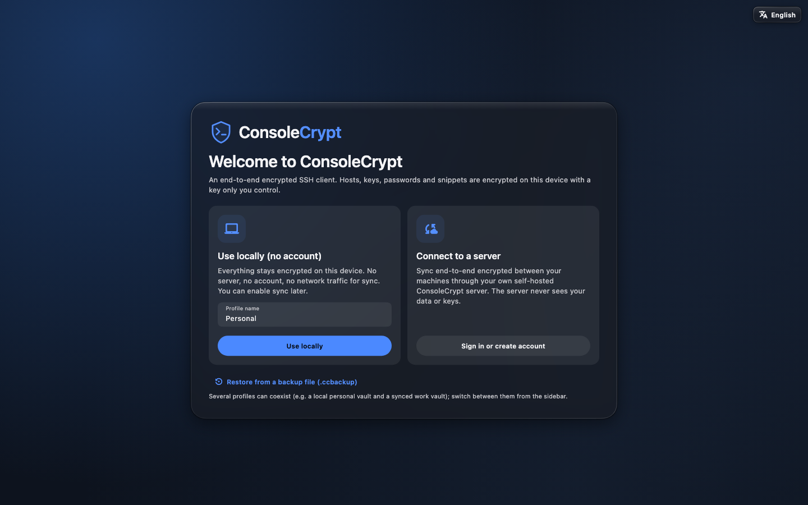

Primer lanzamiento: uso local, conexión del servidor y restauración de una copia de seguridad.

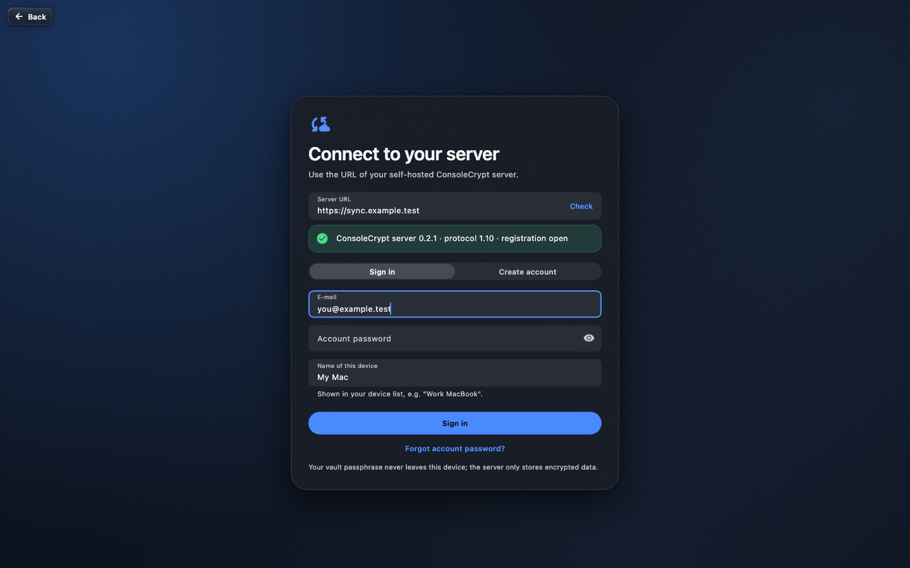

Conectarse a su propio servidor: Check muestra su versión y protocolo, luego iniciar sesión o registrarse con un correo electrónico y una contraseña de cuenta.

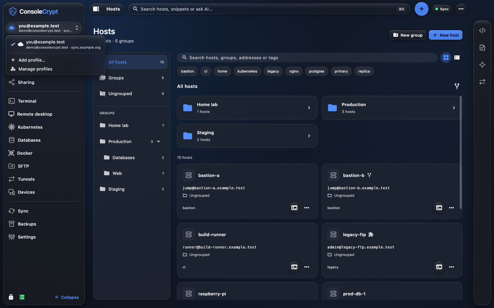

El interruptor de perfil en la parte superior de la barra lateral: el perfil activo, “Agregar perfil...” y “Administrar perfiles”.

<a name="linux-install"></a>

## 2. Linux instalación: DEB, RPM y llavero

El cliente se dirige a los escritorios gráficos x86-64 (x64): Ubuntu 22.04, Debian 12 y Fedora 43. Elija el paquete para su distribución; el administrador del paquete comprueba las dependencias.

1. En Descargas, elija DEB para Ubuntu/Debian o RPM para Fedora. Compruebe las versiones del sistema compatible y la arquitectura en las notas de liberación, a continuación, compare el archivo SHA-256 con la suma de comprobación publicada.

2. Abra un terminal en la carpeta que contenga el paquete descargado. Reemplazar la consolacrypt.deb o consolacrypt.rpm a continuación con su nombre de archivo exacto; ejecutar sólo el comando para su formato de paquete.

3. Después de la instalación, abra ConsoleCrypt desde el menú de aplicación en su sesión normal de escritorio. No ejecute el cliente con sudo: sus teclas y configuraciones pertenecen a su usuario.

4. Las teclas de dispositivo requieren un sistema operativo y desbloqueado con el Servicio Secreto, como GNOME Keyring. Cree y desbloquee el llavero predeterminado utilizando sus herramientas de escritorio antes de iniciar el cliente. La contraseña de llave está separada de su contraseña de cuenta ConsoleCrypt y contraseña de bóveda.

5. A partir de 0.9.14, un DEB o RPM copian actualizaciones de la aplicación: Ajustes → Actualizaciones → Descarga e instalación, la contraseña del administrador, luego reiniciar. Actualizar 0.9.14 en sí mismo y una copia no instalada del paquete manualmente: descargar el nuevo DEB o RPM de Descargas e instalarlo de la misma manera. Antes de actualizar, guardar una copia de seguridad cifrada y terminar importantes SSH sesiones; mantener su bóveda y llavero.

### Ubuntu / Debian — paquete DEB

El nombre de archivo es un ejemplo. apt instala el paquete local y dependencias disponibles de sus repositorios configurados.

```text
sudo apt install ./consolecrypt.deb
```

### Fedora — paquete RPM

El nombre de archivo es un ejemplo. dnf instala el paquete local y comprueba las dependencias. Mantenga estos cheques habilitados.

```text
sudo dnf install ./consolecrypt.rpm
```

> **Ten en cuenta**
>
> Si el Servicio Secreto no está disponible o el llavero está bloqueado, resuelva su estado en la configuración de escritorio y reingrese. El cliente no se cae de vuelta a almacenar las llaves en un archivo plano. No borre su llavero para aclarar un error: hacerlo puede eliminar el acceso de este dispositivo.

<a name="passwords"></a>

## 3. ¿Qué contraseña necesito?

ConsoleCrypt tiene capas de acceso separadas. Reiniciar la contraseña de su cuenta por correo electrónico no desbloquea la bóveda cifrada.

| ¿Qué? | Propósito |
| --- | --- |
| Contraseña de cuenta | Inicie sesión en el servidor y la cuenta del sitio web; puede ser reiniciado por correo electrónico. |
| Vault passphrase | Decodificar datos en el dispositivo y confirmar acciones peligrosas (donde esté habilitada, también con Touch ID, Windows Hola o una huella dactilar). El servidor no lo sabe. |
| Kit de recuperación | Recuperar el acceso a la bóveda después de perder la contraseña. |
| macOS contraseña de llavero | Autorización del sistema para acceder a una clave del dispositivo; generalmente la contraseña de la cuenta de usuario de Mac. |
| SSH contraseña o clave | Inicie sesión en un host remoto, separado del servidor de sincronización. |

1. Si macOS pide acceso al login Keychain después de una nueva construcción, compruebe el nombre de la aplicación y utilice la contraseña de Keychain. Una firma modificada de aplicaciones puede requerir un permiso renovado.

2. Después de un cambio de contraseña de la cuenta Mac, el Keychain todavía puede utilizar su contraseña anterior. Compruébalo en Keychain Access sin eliminar ConsoleCrypt llaves.

> **Ten en cuenta**
>
> No resetee el Keychain sólo para eliminar un aviso: hacerlo puede eliminar las teclas del dispositivo. Preserve su kit de recuperación y una copia de seguridad cifrada primero.

<a name="vault"></a>

## 4. Vault, recuperación y biometría

Tu bóveda se desbloquea en tu dispositivo. Configure bloqueo y desbloqueo después de crearlo.

1. En la ventana del kit de recuperación, “Print / Save as PDF” abre el diálogo de impresión del sistema: imprimir la hoja o guardar un PDF. Un PDF guardado es tan secreto como la hoja impresa; mantenerlo fuera de carpetas sincronizadas por la nube.

2. Guardar el kit de recuperación fuera de línea y completar el cheque de la palabra. Sus palabras y código QR otorgan acceso a la bóveda: no enviarlas por correo electrónico, chat o AI.

3. En los teléfonos, las palabras del kit de recuperación siguen siendo enteras. La columna cuenta sigue el ancho de pantalla y el tamaño de texto, con el código QR debajo de las palabras. Desplazarse para salvar el kit completo.

4. Una bóveda cerrada se abre con su contraseña o, cuando está habilitada, Touch ID, Windows Hola o una huella dactilar. La misma pantalla ofrece “Forgot passphrase?”, Señalar, “Eliminar este perfil...” y “Agregar perfil”.

5. “¿Has olvidado la contraseña?” abre la recuperación: introduce las 24 palabras del kit o su texto de código QR, o lee el QR: “Scan the QR” con la cámara en los teléfonos, “QR de una imagen” de una foto o captura de pantalla en todas partes (decodificado en el dispositivo, enviado a ninguna parte), o, en un dispositivo de confianza con el dispositivo desbloqueado habilitado, elegir “Este dispositivo de confianza”. Entonces pon una nueva contraseña.

6. En “Configuraciónes → Vault”, seleccione el intervalo de bloqueo automático. “Entrar ahora” bloquea la bóveda; “Cambiar la contraseña...” cambia la contraseña de la bóveda.

7. Una nueva contraseña de bóveda necesita al menos 12 caracteres. Las bóvedas existentes todavía se abren con su contraseña actual; en el próximo passphrase desbloquear la llave se re-elabora con parámetros Argon2id más fuertes (al menos 64 MiB).

8. Las acciones peligrosas se confirman con la contraseña bóveda en lugar de escribir una conexión, contexto o nombre de recurso: cambiar las consultas de bases de datos y las ediciones de celdas, Desbloquear la producción, YAML aplicar, eliminar, reiniciar y escalar en Kubernetes . Una contraseña incorrecta no funciona nada, el campo se limpia después de cada intento y Enter confirma.

9. Con el desbloqueo del dispositivo, estas acciones se pueden confirmar con Touch ID Windows Hola o una huella: “Confirmar acciones con biometría” en “Configuración → Vault” se enciende junto con él. La confirmación ofrece un botón como “Confirmar con Touch ID” primero y “Introducir la contraseña de la bóveda” como el inconveniente; si el cheque se cancela o falla, aparece el campo de la contraseña. Una confirmación es de uso único y abarca sólo esa acción y objeto.

10. La contraseña de la bóveda sigue siendo necesaria para cambiar la contraseña, crear un nuevo kit de recuperación, desbloquear el dispositivo, trabajar con copias de seguridad, aprobar dispositivos y cambiar la cuenta o la seguridad de la organización. En Linux , donde la llave se sienta en el teclado de escritorio, no se ofrece confirmación biométrica.

11. Desbloquear con este dispositivo está apagado por defecto. Para encenderlo, desbloquear la bóveda con su contraseña y en “Configuración → Vault” permite “Desbloquear con Touch ID”, “... Windows Hola” o “... huella dactilar”. El sistema pide confirmación una vez; establecer biometría en la configuración del sistema primero.

12. Lo que protege: en Mac y iPhone la tecla de desbloqueo es sostenida por el Enclave Seguro, en Windows por Windows Hola, en Android por la Keystore. El sistema lo libera sólo después de la contraseña de tu huella, cara o dispositivo, por lo que otro programa no puede obtener la clave sin tu confirmación. Añadiendo una huella dactilar o reseteo Windows Hello switches device desbloquear: desbloquear con la contraseña de la bóveda y encenderla de nuevo.

13. Linux no tiene tal protección: la clave se encuentra en el teclado de escritorio, por lo que desbloquear sin una contraseña está disponible para cualquier programa que se ejecuta bajo su cuenta de usuario. Está apagado por defecto allí y se puede encender sólo después de una advertencia.

14. Clave de seguridad física (preview, Windows y macOS): la bóveda se puede abrir con una llave USB FIDO2 como un YubiKey y su PIN. Desbloquear con la contraseña y encender “Configuración → Vault → Clave de seguridad física”: entrar en el PIN y tocar la llave dos veces. La pantalla de bloqueo entonces ofrece “Desbloquear con llave de seguridad”; después del PIN los parpadeos clave y espera un toque. En Windows , Windows pide el PIN y el toque. La clave sella la clave de la bóveda en un sobre local en este dispositivo solamente; la contraseña y el kit de recuperación siguen funcionando.

15. Sin el desbloqueo del dispositivo, la base de datos de la bóveda local sólo se abre con la contraseña o el kit de recuperación. Después de la actualización, el desbloqueo del dispositivo se mantiene apagado hasta que se desbloquea con el passphrase; la aplicación entonces ofrece para encenderlo de nuevo.

16. El dispositivo recuerda la huella dactilar de su clave de bóveda y comprueba todas las teclas que recibe en su contra, en passphrase, Recovery Key o desbloqueo biométrico, aprobación del dispositivo y sincronización habilitante. Si el servidor envía una llave diferente, aparece la pantalla “Diferente clave de bóveda”: los datos en el dispositivo se mantienen inalterados, paradas de sincronización y no hay manera de aceptar la “nueva” clave. No introduzca secretos en ese dispositivo; elija “Copiar diagnósticos” y dígale al administrador del servidor.

17. Si el kit se pierde mientras la bóveda todavía está desbloqueada, crear y guardar un “New Recovery Kit...”. El kit anterior dejará de funcionar.

> **Ten en cuenta**
>
> El desbloqueo de dispositivos es un ajuste de este dispositivo para esta bóveda: no se sincroniza y no reemplaza su kit de contraseña y recuperación. El diálogo del sistema puede ofrecer la contraseña del dispositivo. Face ID en un iPhone físico todavía necesita verificación separada.

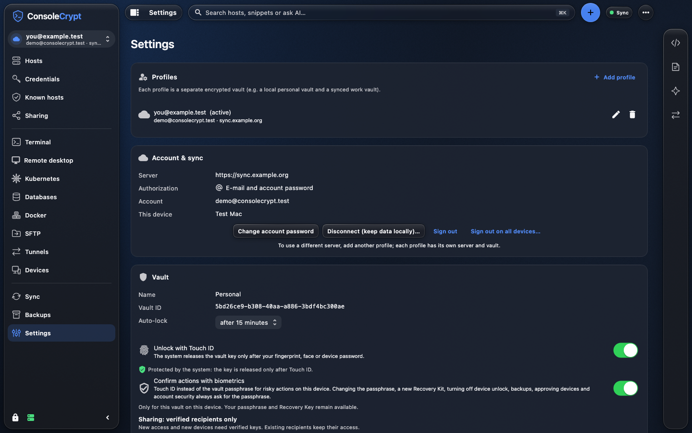

Desbloquear con Touch ID está en y protegido por el sistema, junto a “Confirm actions with biometrics” y “Physical security key”; no se revelan secretos.

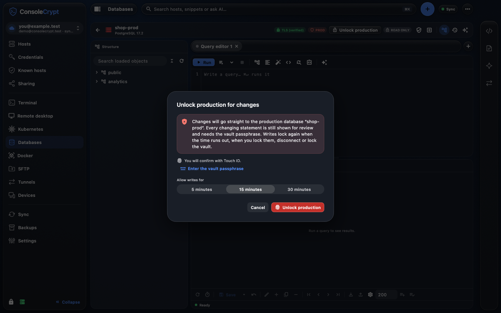

El desbloqueo de la producción se confirma con Touch ID; “Entrar la contraseña de la bóveda” sigue siendo el retroceso.

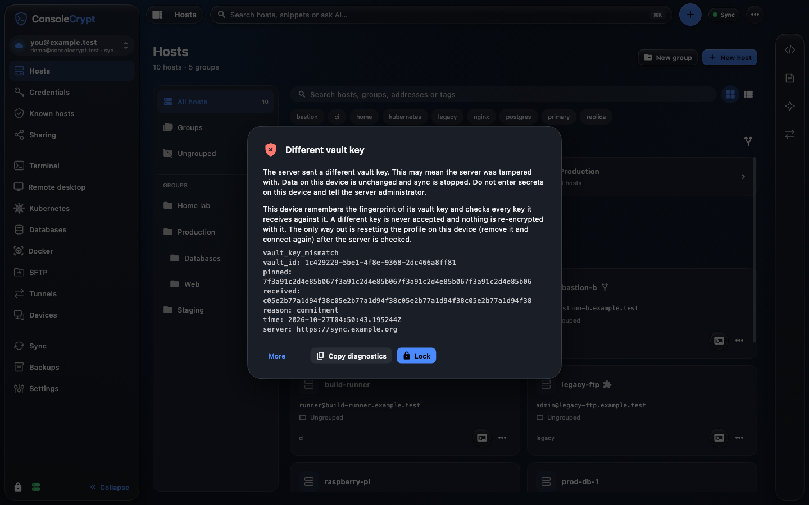

“Diferente clave bóveda”: se detiene la sincronización, y las únicas opciones son Lock, Copy diagnostics and More; demo values.

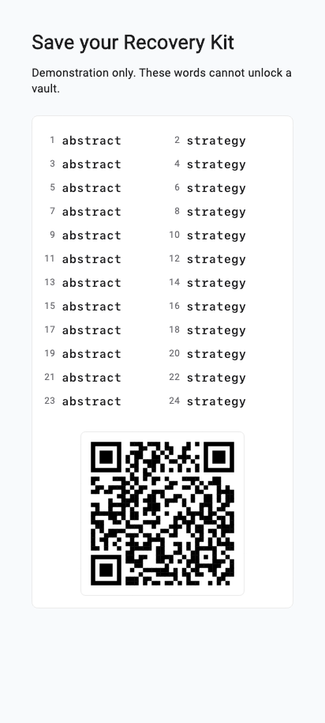

Kit de recuperación en un teléfono: palabras enteras con el código QR abajo. La ilustración sólo contiene datos de demostración.

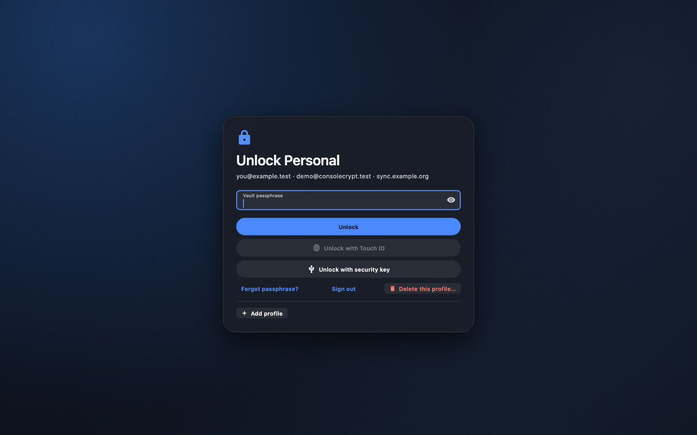

La pantalla de desbloqueo: passphrase, sistema desbloquear, “Desbloquear con llave de seguridad”, “Olvidar la contraseña?” y acciones de perfil.

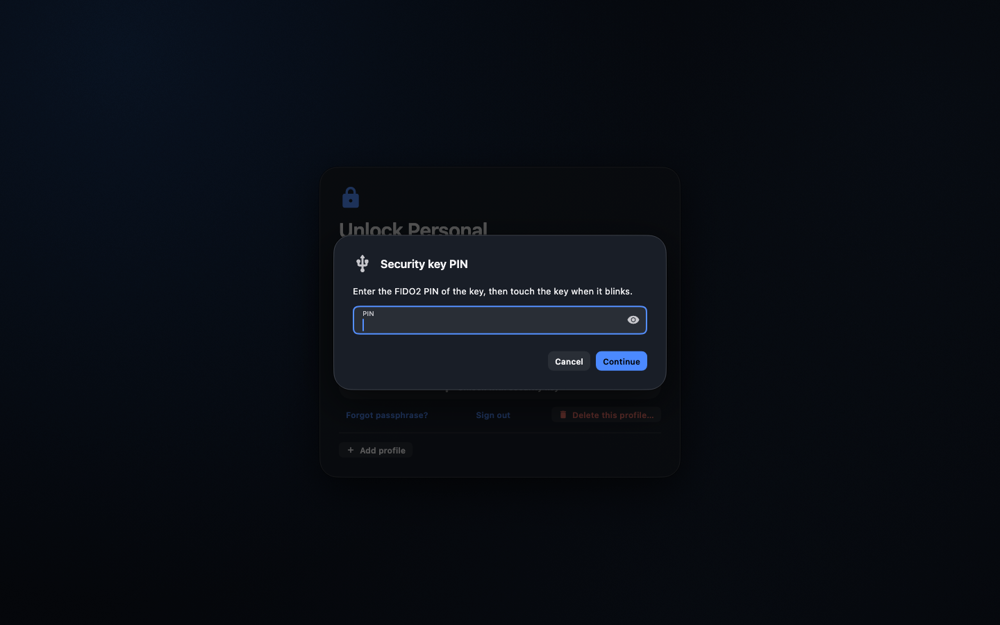

La aplicación pide la clave de seguridad PIN macOS ); en Windows , Windows lo pide.

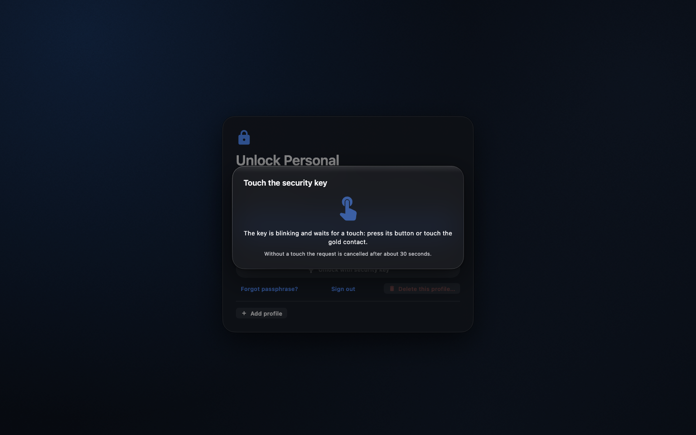

Después del PIN los parpadeos clave y espera un toque; la aplicación lo dice hasta que las respuestas clave.

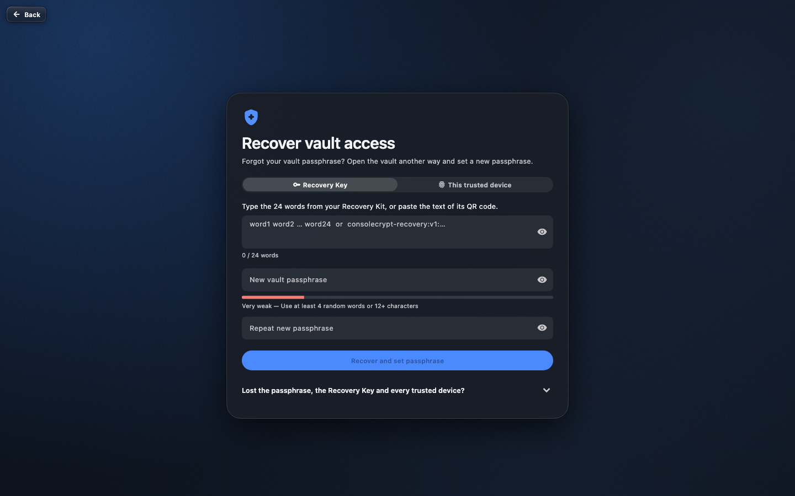

Recuperar el acceso: la llave de recuperación de 24 palabras o este dispositivo de confianza, luego una nueva contraseña.

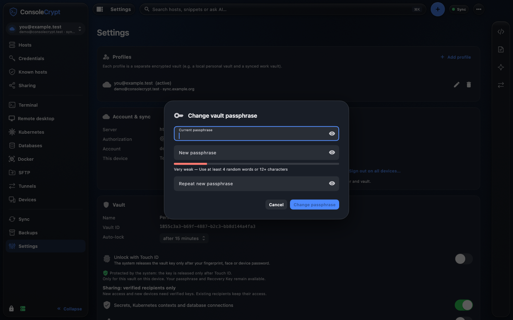

“Cambiar la contraseña...” en la configuración de la bóveda.

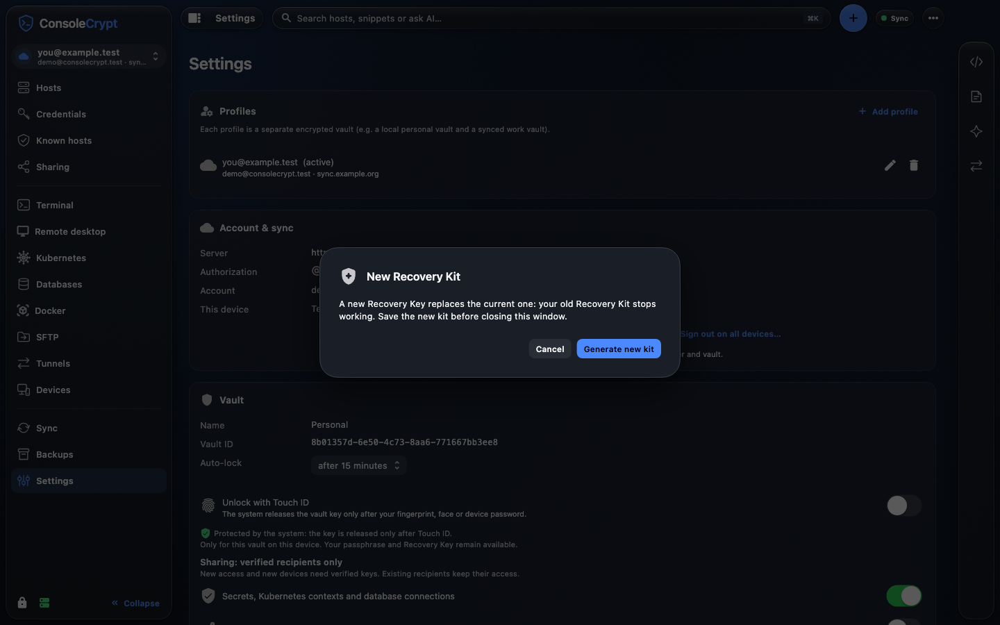

“Nuevo Kit de Recuperación...”: el viejo kit deja de funcionar.

<a name="devices"></a>

## 5. Dispositivos sincronizados y de confianza

Firmar y ser permitido descifrar la bóveda son acciones separadas. Un nuevo dispositivo necesita aprobación.

1. En el segundo dispositivo, seleccione el mismo servidor y cuenta. Cuando se requiere la aprobación, abra “Dispositivos” en un dispositivo ya de confianza.

2. Seleccione el dispositivo pendiente, elija “Verificar y aprobar” y compare todo el código mostrado en ambos dispositivos a través de un canal independiente.

3. Con el servidor 0.2.2 y más tarde, tan pronto como la solicitud se abra en un dispositivo de confianza, el nuevo dispositivo muestra que el nombre del dispositivo y el mismo código de emparejamiento, calculado a partir de las teclas de ambos dispositivos. En el nuevo dispositivo, marca “El código coincide con el de “...” y elige “Codes match”; sin la garrapata no se puede confirmar. La firma de aprobación cubre la clave de la bóveda, y el nuevo dispositivo la comprueba con la llave que confirmaste. Una vez que el servidor ha mostrado este código de emparejamiento, no puede volver a la vieja manera descontrolada — la aplicación rechaza la aprobación.

4. Con un servidor más antiguo, la aprobación funciona como antes y la clave de la bóveda está marcada “La clave de Vault no está confirmada”. Elija “Confirme con contraseña” en dispositivos o “Configuraciones → Vault” e ingrese la contraseña de la bóveda una vez. Si otro dispositivo de la cuenta reporta una clave diferente, Devices muestra “Un dispositivo recibió una tecla de bóveda diferente” con un botón de revocación.

5. Tick “Los 6 grupos coinciden exactamente...” y eligen Aprobar. Si un grupo difiere, elija “Los Codes no coinciden”: la solicitud es rechazada y no se entrega ninguna clave de bóveda.

6. En “Sincronización”, compruebe la conexión, cambios pendientes y conflictos. Los cambios sin conexión siguen siendo locales y se envían cuando la conectividad regresa. El indicador Sync en la barra superior muestra lo mismo de un vistazo: última sincronización, servidor, cola, “Sync now” y “Details”.

7. “Configuración → Cuenta &amp;amp; Sincronización → Desconectar (mantener datos localmente)..” convierte el perfil en un local: los datos se quedan en el dispositivo y la copia cifrada en el servidor no se cambia. “También revoca este dispositivo en el servidor” lo revoca al mismo tiempo.

8. Revoque un dispositivo perdido en la cuenta cliente o sitio web. Reconectarlo requiere una nueva aprobación.

9. El servidor puede limitar la sincronización. Cuando limita temporalmente las solicitudes, el indicador y Sync muestran “El servidor temporalmente limitado sincronización; resumir en HH:MM”: los cambios permanecen en el dispositivo y salen por sí mismos. Cuando el servidor se niega a cambiar debido al objeto o límite de almacenamiento de la bóveda, la tarjeta “Cambios no aceptados por el servidor” explica por qué — eliminar elementos que ya no necesita y elegir Retry.

10. Al iniciar sesión desde un nuevo dispositivo, el servidor puede responder “El límite de dispositivo (N) alcanzado – revocar dispositivos que ya no use, luego iniciar sesión de nuevo” o “Demasiados dispositivos nuevos hoy en día. Pruebe de nuevo después de ...”. Colleague Lookup, compartir y agregar sus propios dispositivos muestran cuántos segundos esperar cuando las solicitudes son limitadas.

11. Con el servidor 0,2.4, eliminar la bóveda de un dispositivo que no se confía todavía tiene efecto después de 7 días. Los dispositivos de confianza muestran “Esta bóveda se eliminará en ...” con “Mantenga la bóveda”; si no lo pidió, elija y cambie la contraseña de la cuenta.

12. Cuando la bóveda fue eliminada en el servidor, sincronizar para y nombra la razón (“vault no se encuentra en el servidor”) en lugar de reintentar para siempre. Datos del servidor que falla el cheque de autenticidad nunca reemplaza la última copia descifrada en el dispositivo.

> **Ten en cuenta**
>
> La revocación termina las sesiones y la sincronización futura, pero no puede borrar datos o cambios previamente leídos SSH - contraseñas de servidor. Después de un compromiso, sustitúyase las contraseñas y claves afectadas en los propios hosts.

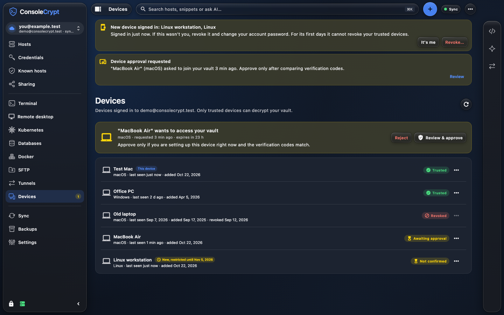

Lista de dispositivos de demostración; la aprobación de acceso es un paso separado.

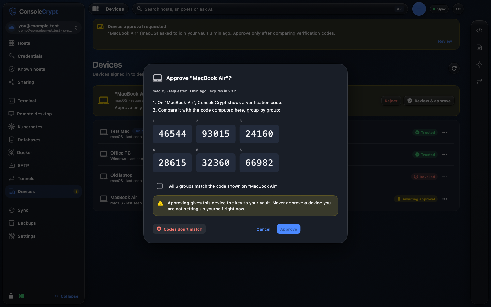

Aprobando un nuevo dispositivo: los 6 grupos de código se comparan con la pantalla del nuevo dispositivo; códigos de demostración.

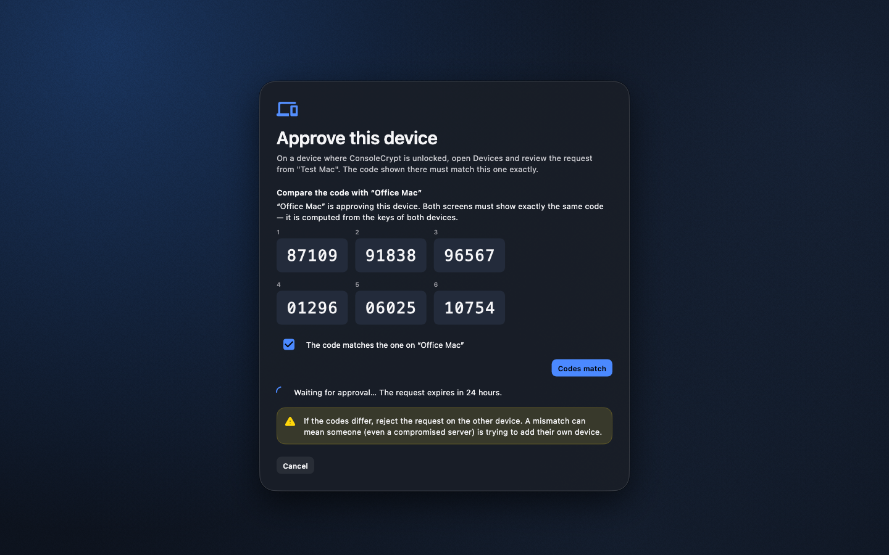

El nuevo dispositivo: el código de emparejamiento con “Office Mac” y la garrapata de partido obligatorio; códigos de demostración.

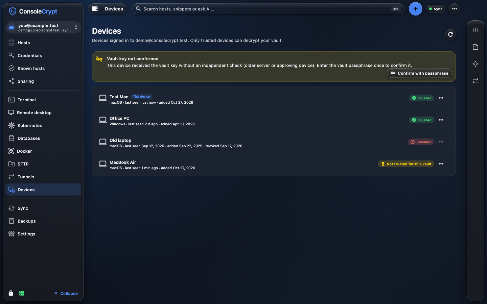

“La clave predeterminada no confirmada” en Dispositivos con “Confirme con contraseña”.

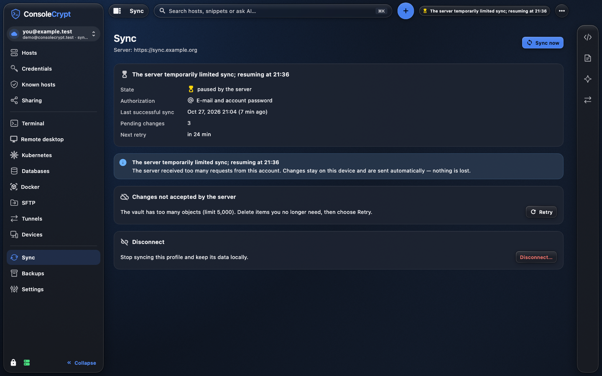

Sincronizado por el servidor hasta la hora mostrada; cambios sobre el límite de objeto esperen a Retry.

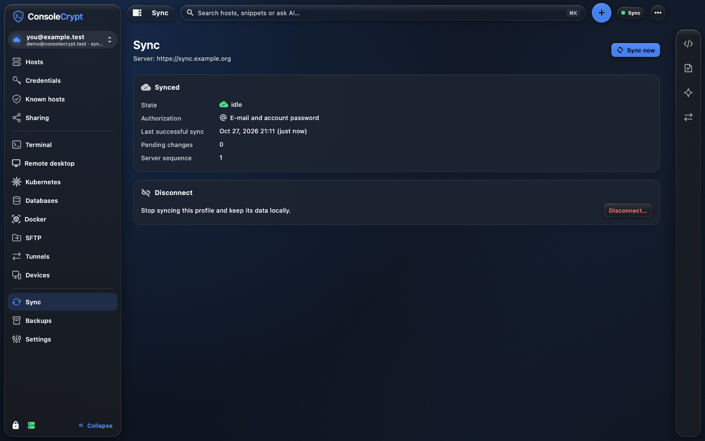

Sincronización y cola para el perfil demo.

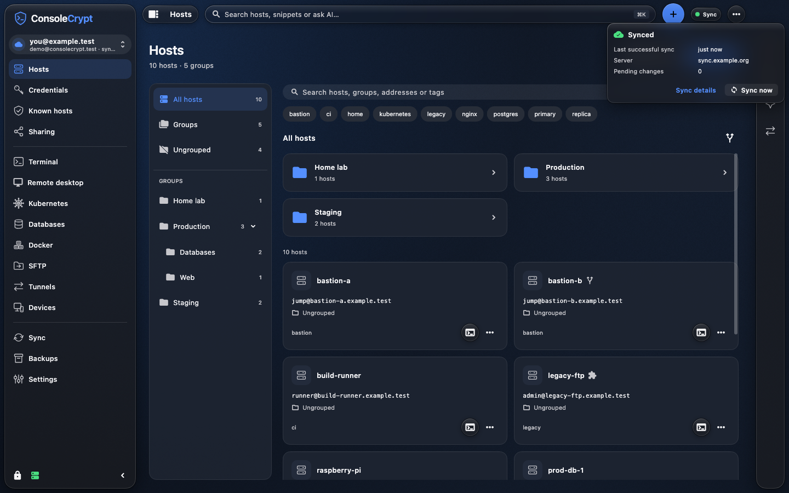

El indicador Sync en la barra superior: última sincronización, servidor y cola.

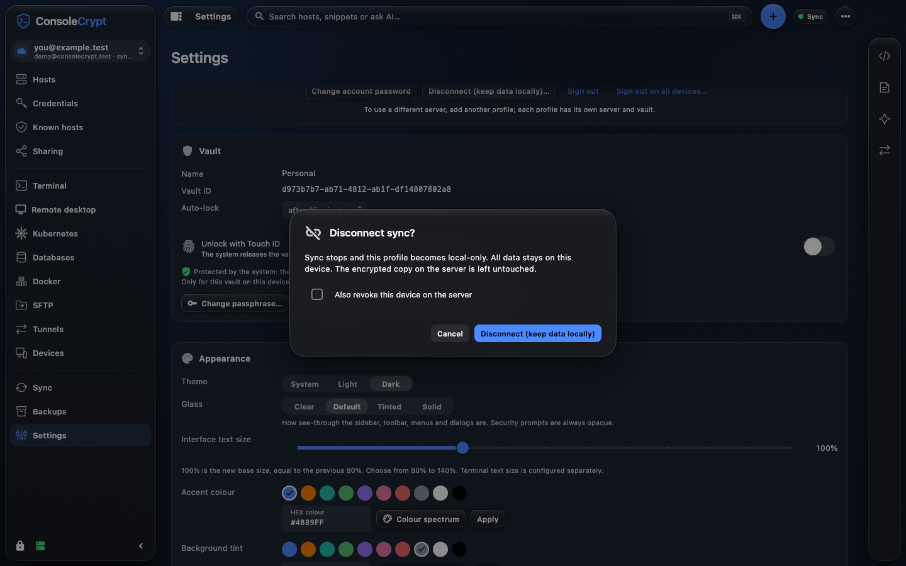

“Desconectar (mantener datos localmente)..” con revocación opcional de este dispositivo.

<a name="device-protection"></a>

## 6. Protección contra inscripciones de nuevos dispositivos

Si alguien firma en tu cuenta desde un dispositivo nuevo, lo descubres de inmediato, y el dispositivo está restringido por un tiempo. Esta protección necesita servidor de sincronización 0.1.16 o posterior.

1. Para cada nuevo dispositivo, el servidor envía un correo electrónico a su dirección de cuenta. El correo electrónico contiene un enlace “Este no era yo”.

2. Sus dispositivos de confianza muestran un aviso “Nuevo dispositivo firmado” con el nombre del dispositivo y el sistema. Si fuera usted, elija “Soy yo” para desestimar el aviso.

3. En Dispositivos, tal dispositivo está marcado “No confirmado” y “Nuevo, restringido hasta ...”. Por sus primeros 14 días no puede revocar sus dispositivos de confianza o terminar sus sesiones, y los intentos de abrir la bóveda de nuevos dispositivos se limitan con tarifas.

4. Si no fuera usted, revocar el dispositivo: “Rechazar...” en el aviso, el menú del dispositivo en Dispositivos o el enlace “Este no era yo” en el correo electrónico, que abre su cuenta del sitio web. Luego cambia tu contraseña de cuenta: quienquiera que haya firmado lo sabe.

5. “Configuración → Cuenta &amp;amp; Sincron → Iniciar sesión en todos los dispositivos...” termina cada sesión de la cuenta, incluyendo ésta. Los dispositivos se registran de nuevo con la contraseña de la cuenta; sus datos locales se guardan.

> **Ten en cuenta**
>
> Iniciar sesión no abre la bóveda por sí misma: un nuevo dispositivo todavía necesita aprobación con un control de código en un dispositivo de confianza. Registrarse en todas partes o cambiar la contraseña de un nuevo dispositivo deja dispositivos de confianza intactos durante sus primeros días.


El nuevo aviso de inicio de sesión y un nuevo dispositivo marcado “No confirmado” y “Nuevo, restringido hasta ...”; todos los dispositivos son dispositivos de demostración.

<a name="enterprise-sign-in"></a>

## 7. Inscripción corporativa: SSO y Active Directory

El servidor Sync 0.2.0 y más tarde puede admitir cuentas sólo a través del servidor de autorización de su organización. Cliente 0.9.0 detecta el modo del servidor y muestra el formulario de emparejamiento. Sólo el registro de cuenta cambia: su contraseña de bóveda aún abre la bóveda.

1. Elija “Conectarse a un servidor”, ingrese la dirección HTTPS de su administrador y pulse Check. Un servidor corporativo muestra un bloqueo “Inscribirse en la empresa” nombrando el servidor de autorización; el registro, la contraseña de la cuenta y “Contraseña olvidada” no se ofrecen en este modo.

2. SSO (OIDC): Ingrese opcionalmente su correo electrónico y presione “Iniciar sesión con ...”. La página de inicio de sesión de su organización se abre en el navegador del sistema y le devuelve a la aplicación después. Al iniciar sesión, la aplicación muestra un estado de espera con Cancelar.

3. Active Directory: introduce tu login (e-mail, UPN o DOMAIN\\user) y contraseña de dominio. La contraseña va al servidor una vez por encima de TLS, nunca se almacena y se limpia desde el campo después de cada intento.

4. Un nuevo usuario crea una bóveda después del primer registro como siempre. Un dispositivo conocido abre la bóveda con la contraseña de la bóveda; un nuevo dispositivo se aprueba con un cheque de código, la llave de recuperación o la contraseña de la bóveda.

5. La aplicación recuerda el método de inicio de sesión y el login (nunca la contraseña) para cada servidor: la próxima vez que estén prefilados, y el indicio “Última vez que usted firmó con ...” ofrece Olvídalo. Ajustes, Sincronización y Dispositivos muestran el servidor corporativo y cuando este dispositivo se firmó bajo “Authorization”.

6. Si su organización desactiva su cuenta, la aplicación muestra “Acceso desactivado por el administrador” y bloquea el perfil. Los datos del dispositivo permanecen cifrados; puede eliminar el perfil del dispositivo o iniciar sesión de nuevo una vez que se restablezca el acceso.

[Cuenta, sincronización y firma corporativa en](../docs/public/es/SYNC_ACCOUNT.md)

> **Ten en cuenta**
>
> La contraseña de su organización no abre la bóveda, y ni el servidor de autorización ni el servidor de sincronización reciben claves de bóveda. Errores de inicio de sesión — dominio no permitido, falta de grupo, segundo factor requerido, identidad ya vinculada a otra cuenta, servicio de registro no disponible — se explican en palabras sencillas; póngase en contacto con su administrador sobre ellos.

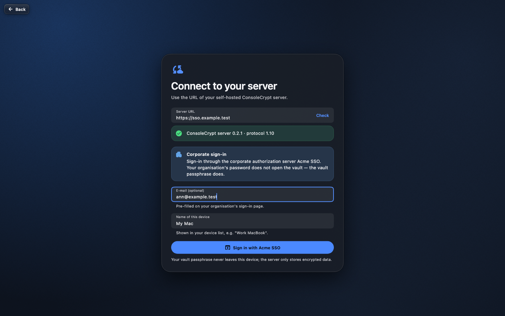

Un servidor con SSO entra en el registro: el bloque “Señal corporativo”, un correo electrónico opcional y el botón “Iniciar sesión con Acme SSO”; el servidor es demo uno.

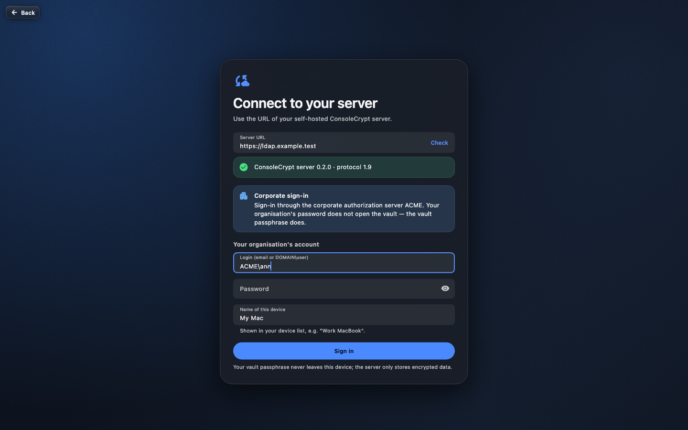

Active Directory sign-in: el login de dominio y la contraseña de la organización.

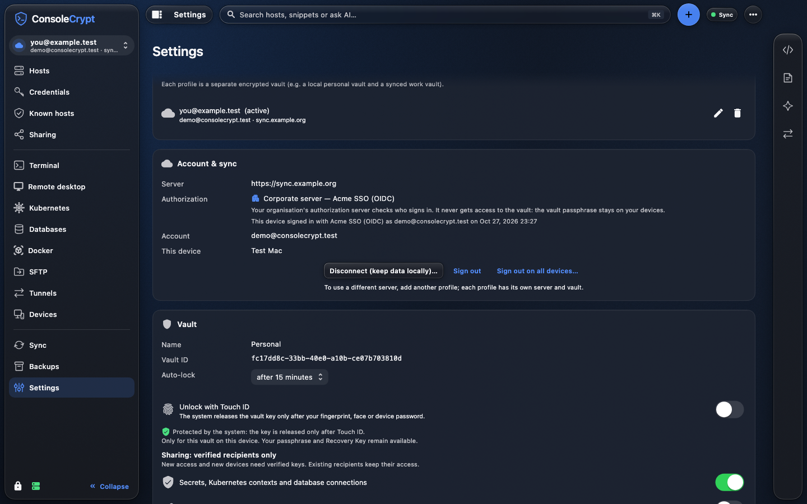

Ajustes: la fila de Autorización nombre el servidor corporativo y muestra cuando este dispositivo se firmó.

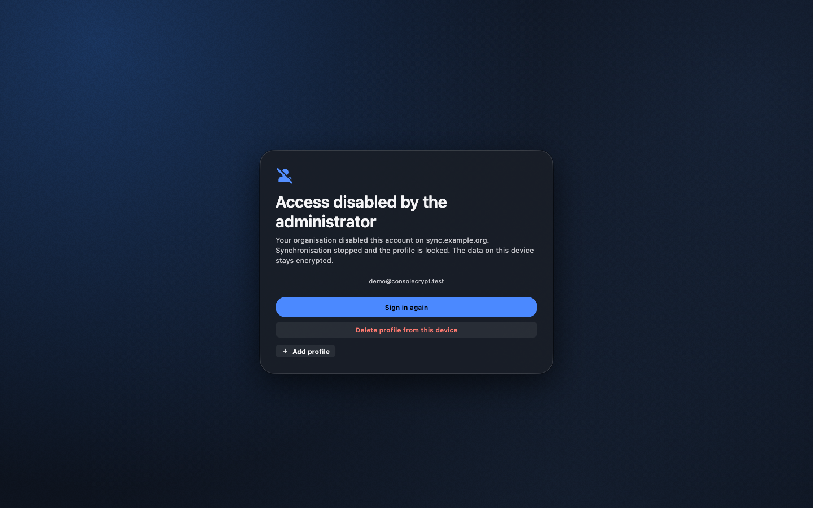

La cuenta fue deshabilitada por la organización: el perfil está bloqueado y los datos permanecen cifrados.

<a name="hosts"></a>

## 8. Hosts: añadir, encontrar y conectar

Tiendas de host SSH o configuración de conexión RDP. Las tarjetas y las filas de listas muestran su dirección, usuario y grupo.

1. Abrir “Hosts → Nuevo host” y elegir por primera vez SSH o RDP. Introduzca un nombre, dirección, puerto, nombre de usuario y credenciales. SSH admite predeterminados de grupos y anfitriones de salto; RDP utiliza una contraseña, un dominio opcional Windows y el puerto 3389 por defecto.

2. En el escritorio, haga clic en Importar en el nuevo SSH -host formulario. Lee ~/.ssh/known\_hosts y /etc/ssh/ssh\_known\_hosts on Linux / macOS , o %USERPROFILE%\\\\.ssh\\\\known\_hosts on Windows . Examinar y seleccionar direcciones; se excluyen las conexiones existentes. Proporcione los nombres de usuario y las credenciales por separado.

3. Importar crea conexiones sin importar confianza clave. Se saltan nombres, patrones, teclas revocadas y registros de CA. Verifique la clave del servidor normalmente cuando se conecte primero.

4. “Desde ~/.ssh/config”, junto a Import, lee la configuración OpenSSH (incluyendo Incluir archivos). Cada entrada Host se convierte en un host con su dirección, puerto y usuario; bloques como Host \* se aplican como predeterminados. Los anfitriones ProxyJump se importan con el host elegido, y las teclas de IdentidadFile se pueden añadir a la bóveda de inmediato, una clave encriptada mantiene su contraseña. ProxyCommand no es compatible.

5. Nombres de búsqueda, direcciones, grupos y etiquetas. La rejilla/lista cambia la vista; abrir una tarjeta de grupo muestra su contenido.

6. Haga clic en el centro de una tarjeta host o en su icono de conexión. Una pestaña de escritorio terminal o remota abre según el tipo de conexión.

7. El menú “...” ofrece conexión, SFTP, edición, eliminación y adición a un grupo existente. “Compartir...” aparece cuando el servidor lo soporta, “Copiar al equipo...” y “Move al equipo...” cuando usted tiene equipos (ver Equipos).

8. El formulario de host está hecho de tarjetas. Autenticación: una contraseña (salvada en la bóveda o ingresada en el tiempo de conexión), una llave SSH (pick, generar o importarla aquí), un agente (el agente del sistema SSH o una vía de toma) o “Inherit from group”. “Elija credential...” asigna un guardado. Si la clave está encriptada y su contraseña no se guarda, la conexión muestra “Passphrase for key “...”” — usado sólo para esa conexión.

9. Seguridad: la política de host-key — Pregunte (confirme teclas desconocidas), Strict (sólo las claves de los anfitriones conocidos) o Aceptar nuevo (salvar las teclas desconocidas automáticamente); una llave cambiada siempre bloquea la conexión. También tiene la implementación SSH (“Built-in (russh)” o “System OpenSSH (compatibilidad)” para servidores antiguos), el intervalo de mantenimiento y “Agent forwarding” — lo permiten sólo para los anfitriones en los que confía.

10. La organización tiene etiquetas y notas de texto libre. En la parte inferior, “Configuración efectiva” muestra lo que una conexión realmente utilizará — grupo, usuario, puerto, credencial y ruta— y de dónde viene cada valor; problemas como un host de salto eliminado aparecen allí también.

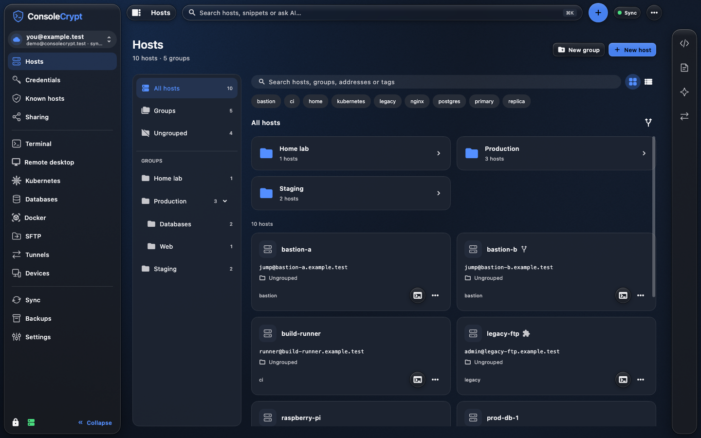

Una visión general de los anfitriones de demostración y sus detalles de conexión.

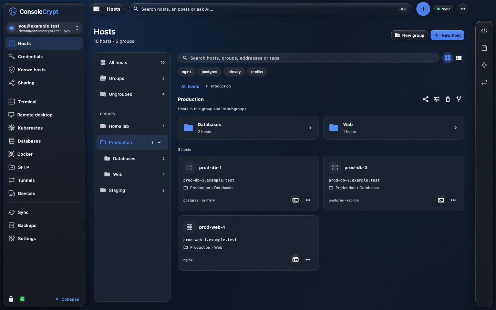

Hosts en un grupo demo: tarjetas, búsqueda y acciones de conexión.

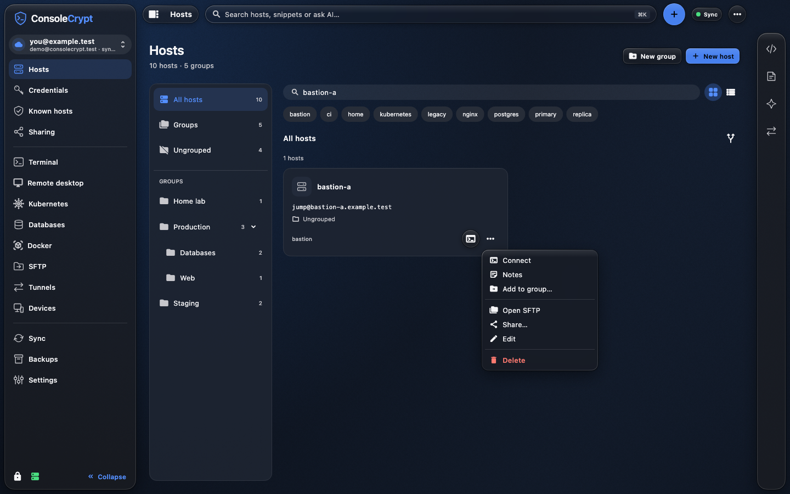

El menú de acción seleccionado del host: conectar, notas, grupo, SFTP, compartir y editar.

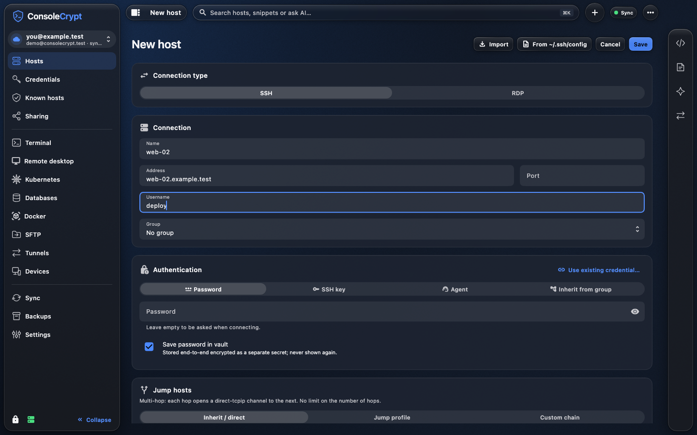

Un nuevo host SSH: tipo de conexión, dirección, usuario, grupo y autenticación.

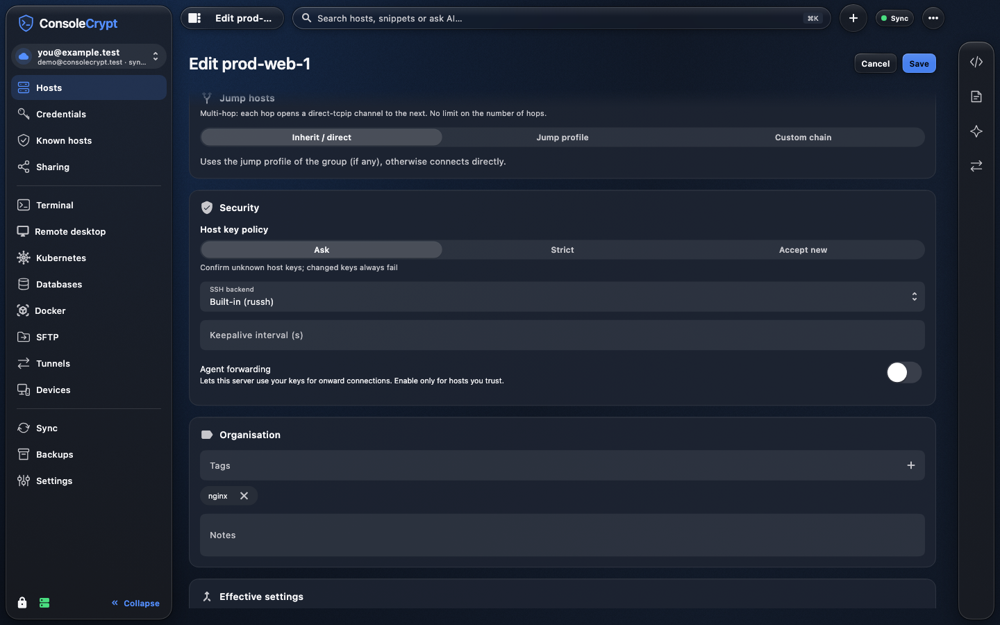

La tarjeta de seguridad: política de host-key SSH implementación, reenvío de agentes y de mantenimiento.

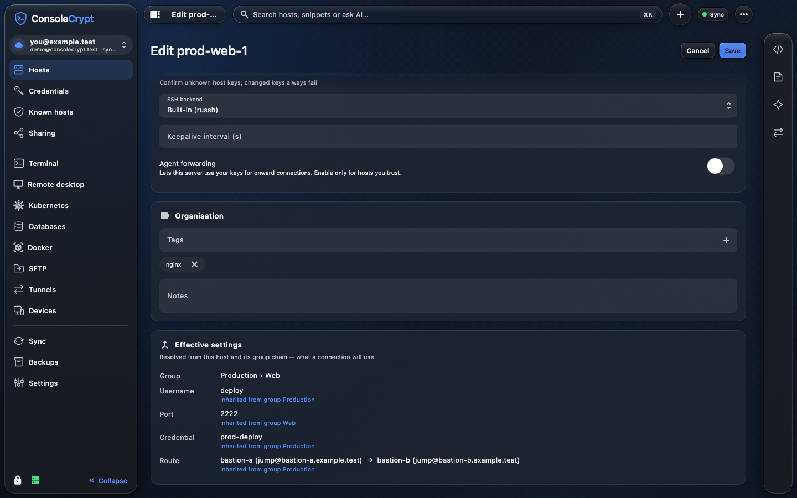

“Configuración efectiva”: qué conexión se utilizará y de dónde viene.

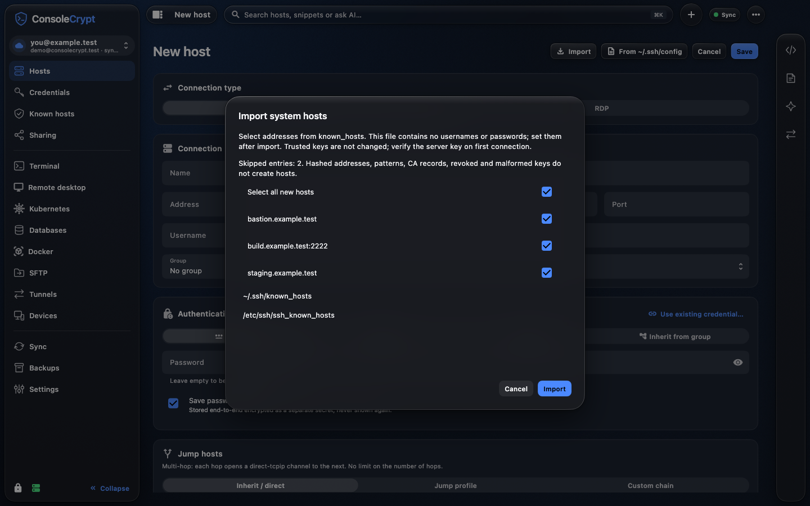

Importar direcciones de una demo known\_hosts: seleccione antes de guardar.

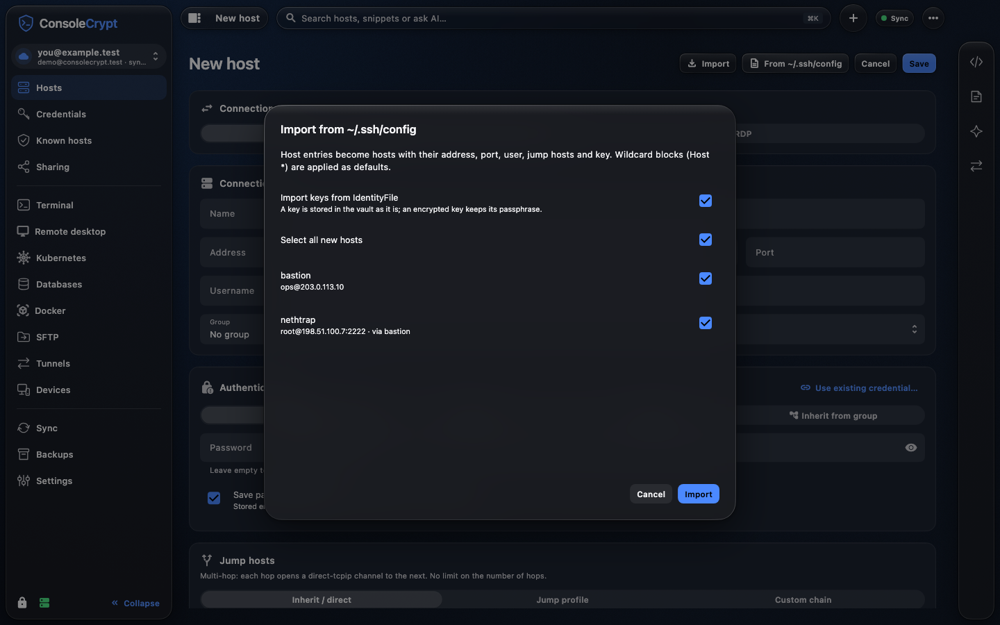

Importación de ~/.ssh/config: Host entries with documentation-range addresses.

<a name="rdp"></a>

## 9. RDP: Windows remoto escritorio

ConsoleCrypt ahora soporta conexiones RDP. Se conecta directamente a un servidor estándar de Microsoft RDP; no hay necesidad de añadir IronRDP Windows .

1. En “Hosts”, crear una conexión RDP. Introduzca la dirección Windows nombre de usuario, contraseña y dominio opcional. Guardar la contraseña en la bóveda cifrada o introducirla para cada conexión. SSH grupos predeterminados no se aplican a RDP.

2. Antes de conectar, revise la dirección, cuenta y certificado de huella dactilar. Compare la huella con el administrador del servidor. Los detalles modificados del host requieren una confirmación fresca.

3. Bajo “Remote desktop”, utilice el botón central de conexión o el “+” junto a las pestañas para elegir un host RDP guardado. Los escritorios abiertos aparecen en la tira de la pestaña. Cambiar entre ellos, abrir nuevas sesiones y cerrar sesiones que ya no necesita. Hasta cuatro sesiones RDP pueden funcionar de inmediato.

4. Haga clic en la pantalla completa para usar toda la pantalla. Revela la barra de conexión superior moviéndose al indicador azul en el borde superior o pulsando Ctrl+Alt+Home. Pin el bar si es necesario. Le permite cambiar sesiones, gestionar permisos, minimizar la ventana, restaurar su tamaño anterior o desconectar la sesión actual. Escapar es enviado a la computadora remota.

5. Permite el acceso del portapapeles de texto para la sesión seleccionada. Ctrl+V ( XboxV en macOS ) en el escritorio activo ahora envía y pega el texto local en Windows sin hacer clic en "Enviar". Con el compartir deshabilitado, Ctrl+V utiliza el portapapeles remoto Windows solamente.

6. “Enviar” ofrece texto sin pegar, mientras que “Recibir” pide texto de Windows . Cambiar el portapapeles local solo no envía nada. Se admite texto de hasta 64 KiB; las imágenes y los archivos no se transfieren a través del portapapeles.

7. En macOS , Windows y Linux , seleccione una carpeta local en permisos de sesión. Esperar “Folder conectado”, luego abierto ConsoleCrypt bajo unidades redireccionadas en Windows Explorador de archivos. El acceso es sólo lectura por defecto; permite escribir por separado. Otras carpetas y unidades locales no son compartidas.

8. Si la carpeta no está disponible, compruebe la política de redirección del servidor Windows. El escritorio sigue siendo utilizable independientemente del acceso a carpetas. Reemplazar la carpeta interrumpe las operaciones en archivos abiertos previamente.

9. El intercambio de archivos admite archivos de hasta 256 MiB y hasta 512 MiB de intentos de escribir por sesión. Reconectar después de alcanzar el límite. Los enlaces simbólicos, los horarios originales y las cerraduras de archivos no se transfieren.

10. Apague la carpeta o el acceso del portapapeles en el panel de sesión cuando esté terminado. Cerrar la bóveda (también automáticamente) oculta el escritorio y cierra los diálogos, pero no la sesión: después de desbloquear la pestaña continúa. Firmar cierra las conexiones y revoca permisos temporales.

> **Ten en cuenta**
>
> Antes de crear hosts RDP, actualice cada dispositivo del espacio de trabajo a la versión 0,3 o posterior. Los clientes mayores no pueden ver los anfitriones RDP, pero pueden cambiar sus credenciales y grupos relacionados. RDP acoge sincronización entre sus dispositivos que ejecutan un cliente actual. Un host RDP puede compartirse con un colega verificado: “Compartir” en el menú host envía la dirección, puerto, usuario y dominio, y las notas y contraseña sólo cuando se marca; los clientes antes de 0.9.14 no muestran tal tarjeta. La redirección de la carpeta no está disponible en el móvil. Clipboard y disponibilidad de la unidad también depende de Windows política del servidor.

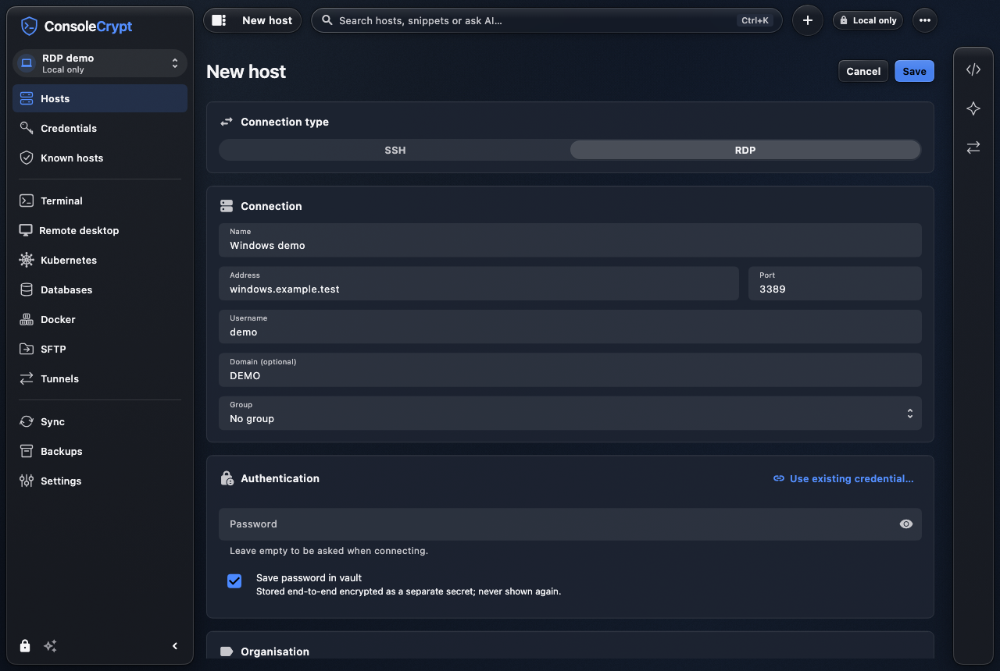

Crear un host RDP: Windows - campos específicos y guardar su contraseña en la bóveda. Datos de demo.

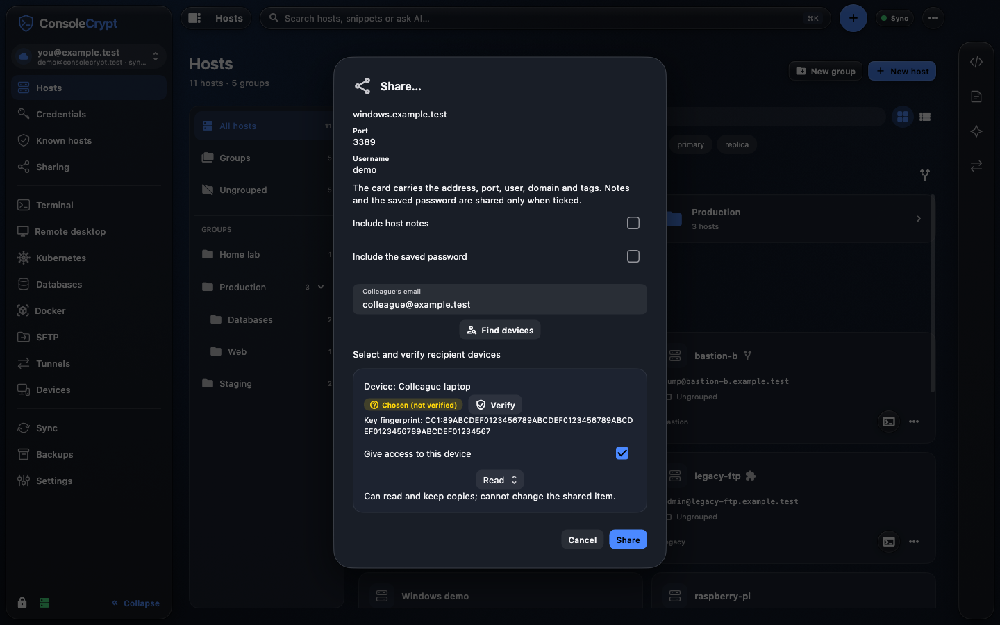

Compartir un host RDP: lo que ve el colega, las notas y las opciones de contraseña y el dispositivo receptor elegido.

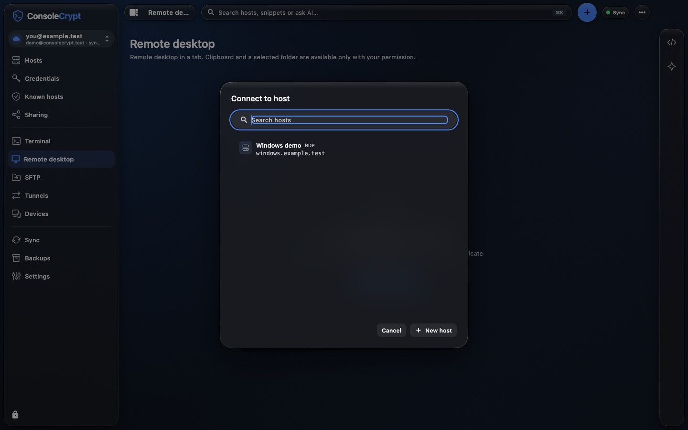

Elegir un host RDP guardado desde el escritorio remoto.

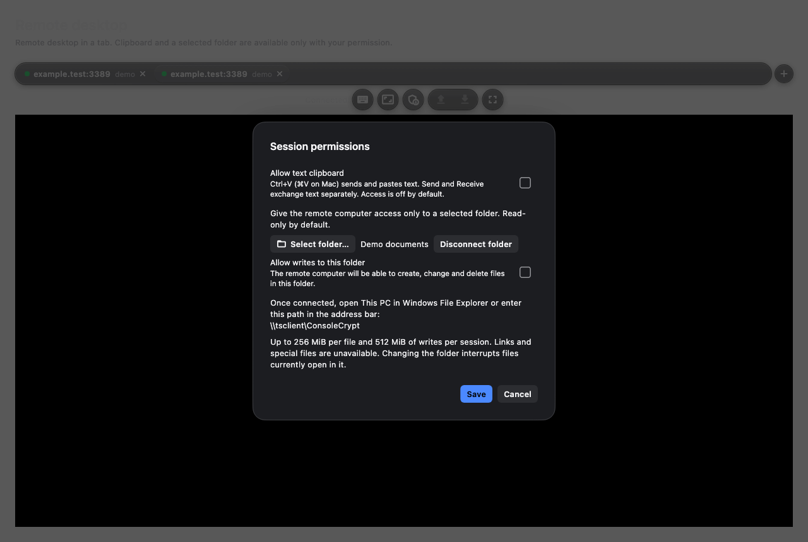

Permisos de sesión de demostración: portapapeles de texto y una carpeta seleccionada con un permiso de escritura separado. El escritorio Windows no se muestra.


Barra de conexión de pantalla completa: conmutación de sesión, permisos y controles de ventana. Datos de demo.

<a name="rdp-mobile"></a>

## 10. RDP en un teléfono: touchpad y teclado

En un teléfono, el escritorio conectado abre automáticamente la pantalla completa. Touchpad es el predeterminado: el dedo mueve el puntero relativo a su posición actual. Un botón flotante abre los controles de sesión.

| Touchpad gesto | Medida |
| --- | --- |
| Mover un dedo | Mover el puntero; levantar y reposicionar el dedo según sea necesario. |
| Grifo corto | Haga clic izquierdo en la posición puntero actual. |
| Dos grifos rápidos | Doble clic izquierdo. |
| Doble-tapa y sostenga el segundo tap, o espere unos 500 ms | Comience a arrastrar; levantar el dedo libera el botón del ratón. |
| Grifo de dos niveles | Haga clic derecho. |
| Mueve dos dedos juntos | Desplazarse sin mover el puntero. |
| Pinch | Zoom 1-4×; la vista sigue el puntero cerca de un borde. |
| Grifo doble de dos niveles | Coloque el escritorio en la pantalla. |
| Grifo de tres niveles | Mostrar o ocultar el teclado. |

1. Pulsa el botón flotante en el borde. Una cuadrícula de azulejos se abre con el teclado, touchpad o toque directo, teclas extras, portapapeles, sesiones, orientación y minimizar. Arrastre el botón a un borde conveniente; su posición se recuerda por separado para ambas orientaciones.

2. En modo táctil directo, un grifo actúa bajo el dedo. El modo seleccionado para un host se recuerda sólo en este dispositivo. Un ratón adjunto funciona normalmente.

3. El teclado supera el escritorio sin encogerlo. Una tira extra-key aparece por encima de ella; una hoja separada proporciona F1–F12, flechas y atajos. Pulsa Ctrl, Alt, Win o Shift una vez para la siguiente llave, dos veces para bloquear el modificador, y luego otra vez para soltarlo.

4. Si el teclado todavía está componiendo una palabra, termine esa entrada primero. Las teclas adicionales no envían comandos durante la composición. Sesiones de conmutación, entrando en el fondo y la liberación de bloqueo se llevó las teclas y los botones del ratón.

5. Los ajustes de RDP móviles proporcionan velocidad de puntero y aceleración, tamaño del cursor, claridad Windows escala, orientación y ocultamiento de botones. La resolución sigue la pantalla cuando el servidor RDP admite el tamaño; de lo contrario, la sesión mantiene su resolución actual.

6. En Android , Volver primero esconde el teclado. A continuación, abre los controles; otra prensa dentro de dos segundos minimiza sin desconectar. Cambia entre hasta cuatro sesiones. La desconexión pide confirmación.

> **Ten en cuenta**
>
> Las tabletas introducen la pantalla completa manualmente, y el modo automático selecciona el tacto directo. Con un lector de pantalla activado, se utiliza el toque directo y el botón se mantiene visible. La redirección de la carpeta de teléfono no está disponible. La versión iOS es un Simulator construir solamente; no hay instalador de iPhone. Las pantallas utilizan widgets reales con un escritorio dibujado, sintético Windows; el área vacía está reservada para el teclado del sistema.

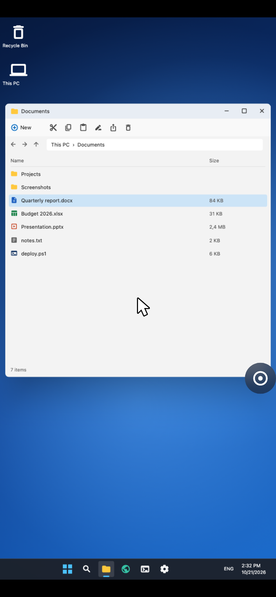

Botón de escritorio y flotante, con paneles permanentes ocultos.

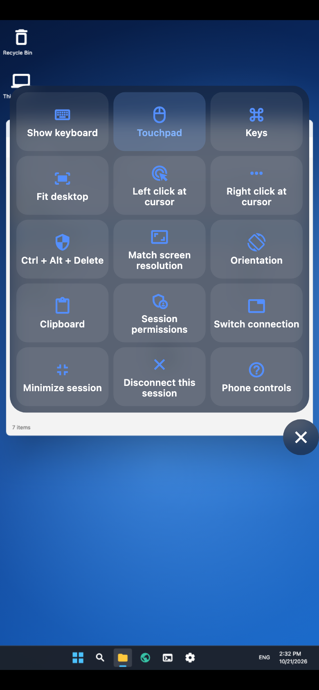

Controles de sesión en orientación retrato.

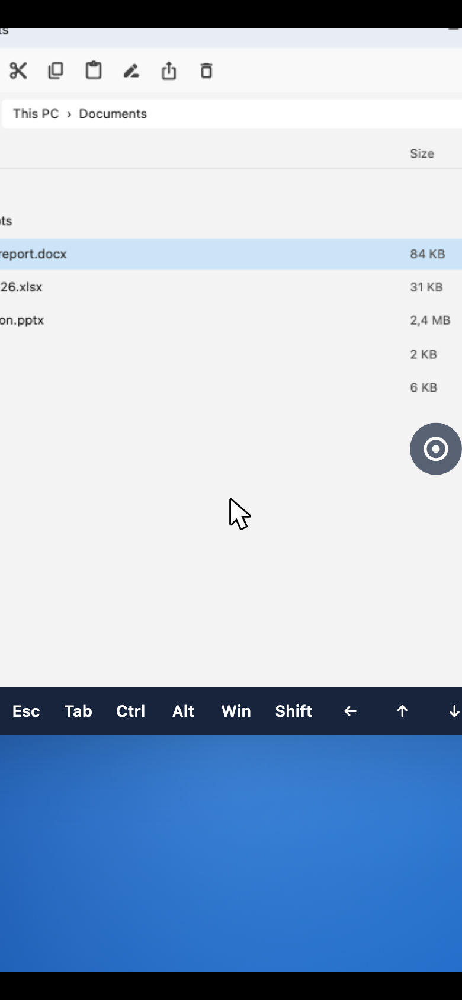

Extra-key strip encima de la zona reservada de teclado de sistema.

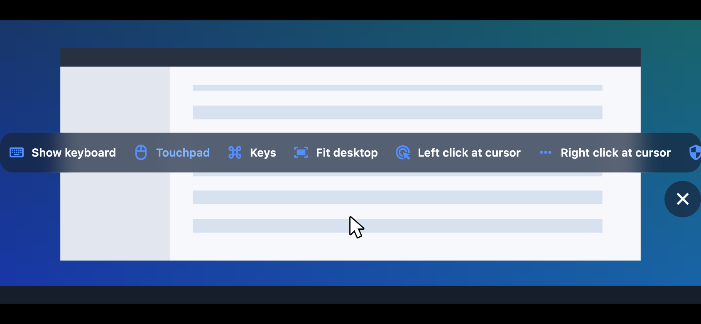

Orientación paisajística y controles de sesión.

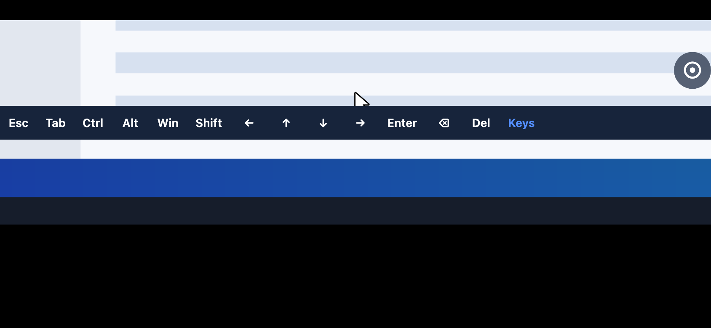

Llaves en la orientación del paisaje; el tamaño del escritorio se mantiene estable.

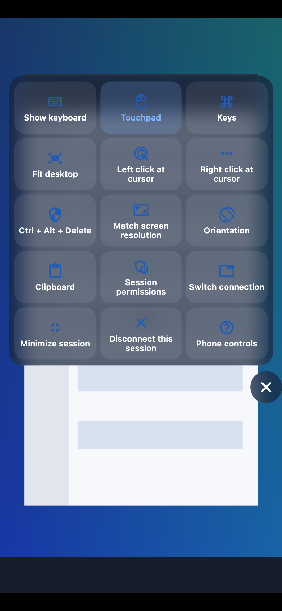

Los mismos controles en el tema ligero.

<a name="quick-connect"></a>

## 11. Búsqueda rápida y conexión

Encuentre un host guardado desde cualquier lugar de la aplicación y abra una sesión SSH o RDP. La paleta de comandos reúne anfitriones, francotiradores y acciones rápidas.

1. En la barra superior, el botón redondo “+” abre los hosts guardados SSH y RDP. Busque un host por nombre o dirección y seleccione para conectar. Si no se guarda todavía, haga clic en "Nuevo host". La búsqueda llena el espacio disponible entre el título de sección y el botón “+”; el estado compacto “Sync” aparece a la derecha.

2. Presione solubleK en macOS o Ctrl+K en Windows / Linux . Escriba un nombre de host o dirección IP; la búsqueda también coincide con la dirección y el nombre de usuario que se muestra en su etiqueta de conexión.

3. Mira en el grupo de anfitriones. Los detalles de la conexión aparecen debajo de cada nombre: comprueba la dirección, nombre de usuario y puerto antes de elegir.

4. Elija un resultado con ↑ y ↓, luego presione Enter o haga clic en su fila. La aplicación abre una sesión terminal SSH o RDP según el tipo host. En la primera conexión, compruebe la llave de host SSH o certificado RDP.

5. Esc cierra la paleta. Si no se encuentra un host, agréguelo en Hosts y busque de nuevo.

> **Ten en cuenta**
>
> La búsqueda de host guardado funciona localmente. Si el nombre introducido o la dirección IP no se encuentra, Enter no envía una solicitud de AI. Para utilizar AI, haga clic explícitamente en su fila o seleccione con las teclas de flecha y confirme. La escritura de una dirección no crea un nuevo anfitrión.

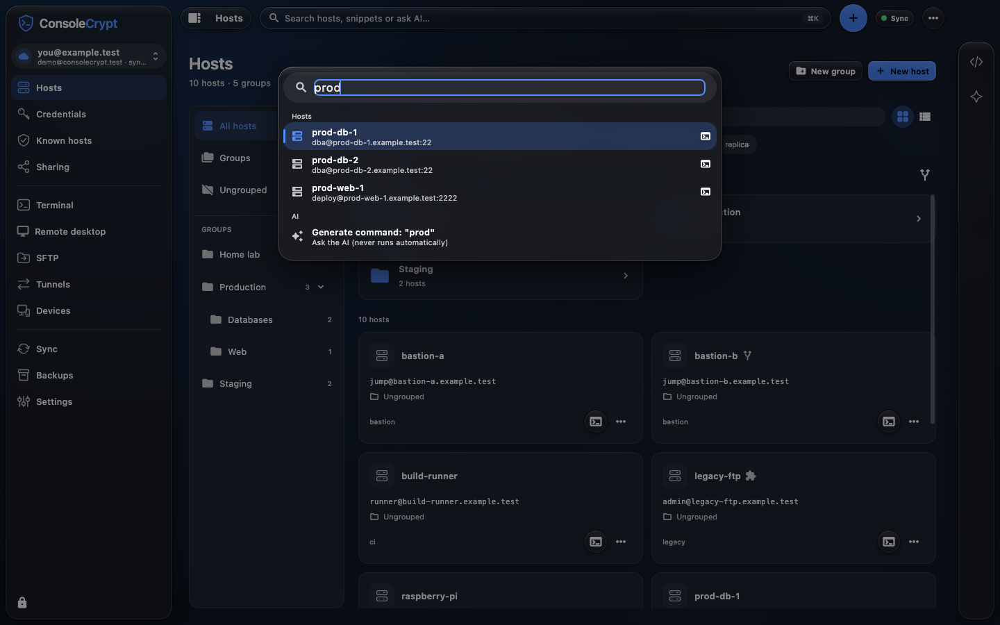

Búsqueda local de anfitriones guardados en la paleta de comandos.

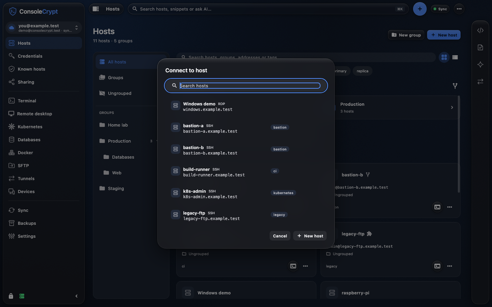

El “+” global: elegir los hosts salvados SSH y RDP.

<a name="groups"></a>

## 12. Grupos y anfitriones saltar

Los grupos organizan su inventario y proporcionan ajustes comunes. Una cadena de salto-host alcanza un host SSH a través de máquinas intermedias.

1. Abra “Hosts” en el menú izquierdo y haga clic en “Nuevo grupo”. Los huéspedes y grupos comparten un inventario; usan grupos anidados para entornos y proyectos.

2. Establecer el nombre de usuario común de un grupo, el puerto, el perfil credencial y de salto-host. Un valor establecido directamente en un anfitrión anula la herencia.

3. Cree un perfil de salto-host y elija los hosts existentes en el orden requerido. Asignar el perfil a un grupo o huésped individual.

4. En la tarjeta de hosts Jump del formulario de host elegir “Inherit / direct” (el perfil del grupo, si lo hay), “Perfil del archivo” o “cadena del cliente”. Una cadena personalizada se construye a partir de los hosts existentes con el botón add-hop; no hay límite en los tubos, y la ruta resultante se muestra debajo de la cadena.

5. Antes de mover o eliminar un grupo, compruebe la configuración heredada resultante: cambiar su padre puede cambiar la conexión.

> **Ten en cuenta**
>
> El cliente establece SSH conexiones directamente, incluyendo los anfitriones de salto. El servidor de sincronización nunca retransmite SSH tráfico. Un grupo privado y una colección compartida son objetos diferentes; las colecciones compartidas se explican a continuación.

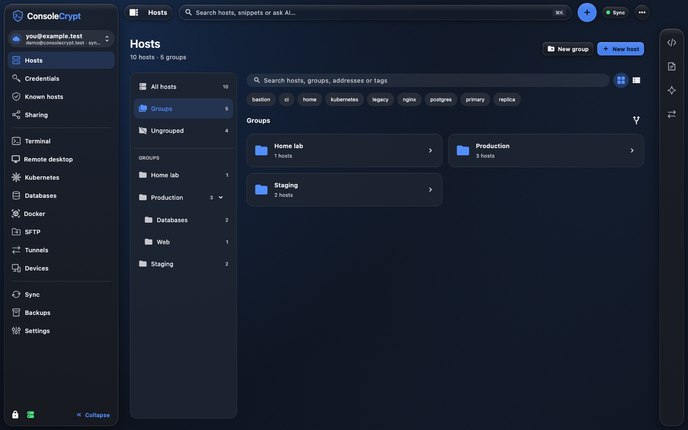

Grupo de demostración inventario y navegación en el espacio de trabajo.

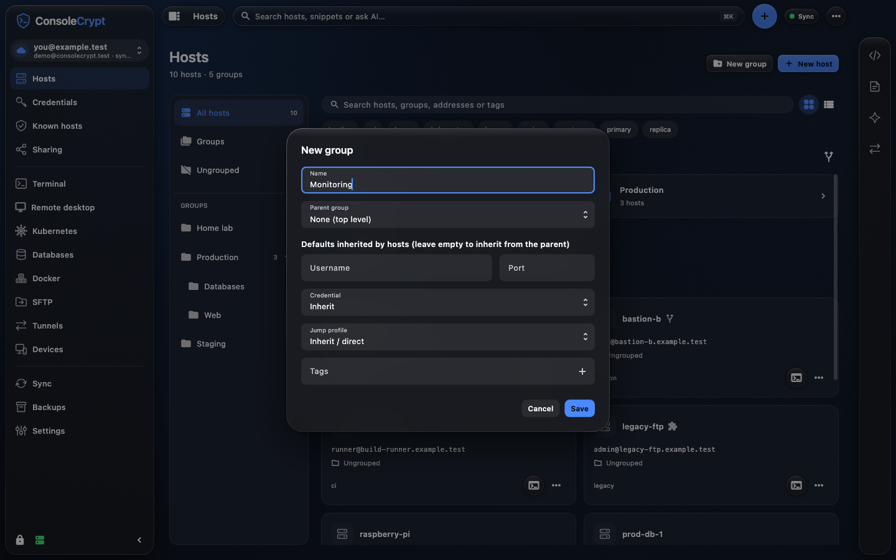

Un nuevo grupo: su nombre, padre y defectos para sus anfitriones.

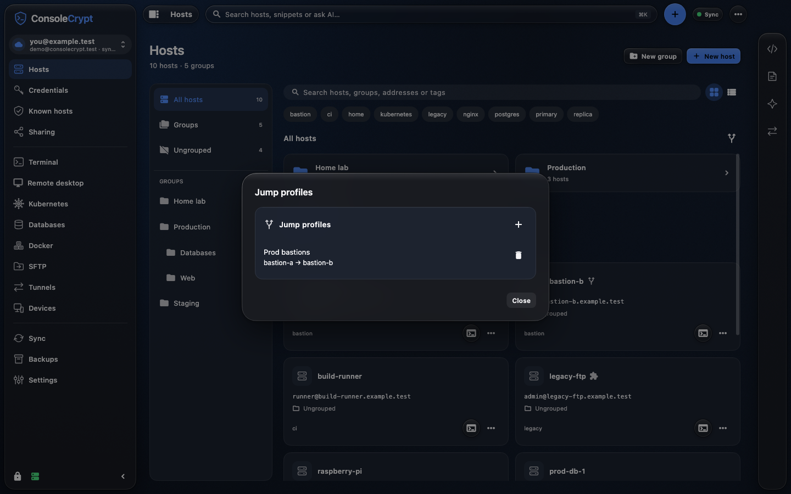

Perfiles de salto: cadenas de anfitriones intermedios.

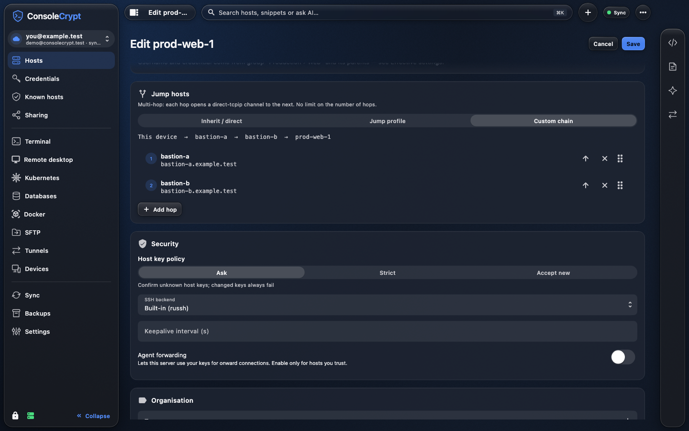

Una cadena personalizada de dos anfitriones de salto y la ruta resultante al host.

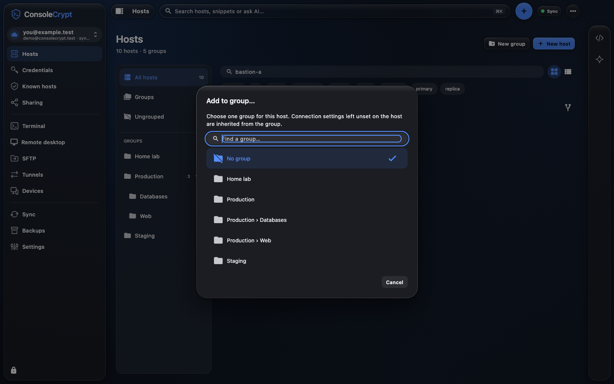

Añadiendo un host demo a un grupo existente.

<a name="password-manager"></a>

## 13. KDBX administrador de contraseña

Las contraseñas abren las bases de datos KeePass KDBX 3/4. SSH /RDP credenciales permanecen en su propia sección; KDBX entradas no se copian automáticamente allí.

1. Desde 1.1.0, la lista inferior a la izquierda sólo muestra bases de datos desbloqueadas. El pequeño botón de bloqueo al lado + abre otras bases de datos recordadas. Seleccione una para desbloquearla; su ... menú y WebDAV configuración permanecen disponibles en ese selector.

2. Todas las entradas y ninguna carpeta son filtros de entrada, separados del árbol de carpeta real. Ninguna carpeta muestra entradas almacenadas en la raíz de la base de datos, por lo que no puede ser renombrada como una carpeta. El cubo de reciclaje está separado de grupos activos. Las tarjetas de campo son más compactas mientras se adaptan valores largos y texto más grande.

3. En la pantalla de bienvenida, elija Crear KDBX , Abrir KDBX o Conectar WebDAV . Introduzca la contraseña de la base de datos y seleccione un archivo clave cuando sea necesario. Utilice + junto a las bases de datos de Contraseña para agregar otra base de datos.

4. Las carpetas de la base de datos seleccionada aparecen a la izquierda, con bases de datos desbloqueadas y un selector para los demás en la parte inferior. Buscar entradas por título, nombre de usuario o URL en el centro y abrir una tarjeta a la derecha. Arrastre el divider para cambiar el tamaño de la lista y la tarjeta.

5. Añadir entrada y Agregar grupo crear contenido. Las entradas admiten un título, nombre de usuario, URL , contraseña, notas y campos personalizados. Confirmar un formulario guarda inmediatamente el archivo cifrado; el estado al lado del nombre de la base de datos muestra el resultado.

6. Desde 1.0.4, utilice el menú de una carpeta ... o haga clic derecho para cambiar su nombre o eliminarlo después de la confirmación. La eliminación mueve la carpeta, subgrupos y entradas a la barra de reciclaje KDBX; el grupo raíz y el sistema bin en sí están protegidos de la eliminación. Una carpeta que contiene el cubo de reciclaje del sistema sólo puede ser renombrada. En un teléfono, seleccione una carpeta con el botón de grupos, luego abra el menú adyacente .... Ambos cambios autosalden, incluyendo WebDAV bases de datos.

7. En 1.0.6, el contenedor de reciclaje del sistema tiene un icono de basura. Seleccione o una carpeta reciclada y utilice la papelera de reciclaje Empty, también disponible en el menú de la papelera. La confirmación elimina todos los grupos reciclados, subgrupos y entradas preservando al mismo tiempo datos activos. Un grupo o entrada reciclado también tiene Eliminar permanentemente con confirmación. El bin del sistema vacío permanece; los cambios autosalva, incluyendo WebDAV .

8. Comenzando con 1.0.1, las notas en una tarjeta abierta siempre son visibles como texto plano, incluyendo múltiples líneas. La contraseña y los campos secretos personalizados permanecen enmascarados; el archivo KDBX permanece encriptado.

9. Haga clic derecho en una entrada para abrir su tarjeta, moverla a otro grupo o eliminarla. También puede arrastrar entradas a carpetas. En un teléfono, utilice el botón ... o una larga prensa.

10. Haga clic derecho en una base de datos o use ... para bloquearla, guardar una copia local o eliminarla de la lista; WebDAV también tiene ajustes de conexión. Eliminar una base de datos de la lista no elimina su fuente KDBX . La contraseña y el archivo clave permanecen disponibles para la reapertura.

11. En Android / iOS , un archivo local se importa en un almacenamiento privado duradero de aplicaciones. Autoseguir los cambios que copian; Guardar la copia local exporta a través del selector del sistema. Use WebDAV para editar un archivo remoto de varios dispositivos.

12. Después de que la primera contraseña se desbloquee, active el desbloqueo rápido para esta base de datos en este dispositivo a través de Windows Hola, Protección del sistema de Apple o Android Keystore. FIDO2/PRF está disponible en Windows / macOS . Linux el desbloqueo rápido biométrico aún no se implementa; iOS Las capacidades de los simuladores dependen de su entorno.

> **Ten en cuenta**
>
> KDBX no se envían archivos al servidor de sincronización ConsoleCrypt. Los caminos locales y las teclas de desbloqueo rápido pertenecen a este dispositivo. Los botones de copia usan el temporizador compartido de limpieza de tableros secretos en los ajustes de seguridad.


Sólo la base de datos desbloqueada permanece en la lista; el botón de bloqueo abre otras bases de datos recordadas.


Elige una base de datos para desbloquear. Su menú de gestión está disponible antes de la apertura.


KDBX bienvenida: crear, abrir o conectar WebDAV .


Carpetas, lista de entrada y tarjeta compacta con datos demo.


Menú de grupo: renombrar o mover a la papelera de reciclaje.


Renombrar al grupo seleccionado sin cambiar su contenido.


Confirme el traslado de un grupo y todo su contenido a la barra de reciclaje KDBX.


El menú del grupo seleccionado en un teléfono.


Papelera de reciclaje del sistema: icono de basura, una entrada eliminada y el botón claro.


Confirme la eliminación de cada grupo y la entrada en la papelera de reciclaje.


Eliminar permanentemente un grupo reciclado individual.


Reciclar papelera y botón despejado en un teléfono.


Editor de entrada y campos personalizados; secretos están enmascarados.


El menú contextual de entrada.


Elegir otra carpeta para una entrada.


Lista de entrada y menús táctiles en una pantalla estrecha.


Tarjeta de entrada en un teléfono.

<a name="password-generator"></a>

## 14. Generador de contraseñas

El generador está disponible en la pantalla de bienvenida del administrador, en una base de datos abierta y en el editor de contraseñas. Funciona en tu dispositivo sin un servidor.

1. Elija una longitud de 8 a 128 utilizando el control deslizante o el número. Permite letras mayúsculas, letras minúsculas, dígitos y caracteres especiales según sea necesario. Puede excluir caracteres similares.

2. Generar de nuevo crea otra contraseña aleatoria. El indicador estima la entropía de la configuración de generación; no es un cheque de incumplimiento.

3. En el editor, elija Usar contraseña, a continuación, guardar la entrada. Cuando se abre por separado, copie la contraseña; el portapapeles sigue la configuración de seguridad compartida.


Longitud, conjuntos de caracteres y estimación de entropía; la contraseña está enmascarada.

<a name="password-webdav"></a>

## 15. KDBX más WebDAV y sincronización

Configure WebDAV antes de abrir una base de datos. ConsoleCrypt cifra los ajustes de conexión y lee y guarda el KDBX en su servidor WebDAV.

1. El menú ... junto a un botón de configuración de la base de datos desbloqueado WebDAV expone el desbloqueo rápido a través de la autenticación del dispositivo y una clave física en las plataformas soportadas. Abra la base de datos con su contraseña primero. WebDAV configuración sincronizar por separado; la tecla de desbloqueo rápido permanece en el dispositivo.

2. Seleccione Connect WebDAV e introduzca un nombre, el completo HTTPS URL terminando en .kdbx, un nombre de usuario y una contraseña WebDAV o una ficha de aplicación. Una dirección de host o carpeta sola es rechazada antes de que la red abra.

3. Después de guardar la conexión, desbloquee la base de datos utilizando su contraseña y archivo clave si es necesario. Las contraseñas WebDAV y KDBX son secretos diferentes. La apertura puede ser cancelada; las operaciones de red tienen timeouts.

4. Los cambios confirmados guardan automáticamente a WebDAV . Safe escribe utilizar un ETag; un servidor sin un ETag confiable debe soportar WebDAV LOCK. Un archivo cambiado externamente nunca es silenciosamente sobrescrito.

5. Después de un error o conflicto, los cambios permanecen en la base de datos abierta. Guardar una copia local antes de resolver el conflicto. Retry guarda errores de red temporales sin desactivar la protección de sobreescritura.

6. Actualice cada dispositivo a 1.0.0 antes de añadir WebDAV conexiones. Los ajustes viven dentro de la configuración de la bóveda cifrada y la contraseña en un secreto encriptado separado. Un cliente más viejo puede dejar un campo desconocido al guardar la configuración.

7. Conecta WebDAV en el ordenador y sincroniza tu perfil. Abre el mismo perfil en el teléfono y elige la base de datos WebDAV. En Bases de datos recientes puedes abrir hasta cinco bases recientes de este dispositivo.

8. Abre la base con su contraseña maestra. Si el teléfono ofrece desbloqueo rápido, actívalo para esta base y confirma con la huella o el PIN del sistema.

> **Ten en cuenta**
>
> ConsoleCrypt servidor 0.2.4 / protocolo 1.13 ya transporta estos objetos cifrados; no se necesita nueva API o migración de bases de datos. No transporta el KDBX , archivo clave o teclas de desbloqueo rápido.


Ajustes de conexión con un ejemplo de un archivo completo HTTPS URL .

<a name="password-palette"></a>

## 16. Contraseñas en la paleta de comandos

Encuentre un nombre de usuario, contraseña o clave de API de cualquier sección, incluyendo el terminal. Elige la entrada primero, luego el campo.

1. Abra la paleta con Ctrl+K (Cmd+K en Mac) o el botón de búsqueda e introduzca contraseñas: (o la etiqueta de contraseñas localizadas seguida de un colon). Puede abrir una KDBX directamente desde la paleta cuando sea necesario.

2. Escriba parte de un título, nombre de usuario o URL . Elija una tarjeta con las flechas y Enter o haciendo clic. Este paso no copia un secreto.

3. En el siguiente menú, seleccione una contraseña, nombre de usuario, URL , notas o campo personalizado como API token. Introduzca copias sólo ese campo y cierre la paleta. Esc vuelve a la lista de entrada.

4. La base de datos debe ser desbloqueada; bloquear el perfil cierra bases de datos abiertas. Los valores secretos no se muestran en los resultados de búsqueda. Las copias usan el temporizador de limpieza de portapapeles compartido.


Encuentra una entrada por título antes de copiar cualquier cosa.


Segundo paso: elija el campo para copiar.

<a name="credentials"></a>

## 17. Contraseñas, claves y credenciales

Las credenciales están separadas de los anfitriones: se puede asignar una credencial a múltiples conexiones.

1. En “Credentials → Nueva credencial”, elija un tipo: una contraseña, una clave nueva SSH, una clave importada, un certificado SSH (una clave privada más su certificado OpenSSH) o un agente SSH — el sistema uno o un agente externo por vía de toma o tubería. Para importar una clave, pegarla o elegir “Elija archivo...”: el archivo (hasta 64 KB) se lee sin hacer una copia.

2. Una nueva clave se genera en el dispositivo como Ed25519 , RSA 3072 o RSA 4096; la parte privada va directamente a la bóveda y la llave pública se muestra para llaves autorizadas. Las teclas FIDO2 aún no se pueden crear.

3. Usa un nombre descriptivo. Asignar la credencial a un host o grupo; introducir una contraseña clave por separado cuando sea necesario.

4. Abra su tarjeta para metadatos y la llave pública. Un secreto se revela sólo después de una acción explícita; maneje las copias del portapapeles cuidadosamente.

5. Un secreto copiado se mantiene fuera de la historia del portapapeles y otros dispositivos y se aclara después de la salida en “Configuraciones → Seguridad” si el portapapeles no ha sido reemplazado por otro valor. Cambiar el ajuste afecta a copias futuras; si la aplicación se cierra antes del plazo, el claro se completa al siguiente comienzo. Vea “Screenshots, protección de pantalla y portapapeles” para más detalles.

> **Ten en cuenta**
>
> No ponga una contraseña o clave privada en un nombre de host, nota o snippet. Utilice el flujo de trabajo compartido protegido separado para compartir un secreto con un colega, en lugar de chat AI.


Credenciales en una bóveda demo; los valores están enmascarados.


Elegir el tipo de una nueva credencial.


Generando una tecla SSH: nombre y algoritmo.

<a name="host-keys"></a>

## 18. Los anfitriones conocidos y SSH - verificación clave

Una clave del servidor identifica el SSH host al que se está conectando. Esto está separado de confiar en un dispositivo ConsoleCrypt.

1. En primera conexión, compare la huella clave con el administrador u otra fuente de confianza antes de aceptarla.

2. Las teclas guardadas aparecen en la sección de barra lateral de “Hotes conocidos”. Revisa la dirección, algoritmo y huella dactilar.

3. Si la clave cambia, la conexión está bloqueada. Establecer la razón primero; eliminar la vieja entrada sólo después de verificar independientemente la nueva clave.


Una lista separada de hospedaje con huellas demo.

<a name="terminal"></a>

## 19. Terminal, pestañas y selección

Una pestaña tiene una sesión terminal SSH , más conchas locales en macOS y Windows ), o hasta cuatro lado a lado cuando se dividen en paneles. Los teléfonos tienen una barra especial; los ordenadores tienen atajos y un menú contextual.

1. En Windows , macOS y Linux , permite el modo Minimal con el botón de barra de herramientas terminal o Ctrl+Shift+M / latitud⇧M. Sólo quedan las pestañas terminales y superiores o izquierdas. Las sesiones, la salida y los paneles divididos permanecen intactos; Ctrl+K / solubleK abre la paleta de comandos habitual. El botón de salida o el mismo atajo restaura la interfaz. Este modo está ausente en los teléfonos.

2. Una sesión SSH tiene un botón Abierto SFTP en la parte superior izquierda. La misma acción está en el menú de clic derecho de la pestaña, incluyendo pestañas inactivas, y abre el servidor de la pestaña. Funciona en modo Minimal y mantiene sesiones terminales. Los terminales locales no tienen SFTP botón.

3. Haga clic dentro de la terminal para escribir. El botón “+” abre otra conexión. Cuando las pestañas se desbordan, desplaza la tira con la rueda del ratón o sus flechas de borde. El número total de pestañas abiertas aparece entre paréntesis junto a las flechas.

4. Para seleccionar varias pantallas de salida, mantén el botón del ratón y desplaza la historia con la rueda. Mueva el puntero más allá de la parte superior o inferior del terminal para desplazarse automáticamente mientras se extiende la selección.

5. Seleccione texto y haga clic derecho para el menú. Ofrece Copia, Pegar, Seleccione todo, Pregúntele a AI y guarde la selección como un snippet. Shift+F10 lo abre desde el teclado.

6. En un teléfono, utilice el icono del teclado y “...” debajo del terminal. Esc, Tab, Ctrl+C, Ctrl+D, Ctrl+L y flechas también están disponibles en la barra desplazable.

7. Los caracteres de pasta y control multilínea requieren revisión. Compruebe el objetivo y el texto antes de confirmar; la ejecución sigue siendo su acción.

8. Haga clic derecho en una pestaña para cambiar el nombre, duplicar, cerrarla, cerrar otros o cerrar pestañas a la derecha. Se destaca una pestaña de fondo con nueva salida, y la barra lateral muestra un recuento separado de tales pestañas al lado del recuento de pestañas. Ajustes → Terminal establece la fuente (de fuentes monoespaciales instaladas) y la pestaña subtítulo: el nombre de la lista, la dirección o el nombre de la computadora, o nada.

9. En el escritorio se puede arrastrar una pestaña a otro lugar, en la tira en la parte superior y en la columna a la izquierda; en la columna Alt+↑ / Alt+↓ hacer lo mismo. La pestaña activa se mantiene activa. El botón de división en la barra de pestañas abre otra sesión al mismo objetivo a su lado — "Split right" (Cmd/Ctrl+Shift+\\) o "Split down" (Cmd/Ctrl+Shift+−), hasta cuatro paneles por pestaña; un clic o Cmd/Ctrl+\] mueve la entrada a otro panel, los separadores pueden cerrar el título

10. Después de una desconexión, utilice la reconexión en el banner de la pestaña. El búfer de salida permanece hasta que la pestaña cierra; el cierre termina esa sesión.

11. “Configuración → Terminal → Colocación de la pestaña”: Parte superior o izquierda. Izquierda es una columna de pestañas con nombres y direcciones; arrastre su borde para cambiar el ancho o doblarlo a iconos. Mientras que la columna se muestra, la barra lateral de la aplicación permanece doblada hasta que la despliega. La elección se mantiene en este dispositivo.

> **Ten en cuenta**
>
> Abra una nueva sesión SSH después de actualizar. Incorporado SSH solicita a UTF-8 que entre y elimine el texto cirílico. Si los caracteres aún están dañados, compruebe la UTF-8 local del host remoto: su cáscara y SSH - los ajustes del servidor pueden anular la solicitud del cliente.


Menú contextual sobre una selección en la terminal demo.


Modo mínimo con las pestañas superiores y el botón SFTP a la izquierda.


Modo mínimo con una columna de la pestaña izquierda; las sesiones y la salida continúan funcionando.


La paleta de comandos Ctrl+K sigue disponible en la terminal mínima.


Una pestaña se divide en dos paneles: un comando a la izquierda y un registro del mismo anfitrión a la derecha, cada panel con su propia sesión.


El menú de pestañas en el botón derecho: renombrar, duplicar y cerrar.


“Configuración → Terminal”: fuente, tamaño, esquema de color y tab subtítulo.


Texto seleccionado en el centro de la historia de desplazamiento de la terminal de demostración.


Ocho pestañas demo abiertas: navegación de tira y cuenta de pestañas.


Demo Android terminal con su barra especial.

<a name="local-terminals"></a>

## 20. Terminales locales: zsh, PowerShell y WSL

En macOS y Windows se puede abrir una cáscara en esta computadora junto con SSH pestañas. Se ejecuta como su usuario ordinario del sistema operativo y no requiere un servidor de sincronización.

1. En la paleta Cmd+K / Ctrl+K, seleccione Nuevo terminal local. macOS abre zsh inmediatamente; Windows ofrece distribuciones PowerShell, cmd e individuales WSL.

2. Abrir Terminal y utilizar su botón de nueva pestaña, Cmd+T en macOS o Ctrl+T en Windows . Bajo las cáscaras locales elige zsh Windows PowerShell, Command Prompt o PowerShell instalado 7. El “+” global de la aplicación todavía abre el SSH /RDP host picker.

3. Cada distribución WSL instalada aparece por separado. Elija Ubuntu, Debian u otra distribución disponible; puede abrir varias pestañas para una cáscara. El cliente no instala WSL en sí mismo.

4. Compruebe el nombre de la etiqueta de ordenador y la distribución WSL cuando se cambia entre las pestañas locales y SSH. Los programas de entrada, redimensionamiento, Ctrl+C y interactivos utilizan un PTY/ConPTY real. SFTP es una acción anfitriona SSH y está ausente de la pestaña local.

5. AI recibe el dialecto de cáscara activo y sólo el contexto explícitamente seleccionado. Los comandos y los snippets AI se pueden insertar en una pestaña local sin Enter; la ejecución automática está deshabilitada. Revise el texto y presione Introdúcese si desea ejecutarlo.

6. Cerrar una pestaña termina su proceso. La cáscara de reinicio comienza una nueva sesión. Interruptor de perfil y dejar de cerrar la cáscara y su grupo de proceso de primer plano actual. El bloqueo de la bóveda (también automáticamente) mantiene los terminales abiertos: las pestañas locales y SSH continúan después del desbloqueo. No se buscan procesos desprendidos o subterráneos, como el nohup, y no se detiene toda la distribución WSL.

> **Ten en cuenta**
>
> Conchas locales en 0,5 soporte macOS y Windows . El paquete macOS funciona sin App Sandbox y reutiliza el almacenamiento existente en su lugar; mantener el contenedor 0.4.1, modelos, bóveda y Keychain. El almacenamiento conflictivo o no legible detiene el inicio antes de crear un nuevo perfil. Las imágenes de abajo usan widgets con perfiles sintéticos, no una carrera nativa WSL.


Nuevo terminal local en la paleta de comandos.


Elegir zsh local y SSH hosts: interfaz real con perfiles demo.


SSH y zsh local lado a lado. El texto de la terminal es sintético; no se ejecutan comandos de usuario.


Windows - de estilo picker para PowerShell, cmd y dos distribuciones WSL en una prueba de widget macOS - anfitriona. No corrieron conchas.

<a name="shortcuts"></a>

## 21. Atajos de teclado

El modificador principal es soluble en macOS y Ctrl en Windows / Linux . Copiado en Windows no utiliza Ctrl+C, que interrumpe un comando. Los atajos de la aplicación se pueden remapped en Ajustes → Atajos de teclado: elegir Cambiar y presionar una nueva combinación con χ/Ctrl o Alt. Si otro comando lo tiene, ese comando lo pierde; si el sistema o terminal lo usa, se le advierte. Restaurar defectos trae de nuevo la tabla abajo.

| Medida | macOS | Windows / Linux |
| --- | --- | --- |
| Encuentra un host, un snippet o una acción | ∙K | Ctrl+K |
| Nueva pestaña SSH | ∙T | Ctrl+T |
| Cerrar ficha activa | . . | Ctrl+W |
| Nuevo anfitrión | ∙N | Ctrl+N |
| Bóveda de bloqueo | ▪L | Ctrl+L |
| Ajustes | ⌘, | Ctrl+, |
| Snippets | ⌘. | Ctrl+. |
| Copiado en terminal | . . | Ctrl+Shift+C |
| Pegado en terminal | Especificaciones métricas | Ctrl+V; también Shift+Insert on Windows |
| Terminal de división derecha | ⌘⇧\\ | Ctrl+Shift+\\ |
| Terminal de separación | ⌘⇧− | Ctrl+Shift+− |
| Siguiente panel terminal | ⌘\] | Ctrl+\] |

> **Ten en cuenta**
>
> Los atajos de aplicación tienen prioridad sobre la entrada terminal. Para enviar Ctrl+L a la concha remota en un teléfono, utilice su botón de tecla especial.


“Configuración → Atajos de teclado”: cada acción puede ser rematada o restaurada a su defecto.

<a name="sftp"></a>

## 22. SFTP : transferencias y vista previa del archivo

Abra SFTP desde el menú del host o la barra lateral. Los archivos viajan directamente entre el dispositivo y el host SSH.

1. Seleccione un host y conéctese. En una computadora, utilice las cacerolas locales y remotas; en un teléfono, cambie las zonas y utilice el selector de archivos del sistema.

2. Seleccione un archivo y elija cargar o descargar. El panel de actividad muestra el progreso de transferencia y cancelación.

3. Los archivos se pueden arrastrar: desde Finder o Explorer en la lista de hosts para subir, desde la lista de hosts en el panel local para descargar, en una carpeta o la barra de ruta para moverse en el servidor. En macOS y Windows , los archivos de la lista de host se pueden arrastrar directamente a Finder o Explorer: el archivo se descarga en una carpeta temporal, se entrega al sistema y se elimina, con el progreso en Transferencias. Las carpetas no van de esta manera; use Download para ellos. Linux no tiene arrastre.

4. Para leer, abra “Quick Look”. Los números de línea están en una barra separada y están excluidos de la selección y copia de texto.

5. Una carpeta que el usuario SSH no puede leer está marcada como inaccesible en lugar de verse vacío. Desde Docker , un volumen o camino de montaje en un SSH host se abre directamente en SFTP .

6. El menú de acciones (botón de barra o clic derecho) reúne todo para los archivos seleccionados: abrir, abrir con, Quick Look, descargar, subir aquí, nueva carpeta y nuevo archivo, renombrar, duplicar, eliminar, Obtener información, copiar ruta o nombre y refrescar.

7. Obtener Info muestra el tamaño, ubicación, propietario y permisos. Cambia los permisos con las casillas de verificación Read, Write and Execute para propietario, grupo y otros o con un código octal; Apply los guarda en el servidor. Para un enlace simbólico, los permisos se aplican al artículo que apunta.

8. La barra de ruta puede ser editada o copiada; la búsqueda filtra la carpeta actual. Las columnas, “Folders first” y mostrar archivos ocultos se establecen en el encabezado de la lista, y las transferencias fallidas pueden ser retraídas del panel de actividad.


Quick Busque un archivo demo con una cadena de números de línea separada.


El menú de acciones para un archivo seleccionado en un host demo.


Obtener información para un archivo: tamaño, propietario y permisos con el código octal.


El panel local a la izquierda y el host remoto a la derecha; se muestra un demo “disk” /Usuarios/demo.


El panel Transferencias: descargas y una carga se realizan, y una transferencia fallida tiene un botón de reingreso.

<a name="sftp-editor"></a>

## 23. SFTP : editor por defecto

En un ordenador, los archivos pueden abrirse en un editor externo. ConsoleCrypt recuerda la aplicación elegida en ese dispositivo.

1. En “Configuraciones → Editor predeterminado para SFTP ”, elija “Elija Aplicación” y seleccione un código VS instalado, Zed u otro editor.

2. “Open” y “Open in editor” usan esa opción. “Open with...” selecciona otra aplicación para un archivo; “System default” restaura la preferencia.

3. ConsoleCrypt nunca ejecuta archivos cuya acción predeterminada ejecutaría código (scriptos, atajos, .exe, .command, .desktop y similar). “Abrir” primero advierte “Este archivo puede ejecutar código”, luego “Abrir como texto” abre el archivo en un editor de texto. Cuando no se encuentra ningún editor, “Elige un editor...” se ofrece. Los archivos descargados están marcados como provenientes de Internet Windows ) y cuarentena macOS .

4. Lea el aviso de primer uso: una copia de trabajo se almacena localmente, y cada guardar la carga al servidor remoto automáticamente.

5. Si otro usuario cambia el archivo remoto, resuelva el conflicto en el panel de edición. Deja de editar a través de ConsoleCrypt para completar la carga y eliminar la copia de trabajo.

> **Ten en cuenta**
>
> Autosalvado externo, respaldos y características de la nube están fuera ConsoleCrypt ’s control. La carpeta de copia de trabajo lleva CACHEDIR.TAG y .nobackup, por lo que borg, restic, tar y otras herramientas de copia de seguridad que los honran saltar; en macOS se excluye de Time Machine. Esta preferencia es para sistemas de escritorio; el manejo de archivos móviles depende de las capacidades del sistema.


La preferencia local recordada por el cliente demo.


Abra un script: el archivo se abre como texto y nunca se ejecuta.

<a name="tunnels"></a>

## 24. SSH túneles

Un túnel utiliza una conexión SSH con el anfitrión elegido. Se dispone de reenvío local, reenvío remoto y SOCKS5 dinámico.

1. Al reenviar un puerto desde Docker o Kubernetes, active Guardar túnel. El preset aparece en Tunnels, donde se puede iniciar, parar o quitarlo. Puerto 0 selecciona un puerto local disponible en cada inicio.

2. Abra “Tunels” y cree uno. Seleccione el host, tipo, dirección de escucha y puerto; para el reenvío local o remoto, especifique una dirección de destino y puerto.

3. Preferir 127.0.0.1 para un servicio local que sólo necesita usted. Una dirección no retrocedente (como 0.0.0.0) muestra una advertencia “No ligada al retroceso” y el túnel se puede salvar sólo después de marcar “Entiendo que este túnel es accesible desde la red”. Para el reenvío remoto de tal dirección funciona sólo si el servidor SSH permite GatewayPorts.

4. Comience el túnel con su interruptor y compruebe su estado: la fila muestra conexiones activas y tiempo de funcionamiento, o la razón después de un error. Deténgase cuando termine. “Empieza automáticamente después de desbloquear” trae el túnel cada vez que la bóveda se desbloquea en este dispositivo.

> **Ten en cuenta**
>
> Las definiciones de túnel ordinarias SSH pueden sincronizarse con la bóveda. Guardado Docker / Kubernetes de avance se mantiene local a este perfil y dispositivo; un túnel de funcionamiento pertenece al dispositivo donde se inició. En los teléfonos, la operación de fondo depende de las restricciones del sistema operativo.


Definiciones y estatus del túnel de demostración.


Guardar un preset al crear un Docker adelante; datos demo solamente.


Restart salvó hacia adelante de Tunnels.


Reenvío remoto en 0.0.0.0: la advertencia y el reconocimiento requerido.

<a name="snippets"></a>

## 25. Snippets, variables y conjuntos de arranque

Un snippet es un comando o plantilla guardado. Abra la herramienta con el icono &lt;/&gt; en la derecha o su acceso directo.

1. Elija “New snippet” e ingrese su nombre, comando, tipo, etiquetas y conjunto opcional. Use variables como { {service} } en la plantilla; cada una puede tener una descripción y un valor predeterminado.

2. El nivel de riesgo — Solo lectura, Modificación, Destructiva o Desconocida— decide cuán estrictamente se confirma una carrera: la modificación y los comandos destructivos se ejecutan sólo después de marcar que usted comprobó el comando. Los comandos que inician otros programas o escriben los propios archivos nunca son sólo lectura: \`env -S\` , \`fd -x\` , \`rg --pre\` , \`sed\` con \`e\` / \`w\` , \`awk\` con \`\| getline\` , \`git -c\` — el nivel viene del comando envuelto, o es desconocido. En el equipo se organiza con la política “Preguntar antes de ejecutar comandos arriesgados” la garrapata siempre es necesaria.

3. “Iniciar paquetes” ofrece Linux diagnósticos, Docker , Kubernetes y conjuntos de bases de datos: SQL · PostgreSQL , SQL · MySQL/MariaDB y SQL · ClickHouse (20 consultas cada una), Redis, MongoDB y SQLite (15 cada uno), Cassandra / ScyllaDB (17) — consultas activas y de larga duración, cerraduras, tamaños, réplicas, réplicas, réplicas, índices, réplicas. Añadir los conjuntos explícitamente; sus comandos se convierten en objetos de bóveda ordinarios.

4. Los fragmentos de base de datos también se ejecutan dentro de psql, mysql, clickhouse-client, redis-cli y mongosh en una sesión SSH: una consulta multilínea se envía como una pasta, y los comandos cambiantes necesitan confirmación. En un espacio de trabajo de la base de datos, el botón Snippets ( XboxJ / Ctrl+J) inserta un fragmento para ese motor en el editor sin ejecutarlo.

5. Editar comandos, moverlos a otro set o eliminarlos. Eliminar un conjunto elimina sus fragmentos después de la confirmación y sincroniza el cambio; los ejemplos no reaparecen automáticamente.

6. Rellene las variables e inspeccione el comando renderizado antes de utilizarlo: el cuadro de diálogo de variables muestra una vista previa. “Insert” lo pone en el terminal sin Enter; “Run” abre una confirmación con el host, el comando y el nivel de riesgo. “Run en múltiples terminales...” en el menú snippet ejecuta el comando en las pestañas de terminal abierta que selecciona después de una confirmación separada.

> **Ten en cuenta**
>
> Snippet cambia de sincronización en un perfil conectado con el servidor. Se quedan en un perfil local. Un fragmento recibido de un colega nunca se ejecuta automáticamente tampoco.


Paquetes de arranque: Linux , Docker , Kubernetes y los conjuntos de bases de datos.


El editor de snippet: una plantilla con variables, sus defectos y el nivel de riesgo.


Antes de ejecutar: valores variables y una vista previa del comando final.


Confirmando un comando destructivo: el host, el comando y la garrapata requerida.


Filtrar y gestionar conjuntos de snippet.

<a name="ai"></a>

## 26. chat AI y el contexto que envía

Elija el proveedor, el contexto y la acción posterior. La respuesta de un modelo no ejecuta comandos.

1. En “Configuraciones → proveedores de IA”, seleccione “Añadir proveedor”: seleccione el tipo, dirección, modelo y, si es necesario, una clave de API (que se guarda en la bóveda), luego “Save &amp;quot; prueba”. Un proveedor está marcado como el predeterminado. Para un proveedor remoto, compruebe su dirección y su política de gestión de datos.

2. “La privacidad predeterminada” establece el perfil de la redacción; el diálogo del proveedor puede establecer un perfil diferente para ese proveedor.

3. El perfil Strict esconde secretos, direcciones, nombres de host, nombres de usuario y nombres de bases de datos. Standard mantiene metadatos anfitriones; Local proporciona más contexto mientras aún oculta secretos.

4. Seleccione el texto terminal requerido y elija “Ask AI”, o active adjuntar la selección en el chat. Revise el contexto antes de Enviar; no pegue secretos en texto libre.

5. Antes de “Insertar” o “Ejecutar...”, revise el comando propuesto y el host objetivo. La ejecución requiere confirmación; evaluar el comando usted mismo.

6. El botón “Historia de conversación” en el encabezado de chat enumera las conversaciones de esta sesión y las guardadas en la bóveda. Elija uno para continuarlo: los mensajes regresan al chat y el modelo recibe los giros anteriores de nuevo (con los mismos datos ocultos como antes). También se puede borrar una conversación allí.

7. Respuestas render Markdown: encabezados, listas, énfasis y código; comandos en bloques de código aparecen como tarjetas con acciones. El icono en la parte inferior de la barra lateral muestra quién responde por defecto: el modelo incorporado (chip), un servidor local (servidor) o una API de nube (globe); haciendo clic en él abre Ajustes. El chip es verde sólo mientras que el modelo incorporado se ejecuta en realidad: azul mientras comienza, rojo después de un error y gris cuando no está funcionando todavía; comienza con la primera petición.

> **Ten en cuenta**
>
> El subsistema AI no tiene acceso a la contraseña de la bóveda o claves privadas. Las conversaciones duran hasta que la bóveda se bloquea; con “Keep AI conversaciones en la bóveda” cada vuelta completa se almacena en la bóveda (y se sincroniza con ella), y los secretos escritos en una pregunta son reemplazados por los propietarios de lugares. Cerrar la bóveda o cambiar los perfiles aclara el chat y cancela la respuesta actual; esto no borra el contexto ya enviado al proveedor.


chat AI con contexto seleccionado de la terminal demo.


“Configuración → Proveedores de IA”: proveedores locales y remotos, el proveedor predeterminado y la privacidad predeterminada.


Añadiendo un proveedor: dirección, modelo, una clave API guardada en la bóveda y el perfil de privacidad.

<a name="local-ai"></a>

## 27. AI local: modelos, su propio GGUF y actualizaciones

En macOS , Windows y Linux x64, el modelo responde en su computadora. Elija Light Qwen2.5-Coder 1.5B, Medium Qwen3.5 4B o Strong Qwen3.5 9B y preserva los modelos descargados a través de las actualizaciones. También puedes añadir tu propio modelo GGUF.

| Tier | Modelo y descarga | Orientación RAM total |
| --- | --- | --- |
| Luz | Qwen2.5-Coder 1.5B Q4\_K\_M · 1.1 GB | 4 GiB |
| Mediana | Qwen3.5 4B Q4\_K\_M · 2.7 GB | 8 GiB |
| Pesado | Qwen3.5 9B Q4\_K\_M · 5,7 GB | 16 GiB |

1. En Ajustes, abra IA local incorporada y seleccione un modelo. La estrella recomienda un nivel basado en el sistema total de RAM, pero nunca cambia su elección automáticamente. RAM desconocida o menos de 4 GiB no muestra ninguna estrella. La guía RAM no es una garantía de velocidad.

2. Elija Instalar IA local. Los archivos son revisados por el tamaño exacto y SHA-256; el progreso es visible y las descargas pueden ser canceladas y reanudadas. Windows instala un tiempo de ejecución separado; macOS incluye el pequeño tiempo de ejecución en su paquete. Los archivos de modelo grandes no están agrupados en el instalador de aplicaciones.

3. Utilice por defecto después de que la instalación se guarde sólo en este dispositivo. Apagarla devuelve a su proveedor habitual. Después de instalar un modelo local con habilitado por defecto local, seleccionando otro modelo que no se descarga pide instalación en lugar de enviar silenciosamente la solicitud a la nube.

4. Añada su propio modelo (GGUF)... elige un archivo GGUF en el ordenador: la aplicación comprueba su encabezado, lo copia en la carpeta de modelos con un cheque SHA-256 y lo selecciona; puede eliminar el original. Su propio modelo está marcado Personalmente, la guía de memoria se calcula desde el tamaño del archivo, y su origen y licencia son suyos para comprobar. Eliminar elimina la copia y devuelve la selección a Qwen2.5-Coder 1.5B.

5. Los modelos de conmutación detienen el proceso actual y conservan los otros archivos GGUF. Eliminar elimina sólo el modelo seleccionado y sus descargas parciales. Actualizar o reparar el tiempo de ejecución reutiliza un modelo verificado; se conserva la preferencia original Qwen2.5-Coder 1.5B y predeterminado.

6. El modelo comienza en la primera solicitud o con Start. Se detiene después de 15 minutos inactivos, bloqueo de bóveda, interruptor de perfil o renuncia. Apple Silicon utiliza Metal; Intel Mac y Windows x64 usan CPU. La instalación incorporada no está disponible en Linux y plataformas móviles.

7. Open Model sources and licenses: Qwen publica el 1.5B GGUF, y Unsloth proporciona cuantizaciones GGUF de Qwen 4B/9B; los tres usan Apache-2.0. El texto de la licencia está disponible fuera de línea.

> **Ten en cuenta**
>
> Las solicitudes locales utilizan sólo 127.0.0.1 con un token aleatorio; el filtrado de contexto sigue activo. En los terminales locales, los comandos AI se insertan sin Enter y se ejecutan manualmente después de su revisión. Linux utiliza inferencia CPU x64; GPU/CUDA e instalación de modelos incorporadas en Android / iOS todavía no están soportados. En macOS , mantener el contenedor de datos anterior al actualizar 0.4.1 a 0.5: el perfil y el modelo se reutilizan en su lugar. Capturas de pantalla muestran estados sintéticos, no descargas reales o velocidades de respuesta.


Linux x64: elegir e instalar un modelo de CPU local. Estado sintético antes de descargar.


Tres modelos, tamaños y guía RAM. La estrella 9B utiliza hardware sintético 16 GiB, no una medición del ordenador del usuario.


Selección de modelos locales y la preferencia predeterminada. Perfil de demostración.


Descarga y verificación de progreso con cancelación; el progreso es sintético.


El modelo seleccionado está listo para detener y eliminar acciones; el estado del proceso es simulado.

<a name="notes"></a>

## 28. Notas, tareas y recordatorios

Notas es una herramienta de panel derecho junto a Snippets y AI. Ábrelo con el icono de la nota, desde la paleta de comandos o desde el encabezado del teléfono. Las notas se encriptan en el dispositivo y se sincronizan con la bóveda.

1. La pestaña Objeto muestra notas sobre lo que está abierto ahora: el SSH anfitrión de la pestaña terminal activa, el host RDP, el host SFTP, la conexión de la base de datos, el recurso o contexto Kubernetes seleccionado Docker contenedor. “+” crea una nota ya adjunta a ese objeto.

2. “Todos” enumera cada nota y a lo que se adjunta; “Tasks” lista solamente tareas, con las anteriores y resaltadas, y las completas agrupadas por separado. La búsqueda cubre títulos, texto y etiquetas.

3. Escriba el texto en Markdown; la pestaña Vista previa muestra el resultado. Añadir etiquetas separadas por coma. El menú “...” de una nota lo fija, lo snooza por una hora (“Recordar en una hora”), lo adjunta al objeto actual o a cualquier host (“Apegar a...”) o lo desprende, y lo elimina. El interruptor de tareas añade un tiempo debido y una marca de Done.

4. Los cambios se ahorran un momento después de escribir; Guardar ( solubleS / Ctrl+S) ahorra de inmediato. El estado que figura a continuación dice “Guardado” o “Cambios no resueltos”. Si la nota no podía ser salvada, dejando el editor pregunta “¿Dejar sin ahorrar?”.

5. Una tarjeta de host en Hosts muestra cuántas notas tiene el host. El botón con el número, o Notas en el menú “...” del host, abre sus notas sin conexión. En la pestaña Objetos, seleccione un host con el icono de búsqueda o límpialo con la cruz; el campo del editor “Atacado a” ofrece “Elige un host...”.

6. Recuerda las ofertas en una hora, hoy a las 18:00, mañana a las 09:00, en una semana o en un momento de tu elección. Mientras que la aplicación está abierta un aviso con Open aparece a tiempo; el icono Notas cuenta con tareas y recordatorios atrasados que se apagaron.

7. Las notas de texto gratuito de la tarjeta host se mueven en una nota regular con “Move to notes”. Cuando se elimina el objeto de una nota, sale con una parte o un equipo, o se adjunta por una versión de aplicación más nueva, la nota se queda, marcada “No vinculada” con el nombre anterior del objeto. En todo, “Mostrar → No ligado (N)” recoge tales notas, y “Apegar a...” en su menú los adjunta de nuevo.

8. Las nuevas notas son siempre personales, también sobre los anfitriones del equipo: sólo las ves, y se quedan después de salir del equipo.

> **Ten en cuenta**
>
> Los recordatorios llegan con la aplicación cerrada también, como notificación del sistema “Un recordatorio de ConsoleCrypt” sin el texto de la nota: el centro de notificación no está encriptado. El sistema contiene hasta 64 recordatorios más cercanos del perfil desbloqueado; la firma fuera del perfil los elimina. En Android el tiempo puede derivar en unos minutos (salvamiento de la batería); en Linux los recordatorios funcionan sólo mientras la aplicación está abierta.


Notas sobre el SSH anfitrión de la pestaña activa: una tarea atrasada, una nota etiquetada y las notas compartidas del anfitrión; todos los datos son datos de demostración.


La pestaña Tareas: retrasado primero, cada tarea con su debido tiempo, recordatorio y apego.


Una tarea con Markdown, una etiqueta, un momento oportuno y un recordatorio, con Save y el estado "Saved".


Texto editado: el estado lee “Cambios sin salvaguardar” hasta el autosalvado o Guardar.


La nota cuenta con una tarjeta anfitriona abre sus notas sin conexión.


El filtro “No vinculado”: una nota del host eliminado viejo-db-1 y “Apegar a...”.


Menú de una nota: pin, recordar en una hora, desprender del objeto y eliminar.

<a name="automation"></a>

## 29. Automatización con Ansible

Crea un proyecto a partir de un playbook o un rol, añade archivos y revisa las propuestas de la IA antes de ejecutarlas.

1. Abre Automatización → Biblioteca. Crea un proyecto, importa un repositorio Git o elige un archivo .ccproject exportado desde ConsoleCrypt. Si está cifrado, introduce la contraseña de exportación.

2. En Ajustes → Fuentes de inventario, elige Hosts de ConsoleCrypt, un archivo de inventario (YAML o INI) o el modo Híbrido para combinar ambos.

3. Pulsa Validar y ejecutar. Elige un Runner y un playbook, marca los destinos o usa Seleccionar todo, revisa los parámetros y confirma. Consulta Tareas para ver el estado y el resultado.

4. Abre Ajustes → Entornos de Runner, elige un entorno y pulsa Buscar entorno. Usa WSL2 en Windows, Python local en los Mac compatibles y un host SSH guardado para la ejecución remota.

5. En el teléfono, usa un Runner remoto accesible. Para ejecutar tareas con la aplicación cerrada, conecta un Runner de servidor permanente y crea una programación en la pestaña correspondiente.

> **Ten en cuenta**
>
> La sincronización de ajustes comparte la configuración cifrada y las referencias entre los dispositivos del perfil. Para los archivos del proyecto, usa Git o un archivo .ccproject cifrado. Comprueba que el Runner y los destinos estén disponibles en el segundo dispositivo.


Elige un proyecto y un playbook en Biblioteca y pulsa Validar y ejecutar.


En los ajustes de la tarea, elige un Runner y los destinos y pulsa Validar proyecto y destinos.

<a name="terminal-only"></a>

## 30. Modo Solo terminal

Abre una ventana independiente con una consola local y coloca las pestañas a la izquierda o arriba.

1. En Windows, abre ConsoleCrypt Terminal desde Inicio o ejecuta ConsoleCrypt Terminal.cmd desde el ZIP portátil. En macOS, arrastra las dos aplicaciones del DMG a Aplicaciones y abre ConsoleCrypt Terminal desde Finder o Spotlight. En Linux, elige ConsoleCrypt Terminal en el menú de aplicaciones o ejecuta consolecrypt --terminal-only.

2. Pulsa + o abre la paleta con Ctrl+K (⌘K en macOS). Elige una consola instalada. Cambia la posición de las pestañas en la barra del terminal.

<a name="teams"></a>

## 31. Equipos

Un equipo es una bóveda compartida por varias cuentas en el mismo servidor. Todos los miembros ven a sus anfitriones, grupos, credenciales y francotiradores; los roles deciden quién puede cambiarlos. Los nombres, configuraciones y recursos del equipo están cifrados de extremo a extremo: el servidor sólo ve quién es un miembro. Los equipos están disponibles en un perfil sincronizado en el servidor 0,2.1 o posterior (sinc.consolecrypt.dev público los soporta); un perfil local no tiene sección Equipos.

| Límite de servidor | Default |
| --- | --- |
| Equipos por cuenta | 50 CC\_MAX\_TEAMS\_PER\_ACCOUNT ) |
| Miembros por equipo | 200 CC\_MAX\_TEAM\_MEMBERS ) |
| Vida de invitación | 7 días |
| Invitaciones por equipo | al menos 20 por hora |

1. Abrir “Configuraciones → Equipos”. Enumere a sus equipos con su papel y los miembros cuentan, invitaciones entrantes y los botones “Crear equipo” y Refresh. Haga clic en un equipo para abrir su ventana.

2. “Crear equipo”: establecer un nombre, una descripción y un color de la paleta o “Custom...”. El creador se convierte en el propietario, y el equipo aparece en todos sus dispositivos después de desbloquear. Si el servidor requiere un correo electrónico verificado, verifique su dirección primero.

3. En “Miembros”, elija “Invitar miembro”: ingrese el correo electrónico, el papel y, opcionalmente, una nota. La nota no está encriptada — el servidor puede leerla. El servidor no revela si existe tal cuenta; sólo una cuenta con una dirección verificada recibe la invitación y el correo electrónico (servidor 0.2.4 y posterior), y el correo electrónico se envía sólo si el servidor ha configurado el correo. Una invitación es válida durante 7 días; las invitaciones pendientes pueden ser canceladas.

4. El invitado ve la invitación en “Configuración → Equipos” y elige Aceptar (o Decline). Aparece un código de 6 grupos de 5 dígitos, leído al administrador en persona, por teléfono o en un mensajero. El código cubre la clave de administración: el equipo se abre sólo si el administrador le agrega; un equipo el servidor integrado no se abre y muestra “El equipo se detiene”.

5. La ventana del equipo del administrador muestra “... aceptada la invitación” con “Código de comparación”. Compare cada grupo con la pantalla de su colega, haga la confirmación y elija “Añadir al equipo”. Si los códigos difieren, elija “Los códigos no coinciden”: nadie se añade y la invitación es rechazada. La clave del equipo va sólo a las teclas de miembro el código en la pantalla se computó de: si el servidor informa de otras teclas u otro papel después del cheque, añadiendo fallos con “Los códigos de verificación no coinciden” — abra la solicitud y compare el código de nuevo.

6. Funciones: hay un Propietario, que puede nombrar administradores y entregar la propiedad (“propietario de Hacer”). Un Administrador invita a editores y espectadores, cambia sus roles, elimina los miembros y edita la configuración. Un Editor cambia los recursos; un Viewer sólo visualiza y conecta, y su equipo está marcado "Leer sólo" en las listas.

7. En Hosts, la barra lateral muestra Personal y cada equipo con su color y conteo de hosts; los hosts de equipo llevan una etiqueta de color en listas. En una sección de equipo, “Nuevo grupo de equipo” crea un grupo dentro del equipo: todo creado en un grupo de equipo pertenece al equipo.

8. Un menú de host “...” ofrece “Copy to team...” y “Move to team...” (en equipos se puede editar), y “Move to personal” para un anfitrión de equipo. Las credenciales que necesitan los anfitriones se copian a lo largo. Las pestañas terminales de los anfitriones de equipo llevan una raya en el color del equipo. Sólo el propietario del equipo puede sacar a un anfitrión del equipo (a personal u otro equipo); otros miembros pueden copiarlo. Cuando la misma llave ya está en la bóveda a la que va el anfitrión, esa llave se utiliza en lugar de otra copia. Las credenciales del equipo llevan la etiqueta del equipo en la lista.

9. La pestaña Ajustes del equipo tiene el nombre, descripción, color y políticas. “Marcar nuevos Kubernetes contextos y bases de datos como producción” hace la nueva producción de conexiones del equipo de inmediato. “Nunca enviar estos recursos a asistentes de inteligencia artificial” mantiene los recursos del equipo fuera del contexto de IA. “Pregunte antes de ejecutar comandos arriesgados” ejecuta comandos de snippet y IA en los hosts del equipo sólo después de marcar “Comprobado este terminal” Los dueños y administradores cambian de configuración; todos los demás los ven solos.

10. “Mi color para este equipo” cambia el color en sus dispositivos solamente. “Equipo de brazos” está disponible para todos excepto el propietario (la mano primero sobre la propiedad). “Rotación de llave” emite una nueva generación de clave manualmente; el número de generación se muestra en la parte inferior de la pestaña.

11. Cuando un miembro sale o se retira, la clave del equipo se rota: nuevos recursos se cifran con la próxima generación clave y el ex miembro no puede leerlos. Si una rotación todavía se debe, los administradores ven una placa y una advertencia con “Rotate key”. La ficha Historia muestra el registro firmado: quien agregó, removió o promovió a quién, entregó la propiedad o rota la llave, y cuándo.

> **Ten en cuenta**
>
> Cada cambio de membresía es firmado por un administrador, y cada cliente verifica todo el registro en sí mismo. Si el servidor muestra a un miembro que nadie ha firmado, o una afiliación mayor, el equipo se detiene solo con una advertencia y no se entregan las llaves. La aplicación también recuerda la clave del equipo: si el servidor da otra llave para la misma época, o una nueva clave que no se encadene a la anterior, el equipo también se detiene. Con el servidor 0.2.4 y más tarde el propietario o un administrador firma la huella de la llave del equipo, y un nuevo miembro abre el equipo sólo si la clave coincide con ella. Un miembro eliminado mantiene sólo lo que ya habían descargado. La política “Clear copied secrets after” acorta cuánto tiempo la contraseña de un equipo credential permanece en el portapapeles; nunca extiende el entorno de seguridad local.


“Configuración → Equipos”: una invitación entrante con una nota y dos equipos con su rol y conteo de miembros; todas las direcciones son direcciones de demostración.


Creación de un equipo: nombre, descripción y color.


The Members tab: a join request with “Compare code”, member roles and a sent invitation.


Invitar a un miembro: correo electrónico, papel y una nota que el servidor puede leer.


El invitado aceptó: el código de 6 grupos para comparar con el administrador (un código de demostración).


El administrador compara el mismo código, marca el partido y añade el miembro.


La pestaña Ajustes: nombre, descripción, color y políticas del equipo.


La ficha Historia: el registro firmado de adiciones, un cambio de rol, una eliminación y una rotación clave.


Hosts: Secciones personales y de equipo en sus colores, con etiquetas de equipo en hosts.


Una sección de equipo: sólo sus grupos y anfitriones, con “Nuevo grupo de equipo”.


Menú de un host personal: “Copiar al equipo...” y “Move al equipo...”.


Las pestañas terminales de los anfitriones de equipo llevan rayas en los colores del equipo.


La política de “Preguntar antes de ejecutar comandos arriesgados”: incluso un snippet inofensivo en un host de equipo necesita la garrapata.

<a name="sharing-start"></a>

## 32. Compartir: empezar

Compartir artículos individuales con dispositivos verificados de personas en el mismo servidor. Su bóveda privada y su llave no son compartidas.

1. Abrir “Compartir”. “Compartido por mí” y “Disponible para mí” lista creada y recibida artículos. Si no está disponible, compruebe soporte y configuración del servidor.

2. Los grupos de tarjetas “Access on another device” agregan este dispositivo y confirman otro. “Las solicitudes de dispositivos” y “Más acciones” están por debajo; las pestañas de lista de elementos se mantienen por encima de la tarjeta.

3. Elija “Compartir...” en un menú host o snippet. Revise los datos: un host se comparte sin credenciales privadas; preste especial atención a las notas.

4. Encuentra los dispositivos de tu colega por correo electrónico y marca “El acceso directo a este dispositivo”: las teclas del dispositivo se fijan en tu dispositivo como “Chosen (no verificado)”. La dirección de correo electrónico y la lista de dispositivos del servidor no prueban las claves por su cuenta.

5. Elija Verificar al lado del dispositivo. La pestaña “Número de seguridad” muestra 12 grupos de dígitos computados de las teclas de ambos dispositivos; tu colega abre el mismo cheque para tu dispositivo y lee su número por teléfono o en persona, y lo escribes — el pegado está deshabilitado. En persona, escanee el “código QR” del colega o escriba su texto. Una vez que coincida, el estado se convierte en “Verificado” con la fecha.

6. Si el servidor reporta más tarde otras teclas para un dispositivo conocido, se marca “Keys cambiados” y no consigue ningún acceso nuevo hasta que se verifica de nuevo. Secrets, Kubernetes contexts and database connections go only to verified devices by default — the “Sharing: verified recipients only” setting in “Settings → Vault” (también puede requerir verificación para hosts, groups and snippets). Se aplica a nuevos accesos y nuevos dispositivos; los receptores existentes mantienen los suyos.

7. Mantener “Leer” para ver, o elegir explícitamente “Editar”. Revisa a los destinatarios y publica. En “Verificar y aceptar”, el destinatario ve al propietario y puede verificarlo de la misma manera; un artículo de un propietario unverificado se marca “Owner not verified” y sus anfitriones nunca se conectan automáticamente. Después de actualizar a 0.9.2, una lista única muestra a los destinatarios de secretos Kubernetes contextos y bases de datos que valen la pena verificar.

> **Ten en cuenta**
>
> La disponibilidad depende de un servidor compatible, correo electrónico verificado y confianza en el dispositivo. Compartir, grupos, secretos y la inscripción verificada de los nuevos dispositivos de un colega están habilitados en sincronización pública.consolecrypt.dev. Cada artículo se publica sólo mediante una acción explícita de su propietario. En su propio servidor compartir está apagado por defecto; las banderas se describen en “Su propio servidor: características, banderas y límites”.


Compartir: la tarjeta de dispositivo, “Mi huella de la llave del dispositivo” y recibió elementos marcados “Owner no verificado”.


El dispositivo del colega es elegido: “Chosen (no verificado)”, el botón Verify y la huella clave; datos demo.


Verificando el dispositivo del colega: el número de seguridad de 12 grupos y el número escribido como el colega lo lee; dígitos de demostración.


Seleccione el acceso del lector o del editor.


“Compartir: sólo los destinatarios verificados” en la tarjeta Vault: secretos, Kubernetes contextos y bases de datos están por defecto.


La lista única de receptores secretos vale la pena verificar y la marca “Owner no verificada”.

<a name="sharing-items"></a>

## 33. Hosts, grupos y secretos compartidos

Cada artículo tiene sus propios derechos de acceso. Un grupo no concede automáticamente el acceso a todos sus hijos.

1. Para un anfitrión recibido, cree una copia privada y asigne su propia credenciales. Una nueva dirección o puerto necesita un cheque separado, incluyendo su cadena de salto-host.

2. Al publicar un grupo, seleccione explícitamente referencias a artículos ya compartidos independientemente. Los niños inaccesibles permanecen encerrados para el destinatario; añadir un host privado a un grupo no lo publica.

3. Publicar un secreto separado de la tarjeta credencial, con una advertencia explícita. La contraseña principal o clave y un SSH -key passphrase son elementos separados; la vista previa enmascarada no revela ningún valor.

4. El destinatario revela explícitamente o copia el secreto después de un nuevo cheque de acceso. Revelar es un tiempo limitado; bloquear, cambiar los perfiles y cerrar el diálogo eliminar el valor revelado.

> **Ten en cuenta**
>
> El lector permite ver y guardar datos accesibles, incluyendo un secreto compartido por separado. No puede evitar copiar datos que ya se han leído. Secrets are not put into ordinary host JSON , snippets or AI context.


El diálogo separado de publicación secreta: el valor está enmascarado y no se ha dado el consentimiento.


“Verificar y aceptar”: el propietario, su dispositivo, el estado clave y el botón Verificar; datos de demostración.

<a name="databases-sharing"></a>

## 34. Conexiones de bases de datos compartidas

Una conexión de base de datos guardada se puede compartir con el dispositivo verificado de un colega, al igual que un host o un contexto Kubernetes. Necesita servidor de sincronización 0.1.15 o posterior con la función activada; sync.consolecrypt.dev lo tiene encendido. Con un servidor mayor, la acción está oculta. En su propio servidor la bandera CC\_SHARED\_DB\_CONNECTIONS\_ENABLED la enciende (ver “Su propio servidor: características, banderas y límites”).

1. En Bases de Datos, abra el menú “...” de la conexión y elija “Compartir”. “Lo que se compartirá” lista todo lo que recibe el colega: el nombre, motor, dirección, puerto, base de datos, usuario, tipo de ruta y marcador de producción. El modo y los límites TLS también son compartidos.

2. Grupos, historia de la consulta, configuración de IA y permisos de sesión nunca se comparten. La contraseña y la clave del cliente se envían sólo con “Incluir la contraseña guardada y la clave del cliente” marcada, y sólo si el servidor admite secretos compartidos.

3. No se comparte una ruta a través de un host SSH, perfil de salto, proxy o túnel: el receptor elige el suyo. A Kubernetes adelante mantiene su espacio de nombres y carga de trabajo mientras que el receptor elige el contexto; a Docker adelante mantiene el nombre del contenedor mientras que el receptor elige el motor. Tal conexión no puede ser salvada como directa.

4. Busque los dispositivos de su colega por correo electrónico, compare el código de dispositivo a través de un canal independiente, elija el papel y seleccione Compartir. Tus propios otros dispositivos no son seleccionados como receptores: obtienen elementos compartidos a través de una inscripción de dispositivo verificada, y un dispositivo que el servidor presenta como el tuyo es rechazado.

5. Para el destinatario, la conexión aparece en la parte superior de las Bases de Datos bajo “Conexiones compartidas” con una placa “Compartida”; sus propios publicados dicen “Compartido por usted”. “Verificar y aceptar” confirma al propietario, y “Details” abre el ahorro de una copia personal, miembros y revocar el acceso. La clave de contraseña y cliente se importan en la copia sólo cuando se marca explícitamente.

6. Una copia de una conexión de producción mantiene una conexión de producción y abre solo lectura. Las conexiones se pueden añadir a grupos compartidos.

7. Como secretos y Kubernetes contextos, las conexiones de bases de datos solo van a dispositivos de colega verificados por defecto: elige Verificar primero y comparar el número de seguridad (ver “Compartir: empezar”).

8. Las conexiones SQLite y Cassandra / ScyllaDB no se pueden compartir con los colegas: no tienen ningún artículo compartido. Entre sus propios dispositivos, Cassandra / ScyllaDB y SQLite-a-host se sincronizan las conexiones después de “Sincronizar con la bóveda”.

> **Ten en cuenta**
>
> Revocar el acceso no invalida una contraseña que ya ha sido copiada; cambiarla en el servidor de bases de datos.


Conexiones compartidas: recibidas las marcadas “Compartida”, su propia “Compartida por usted”, y una invitación a la espera de verificación.


Compartiendo una conexión: lo que recibe el colega; la ruta no es compartida, y la contraseña sólo cuando se marca.

<a name="shared-notes"></a>

## 35. Notas compartidas sobre objetos compartidos

Un host compartido, conexión de bases de datos o Kubernetes contexto ha compartido notas que cada miembro ve. Esto necesita servidor de sincronización 0.2.0 o posterior con notas compartidas habilitadas por el administrador CC\_SHARED\_NOTES\_ENABLED . Un objeto contiene hasta 500 notas de hasta 288 KiB cada una, cifrado.

1. Abra el objeto compartido y la herramienta Notas en la pestaña Objetos. Debajo de sus notas personales, aparece un bloque de “notas compartidas”; su “+” crea una nota compartida.

2. Cualquier miembro puede escribir. Sólo el autor edita una nota; el autor o el propietario del objeto la elimina. Cada nota muestra a su autor: Usted, Propietario o Miembro.

3. Una nota sobre un contenedor Docker de un host compartido SSH o un recurso de un contexto compartido Kubernetes muestra sólo con ese contenedor o recurso.

4. Hasta que el propietario haya abierto el panel de notas para el objeto una vez, los miembros ven un mensaje de espera. Después de que un miembro sea eliminado, el dispositivo del propietario mueve las notas a una nueva llave la próxima vez que se abra el panel.

5. El enlace entre un objeto y su parte es recordado cuando lo publicas o guardas una copia personal. Para objetos publicados antes de 0.9.0 (excepto los anfitriones copiados), publicar o copiar el objeto de nuevo.

> **Ten en cuenta**
>
> El dispositivo del propietario emite y firma la clave de notas compartidas, y el dispositivo del autor firma cada nota: el servidor no puede leer el texto, sustituir la clave ni pasar la nota de otra persona como la tuya.


El bloque de notas compartido de un host compartido: la nota de un miembro y su propia nota con su botón de eliminación.

<a name="sharing-devices"></a>

## 36. Nuevos dispositivos personales de un colega

Una subvención se aplica únicamente a nuevos dispositivos pertenecientes a un colega ya verificado. No invita a otras personas ni eleva los permisos.

1. El propietario del artículo abre “Nuevos dispositivos personales” y elige el dispositivo de anclaje verificado del colega, el techo de papel, la expiración y el límite de admisión. La aprobación manual es el predeterminado; Automático debe estar explícitamente habilitado.

2. Adelante el paquete de subvenciones públicas al nuevo dispositivo. Elija “Agregar este dispositivo” en la tarjeta “Access on another device”: inspecciona el paquete y crea una solicitud con Reader como el predeterminado.

3. En el dispositivo ya verificado del colega, elija “Confirmar otro dispositivo”, abra el paquete y escriba el código (6 grupos de 5 dígitos) de la pantalla del nuevo dispositivo, en este paso el código no se muestra ni se rellena. Luego devuelve el paquete aprobado; al continuar la inscripción, el nuevo dispositivo también escribe el código mostrado en el dispositivo de confirmación.

4. El nuevo dispositivo continúa la inscripción y responde al desafío clave de la posesión a través de “Preguntas de dispositivo”. En modo manual, el propietario aprueba la solicitud; Actúa automáticamente sólo dentro de los límites preautorizados.

> **Ten en cuenta**
>
> Completar el flujo de trabajo requiere que el propietario esté en línea con una bóveda abierta. Ambos modos requieren la verificación completa del código; la importación de un paquete por sí solo no otorga acceso. Los paquetes públicos contienen llaves y firmas públicas, no palabras de recuperación o claves privadas. En su propio servidor la bandera CC\_SHARING\_OWNER\_ONLINE\_ENROLLMENT\_ENABLED enciende esto.


Configuración de una subvención de nuevo dispositivo: La aprobación manual sigue siendo la opción inicial.


“Confirme otro dispositivo”: el código se escribe desde la pantalla del otro dispositivo; el pegado y el autointercambio están apagados; datos de demostración.

<a name="sharing-revoke"></a>

## 37. Revocación, colas y recuperación de confianza

El propietario administra a los participantes. Un editor cambia el contenido; el acceso de los participantes permanece bajo el control del propietario.

1. Abra la gestión de acceso de un elemento y revoque el dispositivo apropiado. Los cambios clave para los datos futuros; las copias previamente leídas permanecen con el destinatario.

2. Revoque la subvención de nuevo dispositivo para detener futuras admisiones. Los dispositivos ya admitidos deben ser revocados por separado.

3. Echa un vistazo a la cola de salida: los cambios firmados pendientes pueden ser retrigados explícitamente. La eliminación de una operación demandada no deshacer un cambio ya publicado.

4. Cuando se advierta sobre el estado de estancamiento, utilice la recuperación de confianza explícita con el propietario y el paquete público guardado. No borre las teclas del sistema para evitar el cheque.

5. Sólo el propietario puede eliminar un artículo compartido: “Elemento compartido completo” elimina el acceso de los destinatarios de inmediato. Durante 30 días se puede restaurar de “Compartido por mí” → “Recientemente eliminado” → “Restore”. Un artículo restaurado se comparte de nuevo con la misma gente, excepto los que se fueron, y lo aceptan de nuevo.

6. Un receptor puede salir con la “parte de margen” en el tema o en una invitación entrante. El artículo deja de llegar a todos sus dispositivos, se guardan copias personales, y el propietario ve quién se fue.

7. Una entrada compartida que no se puede leer está oculta, y una advertencia por encima de la lista dice cuántas entradas fueron saltadas; los otros artículos muestran como de costumbre.

> **Ten en cuenta**
>
> Si un secreto puede haber filtrado, revocar el acceso en ConsoleCrypt no reemplaza cambiar la contraseña o SSH clave en el servidor de destino. Ni la inscripción manual ni automática borra los datos guardados de un receptor. Restaurar los elementos eliminados y dejar un servidor de sincronización de necesidades de acciones 0.1.17 o posterior; con un servidor antiguo estos botones están ocultos.


Eliminado recientemente: los artículos compartidos pueden ser restaurados durante 30 días.


“Administrar el acceso”: el dispositivo verificado de un colega y su papel; los cambios futuros se cifran con una nueva clave.

<a name="settings-overview"></a>

## 38. Ajustes: ¿qué es dónde

Ajustes abiertos desde la barra lateral o con soluble, / Ctrl+,. Es una página de desplazamiento de tarjetas; algunas tarjetas aparecen sólo donde está disponible la función. Las preferencias de aparición, terminal, atajo y editor permanecen en el dispositivo, mientras que los datos de bóveda viven en el perfil cifrado.

| Tarjeta | Lo que sostiene |
| --- | --- |
| Perfiles | La lista de perfiles, “Agregar perfil”, renombrar y eliminar de este dispositivo. |
| Sincronización de la cuenta (o Sincronización para un perfil local) | Servidor, método de inicio de sesión, cuenta, dispositivo; cambiar la contraseña de la cuenta, desconectar, firmar. Un perfil local ofrece sincronización habilitante. |
| Vault | Autobloqueo, desbloqueo del dispositivo, confirmando acciones con biometría, “Compartir: sólo los destinatarios verificados”, cambiando la contraseña, un nuevo kit de recuperación, copias de seguridad, “Lock now”. |
| Equipos | Equipos e invitaciones del perfil; sólo en un servidor con equipos. |
| Apariencia | Tema, efecto de vidrio, tamaño de texto, colores, barra lateral y panel derecho, lenguaje, apertura del último perfil. |
| Seguridad | Limpieza del tablero (en Android , también en el fondo) y protección de captura de pantalla y grabación de pantalla. |
| Proveedores locales de IA y IA | El modelo incorporado (donde esté disponible), los proveedores, la privacidad predeterminada. |
| Terminal | Historia de comandos, tamaño de fuente y familia, tema de color, tab subtítulo, pergamino. |
| Atajos de teclado y SFTP | Remapping atajos y el editor por defecto — en las computadoras. |
| Línea de mando | “Install CLI comandos”: el comando terminal de consolacrypt-cli, en ordenadores. |
| Actualizaciones y Acerca de | Actualizar cheques, versión, autor y licencias. |

1. Haga clic en un título de sección de configuración para colapsar o ampliarlo. Ajustes y valores introducidos permanecen intactos, y cada sección se dobla independientemente.

2. Las tarjetas siguen el orden de la tabla. Los capítulos de esta guía describen cada uno: “Vault, recovery and biometrics”, “Teams”, “Colors, text size and glass effects”, “Screenshots and screen protection”, “AI chat”, “Terminal”, “Keyboard shortcuts”, “Client updates”.

3. Terminal de desplazamiento se mantiene en este dispositivo y nunca sincroniza. La tarjeta de escritorio remoto aparece sólo en los teléfonos.


La parte superior de Ajustes: perfiles, cuenta y sincronización, la bóveda.


Terminal: historia de comandos, fuente, tema de color, tab subtítulo y pergamino.


Proveedores de seguridad e IA: limpieza de portapapeles, proveedores locales y remotos, privacidad predeterminada.

<a name="cli"></a>

## 39. Línea de comandos: consolacrypt-cli

consolacrypt-cli es el cliente ConsoleCrypt de línea de comandos. Nave con los macOS , Windows y Linux instaladores y trabaja con los mismos perfiles que la aplicación.

1. Abrir “Configuraciones → Línea de comando” y elegir “Install comandos CLI”. macOS obtiene un enlace /usr/local/bin/consolecrypt-cli (el sistema puede pedir la contraseña de administrador), Windows añade la carpeta de bin de la aplicación al usuario PATH, y Linux obtiene un enlace ~/.local/bin/consolecrypt-cli.

2. Abra una nueva ventana terminal y ejecute consolecrypt-cli --help . Existen comandos para perfiles, anfitriones, credenciales SSH (interactive o one command after --), túneles, SFTP , sincronización, dispositivos, backups y AI; banderas --profile , --json y --offline .

3. El comando pide el passphrase y otros secretos en sí mismo; scripts pueden pasarlos en variables de entorno CC\_PASSPHRASE y los otros en docs/public/CLI.md). “Remove comandos CLI” elimina sólo lo que ConsoleCrypt creó.

[consolecrypt-cli comandos y banderas](../docs/public/es/CLI.md)

> **Ten en cuenta**
>
> Los teléfonos no tienen línea de comandos. Cuando ~/.local/bin no está en PATH en Linux , la sección lo dice; añádala en la configuración de su cáscara.


“Configuración → Línea de comando” antes de la instalación: lo que hace el comando y el botón “Install CLI comandos”.

<a name="appearance"></a>

## 40. Colores, tamaño de texto y efectos de vidrio

Las preferencias de apariencia se almacenan en este dispositivo. El tamaño del texto de la interfaz y el tamaño de la fuente terminal se ajustan por separado.

1. En “Configuraciones → Aspecto”, elija Sistema, Luz o Oscuridad y disminuir o aumentar la escala de texto en relación con la línea de referencia del 100%.

2. Establecer acento y fondo utilizando el espectro o un valor de color; restablecer restaura el tema original. La sección terminal controla su búfer tipo fuente, tamaño y desplazamiento.

3. Elija un preset terminal o “Customize / import...”. ConsoleCrypt JSON y los presets de color iTerm son compatibles; fondo, texto, cursor, selección y colores ANSI se pueden ajustar individualmente.

4. Elija cristal transparente, predeterminado, estampado o sólido. Si los efectos son simplificados, compruebe el mensaje de rendimiento y los ajustes de transparencia del sistema.

5. Las listas desplegables en toda la aplicación utilizan el mismo estilo de vidrio con tipo compacto. Menús, puntas de herramientas y diálogos toman el color de fondo que elija.

> **Ten en cuenta**
>
> Los diálogos de seguridad permanecen opacos. La reducción de la transparencia del sistema y el modo de rendimiento pueden limitar los efectos de vidrio; la selección de paletas terminales es independiente de la interfaz.


Ajustes de tema, escala y vidrio en la interfaz de demostración.

<a name="right-panel"></a>

## 41. Panel derecho: burbujas o un espacio de trabajo

Snippets, notas, IA y puertos de avance están en el panel de herramientas de la derecha. Elija su comportamiento en la configuración de la apariencia.

1. Bubbles abre la herramienta como una tarjeta flotante independiente. El botón de cierre lo descarta.

2. Panel unificado amplía un espacio de trabajo compartido a la derecha. En una amplia pantalla, redimensionarlo y seguir utilizando el terminal junto a él.

3. Cuando termine con una herramienta, cierre y haga clic en el terminal activo para retomar la escritura. Esto devuelve la entrada a la sesión SSH después de utilizar los campos de paleta o de derecha.

4. Interruptor entre los iconos snippet, AI y puerto-avanzado. Las listas de panel de delanteros que se ejecutan Kubernetes y Docker avanzan juntas y se abre por sí sola cuando se inicia una nueva. En una pantalla estrecha, la herramienta se abre sobre el espacio de trabajo para que sus controles sigan siendo utilizables.


Los dos modos de panel derecho en la configuración.


El panel de francotiradores expandido junto a una terminal de demostración.


El panel AI ampliado junto con una terminal demo.

<a name="screenshots"></a>

## 42. Capturas de pantalla, protección de pantalla y portapapeles

Si una aplicación puede bloquear la captura de pantalla depende del sistema operativo. Las preferencias de captura son locales del dispositivo actual. Los secretos copiados se mantienen fuera de la historia del portapapeles y se eliminan después de un timeout.

| Plataforma | Comportamiento |
| --- | --- |
| Android | Permite “Permitir capturas de pantalla” en la configuración de seguridad. La captura está bloqueada por defecto; el toggle también afecta la grabación y las previsualizaciones de la aplicación reciente. |
| macOS | Capturas de pantalla están permitidas. Modern macOS no proporciona una manera confiable para una aplicación para bloquear todas las capturas de pantalla y la grabación; no hay ningún bloque de trabajo para cambiar. |
| iOS | No hay bloque universal de captura de pantalla. Una tapa de la app-switcher protege la vista previa cuando se basa; los cheques físico-iPhone permanecen separados. |
| Windows | “Configuraciones → Seguridad → Ocultar ventana de captura de pantalla”: Nunca, Mientras que los secretos se muestran (por defecto) o Siempre. Si bien se muestra una contraseña, palabras clave o de recuperación, la ventana se mantiene fuera de capturas de pantalla, grabaciones y pantalla compartida. |

1. En la misma sección, “Clear portapapeles” se establece cuando un secreto copiado se elimina del portapapeles: de 30 segundos (el predeterminado) a 1 día. Una política de equipo sólo puede acortarla. La limpieza también completa después de una aplicación reinicia y nunca toca lo que copiaste más adelante en otras aplicaciones.

2. Secrets — passwords, keys, revealed Kubernetes Secret and Docker environment values, sensitive database cells, recovery words — are copied in a protected way: they stay out of the Windows clipboard history and cloud clipboard (Win+V), are not sent to iPhone or iPad through Universal Clipboard, are marked as secret for clipboard managers and, on Linux , never land in the middle-click. Cerrar la ventana Windows ) o dejar de aplicar macOS , Linux ) elimina el secreto.

3. Las selecciones de terminales y registros y los resultados de consulta también se mantienen fuera de la historia del portapapeles y otros dispositivos, pero no son eliminados por el temporizador; una selección que parece un secreto (password=..., una ficha, una clave privada) se copia como un secreto. Si el portapapeles protegido no está disponible, la aplicación dice “No se puede copiar de forma segura” y no copia nada.

4. Android no permite que una aplicación de fondo lea el portapapeles, por lo que “Clear el portapapeles en el fondo incluso si el secreto no puede ser verificado” (por defecto) lo aclara en el plazo sin un cheque, que también puede borrar el texto que copió en otra aplicación mientras tanto. Con él apagado, el secreto se queda hasta que regrese a ConsoleCrypt . En el guardabotas, el despejado puede llegar hasta unos 10 minutos más tarde.

> **Ten en cuenta**
>
> No capture secretos revelados ni su Kit de Recuperación. Cada imagen de esta guía utiliza datos demo. Una aplicación que leyó el portapapeles antes de ser aclarada, o un gestor de portapapeles que ignora las pistas, puede haber guardado el secreto.


Android : el tiempo de limpieza del portapapeles, aclarando en el fondo y el permiso de captura de pantalla en la interfaz de demostración; esto muestra la interfaz de usuario, no la ejecución en un teléfono físico.


“Clear portapapeles”: de 30 segundos a 1 día después de copiar un secreto.


La sección de seguridad macOS: el tiempo de limpieza del portapapeles y la limitación del sistema operativo.


Windows : “Estírese ventana de captura de pantalla” — Nunca, Mientras que los secretos se muestran o Siempre.

<a name="backups"></a>

## 43. Respaldos y restauración

Sync no reemplaza una copia de seguridad. Mantenga el archivo cifrado aparte de su dispositivo y el kit de recuperación aparte de ese archivo.

1. En “Backups”, exportar la bóveda como un archivo .ccbackup. En un ordenador, configura una carpeta y un calendario automático de copia de seguridad; las capacidades móviles dependen del selector de archivos del sistema.

2. Para restaurar, elija el archivo de la pantalla de bienvenida o la sección de respaldo. Revise su información primero.

3. Desbloquear la copia de seguridad con su contraseña, o con el kit de recuperación y una nueva contraseña. Restaurar crea un nuevo perfil local en este dispositivo; los perfiles existentes no se tocan. Para sincronizar los datos de nuevo, active la sincronización en ese perfil.

> **Ten en cuenta**
>
> Cuando se mueve a otro servidor, mantenga el perfil original hasta que verifique la restauración. Las preferencias de editor y apariencia y el desplazamiento terminal no se convierten en datos de bóveda sincronizados.


Copias de seguridad cifradas y programación en el cliente demo.


Restaurar desde la pantalla de bienvenida: un archivo .ccbackup se abre a un nuevo perfil local.

<a name="about"></a>

## 44. Versión, autor y licencias

Acerca muestra detalles de la aplicación instalada: su versión, número de construcción, autor y licencias.

1. Abrir “Configuraciones → Acerca”. En macOS , el mismo diálogo también está disponible en el menú de aplicación ConsoleCrypt.

2. Al ponerse en contacto con el soporte, incluya la versión y construya el número de este diálogo junto con su sistema operativo. Ellos identifican la actualización que ha instalado.

3. En un perfil sincronizado, el diálogo también muestra “Código fuente de su servidor de sincronización:”, el enlace que el servidor informa sobre sí mismo (un requisito AGPL-3.0 para servicios de red).

4. Las licencias de cliente y servidor se enumeran por separado; ambas se etiquetan AGPL-3.0 en la interfaz. Consulta nuevas versiones en Actualizaciones.


Acerca de: versión, autor y etiquetas de licencia cliente y servidor.

<a name="updates"></a>

## 45. Actualizaciones del cliente

En Windows , macOS , Android y Linux (una copia DEB o RPM, de 0.9.14), “Settings → Updates” ofrece cheques de inicio y un cheque manual. Un cheque no instala una actualización por sí mismo.

1. El RuStore Android construye actualizaciones a través de la tienda. Use Open RuStore en su configuración. Esta variante no descarga APKs ni solicita permiso para instalar otras aplicaciones. El APK ordinario en Descargas sigue siendo un canal separado. Retroceda los datos locales antes de cambiar de un certificado de depuración más antiguo al nuevo certificado de producción.

2. Apaga los cheques automáticos si prefieres los cheques manuales. Elija “Comprobar actualizaciones” y revisar la nueva versión y notas.

3. Guardar una copia de seguridad y terminar sesiones importantes antes de la instalación. Cuando se descarga a través de la aplicación, el paquete se comprueba contra metadatos firmados y un chequesum; la instalación requiere su acción.

4. En Windows , “Descargar e instalar” descarga y verifica el instalador; luego ConsoleCrypt cierra, el instalador actualiza la aplicación y la inicia de nuevo. SSH sesiones cerrar; perfiles y bóvedas se guardan. Una copia desempaquetada del archivo ZIP no puede actualizarse: descargar el instalador o un nuevo archivo de Descargas. El APK común Android utiliza el instalador APK del sistema; la variante RuStore utiliza la tienda.

5. En Windows , la actualización de 0.8.5 o anterior a través de la aplicación puede fallar. Descargar 0.8.6 de Descargas una vez e instalarlo manualmente sobre la versión anterior; perfiles y bóvedas se guardan. Más tarde se instalan actualizaciones de la aplicación.

6. En Linux , Descargue e instale comprueba el paquete contra el feed firmado Linux y SHA-256; el sistema entonces pide la contraseña del administrador, y apt, dnf o zypper lo instala. Elija reiniciar para abrir la nueva versión; se mantienen perfiles, bóvedas y el llavero. Cierre el diálogo de contraseña cancela. Sin pkexec, o en un error, instalar el DEB o RPM de Descargas manualmente (ver el capítulo de instalación Linux).

7. Con ConsoleCrypt 0.2.2 o más reciente en macOS , elija un nuevo nombre de archivo DMG o carpeta en el diálogo “Guardar y abrir” después de descargar. Una vez que se abra el DMG, deje la aplicación, arrastre la nueva copia a Aplicaciones y confirme la sustitución.

8. Cancelar el diálogo mantiene la descarga verificada lista para reingresar. Elija un nuevo nombre de archivo al guardar: un archivo existente nunca es sobrescrito.

[Instrucciones completas de actualización del cliente](../docs/public/es/UPDATES.md)

> **Ten en cuenta**
>
> Si ConsoleCrypt no puede abrirse macOS después de una actualización de la vieja aplicación, descargue el último DMG una vez a través de su navegador. Quit ConsoleCrypt y reemplazarlo en Aplicaciones. Descargar de nuevo a través del botón antiguo no limpiará el bloque. Mantén tu bóveda y Keychain. Después de que la aplicación sustituida comience, las actualizaciones posteriores utilizan el diálogo "Guardar y abrir".


Actualizar la comprobación con una preferencia de arranque independiente.

<a name="server-account"></a>

## 46. Cuenta: contraseña, desconexión y cuenta del sitio web

La cuenta del sitio web gestiona su cuenta de servicio público. Los anfitriones, llaves y snippets descifrados permanecen en la aplicación.

1. Abra “Cuenta” y utilice su correo electrónico de servicio público y contraseña de cuenta, incluyendo las cuentas existentes consolecrypt.evsikov.net. Puede verificar el correo electrónico, cambiar la contraseña de la cuenta y revocar los dispositivos aquí.

2. Para un entorno privado, implemente un servidor compatible desde el componente servidor del repositorio. Docker y Helm instrucciones están destinadas a los administradores.

3. Cree un perfil cliente usando la dirección de su servidor HTTPS y regístrese, o regístrese si el servidor permite el registro; un servidor corporativo le firma a través de su organización. El administrador configura correo electrónico, copias de seguridad del servidor y la disponibilidad compartida.

4. En la aplicación, “Configuración → Sincronización de cuenta” muestra el servidor, el método de inicio de sesión, la cuenta y el nombre de este dispositivo. “Cambiar contraseña de cuenta” pide la actual y una nueva contraseña (al menos 10 caracteres); la contraseña de la cámara no cambia. En un servidor corporativo la contraseña se cambia en su organización.

5. “Regístrese” termina la sesión de este dispositivo; “Regístrese en todos los dispositivos...” termina cada sesión de la cuenta. “Desconectar (mantener datos localmente)..” convierte el perfil en un local y también puede revocar este dispositivo en el servidor.

> **Ten en cuenta**
>
> El servidor ve cuentas y metadatos operativos, almacena objetos cifrados y no tiene clave de desciframiento. Iniciar sesión en este sitio web no transfiere una cuenta de otro servidor.


Ajustes: perfiles, “Continuación de cuentas” con las acciones de la cuenta, y la bóveda.


“Cambiar contraseña de cuenta”: la contraseña de la bóveda se mantiene igual.

<a name="kubernetes-connections"></a>

## 47. Kubernetes : conexiones y acceso

Importar contextos existentes y mantener credenciales en su bóveda cifrada. Las solicitudes de racimo se originan desde el dispositivo.

1. Abierto Kubernetes , elija la importación de kubeconfig y seleccione un archivo o pasta YAML . El escritorio admite múltiples archivos y el escaneado de carpetas.

2. Seleccione contextos y revise el servidor, usuario, espacio de nombres y autenticación. Marcar grupos de producción. El archivo original no cambia.

3. Para la autenticación de los ejecutivos, revise el camino ejecutable, argumentos y SHA-256. La importación no ejecuta el comando; su primera ejecución necesita aprobación separada.

4. Configure SSH o un proxy cuando sea necesario, luego conéctese. Use token, certificado de cliente o OIDC en móvil; los plugins de ejecutivo externo requieren escritorio.

5. Para compartir con colegas, abra acceso compartido y seleccione un contexto. Las credenciales están excluidas por defecto y requieren una inclusión explícita.

[Instrucciones completas Kubernetes](../docs/public/es/KUBERNETES.md)

> **Ten en cuenta**
>
> Las conexiones de Cluster se sincronizan como objetos cifrados. Exportar un kubeconfig crea un archivo separado que puede contener secretos.


Kubernetes interfaz con datos de demostración.


Kubernetes interfaz con datos de demostración.


kubeconfig importación: contextos de un archivo demo, su autenticación, el interruptor de producción y un archivo de certificado que necesita aprobación separada.

<a name="kubernetes-resources"></a>

## 48. Kubernetes : recursos y cambios

Las listas y detalles en vivo muestran objetos de las API disponibles, incluyendo CRDs instalados.

1. En el escritorio, el navegador de las listas izquierdas agrupaciones y grupos de recursos plegables, recursos personalizados por grupo API y favoritos. Un clúster se abre en una visión general con nodos, Pods, problemas, CPU y gráficos de memoria y estados Pod. Sin metrics-servidor, la visión general ofrece uno básico; encender --kubelet-insecure-tls para los grupos locales. Haga clic derecho en un clúster para renombrar, propiedades, test/producción, etiqueta de color, compartir y exportar kubeconfig.

2. Seleccione un espacio de nombres y tipo de recurso. Utilice la búsqueda, filtración y configuración de columna; la lista actualiza automáticamente.

3. Abrir un objeto para el estado YAML, eventos y recursos relacionados. Las cargas de trabajo respaldadas exponen la historia de la implantación y las comparaciones de la revisión.

4. Para editar YAML , abra el editor y elija Apply: el cambio se valida primero en el servidor, luego se sigue la confirmación de difusa y una contraseña de bóveda. Una negativa muestra qué controlador posee un campo o qué campos fueron rechazados. Los conflictos de propiedad sobre el terreno requieren una decisión separada.

5. Los contenedores de eliminación, reinicio, escalado, cordón/drain y depuración requieren confirmación con la contraseña de la bóveda; ningún nombre de recurso necesita escribir. Los valores secretos se ocultan y revelan por separado.

6. Un contexto de producción bloquea escribe. El escritorio permite una ventana de escritura de 10 minutos confirmada con la contraseña de la bóveda; las mutaciones de producción a granel permanecen prohibidas.

[Instrucciones completas Kubernetes](../docs/public/es/KUBERNETES.md)

> **Ten en cuenta**
>
> Kubernetes RBAC todavía se aplica. Las métricas requieren un servidor de métricas accesible; los datos o permisos faltantes se reportan explícitamente.


Kubernetes interfaz con datos de demostración.


Kubernetes interfaz con datos de demostración.


Edición YAML : después de “Validar en el servidor” se muestra la diferencia, y la aplicación necesita una confirmación separada.


Historial del despliegue: dos revisiones del despliegue comparadas campo por campo.

<a name="kubernetes-logs-shell"></a>

## 49. Kubernetes : troncos, conchas y túneles

Logs, shell and port forwarding are built into the client and require no external kubectl.

1. Seleccione un contenedor en los detalles Pod y abrir Logs. Corriente la salida, las líneas de filtro o inspeccionar la ejecución anterior del contenedor.

2. Abrir registros relacionados con Pod de una carga de trabajo. Guarde la salida a un archivo en el escritorio o utilice el sistema compartido en el móvil.

3. El puerto que corre por delante vive en el panel derecho junto con Docker hacia adelante: cada muestra su estado, dirección local con un botón de copia, Pod y puerto, tráfico y un botón de parada. El panel se abre después de que se inicie un delantero, y el encabezado de racimo tiene un botón "Port forwards: N".

4. Abre la terminal de Pod. La selección automática intenta bash, ceniza y sh, o elegir un comando explícitamente. La producción requiere el permiso de contexto correspondiente.

5. Crear un puerto hacia adelante para el puerto deseado. Utilice la dirección local mostrada y detenga el túnel cuando esté terminado.

6. Un Pod con un puerto de base de datos estándar PostgreSQL , MySQL, MariaDB, ClickHouse, Redis, MongoDB) tiene un botón “Conectar a la base de datos”. Abre una conexión guardada con la misma ruta, o una base de datos con una ruta Kubernetes: al Pod mismo para un StatefulSet, de lo contrario a su único Servicio o Despliegue, por lo que la conexión sobrevive Pod reinicia. El avance se restaura en cada conexión.

7. En Android, los túneles activos aparecen en una notificación con una acción de parada. iOS está disponible como un Simulador construye solamente. Cerrar la bóveda mantiene la sesión de racimo: los terminales de vainas y los puertos de adelante siguen funcionando, y después de desbloquear la sección vuelve a abrir el mismo cluster.

[Instrucciones completas Kubernetes](../docs/public/es/KUBERNETES.md)


Kubernetes interfaz con datos de demostración.


Kubernetes interfaz con datos de demostración.


A PostgreSQL Pod con el botón “Conectar a la base de datos”. Datos de demostración.


Pod logs in the resource card: container choice, the previous run, following, filtering and levels.


El terminal Pod en el panel inferior: el contenedor y la dirección Pod en su cabecera; la salida es una demo.


Un puerto Pod hacia adelante: la dirección en este dispositivo y la lista de los avances activos a la derecha.

<a name="kubernetes-gitops"></a>

## 50. Kubernetes : GitOps y problemas

Flux y Argo CD son descubiertos de CRDs disponibles. La visión general combina el estado, las dependencias y los vínculos con los objetos problemáticos.

1. Open GitOps y select sources, Kustomizations, HelmReleases u otro grupo disponible. La búsqueda estrecha la lista.

2. Utilizar la corriente de recursos y las dependencias para navegar de una fuente a su volumen de trabajo. Estado y eventos ayudan a explicar fallas.

3. Para Flux, seleccione Sincronizar ahora, Sincronizar con fuente o sincronización de pausas/resumo — la herramienta explica lo que Flux hará. Revise el objeto y confirme con la contraseña de la bóveda. Argo proporciona sincronización y refresco.

4. Establezca una razón de suspensión y recuerde por separado. Un recordatorio nunca reanuda un objeto automáticamente.

5. Opcionalmente habilitar las alertas Flux e historial de eventos para el contexto. La historia permanece local durante hasta siete días; las alertas operan dentro de la aplicación en ejecución.

6. Problemas recopilan diagnósticos para Pods, cargas de trabajo, nodos y GitOps. Abra el objeto, los registros o una explicación de AI de un hallazgo.

[Instrucciones completas Kubernetes](../docs/public/es/KUBERNETES.md)

> **Ten en cuenta**
>
> La visión general está marcada parcial cuando RBAC evita algunas lecturas o se alcanza un límite de datos.


Kubernetes interfaz con datos de demostración.


GitOps en un teléfono con datos de demostración. El panel de filtro está desplazado; desplazalo hacia la parte superior para usar la búsqueda.

<a name="kubernetes-helm"></a>

## 51. Kubernetes : Helm

Inspeccionar las liberaciones de Helm almacenadas y compararlas con el clúster actual.

1. Abre Helm, elige un espacio de nombres y suelta. La historia muestra estado, gráfico y revisión.

2. Inspeccione valores y manifieste. Todos los valores de cadena y campos con nombre credencial están enmascarados. Los valores computados pueden ser incompletos para las dependencias de gráficos.

3. Compare dos revisiones o seleccione comparación en vivo. Los datos no disponibles y enmascarados se indican por separado.

4. Rollback de escritorio requiere helm instalado y aprobación separada con la contraseña de la bóveda. También se aplican restricciones de producción a esta operación.

[Instrucciones completas Kubernetes](../docs/public/es/KUBERNETES.md)

> **Ten en cuenta**
>
> Comparación en vivo lee el manifiesto almacenado y objetos en vivo; no realiza diagnóstico de deriva de funcionamiento seco o reemplaza el controlador.


Kubernetes interfaz con datos de demostración.


Kubernetes interfaz con datos de demostración.

<a name="kubernetes-terminal-ai"></a>

## 52. Kubernetes : context terminal and AI

El contexto sigue siendo explícito tanto para los comandos locales como para la asistencia de inteligencia artificial.

1. En el escritorio, abra una terminal contextual y elija una concha. Su título muestra el cluster y el espacio de nombre predeterminado; la pestaña mantiene ese contexto durante la navegación.

2. kubectl y Flux usan un kubeconfig temporal para el proxy local. Las claves de racimo reales no están escritas a ese archivo, y el proxy impone la política de producción.

3. Si falta un CLI, revise la opción de instalación, el comando exacto y el método de instalación. Fuentes del paquete siguen la configuración del administrador del paquete. La ejecución requiere una aprobación separada.

4. Open AI desde el panel Kubernetes o un problema. Comprueba el proveedor y el consentimiento para el acceso a los datos de los grupos.

5. Discuta recursos, eventos y colas de troncos. Los comandos sugeridos y YAML sólo se ejecutan después de su acción a través de los controles normales.

[Instrucciones completas Kubernetes](../docs/public/es/KUBERNETES.md)

> **Ten en cuenta**
>
> Un proveedor externo recibe datos sanitarios seleccionados. WSL requiere acceso al proxy Windows bucleback; la red incompatible nunca expone a un oyente proxy externo.


AI in Kubernetes : una pregunta sobre un Pod fallante, los registros y eventos que lee y la respuesta del modelo local; la respuesta es una demostración escrita.

<a name="databases-connections"></a>

## 53. Bases de datos: conexiones y rutas

La sección Bases de Datos funciona con PostgreSQL , MySQL y MariaDB, ClickHouse, Redis, MongoDB, Cassandra y ScyllaDB, y con archivos SQLite. Los controladores están integrados en la aplicación, las conexiones viven en la bóveda cifrada, y las consultas van desde el dispositivo directamente a la base de datos.

1. Abrir bases de datos en la barra lateral y elegir “Nueva conexión de base de datos”. Introduzca un nombre, motor, host, puerto, base de datos (un índice para Redis), nombre de usuario y contraseña. “Mejor conexión” muestra la versión del servidor antes de guardar.

2. Guarde la contraseña en la bóveda o escríbala cada vez que abra la conexión; una contraseña escrita se utiliza una vez y no se mantiene. Bajo “Protección TLS”, el certificado y el nombre de host se verifican por defecto; para una dirección local o un puerto de avance el modo cambia a “Prefer encryption” por sí mismo.

3. El cifrado nunca se deja caer en silencio. “Encriptación preferida” va sin TLS sólo dentro de un túnel o hacia adelante SSH host, perfil de salto, SSH túnel, Kubernetes , Docker ) y en este equipo. Una conexión directa a otro host sin TLS falla y la contraseña no se envía; si una conexión no cifrada es aceptable, elija “Deshabilitar TLS” explícitamente.

4. Con “Require encryption”, PostgreSQL se une la contraseña a la conexión TLS (SCRAM-SHA-256-PLUS), por lo que un interceptor con un certificado falsificado no puede obtenerla. Los servidores que usan md5 o la autenticación de contraseña necesitan “Permitir el inicio de sesión sin la unión TLS (menos seguros)”, que está apagado por defecto. Sobre la red sin TLS, PostgreSQL nunca envía la contraseña en texto plano.

5. La protección real muestra en el encabezado del espacio de trabajo y en la tarjeta de conexión: “TLS (verificado)”, “TLS (certificado no verificado)”, “No TLS – protegido por un túnel” o “No TLS”.

6. Bajo “Ruta de conexión”, elija cómo llegar a la base de datos: directamente, a través de un host SSH o SSH perfil de salto, a través de un túnel guardado SSH, un puerto Kubernetes hacia adelante (Pod, Service, Deployment o StatefulSet) o un contenedor Docker. Los túneles y los avances comienzan por sí mismos en conexión; los que corren se reutilizan. Un túnel guardado con una dirección de enlace de red comienza en 127.0.0.1 sólo cuando una conexión de base lo utiliza.

7. Cuando el host es localhost y el puerto coincide con el puerto local de un túnel guardado, el formulario ofrece utilizar ese túnel. A través de cualquier ruta, TLS aún verifica el nombre de host original de la base de datos.

8. “Import connection” acepta una cadena de conexión (postgres://, mysql://, clickhouse://, redis://, mongodb://, mongodb+srv://, cassandra:// o scylla://, sqlite:///path/to/file.db) o un archivo .pgpass. Revise las conexiones encontradas antes de guardar: para cada una, marque la producción, seleccione una ruta y decida si guardar la contraseña.

9. Enciende “Producción — lee solamente, escribe sólo en una ventana temporal” para bases de datos en vivo. Bajo “Grupo”, establece el grupo, las etiquetas y el color; el color se muestra en la tarjeta y en el encabezado del espacio de trabajo. La búsqueda coincide con el nombre, host, base de datos, motor y etiquetas, y las etiquetas por encima de la lista actúan como filtros.

10. El toggle junto a los interruptores de búsqueda entre tarjetas y una lista compacta, como en Hosts; la elección se recuerda en este dispositivo. El icono junto a un nombre muestra la ruta, y el menú “...” conecta, edita o elimina.

[Instrucciones completas de las bases de datos](../docs/public/es/DATABASES.md)

> **Ten en cuenta**
>
> Las conexiones se sincronizan entre sus dispositivos sólo en forma encriptada; el servidor de sincronización no ve contraseñas ni consultas. Las consultas viajan desde el dispositivo a la base de datos sobre la ruta elegida. Las conexiones SQLite a un archivo en este ordenador se quedan aquí; Cassandra / ScyllaDB y las conexiones SQLite-through-a-host se mueven a la bóveda con “Sync con la bóveda”; vea el siguiente capítulo.


Conexiones de demostración: iconos de ruta, etiquetas de color, placa PROD, filtros de etiquetas y el icono “Este dispositivo sólo” en SQLite y Cassandra.


Las mismas conexiones que una lista compacta.


Elegir la ruta en el formulario de conexión: SSH host, perfil de salto, Kubernetes, túnel o Docker contenedor.

<a name="databases-sqlite-cassandra"></a>

## 54. Bases de datos: SQLite, Cassandra y ScyllaDB

SQLite es un archivo, no un servidor; Cassandra y ScyllaDB hablan CQL. Ambos motores llegaron en 0.9.2. Desde 0.9.14, Cassandra / ScyllaDB y conexiones SQLite-through-a-host pueden entrar en la bóveda, mientras que un archivo SQLite en este equipo se queda aquí.

1. Para SQLite, elija “Nueva conexión de base de datos”, seleccione el motor “SQLite” y establezca “Ubicación de archivo” a “Este ordenador” macOS , Windows , Linux . Escriba la ruta o utilice “Elija el archivo...”. Sólo “Crear nueva base de datos...” crea un archivo vacío: la aplicación nunca se conecta a un archivo perdido y rechaza un archivo que no es una base de datos SQLite (o una cifrada).

2. Un archivo en un servidor, en un contenedor o un Pod abre a través de “ SSH host”, “ Docker contenedor” o “ Kubernetes Pod”: el programa sqlite3 (3.16 o más) ejecuta las consultas donde está el archivo, y el archivo en sí nunca se copia. Un contexto de producción Kubernetes debe permitir el funcionamiento de comandos. Los teléfonos sólo ofrecen estas opciones.

3. “Leer sólo” está por defecto: el archivo abre sólo lectura y ninguna consulta puede cambiarlo. Sin ella, se aplican las reglas habituales: se revisan los cambios y la producción necesita una ventana de escritura temporal. ATTACH, VACUUM INTO, cargar extensiones y cambiar pragmas siempre se rechazan.

4. Estructura de un archivo: Tablas, Vistas, Índices, Secuencias (contadores de AUTOINCREMENT), Activadores de mesa y tipos de datos. Una tabla sostiene Columnas mostradas como “nombre (TYPE)”, Claves, Claves extranjeras, Índices, Referencias (otras tablas’ llaves extranjeras apuntando aquí) y Triggers. DDL, detalles de objetos, el Árbol EXPLAIN QUERY PLAN, exportación y edición de celdas por trabajo primario llave o hilado como para los otros motores.

5. Para Cassandra y ScyllaDB, elija el motor “Cassandra / ScyllaDB” (puerto 9042): “Host” es el primer punto de contacto y “Keyspace” el espacio clave predeterminado. Bajo “Configuración de entrada”, establece “Más puntos de contacto”, “Centro de datos local”, la lectura (LOCAL\_ONE por defecto) y escribe (LOCAL\_QUORUM) consistencia y “Cambios por página” (500).

6. Directamente, las solicitudes se extienden sobre cada nodo en el centro de datos del primer punto de contacto que responde y se mueven a otros nodos cuando uno falla; a través SSH, túneles y reenvíe la sesión funciona a través de un nodo. Con ScyllaDB en una ruta directa, la sesión abre una conexión por nodo shard (el puerto de shard-aware 19042) y vuelve al puerto regular cuando eso es inalcanzable. A través de los túneles mantienen los nodos en la red local del ordenador o usan un nodo. Con un conjunto de centro de datos local, el punto de contacto debe estar en él.

7. Las consultas están escritas en CQL, y cada una es analizada en la aplicación antes de ser enviada: SELECT, DESCRIBE, LIST y USE leído; INSERT, UPDATE, DELETE y BATCH pasan por la revisión del cambio; DROP y TRUNCATE cuentan como peligrosos; GRANT, REVOKE y la gestión del papel se niegan a la producción incluso en una ventana de escritura. Un SELECT con ALLOW FILTERING, o sin WHERE y LIMIT, pide la confirmación primero. La página siguiente sólo carga en “Cargar más”.

8. Estructura de Cassandra: espacios clave con su replicación → tablas, vistas materializadas, tipos de usuario, funciones y agregados → columnas marcadas PARTITION KEY, CLUSTERING ASC/DESC y STATIC. Una célula se puede editar cuando el resultado contiene toda la clave principal: las filas se actualizan con UPDATE ... IF EXISTS, y filas de una partición en una sola partición condicional BATCH (todo o ninguno). Diferentes particiones no cambian juntas — la revisión advierte al respecto.

> **Ten en cuenta**
>
> “Este dispositivo sólo”: en 0.9.2, SQLite y Cassandra / ScyllaDB no se sincronizan, se almacenan en la bóveda o sus copias de seguridad, o se comparten, y su historial de consultas permanece local, porque las versiones de aplicaciones hasta 0.9.1 no pueden abrirlas. La conexión y su contraseña se guardan en la base de datos local del perfil, cifrada con las claves de la bóveda. Desde 0.9.14 “Sync con la bóveda” mueve las conexiones Cassandra y SQLite-through-a-host en la bóveda una vez que cada dispositivo de la cuenta funciona 0.9.2 o posterior; un archivo SQLite en este equipo se queda aquí.


Un archivo SQLite en este ordenador: la tabla de elementos con columnas de “nombre (TYPE), teclas extranjeras, referencias y un disparador; abajo, la secuencia, disparador de mesa y carpetas de tipo de datos. El período de sesiones es sólo de lectura.


Una conexión SQLite: un archivo en este ordenador, “sólo” en, y la nota “Este dispositivo solamente”.


Cassandra / ScyllaDB: puntos de contacto, el centro de datos local, niveles de consistencia y la nota sobre la que se utiliza una sesión.

<a name="databases-queries"></a>

## 55. Bases de datos: estructura, consultas y resultados

Haga clic en una conexión para abrir su espacio de trabajo: la estructura de bases de datos de la izquierda, pestañas de consulta, el editor y la red de resultados de la derecha. Arrastre las fronteras del panel para redimensionarlos. El modificador principal es soluble en macOS y Ctrl en Windows y Linux .

| Editor de medidas | macOS | Windows / Linux |
| --- | --- | --- |
| Ejecute la selección o la declaración en la línea del cuidado | ⌘↵ | Ctrl+Enter |
| Ejecute todo el guión | Alternativa o ⇧ | Alt+X o Ctrl+Shift+Enter |
| Completa en el cuidado | ⌃Space | Ctrl+Space |
| Formato de la consulta | ⇧ѕF | Ctrl+Shift+F |
| Toggle line comments | ⌘/ | Ctrl+/ |
| Encontrar y reemplazar | ∙F | Ctrl+F |
| Cancelar la consulta | ⌘. | Ctrl+. |
| EXPLAIN | ∙E | Ctrl+E |
| Historia de las consultas | . . . | Ctrl+H |
| Auxiliar de inteligencia | ▪I | Ctrl+I |
| Insertar un fragmento | ∙J | Ctrl+J |

1. En el escritorio, los resultados SQL tienen barras de desplazamiento verticales y horizontales delgadas. Sobre un borde de mesa para ampliar la barra de desplazamiento, luego arrástrela. La edición de celdas y columnas pintadas siguen funcionando.

2. La estructura se carga al ampliarla y clasifica objetos en carpetas: tablas, vistas, funciones, secuencias, diccionarios; una tabla contiene columnas, índices, limitaciones y disparadores. La tabla ampliada está enmarcada, y las columnas clave llevan iconos. Búsqueda filtra los objetos ya cargados; el botón al lado de él colapsa todo.

3. El menú de un objeto ofrece “Preview first 100 rows”, “Show DDL”, “Insert identifier” y “Object details”. Una colección MongoDB también tiene “Infer schema de muestra”: tipos de campo y la parte de los documentos que contienen cada campo.

4. Haga doble clic en una tabla o eligiendo “Preview first 100 rows” ejecuta la consulta de inmediato y muestra los datos abajo en una pestaña de vista previa llamada “nombre — datos”. Hay una pestaña de este tipo, reutilizada para la siguiente tabla; una vez que editas su texto se convierte en una pestaña ordinaria.

5. “Detalles objetivos” para PostgreSQL , MySQL/MariaDB, ClickHouse y Redis se agrupan en secciones: propietario, filas estimadas, tamaños de datos e índices, recuentos de columnas e índices, teclas de partición y clasificación, último VACUUM y ANALYZE, y para una tecla Redis su tipo, TTL, longitud y memoria. Las tallas están en KiB/MiB, las estimaciones son marcadas como “copia” y “copiar” copia todo como texto. Donde no hay nada que mostrar, el elemento del menú está oculto.

6. DDL se muestra resaltado con números de línea, cada declaración (CREATE TABLE, cada INDEX CREATE) separada por una regla. El diálogo sigue el ancho de la ventana; las líneas largas envuelven con un indent, y desactivando las “líneas Wrap” los desplazamientos laterales en su lugar, una opción que se recuerda. “Copiar” copia todo el texto, y “Abrir en editor” lo añade a la pestaña actual debajo del texto existente; nada funciona.

7. El editor numera líneas, destaca sintaxis y completa palabras clave, tablas y columnas, incluso a través de un alias: o. después de las órdenes o. La “+” por encima del editor abre otra pestaña de consulta.

8. El botón Snippets en la barra de herramientas del editor ( solubleJ / Ctrl+J) abre “Insertar un snippet”: tus snippets para este motor, con búsqueda. Después de llenar sus variables, la consulta elegida se añade a la pestaña actual debajo del texto existente; nada se ejecuta.

9. “Run” y latitud↵ / Ctrl+Enter ejecuta la selección o, sin uno, la declaración en la línea del cuidado, como en clientes SQL familiares. Las declaraciones terminan en un semicollón o una línea en blanco; desde cualquier línea de una declaración multilínea toda la declaración se ejecuta, y en una línea en blanco la declaración más cercana arriba se ejecuta. La flecha al lado de Run ofrece “El guión completo”: las declaraciones ejecutan una por una y paran en el primer error. Variables como { {name} } se llenan en una ventana separada y se vinculan como parámetros de controlador, nunca pegados en el texto.

10. Los resultados son una red compacta con números de fila. Las columnas se pueden clasificar, filtrar, pintar y ocultar; los encabezados llevan un tipo de glifo y una clave en las columnas clave, NULL muestra como \[NULL\], y un valor largo se abre en su totalidad. Las primeras filas se cargan de inmediato, el resto con “Más carga” o desde la barra de herramientas bajo el resultado (ver “Databases: producción, cambios, historia y exportación”). En un teléfono, los resultados aparecen como tarjetas de registro.

11. El conmutador a la izquierda del resultado lo muestra como una Tabla, Texto (una tabla monoespacial alineada de hasta 2.000 filas que es fácil de seleccionar y copiar) o un Registro (una fila como un campo → formulario de valor;  se abre para la fila actual). La vista se recuerda por ficha.

12. Un clic enmarca una celda, y ≥C / Ctrl+C copia su valor. Un clic en un número de fila selecciona la fila, Shift+click extiende la selección, χ/Ctrl+click añade o elimina una fila y Esc aclara la selección. La línea de estado muestra “Seleccionado: N hileras”, y copiar, exportar y el asistente de AI utilizar las filas seleccionadas.

13. EXPLAIN dibuja el plan como un árbol: cada paso muestra filas y costes, una barra marca la propia parte del paso, y “ JSON ” abre el plan crudo. “Ejecutar con ANALYZE” añade fechas reales pero en realidad ejecuta la consulta, por lo que está disponible sólo para conexiones de no producción y pide confirmación primero. Para Cassandra/ScyllaDB, la consulta “Trace query” reemplaza a EXPLAIN: la consulta se ejecuta una vez con el rastreo, y el árbol muestra los pasos y retrasos de cada nodo.

14. Redis: las teclas se agrupan en carpetas por el separador “:” y leer página por página con SCAN; cada clave muestra su tipo y TTL. KEYS nunca se ejecuta; el equivalente SCAN se ofrece en su lugar y se añade a la pestaña actual. MongoDB: los comandos utilizan la sintaxis familiar de la cáscara, por ejemplo db.orders.find({ status: "paid" }).

> **Ten en cuenta**
>
> Los valores en columnas llamadas como contraseña, token o secreto están enmascarados. Los datos copiados de los resultados se limpian desde el portapapeles por el temporizador en los ajustes de seguridad.


El espacio de trabajo: la tabla de órdenes ampliadas, una consulta destacada y su resultado en datos demo; el encabezado muestra el estado de TLS y la producción de desbloqueo.


Un rastro de consulta de ScyllaDB: el coordinador y dos réplicas, los pasos de cada nodo con su tiempo; el paso más lento está marcado.


La pestaña de vista previa de “ordens — data”: las primeras filas de la tabla aparecen inmediatamente.


La vista del registro: la tercera fila de resultado como campo → forma de valor.


“Insértese un snippet” (justoJ / Ctrl+J): búsqueda PostgreSQL snippets con sus niveles de riesgo.


Detalles de la tabla de pedidos: secciones, tamaños en MiB y estimaciones marcadas con “coger”.


Un plan EXPLAIN: pasos, filas estimadas y coste; barras muestran la parte de cada paso.


DDL de la tabla de órdenes: resaltar, números de línea, declaraciones separadas por reglas y el botón line-wrap.


Tres filas seleccionadas: la línea de estado dice “Seleccionado: 3 filas”.

<a name="databases-changes"></a>

## 56. Bases de datos: producción, cambios, historia y exportación

Una conexión de producción es sólo lectura, y cualquier cambio se muestra a usted antes de que funcione. Los escritos se activan explícitamente en una sesión de no producción, y en la producción sólo dentro de una ventana temporal.

1. La producción tiene dos capas de protección. En el servidor, PostgreSQL y MySQL/MariaDB ejecutan consultas en transacciones de sólo lectura y ClickHouse se lee solo. En la aplicación, cada consulta se analiza antes de enviar: cambiar comandos e intentos de levantar la protección nunca llegan al servidor. Cuando la producción debe cambiarse, abra una ventana de escritura temporal; vea “Databases: escribir a la producción”.

2. “Comprobar privilegios” en el encabezado del espacio de trabajo informa si la protección del lado del servidor es verificada y si el papel puede escribir. Para la producción, prefiera un papel de sólo lectura: SELECT o pg\_read\_all\_data in PostgreSQL , SELECT en MySQL, un perfil de sólo lectura en ClickHouse, ACL +@read -@write in Redis y el papel de lectura en MongoDB.

3. Una conexión de no producción también abre solo lectura. El botón de bloqueo en la cabecera permite escribir hasta que la conexión se cierre. Una consulta cambiante o peligrosa (DROP, TRUNCATE, UPDATE o DELETE sin WHERE, FLUSHALL, dejando una colección) se muestra en “Review query” como un bloque de código destacado con números de línea que puede seleccionar y copiar. Sólo funciona después de entrar en la bóveda de la contraseña; una contraseña equivocada no corre nada.

4. Una barra de herramientas se sienta bajo el resultado. Refresh (F5, solubleR / Ctrl+R) ejecuta la última consulta de lectura de la pestaña de nuevo después de una revisión fresca, y el menú junto a ella se enciende automáticamente cada 5, 10 o 30 segundos, 1 o 5 minutos. Repita sólo las consultas leídas (producción incluida) y salta un ritmo mientras los cambios están pendientes, una consulta corre o la ventana está oculta.

5. El engranaje y el campo “Rows per fetch” fijan el tamaño de la siguiente página (1–1,000, recordado por conexión), junto a “Carguen las próximas filas” y “Agarren todas las filas”. Las flechas se mueven a la primera, anterior, siguiente y última fila. La línea de estado muestra las filas traídas, el tiempo transcurrido, la fecha y hora de la consulta terminada, “más disponible”, las filas seleccionadas y los cambios pendientes.

6. En el escritorio, cuando se permiten los escritos (una sesión de no producción o producción con una ventana de escritura abierta), filas de un simple SELECT de una sola mesa en PostgreSQL , MySQL o MariaDB pueden ser cambiados, añadidos y eliminados. Una fila es identificada por su clave principal o, sin uno, por la primera llave única de las columnas NO NULL; de lo contrario los botones están apagados y la punta de la herramienta dice por qué. Sin acceso a escritura, un doble clic abre el visor de valor.

7. Haga doble clic en una celda (o pulse Enter o F2) para editarla en su lugar: Enter mantiene el valor, Esc cancela y Tab se mueve a la siguiente celda; el tipo viene de la columna y NULL es su propio toggle. Las celdas modificadas se resaltan en amarillo. “Agrega una fila” (TyN / Ctrl+Alt+N) añade una hilera verde marcada “+”: las columnas del servidor muestran \[DEFAULT\], y las requeridas deben ser rellenadas. “Duplicar la fila” (TyD / Ctrl+D) copia una hilera sin su llave.

8. Nada funciona antes de Guardar ( latitudS / Ctrl+S). La revisión muestra las declaraciones DELETE, UPDATE e INSERT por clave con los valores reales y pide la contraseña de la bóveda (o Touch ID, Windows Hola, una huella dactilar); luego todo se ejecuta en una transacción donde cada declaración debe cambiar exactamente una fila, o todo ello se vuelve a rodar. “Mostrar SQL” en el menú del botón Guardar abre las declaraciones para copiarlas o ponerlas en el editor; Dejar con cambios pendientes — correr de nuevo, refrescar, cerrar la pestaña— pregunta si guardar, descartar o quedarse.

9. “Historia de preguntas” mantiene el texto, tiempo, duración, recuento y errores, pero no valores de parámetro o datos. Filtro por Suceso, Con errores o Favoritos. Por defecto la historia está encriptada y permanece en este dispositivo; puede sincronizarla o apagarla. Guardar una consulta de la historia como un snippet, y sus { {name} } marcadores de posición se convierten en variables snippet.

10. Copia una celda, una fila, una selección o todo el resultado cargado. “Resultado de exportación” vuelve a ejecutar la consulta de lectura y transmite cada fila a un archivo como CSV, TSV, JSON, NDJSON, Markdown o SQL INSERT, con progreso y cancelación. CSV y TSV eliminan las fórmulas de hoja de cálculo (“Fórmulas de Escape (para Excel)”, por defecto), y SQL INSERT escapa a las citas y las pestañas correctas para cada base de datos. Una consulta cambiante nunca se repite para la exportación.

> **Ten en cuenta**
>
> La protección de la aplicación complementa los privilegios de la base de datos pero no los reemplaza. Para la producción, una cuenta de sólo lectura sigue siendo la principal salvaguardia.


Cambios pendientes: una célula editada (amarillo), una fila para eliminar (rojo) y una nueva fila (verde), con Save (3) y la barra de herramientas bajo el resultado.


Editando una tabla de producción en una ventana de escritura abierta: se destaca la célula cambiada, la siguiente está abierta para la entrada.


Revisión de ediciones: las declaraciones UPDATE con los valores reales y el campo bóveda passphrase.

<a name="databases-production"></a>

## 57. Bases de datos: escritura a la producción

Una conexión de producción abre solo lectura. Cuando la producción debe cambiarse, abra una ventana de escritura temporal: dura unos minutos y se aplica solamente a esta sesión.

1. Elija “Desbloquear la producción” en el encabezado del espacio de trabajo. Introduzca la contraseña de la bóveda — o confirme con Touch ID, Windows Hola o una huella dactilar cuando “Confirme acciones con biometría” está encendida — y elija 5, 15 o 30 minutos. La confirmación es verificada por el núcleo de la aplicación.

2. Mientras que la ventana está abierta, el encabezado muestra una “Producción roja escribe hasta la placa HH:MM” con una cuenta atrás y un botón de bloqueo. Cada declaración cambiante se muestra para revisión y funciona sólo después de entrar en la contraseña de la bóveda. Las células de resultados se pueden editar directamente en la red.

3. La ventana se cierra por sí misma cuando el tiempo se agota, en la cerradura, en la desconexión, cuando la bóveda se bloquea o cuando el perfil cambia. Las lecturas todavía se ejecutan en transacciones de sólo lectura mientras está abierta.

4. El servidor sigue negando un papel solo de lectura: después de desbloquear, la aplicación verifica privilegios y advierte cuando el papel no puede escribir. Los cambios realizados en la ventana son marcados “cambio de producción” en la historia de la consulta.

> **Ten en cuenta**
>
> Los teléfonos nunca consiguen una ventana de escritura. Para el trabajo cotidiano con la producción, prefiera una cuenta de base de datos sólo lectura: entonces un cambio accidental es imposible incluso con la ventana abierta.


Producción desbloqueante: la bóveda y la longitud de la ventana de escritura.


Una ventana de escritura abierta: la placa roja con su tiempo final, la cuenta atrás y el botón de bloqueo.

<a name="databases-designer"></a>

## 58. Bases de datos: diseñador de tablas e importación de CSV

Crear o cambiar una tabla sin escribir SQL, y cargar datos CSV en una tabla. En ambos casos nada funciona en el servidor hasta que lo confirme.

1. “Crear tabla...” está en el menú de un esquema PostgreSQL ), una base de datos (MySQL/MariaDB, ClickHouse, SQLite), un espacio clave (Cassandra/ScyllaDB) y la carpeta Tablas, y en un botón en el encabezado del espacio de trabajo; para MongoDB se lee “Crear colección...”. “Editar estructura...” en un menú de carga actual. Redis no tiene diseñador.

2. El diseñador se abre como una pestaña “Design: nombre” junto a las pestañas de consulta: nombre, esquema o base de datos, comentario y las secciones Columnas, Llaves, Llaves Extranjeras, Índices, Cheques, Opciones y DDL. Para cada columna, establece el nombre, el tipo (la lista de búsqueda del motor o la propia), longitud y escala, NO NULL, el predeterminado (presets como ahora() o gen\_random\_uuid()), aumento de auto, clave primaria, singularidad y un comentario. El texto de la línea en el predeterminado se convierte en una cadena: activa se convierte en 'activa'.

3. Mientras usted diseña, los cambios se recogen en un borrador. La nueva tabla y sus columnas muestran en el árbol inmediatamente en verde con un punto, cambiados en naranja; haciendo clic en ellos te trae de vuelta al diseñador. Usted puede deshacer el último paso o “Revertir todos los cambios”, y los problemas — nombres vacíos o repetidos, un tipo sin su longitud, ORDER BY for MergeTree— están marcados de inmediato. La sección DDL muestra el script resultante.

4. “Guardar cambios” ( latitudS / Ctrl+S) abre “‹table› — guardar cambios” con todo el script, y esa es la confirmación. La ventana advierte sobre los datos caídos o una tabla reescribir y pide la contraseña de la bóveda; el guardia de producción habitual se aplica, por lo que una ventana de escritura debe ser abierta. “Abrir en editor” y “Copy” no ejecutan nada.

5. En PostgreSQL el script se ejecuta en una transacción, por lo que un fallo no cambia nada. En MySQL/MariaDB, ClickHouse y MongoDB DDL no es transaccional: la ventana lo dice y, en un fallo, muestra qué declaraciones ya se aplicaron. Cerrar una pestaña con los cambios pendientes pide Guardar, No guardar o Cancelar.

6. SQLite: renombres, nuevas columnas al final y los índices cambian con ALTER TABLE; otros cambios reedifican la tabla en una transacción, manteniendo sus filas e índices, con la ejecución de llave extranjera para ese tiempo. Una tabla con disparadores, columnas generadas o COLLATE nunca se reconstruye: hacer tales cambios en el editor. Las opciones ofrecen STRICT y SOUT ROWID. Cassandra/ScyllaDB: se requiere una clave principal, “Clas columnas clave en la tecla de partición” divide la clave de partición de las columnas de agrupación, y el orden de agrupación se escribe como “en DESC”; colecciones, contadores, índices secundarios de un cuarto, TTL y gc\_grace\_seconds están allí. La clave, el orden de agrupación y los tipos permanecen fijos después de la creación, y sólo las columnas clave pueden ser renombradas.

7. Importación CSV para PostgreSQL , MySQL, MariaDB, SQLite, ClickHouse, Cassandra/ScyllaDB, MongoDB y Redis en el escritorio: “Datos de importación...” en la barra de herramientas bajo el resultado (en la tabla del resultado) o “Importación desde CSV...” en el menú de una tabla, colección, base de datos Redis o carpeta clave; debe permitirse escribir. En MongoDB una columna puede crear un nuevo campo; en las columnas de Redis se convierten en los campos clave y valor o hash. El mago tiene cinco pasos: un archivo CSV, TSV o texto de hasta 200 MB (leer como un flujo en este dispositivo); “Configuración de lectura” con una vista previa de las primeras 100 filas — codificación, delimitador (detectado), carácter de cita, fila de encabezado, líneas a saltar, lo que cuenta como NULL, el separador decimal y el orden de fecha.

8. Luego Columnas: cada columna de archivo va a la columna de la tabla con el mismo nombre o se salta, y las primeras 1.000 filas se revisan contra los tipos, con valores de muestra que no caben. Bajo “Opciones de importación” escoge insertar, insertar esquiar las teclas existentes, o insertar y actualizar por llave; el tamaño del lote; en una mala fila, detener o saltar en un archivo ‹›.errors.csv report; una transacción para el archivo o uno por lote; y “Eliminar todas las filas de la tabla primero” (off). Luego viene la revisión habitual con la contraseña de la bóveda y una carrera con progreso y Cancelar.

9. SQLite through sqlite3 on a host SSH , Docker , Kubernetes ) y Cassandra/ScyllaDB escriben sin una transacción compartida: cada declaración se compromete por su cuenta, por lo que no hay una opción de transacción por archivo y una importación parada mantiene las filas ya escritas. En Cassandra, inserte e inserte saltando las teclas existentes nunca sobreescribir una fila con la misma llave (INSERT ... SI NO EXISTAS), insertar y actualizar es un INSERT llano, y “Eliminar todas las filas de la tabla primero” es un TRUNCATE. Las columnas de contador no se importan. ClickHouse toma filas en lotes INSERT sin una transacción compartida, y "Eliminar todas las filas de la tabla primero" es una TABLE TRUNCATE. MongoDB escribe documentos en una colección: nuevos campos vienen de los encabezados, y el partido de salida e inserción y actualización por \`\_id\` . Redis escribe en una base de datos o carpeta clave como cadenas (SET) o hashes (HSET), sin una transacción.

10. “Crear tabla de CSV...” en un esquema PostgreSQL ) o base de datos (MySQL, SQLite, ClickHouse with a MergeTree table) menú construye una simple CREATE TABLE de las primeras filas del archivo; copiarlo o abrirlo en el editor y ejecutarlo a través de la revisión habitual. Cassandra no tiene tal artículo: una tabla CQL necesita una clave primaria.

11. En PostgreSQL el diseñador deja caer una identidad de columna y cambia la mercancía ALWAYS por DEFAULT, y las opciones ofrecen UNLOGGED. En ClickHouse renombra la tabla y elimina una columna predeterminada y comentario. Los comentarios con un apostrophe se guardan en cada motor excepto MySQL comentarios con una barra de respaldo, que el diseñador rechaza.

> **Ten en cuenta**
>
> Cancelación de una importación hace retroceder la transacción abierta; con una transacción por lote, sólo se mantienen los lotes terminados. Los valores que parecen fórmulas son importados como son. Otras consultas de la conexión esperan mientras una importación corre.


Diseñando una nueva tabla de facturas: columnas con tipos, NO NULL y defectos; el proyecto de tabla y sus columnas muestran en el árbol en verde.


“Guardar cambios”: todo el script, la nota de transacción y la contraseña de la bóveda antes de que todo funcione.


Importación CSV, paso 2 de 5: codificación, delimitador, NULL, separador decimal y una vista previa de las primeras filas del archivo.


Paso 3 de 5: columnas de archivos mapeados por nombre, manager\_note saltado, y valores totales con una coma decimal marcado.

<a name="databases-ai"></a>

## 59. Bases de datos: Asistente de inteligencia artificial

El asistente escribe, explica, arregla y acelera las consultas. Utiliza al proveedor de Ajustes → AI y nunca funciona nada por su cuenta.

1. Abra el panel con el botón AI en el encabezado del espacio de trabajo o ≥I / Ctrl+I. Escoge el proveedor y la tarea: componer, explicar, arreglar o optimizar una consulta utilizando su plan EXPLAIN, traducirlo a otro dialecto, convertirlo en un fragmento parametrado, sugerir consultas de ejemplo o explicar filas seleccionadas.

2. Describa lo que necesita y elija “Auxiliar de IA”. En “Examinar el contexto AI”, marca lo que se puede compartir: metadatos de esquema, filas seleccionadas explícitamente, una muestra de hasta 20 filas o una consulta de sólo lectura de hasta 50 filas. Todo comienza, y sin consentimiento el modelo no recibe esquema ni datos.

3. La respuesta llega como un borrador con una explicación y la lista de contexto que se compartió. “Aceptar borrador” lo añade a la actual ficha de editor debajo del texto existente; ejecutarlo depende de usted, con los cheques habituales. “Refinar” continúa la conversación y “Rechazar” descarta el borrador.

4. Las contraseñas, cadenas de conexión y direcciones de servidor nunca se envían al modelo. Para proveedores externos con nombres estrictos de privacidad, tabla y columna son reemplazados por alias antes de enviar y restaurar en la respuesta. Para las conexiones de producción, los borradores DDL se muestran pero no se pueden ejecutar.

> **Ten en cuenta**
>
> El botón de escudo en el panel revoca el consentimiento dado para la conexión actual.


The AI Assistant: a draft query from a description; only two table names were shared with the model.

<a name="docker-containers"></a>

## 60. Docker : anfitriones y contenedores

La sección Docker se conecta al motor en este ordenador o en un host guardado SSH. Se alcanza un motor remoto a través de la conexión del host SSH.

1. Abierto Docker en la barra lateral. La lista muestra Este ordenador y sus hosts guardados SSH; encontrar uno y elegir Connect. La cabecera muestra la versión del motor, la plataforma y el número de contenedores en funcionamiento.

2. Si el usuario SSH no puede acceder al socket Docker, lo verá de inmediato, junto con el comando que agrega el usuario al grupo de docker. Ejecutar en el host y reconectar; el nuevo grupo se aplica a nuevas sesiones SSH. Si sshd prohibe el reenvío de socket, establezca PermitStreamLocalForwarding sí o instale el docker CLI en el host.

3. Los contenedores están agrupados por proyecto de compostura, con los primeros contenedores de funcionamiento y los contenedores independientes duran. Un encabezado de grupo muestra cuántos están corriendo y colapsa el grupo. El filtro coincide con nombres e imágenes, y el interruptor All / Running / Stopped estrecha la lista.

4. Cada fila muestra el estado, control de salud, imagen, identificación corta y puertos. Los botones comienzan, detienen y reinician el contenedor y abren sus registros y terminales. El menú “...” añade pausa, mata, elimina, reenvío de puertos, detalles y ID de copia. Matar y quitar pedir confirmación; los volúmenes nombrados sobreviven la eliminación.

[Instrucciones completas Docker](../docs/public/es/DOCKER.md)

> **Ten en cuenta**
>
> Las acciones se ejecutan con los derechos del usuario Docker en el host: la aplicación nunca eleva privilegios o se ejecuta sudo. Cambiar perfiles o bloquear la bóveda cierra la sesión Docker.


Elegir un motor: este ordenador o un host guardado SSH.


Contenedores de demostración agrupados por proyecto compuesto, con el filtro del estado.

<a name="docker-details"></a>

## 61. Docker : detalles, registros, volúmenes y avances

Haga clic en un contenedor para abrir sus detalles a la derecha mientras mantiene la lista en la vista.

1. La pestaña Vista general muestra la imagen, comando, restarts, puertos, redes con direcciones IP, monturas, etiquetas y variables ambientales. JSON tiene la salida de inspección completa con un botón de copia.

2. Las contraseñas, fichas y claves están enmascaradas no sólo en variables ambientales sino también en URLs, comandos y argumentos, etiquetas, la pestaña JSON y la vista compuesta. Referencias tales como $ {POSTGRES\_PASSWORD} permanecer visible: no son el secreto en sí mismo.

3. “Mostrar secretos” en el medio ambiente y “Mostrar en su totalidad” en la pestaña JSON pide la contraseña de la bóveda. El texto copiado se aclara automáticamente desde el portapapeles, “Seguir secretos” enmascara los valores de nuevo, y los datos revelados se olvidan cuando los detalles se cierran o se recargan y cuando la bóveda se bloquea.

4. La pestaña Logs sigue nuevas líneas, con stderr en su propio color. Pausa (se mantienen nuevas líneas), horarios, búsqueda con un recuento de coincidencias, copia de las líneas mostradas y despejado están disponibles. Terminal abre una cáscara dentro del contenedor en su propia pestaña terminal: detección automática intenta bash, ceniza y sh, o elegir la cáscara usted mismo.

5. La vista Volumes enumera volúmenes por proyecto de componer con los contenedores que los utilizan; los no utilizados están marcados. Una ruta de volumen o montaje se abre en SFTP en que SSH host, o en el gestor de archivos para local Docker . Docker El escritorio mantiene volúmenes dentro de su máquina virtual, por lo que sus carpetas no pueden abrirse desde el ordenador.

6. “Forward port” vincula un puerto local a un puerto de contenedores; 0 elige uno libre. En un host SSH, el delantero pasa por la conexión SSH. Corriendo Docker y Kubernetes los reenvíos comparten el panel "Port forwards" de la mano derecha con la dirección, un botón de copia, tráfico y Stop.

7. Un contenedor con un puerto de base de datos estándar tiene un botón “Conectar a la base de datos”. Si una conexión con la misma ruta ya se guarda, se abre en bases de datos a la vez. De lo contrario aparece un formulario con el motor, el puerto y la ruta llenados, más el nombre de la base de datos y el usuario cuando el entorno los tiene; sólo queda la contraseña. Un puerto publicado se guarda como una dirección ordinaria; para uno inédito, el adelante se restaura en cada conexión.


Detalles del contenedor: puertos, redes, monturas, etiquetas y secretos de entorno enmascarados.


La pestaña JSON: la contraseña en el comando está enmascarada; el texto completo necesita la contraseña de la bóveda.


Volumen por proyecto y los contenedores que los utilizan.


Un puerto de contenedores hacia adelante en el panel derecho compartido.


“Conecte a la base de datos”: el formulario con la ruta de contenedores Docker; sólo queda la contraseña.

<a name="docker-compose"></a>

## 62. Docker : proyectos de compostura

El menú de un encabezado de grupo compuesto controla todo el proyecto y abre sus archivos.

1. Elija “...” en el encabezado del proyecto o haga clic con el botón derecho. “Iniciar todo” comienza sólo los contenedores parados; “Parar todo” y “Reiniciar todo” dicen cuántos contenedores están afectados y esperar confirmación.

2. “View YAML ” abre los archivos del proyecto como pestañas con números de línea y resaltado; la carpeta del proyecto y los archivos ambientales se enumeran en la parte superior. Un archivo que el usuario SSH no puede leer está marcado como tal. Las contraseñas y fichas en los archivos están enmascaradas; “Mostrar en su totalidad” muestra el texto original después de la contraseña de la bóveda. Copiar pasa por el portapapeles autolimpiables.

3. Para editar, elija “Editar YAML” e introduzca la contraseña de la bóveda: los archivos de compostura pueden contener contraseñas y decidir qué funciona en el host. El permiso de edición dura un tiempo limitado; después de eso se le pide otra vez la contraseña.

4. “Guardar y aplicar” valida primero la configuración en el host con config compose; en errores nada se guarda. Luego se mantiene una copia de seguridad como compose.yaml.bak-YYYYYYMMDD-HHMMSS al lado del archivo, el archivo está escrito y el proyecto se actualiza con compose up -d, cuya salida aparece en la ventana. “Guardar sin aplicar” deja los contenedores en funcionamiento en la configuración anterior.

5. Si un archivo cambió en el host después de que lo abrió, se rechaza el ahorro: copiar sus ediciones y abrir el archivo de nuevo. Sin permiso de escritura, el archivo permanece inalterado.

6. Salvar está protegido contra los intercambios de archivos. El archivo temporal y la copia de seguridad se crean sin seguir enlaces simbólicos, y antes y después de la sustitución la aplicación comprueba que el archivo sigue siendo el que escribió. Si se intercambia un archivo, se guardan paradas y el original se restaura de la copia de seguridad. Si otros usuarios pueden escribir a la carpeta del proyecto, aparece una advertencia antes de guardar.

> **Ten en cuenta**
>
> Los proyectos cuyos contenedores no llevan las etiquetas compuestas con las trayectorias de archivo (versiónes de compostura más antiguas u otras herramientas) no pueden mostrar o editar sus YAML .


El menú del proyecto de compostura: YAML y acciones en cada contenedor.


Componga archivos como fichas con números de línea: las contraseñas están enmascaradas; “Mostrar en su totalidad” y la edición requieren la contraseña de la bóveda.

<a name="server-setup"></a>

## 63. Su propio servidor: Kubernetes

Un servidor permite sincronización y colaboración de dispositivos. El cliente no necesita uno para uso local. Ni el sitio web del producto ni el análisis se requiere para ejecutar su propio servidor.

1. Prepare Kubernetes , Helm, PostgreSQL 16 y un HTTPS dominio. Una pequeña instalación puede utilizar el PostgreSQL agrupado con el gráfico Helm; las instrucciones completas a continuación describen ambas opciones.

2. Descarga la fuente. Mantenga kubeconfig, la contraseña de la base de datos y la contraseña SMTP fuera del repositorio. Cree un espacio de nombres y un Secret que contenga su PostgreSQL URL de un archivo privado.

3. Copiar el ejemplo Valores de Helm en un directorio privado. Configure el repositorio de imagen y el digestivo inmutable, su dominio, IngressClass, TLS y la base de datos existente Secret. Mantenga las firmas de solicitud obligatorias habilitadas.

4. Validar los valores con helm lint e instalar el gráfico. El ejemplo a continuación asume externo PostgreSQL y un TLS Ingress ya configurado; sustituya sus propios dominios y caminos de archivo.

5. El Ingress debe pasar sólo /v1, /healthz y /readyz, adelante el /v1/events/ws WebSocket, aceptar los cuerpos de solicitud hasta 16 MiB y nunca reescribir el camino, la consulta o el cuerpo: se firman las solicitudes. No publique el puerto de métricas 9090 a través del Ingress.

6. Check /readyz y /v1/meta: la respuesta muestra server\_version, protocol\_version y las capacidades del servidor. Los equipos necesitan servidor 0.2.1, firma corporativa y notas compartidas necesitan 0.2.0; si la versión es más antigua, indique un nuevo digest de imagen en sus valores (ver “Su propio servidor: copias de seguridad, actualizaciones y comandos”). En el cliente, elija una conexión del servidor e ingrese su dirección base HTTPS sin /v1. Inicie sesión o registre y pruebe sincronización en un segundo dispositivo.

7. Todos los ajustes de servidor en Helm provienen de bloques de valores: config (características, límites, cuotas, fichas, Argon2), auth (comerario corporativo), correo, base de datos (conexión y piscina), migraciones y métricas. El gráfico los convierte en variables CC\_\* en un ConfigMap; no se pasa un "" vacío y se aplica el defecto del servidor. Las claves sin su propio camino (por ejemplo CC\_TEAMS\_ENABLED y los límites del equipo) entran en extraEnv. La tabla de asignación está en “Su propio servidor: referencia de configuración” y “Su propio servidor: instalación y parámetros por método”.

8. Para el correo electrónico, configure SMTP con TLS y un Secreto separado (mail.transport: smtp); sin correo, el administrador verifica las direcciones con admin check-email. Los equipos están por defecto, mientras que el compartir, las notas compartidas y la protección de dispositivos nuevos están habilitados con banderas separadas, véase “Su propio servidor: características, banderas y límites”. Programar PostgreSQL copias de seguridad y verificar la restauración antes de las actualizaciones.

### 1. Fuente y base de datos Secret

Ejemplo para sh/bash/zsh. El archivo base de datos-url contiene su cadena de conexión de base de datos; el comando lo lee sin imprimir su contenido.

```text
git clone https://github.com/evsikovas/consolecrypt-server.git
cd consolecrypt-server
kubectl --kubeconfig /private/path/kubeconfig.yaml create namespace consolecrypt
kubectl --kubeconfig /private/path/kubeconfig.yaml -n consolecrypt create secret generic consolecrypt-database \
  --from-file=database-url=/private/path/database-url
```

### 2. Validar e instalar el gráfico Helm

Complete sus valores privados.yaml utilizando las instrucciones completas primero. El ejemplo funciona con Helm 3 y 4. Retrocede la base de datos antes de actualizar: un reverso de Helm no deshacer las migraciones.

```text
helm lint server/helm/consolecrypt-server -f /private/path/values.yaml
helm upgrade --install consolecrypt server/helm/consolecrypt-server \
  --namespace consolecrypt \
  --kubeconfig /private/path/kubeconfig.yaml \
  -f /private/path/values.yaml \
  --history-max 10 --wait --timeout 10m
```

### 2a. Banderas de correo y núcleo en valores.yaml

Un fragmento del archivo de valores privados. La contraseña SMTP vive en un Secreto existente; TrustProxyHeaders: auto confía X-Forwarded-Para cuando el Ingreso esté habilitado.

```text
config:
  registrationOpen: true
  requireEmailVerification: true
  requireRequestProof: true
  trustProxyHeaders: auto
mail:
  transport: smtp
  from: "ConsoleCrypt <no-reply@example.com>"
  smtp:
    host: smtp.example.com
    port: 587
    tls: starttls
    username: mailer@example.com
    existingSecret: consolecrypt-smtp
    existingSecretPasswordKey: smtp-password
metrics:
  enabled: true
```

### 3. Compruebe la API de ejecución

Utilice su propio dominio. /readyz confirma la preparación de la base de datos; /v1/meta informa la versión del servidor y el protocolo.

```text
curl --fail https://sync.example.com/readyz
curl --fail https://sync.example.com/v1/meta
```

[Cómo establecer cualquier parámetro: Componer, ejecutar docker, Helm, JSON , sistemad →](#server-settings)

[Cada parámetro servidor: Caminos de helm, predeterminados, valores permitidos →](#server-reference)

[Archivo fuente en GitHub : HOSTING.md — instalación completa de Helm, HTTPS , correo electrónico, backups](https://github.com/evsikovas/consolecrypt-server/blob/main/docs/public/HOSTING.md)

> **Ten en cuenta**
>
> Las cuentas en diferentes servidores son independientes. El servidor almacena datos cifrados y metadatos operativos, nunca descifra su bóveda y nunca lleva conexiones SSH. Retrocedan las bóvedas existentes antes de moverlas.


Conexión al cliente: elegir un servidor o comenzar a trabajar localmente.


Sincronización: el perfil conectado, estado y acciones para verificar el intercambio de datos.

<a name="server-docker"></a>

## 64. Su propio servidor: Docker

Ejecutar ConsoleCrypt en un solo servidor Linux sin Kubernetes : una imagen preconstruida del servidor, PostgreSQL 16 y Caddy para HTTPS . Los datos y certificados de base se mantienen en volúmenes persistentes Docker.

1. Prepare un servidor AMD64 o ARM64 Linux con Docker Motor, Docker Componga 2.24.4 o más reciente, Git y Python 3.9 o más reciente. Apunte el DNS de su dominio en el servidor y haga los puertos TCP 80 y 443 disponibles para HTTPS (Caddy utiliza UDP 443 para opcional HTTP /3). Ningún otro proxy puede contener estos puertos.

2. Descargar el ejemplo y ejecutar el generador de configuración. Crea contraseñas de bases de datos aleatorias y un servidor privado.env fuera del repositorio, pide ajustes SMTP y se niega a sobreescribir un archivo existente. Mantenga este archivo al actualizar.

3. Validar la configuración y comenzar el perfil https. Componga descargas la imagen del servidor preconstruido y comienza PostgreSQL y Caddy. Rust construye y Helm no son necesarios; el servidor ejecuta las migraciones de bases de datos en la puesta en marcha.

4. Compruebe /readyz y /v1/meta a través de su dominio HTTPS. PostgreSQL no publica un puerto host; el puerto de API HTTP está destinado a 127.0.0.1 solamente. Los clientes se conectan a través de Caddy; no exponga el puerto 8080 a Internet.

5. En el cliente, elija su propio servidor e ingrese https://sync.example.com sin /v1. Crear una cuenta, comprobar la entrega de correo electrónico y sincronizar entre dos dispositivos. Este ejemplo requiere verificación de correo electrónico; sin SMTP (el generador con --mail-disabled ) el administrador verifica una dirección con admin verificar-email. Para cerrar el registro, establecer CC\_REGISTRATION\_OPEN =falso en server.env y recrear el servicio del servidor.

6. Check server\_version in /v1/meta: el ejemplo marca una imagen probada y puede retrasarse detrás de la última versión. Los equipos necesitan servidor 0.2.1, firma corporativa y notas compartidas necesitan 0.2.0; “Tu propio servidor: copias de seguridad, actualizaciones y comandos” explica cambiar la imagen. Compartir banderas entra en server.env, mientras que los ajustes que componen.yaml no lista (límites de equipo, registro corporativo) entran en un compose separado.override.yaml; “Tu propio servidor: instalación y parámetros por método” explica qué clave va donde.

7. Si el host ya ejecuta su propio HTTPS proxy inverso, gota --profile https y apunta el proxy en http://127.0.0.1:8080 CC\_HTTP\_PORT cambia el puerto. El proxy debe sobreescribir X-Forwarded-For, adelantar el /v1/events/ws WebSocket, aceptar cuerpos hasta 16 MiB y nunca cambiar el camino, la consulta o el cuerpo de solicitudes firmadas.

8. Programa PostgreSQL copias de seguridad y restauración de pruebas (los usuarios están en “Su propio servidor: copias de seguridad, actualizaciones y comandos”). Antes de actualizar, guardar la base de datos, configuración privada y digerir imagen actual. El nombre del proyecto Compose es consolecrypt-selfhost: otro nombre crea otra base de datos. Reiniciar contenedores conserva datos; abajo -v y docker volumen prune borrarlo.

### 1. Ejemplo y configuración privada

Comandos para una terminal Linux, Bash o zsh. Reemplace sync.example.com con su dominio. El generador solicita la contraseña SMTP sin mostrarla.

```text
git clone --depth 1 https://github.com/evsikovas/consolecrypt-server.git consolecrypt-server-docker
cd consolecrypt-server-docker
export CC_INSTALL_DIR="$HOME/.config/consolecrypt-docker"
export CC_API_DOMAIN="sync.example.com"
python3 server/deploy/docker/init-config.py \
  --directory "$CC_INSTALL_DIR" --domain "$CC_API_DOMAIN"
```

### 2. Comienza con HTTPS

En la misma terminal, definir el ayudante cc\_compose. config --quiet valida el archivo sin contraseñas de impresión; Caddy obtiene un certificado para su dominio elegido.

```text
cc_compose() {
  docker compose --env-file "$CC_INSTALL_DIR/server.env" \
    -f server/deploy/docker/compose.yaml --profile https "$@"
}
cc_compose config --quiet
cc_compose pull
cc_compose up -d --wait --wait-timeout 180
cc_compose ps
```

### 3. Comprueba y conecta a tu cliente

Espera HTTP 200, listo desde /readyz y versión JSON de /v1/meta. Utilice el mismo dominio con https:// en el cliente. Si el certificado aún no está listo, compruebe DNS, puertos y registros Caddy usando las instrucciones completas.

```text
curl --fail "https://$CC_API_DOMAIN/readyz"
curl --fail "https://$CC_API_DOMAIN/v1/meta"
```

[Que clave entra en server.env y que en compose.override.yaml →](#server-settings-compose)

[Cada parámetro servidor: Caminos de helm, predeterminados, valores permitidos →](#server-reference)

[Archivo fuente en GitHub : HOSTING.md — full Docker instalación ](https://github.com/evsikovas/consolecrypt-server/blob/main/docs/public/HOSTING.md#docker-compose)

> **Ten en cuenta**
>
> Esta configuración de Compose ejecuta el servidor de sincronización. Nunca descifra bóvedas o lleva tráfico SSH. El servidor privado.env contiene contraseñas: no publicarla o adjuntarla a los informes. No vuelva a ejecutar el generador para una base de datos existente. Para cambiar la configuración SMTP, editar server.env y recrear el contenedor servidor; no es necesario reconstruir la imagen.


Elija su propio servidor en el cliente y introduzca su dirección HTTPS.

<a name="server-settings"></a>

## 65. Su propio servidor: instalación y parámetros por método

Cada configuración de servidor es una variable CC\_\*; la lista completa con las rutas de Helm, los valores predeterminados y permitidos está en “Tu propio servidor: referencia de configuración”. Este capítulo muestra dónde poner una clave para cada método de instalación Docker Compose, docker run, Helm, a JSON archivo y sistematizado), cómo aplicar y verificar un cambio, y ejemplos trabajados: notas y equipos compartidos, registrarse con el ID de entrada y Active Directory, conmutando límites para hacer cumplir, elevando cuotas.

| Método | Donde ponerlo | Cómo aplicar |
| --- | --- | --- |
| Docker Composición: las teclas compose.yaml interpola con ${...} | El servidor privado.env | cc\_compose up -d --wait --wait-timeout 180 server |
| Docker Composición: cada otra clave y claves con un valor fijo en compose.yaml | servicios.server.environment in a private compose.override.yaml (a second -f in cc\_compose) | El mismo comando; los valores de anulación reemplazan las mismas teclas de compose.yaml |
| Docker Run | -e CC\_KEY =valor o --env-file con un archivo privado | Recrear el contenedor: docker rm -f, luego el mismo docker run |
| Kubernetes / Helm | El config, auth, mail, base de datos, migraciones y métricas bloques del archivo de valores; claves sin una ruta Helm ir en extraEnv | helm actualización con el archivo de valores completos; pods rodar automáticamente cuando la configuración cambia |
| Binario / sistemad | Un archivo privado JSON ( --config o CC\_CONFIG\_FILE ) o Environment= en el archivo de unidad | systemctl restart consolecrypt-servidor: nada se recarga en la mosca |
| Secretos de firma corporativa | Archivos solamente: CC\_OIDC\_CLIENT\_SECRET\_FILE , CC\_OIDC\_TOKEN\_KEY\_FILE , CC\_LDAP\_BIND\_PASSWORD\_FILE y los certificados CC\_OIDC\_CA\_FILE , CC\_LDAP\_CA\_FILE | Montaje sólo lectura, legible por UID 65532, reiniciar el servidor |

**En este capítulo** [Reglas para cada método](#server-settings-rules) · [Docker Composición](#server-settings-compose) · [Plain docker run](#server-settings-docker-run) · [Kubernetes : Helm](#server-settings-helm) · [JSON archivo, binario y sistemad](#server-settings-native) · [Ejemplo: notas y equipos compartidos](#server-settings-example-notes) · [Ejemplo: Inscripción corporativa con ID de entrada](#server-settings-example-entra) · [Ejemplo: Active Directory (LDAP) sign-in](#server-settings-example-ldap) · [Ejemplo: límite de solicitud de observación para hacer cumplir](#server-settings-example-limits) · [Ejemplo: aumento de las cuotas](#server-settings-example-quotas)

<a id="server-settings-rules"></a>

### Reglas para cada método

- Los nombres de parámetros son los mismos en todas partes: las variables `CC_*`
  [“Tu propio servidor: referencia de configuración”]#server-reference ).
- El entorno de proceso gana sobre el archivo JSON; una variable vacía significa "no
  set" (el predeterminado se aplica).
- Una variable con un tipo en su nombre es ignorada silenciosamente; un valor ** inválido**
  para el comienzo con `invalid configuration: <KEY>: …` .
- Los cambios se aplican sólo después de un reinicio (excepto `admin limits set` ).
- Los secretos de la empresa son archivos solamente `*_FILE` ); las contraseñas de la base de datos y SMTP van
  a través del medio ambiente o un archivo privado JSON. No hay otro `*_FILE`
  variantes.

Para verificar: la línea de registro `starting` muestra la configuración efectiva (passwords
redacted); `/v1/meta` muestra registro, verificación de direcciones, modo de registro,
equipos y protección de dispositivos; `admin limits show` y `admin auth status` show
límites, cuotas y registro.

<a id="server-settings-compose"></a>

### Docker Composición

El registro pasa por el servidor sólo el bloque `environment:` del `server`
`server.env` está interpolado en `compose.yaml` ( `--env-file` ) pero sí
no alcanzar el contenedor en sí mismo: `CC_LIMIT_PUSH_ACCOUNT_RATE=600/min` en
`server.env` no cambia nada a menos que `compose.yaml` lo use.

1. **Keys cambió en `server.env` ** — escrito como `${KEY:-value}` en
   `compose.yaml` : `CC_DATABASE_PASSWORD` , `CC_RUN_MIGRATIONS` ,
   `CC_REGISTRATION_OPEN`) , `CC_MAIL_TRANSPORT` , `CC_MAIL_FROM` , `CC_SMTP_HOST` ,
   `CC_SMTP_PORT`, `CC_SMTP_TLS` , `CC_SMTP_USERNAME` , `CC_SMTP_PASSWORD` , los siete
   banderas compartidas `CC_DEVICE_PROTECTION_ENABLED` , `CC_NEW_DEVICE_MAIL_ENABLED` ,
   `CC_DEVICE_QUARANTINE_DAYS` , `CC_TEAMS_ENABLED` , `CC_RATE_LIMIT_MODE`
   `CC_QUOTAS_V2_ENABLED` , `CC_MAX_DEVICES_PER_ACCOUNT` , `CC_MAX_VAULT_OBJECTS`
   más Compose propio `CC_SERVER_VERSION` , `CC_SERVER_IMAGE` , `CC_DOMAIN` ,
   `CC_HTTP_PORT`, `CC_POSTGRES_ADMIN_PASSWORD` . Valores de presupuesto que contienen `$` , `#` ,
   espacios o citas con citas individuales.
2. **Cada otra clave entra en un privado `compose.override.yaml` ** al lado
   `server.env` — claves que `compose.yaml` no lista `CC_LIMIT_*` ,
   `CC_MAX_VAULT_BYTES`) , `CC_MAX_TEAM_MEMBERS` , `CC_AUTH_*` , `CC_OIDC_*` ,
   `CC_LDAP_*` , retención ...) y las teclas de códigos duros `CC_DATABASE_URL` ,
   `CC_DATABASE_CONNECT_TIMEOUT_SECS` , `CC_LISTEN_ADDR` , `CC_METRICS_LISTEN`
   `CC_PUBLIC_URL` , `CC_REQUIRE_EMAIL_VERIFICATION` , `CC_REQUIRE_REQUEST_PROOF`
   `CC_TRUST_PROXY_HEADERS` , `CC_EVENT_BUS` , `CC_HSTS` , `CC_LOG_FORMAT` ). El
   override `environment:` reemplaza valores del mismo nombre. Escribe valores como
   citadas cuerdas y caminos como caminos absolutos, e incluyen el archivo con un
   segundo `-f` en cada comando:

   ```sh
   cc_compose() {
     docker compose --env-file "$CC_INSTALL_DIR/server.env" \
       -f "$CC_COMPOSE_FILE" -f "$CC_INSTALL_DIR/compose.override.yaml" \
       --profile https "$@"
   }
   ```

   Una entrada `env_file:` en el servicio también funciona, pero `compose.yaml` 's
   `environment:` gana más `env_file` , por lo que las teclas enumeradas anteriormente todavía pertenecen en
   `environment:`.
3. **Archivos secretos** (Claves de entrada `*_FILE` y certificados de CA): no encadenados
   Configurar montajes `secrets:` como ficheros simples en `/run/secrets/<name>` con el host
   propietario y modo. La imagen funciona como UID 65532, por lo que
   `sudo chown 65532:65532 "$CC_INSTALL_DIR"/secrets/*` y
   `sudo chmod 0400 "$CC_INSTALL_DIR"/secrets/*`. Una montura de unión de sólo lectura
   `…/secrets:/run/secrets/consolecrypt:ro` ) también funciona.
4. **Aplicar y verificar**:

   ```sh
   cc_compose config --quiet
   cc_compose up -d --wait --wait-timeout 180 server
   cc_compose logs --no-log-prefix server | grep '"starting"' | tail -n 1
   curl --fail --silent --show-error "$CC_API_ORIGIN/v1/meta" | python3 -m json.tool
   cc_compose exec -T server /usr/local/bin/consolecrypt-server admin limits show
   ```

   `up -d` recrea el contenedor sólo cuando su configuración cambió; volumen
   se guardan los datos. Nunca uso `down -v` .

<a id="server-settings-docker-run"></a>

### Plain docker run

Las teclas de paso con `-e KEY=value` o `--env-file` . Note that `docker run --env-file`
toma valores literalmente y ** no tira citas**, por lo que el citado `server.env`
escrito por `init-config.py` no cabe – escribe valores no citados. Las contraseñas son
más fácil de mantener en un archivo privado JSON montado sólo lectura:

```sh
sudo install -d -m 0750 /etc/consolecrypt
sudo install -m 0400 -o 65532 -g 65532 server.json /etc/consolecrypt/server.json
docker run -d --name consolecrypt-server --restart unless-stopped \
  --read-only --cap-drop ALL --security-opt no-new-privileges:true \
  -p 127.0.0.1:8080:8080 \
  -v /etc/consolecrypt/server.json:/etc/consolecrypt/server.json:ro \
  -v /etc/consolecrypt/secrets:/run/secrets/consolecrypt:ro \
  -e CC_TRUST_PROXY_HEADERS=true \
  "ghcr.io/evsikovas/consolecrypt-server:$CC_SERVER_VERSION" \
  --config /etc/consolecrypt/server.json serve
```

`CC_SERVER_VERSION` es la versión del servidor (como en el ejemplo Compose Docker).
La imagen ya se establece `CC_LISTEN_ADDR=0.0.0.0:8080` ,
`CC_METRICS_LISTEN=0.0.0.0:9090` , `CC_LOG_FORMAT=json` y `CC_SOURCE_CODE_URL` ;
entorno contenedor gana sobre el archivo JSON, así que cambia estos cuatro con `-e` .
Para cambiar los parámetros `docker rm -f consolecrypt-server` y ejecutar los mismos
`docker run` de nuevo (datos vive en PostgreSQL ). Admin comandos:
`docker exec consolecrypt-servidor /usr/local/bin/consolecrypt-servidor --config
/etc/consolecrypt/server.json admin ...`.

<a id="server-settings-helm"></a>

### Kubernetes : Helm

El gráfico convierte los bloques de valores en `CC_*` variables: no secretas en un
ConfigMap, la base de datos URL y la contraseña SMTP en un Secreto o `secretKeyRef`
referencias a las suyas. La columna "Helm" de [“Tu propio servidor: referencia de configuración”]#server-reference )
mapas cada clave. Las cadenas vacías se omiten, por lo que el servidor se aplica por defecto.

| ¿Qué? | Donde en valores |
|---|---|
| banderas, fichas, cuotas, límites, WebSocket, mantenimiento, taladro | `config.*` `config.rateLimit.limits` → `CC_LIMIT_*` |
| empresa sign-in | `auth.*` ; secretos `auth.oidc.existingSecret` / `auth.ldap.existingSecret` |
| correo | `mail.*` ; contraseña `mail.smtp.existingSecret` |
| base de datos | `database.*` o `postgresql.*`; migraciones `migrations.*` |
| métricas | `metrics.enabled` `CC_METRICS_LISTEN` ) |
| teclas sin una ruta del gráfico `CC_TEAMS_ENABLED` , `CC_MAX_TEAMS_PER_ACCOUNT` , `CC_MAX_TEAM_MEMBERS` , `RUST_LOG` , `OTEL_*` , un externo `CC_DATABASE_PASSWORD` ) | `extraEnv` |

```yaml
extraEnv:
  - name: CC_MAX_TEAM_MEMBERS
    value: "50"
  - name: CC_DATABASE_PASSWORD          # external database password apart from the URL
    valueFrom:
      secretKeyRef: {name: consolecrypt-database, key: password}
```

`extraEnv` (el contenedor `env` ) gana sobre el gráfico ConfigMap ( `envFrom` );
`extraEnvFrom` se añade después de la gráfica ConfigMap y la anula también. Uso
esto sólo para claves sin su propio camino, o valores y ajustes eficaces deriva
aparte. Aplicar con `helm upgrade` y el archivo **completo** valores privados — pods
rodar por sí mismos porque el checksum ConfigMap cambia; después de cambiar el
contenido de un Secreto existente, ejecutar 'Kubectl rollout reinicio
implementación/consolecrypt `. ` kubectl get configmap consolecrypt -o yaml` muestra el
valores no secretos `CC_*` como la cápsula los ve.

<a id="server-settings-native"></a>

### JSON archivo, binario y sistemad

Sin contenedores mantenga la configuración en un archivo privado JSON (` --config
/etc/consolecrypt/server.json ` or ` CC_CONFIG_FILE `): uno JSON objeto, valores de cadena
sólo, modo `0600` o `0400` , propiedad del usuario del servicio. Un desconocido o duplicado
llave, inválida JSON o un archivo no legible para el inicio sin imprimir el
contenido. `CC_LOG` , `RUST_LOG` y `OTEL_*` no se aceptan en el archivo - los establece
en el ambiente de servicio con un drop-in (`sudo systemctl edit
consolecrypt-server `, ` [Service] ` / ` Environment= CC_LOG =info,sqlx=warn`). Véase
[server.example.json]https://github.com/evsikovas/consolecrypt-server/blob/main/server/deploy/native/server.example.json ), el
[unidad sistematizada]https://github.com/evsikovas/consolecrypt-server/blob/main/server/deploy/native/consolecrypt-server.service ) y el
[README nativo] https://github.com/evsikovas/consolecrypt-server/blob/main/server/deploy/native/README.md ). Después de la edición:
`sudo systemctl restart consolecrypt-server` , entonces
`sudo -u consolecrypt consolecrypt-server --config /etc/consolecrypt/server.json healthcheck`.
Si no `CC_DATABASE_PASSWORD` ni el URL tiene la contraseña de la base de datos, el
controlador lee el estándar `PGPASSWORD` del entorno de servicio.

<a id="server-settings-example-notes"></a>

### Ejemplo: notas y equipos compartidos

Las notas compartidas necesitan la bandera principal para compartir; los equipos están por defecto e independientes
de ella. Docker Compuesto, `server.env` (entonces `cc_compose up -d --wait
--wait-timeout 180 servidores:

```dotenv
CC_OBJECT_SHARING_ENABLED=true
CC_SHARED_NOTES_ENABLED=true
CC_TEAMS_ENABLED=true
```

Limitaciones de equipo en `compose.override.yaml` :

```yaml
services:
  server:
    environment:
      CC_MAX_TEAMS_PER_ACCOUNT: "20"
      CC_MAX_TEAM_MEMBERS: "50"
```

Helm:

```yaml
config:
  requireRequestProof: true
  objectSharingEnabled: true
  sharedNotesEnabled: true
extraEnv:
  - name: CC_TEAMS_ENABLED
    value: "true"
  - name: CC_MAX_TEAM_MEMBERS
    value: "50"
```

JSON : `" CC_OBJECT_SHARING_ENABLED ": "verdad", " CC_SHARED_NOTES_ENABLED ": "verdad", "
"CC_MAX_TEAM_MEMBERS ": "50". Check `capabilities.teams: true` en `/v1/meta` ; el
cliente ve el soporte de nota en `/v1/shares/capabilities` `supports_notes_v1` ).

<a id="server-settings-example-entra"></a>

### Ejemplo: Inscripción corporativa con ID de entrada

Registre la aplicación como se describe en [“Su propio servidor: recetas corporativas de inscripción”]#server-idp-entra )
con la redireccion URI `https://sync.example.org/v1/auth/oidc/callback` .

Docker Se componen — secretos:

```sh
mkdir -p "$CC_INSTALL_DIR/secrets"
( umask 077
  openssl rand -hex 32 > "$CC_INSTALL_DIR/secrets/oidc-token-key"
  read -rs CC_SECRET && printf '%s' "$CC_SECRET" > "$CC_INSTALL_DIR/secrets/oidc-client-secret"
  unset CC_SECRET )
sudo chown 65532:65532 "$CC_INSTALL_DIR"/secrets/*
sudo chmod 0400 "$CC_INSTALL_DIR"/secrets/*
```

`$CC_INSTALL_DIR/compose.override.yaml` (sustitución
`/home/admin/.config/consolecrypt-docker` con su `$CC_INSTALL_DIR` ):

```yaml
services:
  server:
    environment:
      CC_PUBLIC_URL: https://sync.example.org
      CC_AUTH_MODE: enterprise
      CC_AUTH_PROVIDER: oidc
      CC_AUTH_DISPLAY_NAME: Example SSO
      CC_AUTH_ALLOWED_DOMAINS: example.org
      CC_OIDC_PRESET: entra
      CC_OIDC_ISSUER: https://login.microsoftonline.com/<tenant-id>/v2.0
      CC_OIDC_CLIENT_ID: <application-client-id>
      CC_OIDC_REQUIRED_CLAIM: roles=ConsoleCrypt.User
      CC_OIDC_CLIENT_SECRET_FILE: /run/secrets/oidc-client-secret
      CC_OIDC_TOKEN_KEY_FILE: /run/secrets/oidc-token-key
    secrets: [oidc-client-secret, oidc-token-key]
secrets:
  oidc-client-secret:
    file: /home/admin/.config/consolecrypt-docker/secrets/oidc-client-secret
  oidc-token-key:
    file: /home/admin/.config/consolecrypt-docker/secrets/oidc-token-key
```

Entonces `cc_compose config --quiet` , `cc_compose up -d --wait --wait-timeout 180
servidor ` and ` cc_compose exec -T server /usr/local/bin/consolecrypt-servidor admin
auth test`. El ejemplo Caddy sólo sirve la API, por lo que enlaces de correo a
`https://sync.example.org/account` respuesta 404; los códigos en correos funcionan en la aplicación.

Helm:

```sh
cc_kubectl create secret generic consolecrypt-oidc \
  --from-file=client-secret="$CC_INSTALL_DIR/secrets/oidc-client-secret" \
  --from-file=token-key="$CC_INSTALL_DIR/secrets/oidc-token-key"
```

```yaml
config:
  publicUrl: https://sync.example.org
auth:
  mode: enterprise
  provider: oidc
  displayName: Example SSO
  allowedDomains: [example.org]
  oidc:
    preset: entra
    issuer: https://login.microsoftonline.com/<tenant-id>/v2.0
    clientId: <application-client-id>
    requiredClaim: roles=ConsoleCrypt.User
    existingSecret: consolecrypt-oidc
```

JSON o sistemad: las mismas teclas que el archivo override; las `*_FILE` caminos apuntan a
ficheros con modo `0400` propiedad del usuario del servicio.

<a id="server-settings-example-ldap"></a>

### Ejemplo: Active Directory (LDAP) sign-in

Preparar la cuenta de servicio y certificado como en
[“Tu propio servidor: recetas corporativas de inscripción”]#server-idp-ldap ). Docker Compuesto,
`compose.override.yaml` `ldap-bind-password` y `ad-ca.pem` en
`$CC_INSTALL_DIR/secrets` , propietario 65532, modo `0400` ):

```yaml
services:
  server:
    environment:
      CC_AUTH_MODE: enterprise
      CC_AUTH_PROVIDER: ldap
      CC_AUTH_DISPLAY_NAME: ACME
      CC_AUTH_ALLOWED_DOMAINS: acme.com
      CC_LDAP_URL: ldaps://dc1.acme.local:636
      CC_LDAP_CA_FILE: /run/secrets/ad-ca.pem
      CC_LDAP_BIND_DN: CN=svc-consolecrypt,OU=Service,DC=acme,DC=local
      CC_LDAP_BIND_PASSWORD_FILE: /run/secrets/ldap-bind-password
      CC_LDAP_BASE_DN: DC=acme,DC=local
      CC_LDAP_REQUIRED_GROUP: CN=ConsoleCrypt,OU=Groups,DC=acme,DC=local
      CC_LDAP_MAX_FAILURES: "3"
      CC_LDAP_FAILURE_WINDOW_MINUTES: "30"
    secrets: [ldap-bind-password, ad-ca.pem]
secrets:
  ldap-bind-password:
    file: /home/admin/.config/consolecrypt-docker/secrets/ldap-bind-password
  ad-ca.pem:
    file: /home/admin/.config/consolecrypt-docker/secrets/ad-ca.pem
```

El contenedor debe resolver el nombre DNS del controlador de dominio (add `dns:` o
`extra_hosts:` al servicio si Docker utiliza otro resolución). Mira a un usuario
sin contraseña: `cc_compose exec -T server /usr/local/bin/consolecrypt-servidor
Ad admin auth test --login alice@acme.com`.

Helm:

```sh
cc_kubectl create secret generic consolecrypt-ldap \
  --from-file=bind-password="$CC_INSTALL_DIR/secrets/ldap-bind-password" \
  --from-file=ca.pem="$CC_INSTALL_DIR/secrets/ad-ca.pem"
```

```yaml
auth:
  mode: enterprise
  provider: ldap
  displayName: ACME
  allowedDomains: [acme.com]
  ldap:
    url: ldaps://dc1.acme.local:636
    bindDn: CN=svc-consolecrypt,OU=Service,DC=acme,DC=local
    baseDn: DC=acme,DC=local
    requiredGroup: CN=ConsoleCrypt,OU=Groups,DC=acme,DC=local
    maxFailures: 3
    failureWindowMinutes: 30
    existingSecret: consolecrypt-ldap
    caKey: ca.pem
```

<a id="server-settings-example-limits"></a>

### Ejemplo: límite de solicitud de observación para hacer cumplir

1. Por una semana después de actualizar a 0,2 reloj `cc_rate_limit_observed_total{limiter}`
   (el puerto de métricas; el ejemplo Docker lo apaga - habilitar `CC_METRICS_LISTEN`
   en la anulación y publicar el puerto en `127.0.0.1` solamente) o
   `limit_exceeded` eventos de auditoría.
2. Si los usuarios ordinarios alcanzan un límite, levantenlo (por ejemplo.
   `CC_LIMIT_PUSH_ACCOUNT_RATE=600/min` ) o anularlo para una cuenta con
   `admin limits set`.
3. Cambia el modo. Docker Composición: `CC_RATE_LIMIT_MODE=enforce` en `server.env` ,
   límites elevados en `compose.override.yaml` :

```yaml
services:
  server:
    environment:
      CC_METRICS_LISTEN: 0.0.0.0:9090
      CC_LIMIT_PUSH_ACCOUNT_RATE: "600/min"
      CC_LIMIT_PUSH_ACCOUNT_BURST: "600"
      CC_LIMIT_RECIPIENT_LOOKUP_ACCOUNT_PER_DAY: "100"
    ports:
      - "127.0.0.1:9090:9090"
```

Helm:

```yaml
config:
  rateLimit:
    mode: enforce
    limits:
      push_account: {rate: "600/min", burst: 600}
      recipient_lookup_account: {perDay: 100}
```

Después del reinicio `admin limits show` comienza con `request limits: enforce` y
enumera los valores efectivos (las anulaciones de la cuenta están marcadas `*` );
contado por `cc_rate_limited_total{limiter}` .

<a id="server-settings-example-quotas"></a>

### Ejemplo: aumento de las cuotas

Servidor en todo. Docker Composición: `CC_MAX_VAULT_OBJECTS` y
`CC_MAX_DEVICES_PER_ACCOUNT` en `server.env` , el resto en la anulación:

```dotenv
CC_MAX_VAULT_OBJECTS=200000
CC_MAX_DEVICES_PER_ACCOUNT=40
```

```yaml
services:
  server:
    environment:
      CC_MAX_VAULT_BYTES: "4294967296"
      CC_MAX_VAULTS_PER_ACCOUNT: "100"
      CC_NEW_DEVICES_PER_ACCOUNT_PER_DAY: "20"
```

Helm:

```yaml
config:
  quotas:
    maxVaultBytes: 4294967296
    maxVaultsPerAccount: 100
    maxVaultObjects: 200000
    maxDevicesPerAccount: 40
    newDevicesPerAccountPerDay: 20
```

Una cuenta, sin reiniciar (aplica dentro de 30 segundos):

```sh
cc_compose exec -T server /usr/local/bin/consolecrypt-server admin limits set \
  --email user@example.org max_vault_bytes=4294967296 max_vault_objects=200000
cc_compose exec -T server /usr/local/bin/consolecrypt-server admin limits show --email user@example.org
```

`CC_MAX_DEVICES_PER_ACCOUNT` no puede exceder de 64 y `CC_MAX_VAULT_BYTES` no puede ser
debajo de 1 MiB. Plan PostgreSQL espacio de disco para la cuota por vencimiento y el número de
cuentas.

[Ficha de fuente en GitHub : HOSTING.md](https://github.com/evsikovas/consolecrypt-server/blob/main/docs/public/HOSTING.md)

> **Ten en cuenta**
>
> server.env, un archivo override con secretos, el archivo de valores y el archivo JSON contienen contraseñas: nunca publicarlos y nunca imprimir docker compose config sin --quiet . El acceso al daemon Docker o al cluster Secrets revela estos valores, limitándolo a los administradores.

<a name="server-enterprise"></a>

## 66. Su propio servidor: firma corporativa y notas compartidas

Desde el servidor 0.2.0 (protocol 1.9) el servidor puede funcionar en modo de empresa: las cuentas se registran sólo a través de un OpenID Connect IdP o Active Directory / LDAP. Es parte del servidor de código abierto, sin construcción ni licencia separada. Encriptación, bóvedas, dispositivos, compartir y equipos (servidor 0.2.1) funcionan en ambos modos.

| Llave (Helm) | Default | ¿Qué hace? |
| --- | --- | --- |
| CC\_AUTH\_MODE (auth.mode) | estándar | estándar — email y contraseña de cuenta; empresa — sólo a través del IdP o directorio |
| CC\_AUTH\_PROVIDER (auth.provider) | — | oidc o ldap; requerido en modo de empresa |
| CC\_AUTH\_DISPLAY\_NAME (auth.displayName) | — | Etiquetas del botón de inicio de sesión en la aplicación, hasta 64 caracteres imprimibles |
| CC\_AUTH\_ALLOWED\_DOMAINS (auth.allowedDomains) | cualquiera | Dominios de correo electrónico separados por comas o espacios; necesarios para vincular las cuentas existentes automáticamente, obligatorios para google |
| CC\_AUTH\_AUTO\_CREATE (auth.autoCreate) | verdadero | Crear una cuenta en el primer registro; falsos rechaza usuarios desconocidos con 403 |
| CC\_AUTH\_RECHECK\_MINUTES (auth.recheckMinutes) | 15 | Cuán a menudo un usuario se vuelve a comprobar con el IdP o directorio, 1–1440 |
| CC\_AUTH\_RECHECK\_GRACE\_HOURS (auth.recheckGraceHours) | 24 | Cuán largas sesiones sobreviven mientras que el IdP o directorio es inalcanzable, 0–720 |
| CC\_PUBLIC\_URL (config.publicUrl) | — | Obligatorio https://… para OIDC: el IdP devuelve el navegador a CC\_PUBLIC\_URL /v1/auth/oidc/callback |
| CC\_OIDC\_ \* (auth.oidc.\*), CC\_LDAP\_ \* (auth.ldap.\*) | — | Ajustes del proveedor, ver el siguiente capítulo; ignorado en modo estándar |

1. Actualizar el servidor a 0.2.0 y respaldar la base de datos primero: migración 0011 sólo agrega tablas. Revise las cuentas con los usuarios de listas de administración.

2. OIDC: registre el servidor con su IdP como cliente confidencial con el redirección URI https:// &lt;server&gt; /v1/auth/oidc/callback, seleccione un preset (entra, adfs, keycloak, google, okta o genérico) y ponga el secreto del cliente y una llave de sellado de 32 bytes en un Secret. Establecer config.publicUrl.

3. LDAP / AD: use ldaps:// (or ldap:// with STARTTLS), a service account for searches and Optionally a required group. Mantenga el límite de registro fallido del servidor debajo del umbral de bloqueo de la cuenta del dominio.

4. Establecer auth.mode: empresa CC\_AUTH\_MODE = empresa) y reiniciar el servidor. Al principio comprueba el IdP o directorio y falla con un error claro; el estado de administración auth y la prueba de administración auth repiten los cheques. Los usuarios necesitan cliente 0.9.0 o posterior. Con Docker Componga, ponga el CC\_AUTH\_ \*, CC\_OIDC\_ \* y CC\_LDAP\_ \* llaves y archivos secretos en un compose separado.override.yaml; archivos secretos deben ser legibles por el usuario del contenedor (UID 65532), y necesidades OIDC CC\_PUBLIC\_URL .

5. Después del interruptor, registro, inicio de sesión, restablecimiento de contraseñas y respuesta de cambio de contraseña empresa\_auth\_required, y las sesiones se abren con una contraseña para refrescar: cada usuario se inscribe una vez a través del IdP o AD. Una cuenta de contraseña existente se vincula automáticamente sólo si su dominio está permitidoDominios CC\_AUTH\_ALLOWED\_DOMAINS ); de lo contrario el registro falla con la identidad\_conflicto y el administrador lo vincula con el enlace de identidad de administrador (el sub OIDC o el objeto ADGUID). Vincular elimina la contraseña de la cuenta y termina sesiones anteriores; se mantienen dispositivos y bóvedas.

6. Empleados discapacitados en el IdP o AD pierden acceso sincronizado dentro de auth.recheckMinutes (15 por defecto) + 1 minuto: sus sesiones son revocadas y la aplicación bloquea el perfil. Si el IdP o AD es inalcanzable, las sesiones siguen trabajando para auth.recheckGraceHours (24 horas por defecto), después de lo cual las respuestas de actualización idp\_unavailable hasta que la fuente regrese.

7. LDAP sign-in protege las cuentas de dominio del bloqueo: después de 3 intentos fallidos en 15 minutos por login (y 30 por IP) el servidor responde 429 sin contactar con AD. Google Workspace requiere la lista de dominio permitido y no admite el cheque MFA; Entra ID necesita un emisor con el id inquilino, /common es rechazado.

8. No hay registro de contraseñas de emergencia en modo de empresa. Si el IdP o AD falla, cambiar temporalmente de nuevo a CC\_AUTH\_MODE = estándar y establecer una contraseña con admin set-password --email ... --password-stdin ; una vez que la empresa está de nuevo, la contraseña se elimina en el próximo registro del usuario. La identidad de administrador unlink elimina un enlace, sesión de administración revoca las sesiones finales, y los usuarios de listas de administración muestra el método de registro de cada cuenta.

9. Recetas paso a paso para el ID de entrada, AD FS, Keycloak, Google Workspace, Okta, cualquier proveedor de OIDC y Active Directory, las reglas de primer enlace y una tabla de error están en el próximo capítulo, “Tu propio servidor: recetas de inicio de sesión corporativa”.

10. Las notas compartidas se habilitan por separado con la bandera compartidaNotesEnabled CC\_SHARED\_NOTES\_ENABLED junto con el objetoSharingEnabled, en modo de inicio de sesión.

### Helm: inscríbete con el ID de entrada

Un fragmento de tus valores privados.yaml. Reemplazar los identificadores y el nombre secreto por tu cuenta; guardar secretos sólo en el Secreto.

```text
config:
  publicUrl: https://sync.example.com
  objectSharingEnabled: true
  sharedNotesEnabled: true
auth:
  mode: enterprise
  provider: oidc
  displayName: Acme SSO
  allowedDomains: [example.com]
  oidc:
    preset: entra
    issuer: https://login.microsoftonline.com/<tenant-id>/v2.0
    clientId: <application-id>
    requiredClaim: groups=<group-object-id>
    existingSecret: consolecrypt-oidc
```

### Compruebe la configuración

Kubernetes y Docker Composición (el ayudante cc\_compose del capítulo Docker). Para LDAP, --login busca al usuario, su grupo y estado discapacitado; con --password-stdin realiza un enlace real que cuenta con hacia la política de bloqueo de dominio. Para OIDC, --login vuelve a comprobar la cuenta con el IdP de inmediato.

```text
kubectl -n consolecrypt exec deployment/consolecrypt -- \
  /usr/local/bin/consolecrypt-server admin auth status
kubectl -n consolecrypt exec deployment/consolecrypt -- \
  /usr/local/bin/consolecrypt-server admin auth test --login alice@example.com

cc_compose exec -T server /usr/local/bin/consolecrypt-server admin auth status
cc_compose exec -T server /usr/local/bin/consolecrypt-server admin list-users
```

[Recetas: ID de entrada, AD FS, Keycloak, Google Workspace, Okta, Active Directory →](#server-idp)

[Cada CC\_AUTH\_ \*, CC\_OIDC\_ \* y CC\_LDAP\_ \* llave con sus cheques →](#server-reference-enterprise)

[Ejemplo: ID de entrada con Docker Compose y Helm →](#server-settings-example-entra)

> **Ten en cuenta**
>
> El servidor de autorización sólo prueba identidad. Ni el IdP, AD ni el servidor de sincronización reciben cualquier cosa que descifra una bóveda; después de iniciar sesión, el dispositivo es un nuevo dispositivo ordinario cubierto por protección de dispositivos nuevos.


Cómo el cliente ve un servidor en modo de empresa con Active Directory.

<a name="server-idp"></a>

## 67. Su propio servidor: recetas corporativas de inscripción

La guía completa del movimiento empresarial: lo que el servidor necesita del IdP, recetas paso a paso para Microsoft Entra ID, AD FS 2016+, Keycloak, Google Workspace, Okta y cualquier proveedor de OIDC, Active Directory over LDAPS o STARTTLS, cuenta que conecta al primer inicio de sesión, comandos, implementación, una tabla de solución de problemas y conmutación de nuevo al registro estándar. En los ejemplos el servidor es https://sync.acme.com y los corchetes de ángulo marcan sus propios valores; guardan secretos sólo en archivos y Secretos.

**En este capítulo** [El cifrado no cambia](#server-idp-encryption) · [Cómo funciona](#server-idp-how) · [Lo que el servidor necesita del IdP](#server-idp-needs) · [Recetas de OIDC](#server-idp-oidc) · [Microsoft Entra ID](#server-idp-entra) · [AD FS 2016+](#server-idp-adfs) · [Keycloak](#server-idp-keycloak) · [Google Workspace](#server-idp-google) · [Okta](#server-idp-okta) · [Cualquier otro proveedor de OIDC](#server-idp-generic) · [Active Directory y LDAP](#server-idp-ldap) · [Primera entrada y conexión de cuenta](#server-idp-linking) · [Cambiar de estándar a empresa](#server-idp-switch) · [Controles de inicio y comandos de administración](#server-idp-commands) · [Despliegue](#server-idp-deployment) · [Solución de problemas](#server-idp-troubleshooting) · [Cambiar de nuevo al modo estándar](#server-idp-standard) · [Errores para aplicaciones (protocolo 1.9)](#server-idp-errors)

<a id="server-idp-encryption"></a>

### El cifrado no cambia

La contraseña de la cuenta —o ahora el IdP o AD— sólo prueba identidad al servidor.
Los datos son abiertos por la contraseña de la bóveda (Argon2id en el cliente), la clave de recuperación
o aprobación de un dispositivo de confianza. Ni el IdP, AD ni el servidor reciben
algo que descifra una bóveda. Después de un registro IdP/AD en el dispositivo es un dispositivo ordinario
nuevo dispositivo, cubierto por protección de dispositivos nuevos.

<a id="server-idp-how"></a>

### Cómo funciona

**OIDC.** El servidor es un cliente confidencial del IdP y la aplicación es pública
cliente del servidor, con PKCE (S256) en ambas piernas. La aplicación abre el sistema
navegador en `/v1/auth/oidc/start` ; el servidor redirige al IdP con su propio
`state` , `nonce` y PKCE; el IdP devuelve el navegador a
`https://<server>/v1/auth/oidc/callback` ; el servidor intercambia el código, verifica
la ficha de identificación (RS256/PS256/ES256 firma a través de JWKS, exacta `iss` , `aud` , `azp` ,
`exp` , `iat` , `nonce` , 60 s reloj skew), el dominio, grupo y MFA, y hallazgos o
crea la cuenta; el navegador vuelve a la aplicación con una sola vez `login_code`
(60 s, atado a PKCE y dispositivo de la aplicación). Sólo el servidor
`/v1/auth/oidc/callback` está registrado en el IdP; el bucleback de la aplicación y
`consolecrypt://auth/callback` direcciones no lo son.

**LDAP / AD.** La aplicación envía el login (e-mail, UPN o `DOMAIN\user` ) y la
contraseña de dominio a `POST /v1/auth/ldap/login` sobre TLS. El servidor encuentra al usuario
con la cuenta de servicio, entonces se une como DN de ese usuario con la contraseña dada.
La contraseña nunca se almacena o se registra. "Ninguno de esos usuarios" y "contraseña incorrecta" look
igual.

**Un enlace de contabilidad.** Una cuenta está atada a una identidad externa — OIDC `(iss, sub)`
o el AD `objectGUID` . El e-mail es sólo un atributo: una dirección cambia hace
no romper la cuenta, y la cuenta de otra persona con la misma dirección nunca es
`identity_conflict` ).

**Re-checks (leavers).** En la mayoría de cada `CC_AUTH_RECHECK_MINUTES` el servidor pregunta
el IdP (por refrescación de la ficha de actualización del IdP) o AD (en busca del
`objectGUID` ) si el usuario todavía puede trabajar - en la actualización de token de la aplicación y en un
pasan cada minuto para cuentas con sesiones activas. Discapacitados o
usuario eliminado, un usuario que dejó el grupo o perdió la reclamación requerida, tiene todo
sesiones revocadas; la aplicación recibe `account_disabled` y bloquea la sincronización
perfil dentro `CC_AUTH_RECHECK_MINUTES` + 1 minuto. Mientras que el IdP o AD es
inalcanzable, las sesiones siguen trabajando para `CC_AUTH_RECHECK_GRACE_HOURS` después de
último cheque exitoso; luego refresca las respuestas `503 idp_unavailable` (sin
revoque) hasta que la fuente haya vuelto.

<a id="server-idp-needs"></a>

### Lo que el servidor necesita del IdP

| ¿Qué? | Valor | Clave |
|---|---|---|
| Servidor público URL | `https://sync.acme.com` (lo que los usuarios entran en el cliente, sin `/v1` ) | `CC_PUBLIC_URL` |
| Redirect URI at the IdP | `https://sync.acme.com/v1/auth/oidc/callback` — exactamente `CC_PUBLIC_URL` + `/v1/auth/oidc/callback` , el tipo de cliente "Web" / confidencial | — |
| Issuer | exactamente como en `https://<issuer>/.well-known/openid-configuration` (el campo `issuer`, con o sin un seguimiento `/` como lo escribe el IdP) | `CC_OIDC_ISSUER` |
| ID de cliente | la solicitud registrada id | `CC_OIDC_CLIENT_ID` |
| Secreto del cliente | a file with the secret; `client_secret_basic` or `client_secret_post` | `CC_OIDC_CLIENT_SECRET_FILE` , `CC_OIDC_TOKEN_AUTH_METHOD` |
| Clave de sellado de token refrescante | un archivo con 32 bytes aleatorios `openssl rand -hex 32` ) | `CC_OIDC_TOKEN_KEY_FILE` |
| Tipos de concesión | Código de Autorización con PKCE S256, y Refresh Token | — |
| Scopes | `openid email profile offline_access` (los carteles tienen su propio) | `CC_OIDC_SCOPES` |
| Claims in the **ID token** | `sub`; an e-mail `email` , `preferred_username` or `upn` ); `groups` or `roles` to restrict access; `amr` / `acr` for MFA | `CC_OIDC_EMAIL_CLAIM` , `CC_OIDC_REQUIRED_CLAIM` , `CC_OIDC_REQUIRE_MFA` |

Al iniciar el servidor se comprueba: el descubrimiento HTTPS , un emparejado `issuer` , HTTPS
`authorization_endpoint` , `token_endpoint` y `jwks_uri` , al menos una RS256,
PS256 o ES256 clave en el JWKS, y S256 si el IdP enumera los métodos PKCE. Claims are
leer sólo desde la ficha ID (sin llamada de usuario), por lo que grupos, roles y el correo electrónico
Debe estar en el token de identificación. El IdP **refresh token** poderes que el licenciante vuelve a comprobar; sin
que los usuarios simplemente firman a través del IdP de nuevo cada `CC_AUTH_RECHECK_GRACE_HOURS` ,
y `admin auth test --login <email>` informes `no IdP refresque token almacenado
(Solicitud de acceso sin conexión) &quot; .

<a id="server-idp-oidc"></a>

### Recetas de OIDC

Todas las recetas asumen el servidor en `https://sync.acme.com` , por lo que el IdP redirecciona URI
es `https://sync.acme.com/v1/auth/oidc/callback` . Prepare primero los archivos secretos
(propiado por el usuario del proceso del servidor - UID 65532 en el contenedor):

```sh
install -d -m 700 /etc/consolecrypt/secrets
( umask 077
  openssl rand -hex 32 > /etc/consolecrypt/secrets/oidc-token-key
  # the IdP client secret, without a newline and without echoing it:
  read -rs CC_SECRET && printf '%s' "$CC_SECRET" > /etc/consolecrypt/secrets/oidc-client-secret
  unset CC_SECRET )
```

No girar `oidc-token-key` sin necesidad: las fichas de actualización IdP almacenadas se convierten
no legible y los usuarios se registran una vez más. Muchos IdPs vencen los secretos del cliente: establecer un
Recordar, luego reemplazar el archivo y reiniciar el servidor. Claves compartidas por cada
receta:

```dotenv
CC_AUTH_MODE=enterprise
CC_AUTH_PROVIDER=oidc
CC_AUTH_DISPLAY_NAME=Acme SSO
CC_AUTH_ALLOWED_DOMAINS=acme.com
CC_PUBLIC_URL=https://sync.acme.com
CC_OIDC_CLIENT_SECRET_FILE=/etc/consolecrypt/secrets/oidc-client-secret
CC_OIDC_TOKEN_KEY_FILE=/etc/consolecrypt/secrets/oidc-token-key
```

<a id="server-idp-entra"></a>

### Microsoft Entra ID

1. Microsoft Entra admin center → ** Inscripciones de aplicaciones → Nuevo registro**: nombre
   " ConsoleCrypt Sync", **Cuenta en este directorio organizativo solamente**
   (Single tenant), redirige URI en la plataforma **Web**:
   `https://sync.acme.com/v1/auth/oidc/callback`. No escojas "SPA" o "Mobile y
   escritorio" — el servidor es un cliente confidencial.
2. En **Overview** copiar el **Application (client) ID** → `CC_OIDC_CLIENT_ID` y
   ** Directory (tenant) ID** → emisor
   `https://login.microsoftonline.com/<tenant-id>/v2.0`.
3. **Certificados &lt; secretos → Secretos del cliente → Nuevo secreto del cliente**: almacenar el valor
   (no el ID secreto) en `oidc-client-secret` . Observe su fecha de vencimiento.
4. **API permisos**: Microsoft Graph delegadod `openid` , `email` , `profile` ,
   `offline_access` ; **Grant admin consent** para que los empleados no vean ningún aviso de consentimiento.
5. **Configuración token → Agregar reclamo opcional → ID → `email` **. El preset utiliza
   `preferred_username` (generalmente la UPN) como correo electrónico; si las UPN difieren del correo
   direcciones, set `CC_OIDC_EMAIL_CLAIM=email` (los usuarios necesitan el atributo de correo).
6. Acceso restringido: uno de:
   - ** Funciones de aplicación** (recomendadas): ** roles de aplicación → Crear papel de aplicación**, permitido miembro
     types Users/Groups, value `ConsoleCrypt.User`; then **Enterprise applications
     → ConsoleCrypt Sync → Users and groups → Add user/group** and assign the role
     to a group. On the server: `CC_OIDC_REQUIRED_CLAIM=roles=ConsoleCrypt.User`;
   - **Reclamación de grupos**: **Configuración token → Agregar grupos reclaman → Seguridad
     groups**, **Group ID** in the ID token; on the server
     `CC_OIDC_REQUIRED_CLAIM=groups=<group-object-id>`. For users in more than 200
     groups Entra omits `groups` (overage) and the server logs a warning — use app
     roles or "Groups assigned to the application".
   También se establece **Aplicaciones de precios → Propiedades → Asignación requerida = Sí** por lo que
   Entrada no tiene token a los usuarios no asignados.
7. MFA: lo requiere con una política **Acceso Condicional** para la aplicación.
   `CC_OIDC_REQUIRE_MFA=true` cheques adicionales `amr` / `acr` en la ficha de identificación;
   habilitarlo sólo después de que un registro de prueba tenga éxito - si el IdP no reporta el
   método, cada registro se obtiene `mfa_required` .

```dotenv
CC_OIDC_PRESET=entra
CC_OIDC_ISSUER=https://login.microsoftonline.com/<tenant-id>/v2.0
CC_OIDC_CLIENT_ID=<application-client-id>
CC_OIDC_REQUIRED_CLAIM=roles=ConsoleCrypt.User
```

El preset se niega `/common` , `/organizations` y `/consumers` emisores: un arrendatario
id es necesario. Un usuario discapacitado en Entra ya no puede refrescarse, y el servidor
revoca sus sesiones en la próxima revisión.

<a id="server-idp-adfs"></a>

### AD FS 2016+

1. AD FS Management → ** Grupos de Aplicación → Añadir Grupo de Aplicación → Servidor
   aplicación** (o "El navegador web que accede a una aplicación web" con una
   cliente). Copiar el identificador del cliente → `CC_OIDC_CLIENT_ID` . Redirect URI:
   `https://sync.acme.com/v1/auth/oidc/callback`.
2. **Configurar las credenciales de aplicación → Generar un secreto compartido** →
   `oidc-client-secret` archivo.
3. Añadir un ** API de Internet** al grupo con identificador = id del cliente del servidor, un
   política de control de acceso (por ejemplo, "Permitir grupo específico") y los permisos
   `openid`, `profile` , `email` , `allatclaims` .
4. Issuance Transform Rules of the Web API: "Enviar LDAP Atributos como Reclamaciones" —
   `E-Mail-Addresses → email` , `User-Principal-Name → upn` ; para restringir por grupo,
   "Enviar a los miembros del grupo como una reclamación" (por ejemplo `group` = `ConsoleCrypt` ). El
   `allatclaims` alcance (en el preset) pone estas reclamaciones en el token de identificación.
5. Si el certificado AD FS viene de un CA interno, ponga el certificado raíz
   (PEM) en `CC_OIDC_CA_FILE` .
6. El emisor es `https://adfs.acme.com/adfs` — comprobar el campo `issuer`
   `https://adfs.acme.com/adfs/.well-known/openid-configuration`.

```dotenv
CC_OIDC_PRESET=adfs
CC_OIDC_ISSUER=https://adfs.acme.com/adfs
CC_OIDC_CLIENT_ID=<client-id>
CC_OIDC_EMAIL_CLAIM=upn
CC_OIDC_REQUIRED_CLAIM=group=ConsoleCrypt
CC_OIDC_CA_FILE=/etc/consolecrypt/secrets/adfs-ca.pem
# CC_OIDC_TOKEN_AUTH_METHOD=client_secret_post   # if AD FS rejects Basic
```

AD FS reporta MFA en `amr` como `http://schemas.microsoft.com/claims/multipleauthn` ,
que `CC_OIDC_REQUIRE_MFA=true` acepta.

<a id="server-idp-keycloak"></a>

### Keycloak

1. Elija el reino (por ejemplo `acme` ) → **Clients → Crear cliente**: OpenID Connect,
   ID de cliente `consolecrypt-server` , **Client autentication: On**, Standard flow:
   On, Direct access grants: Off.
2. **Redirección de valor URIs**: `https://sync.acme.com/v1/auth/oidc/callback` .
   **Advanced → Proof Key for Code Exchange Code Challenge Method: S256**.
3. **Credentials** → secreto del cliente → el archivo secreto.
4. E-mail: los alcances `email` y `profile` del cliente deben ser por defecto para el cliente.
   Keycloak envía `email_verified` ; una dirección no verificada bloquea el enlace automático
   de una cuenta de contraseña existente `email_not_verified` ).
5. Grupo: **Client scopes → consolacrypt-servidor-dedicado → Añadir mapper →
   configuración → Composición del grupo**, Nombre de la reclamación de Token `groups` , **
   path: Off** (otros el valor es `/consolecrypt-users` ), Añadir a la ficha de identificación: En.
   Luego `CC_OIDC_REQUIRED_CLAIM=groups=consolecrypt-users` . Un papel de cliente con el
   "El papel del cliente" mapper también funciona.
6. Desactivar un usuario con **Usuarios → Habilitado: Off**: su token refrescante deja de funcionar
   y el servidor revoca las sesiones en la siguiente revisión.

```dotenv
CC_OIDC_PRESET=keycloak
CC_OIDC_ISSUER=https://sso.acme.com/realms/acme
CC_OIDC_CLIENT_ID=consolecrypt-server
CC_OIDC_REQUIRED_CLAIM=groups=consolecrypt-users
```

<a id="server-idp-google"></a>

### Google Workspace

1. Google Cloud Console (un proyecto de su organización) → **APIs &amp; Services →
   Pantalla de consentimiento OAuth**: Tipo de usuario **Internal**, alcances `openid` , `email` ,
   `profile`.
2. **Credentials → Crear credenciales → OAuth cliente ID → Aplicación web**,
   URI `https://sync.acme.com/v1/auth/oidc/callback` autorizado. ID de cliente
   → `CC_OIDC_CLIENT_ID` , secreto cliente → el archivo.
3. No se necesita emisor `https://accounts.google.com` ). Las solicitudes de preajuste sin conexión
   `access_type=offline` , `prompt=consent` ); Google rechaza
   `offline_access` en `CC_OIDC_SCOPES` y el servidor se niega a empezar con él.
4. `CC_AUTH_ALLOWED_DOMAINS` es obligatorio: sólo las cuentas del espacio de trabajo cuyo token de identificación
   `hd` está en la lista puede registrarse. Una cuenta de Google consumidor con un
   Dirección de aspecto corporativo no tiene `hd` y es rechazada.
5. Google no pone ni grupos ni MFA en la ficha ID: restringir quién puede utilizar el
   aplicación en la consola Admin y ejecute 2-Step Verificación por la política Workspace.
   El servidor se niega `CC_OIDC_REQUIRE_MFA=true` a google.

```dotenv
CC_OIDC_PRESET=google
CC_AUTH_ALLOWED_DOMAINS=acme.com
CC_OIDC_CLIENT_ID=<client-id>.apps.googleusercontent.com
```

<a id="server-idp-okta"></a>

### Okta

1. Consola de Admin → ** Aplicaciones → Crear Integración de App → OIDC - OpenID
   Conectar → Aplicación Web**. Tipos de subvenciones: Código de Autorización y **Refresh
   Token**. Sign-in redirect URI: `https://sync.acme.com/v1/auth/oidc/callback` .
2. **Cliente autenticación: Secreto del cliente**; encender **Require PKCE como adicional
   verificación**. ID de cliente y secreto → `CC_OIDC_CLIENT_ID` y el archivo.
3. **Asignaciones**: asignar la aplicación a un grupo. Para los grupos reclaman en la ficha ID:
   **Regístrate → OpenID Connect ID Token → Groups claim** named `groups` , filter
   Matches regex `ConsoleCrypt.*` (en un servidor de autorización personalizada añadir el
   `groups` claim under **Security → API → Autorization Servers → Claims**).
4. El emisor es el dominio de org ( `https://acme.okta.com` ) o una autorización
   servidor `https://acme.okta.com/oauth2/default` ) y debe coincidir `issuer` en
   descubrimiento exactamente. En un servidor de autorización personalizada la política de acceso debe
   permitir el alcance `offline_access`.

```dotenv
CC_OIDC_PRESET=okta
CC_OIDC_ISSUER=https://acme.okta.com
CC_OIDC_CLIENT_ID=<client-id>
CC_OIDC_REQUIRED_CLAIM=groups=ConsoleCrypt-Users
```

<a id="server-idp-generic"></a>

### Cualquier otro proveedor de OIDC

Use `CC_OIDC_PRESET=generic` (el defecto) y compruebe que: el cliente es
confidencial con Código de Autorización + PKCE S256 y Refresh Token y el
redireccionar URI arriba; la ficha ID se firma con RS256, PS256 o ES256 y lleva
`sub` , un correo electrónico `email` u otra reclamación `CC_OIDC_EMAIL_CLAIM` ) y, si
necesario, el grupo reclama `CC_OIDC_REQUIRED_CLAIM` ; descubrimiento
`<issuer>/.well-known/openid-configuration` es alcanzable sobre HTTPS ( CA interna:
`CC_OIDC_CA_FILE` ) y su `issuer` equivale `CC_OIDC_ISSUER` . Si el IdP rechaza
el secreto en un encabezado básico, conjunto `CC_OIDC_TOKEN_AUTH_METHOD=client_secret_post` .
Para el MFA averiguar qué `amr` / `acr` el IdP escribe y lista no estándar `acr`
valores en `CC_OIDC_MFA_ACR_VALUES` .

```dotenv
CC_OIDC_PRESET=generic
CC_OIDC_ISSUER=https://idp.acme.com
CC_OIDC_CLIENT_ID=consolecrypt-server
CC_OIDC_SCOPES=openid email profile offline_access
CC_OIDC_REQUIRED_CLAIM=groups=consolecrypt-users
```

<a id="server-idp-ldap"></a>

### Active Directory y LDAP

1. ** Cuenta de servicio** con derechos mínimos: un usuario de dominio ordinario puede leer el
   directorio; no se necesitan derechos de administración. Utilice una contraseña no barata (o su
   procedimiento de rotación: actualizar el archivo, reiniciar el servidor). Guarde la contraseña en
   `ldap-bind-password` , el DN en `CC_LDAP_BIND_DN` .
2. **LDAPS**: los controladores de dominio necesitan un certificado (AD CS "Controlador de dominios" o
   "Kerberos Authentication"). Exportar la raíz CA como PEM → `CC_LDAP_CA_FILE` . El
   host in `CC_LDAP_URL` debe coincidir con el certificado del controlador (un nombre DNS, no un
   IP). Compruebe desde el host servidor:
   `openssl s_client -connect dc1.acme.local:636 -CAfile ad-ca.pem </dev/null`
   (expect `Verify return code: 0 (ok)` ). Con sólo puerto 389 uso disponible
   `ldap://dc1.acme.local:389` y `CC_LDAP_STARTTLS=true`; llano `ldap://` sin
   TLS es rechazado.
3. **Buscar filtro**: por defecto un usuario se encuentra por `mail` , `userPrincipalName` o
   `sAMAccountName` , por lo que la gente puede escribir un correo electrónico, un UPN o `ACME\alice` . Varios
   Los fósforos rechazan el registro. Un filtro personalizado debe contener `{login}` .
4. ** Grupo de acceso**, por ejemplo `CN=ConsoleCrypt,OU=Groups,DC=acme,DC=local`; anidado
   grupos cuentan a través de la regla AD `LDAP_MATCHING_RULE_IN_CHAIN` . Composición
   chequeado en el registro y cada nuevo cheque.
5. **Stable id**: `objectGUID` — un nuevo correo electrónico, UPN o nombre de cuenta no
   romper el enlace. Para `admin identity link` tómelo con
   `(Get-ADUser alice).ObjectGUID`. Cuentas para discapacitados `userAccountControl` con
   `ACCOUNTDISABLE` ) no puede firmar y perder sus sesiones en la próxima revisión.
6. **Prueba la búsqueda** antes de cambiar (la contraseña se solicita, no se pasa como
   un argumento:
   `ldapsearch -H ldaps://dc1.acme.local:636 -D '<service account DN>' -W -b 'DC=acme,DC=local' '(sAMAccountName=alice)' mail objectGUID userAccountControl`.
7. **Política de bloqueo de dominio**: mantener `CC_LDAP_MAX_FAILURES` debajo del cierre
   umbral (véase infra).

```dotenv
CC_AUTH_MODE=enterprise
CC_AUTH_PROVIDER=ldap
CC_AUTH_DISPLAY_NAME=ACME
CC_AUTH_ALLOWED_DOMAINS=acme.com
CC_LDAP_URL=ldaps://dc1.acme.local:636
CC_LDAP_CA_FILE=/etc/consolecrypt/secrets/ad-ca.pem
CC_LDAP_BIND_DN=CN=svc-consolecrypt,OU=Service,DC=acme,DC=local
CC_LDAP_BIND_PASSWORD_FILE=/etc/consolecrypt/secrets/ldap-bind-password
CC_LDAP_BASE_DN=DC=acme,DC=local
CC_LDAP_REQUIRED_GROUP=CN=ConsoleCrypt,OU=Groups,DC=acme,DC=local
CC_LDAP_MAX_FAILURES=3
CC_LDAP_FAILURE_WINDOW_MINUTES=30
```

Una contraseña vacía es rechazada antes de que se contacte con AD (sería un anónimo
bind). El servidor está construido para Active Directory; con otro directorio LDAP
su propio `CC_LDAP_USER_FILTER` , `CC_LDAP_EMAIL_ATTR` y un estable
`CC_LDAP_ID_ATTR` (como `entryUUID` ); `CC_LDAP_REQUIRED_GROUP` utiliza la regla AD
`LDAP_MATCHING_RULE_IN_CHAIN` , que otro directorio puede no soportar - prueba con
`admin auth test --login`.

**Guardia de bloqueo.** Los contenedores fallidos cuentan con la política de bloqueo de dominio, por lo que un
atacante podría encerrar a los empleados a través de `/v1/auth/ldap/login` . El servidor cuenta
intentos en PostgreSQL (compartido por todas las réplicas) por inicio de sesión y por directorio
usuario (e-mail, UPN y `DOMAIN\user` ortografías cuentan juntos). Después
`CC_LDAP_MAX_FAILURES` fallos dentro de `CC_LDAP_FAILURE_WINDOW_MINUTES` más
los intentos son rechazados **sin contactar con AD** `429 rate_limited` con
`Retry-After` ) hasta que pase la ventana; los logins desconocidos se comportan igual, por lo que
la existencia no se revela, y un registro exitoso reajusta el contador. Fallos
por cliente IP se contabilizan por separado `CC_LDAP_MAX_FAILURES_PER_IP` ). **Keep
`CC_LDAP_MAX_FAILURES` debajo del umbral de cierre de la cuenta del dominio y
`CC_LDAP_FAILURE_WINDOW_MINUTES` por lo menos el contador de cierre de la cuenta de reajuste
después de" tiempo** — por ejemplo un umbral de dominio de 5 por 30 minutos → `CC_LDAP_MAX_FAILURES=3` ,
`CC_LDAP_FAILURE_WINDOW_MINUTES=30`.

<a id="server-idp-linking"></a>

### Primera entrada y conexión de cuenta

1. **Identidad conocida** `(iss, sub)` o `objectGUID`: insértese en el enlace
   cuenta. Si el correo electrónico IdP/AD cambió y ninguna otra cuenta lo utiliza, el
   la dirección de la cuenta está actualizada.
2. **Nueva identidad, existe una cuenta con la misma dirección** (por ejemplo, creada en
   modo estándar): está conectado automáticamente sólo si el dominio está en
   `CC_AUTH_ALLOWED_DOMAINS` , la cuenta todavía no tiene identidad externa, el IdP lo hizo
   no reportar `email_verified=false` , y la cuenta no está deshabilitada. La cuenta
   se elimina la contraseña, se terminan las sesiones de contraseña, se quedan dispositivos y bóvedas. De lo contrario
   respuestas de registro `409 identity_conflict` con la razón en el registro
   `linked_to_other_identity`, `link_requires_allowed_domain` ,
   `email_not_verified` ) — link by hand with
   `consolecrypt-server admin identity link --email alice@acme.com --subject <sub or objectGUID>`
   `--subject` es la reclamación ID del usuario `sub` — el ID del usuario en el Keycloak
   consola, el `00u…` usuario id en Okta; en el ID de entrada `sub` no es el ID de objeto
   `oid` — o el AD `objectGUID` ; sin `--issuer` el configurado
   `CC_OIDC_ISSUER` o base DN se utiliza).
3. **Nueva identidad, sin cuenta**: se crea una cuenta con una dirección verificada
   cuando `CC_AUTH_AUTO_CREATE=true` . Con `false` respuestas de registro `403` con razón
   `not_provisioned` ; sólo cuentas creadas de antemano (en modo estándar) o vinculadas
   con `admin identity link` puede iniciar sesión.

Una identidad sin un e-mail `email_missing` ) o con un dominio fuera
`CC_AUTH_ALLOWED_DOMAINS` se niega con `403 domain_not_allowed` .

<a id="server-idp-switch"></a>

### Cambiar de estándar a empresa

1. Actualizar al servidor 0.2.0 o más tarde y respaldar la base de datos (migración)
   `0011_enterprise_auth` sólo añade tablas y hace `users.password_hash`
   opcional).
2. Registrar la aplicación en el IdP o crear la cuenta de servicio AD (recetas arriba);
   poner los secretos en archivos / un Secreto.
3. Revisar las cuentas con `admin list-users` y decidir qué dominios entrar
   `CC_AUTH_ALLOWED_DOMAINS` por lo que las cuentas existentes se vinculan.
4. Set `CC_AUTH_MODE=enterprise` y reiniciar. Check `admin auth status` ,
   `admin auth test` y `"auth": {"mode": "enterprise", …}` en `/v1/meta`
   Actualizar las aplicaciones a una versión con inicio de sesión empresarial (cliente 0.9.0).
5. Inicie sesión con su propia cuenta y compruebe la columna `sign_in`
   `admin list-users`.

Después del registro, registro de contraseñas, restablecimiento de contraseñas y cambio y dirección
respuesta de verificación `403 enterprise_auth_required` ; sesiones abiertas con contraseña
Deje de refrescarse, así que cada usuario se inscribe una vez a través del IdP/AD; dispositivos y bóvedas
se guardan, y un dispositivo ya registrado firma con su llave de dispositivo como antes.

<a id="server-idp-commands"></a>

### Controles de inicio y comandos de administración

Al iniciar el servidor valida la configuración y falla con un claro
mensaje: para OIDC los archivos secretos, el descubrimiento, la coincidencia `issuer` y un JWKS
con las teclas RS256/PS256/ES256; para LDAP los archivos, la conexión, TLS, el servicio
la cuenta bind, la base DN y el grupo.

```sh
consolecrypt-server admin auth status                       # mode, provider, last check, linked accounts
consolecrypt-server admin auth test                         # repeat the start-up checks
consolecrypt-server admin auth test --login alice@acme.com  # LDAP: find the user, group, disabled state
consolecrypt-server admin auth test --login alice@acme.com --password-stdin   # LDAP: a real bind
consolecrypt-server admin auth test --login alice@acme.com  # OIDC: re-check the account at the IdP now
consolecrypt-server admin identity link --email alice@acme.com --subject <sub or objectGUID>
consolecrypt-server admin identity unlink --email alice@acme.com
consolecrypt-server admin session revoke --email alice@acme.com
consolecrypt-server admin list-users                        # sign_in column: password, oidc, ldap
```

OIDC `admin auth test --login` realiza una revisión real: si el IdP se niega, el
Las sesiones de la cuenta son revocadas. LDAP `--password-stdin` realiza un bind real que
cuenta con la política de bloqueo de dominio. Con Docker Compuesto o Kubernetes ejecutar el
comandos dentro del contenedor (`cc_compose exec -T server
/usr/local/bin/consolecrypt-servidor admin ... `, ` kubectl -n consolacrypt exec
implementación/consolecrypt -- /usr/local/bin/consolecrypt-servidor admin ...`).

El registro y `audit_events` registros ( `login` , `metadata.method` ), cuenta
creaciones, enlaces, rechazos `login_failed` con `metadata.reason` , los mismos valores
como en la sección rusa anterior), volver a comprobar las revocaciones
`enterprise_access_revoked` ) y revocaciones de administración — nunca contraseñas, cliente
secretos, fichas o códigos de acceso. métricas: `cc_enterprise_logins_total{method,result}` ,
`cc_enterprise_rechecks_total{result}`, `cc_ldap_lockout_guard_total{scope}` ,
`cc_oidc_jwks_refetch_total`.

<a id="server-idp-deployment"></a>

### Despliegue

- **Helm**: el bloque `auth:` que se muestra en la sección rusa; los secretos provienen de un
  Secreto existente `client-secret` y `token-key` para OIDC, `bind-password` y
  una tecla CA opcional para LDAP) montado sólo de lectura en
  `/run/secrets/consolecrypt-auth`. El gráfico se llena en los `*_FILE` caminos y
  residuos `ldap://` sin `starttls: true` y OIDC sin un `https://`
  `config.publicUrl`.
- ** Docker Composición**: mantener las llaves y secretos en un privado
  `compose.override.yaml` junto a `server.env` , montar los secretos como Compose
  secretos propiedad de UID 65532 con modo 0400, y añadir la anulación como segundo `-f`
  a `cc_compose` (la sección rusa muestra los archivos completos).
- **Binario**: las mismas teclas en un archivo privado JSON `--config` , modo 0600) o
  ambiente de servicio; `*_FILE` caminos apuntan a archivos propiedad del usuario del servicio
  con el modo 0600.

Ejemplos completos de trabajo: [“Su propio servidor: instalación y parámetros por método”]#server-settings ).

<a id="server-idp-troubleshooting"></a>

### Solución de problemas

| Síntoma | Causa | Corrección |
|---|---|---|
| No hay comienzo: `OIDC sign-in requires CC_PUBLIC_URL (https://…)` | `CC_PUBLIC_URL` desaparecidos o no `https://` | establecer el servidor público URL ; en Helm `config.publicUrl` |
| `CC_OIDC_ISSUER: Entra ID multi-tenant endpoints … are not allowed` | `/common` , `/organizations` o `/consumers` emisor | `https://login.microsoftonline.com/<tenant-id>/v2.0` |
| `CC_OIDC_ISSUER: for adfs expected …/adfs` , `for keycloak expected …/realms/<realm>` | emisor no se ajusta al preset | copia `issuer` del descubrimiento del IdP |
| `OIDC discovery: issuer mismatch` | `CC_OIDC_ISSUER` difiere del descubrimiento `issuer` (a menudo un seguimiento `/` ) | copiarlo carácter para carácter |
| `OIDC discovery at …` : error de solicitud o certificado | el servidor no puede alcanzar el IdP más HTTPS o no confía en su CA | check DNS, egress y proxies; CA interna → `CC_OIDC_CA_FILE` |
| `… none of RS256, PS256, ES256` o `does not support PKCE S256` | otro algoritmo de firma o no PKCE S256 | RS256/ES256 y PKCE S256 para el cliente |
| `CC_OIDC_CLIENT_SECRET_FILE (…): cannot open the file` / `file is empty` | camino incorrecto, UID 65532 no puede leerlo, archivo vacío | comprobar el montaje, `chown 65532:65532` , `chmod 0400` , el contenido |
| `CC_OIDC_TOKEN_KEY_FILE (…): expected 32 random bytes …` | no 64 caracteres hex o base64 de 32 bytes | `openssl rand -hex 32 > oidc-token-key` |
| `CC_OIDC_PRESET=google requires CC_AUTH_ALLOWED_DOMAINS` | no lista de dominios para Google | lista tus dominios del espacio de trabajo |
| El IdP muestra un error de redirección URI | otra redireccion URI está registrada | `CC_PUBLIC_URL` + `/v1/auth/oidc/callback` , Tipo de cliente web |
| `403 domain_not_allowed` `email_missing` ) | dominio exterior `CC_AUTH_ALLOWED_DOMAINS` o no dirección en el token ID | `CC_OIDC_EMAIL_CLAIM` (Entra: `email` vs `preferred_username` ), el atributo de correo, la lista de dominio |
| `403 group_required` | la reclamación `CC_OIDC_REQUIRED_CLAIM` falta, o el usuario está fuera `CC_LDAP_REQUIRED_GROUP` | poner la reclamación en el token **ID**, comprobar su valor (Keycloak: Full group path Off); Entrada superior a 200 grupos → funciones de aplicación |
| `403 mfa_required` | el IdP informó que no había MFA en `amr` / `acr` | hacer cumplir el MFA en el IdP; no estándar `acr` → `CC_OIDC_MFA_ACR_VALUES` ; de lo contrario, apagar `CC_OIDC_REQUIRE_MFA` |
| `409 identity_conflict` | la dirección pertenece a una cuenta vinculada en otro lugar, el dominio no está listado, o `email_verified=false` | `admin identity link` / `unlink` ; añadir el dominio a `CC_AUTH_ALLOWED_DOMAINS` |
| `403` con razón `not_provisioned` | `CC_AUTH_AUTO_CREATE=false` y ninguna cuenta | crear/enlazar la cuenta o habilitar la creación automática |
| `503 idp_unavailable` | IdP/directory unreachable durante más tiempo `CC_AUTH_RECHECK_GRACE_HOURS` | restaurar el acceso; `admin auth status` muestra el último cheque |
| Un levadura todavía sincroniza | el nuevo cheque no ha funcionado todavía, o no IdP refresco token | espera hasta `CC_AUTH_RECHECK_MINUTES` + 1 min; `admin session revoke` ; `admin auth test --login` |
| `CC_LDAP_URL: plain ldap:// is refused` | `ldap://` sin STARTTLS | `ldaps://…:636` o `CC_LDAP_STARTTLS=true` |
| `LDAP …: cannot connect (network or TLS certificate problem)` | red, puerto, un nombre de host no en el certificado, CA equivocado | el nombre DNS del certificado `CC_LDAP_CA_FILE` , `openssl s_client` |
| `LDAP TLS: no system root certificates found` | la imagen carece de la raíz necesaria | establecido `CC_LDAP_CA_FILE` |
| `service account bind rejected (check CC_LDAP_BIND_DN and password)` | DN o contraseña incorrecta, cuenta de servicio con discapacidad | comprobar el DN, un archivo de contraseña sin caracteres extras, el estado de cuenta |
| `LDAP base DN … not found` / `CC_LDAP_REQUIRED_GROUP … not found` | a typo in the DN | copiar el DN del directorio |
| `401 invalid_credentials` con la contraseña correcta | la cuenta está deshabilitada, bloqueada, su contraseña caducó, o la búsqueda encontró varias entradas | comprobar la cuenta en AD; estrecho `CC_LDAP_USER_FILTER` |
| `429 rate_limited` en el registro de LDAP | `CC_LDAP_MAX_FAILURES` o `CC_LDAP_MAX_FAILURES_PER_IP` | esperar `CC_LDAP_FAILURE_WINDOW_MINUTES` ; averiguar quién está adivinando contraseñas |

<a id="server-idp-standard"></a>

### Cambiar de nuevo al modo estándar

No hay registro de contraseñas de emergencia en modo de empresa**. Si el IdP o AD
está abajo o malconfigurado, empezar con `admin auth status` y `admin auth test` . A
dejar entrar a la gente con contraseñas por un tiempo:

1. Set `CC_AUTH_MODE=standard` (Helm: `auth.mode: standard` ) y reiniciar. El
   `CC_OIDC_*` y `CC_LDAP_*` teclas pueden permanecer: el modo estándar no las lee, por lo que
   cambiar de nuevo es un cambio de una sola tecla.
2. Las cuentas vinculadas no tienen contraseña: establecer una con
   `admin set-password --email … --password-stdin` (o emite un código con
   `admin reset-token --email …` ). La contraseña de la cuenta todavía no abre
   Bóveda.
3. Se guardan los enlaces. Una vez que el modo de empresa está de vuelta, el inicio de sesión es IdP/AD sólo de nuevo
   y la contraseña se elimina en el siguiente registro del usuario. Para eliminar un enlace para
   bueno: `admin identity unlink --email …` .

<a id="server-idp-errors"></a>

### Errores para aplicaciones (protocolo 1.9)

`enterprise_auth_required` (403), `identity_conflict` (409), `domain_not_allowed`
(403), `group_required` (403), `mfa_required` (403), `idp_unavailable` (503),
`account_disabled` (403), `invalid_credentials` (401), `rate_limited` (429) — ver
la tabla en la sección rusa y [PROTOCOL_CHANGELOG.md] https://github.com/evsikovas/consolecrypt-server/blob/main/PROTOCOL_CHANGELOG.md ).

[Archivo fuente en GitHub : ENTERPRISE.md](https://github.com/evsikovas/consolecrypt-server/blob/main/docs/public/ENTERPRISE.md)

> **Ten en cuenta**
>
> El IdP y el directorio sólo prueban identidad. El cifrado de Vault no depende de ellos: ni el IdP, AD ni el servidor reciben claves de bóveda, y cambiar el método de inicio de sesión no cambia los datos.

<a name="server-config"></a>

## 68. Su propio servidor: características, banderas y límites

Las funciones de su propio servidor se activan con variables CC\_\*. Con Docker Componga que van al servidor privado.env (para las variables compose.yaml lists) o un compose separado.override.yaml; con Helm en el config, auth y bloques de correo de su archivo de valores; sin contenedores en el entorno de servicio o un archivo privado JSON ( ( --config ). Los valores a continuación son los defectos del servidor.

| Característica | Variable (Helm) | Default |
| --- | --- | --- |
| Nuevo registro de cuentas | CC\_REGISTRATION\_OPEN (config.registrationOpen) | on |
| Verificación de correo electrónico requerida | CC\_REQUIRE\_EMAIL\_VERIFICATION (config.requireEmailVerification) | en el ejemplo Docker |
| Mail | CC\_MAIL\_TRANSPORT : smtp, file or disabled (mail.transport) | discapacitados; smtp en el ejemplo Docker |
| Firmas de solicitud de dispositivo | CC\_REQUIRE\_REQUEST\_PROOF (config.requireRequestProof) | on |
| Equipos | CC\_TEAMS\_ENABLED (vía extraEnv en Helm) | on |
| Equipos por cuenta / miembros por equipo | CC\_MAX\_TEAMS\_PER\_ACCOUNT / CC\_MAX\_TEAM\_MEMBERS | 50 / 200 |
| Compartir (Bandera principal) | CC\_OBJECT\_SHARING\_ENABLED (config.objectSharingEnabled) | Quítate. |
| Grupos compartidos y secretos compartidos | CC\_SHARED\_GROUPS\_ENABLED , CC\_SHARED\_SECRETS\_ENABLED | Quítate. |
| Contextos compartidos Kubernetes y conexiones de bases de datos | CC\_SHARED\_KUBE\_CONTEXTS\_ENABLED , CC\_SHARED\_DB\_CONNECTIONS\_ENABLED | Quítate. |
| Notas compartidas | CC\_SHARED\_NOTES\_ENABLED (config.sharedNotesEnabled) | Quítate. |
| Nuevos dispositivos de un colega con el propietario en línea | CC\_SHARING\_OWNER\_ONLINE\_ENROLLMENT\_ENABLED | Quítate. |
| Protección de nuevos dispositivos | CC\_DEVICE\_PROTECTION\_ENABLED (config.deviceProtection.enabled), cuarentena CC\_DEVICE\_QUARANTINE\_DAYS | apagado; cuarentena de 14 días |
| Inscripción corporativa | CC\_AUTH\_MODE (auth.mode) | estándar |
| Vaults por cuenta / tamaño de la bóveda | CC\_MAX\_VAULTS\_PER\_ACCOUNT / CC\_MAX\_VAULT\_BYTES (al menos 1 MiB; config.quotas.maxVaultsPerAccount / maxVaultBytes) | 50 / 1 GiB |
| 0.2.2 cuotas: objetos, lápidas, dispositivos | CC\_QUOTAS\_V2\_ENABLED (config.quotas.v2Enabled) | on |
| Objetos por bóveda / costo de lápida | CC\_MAX\_VAULT\_OBJECTS / CC\_TOMBSTONE\_COST\_BYTES (0–1048576) | 100.000 bytes / 256 bytes |
| Dispositivos por cuenta / nuevos dispositivos por día | CC\_MAX\_DEVICES\_PER\_ACCOUNT (1–64) / CC\_NEW\_DEVICES\_PER\_ACCOUNT\_PER\_DAY (0 = no limit) | 20 / 10 |
| Límites de solicitud | CC\_RATE\_LIMIT\_ENABLED , modo CC\_RATE\_LIMIT\_MODE : observar o hacer cumplir (config.rateLimit.enabled / modo) | sobre, observar |
| WebSocket conexiones por cuenta (por réplica) | CC\_WS\_MAX\_CONNECTIONS\_PER\_USER (config.websocket.maxConnectionsPerUser) | 32 |
| Prometheus metrics (/metrics) | CC\_METRICS\_LISTEN (metrics.enabled) | port 9090; off in the Docker example |

1. Compartir es por defecto. Cada extensión — grupos, secretos, Kubernetes , bases de datos, notas, nuevos dispositivos de un colega— necesita la bandera principal CC\_OBJECT\_SHARING\_ENABLED y las firmas de solicitud activadas, de lo contrario el servidor se niega a comenzar. Permite sólo lo que necesita; apagar una bandera oculta objetos compartidos y notas sin borrar su contenido cifrado. El cliente aprende las capacidades de los autenticados /v1/shares/capacidades, no de /v1/meta.

2. Los equipos (servidor 0.2.1) están por defecto y no dependen de las banderas compartidas. Con CC\_TEAMS\_ENABLED =falso la respuesta de las rutas del equipo 404 y los clientes esconden la sección Equipos. Si se requiere verificación de correo electrónico, una cuenta sin una dirección verificada no puede crear un equipo. Las invitaciones duran 7 días, un equipo envía a la mayoría de 20 por hora, y sólo el propietario puede nombrar administradores.

3. La protección de dispositivos nuevos envía correos electrónicos con un enlace “Esto no era yo” a la página de la cuenta en CC\_PUBLIC\_URL /cuenta. Publish such a page and configure mail before turn it on; without SMTP no emails are sent, while the rest of the protection works. En el ejemplo Docker CC\_PUBLIC\_URL está vacío y Caddy sólo sirve la API.

4. Sin correo CC\_MAIL\_TRANSPORT =discapacitado) el administrador verifica las direcciones con admin verifique-email y emite un token de una sola vez de contraseña con el administrador de reinicio-token. En un servidor local o de prueba CC\_MAIL\_TRANSPORT =file escribe cada mensaje como &lt;time&gt; - &lt;kind&gt; - &lt;id&gt; .eml en CC\_MAIL\_DIR ; el código de confirmación se encuentra en check\_email, el código de reset en password\_reset (cómo leerlos: HOSTING.md, “Mail sin SMTP”). Para cerrar el servidor a los recién llegados, apague el registro; en una cuenta de servidor corporativo se crean en el primer registro a través del IdP o AD CC\_AUTH\_AUTO\_CREATE .

5. Límites de solicitud (servidor 0.2.2) viven en PostgreSQL y son compartidos por todas las réplicas. En modo de observación (el defecto) las solicitudes de exceso sólo se contabilizan en la métrica cc\_rate\_limit\_observ\_total y el registro de auditoría (limit\_exceeded); en modo de ejecución la solicitud obtiene 429 rate\_limitado con Retry-After y detalles.limit. Inicie sesión y los límites de recuperación (auth\_ip, login\_email, login\_email\_total, recovery\_email, recovery\_email\_total) se aplican en ambos modos. Para cambiar: ver la métrica durante una semana, elevar los umbrales si es necesario, luego establecer el cumplimiento. CC\_RATE\_LIMIT\_ENABLED =falso desactiva cada límite de solicitud, pero no las cuotas.

6. Cada límite tiene cuatro llaves: CC\_LIMIT\_ &lt;NAME&gt; \_RATE — N por el período natural del límite o N/s, N/min, N/hour, N/day (0 = no cubo principal); \_BURST — la capacidad, un número entero de al menos 1 (por defecto: un período de la tasa); \_PER\_HOUR y \_PER\_DAY — techos adicionales (0 = ninguno). Por ejemplo CC\_LIMIT\_PUSH\_ACCOUNT\_RATE = 600/min. El mayor CC\_RATE\_LIMIT\_AUTH\_PER\_IP\_PER\_MINUTE , CC\_RATE\_LIMIT\_LOGIN\_PER\_EMAIL\_PER\_MINUTE y CC\_RATE\_LIMIT\_RECOVERY\_PER\_EMAIL\_PER\_HOUR establece la tasa auth\_ip, login\_email y recovery\_email mientras que la nueva tecla \_RATE no está activada. Cada réplica también mantiene límites en memoria: CC\_RATE\_LIMIT\_AUTH\_PER\_IP\_PER\_MINUTE (30, la primera etapa de inicio de sesión), CC\_RATE\_LIMIT\_PROOF\_PER\_DEVICE\_PER\_MINUTE (20) y CC\_RATE\_LIMIT\_READ\_PER\_DEVICE\_PER\_MINUTE (1200 lecturas por minuto, 0 = off).

7. Quotas ( CC\_QUOTAS\_V2\_ENABLED =true; false restores the 0.2.1 behaviour): ciphertext plus tombstones at CC\_TOMBSTONE\_COST\_BYTES each may not exceed CC\_MAX\_VAULT\_BYTES por bóveda (413 above\_quota), objetos vivos más lápidas CC\_MAX\_VAULT\_OBJECTS (413 objeto\_limit), dispositivos activos CC\_MAX\_DEVICES\_PER\_ACCOUNT (403 device\_limit), nuevos dispositivos por día CC\_NEW\_DEVICES\_PER\_ACCOUNT\_PER\_DAY (403 device\_daily\_limit). La eliminación de un objeto en vivo siempre es aceptada. límite de administración fijado --email ... clave=valor cambia los límites y cuotas para una cuenta (keys &lt;name&gt; \_rate, \_burst, \_per\_hour, \_per\_day y max\_vault\_bytes, max\_vault\_objects, max\_devices\_per\_account, new\_devices\_per\_account\_per\_day limits):

8. Docker El registro pasa por el servidor sólo las variables enumeradas en compose.yaml: cambiar el registro, el correo, compartir banderas y la protección del dispositivo en server.env y recrear el servicio del servidor. Poner límites de equipo, el registro corporativo y otras teclas en un compose.override.yaml en su directorio privado y añadirlo como un segundo -f en el ayudante cc\_compose. En Helm las banderas viven en el bloque de config, y las variables sin su propia llave (como los límites de equipo) entran en extraEnv.

### Docker Composición: banderas en server.env

Líneas del servidor privado.env: este ejemplo permite compartir y compartir notas y cierra el registro. Después de la edición, recrea sólo el servicio servidor: cc\_compose up -d --wait --wait-timeout 180 server.

```text
CC_OBJECT_SHARING_ENABLED=true
CC_SHARED_NOTES_ENABLED=true
CC_REGISTRATION_OPEN=false
```

### Docker Composición: límites de equipo en compose.override.yaml

Un archivo en el directorio privado $ CC\_INSTALL\_DIR junto al servidor.env.

```text
# $CC_INSTALL_DIR/compose.override.yaml
services:
  server:
    environment:
      CC_MAX_TEAMS_PER_ACCOUNT: "20"
      CC_MAX_TEAM_MEMBERS: "50"
```

### Docker Composición: el ayudante cc\_compose con el archivo override

Sin el segundo -f, Docker Compose no lee un archivo override de otro directorio. Utilice este ayudante para todos los comandos.

```text
cc_compose() {
  docker compose --env-file "$CC_INSTALL_DIR/server.env" \
    -f server/deploy/docker/compose.yaml \
    -f "$CC_INSTALL_DIR/compose.override.yaml" --profile https "$@"
}
cc_compose config --quiet
cc_compose up -d --wait --wait-timeout 180 server
```

### Nombres y predeterminados de límites

Un nombre límite produce los CC\_LIMIT\_ &lt;NAME&gt; \_\* claves (push\_account → CC\_LIMIT\_PUSH\_ACCOUNT\_RATE ). \* marcas de registro y límites de recuperación: se aplican en modo de observación también y no pueden ser overridden por cuenta. login\_email cuenta firmas fallidas por correo electrónico de una red (/24 IPv4 , /64 IPv6 .

```text
push_device               120/min, burst 60
push_account              300/min
mutations_account         50000/hour
unknown_delete_account    1000/day
share_write_account       60/hour, burst 20
share_revision_account    600/hour
recipient_lookup_account  30/min + 300/day
enrollment_account        30/hour
trust_request_device      10/hour
trust_request_account     30/day
verification_account      20/hour
account_security          10/hour
ws_connect_account        60/min
auth_ip                *  30/min
login_email            *  10/min + 50/hour
login_email_total      *  200/hour
recovery_email         *  5/hour
recovery_email_total   *  20/day
```

### Docker Composición: cumplimiento y cuotas

Las primeras líneas entran en server.env (compose.yaml las interpola), el resto en compose.override.yaml. A continuación, ejecutar cc\_compose up -d --wait --wait-timeout 180 servidor.

```text
# server.env
CC_RATE_LIMIT_MODE=enforce
CC_MAX_VAULT_OBJECTS=200000
CC_MAX_DEVICES_PER_ACCOUNT=30

# compose.override.yaml
services:
  server:
    environment:
      CC_MAX_VAULT_BYTES: "2147483648"
      CC_LIMIT_PUSH_ACCOUNT_RATE: 600/min
```

### Anula por una cuenta

Se aplican sin reiniciar, dentro de 30 segundos. En Kubernetes ejecutelos a través de la implementación de exec kubectl/consolecrypt.

```text
cc_compose exec -T server /usr/local/bin/consolecrypt-server admin limits show --email user@example.com
cc_compose exec -T server /usr/local/bin/consolecrypt-server admin limits set \
  --email user@example.com push_account_rate=600/min max_vault_objects=200000
cc_compose exec -T server /usr/local/bin/consolecrypt-server admin limits reset --email user@example.com
```

### Helm: a values.yaml fragment

Agregue las teclas que necesita para su archivo de valores completos y aplíquelo con el mismo comando helm upgrade --install.

```text
config:
  requireRequestProof: true
  objectSharingEnabled: true
  sharedNotesEnabled: true
  rateLimit:
    mode: enforce
    limits:
      push_account: {rate: "600/min", burst: 600}
  quotas:
    maxVaultObjects: 200000
extraEnv:
  - name: CC_MAX_TEAM_MEMBERS
    value: "50"
```

[Todos los 18 límites de solicitud y sus CC\_LIMIT\_ \* llaves →](#server-reference-limits)

[Quotas: bóvedas, objetos, dispositivos →](#server-reference-sync)

[Ejemplo: límites de la observación para hacer cumplir →](#server-settings-example-limits)

> **Ten en cuenta**
>
> Las banderas cambian sólo lo que el servidor permite. El servidor todavía almacena sólo metadatos cifrados y operativos: ningún ajuste le da las llaves de las bóvedas, equipos o objetos compartidos.


El cliente muestra a los Equipos sólo cuando el servidor los soporta.

<a name="server-reference"></a>

## 69. Su propio servidor: referencia de configuración

Cada parámetro servidor de sincronización: cada tecla CC\_\* con su ruta Helm, por defecto, valores permitidos, bandera secreta y propósito, agrupado como en la referencia fuente; el orden de fuentes de configuración y cheques de puesta en marcha; todos los 18 límites de solicitud y los comandos de administración. La referencia se verifica contra el código del servidor en cada versión. Dónde poner una clave para cada método de instalación está en “Su propio servidor: instalación y parámetros por método”.

**En este capítulo** [Cómo el servidor lee sus configuraciones](#server-reference-sources) · [Network, public URL , TLS y proxy](#server-reference-network) · [Base de datos y piscina de conexión](#server-reference-database) · [Mail (SMTP)](#server-reference-mail) · [Registro, verificación de direcciones, fichas y contraseñas de cuenta](#server-reference-registration) · [Dispositivos y protección de nuevos dispositivos](#server-reference-devices) · [Sincronización, WebSocket y cuotas](#server-reference-sync) · [Compartir y equipos](#server-reference-sharing) · [Límites de solicitud](#server-reference-rate-limits) · [PostgreSQL limits: CC\_LIMIT\_ &lt;NAME&gt; \_\*](#server-reference-limits) · [Inscripción de la empresa: CC\_AUTH\_ \*, CC\_OIDC\_ \*, CC\_LDAP\_ \*](#server-reference-enterprise) · [Claves comunes](#server-reference-auth) · [OIDC](#server-reference-oidc) · [LDAP / Active Directory](#server-reference-ldap) · [Observabilidad: métricas, troncos, localización](#server-reference-observability) · [Mantenimiento y retención de datos](#server-reference-maintenance) · [Variables de servicio](#server-reference-service) · [Comandos de Admin](#server-reference-admin)

<a id="server-reference-sources"></a>

### Cómo el servidor lee sus configuraciones

**Fuentes y precedencia.** El servidor lee `CC_*` variables ambientales y,
opcionalmente, un archivo privado JSON:

1. el entorno de proceso (incluyendo una variable **explicablemente vacía**);
2. el archivo JSON dado por `--config <path>` , o, sin la bandera, por
   `CC_CONFIG_FILE`;
3. el predeterminado incorporado.

Un valor vacío significa "no establecido": con `CC_X=` (vacío) en el medio ambiente
servidor utiliza el predeterminado ** y no mira el archivo JSON** para esa clave. Sólo
las claves conocidas de esta referencia son leídas del medio ambiente; una variable con
a typo en su nombre es ignorado silenciosamente. En el archivo JSON, por contraste, desconocido
o la tecla duplicada detiene el comienzo.

** Formatos de valor.**

| Tipo | Cómo escribirlo |
|---|---|
| boolean | `true` / `false` , `1` / `0` , `yes` / `no` , `on` / `off` (caso inferior) |
| entero | simple decimal sin unidades o separadores: `1073741824` , no `1GiB` |
| duración | un entero en la unidad llamada por la llave: `_SECS` segundos, `_MINUTES` minutos, `_HOURS` horas, `_DAYS` días |
| dirección | `host:port` , por ejemplo `0.0.0.0:8080` o `[::]:8080` |
| lista | `CC_AUTH_ALLOWED_DOMAINS` , `CC_OIDC_MFA_ACR_VALUES` ); `CC_OIDC_SCOPES` es espacio separado |
| ruta del archivo | un camino absoluto dentro del contenedor o en el host de servicio |

En el archivo JSON cada valor es una cadena, números y booleanos incluidos:
`{"CC_MAX_VAULT_OBJECTS": "200000", "CC_HSTS": "true"}`.

**Validación al inicio.** Un valor inválido detiene al servidor con
`invalid configuration: <KEY>: …` ; el valor en sí nunca se imprime. Gamas
(listed in the tables) and cross-key rules are checked:

- cada bandera compartida requiere `CC_OBJECT_SHARING_ENABLED=true` y
  `CC_REQUIRE_REQUEST_PROOF=true`;
- `CC_REFRESH_TOKEN_TTL_SECS` debe ser por lo menos `CC_ACCESS_TOKEN_TTL_SECS` ;
- `CC_AUTH_MODE=enterprise` requiere `CC_AUTH_PROVIDER` y las llaves del proveedor;
  OIDC también requiere un `https://` `CC_PUBLIC_URL` .

El modo Enterprise también comprueba la red al inicio: el descubrimiento del IdP y
JWKS, o la conexión del directorio, TLS y bind (ver
[“Tu propio servidor: recetas corporativas de inicio de sesión”]#server-idp). Al iniciar el servidor se registra a `starting`
línea con la configuración efectiva, contraseñas y la base de datos URL redacted —
una manera rápida de confirmar una clave alcanzada el proceso.

**Cuando se aplican cambios.** Sólo cuando el proceso se reinicia; ni el archivo ni el
el medio ambiente es releído a tiempo de ejecución. La excepción es el límite de venta por cuenta
`admin limits set` ), que se aplican dentro de 30 segundos sin reiniciar.

**Secrets.** Los valores secretos son `CC_DATABASE_URL` (cuando contiene una contraseña),
`CC_DATABASE_PASSWORD` , `CC_SMTP_PASSWORD` y los archivos de inicio de sesión de la empresa. El
El servidor nunca los registra. No existe un mecanismo genérico `*_FILE`: el servidor lo hace
`CC_DATABASE_PASSWORD_FILE` o `CC_SMTP_PASSWORD_FILE` . Sólo cinco llaves,
que son caminos mismos, apuntar a los archivos: `CC_OIDC_CLIENT_SECRET_FILE` ,
`CC_OIDC_TOKEN_KEY_FILE` , `CC_LDAP_BIND_PASSWORD_FILE` , `CC_OIDC_CA_FILE`
`CC_LDAP_CA_FILE`. Pase la base de datos y contraseñas SMTP a través del medio ambiente
(a Kubernetes `secretKeyRef` , el archivo privado `server.env` ) o un archivo privado JSON
con modo `0600` .

**Mientras comandos leen la configuración** `serve` (el predeterminado), `migrate` y
`admin …` cargar y validar toda la configuración, por lo que `admin` necesita lo mismo
teclas como el servidor (dentro del contenedor que ya están allí). `healthcheck`
lee solamente `CC_LISTEN_ADDR` y sondas `http://127.0.0.1:<port>/readyz` .

<a id="server-reference-network"></a>

### Network, public URL , TLS y proxy

El servidor no termina TLS y no tiene configuración de certificado: un reverso
proxy o Ingress en el frente proporciona HTTPS . El proxy debe hacer avanzar el
`/v1/events/ws` WebSocket, acepta los cuerpos de solicitud hasta 16 MiB y deja el camino,
consulta y cuerpo intacto: están cubiertos por la firma del dispositivo.

| Variable | Helm | Default | Valores | Secret | ¿Qué hace? |
|---|---|---|---|---|---|
| `CC_LISTEN_ADDR` | (el gráfico siempre usa `0.0.0.0:8080` ) | `0.0.0.0:8080` | `host:port` | no | Dirección y puerto de la HTTP /WebSocket API. En un host sin contenedores, con el proxy en la misma máquina, use `127.0.0.1:8080` por lo que la API no es accesible directamente. `healthcheck` utiliza su puerto. |
| `CC_PUBLIC_URL` | `config.publicUrl` | no establecido | `https://…` URL | no | Base pública URL de la instancia `https://sync.example.org` , sin `/v1` . Botones de correo `/account#action=verify` , `reset` , `deny-device` ) y el OIDC redireccionan URI `CC_PUBLIC_URL/v1/auth/oidc/callback` se construyen desde él. Sin ella los correos sólo llevan un código y nunca mencionan una página web. Debe ser un absoluto `http(s)://` URL sin `?` o `#` (otros el servidor no comienza). Se requiere para OIDC y debe comenzar con `https://` `http://` sólo en `127.0.0.1` / `localhost` para el desarrollo. La página `/account` en este origen es servida por su sitio web o por el propio servidor `CC_WEB_ACCOUNT=true` ); sin uno, los enlaces de correo responden 404 — los códigos en los correos todavía funcionan en la aplicación. |
| `CC_WEB_ACCOUNT` | `config.webAccount` | `false` | boolean | no | Página de cuenta incorporada en el servidor mismo: `GET /account` (+ `app.js` , `app.css` . Confirme el correo electrónico, establezca una nueva contraseña con el código postal, "Este no era yo" para correos de nuevos dispositivos, sólo a través de los puntos finales basados en código público, sin registro, cookies o acceso a la bóveda; CSP de origen estricto. Para un servidor auto hospedado sin un sitio web: encienda y configura `CC_PUBLIC_URL` al servidor URL; el proxy inverso debe pasar `/account` y `/account/*` . Off: el servidor se mantiene solo con API. |
| `CC_TRUST_PROXY_HEADERS` | `config.trustProxyHeaders` `auto` = `ingress.enabled` , `"true"` , `"false"` | `false` | boolean | no | Tome la dirección del cliente de la entrada **última** `X-Forwarded-For` (el que su proxy agregó). Únicamente con un proxy de confianza que establece o anexa el encabezado y con acceso directo al puerto de API cerrado, de lo contrario los clientes pueden aprovechar su dirección. Sin ella cada límite per-IP sólo ve la dirección del proxy. |
| `CC_HSTS` | `config.hsts` | `true` | boolean | no | Enviar `Strict-Transport-Security: max-age=63072000; includeSubDomains` . Apágalo sólo si el proxy establece HSTS en sí o subdominios debe permanecer accesible sobre HTTP . |
| `CC_SOURCE_CODE_URL` | `config.sourceCodeUrl` | la fuente de la construcción URL (la imagen lo establece) | URL | no | Enlace fuente que `/v1/meta` regresa como `source_code_url` (AGPL-3.0 §13). Déjala inestable para la imagen oficial. Si ejecuta un servidor **modificado**, apunte a su fuente modificada. |

<a id="server-reference-database"></a>

### Base de datos y piscina de conexión

| Variable | Helm | Default | Valores | Secret | ¿Qué hace? |
|---|---|---|---|---|---|
| `CC_DATABASE_URL` | `database.url` , `database.existingSecret` + `database.existingSecretKey` , o el paquete `postgresql.*` | # Requiere # | `postgres://…` URL | Sí, con una contraseña | PostgreSQL 16 URL : `postgres://user@host:5432/db?sslmode=verify-full` . Para un uso externo de bases de datos `sslmode=verify-full` y, con una CA privada, `sslrootcert=<path in the container>` . Una contraseña dentro del URL debe ser codificada por ciento; pasarla por separado en `CC_DATABASE_PASSWORD` es más simple. **Secret** cuando contiene una contraseña. En Helm `database.url` se almacena en el Secreto de la gráfica, `existingSecret` en el suyo. |
| `CC_DATABASE_PASSWORD` | sólo con la base de datos `postgresql.auth.password` / `existingSecret` ); para un uso externo `extraEnv` con un `secretKeyRef` | no establecido | cuerda | Sí. | Contraseña aplicada en la parte superior de la URL ; no escaneo necesario. **Secret.** Cuando no esta ni la URL tiene una contraseña, el controlador utiliza la variable estándar `PGPASSWORD`. |
| `DATABASE_URL` | — | no establecido | `postgres://…` URL | Sí, con una contraseña | Nombre de Legacy `CC_DATABASE_URL`, **ambiente**. Utilizado cuando `CC_DATABASE_URL` no está en el entorno de proceso; entonces gana más `CC_DATABASE_URL` del archivo JSON. **Secret** cuando contiene una contraseña. |
| `CC_DATABASE_MAX_CONNECTIONS` | `database.maxConnections` | `20` | entero ≥ 1 | no | Tamaño de la piscina por proceso (pod), al menos 1. Cada proceso tiene una conexión más para `LISTEN/NOTIFY` . Mantenga `replicas × (value + 1)` debajo PostgreSQL 's `max_connections` . Esperando un tiempo libre de conexión después de 5 segundos. |
| `CC_DATABASE_CONNECT_TIMEOUT_SECS` | `database.connectTimeoutSecs` | `60` | segundos, entero | no | ¿Cuántos segundos de inicio sigue reiniciando una base de datos inalcanzable (desde 0,25 a 5 segundos) antes de salir con un error. Se aplica a `serve`, `migrate` y `admin` . |
| `CC_RUN_MIGRATIONS` | `migrations.runAtStartup` | `true` | boolean | no | Aplicar las migraciones incorporadas al inicio (bajo una cerradura de asesoramiento, segura con varias réplicas). Use `false` sólo cuando las migraciones se ejecutan por separado `consolecrypt-server migrate` , Helm `migrations.job.enabled` ) o para una devolución que ha verificado. La vuelta de la imagen no deshacer las migraciones. |
| `CC_EVENT_BUS` | `config.eventBus` | `postgres` | `postgres` , `local` | no | Cómo los eventos en tiempo real llegan a los clientes de WebSocket: `postgres` `LISTEN/NOTIFY` , cualquier número de réplicas) o `local` (en proceso, una sola réplica; el gráfico se niega `local` con `replicaCount > 1` o autoscaling). |

<a id="server-reference-mail"></a>

### Mail (SMTP)

Mail lleva códigos de verificación y restablecimiento de contraseñas, protección de dispositivos
correos, advertencias de registro fallidas y invitaciones de equipo.

| Variable | Helm | Default | Valores | Secret | ¿Qué hace? |
|---|---|---|---|---|---|
| `CC_MAIL_TRANSPORT` | `mail.transport` | `disabled` | `disabled` `none` ), `smtp` , `file` | no | `disabled` (o `none`): nada se envía, el operador utiliza `admin verify-email` y `admin reset-token`; `smtp` : enviar a través de SMTP; `file` : desarrollo solamente, cada mensaje está escrito como un archivo en `CC_MAIL_DIR` . |
| `CC_MAIL_DIR` | `mail.file.dir` (un Dir vacío en la cápsula) | `./.dev-mail` | ruta | no | Directorio para `file` ; relativo al directorio de trabajo de proceso. Los archivos se crean con el modo `0600` . |
| `CC_MAIL_FROM` | `mail.from` | `ConsoleCrypt <no-reply@localhost>` | dirección `Name <a@example.org>` | no | Sender. Su servidor SMTP y los registros DNS del remitente deben permitirlo. |
| `CC_MAIL_LANGUAGE` | `mail.language` | `ru` | `ru` , `en` | no | Idioma del correo y de la página de cuenta incorporada. El correo es HTML con una alternativa de texto simple (UTF-8); el código siempre se muestra para pegar en la aplicación, su validez proviene de la configuración TTL. |
| `CC_SMTP_HOST` | `mail.smtp.host` | — | nombre de host | no | SMTP nombre de host; requerido con `smtp` . |
| `CC_SMTP_PORT` | `mail.smtp.port` | `587` | 1–65535 | no | Puerto SMTP (1-65535). |
| `CC_SMTP_TLS` | `mail.smtp.tls` | `starttls` | `starttls` , `tls` , `none` | no | `starttls` (normalmente 587), `tls` — TLS implícita (generalmente 465), `none` — no cifrado, sólo para un relé local o un receptor de correo de prueba. |
| `CC_SMTP_USERNAME` | `mail.smtp.username` | no establecido | cuerda | no | Acceso SMTP. Vacío: ninguna autenticación (un relé autorizado por IP). |
| `CC_SMTP_PASSWORD` | `mail.smtp.password` (Carta Secreta) o `mail.smtp.existingSecret` + `existingSecretPasswordKey` | no establecido | cuerda | Sí. | contraseña SMTP. **Secret**: use `existingSecret` en Helm. |

<a id="server-reference-registration"></a>

### Registro, verificación de direcciones, fichas y contraseñas de cuenta

| Variable | Helm | Default | Valores | Secret | ¿Qué hace? |
|---|---|---|---|---|---|
| `CC_REGISTRATION_OPEN` | `config.registrationOpen` | `true` | boolean | no | Permitir el nuevo registro de cuentas. `false` : respuestas de registro 403 y `/v1/meta` informes `registration_open: false` ; las cuentas existentes siguen funcionando. Ignorado en modo de empresa, donde el primer registro IdP/directorio crea cuentas `CC_AUTH_AUTO_CREATE` . |
| `CC_REQUIRE_EMAIL_VERIFICATION` | `config.requireEmailVerification` | `false` | boolean | no | Consulta una dirección verificada: sin ella, inicia sesión y crea una bóveda, un equipo o una respuesta compartida `email_not_verified` . Necesidades de correo o `admin verify-email`. El ejemplo Docker Compose lo enciende. |
| `CC_EMAIL_VERIFY_TTL_SECS` | `config.tokens.emailVerifyTtlSecs` | `172800` (48 h) | segundos, entero | no | Duración de la vida de un código de verificación de direcciones. |
| `CC_PASSWORD_RESET_TTL_SECS` | `config.tokens.passwordResetTtlSecs` | `3600` (1 h) | segundos, entero | no | Tiempo de vida de un código de reajuste de contraseña de cuenta (de un correo o `admin reset-token` ). |
| `CC_ACCESS_TOKEN_TTL_SECS` | `config.tokens.accessTtlSecs` | `900` (15 min) | segundos, 60 a 86400 | no | Acceso a la vida útil, 60-86400. Más corto significa la revocación de las mordeduras antes, pero los refrescos son más frecuentes. |
| `CC_REFRESH_TOKEN_TTL_SECS` | `config.tokens.refreshTtlSecs` | `2592000` (30 días) | segundos, ≥ `CC_ACCESS_TOKEN_TTL_SECS` | no | Actualizar la vida token (una sesión de dispositivo sin un refresco); por lo menos el acceso a la vida token. Después de que el dispositivo se inscribe de nuevo. |
| `CC_ARGON2_MEMORY_KIB` | `config.argon2.memoryKib` | `19456` (19 MiB) | KiB, entero | no | Memoria Argon2id para **contratar contraseña** hashes (el servidor nunca recibe claves de bóveda). Nuevos parámetros se aplican a nuevos hashes; los hashes existentes se verifican con sus propios parámetros hasta que cambie la contraseña. |
| `CC_ARGON2_ITERATIONS` | `config.argon2.iterations` | `2` | entero ≥ 1 | no | Pasa Argon2id. |
| `CC_ARGON2_PARALLELISM` | `config.argon2.parallelism` | `1` | entero ≥ 1 | no | Paralelismo Argon2id. |
| `CC_ARGON2_MAX_CONCURRENT` | `config.argon2.maxConcurrent` `4` ) | Número de CPU, a la mayoría de 4 | entero ≥ 1 | no | Hashes computed at the same time (a CPU and Memory guard against sign-in floods), at least 1. Memoria de pico Ω `CC_ARGON2_MEMORY_KIB × CC_ARGON2_MAX_CONCURRENT` — mantenerlo bien por debajo del límite de memoria del contenedor. |

<a id="server-reference-devices"></a>

### Dispositivos y protección de nuevos dispositivos

| Variable | Helm | Default | Valores | Secret | ¿Qué hace? |
|---|---|---|---|---|---|
| `CC_REQUIRE_REQUEST_PROOF` | `config.requireRequestProof` | `true` | boolean | no | Requiere cada solicitud para ser firmada con la llave del dispositivo (protocolo 1.5): una señal robada es inútil sin la llave. `false` es una excepción temporal para los clientes antiguos: las pruebas inválidas todavía se niegan, las faltas sólo se cuentan `cc_request_proofs_total{result="missing"}` . Compartir requiere `true` . |
| `CC_DEVICE_REQUEST_TTL_SECS` | `config.tokens.deviceRequestTtlSecs` | `86400` (24 h) | segundos, entero | no | La solicitud de confianza de un dispositivo nuevo espera la aprobación en un dispositivo de confianza. |
| `CC_DEVICE_PROTECTION_ENABLED` | `config.deviceProtection.enabled` | `false` | boolean | no | Protección contra inscripciones de nuevos dispositivos: cuarentena, límites en el material de desbloqueo para dispositivos no conectados, correos "nuevo dispositivo", el evento `device_registered`, revocando dispositivos no utilizados en el reset de contraseñas. "Esto no era yo" enlaces apuntan a `CC_PUBLIC_URL/account` . Detalles: [“Protección contra las entradas de nuevos dispositivos”]#device-protection ). |
| `CC_NEW_DEVICE_MAIL_ENABLED` | `config.deviceProtection.newDeviceMail` | `true` | boolean | no | Correos "Nuevo dispositivo" (con protección en y correo configurado). |
| `CC_DEVICE_QUARANTINE_DAYS` | `config.deviceProtection.quarantineDays` | `14` | días, 0-365 | no | Cuarentena de un dispositivo nuevo en días, 0–365: mientras tanto no puede revocar dispositivos de confianza, y un cambio de contraseña o "firmar en todas partes" de él no termina las sesiones de dispositivos de confianza. `0` : ninguna cuarentena. |
| `CC_ENVELOPE_LIMIT_ACCOUNT_PER_HOUR` | `config.deviceProtection.envelopesPerAccountPerHour` | `5` | entero ≥ 0, `0` = sin límite | no | Cuán a menudo por hora los dispositivos no confiables de la cuenta pueden recibir material de desbloqueo de la bóveda `0` = sin límite. Los contadores son compartidos por todas las réplicas. |
| `CC_ENVELOPE_LIMIT_ACCOUNT_PER_DAY` | `config.deviceProtection.envelopesPerAccountPerDay` | `20` | entero ≥ 0, `0` = sin límite | no | Lo mismo por día. |
| `CC_ENVELOPE_LIMIT_DEVICE_PER_HOUR` | `config.deviceProtection.envelopesPerDevicePerHour` | `3` | entero ≥ 0, `0` = sin límite | no | Lo mismo para un dispositivo sin confianza por hora. |
| `CC_NEW_DEVICE_MAIL_PER_HOUR` | `config.deviceProtection.newDeviceMailsPerHour` | `10` | entero ≥ 0 | no | Correos de "Nuevo dispositivo" por cuenta por hora; más tarde los registros de esa hora se doblan en un solo correo. |

<a id="server-reference-sync"></a>

### Sincronización, WebSocket y cuotas

| Variable | Helm | Default | Valores | Secret | ¿Qué hace? |
|---|---|---|---|---|---|
| `CC_SYNC_PAGE_BYTES` | `config.sync.pageBytes` | `8388608` (8 MiB) | bytes, ≥ 65536 | no | Presupuesto de byte de una página `changes` / `snapshot` y de listas compartidas, por lo menos 65536. |
| `CC_QUOTAS_V2_ENABLED` | `config.quotas.v2Enabled` | `true` | boolean | no | Servidor 0,2 cuotas: tombstone y contabilidad de objetos, límites de dispositivo, eliminación de un objeto desconocido sin lápida. `false` restaura el comportamiento 0,2.1 (los contadores todavía se mantienen). |
| `CC_MAX_VAULT_BYTES` | `config.quotas.maxVaultBytes` | `1073741824` (1 GiB) | bytes, ≥ 1048576 | no | Ciphertext más lápidas por bóveda, al menos 1 MiB. Más allá: `413` , `details.reason = "vault_quota"` . |
| `CC_TOMBSTONE_COST_BYTES` | `config.quotas.tombstoneCostBytes` | `256` | bytes, 0–1048576 | no | Los bytes Quota cada tombstone (objeto eliminado) cuesta, 0–1048576. |
| `CC_MAX_VAULT_OBJECTS` | `config.quotas.maxVaultObjects` | `100000` | entero ≥ 1 | no | Objetos vivos más lápidas por bóveda, al menos 1. Más allá: `413` , `object_limit` . |
| `CC_MAX_VAULTS_PER_ACCOUNT` | `config.quotas.maxVaultsPerAccount` | `50` | entero ≥ 1 | no | Vaults una cuenta puede poseer, por lo menos 1. Más allá: `403` , `vault_limit` . |
| `CC_MAX_DEVICES_PER_ACCOUNT` | `config.quotas.maxDevicesPerAccount` | `20` | 1–64 | no | Dispositivos no revocados por cuenta, 1–64 (64 es el límite receptor de un elemento compartido). Uno más: `403` , `device_limit` . |
| `CC_NEW_DEVICES_PER_ACCOUNT_PER_DAY` | `config.quotas.newDevicesPerAccountPerDay` | `10` | entero ≥ 0, `0` = sin límite | no | Nuevos dispositivos por cuenta en 24 horas `0` = sin límite. Más allá: `403` , `device_daily_limit` con `details.until` . |
| `CC_WS_PING_INTERVAL_SECS` | `config.websocket.pingIntervalSecs` | `30` | segundos, ≥ 1 | no | Intervalo de ping WebSocket, al menos 1. Bájalo si tu proxy cierra conexiones ociosas antes. |
| `CC_WS_SESSION_RECHECK_SECS` | `config.websocket.sessionRecheckSecs` | `30` | segundos, 1–30 | no | Cuán a menudo un WebSocket abierto comprueba que su sesión no es revocada, 1–30: la revocación llega a las tomas dentro de 30 segundos. |
| `CC_WS_MAX_CONNECTIONS_PER_USER` | `config.websocket.maxConnectionsPerUser` | `32` | entero ≥ 1 | no | Concurrent WebSocket conexiones por cuenta por réplica, al menos 1; más respuesta `429` . |

Quotas de un solo cambio de cuenta sin reiniciar: `limites admin --email ...
max_vault_bytes=... max_vault_objects=... max_devices_per_account=...
new_devices_per_account_per_day=... `. ` CC_MAX_VAULTS_PER_ACCOUNT `no puede ser
- Por aquí.

<a id="server-reference-sharing"></a>

### Compartir y equipos

Cada bandera compartida se apaga por defecto y requiere `CC_OBJECT_SHARING_ENABLED=true`
y `CC_REQUIRE_REQUEST_PROOF=true` (otra vez el servidor no comienza). Turning
una bandera oculta objetos de ese tipo sin borrar su cifertexto. Clientes
aprender las capacidades de los autenticados `/v1/shares/capabilities` . Detalles:
[“Compartir: empezar”]#sharing-start ).

| Variable | Helm | Default | Valores | Secret | ¿Qué hace? |
|---|---|---|---|---|---|
| `CC_OBJECT_SHARING_ENABLED` | `config.objectSharingEnabled` | `false` | boolean | no | El principal mecanismo de intercambio para los anfitriones. |
| `CC_SHARED_GROUPS_ENABLED` | `config.sharedGroupsEnabled` | `false` | boolean | no | Grupos compartidos (colecciones). |
| `CC_SHARED_SECRETS_ENABLED` | `config.sharedSecretsEnabled` | `false` | boolean | no | Secretos compartidos individuales. |
| `CC_SHARED_KUBE_CONTEXTS_ENABLED` | `config.sharedKubeContextsEnabled` | `false` | boolean | no | Compartida Kubernetes conexiones ( `supports_kube_contexts` ). |
| `CC_SHARED_DB_CONNECTIONS_ENABLED` | `config.sharedDbConnectionsEnabled` | `false` | boolean | no | Conexións de base de datos compartidas `supports_db_connections` ). |
| `CC_SHARED_NOTES_ENABLED` | `config.sharedNotesEnabled` | `false` | boolean | no | Notas compartidas sobre objetos compartidos `supports_notes_v1` ): hasta 500 notas por objeto, hasta 288 KiB de cifertexto por nota. |
| `CC_SHARING_OWNER_ONLINE_ENROLLMENT_ENABLED` | `config.sharingOwnerOnlineEnrollmentEnabled` | `false` | boolean | no | Añadiendo los nuevos dispositivos personales de un destinatario con el propietario en línea. |
| `CC_TEAMS_ENABLED` | `extraEnv` | `true` | boolean | no | Equipos (Bóvedas divididas, `/v1/teams/*`, `capabilities.teams` en `/v1/meta` ). Independiente de las banderas compartidas. Con `false` las rutas del equipo responden 404; se guardan los datos. |
| `CC_MAX_TEAMS_PER_ACCOUNT` | `extraEnv` | `50` | entero ≥ 1 | no | Los equipos de una cuenta pueden pertenecer, al menos 1. |
| `CC_MAX_TEAM_MEMBERS` | `extraEnv` | `200` | entero ≥ 2 | no | Miembros de un equipo, al menos 2. |

<a id="server-reference-rate-limits"></a>

### Límites de solicitud

Los límites protegen el servidor de cualquier cuenta, dispositivo o dirección. La mayoría
límites viven en PostgreSQL (cubos registrados en el tiempo de la base de datos) y actúan lo mismo en
cada réplica; tres límites de primera etapa viven en la memoria de cada réplica. Rechazo
`429 rate_limited` con `Retry-After` y `details.limit` .

| Variable | Helm | Default | Valores | Secret | ¿Qué hace? |
|---|---|---|---|---|---|
| `CC_RATE_LIMIT_ENABLED` | `config.rateLimit.enabled` | `true` | boolean | no | `false` se apaga **todo** límite de solicitud (como estancia). Debugging sólo. |
| `CC_RATE_LIMIT_MODE` | `config.rateLimit.mode` | `observe` | `observe` , `enforce` | no | `observe` : el exceso en los límites PostgreSQL y el límite de lectura sólo se cuenta `cc_rate_limit_observed_total{limiter}` , evento de auditoría `limit_exceeded` a la mayoría de horas por cuenta y límite); `enforce` : se rechaza. Los límites de registro y recuperación (marcados a continuación) y las primeras etapas `CC_RATE_LIMIT_AUTH_PER_IP_PER_MINUTE` y `CC_RATE_LIMIT_PROOF_PER_DEVICE_PER_MINUTE` actúan en ambos modos. Procedimiento: observar la métrica durante una semana, elevar los umbrales si es necesario, entonces `enforce` . |
| `CC_RATE_LIMIT_AUTH_PER_IP_PER_MINUTE` | `config.rateLimit.authPerIpPerMinute` | `30` | entero, por minuto | no | Primera etapa en memoria de réplica: registro público, solicitudes de registro y recuperación por IP IPv6 por /64) por minuto. Aunque `CC_LIMIT_AUTH_IP_RATE` es inestable, el mismo valor establece el límite compartido `auth_ip`. |
| `CC_RATE_LIMIT_PROOF_PER_DEVICE_PER_MINUTE` | `config.rateLimit.proofPerDevicePerMinute` | `20` | entero, por minuto | no | En la memoria de réplica: intentos de prueba clave (aprueba/aprobar) por dispositivo por minuto. |
| `CC_RATE_LIMIT_READ_PER_DEVICE_PER_MINUTE` | `config.rateLimit.readPerDevicePerMinute` | `1200` | entero, por minuto; `0` = apagado | no | En la memoria de réplica: lecturas autenticadas (GET) por dispositivo por minuto; `0` = apagado. Follows `CC_RATE_LIMIT_MODE` . |
| `CC_RATE_LIMIT_LOGIN_PER_EMAIL_PER_MINUTE` | `config.rateLimit.loginPerEmailPerMinute` | `10` ) | entero, por minuto | no | Nombre pre-0.2.2: la tasa por minuto (y la capacidad) de `login_email` . Ignorado cuando `CC_LIMIT_LOGIN_EMAIL_RATE` está establecido. |
| `CC_RATE_LIMIT_RECOVERY_PER_EMAIL_PER_HOUR` | `config.rateLimit.recoveryPerEmailPerHour` | `5` ) | entero, por hora | no | Pre-0.2.2 nombre: la tasa horaria de `recovery_email` . Ignorado cuando `CC_LIMIT_RECOVERY_EMAIL_RATE` está establecido. |

<a id="server-reference-limits"></a>

### PostgreSQL limits: CC\_LIMIT\_ &lt;NAME&gt; \_\*

Cada límite tiene cuatro teclas `<NAME>` es el nombre límite en el caso superior:

- `CC_LIMIT_<NAME>_RATE` - tasa del cubo principal: `N` por el límite natural
  (véase el cuadro) o `N/s` , `N/sec` , `N/min` `N/m` ), `N/hour` ( `N/h` ),
  `N/day` `N/d` ); se permite una fracción `N`; `0` = no cubo principal. Configuración únicamente
  la tasa hace de la capacidad un período de esa tasa.
- `CC_LIMIT_<NAME>_BURST` — capacidad de cubo (requisitos seguidos), un número entero de
  menos 1. Predeterminado: un período de la tasa a menos que la tabla lista una explosión.
- `CC_LIMIT_<NAME>_PER_HOUR` , `CC_LIMIT_<NAME>_PER_DAY` — extra por hora y diariamente
  techos, enteros; `0` = no techo.

Un límite sin tarifa y sin techos no limita nada. En Helm vienen las cuatro llaves
`config.rateLimit.limits` , por ejemplo.
`{push_account: {rate: "600/min", burst: 600, perHour: 0, perDay: 0}}` (campos
`rate` , `burst` , `perHour` , `perDay` ). Para una cuenta:
`admin limits set --email … push_account_rate=600/min` (suffixes `_rate` ,
`_burst` , `_per_hour` , `_per_day` ); los límites de entrada no pueden ser anulados de esta manera.

| Nombre | Lo que limita | Default | Llaves |
|---|---|---|---|
| `push_device` | empuja desde un dispositivo | 120/min, explosión 60 | `CC_LIMIT_PUSH_DEVICE_RATE` , `CC_LIMIT_PUSH_DEVICE_BURST` , `CC_LIMIT_PUSH_DEVICE_PER_HOUR` , `CC_LIMIT_PUSH_DEVICE_PER_DAY` |
| `push_account` | empuja desde todos los dispositivos de una cuenta | 300/min | `CC_LIMIT_PUSH_ACCOUNT_RATE` , `CC_LIMIT_PUSH_ACCOUNT_BURST` , `CC_LIMIT_PUSH_ACCOUNT_PER_HOUR` , `CC_LIMIT_PUSH_ACCOUNT_PER_DAY` |
| `mutations_account` | cambios dentro de los impulsos de una cuenta | 50.000 horas/hora | `CC_LIMIT_MUTATIONS_ACCOUNT_RATE` , `CC_LIMIT_MUTATIONS_ACCOUNT_BURST` , `CC_LIMIT_MUTATIONS_ACCOUNT_PER_HOUR` , `CC_LIMIT_MUTATIONS_ACCOUNT_PER_DAY` |
| `unknown_delete_account` | borra de objetos que el servidor nunca había tenido | 1000/día | `CC_LIMIT_UNKNOWN_DELETE_ACCOUNT_RATE` , `CC_LIMIT_UNKNOWN_DELETE_ACCOUNT_BURST` , `CC_LIMIT_UNKNOWN_DELETE_ACCOUNT_PER_HOUR` , `CC_LIMIT_UNKNOWN_DELETE_ACCOUNT_PER_DAY` |
| `share_write_account` | crear objetos compartidos | 60 horas/hora, ráfaga 20 | `CC_LIMIT_SHARE_WRITE_ACCOUNT_RATE` , `CC_LIMIT_SHARE_WRITE_ACCOUNT_BURST` , `CC_LIMIT_SHARE_WRITE_ACCOUNT_PER_HOUR` , `CC_LIMIT_SHARE_WRITE_ACCOUNT_PER_DAY` |
| `share_revision_account` | revisiones de objetos compartidos, cambios de acceso, notas compartidas | 600 horas | `CC_LIMIT_SHARE_REVISION_ACCOUNT_RATE` , `CC_LIMIT_SHARE_REVISION_ACCOUNT_BURST` , `CC_LIMIT_SHARE_REVISION_ACCOUNT_PER_HOUR` , `CC_LIMIT_SHARE_REVISION_ACCOUNT_PER_DAY` |
| `recipient_lookup_account` | búsquedas de destinatarios por correo electrónico | 30/min y 300/día | `CC_LIMIT_RECIPIENT_LOOKUP_ACCOUNT_RATE` , `CC_LIMIT_RECIPIENT_LOOKUP_ACCOUNT_BURST` , `CC_LIMIT_RECIPIENT_LOOKUP_ACCOUNT_PER_HOUR` , `CC_LIMIT_RECIPIENT_LOOKUP_ACCOUNT_PER_DAY` |
| `enrollment_account` | añadiendo los propios dispositivos del receptor | 30 horas | `CC_LIMIT_ENROLLMENT_ACCOUNT_RATE` , `CC_LIMIT_ENROLLMENT_ACCOUNT_BURST` , `CC_LIMIT_ENROLLMENT_ACCOUNT_PER_HOUR` , `CC_LIMIT_ENROLLMENT_ACCOUNT_PER_DAY` |
| `trust_request_device` | solicitudes de confianza de un dispositivo | 10 horas | `CC_LIMIT_TRUST_REQUEST_DEVICE_RATE` , `CC_LIMIT_TRUST_REQUEST_DEVICE_BURST` , `CC_LIMIT_TRUST_REQUEST_DEVICE_PER_HOUR` , `CC_LIMIT_TRUST_REQUEST_DEVICE_PER_DAY` |
| `trust_request_account` | solicitudes de confianza de todos los dispositivos de una cuenta | 30/día | `CC_LIMIT_TRUST_REQUEST_ACCOUNT_RATE` , `CC_LIMIT_TRUST_REQUEST_ACCOUNT_BURST` , `CC_LIMIT_TRUST_REQUEST_ACCOUNT_PER_HOUR` , `CC_LIMIT_TRUST_REQUEST_ACCOUNT_PER_DAY` |
| `verification_account` | verificación clave: los anuncios de aprobación de dispositivos, las huellas clave de la bóveda firmadas | 20 horas | `CC_LIMIT_VERIFICATION_ACCOUNT_RATE` , `CC_LIMIT_VERIFICATION_ACCOUNT_BURST` , `CC_LIMIT_VERIFICATION_ACCOUNT_PER_HOUR` , `CC_LIMIT_VERIFICATION_ACCOUNT_PER_DAY` |
| `account_security` | cambio de contraseña, reingreso del kit de recuperación, reemplazo de sobre | 10 horas | `CC_LIMIT_ACCOUNT_SECURITY_RATE` , `CC_LIMIT_ACCOUNT_SECURITY_BURST` , `CC_LIMIT_ACCOUNT_SECURITY_PER_HOUR` , `CC_LIMIT_ACCOUNT_SECURITY_PER_DAY` |
| `ws_connect_account` | nuevas conexiones WebSocket de una cuenta | 60/min | `CC_LIMIT_WS_CONNECT_ACCOUNT_RATE` , `CC_LIMIT_WS_CONNECT_ACCOUNT_BURST` , `CC_LIMIT_WS_CONNECT_ACCOUNT_PER_HOUR` , `CC_LIMIT_WS_CONNECT_ACCOUNT_PER_DAY` |
| `auth_ip` (siempre se aplica) | solicitudes de registro, registro y recuperación públicas de una dirección, compartidas por réplicas | 30/min | `CC_LIMIT_AUTH_IP_RATE` , `CC_LIMIT_AUTH_IP_BURST` , `CC_LIMIT_AUTH_IP_PER_HOUR` , `CC_LIMIT_AUTH_IP_PER_DAY` |
| `login_email` (siempre se aplica) | **Failed** sign-ins to one e-mail address from one network (/24 IPv4 , /64 IPv6 ) | 10/min y 50/hora | `CC_LIMIT_LOGIN_EMAIL_RATE` , `CC_LIMIT_LOGIN_EMAIL_BURST` , `CC_LIMIT_LOGIN_EMAIL_PER_HOUR` , `CC_LIMIT_LOGIN_EMAIL_PER_DAY` |
| `login_email_total` (siempre se aplica) | fallaron los firmantes en una dirección de todas las redes | 200 horas | `CC_LIMIT_LOGIN_EMAIL_TOTAL_RATE` , `CC_LIMIT_LOGIN_EMAIL_TOTAL_BURST` , `CC_LIMIT_LOGIN_EMAIL_TOTAL_PER_HOUR` , `CC_LIMIT_LOGIN_EMAIL_TOTAL_PER_DAY` |
| `recovery_email` (siempre se aplica) | las solicitudes de reajuste de contraseñas a una dirección de una red | 5 horas | `CC_LIMIT_RECOVERY_EMAIL_RATE` , `CC_LIMIT_RECOVERY_EMAIL_BURST` , `CC_LIMIT_RECOVERY_EMAIL_PER_HOUR` , `CC_LIMIT_RECOVERY_EMAIL_PER_DAY` |
| `recovery_email_total` (siempre se aplica) | resetea correos a una dirección de todas las redes (la respuesta es siempre `202` ) | 20/día | `CC_LIMIT_RECOVERY_EMAIL_TOTAL_RATE` , `CC_LIMIT_RECOVERY_EMAIL_TOTAL_BURST` , `CC_LIMIT_RECOVERY_EMAIL_TOTAL_PER_HOUR` , `CC_LIMIT_RECOVERY_EMAIL_TOTAL_PER_DAY` |

Los intentos de otras personas no bloquean al propietario: un exitoso registro gasta no
límite de correo electrónico, y un registro de uno de los dispositivos conocidos de la cuenta es limitado
sólo por dirección. Valores efectivos: `consolecrypt-server admin limits show` (con
`--email` para una cuenta).

<a id="server-reference-enterprise"></a>

### Inscripción de la empresa: CC\_AUTH\_ \*, CC\_OIDC\_ \*, CC\_LDAP\_ \*

En `standard` modo las teclas del proveedor no se leen ni validan, por lo que cambiar
de ida y vuelta es un cambio de `CC_AUTH_MODE` solo. Orden de configuración, IdP y
recetas, comandos y solución de problemas del directorio: [“Tu propio servidor: recetas corporativas de inicio de sesión”] #server-idp ).
En Helm este es el bloque `auth:`; los secretos provienen de un Secreto existente que el
gráficos sólo lectura en `/run/secrets/consolecrypt-auth` , y el gráfico se llena
el `*_FILE` caminos en sí mismo.

<a id="server-reference-auth"></a>

### Claves comunes

| Variable | Helm | Default | Valores | Secret | ¿Qué hace? |
|---|---|---|---|---|---|
| `CC_AUTH_MODE` | `auth.mode` | `standard` | `standard` , `enterprise` | no | `standard` : e-mail y contraseña de cuenta; `enterprise` : registrarse sólo a través del IdP (OIDC) o el directorio (LDAP); las contraseñas de registro y cuenta están apagadas. |
| `CC_AUTH_PROVIDER` | `auth.provider` | — | `oidc` , `ldap` | no | `oidc` o `ldap`; requerido en modo de empresa. |
| `CC_AUTH_DISPLAY_NAME` | `auth.displayName` | no establecido | hasta 64 caracteres imprimibles | no | Etiqueta del botón de inicio de sesión de la aplicación ("Regístrate con ..."), hasta 64 caracteres imprimibles. |
| `CC_AUTH_ALLOWED_DOMAINS` | `auth.allowedDomains` (una lista) | vacías | lista de dominios | no | Dominios de correo electrónico permitidos `acme.com, acme.ru` ; se retira un líder `@`, no se incluyen subdominios sensibles a casos). Necesario para vincular automáticamente las cuentas de contraseña existentes; obligatorio para el preset `google`. |
| `CC_AUTH_AUTO_CREATE` | `auth.autoCreate` | `true` | boolean | no | Crear una cuenta en el primer registro de una nueva identidad. `false` : sólo las cuentas existentes o vinculadas se registran; todos los demás obtienen `403` `not_provisioned` . |
| `CC_AUTH_RECHECK_MINUTES` | `auth.recheckMinutes` | `15` | minutos, 1–1440 | no | Cuán a menudo (1–1440 min) para volver a comprobar el usuario en el directorio IdP/. Un empleado discapacitado pierde sincronización en este momento + 1 minuto. |
| `CC_AUTH_RECHECK_GRACE_HOURS` | `auth.recheckGraceHours` | `24` | horas, 0–720 | no | Cuantas horas (0–720) las sesiones sobreviven mientras que el IdP/directorio es inalcanzable; luego refresca las respuestas `503 idp_unavailable`. |

<a id="server-reference-oidc"></a>

### OIDC

| Variable | Helm | Default | Valores | Secret | ¿Qué hace? |
|---|---|---|---|---|---|
| `CC_OIDC_PRESET` | `auth.oidc.preset` | `generic` | `generic` , `entra` , `adfs` , `keycloak` , `google` , `okta` | no | `generic` , `entra` , `adfs` , `keycloak` , `google` , `okta` : defaults and start-up checks (Entra: tenant-id issuer, no `/common` , `/organizations` , `/consumers` ; AD FS: ends with `/adfs` ; Keycloak: contains `/realms/` ; Google: fixed issuer, mandatory domain list, `hd` check). |
| `CC_OIDC_ISSUER` | `auth.oidc.issuer` | `google` : `https://accounts.google.com` ) | `https://…` URL | no | Exact issuer: character for character equal to `issuer` in discovery and `iss` in the ID token, trailing `/` included. `https://` only `http://` on loopback for development), no query or fragment. |
| `CC_OIDC_CLIENT_ID` | `auth.oidc.clientId` | necesarios | cuerda | no | El cliente del servidor (aplicación) id en el IdP. |
| `CC_OIDC_CLIENT_SECRET_FILE` | `auth.oidc.existingSecret` + `clientSecretKey` `client-secret` ) | necesarios | ruta del archivo | el archivo: sí | Sendero del archivo con el secreto del cliente (UTF-8, la nueva línea de seguimiento cayó, hasta 64 KiB). **Secret**: el usuario del proceso debe ser capaz de leerlo (UID 65532 en el contenedor). |
| `CC_OIDC_TOKEN_KEY_FILE` | `auth.oidc.existingSecret` + `tokenKeyKey` `token-key` ) | necesarios | ruta del archivo | el archivo: sí | Camino del archivo con la llave de 32 bytes que sella las fichas de actualización IdP en la base de datos (ChaChaCha20-Poly1305): 64 caracteres hex `openssl rand -hex 32` ), base64 de 32 bytes, o 32 bytes aleatorios. **Secret.** Cambiarlo hace que las fichas de actualización almacenadas no estén legibles - los usuarios firman una vez más. |
| `CC_OIDC_SCOPES` | `auth.oidc.scopes` | `openid email profile offline_access` ; `adfs` : `openid email profile allatclaims` ; `google` : `openid email profile` | lista separada del espacio incl. `openid` | no | Alcances separados del espacio; `openid` es necesario. `offline_access` proporciona la ficha de actualización para volver a comprobar; Google la rechaza (el preset añade `access_type=offline` y `prompt=consent` en sí). |
| `CC_OIDC_EMAIL_CLAIM` | `auth.oidc.emailClaim` | `email` ; `entra` : `preferred_username` ; `adfs` : `upn` | nombre de reclamación | no | ID token claim used as the account e-mail (the value must contain `@` ). |
| `CC_OIDC_REQUIRED_CLAIM` | `auth.oidc.requiredClaim` | no establecido | `claim=value` | no | `name=value` : admitir sólo identidades cuya reclamación equivale al valor o, para arrays como `groups` y `roles` , lo contiene. De lo contrario `403 group_required` . |
| `CC_OIDC_REQUIRE_MFA` | `auth.oidc.requireMfa` | `false` | boolean | no | Consultar el registro multifactorial: `mfa` o `http://schemas.microsoft.com/claims/multipleauthn` en `amr` , o un `acr` de `CC_OIDC_MFA_ACR_VALUES` . De lo contrario `403 mfa_required` . Rechazado para `google` sin `acr` valores. |
| `CC_OIDC_MFA_ACR_VALUES` | `auth.oidc.mfaAcrValues` | vacío | lista | no | `acr` valores que cuentan como multifactor (comma o espacio separado). |
| `CC_OIDC_TOKEN_AUTH_METHOD` | `auth.oidc.tokenAuthMethod` | `client_secret_basic` | `client_secret_basic` `basic` ), `client_secret_post` `post` ) | no | Cómo se autentica el servidor en el punto final token: `client_secret_basic` `basic` ) o `client_secret_post` `post` . |
| `CC_OIDC_CA_FILE` | `auth.oidc.caKey` (una clave en el mismo Secreto) | raíces del sistema | ruta a un archivo PEM | no | Certificado PEM de una raíz adicional CA para un IdP detrás de un CA interno (por ejemplo. AD FS). |

<a id="server-reference-ldap"></a>

### LDAP / Active Directory

| Variable | Helm | Default | Valores | Secret | ¿Qué hace? |
|---|---|---|---|---|---|
| `CC_LDAP_URL` | `auth.ldap.url` | necesarios | `ldaps://…` , `ldap://…` | no | `ldaps://dc1.acme.local:636` , o `ldap://dc1.acme.local:389` junto con `CC_LDAP_STARTTLS=true` . Plain `ldap://` sin STARTTLS se rechaza: contraseñas de dominio no deben viajar en texto claro. El nombre de host debe coincidir con el certificado del controlador de dominio. |
| `CC_LDAP_STARTTLS` | `auth.ldap.starttls` | `false` | boolean | no | STARTTLS for `ldap://` ; not allowed with `ldaps://` . |
| `CC_LDAP_CA_FILE` | `auth.ldap.caKey` (una clave en el mismo Secreto) | raíces del sistema | ruta a un archivo PEM | no | PEM con el certificado CA raíz del dominio (uno o más certificados). |
| `CC_LDAP_BIND_DN` | `auth.ldap.bindDn` | necesarios | DN | no | DN de la cuenta de servicio para búsquedas y re-checks, por ejemplo `CN=svc-consolecrypt,OU=Service,DC=acme,DC=local` . Leer acceso al directorio es suficiente. |
| `CC_LDAP_BIND_PASSWORD_FILE` | `auth.ldap.existingSecret` + `bindPasswordKey` `bind-password` ) | necesarios | ruta del archivo | el archivo: sí | Camino del archivo con la contraseña de la cuenta de servicio. **Secret.** |
| `CC_LDAP_BASE_DN` | `auth.ldap.baseDn` | necesarios | DN | no | Dónde buscar usuarios `DC=acme,DC=local` ). También identifica la fuente de enlaces de identidad: después de cambiarlo, los enlaces deben ser recreados. |
| `CC_LDAP_USER_FILTER` | `auth.ldap.userFilter` | `((objectClass=user)(\|(mail= {login} )(userPrincipalName= {login} )(sAMAccountName= {login} )) | Filtro LDAP con `{login}` | no | Filtro de búsqueda con `{login}` ; debe comenzar con `(` . La entrada de usuario se ha escapado por RFC 4515 y se ha bajado un prefijo `DOMAIN\`. Si varias entradas coinciden, el registro es rechazado. |
| `CC_LDAP_EMAIL_ATTR` | `auth.ldap.emailAttr` | `mail` | nombre | no | Atribuir a mantener la dirección de correo electrónico. |
| `CC_LDAP_ID_ATTR` | `auth.ldap.idAttr` | `objectGUID` | nombre | no | identificador de usuario estable; `objectGUID` se almacena como una cadena GUID. Un correo electrónico o nombre cambiado no rompe el enlace. |
| `CC_LDAP_REQUIRED_GROUP` | `auth.ldap.requiredGroup` | no establecido | DN | no | DN del grupo al que debe pertenecer el usuario (conteo de grupos anulados, regla AD `LDAP_MATCHING_RULE_IN_CHAIN`); verificada al inicio de sesión y volver a comprobar. Al iniciar el servidor se comprueba que el grupo existe. |
| `CC_LDAP_TIMEOUT_SECS` | `auth.ldap.timeoutSecs` | `10` | segundos, 1-60 | no | Tiempo de conexión y operación, 1–60 segundos. |
| `CC_LDAP_MAX_FAILURES` | `auth.ldap.maxFailures` | `3` | 1–100 | no | Inscripciones fallidas por login y por usuario del directorio dentro de la ventana, 1–100; después de eso el servidor responde `429` **sin contactar con AD**. Mantenlo **bajo** el umbral de cierre de la cuenta del dominio. |
| `CC_LDAP_FAILURE_WINDOW_MINUTES` | `auth.ldap.failureWindowMinutes` | `15` | minutos, 1–1440 | no | Failed ventana de inicio de sesión, 1–1440 minutos; no más corto que el tiempo de reajuste del contador de cierre de la política de dominio. |
| `CC_LDAP_MAX_FAILURES_PER_IP` | `auth.ldap.maxFailuresPerIp` | `30` | entero ≥ 0, `0` = sin límite | no | Señales fallidos por IP dentro de la ventana; `0` = ningún límite. |

<a id="server-reference-observability"></a>

### Observabilidad: métricas, troncos, localización

| Variable | Helm | Default | Valores | Secret | ¿Qué hace? |
|---|---|---|---|---|---|
| `CC_METRICS_LISTEN` | `metrics.enabled` `true` → `0.0.0.0:9090` , `false` → `off` | `0.0.0.0:9090` | `host:port` , `off` , `disabled` | no | Separado Prometheus listener `GET /metrics` ). `off` o `disabled` lo apaga. Las métricas no son deuthenticadas: nunca publicar el puerto o recorrerlo a través del Ingress. El ejemplo Docker Compose los apaga. |
| `CC_LOG_FORMAT` | `config.log.format` | `json` | `json` , `pretty` `text` ) | no | Formato de registro en stderr: `json` o `pretty` `text` ). `admin` comandos siempre log `pretty` . |
| `CC_LOG` | `config.log.filter` | `info,sqlx=warn` | EnvFilter directive | no | **Environment only** (no aceptado en el archivo JSON). Filtro de registro en `tracing` Sintaxis EnvFilter: `info` , `debug,sqlx=warn` . Sin ella `RUST_LOG` se lee. |
| `RUST_LOG` | `extraEnv` | — | EnvFilter directive | no | **Environment only.** Filtro de registro de Fallback cuando `CC_LOG` es inestable. |
| `OTEL_EXPORTER_OTLP_ENDPOINT` | `extraEnv` | no establecido | URL | no | **El entorno sólo.** Permite la exportación de traza de OpenTelemetry (OTLP HTTP /protobuf), por ejemplo `http://otel-collector:4318` . Se aplican variables estándar `OTEL_*`. Los galones sólo llevan campos no secretos (request id, route, status, user and device UUIDs). |
| `OTEL_EXPORTER_OTLP_TRACES_ENDPOINT` | `extraEnv` | no establecido | URL | no | **El medio ambiente sólo.** Lo mismo con un punto final sólo traza. |

<a id="server-reference-maintenance"></a>

### Mantenimiento y retención de datos

El pase de mantenimiento elimina las filas de contabilidad caducadas. Se ejecuta en una réplica a
tiempo (cerradura de vista). La retención es en días, `0` se mantiene para siempre, a la mayoría de 36500.
El servidor no hace copias de seguridad: use `pg_dump` como se describe en [“Su propio servidor: instalación y parámetros por método”] #server-settings .

| Variable | Helm | Default | Valores | Secret | ¿Qué hace? |
|---|---|---|---|---|---|
| `CC_MAINTENANCE_INTERVAL_SECS` | `config.maintenance.intervalSecs` | `3600` | segundos `0` = apagado | no | Período del paso de mantenimiento; `0` lo apaga. |
| `CC_RETENTION_SESSION_DAYS` | `config.maintenance.retention.sessionDays` | `7` | días, 0–36500, `0` = para siempre | no | Cuánto tiempo se mantienen las sesiones revocadas y caducadas. |
| `CC_RETENTION_SYNC_MUTATION_DAYS` | `config.maintenance.retention.syncMutationDays` | `30` | días, 0–36500, `0` = para siempre | no | Registros de Idempotencia de cambios aceptados de sincronización. |
| `CC_RETENTION_AUDIT_DAYS` | `config.maintenance.retention.auditDays` | `365` | días, 0–36500, `0` = para siempre | no | The audit trail `audit_events` ). |
| `CC_RETENTION_DELETED_VAULT_DAYS` | `config.maintenance.retention.deletedVaultDays` | `30` | días, 0–36500, `0` = para siempre | no | Después de cuántos días se purga el cifertexto de una bóveda eliminada. |
| `CC_RETENTION_DEVICE_REQUEST_DAYS` | `config.maintenance.retention.deviceRequestDays` | `90` | días, 0–36500, `0` = para siempre | no | Decidió y venció las solicitudes de confianza del dispositivo. |

<a id="server-reference-service"></a>

### Variables de servicio

| Variable | Donde | ¿Qué hace? |
|---|---|---|
| `CC_CONFIG_FILE` | medio ambiente | Path of the private JSON settings file when `--config` is not given. El archivo: regular, hasta 64 KiB, uno JSON objeto de claves conocidas con valores de cadena, modo `0600` o `0400` en Unix. Nunca se busca en el directorio de trabajo, nunca se ejecuta, y `$` o comandos no se expanden. |

Variables del Docker Ejemplo de compostura — leído por Compose, no por el servidor:

| Variable | ¿Qué hace? |
|---|---|
| `CC_SERVER_VERSION` | Versión de imagen `ghcr.io/evsikovas/consolecrypt-server:<version>` . |
| `CC_SERVER_IMAGE` | La referencia de imagen completa en lugar de una versión, por ejemplo con un `@sha256:` digest. |
| `CC_DOMAIN` | Domain Caddy obtiene el certificado para. |
| `CC_HTTP_PORT` | Puerto de API en el host's `127.0.0.1` (default `8080` ). |
| `CC_POSTGRES_ADMIN_PASSWORD` | PostgreSQL contraseña administrador dentro del contenedor de bases de datos (creado por `init-config.py` ). |
| `CC_POSTGRES_PASSWORD` , `CC_METRICS_PORT` | Sólo para el desarrollo `server/docker-compose.yml` : la contraseña de la base de datos agrupada y el puerto de métricas host. |

<a id="server-reference-admin"></a>

### Comandos de Admin

Los comandos se ejecutan con la misma configuración binaria y la misma `--config` es un
bandera global: 'docker compose ... exec -T server /usr/local/bin/consolecrypt-servidor
admin ... ` or ` kubectl exec deployment/... -- /usr/local/bin/consolecrypt-servidor admin
…`. Nunca dan acceso a contenidos de bóveda.

| Comando | ¿Qué hace? |
|---|---|
| `serve` | Ejecute el servidor (el predeterminado). |
| `migrate` | Aplicar las migraciones y la salida. |
| `healthcheck` | Sonda `/readyz` del oyente local; código de salida 0 significa listo. |
| `admin list-users` | Cuentas: estado, método de registro `password` , `oidc` , `ldap` ), verificación de direcciones, dispositivo y conteos de bóveda. |
| `admin verify-email --email …` | Marca la dirección verificada (un servidor sin correo). |
| `admin reset-token --email …` | Imprima un código de reajuste de contraseña de una cuenta de uso único (válido para `CC_PASSWORD_RESET_TTL_SECS` ). |
| `admin set-password --email … --password-stdin` | Establecer la contraseña de la primera línea stdin; todas las sesiones terminan. |
| `admin disable-user --email …` / `admin enable-user --email …` | Desactivar la cuenta y revocar sus sesiones / habilitarla de nuevo. |
| `admin session revoke --email …` | Finalizar cada sesión de la cuenta. |
| `admin rotate-epoch --all` / `--vault <id>` | Después de restaurar la base de datos de una copia de seguridad: rotar las épocas de bóveda para que los clientes noten la devolución. |
| `admin limits show [--email …]` | Límites y cuotas eficaces (del servidor o una cuenta). |
| `admin limits set --email … key=value…` | Superar los límites y cuotas de una cuenta; se aplica dentro de 30 segundos. |
| `admin limits reset --email … [key…]` | Retire los overrides (todos ellos sin llaves). |
| `admin auth status` | Modo de inicio de sesión, proveedor, último control de IdP/directorio, cuentas vinculadas. |
| `admin auth test [--login … [--password-stdin]]` | Repita los cheques de puesta en marcha; con `--login` busque un usuario LDAP (un vínculo real con `--password-stdin` ) o vuelva a comprobar una cuenta OIDC en el IdP. |
| `admin identity link --email … --subject … [--issuer …]` | Enlace de la cuenta a un OIDC `sub` o un `objectGUID` ; la contraseña de la cuenta se elimina y se terminan las sesiones. |
| `admin identity unlink --email … [--subject …]` | Eliminar los enlaces de la cuenta (o uno de ellos). |

[Archivo fuente en GitHub : CONFIGURATION.md  damos](https://github.com/evsikovas/consolecrypt-server/blob/main/docs/public/CONFIGURATION.md)

> **Ten en cuenta**
>
> Los valores secretos —la base de datos y las contraseñas SMTP, una base de datos URL con una contraseña y los archivos de inicio de sesión de la empresa— nunca deben ser publicados o comprometidos. El servidor nunca los registra; los archivos \*\_FILE deben ser legibles sólo por el usuario del proceso del servidor.

<a name="server-maintenance"></a>

## 70. Su propio servidor: respaldos, actualizaciones y comandos

Todos los datos del servidor persistentes viven en PostgreSQL . Una copia de seguridad de bases de datos más la configuración privada es lo que una restauración necesita. Los comandos de Admin administran cuentas y sesiones pero nunca dan acceso a contenidos de bóveda.

| Comando de Admin | ¿Qué hace? |
| --- | --- |
| Usuarios de la lista de administración | Cuentas: estado, método de inicio de sesión (password, oidc, ldap), contados de dispositivo y bóveda. |
| admin check-email --email ... | Marca el correo electrónico de la cuenta como verificado (un servidor sin SMTP). |
| admin reset-token --email ... | Imprimen una cuenta de un solo uso token de la contraseña. |
| admin set-password --email ... --password-stdin | Establece una nueva contraseña de cuenta desde stdin y muestra todas las sesiones. |
| admin desactivador/usuario de habilitación --email ... | Deshabilita una cuenta y revoca sus sesiones, o la habilita de nuevo. |
| revocación de la sesión de administración --email ... | Señala cada sesión de la cuenta. |
| Los límites de administración muestran confidencialidad establecido Silencioso --email ... | Limitaciones y cuotas eficaces; anula una cuenta (aplicada dentro de 30 segundos). |
| admin rotate-epoch --all Silencio --vault &lt;id&gt; | Después de una restauración de la base de datos: rota las épocas de la bóveda para que los clientes detecten la devolución. |
| Administración de estado de auth prueba de la vida, enlace de identidad de administrador | Inscripción corporativa: cheques IdP o AD y enlace de cuenta (ver el capítulo de inicio de sesión corporativo). |

1. Ejecute pg\_dump en formato personalizado regularmente y mantenga copias cifradas fuera del nodo de la base de datos. Mantenga separadamente el servidor.env o su archivo de valores, secretos y los volúmenes de Caddy. Una copia contiene metadatos de cuenta a pesar de que el contenido de la bóveda está encriptado.

2. Prueba restaurando en una base de datos vacía separada que ningún cliente en vivo utiliza: comparar tablas, migraciones, recuentos y share\_instance.instance\_id. Un listado de archivos no reemplaza una restauración de prueba.

3. Después de una restauración de desastres, acceso cercano al cliente, restaurar toda la base de datos antes de iniciar la API y ejecutar admin rotate-epoch --all antes de la reapertura: los clientes notan la devolución y recargar lo que falta la copia de seguridad. El comando no reinicia la confianza en los elementos compartidos; la instancia del servidor UUID debe ser preservada.

4. Actualización: hacer y verificar una copia de seguridad, mantener el digesto anterior y la configuración. Actualizar el clon (git pull) y cambiar CC\_SERVER\_VERSION en servidor.env a la nueva versión — o establecer CC\_SERVER\_IMAGE con el digesto desde el servidor-image.json conectado a la versión en la página de lanzamiento del repositorio del servidor de consolas. En Helm la nueva versión llega con la aplicación gráficaVersion; pin image.digest para la reproducibilidad. La imagen reporta su propio enlace fuente: CC\_SOURCE\_CODE\_URL (config.sourceCodeUrl) es sólo para una construcción modificada, y una línea izquierda por el viejo generador debe ser eliminada. Luego comprobar /readyz, /v1/meta, correo y sincronización entre dos dispositivos.

5. Las migraciones se construyen en el servidor y se ejecutan al principio; volver a una imagen antigua no los deshacer. Use CC\_RUN\_MIGRATIONS =false (migrations.runAtStartup: false and migrations.job.enabled: false in Helm) only for a rollback you have verified as compatible. Migraciones recientes: 0008 protección de dispositivos (0.1.16), 0009 eliminación del propietario de artículos compartidos (0.1.17), 0010 notas compartidas y 0011 firma corporativa (0.2.0), 0012 equipos (0.2.1), 0013\_quotas\_limits cuotas y límites de solicitud (0.2.2; recuenta objetos y lápidas de cada bóveda una vez, por lo que una gran base de datos comienza más lenta).

6. No cambie la versión principal PostgreSQL cambiando la etiqueta, y no utilice -v, docker volume prune o helm desinstalar, o eliminar PVCs para actualizar. /healthz respuestas sin tocar la base de datos (vivencia), /readyz comprueba la base de datos, /v1/meta muestra la versión, protocolo y capacidades; Prometheus métricas se sirven en un puerto separado 9090.

### Docker Composición: respaldo y comprobación

pg\_dump funciona dentro del contenedor PostgreSQL sobre su toma local, por lo que ninguna contraseña aparece en los argumentos. El ayudante cc\_compose viene del capítulo Docker.

```text
umask 077
CC_BACKUP_FILE="$CC_INSTALL_DIR/backups/consolecrypt-$(date -u +%Y%m%dT%H%M%SZ).dump"
mkdir -p "$CC_INSTALL_DIR/backups"
cc_compose exec -T postgres pg_dump -U postgres -d consolecrypt \
  --format=custom --no-owner --no-acl > "$CC_BACKUP_FILE"
cc_compose exec -T postgres pg_restore --list < "$CC_BACKUP_FILE" > "$CC_BACKUP_FILE.list"
```

### Docker Composición: actualización de la imagen

Primero actualiza el clon (git pull) y cambia CC\_SERVER\_VERSION en server.env a la nueva versión (o CC\_SERVER\_IMAGE a su digest).

```text
cc_compose config --quiet
cc_compose pull server
cc_compose up -d --wait --wait-timeout 180 server
curl --fail "https://$CC_API_DOMAIN/readyz"
curl --fail "https://$CC_API_DOMAIN/v1/meta"
```

### Comandos de Admin

La primera línea es Docker Compose, la segunda Kubernetes . Después de una restauración de la base de datos, rotate-epoch corre antes de que el acceso al cliente regrese.

```text
cc_compose exec -T server /usr/local/bin/consolecrypt-server admin verify-email --email user@example.com
kubectl -n consolecrypt exec deployment/consolecrypt -- \
  /usr/local/bin/consolecrypt-server admin rotate-epoch --all
```

[Cada comando admin →](#server-reference-admin)

[Archivo fuente en GitHub : HOSTING.md — backups, restauraciones y actualizaciones ](https://github.com/evsikovas/consolecrypt-server/blob/main/docs/public/HOSTING.md)

> **Ten en cuenta**
>
> Restaurar el servidor de una copia de seguridad no reemplaza las copias de seguridad del cliente: el archivo .ccbackup encriptado de cada usuario y el kit de recuperación siguen siendo su propia red de seguridad.
