# Руководство ConsoleCrypt

[English](en.md) · [README](../README.md) · [Сайт](https://consolecrypt.dev/guide?lang=ru)

Пошаговое руководство с реальным интерфейсом приложения и демонстрационными данными. Снимки не содержат пользовательских секретов. Версии исходных снимков указаны в [манифесте](../assets/guide/manifest.json).

## Оглавление

**Начало работы**

- [Первый запуск и профили](#first-start)
- [Установка Linux: DEB, RPM и связка ключей](#linux-install)
- [Какой пароль нужен?](#passwords)
- [Хранилище, восстановление и биометрия](#vault)
- [Синхронизация и доверенные устройства](#devices)
- [Защита от входа с нового устройства](#device-protection)
- [Корпоративный вход: SSO и Active Directory](#enterprise-sign-in)

**Рабочее пространство**

- [Хосты: добавить, найти, подключиться](#hosts)
- [RDP: удалённый рабочий стол Windows](#rdp)
- [RDP на телефоне: тачпад и клавиатура](#rdp-mobile)
- [Быстрый поиск и подключение](#quick-connect)
- [Группы и jump-хосты](#groups)
- [Пароли, ключи и учётные данные](#credentials)
- [Известные хосты и проверка SSH-ключа](#host-keys)
- [Терминал, вкладки и выделение](#terminal)
- [Локальные терминалы: zsh, PowerShell и WSL](#local-terminals)
- [Горячие клавиши](#shortcuts)
- [SFTP: передача и просмотр файлов](#sftp)
- [SFTP: редактор по умолчанию](#sftp-editor)
- [SSH-туннели](#tunnels)
- [Сниппеты, переменные и базовые наборы](#snippets)
- [ИИ-чат и отправляемый контекст](#ai)
- [Локальный ИИ: модели, своя GGUF и обновление](#local-ai)
- [Заметки, задачи и напоминания](#notes)
- [Kubernetes: подключения и доступ](#kubernetes-connections)
- [Kubernetes: ресурсы и изменения](#kubernetes-resources)
- [Kubernetes: логи, shell и туннели](#kubernetes-logs-shell)
- [Kubernetes: GitOps и проблемы](#kubernetes-gitops)
- [Kubernetes: Helm](#kubernetes-helm)
- [Kubernetes: терминал контекста и ИИ](#kubernetes-terminal-ai)
- [Базы данных: подключения и маршруты](#databases-connections)
- [Базы данных: SQLite, Cassandra и ScyllaDB](#databases-sqlite-cassandra)
- [Базы данных: структура, запросы и результаты](#databases-queries)
- [Базы данных: прод, изменения, история и экспорт](#databases-changes)
- [Базы данных: запись в прод](#databases-production)
- [Базы данных: конструктор таблиц и импорт CSV](#databases-designer)
- [Базы данных: ИИ-помощник](#databases-ai)
- [Docker: хосты и контейнеры](#docker-containers)
- [Docker: сведения, логи, тома и пробросы](#docker-details)
- [Docker: compose-проекты](#docker-compose)

**Совместная работа**

- [Команды](#teams)
- [Совместный доступ: с чего начать](#sharing-start)
- [Общие хосты, группы и секреты](#sharing-items)
- [Общие подключения баз данных](#databases-sharing)
- [Общие заметки к общим объектам](#shared-notes)
- [Новые собственные устройства коллеги](#sharing-devices)
- [Отзыв, очередь и восстановление доверия](#sharing-revoke)

**Настройки и обслуживание**

- [Настройки: что где находится](#settings-overview)
- [Командная строка: consolecrypt-cli](#cli)
- [Цвета, размер текста и эффект стекла](#appearance)
- [Правая панель: пузыри или единая область](#right-panel)
- [Скриншоты, защита экрана и буфер обмена](#screenshots)
- [Резервные копии и восстановление](#backups)
- [Версия, автор и лицензии](#about)
- [Обновления клиента](#updates)
- [Аккаунт: пароль, отключение и личный кабинет](#server-account)
- [Свой сервер: Kubernetes](#server-setup)
- [Свой сервер: Docker Compose](#server-docker)
- [Свой сервер: установка и параметры по способам](#server-settings)
- [Свой сервер: корпоративный вход и общие заметки](#server-enterprise)
- [Свой сервер: корпоративный вход — рецепты](#server-idp)
- [Свой сервер: возможности, флаги и лимиты](#server-config)
- [Свой сервер: справочник параметров](#server-reference)
- [Свой сервер: резервные копии, обновления и команды](#server-maintenance)

<a name="first-start"></a>

## 1. Первый запуск и профили

Начните локально или подключите зашифрованную синхронизацию. Профиль объединяет своё хранилище и, при наличии, аккаунт на выбранном сервере.

1. Установите клиент из раздела «Скачать». На macOS перенесите ConsoleCrypt в Applications; на Windows запустите установщик; на Linux установите DEB или RPM по главе «Установка Linux»; на Android подтвердите установку APK в системном диалоге.

2. На macOS и Windows приложение открывается в большом окне, которое подстраивается под доступное место на экране. Измените его размер под свою работу: терминал и боковые инструменты могут оставаться рядом.

3. Для работы без сервера выберите «Работать локально», задайте название профиля и создайте хранилище.

4. Для нескольких устройств выберите «Подключиться к серверу», проверьте HTTPS-адрес и войдите или создайте аккаунт. Подтвердите email, если сервер этого требует.

5. Переключайте профили в верхней части бокового меню. Дополнительные профили и включение синхронизации доступны в настройках; данные разных профилей не смешиваются.

6. При подключении сервера «Проверить» сначала показывает версию сервера, протокол и открыта ли регистрация. Укажите имя этого устройства — оно появится в списке ваших устройств. Ссылка «Забыли пароль аккаунта?» сбрасывает пароль аккаунта по почте, но не парольную фразу хранилища.

7. «Настройки → Профили» переименовывают и удаляют профили. Удаление стирает профиль только с этого устройства и требует отметки «Я понимаю, что это действие необратимо»; зашифрованное хранилище синхронизированного профиля на сервере не затрагивается, а локальное хранилище можно вернуть только из резервной копии. Флажок «Открывать последний профиль при запуске» в «Оформлении» сразу открывает последний профиль (система может запросить доступ к связке ключей).

> **Обратите внимание**
>
> Веб-кабинет обслуживает публичный сервер sync.consolecrypt.dev и сохраняет аккаунты consolecrypt.evsikov.net. Используйте прежние email и пароль. Старый домен сейчас недоступен, а адрес существующего профиля автоматически не меняется. Сохраните резервную копию перед перенастройкой сервера. Аккаунты других серверов не появляются здесь автоматически.

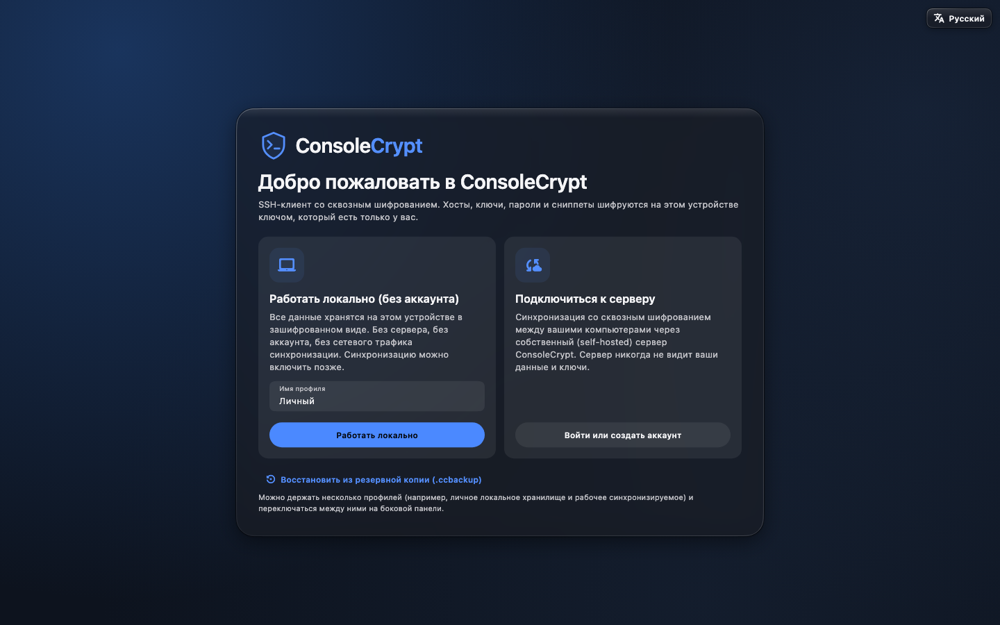

Первый запуск: локальная работа, подключение сервера и восстановление из копии.

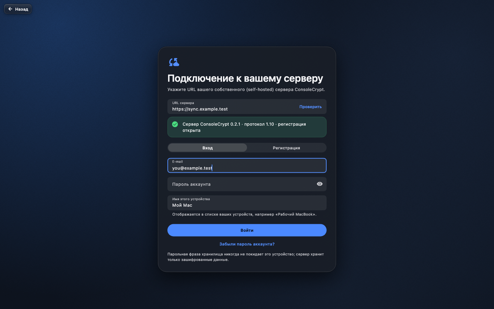

Подключение к своему серверу: «Проверить» показывает версию и протокол, затем вход или регистрация по email и паролю аккаунта.

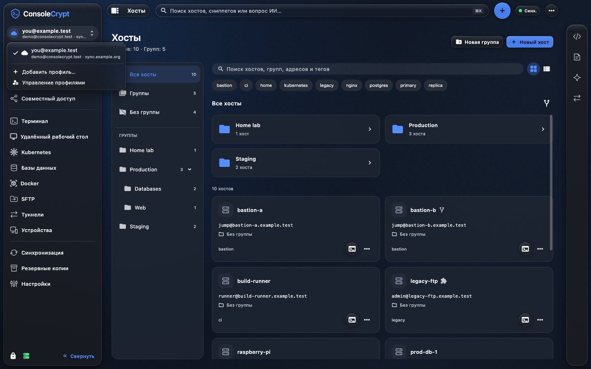

Переключатель профилей вверху бокового меню: активный профиль, «Добавить профиль…» и «Управление профилями».

<a name="linux-install"></a>

## 2. Установка Linux: DEB, RPM и связка ключей

Клиент предназначен для x86-64 (x64) с графическим рабочим столом: Ubuntu 22.04, Debian 12 и Fedora 43. Выберите пакет своего дистрибутива; пакетный менеджер проверит зависимости.

1. На странице «Скачать» выберите DEB для Ubuntu/Debian или RPM для Fedora. Проверьте поддерживаемые версии системы и архитектуру в описании релиза, затем сравните SHA-256 файла с опубликованной контрольной суммой.

2. Откройте терминал в папке с загруженным пакетом. В примере ниже замените consolecrypt.deb или consolecrypt.rpm точным именем своего файла; выполните только команду для своего формата.

3. После установки запустите ConsoleCrypt из меню приложений в своей обычной графической сессии. Не запускайте клиент через sudo: ключи и настройки принадлежат вашему пользователю.

4. Для ключей устройства нужна работающая и разблокированная системная связка ключей с Secret Service, например GNOME Keyring. Создайте и разблокируйте основную связку средствами рабочего стола до запуска клиента. Пароль связки ключей отличается от пароля аккаунта ConsoleCrypt и парольной фразы хранилища.

5. Начиная с 0.9.9 копия из DEB или RPM обновляется из приложения: «Настройки → Обновления» → «Скачать и установить», пароль администратора и «Перезапустить». Саму 0.9.9 и копию не из пакета обновляйте вручную: скачайте новый DEB или RPM со страницы «Скачать» и установите тем же способом. Перед обновлением сохраните зашифрованную резервную копию и завершите важные SSH-сессии; хранилище и связку ключей сохраняйте.

### Ubuntu / Debian — пакет DEB

Имя файла — пример. apt устанавливает локальный пакет и доступные зависимости из настроенных репозиториев.

```text
sudo apt install ./consolecrypt.deb
```

### Fedora — пакет RPM

Имя файла — пример. dnf устанавливает локальный пакет и проверяет зависимости. Не отключайте эти проверки.

```text
sudo dnf install ./consolecrypt.rpm
```

> **Обратите внимание**
>
> Если Secret Service недоступен или связка заблокирована, исправьте её состояние в настройках рабочего стола и повторите действие. Клиент не заменяет защищённое хранение ключей записью в обычный файл. Не удаляйте связку ключей ради устранения ошибки: это может лишить устройство доступа.

<a name="passwords"></a>

## 3. Какой пароль нужен?

В ConsoleCrypt есть разные уровни доступа. Сброс пароля аккаунта по почте не открывает зашифрованное хранилище.

| Что | Для чего |
| --- | --- |
| Пароль аккаунта | Вход на сервер и в веб-кабинет; его можно сбросить через email. |
| Парольная фраза хранилища | Расшифровка данных на устройстве и подтверждение опасных действий (там, где включено, — также Touch ID, Windows Hello или отпечатком). Сервер её не знает. |
| Комплект восстановления | Восстановление доступа к хранилищу при потере парольной фразы. |
| Пароль связки ключей macOS | Системное разрешение доступа к ключу устройства; обычно пароль учётной записи Mac. |
| Пароль или ключ SSH | Вход на удалённый хост, а не на сервер синхронизации. |

1. Если macOS спрашивает доступ к связке «Вход» после новой сборки, проверьте название приложения и используйте пароль этой связки. Смена подписи приложения может вызывать новое разрешение.

2. Если пароль Mac меняли, пароль связки ключей мог остаться прежним. Проверьте состояние связки в системном приложении «Связка ключей», не удаляя ключи ConsoleCrypt.

> **Обратите внимание**
>
> Не сбрасывайте связку ключей ради устранения диалога: это может удалить ключи устройства. Сначала сохраните комплект восстановления и зашифрованную резервную копию.

<a name="vault"></a>

## 4. Хранилище, восстановление и биометрия

Хранилище открывается на вашем устройстве. Настройте блокировку и способ разблокировки сразу после создания.

1. В окне комплекта восстановления «Печать / Сохранить как PDF» открывает системную печать: можно распечатать лист или сохранить PDF. Сохранённый PDF так же секретен, как распечатанный лист, — не храните его в папках, которые синхронизируются с облаком.

2. Сохраните комплект восстановления офлайн и выполните проверку слов. Слова и QR-код дают доступ к хранилищу: не отправляйте их по почте, в чат или ИИ.

3. На телефоне слова комплекта восстановления отображаются целиком. Количество колонок зависит от ширины экрана и размера шрифта; QR-код расположен под словами. Прокрутите экран, чтобы сохранить весь комплект.

4. Заблокированное хранилище открывается парольной фразой или, если включено, Touch ID, Windows Hello или отпечатком. На этом же экране есть «Забыли парольную фразу?», «Выйти», «Удалить этот профиль…» и «Добавить профиль».

5. «Забыли парольную фразу?» открывает восстановление: введите 24 слова комплекта, текст его QR-кода или прочитайте QR: на телефоне — «Сканировать QR» камерой, везде — «QR с картинки» из снимка или скриншота (распознаётся на устройстве, никуда не отправляется) либо, на доверенном устройстве с включённой разблокировкой устройством, выберите «Это доверенное устройство». Затем задайте новую парольную фразу.

6. В «Настройки → Хранилище» выберите время автоблокировки. «Заблокировать сейчас» закрывает хранилище; «Изменить парольную фразу…» меняет именно его парольную фразу.

7. Новая парольная фраза хранилища должна быть не короче 12 символов. Существующие хранилища открываются прежней фразой; при следующей разблокировке фразой ключ перешифровывается с более стойкими параметрами Argon2id (не слабее 64 МиБ).

8. Опасные действия подтверждаются паролем хранилища, а не вводом имени подключения, контекста или ресурса: изменяющие запросы к базам и правки ячеек, «Разблокировать прод», применение YAML, удаление, перезапуск и масштабирование в Kubernetes. Неверный пароль ничего не выполняет, поле очищается после каждой попытки, Enter подтверждает.

9. Когда включена разблокировка устройством, такие действия можно подтверждать Touch ID, Windows Hello или отпечатком: переключатель «Подтверждать действия биометрией» в «Настройки → Хранилище» включается вместе с ней. В окне подтверждения первой стоит кнопка вроде «Подтвердить с Touch ID», а «Ввести пароль хранилища» — запасной путь; если проверка отменена или не удалась, появляется поле пароля. Подтверждение одноразовое и действует только для этого действия и объекта.

10. Пароль хранилища по-прежнему нужен всегда для смены парольной фразы, нового комплекта восстановления, отключения разблокировки устройством, резервных копий, одобрения устройств и безопасности аккаунта или организации. В Linux, где ключ лежит в связке ключей рабочего стола, биометрическое подтверждение не предлагается.

11. Разблокировка устройством по умолчанию выключена. Чтобы включить её, откройте хранилище парольной фразой и в «Настройки → Хранилище» включите «Разблокировка через Touch ID», «… Windows Hello» или «… отпечаток пальца». Система один раз попросит подтверждение; биометрию заранее настройте в системе.

12. Что это даёт: на Mac и iPhone ключ разблокировки хранится в Secure Enclave, в Windows — в Windows Hello, на Android — в Keystore. Система выдаёт его только после отпечатка, лица или пароля устройства, поэтому другая программа не получит ключ без вашего подтверждения. Если добавить отпечаток или сбросить Windows Hello, разблокировка устройством отключится: откройте хранилище парольной фразой и включите её снова.

13. В Linux такой защиты нет: ключ лежит в связке ключей рабочего стола, и разблокировка без пароля доступна любой программе вашего пользователя. Поэтому там она выключена по умолчанию и включается только после предупреждения.

14. Без разблокировки устройством локальная база хранилища открывается только парольной фразой или комплектом восстановления. После обновления разблокировка устройством остаётся выключенной до первого входа парольной фразой; затем приложение предложит включить её снова.

15. Устройство запоминает отпечаток ключа своего хранилища и сверяет с ним любой полученный ключ — при разблокировке паролем, ключом восстановления или биометрией, при одобрении устройства и при включении синхронизации. Если сервер передал другой ключ, появляется экран «Другой ключ хранилища»: данные на устройстве не меняются, синхронизация останавливается, а принять «новый» ключ нельзя. Не вводите секреты на этом устройстве, нажмите «Скопировать диагностику» и сообщите администратору сервера.

16. Если комплект потерян, пока хранилище открыто создайте «Новый комплект восстановления…» и сохраните его. Предыдущий комплект перестанет действовать.

> **Обратите внимание**
>
> Разблокировка устройством — настройка этого устройства для этого хранилища, она не синхронизируется и не заменяет парольную фразу и комплект восстановления. Системный диалог может предложить пароль устройства. Face ID на физическом iPhone ещё требует отдельной проверки.

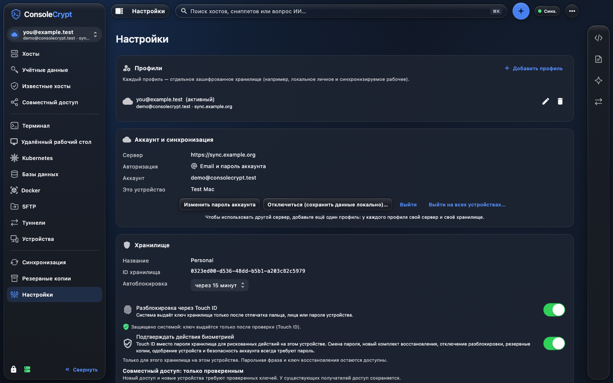

Разблокировка через Touch ID включена и защищена системой, рядом — «Подтверждать действия биометрией»; секреты на снимке не раскрыты.

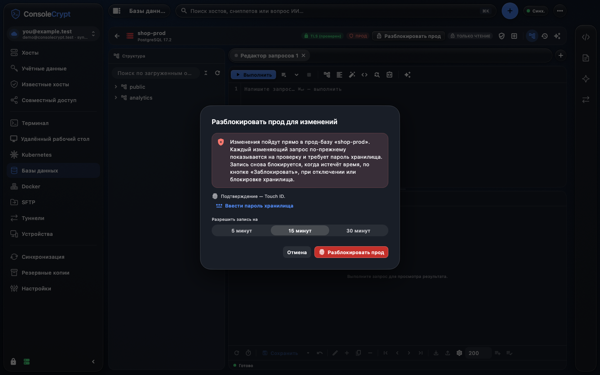

Разблокировка прода подтверждается Touch ID; «Ввести пароль хранилища» остаётся запасным путём.

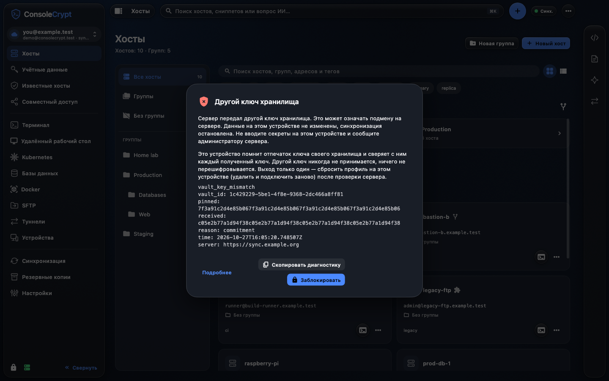

«Другой ключ хранилища»: синхронизация остановлена, есть только «Заблокировать», «Скопировать диагностику» и «Подробнее»; значения демонстрационные.

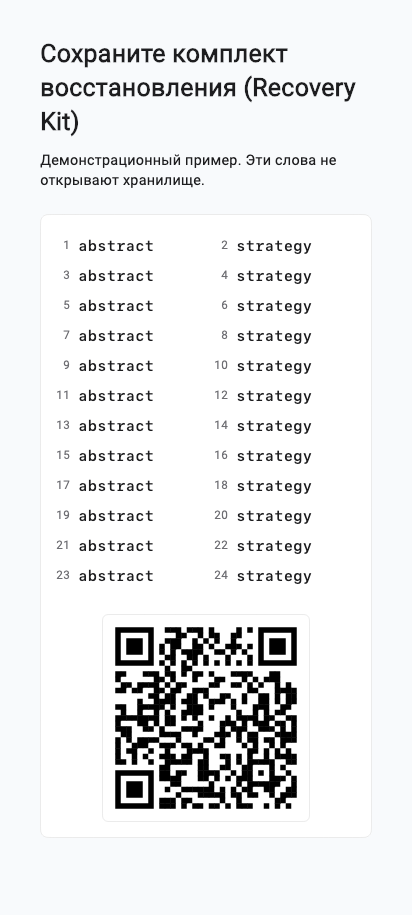

Комплект восстановления на телефоне: слова целиком, QR-код ниже. На иллюстрации только демонстрационные данные.

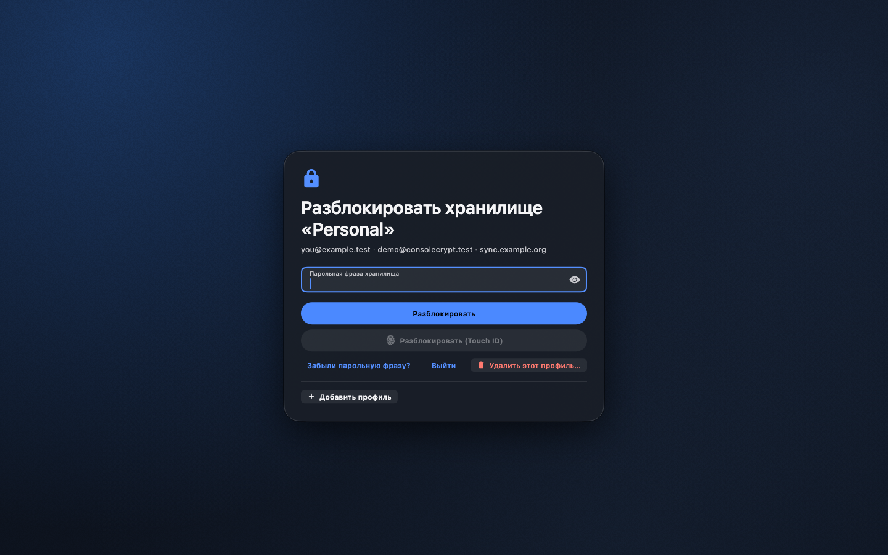

Экран разблокировки: парольная фраза, системная разблокировка, «Забыли парольную фразу?» и действия с профилем.

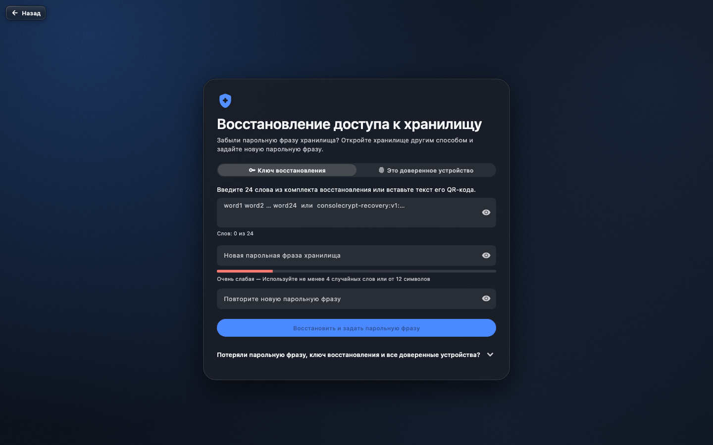

Восстановление доступа: ключ восстановления из 24 слов или это доверенное устройство, затем новая парольная фраза.

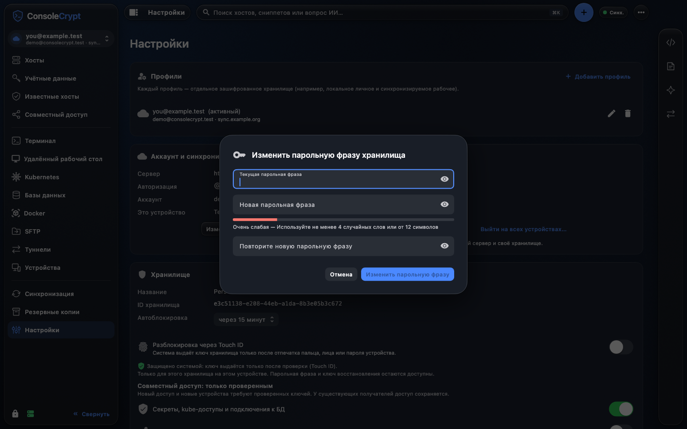

«Изменить парольную фразу…» в настройках хранилища.

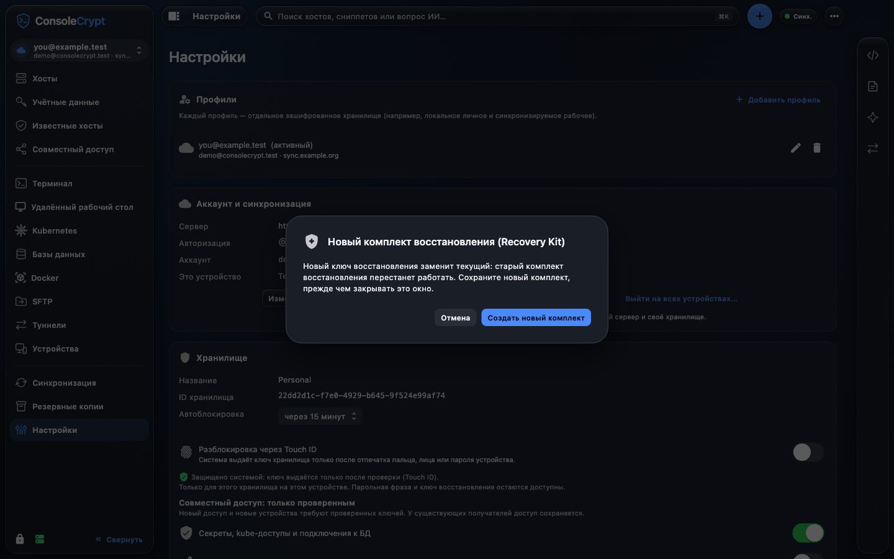

«Новый комплект восстановления…»: старый комплект перестанет работать.

<a name="devices"></a>

## 5. Синхронизация и доверенные устройства

Вход в аккаунт и право расшифровывать хранилище — разные действия. Новое устройство требует подтверждения.

1. На втором устройстве выберите тот же сервер и аккаунт. Если требуется доверие, откройте «Устройства» на уже доверенном устройстве.

2. Выберите ожидающее устройство, нажмите «Проверить и одобрить» и сверьте весь показанный код на обоих устройствах через независимый канал.

3. С сервером 0.2.2 и новее, как только запрос открыт на доверенном устройстве, новое устройство показывает его имя и тот же код пары — он вычисляется из ключей обоих устройств. Отметьте «Код совпадает с кодом на «…»» и нажмите «Коды совпадают» на новом устройстве: без отметки подтвердить нельзя. Подпись одобрения охватывает ключ хранилища, и новое устройство проверяет её ключом, который вы подтвердили. Если сервер однажды показал этот код пары, вернуться к старому способу без проверки он уже не сможет — приложение откажет в подтверждении.

4. Со старым сервером одобрение работает как раньше, а ключ хранилища помечается «Ключ хранилища не подтверждён». Нажмите «Подтвердить паролем» в «Устройствах» или в «Настройки → Хранилище» и один раз введите пароль хранилища. Если другое устройство аккаунта сообщило иной ключ, в «Устройствах» появится предупреждение «Устройство получило другой ключ хранилища» с кнопкой «Отозвать».

5. Отметьте «Все 6 групп в точности совпадают…» и нажмите «Одобрить». Если хотя бы одна группа отличается, нажмите «Коды не совпадают»: запрос будет отклонён, а ключ хранилища не передаётся.

6. В разделе «Синхронизация» проверьте подключение, очередь изменений и конфликты. Изменения при отсутствии сети остаются локально и отправляются после восстановления связи. Индикатор «Синх.» в верхней панели показывает то же кратко: последнюю синхронизацию, сервер, очередь, «Синхронизировать» и «Подробнее».

7. «Настройки → Аккаунт и синхронизация → Отключиться (сохранить данные локально)…» превращает профиль в локальный: данные остаются на устройстве, зашифрованная копия на сервере не меняется. Флажок «Также отозвать это устройство на сервере» сразу отзывает его.

8. Потерянное устройство отзовите в клиенте или веб-кабинете. Повторное подключение требует нового подтверждения.

9. Сервер может ограничивать синхронизацию. Если он временно ограничил запросы, индикатор и раздел «Синхронизация» показывают «Сервер временно ограничил синхронизацию, продолжим в ЧЧ:ММ»: изменения остаются на устройстве и уйдут сами. Если сервер не принял изменения из-за предела объектов или места хранилища, карточка «Сервер не принял изменения» объясняет причину — удалите ненужные записи и нажмите «Повторить».

10. При входе с нового устройства сервер может сообщить «Достигнут предел устройств (N) — отзовите неиспользуемые устройства и войдите снова» или «Сегодня подключено слишком много новых устройств. Повторите после …». Поиск коллег, публикация и добавление своих устройств при ограничении запросов показывают, через сколько секунд повторить.

11. С сервером 0.2.4 удаление хранилища, запрошенное с ещё не доверенного устройства, выполняется через 7 дней. На доверенных устройствах появляется предупреждение «Хранилище будет удалено …» с кнопкой «Сохранить хранилище»; если удаление запросили не вы, нажмите её и смените пароль аккаунта.

12. Если хранилище удалено на сервере, синхронизация останавливается и называет причину («хранилище не найдено на сервере»), а не повторяет попытки бесконечно. Данные с сервера, не прошедшие проверку подлинности, не заменяют последнюю расшифрованную копию на устройстве.

> **Обратите внимание**
>
> Отзыв прекращает сеансы и будущую синхронизацию, но не стирает уже прочитанные данные и не меняет пароли на SSH-серверах. При компрометации замените соответствующие пароли и ключи на самих хостах.

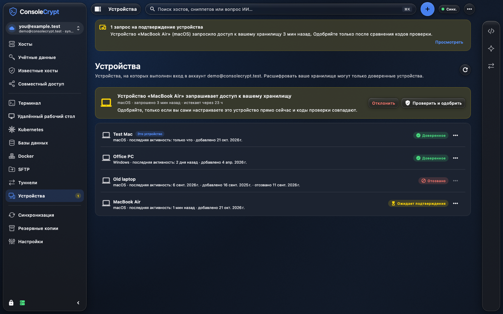

Список демонстрационных устройств; подтверждение доступа выполняется отдельно.

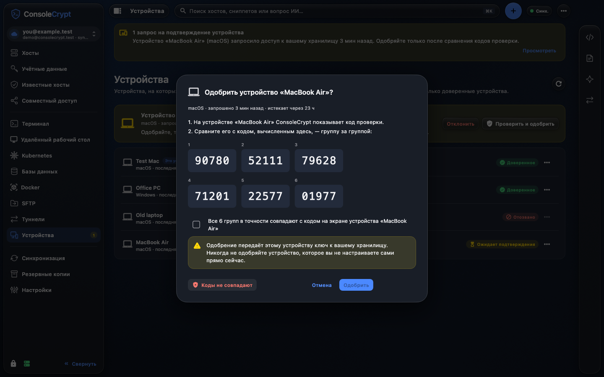

Одобрение нового устройства: 6 групп кода сверяются с экраном нового устройства; коды демонстрационные.

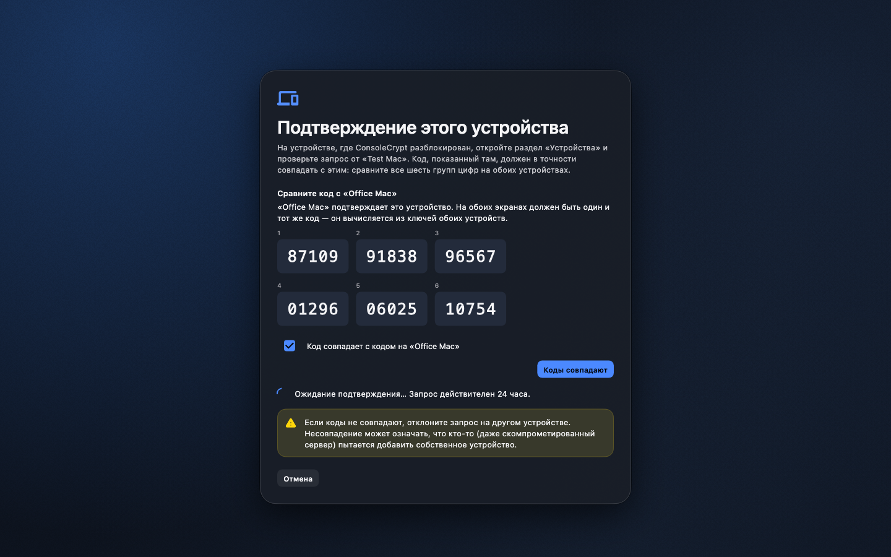

Новое устройство: код пары с «Office Mac» и обязательная отметка совпадения; коды демонстрационные.

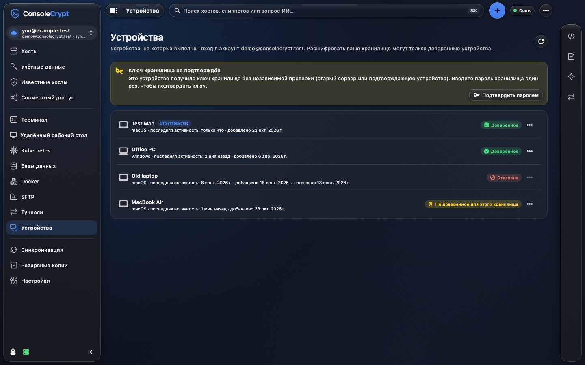

«Ключ хранилища не подтверждён» в «Устройствах» и кнопка «Подтвердить паролем».

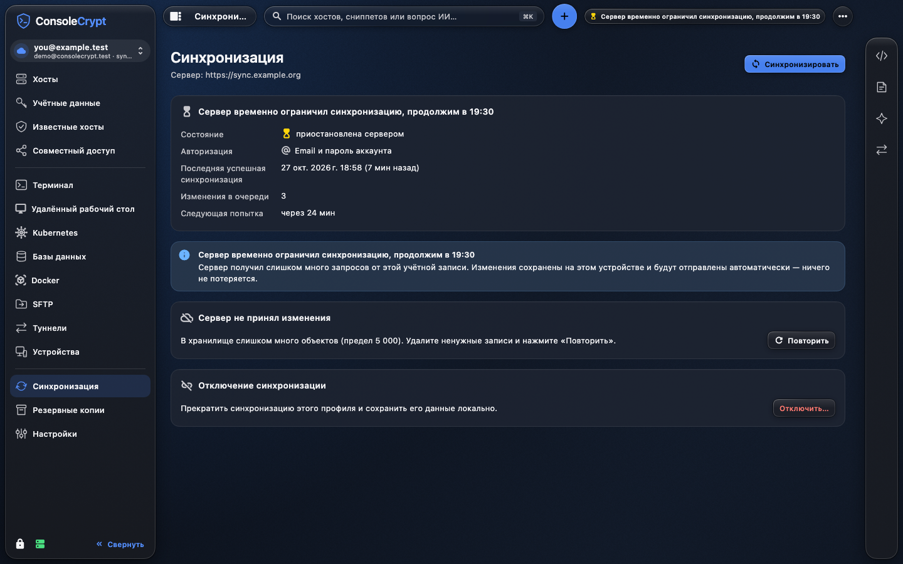

Синхронизация приостановлена сервером до указанного времени; изменения сверх предела объектов ждут «Повторить».

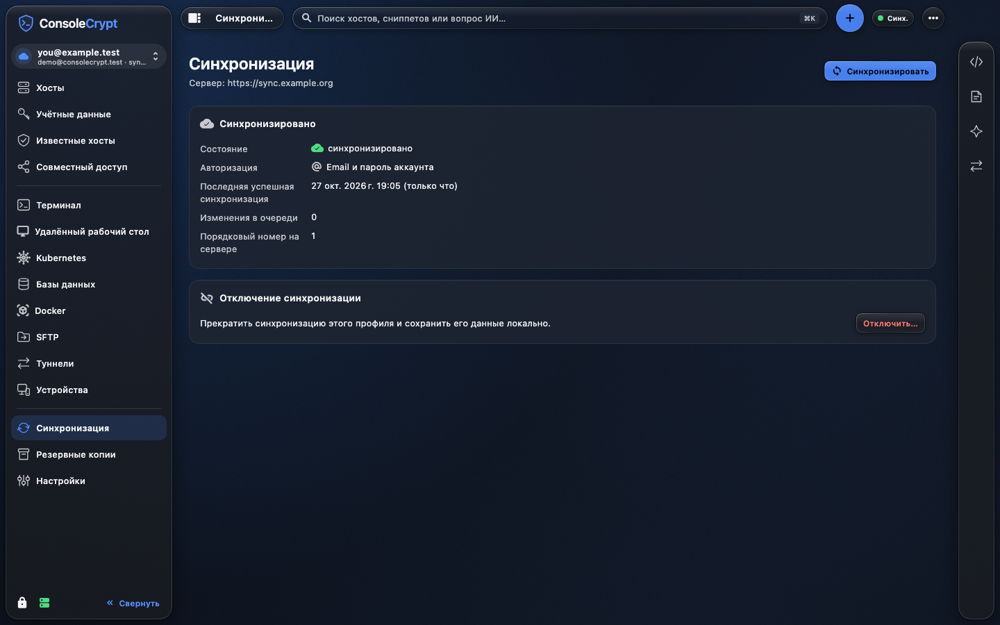

Состояние синхронизации и очередь демонстрационного профиля.

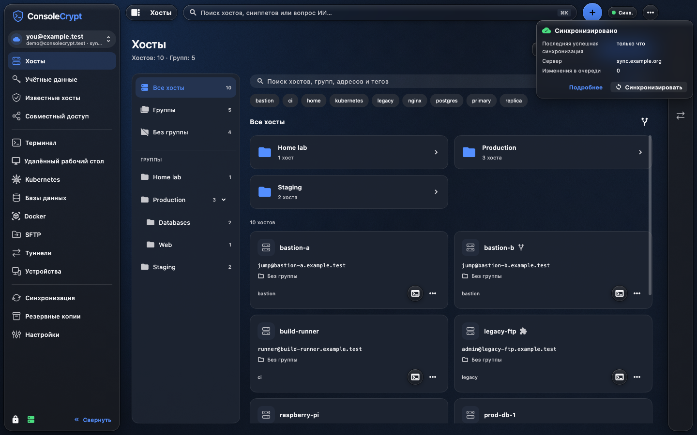

Индикатор «Синх.» в верхней панели: последняя синхронизация, сервер и очередь.

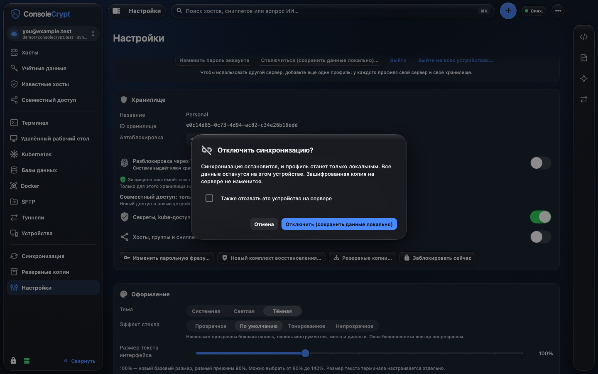

«Отключиться (сохранить данные локально)…» с необязательным отзывом этого устройства.

<a name="device-protection"></a>

## 6. Защита от входа с нового устройства

Если кто-то войдёт в ваш аккаунт с нового устройства, вы сразу об этом узнаете, а само устройство первое время ограничено. Для защиты нужен сервер синхронизации 0.1.16 или новее.

1. О каждом новом устройстве сервер присылает письмо на адрес аккаунта. В письме есть ссылка «Это не я».

2. На ваших доверенных устройствах появляется уведомление «Новое устройство вошло в аккаунт» с именем устройства и системой. Если входили вы, нажмите «Это я», и уведомление скроется.

3. В разделе «Устройства» такое устройство помечено «Не подтверждено» и «Новое, ограничения до …». Первые 14 дней оно не может отзывать ваши доверенные устройства и завершать их сеансы, а попытки открыть хранилище с новых устройств ограничены по частоте.

4. Если входили не вы, отзовите устройство: «Отозвать…» в уведомлении, меню устройства в разделе «Устройства» или ссылка «Это не я» в письме, которая открывает личный кабинет. Затем смените пароль аккаунта: тот, кто вошёл, его знает.

5. «Настройки → Аккаунт и синхронизация → Выйти на всех устройствах…» завершает все сеансы аккаунта, включая текущий. Устройства снова входят паролем аккаунта, их локальные данные сохраняются.

> **Обратите внимание**
>
> Вход в аккаунт сам по себе не открывает хранилище: новому устройству по-прежнему нужно одобрение со сверкой кода на доверенном устройстве. Если выйти на всех устройствах или сменить пароль с нового устройства, доверенные устройства в первые дни не затрагиваются.


Уведомление о новом входе и новое устройство с пометками «Не подтверждено» и «Новое, ограничения до …»; все устройства демонстрационные.

<a name="enterprise-sign-in"></a>

## 7. Корпоративный вход: SSO и Active Directory

Сервер синхронизации 0.2.0 и новее может пускать в аккаунты только через сервер авторизации вашей организации. Клиент 0.9.0 сам узнаёт режим сервера и показывает нужную форму. Меняется только вход в аккаунт: хранилище по-прежнему открывает ваш пароль хранилища.

1. Выберите «Подключиться к серверу», введите HTTPS-адрес, который дал администратор, и нажмите «Проверить». Для корпоративного сервера появится блок «Корпоративный вход» с названием сервера авторизации; регистрации, пароля аккаунта и «Забыли пароль» в этом режиме нет.

2. SSO (OIDC): при желании укажите e-mail и нажмите «Войти через …». Страница входа организации откроется в системном браузере; после входа браузер вернёт вас в приложение. Пока вход идёт, в приложении виден статус ожидания и кнопка «Отмена».

3. Active Directory: введите логин (e-mail, UPN или DOMAIN\\user) и пароль домена. Пароль уходит на сервер один раз по TLS, не сохраняется и стирается из поля после каждой попытки.

4. Новый пользователь после первого входа создаёт хранилище, как обычно. Уже известное устройство открывает хранилище паролем хранилища; новое устройство одобряется со сверкой кода, ключом восстановления или паролем хранилища.

5. Приложение запоминает для каждого сервера способ входа и логин (не пароль): в следующий раз они подставлены, а подсказка «В прошлый раз вы входили через …» предлагает «Забыть». В «Настройках», «Синхронизации» и «Устройствах» строка «Авторизация» показывает корпоративный сервер и когда это устройство вошло.

6. Если организация отключит вашу учётную запись, приложение покажет «Доступ отключён администратором» и заблокирует профиль. Данные на устройстве остаются зашифрованными; профиль можно удалить с устройства или войти снова, когда доступ вернут.

[Аккаунт, синхронизация и корпоративный вход ↗](../docs/public/SYNC_ACCOUNT.md)

> **Обратите внимание**
>
> Пароль организации не открывает хранилище, и ни сервер авторизации, ни сервер синхронизации не получают ключей хранилища. Ошибки входа — домен не допущен, нет нужной группы, требуется второй фактор, учётная запись уже связана с другим аккаунтом, служба входа недоступна — показываются понятным текстом; с ними обращайтесь к администратору.

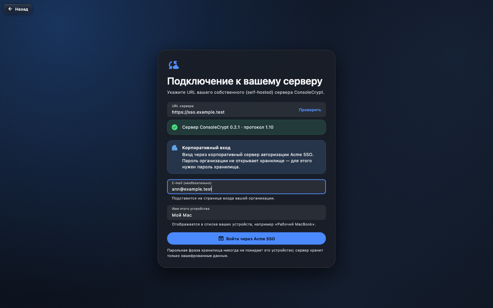

Сервер с входом через SSO: блок «Корпоративный вход», необязательный e-mail и кнопка «Войти через Acme SSO»; сервер демонстрационный.

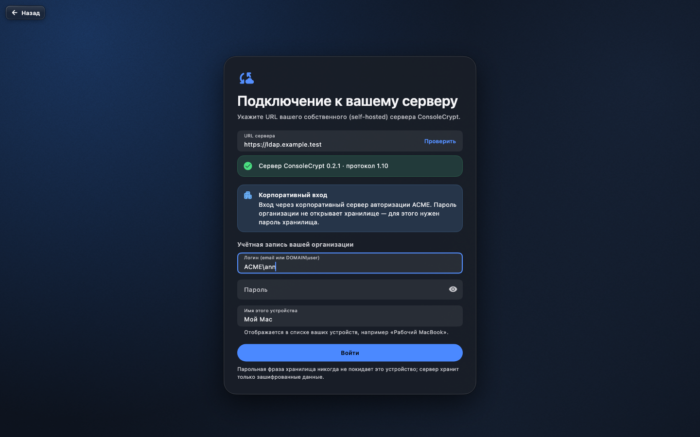

Вход через Active Directory: логин домена и пароль организации.

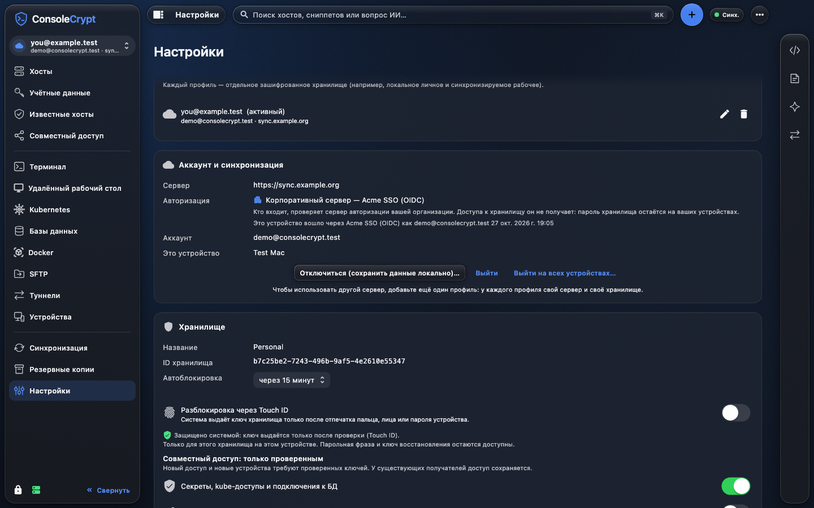

Настройки: строка «Авторизация» называет корпоративный сервер и показывает, когда вошло это устройство.

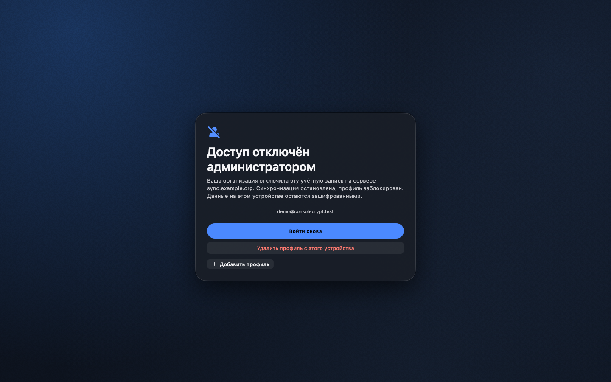

Учётная запись отключена организацией: профиль заблокирован, данные остаются зашифрованными.

<a name="hosts"></a>

## 8. Хосты: добавить, найти, подключиться

Хост хранит параметры подключения по SSH или RDP. Карточки и список показывают адрес, пользователя и группу.

1. Откройте «Хосты → Новый хост» и сначала выберите SSH или RDP. Задайте имя, адрес, порт, пользователя и учётные данные. Для SSH доступны наследование из группы и jump-хосты; для RDP — пароль и необязательный домен Windows, порт по умолчанию 3389.

2. На компьютере в форме нового SSH-хоста нажмите «Импорт». Клиент читает ~/.ssh/known\_hosts и /etc/ssh/ssh\_known\_hosts на Linux/macOS, либо %USERPROFILE%\\\\.ssh\\\\known\_hosts на Windows. Просмотрите адреса и отметьте нужные; уже сохранённые подключения исключаются. Пользователя и учётные данные укажите отдельно.

3. Импорт создаёт подключения, но не переносит доверие к ключам. Хешированные имена, шаблоны, отозванные ключи и записи CA пропускаются. При первом подключении проверьте ключ сервера обычным способом.

4. Кнопка «Из ~/.ssh/config» рядом с «Импорт» читает конфигурацию OpenSSH (с Include). Каждая запись Host становится хостом с адресом, портом и пользователем; блоки с масками вроде Host \* применяются как значения по умолчанию. Хосты из ProxyJump импортируются вместе с выбранным, а ключи из IdentityFile можно сразу добавить в хранилище — зашифрованный ключ сохраняет свою парольную фразу. ProxyCommand не поддерживается.

5. Используйте поиск по именам, адресам, группам и тегам. Переключатель карточки/список меняет представление; карточка группы открывает её содержимое.

6. Нажмите в центре карточки хоста или на значок подключения. В зависимости от типа откроется терминал или удалённый рабочий стол.

7. В меню «…» доступны подключение, SFTP, редактирование, удаление и добавление в существующую группу. «Поделиться…» показывается при поддержке сервером, «Копировать в команду…» и «Переместить в команду…» — если у вас есть команды (глава «Команды»).

8. Форма хоста состоит из карточек. «Аутентификация»: пароль (его можно сохранить в хранилище или вводить при подключении), SSH-ключ (выбрать, создать или импортировать прямо здесь), агент (системный SSH-агент или путь к сокету) либо «Из группы». «Выбрать учётные данные…» назначает уже сохранённые. Если ключ зашифрован, а его пароль не сохранён, при подключении появится окно «Пароль к ключу «…»» — пароль нужен только для этого подключения.

9. «Безопасность»: политика ключа хоста — «Спрашивать» (подтверждать неизвестные ключи), «Строгая» (только ключи из известных хостов) или «Принимать новые» (сохранять неизвестные автоматически); изменённый ключ блокирует подключение всегда. Там же SSH-реализация («Встроенный (russh)» или «Системный OpenSSH (совместимость)» для старых серверов), интервал keepalive и «Проброс агента» — включайте его только для доверенных хостов.

10. «Организация» хранит теги и свободные заметки. Внизу формы «Итоговые настройки» показывают, что реально будет использовано при подключении — группа, пользователь, порт, учётные данные и маршрут — и откуда взято каждое значение; там же видны проблемы, например удалённый jump-хост.

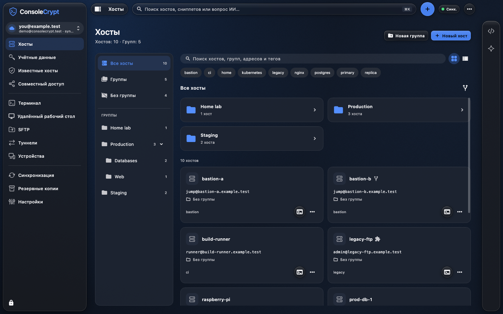

Обзор демонстрационных хостов и их параметров подключения.

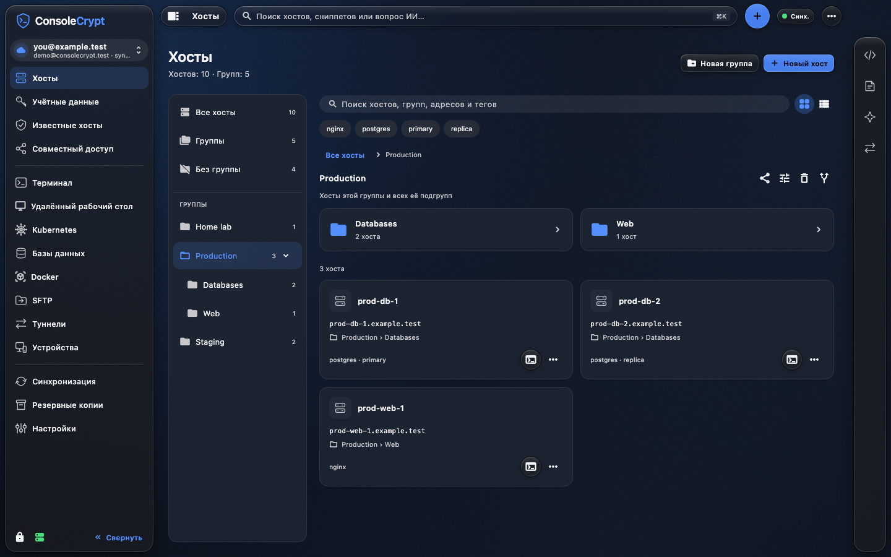

Хосты внутри демонстрационной группы: карточки, поиск и действия подключения.

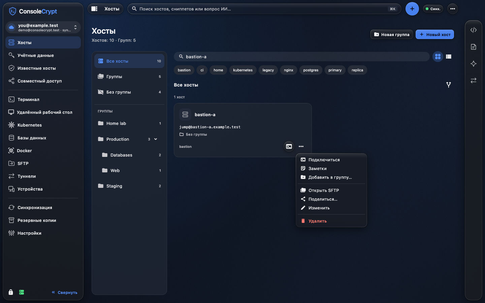

Меню действий выбранного хоста: подключение, заметки, группа, SFTP, совместный доступ и изменение.

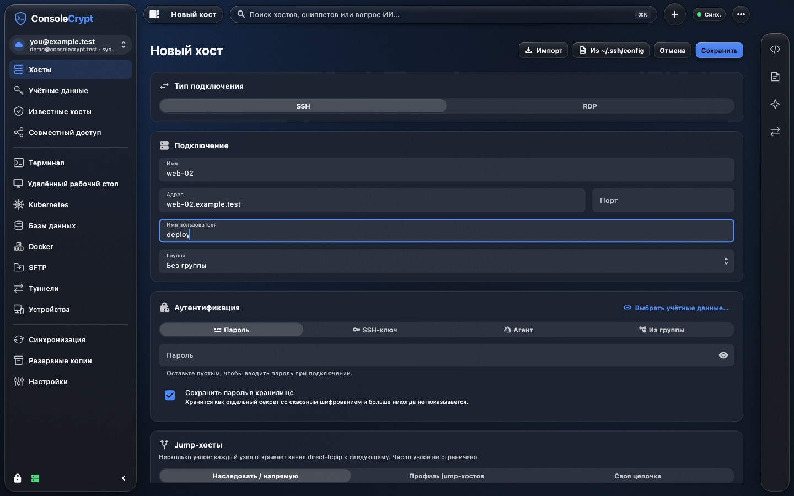

Новый SSH-хост: тип подключения, адрес, пользователь, группа и аутентификация.

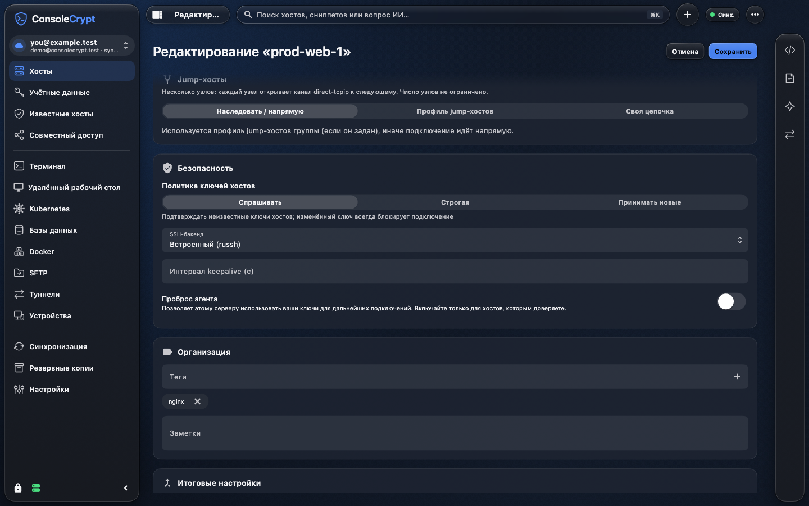

Карточка «Безопасность»: политика ключа хоста, SSH-реализация, keepalive и проброс агента.

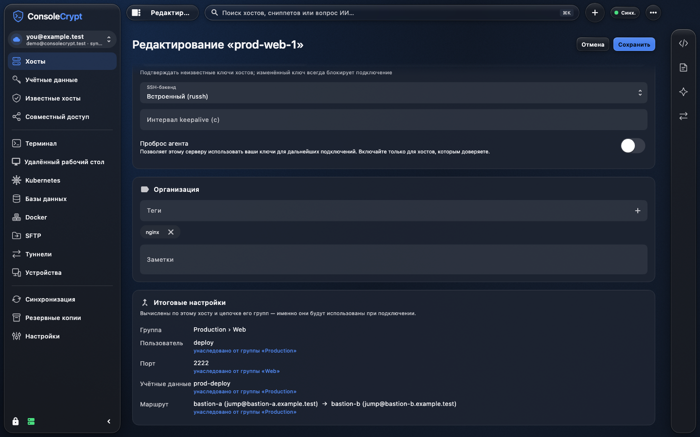

«Итоговые настройки»: что будет использовано при подключении и откуда это взято.

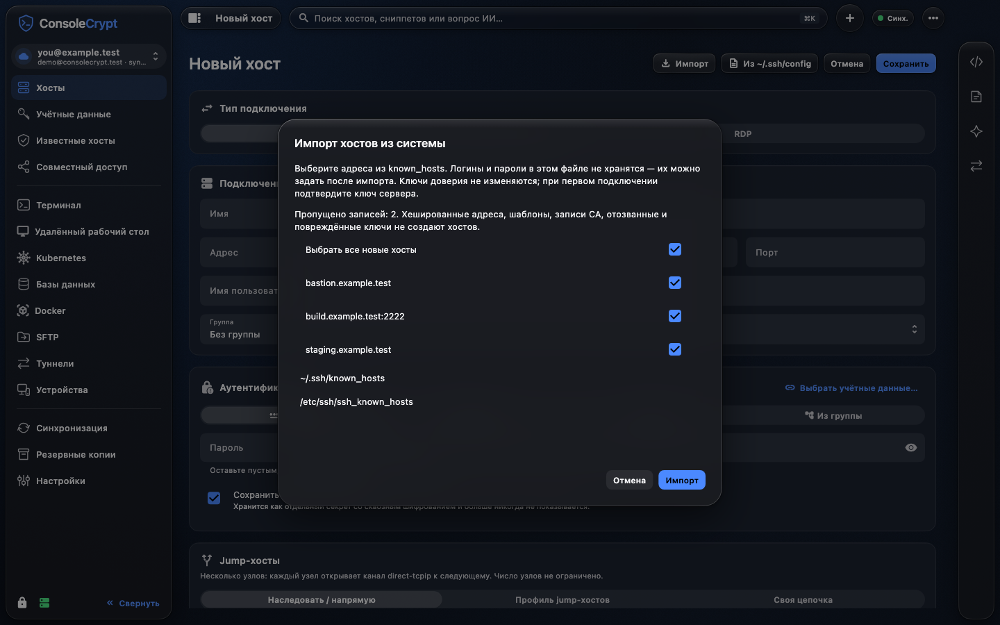

Импорт адресов из демонстрационного known\_hosts: выбор перед сохранением.

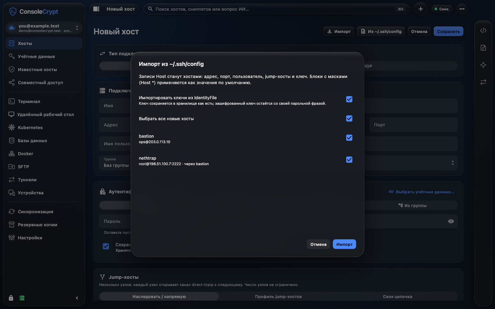

Импорт из ~/.ssh/config: записи Host с адресами из документационных диапазонов.

<a name="rdp"></a>

## 9. RDP: удалённый рабочий стол Windows

Добавлена возможность подключиться к RDP. ConsoleCrypt подключается напрямую к стандартному серверу Microsoft RDP; устанавливать дополнение IronRDP на Windows не нужно.

1. В «Хостах» создайте подключение типа RDP. Укажите адрес, пользователя Windows, пароль и, при необходимости, домен. Пароль можно сохранить в зашифрованном хранилище или вводить при каждом подключении. Настройки SSH-группы не применяются к RDP.

2. Перед подключением проверьте адрес, учётную запись и отпечаток сертификата. Сверьте отпечаток с администратором сервера. При изменении данных хоста подтверждение потребуется заново.

3. В разделе «Удалённый рабочий стол» нажмите кнопку подключения в центре или «+» рядом с вкладками и выберите сохранённый RDP-хост. Открытые рабочие столы находятся в панели вкладок. Переключайтесь между ними, открывайте новые и закрывайте ненужные. Одновременно доступны до четырёх RDP-сеансов.

4. Нажмите «Во весь экран»: рабочий стол займёт весь экран компьютера. Чтобы показать верхнюю панель, наведите указатель на синий индикатор у верхнего края или нажмите Ctrl+Alt+Home. Панель можно закрепить. В ней доступны переключение подключений, разрешения, сворачивание окна, возврат к обычному размеру и закрытие текущего сеанса. Escape передаётся удалённому компьютеру.

5. Включите обмен текстом для выбранного сеанса. Теперь Ctrl+V (⌘V на macOS) в активном рабочем столе передаёт локальный текст и вставляет его в Windows — предварительно нажимать «Отправить» не нужно. При выключенном обмене Ctrl+V использует буфер самой удалённой Windows.

6. Кнопка «Отправить» передаёт текст без вставки, а «Получить» запрашивает текст из Windows. Изменение локального буфера само по себе ничего не отправляет. Поддерживается текст до 64 КиБ; изображения и файлы через буфер не передаются.

7. На macOS, Windows и Linux выберите одну локальную папку в разрешениях сеанса. Дождитесь состояния «Папка подключена» и откройте ConsoleCrypt в разделе перенаправленных дисков Проводника Windows. По умолчанию разрешено только чтение; запись включается отдельно. Другие папки и диски компьютера не предоставляются.

8. Если папка не подключилась, проверьте политику перенаправления дисков на Windows-сервере. Рабочий стол продолжает работать независимо от доступа к папке. Замена папки прерывает операции с ранее открытыми файлами.

9. Обмен поддерживает файлы до 256 МиБ и суммарно до 512 МиБ попыток записи за сеанс. После достижения лимита переподключитесь. Символические ссылки, исходные отметки времени и блокировки файлов не переносятся.

10. Отключите разрешение на папку или буфер в панели сеанса, когда обмен закончен. Блокировка хранилища и выход закрывают соединения и отзывают временные разрешения.

> **Обратите внимание**
>
> Перед созданием RDP-хостов обновите все устройства рабочего пространства до версии 0.3 или новее. Старые клиенты не видят RDP-хосты, но могут изменить связанные учётные данные и группы. RDP-хосты синхронизируются между вашими устройствами с актуальной версией клиента. RDP-хостом можно поделиться с проверенным коллегой: «Совместный доступ» в меню хоста передаёт адрес, порт, пользователя и домен, а заметки и пароль — только по отметке; клиенты до 0.9.9 такую карточку не показывают. На мобильных устройствах перенаправление папок недоступно. Доступность буфера и диска также зависит от политики Windows-сервера.

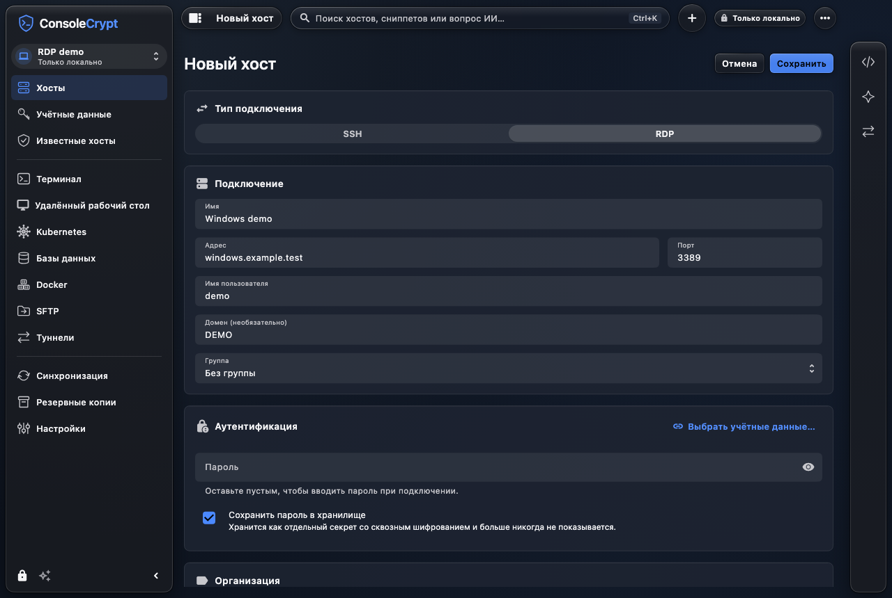

Создание RDP-хоста: отдельные поля Windows и сохранение пароля в хранилище. Демонстрационные данные.

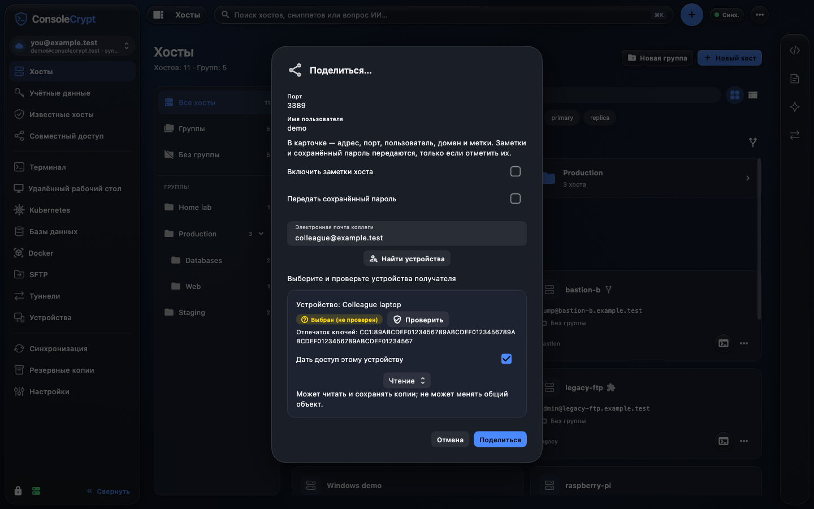

Общий доступ к RDP-хосту: что увидит коллега, отметки для заметок и пароля, выбранное устройство получателя.

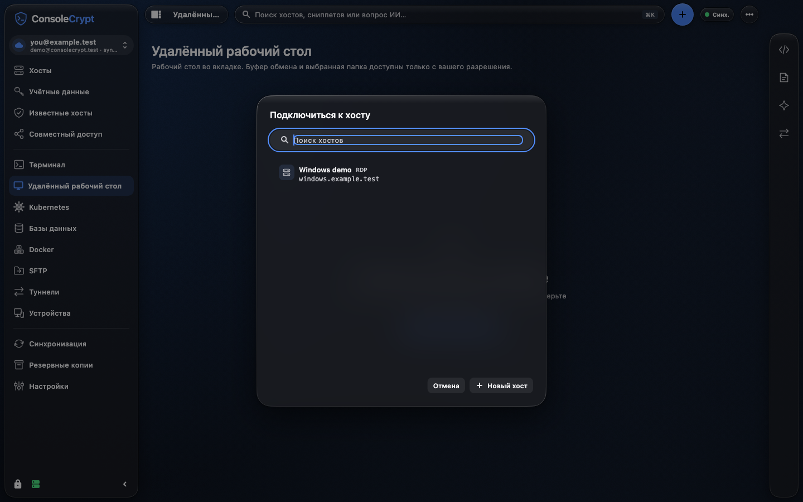

Выбор сохранённого RDP-хоста из раздела удалённого рабочего стола.

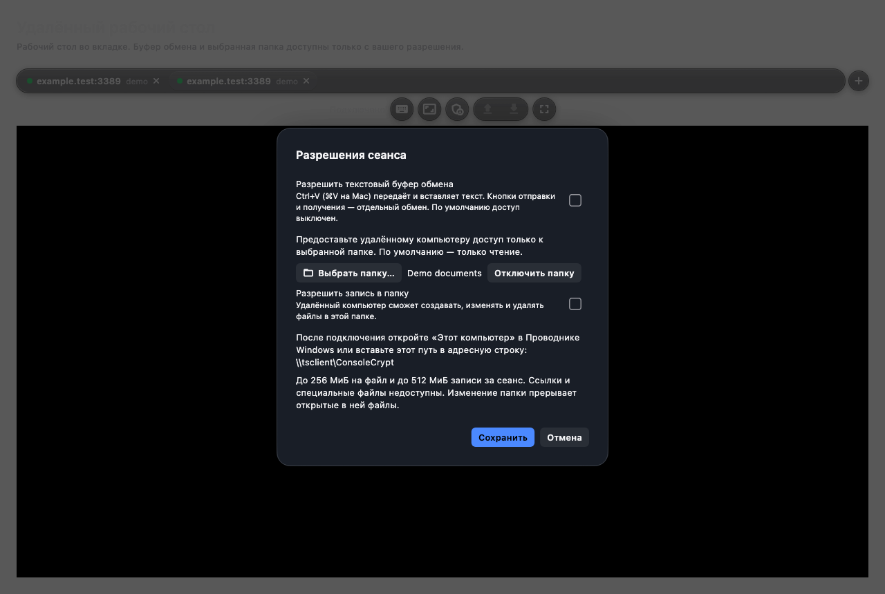

Разрешения демонстрационного сеанса: текстовый буфер и выбранная папка с отдельным правом записи. Рабочий стол Windows на снимке не отображается.


Панель полного экрана: переключение подключения, разрешения и управление окном. Демонстрационные данные.

<a name="rdp-mobile"></a>

## 10. RDP на телефоне: тачпад и клавиатура

На телефоне подключённый рабочий стол автоматически открывается на весь экран. По умолчанию включён тачпад: палец двигает курсор относительно его текущего положения. Одна плавающая кнопка открывает управление сеансом.

| Жест в режиме тачпада | Действие |
| --- | --- |
| Движение одним пальцем | Перемещение курсора; палец можно поднимать и переносить. |
| Короткое касание | Левый клик в текущей позиции курсора. |
| Два быстрых касания | Двойной левый клик. |
| Двойное касание с удержанием второго или удержание около 500 мс | Начать перетаскивание; отпускание пальца отпускает кнопку мыши. |
| Касание двумя пальцами | Правый клик. |
| Параллельное движение двух пальцев | Прокрутка без перемещения курсора. |
| Щипок | Масштаб 1–4×; курсор остаётся видимым при перемещении к краю. |
| Двойное касание двумя пальцами | Вписать рабочий стол в экран. |
| Касание тремя пальцами | Открыть или скрыть клавиатуру. |

1. Нажмите плавающую кнопку у края. Откроется сетка плиток: клавиатура, тачпад или прямое касание, специальные клавиши, буфер, сеансы, ориентация и сворачивание. Перетащите кнопку к удобному краю; её положение запоминается отдельно для двух ориентаций.

2. В режиме «Касание» нажатие действует под пальцем. Выбранный для хоста режим сохраняется только на этом устройстве. Подключённая мышь работает обычным способом.

3. Клавиатура появляется поверх рабочего стола, не сжимая его. Над ней есть полоса дополнительных клавиш; отдельный лист открывает F1–F12, стрелки и сочетания. Одно касание Ctrl, Alt, Win или Shift действует на следующую клавишу; двойное фиксирует модификатор, следующее отпускает.

4. Если клавиатура ещё составляет слово, сначала завершите ввод. До окончания композиции дополнительные клавиши не отправляют команды. Смена сеанса, уход в фон и блокировка отпускают зажатые клавиши и кнопки мыши.

5. В мобильных настройках RDP выберите скорость и ускорение курсора, его размер, чёткость, масштаб Windows, ориентацию и автоскрытие кнопки. Разрешение подстраивается под экран, если RDP-сервер разрешает изменение размера; иначе сеанс сохраняет прежнее разрешение.

6. На Android кнопка «Назад» сначала скрывает клавиатуру. Затем она раскрывает управление; повторное нажатие в течение двух секунд сворачивает сеанс без отключения. Можно переключаться между четырьмя сеансами. «Отключить» запрашивает подтверждение.

> **Обратите внимание**
>
> На планшете полный экран включается вручную, а автоматический режим выбирает прямое касание. При включённом экранном дикторе используется прямое касание и кнопка не скрывается. Перенаправление папок на телефоне недоступно. Сборка для iOS проверяется на Simulator; её выпуск пока отложен. На снимках настоящие виджеты; рабочий стол Windows нарисован синтетически. Пустая область зарезервирована для системной клавиатуры.


Рабочий стол и плавающая кнопка: постоянные панели скрыты.

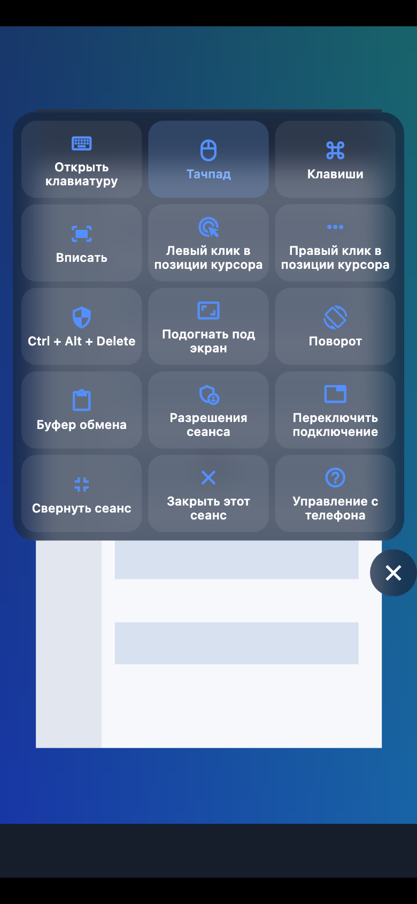

Меню управления в портретной ориентации.

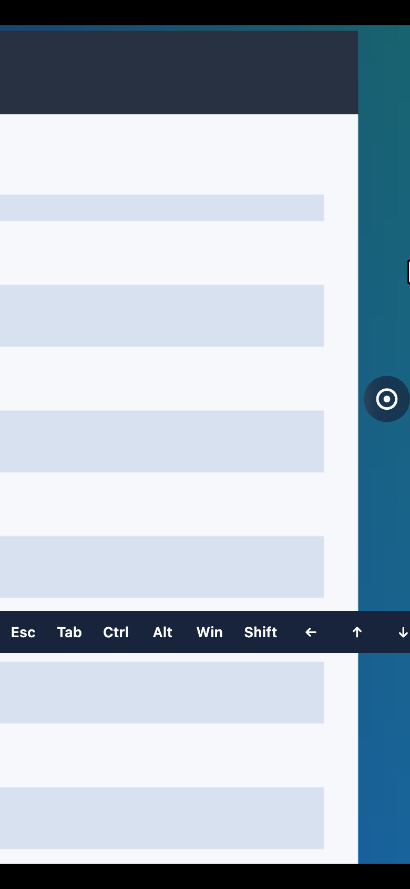

Полоса клавиш над зарезервированной областью системной клавиатуры.

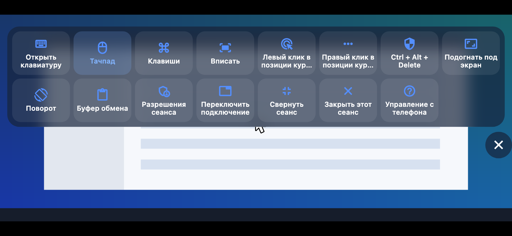

Альбомная ориентация и меню управления.

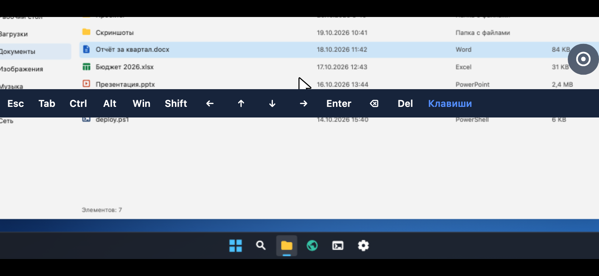

Клавиши в альбомной ориентации; размер рабочего стола сохраняется.

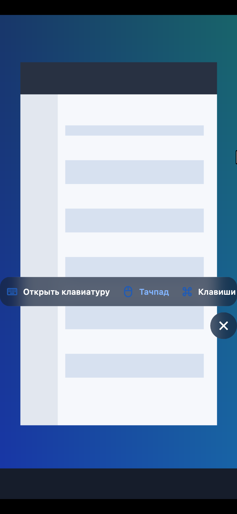

Те же элементы управления в светлой теме.

<a name="quick-connect"></a>

## 11. Быстрый поиск и подключение

Найдите сохранённый хост из любой части приложения и сразу откройте SSH- или RDP-сеанс. Палитра команд объединяет поиск хостов, сниппетов и быстрые действия.

1. В верхней панели круглая кнопка «+» открывает список сохранённых SSH- и RDP-хостов. Найдите хост по имени или адресу и выберите его для подключения. Если нужного хоста ещё нет, нажмите «Новый хост». Поиск занимает свободное место между названием раздела и кнопкой «+»; справа отображается компактный статус «Синх.».

2. Нажмите ⌘K на macOS или Ctrl+K на Windows/Linux. Начните вводить имя хоста или его IP-адрес; поиск также учитывает адрес и имя пользователя в строке подключения.

3. Смотрите результаты в группе «Хосты». Под названием указаны параметры подключения: проверьте адрес, пользователя и порт перед выбором.

4. Выберите результат стрелками ↑ и ↓ и нажмите Enter либо щёлкните по строке. Приложение откроет SSH-терминал или RDP-сеанс в зависимости от типа хоста. При первом подключении проверьте ключ SSH или сертификат RDP.

5. Esc закрывает палитру. Если хост не найден, добавьте его в разделе «Хосты» и повторите поиск.

> **Обратите внимание**
>
> Поиск сохранённых хостов выполняется локально. Если введённое имя или IP-адрес не найдено, Enter не отправляет запрос ИИ. Для ИИ явно нажмите соответствующую строку или выберите её стрелками и подтвердите. Ввод адреса не создаёт новый хост.

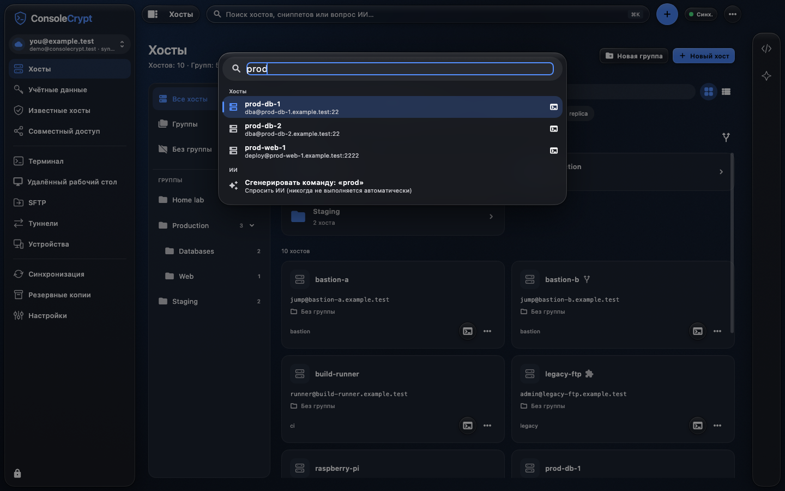

Локальный поиск сохранённых хостов в палитре команд.

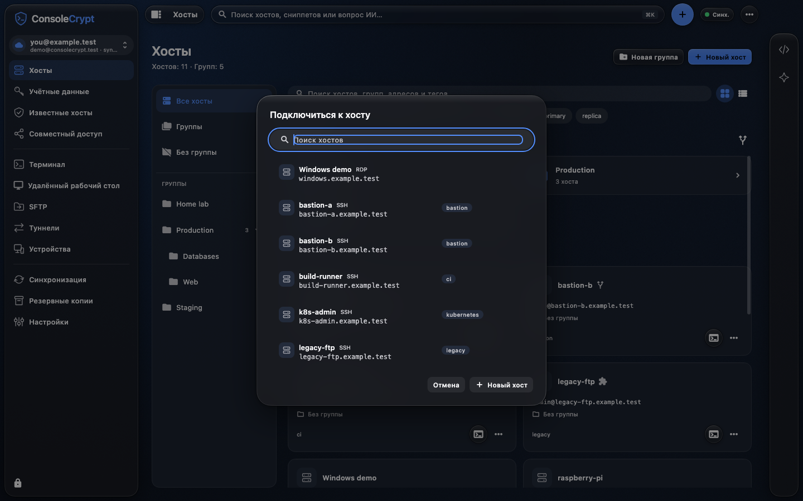

Общая кнопка «+»: выбор сохранённых SSH- и RDP-хостов.

<a name="groups"></a>

## 12. Группы и jump-хосты

Группы помогают ориентироваться и задавать общие параметры. Цепочка jump-хостов позволяет добраться до SSH-хоста через промежуточные узлы.

1. Откройте «Хосты» в левом меню и нажмите «Новая группа». Хосты и группы находятся в одном каталоге; для окружений и проектов можно создавать вложенные группы.

2. В настройках группы задайте общие имя пользователя, порт, учётные данные и профиль jump-хостов. Значение, заданное на хосте, имеет приоритет над наследованием.

3. В разделе профилей jump-хостов создайте профиль и выберите существующие хосты в нужном порядке. Назначьте профиль группе или отдельному хосту.

4. В карточке «Jump-хосты» формы хоста выберите «Наследовать / напрямую» (профиль группы, если он есть), «Профиль jump-хостов» или «Своя цепочка». Своя цепочка собирается кнопкой добавления узла из существующих хостов; число узлов не ограничено, а под цепочкой показан итоговый маршрут.

5. Перед перемещением или удалением группы проверьте итоговые унаследованные параметры: изменение родителя может изменить подключение.

> **Обратите внимание**
>
> SSH-соединения устанавливает клиент напрямую, включая jump-хосты. Сервер синхронизации не передаёт SSH-трафик. Личная группа и общая коллекция — разные объекты; правила общей коллекции описаны ниже.

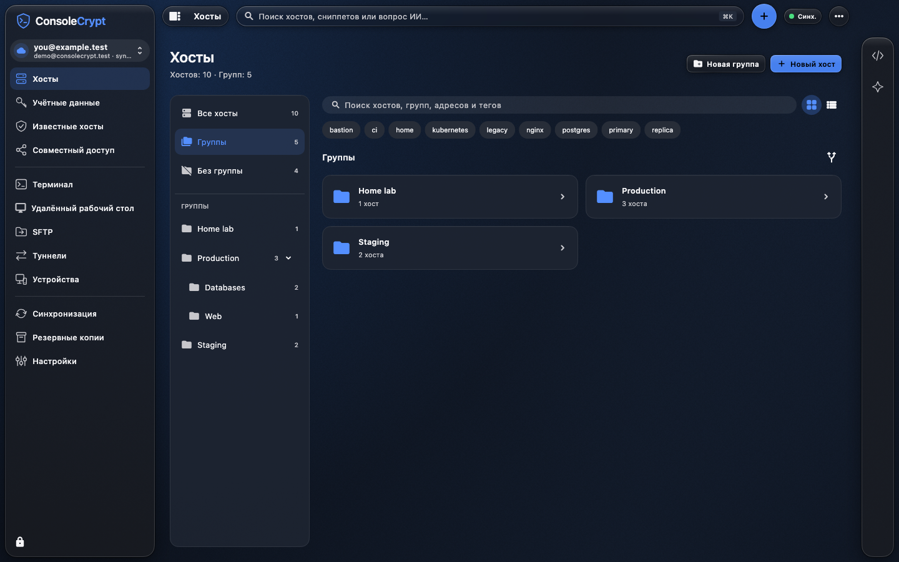

Демонстрационный каталог групп и навигация внутри рабочего пространства.

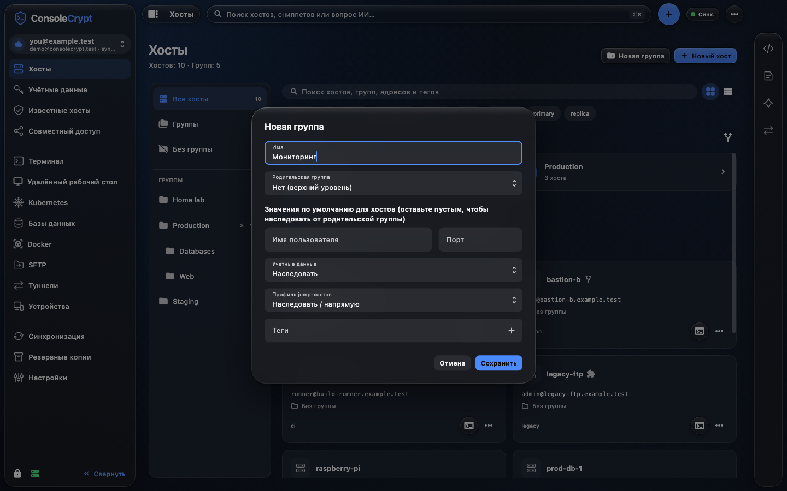

Новая группа: название, родитель и параметры по умолчанию для её хостов.

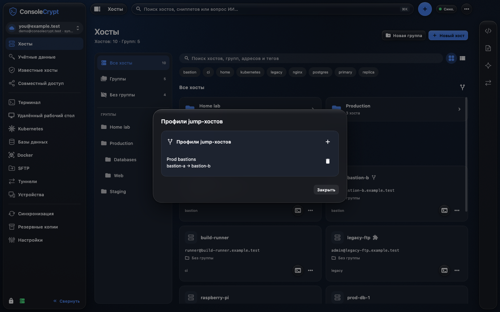

Профили jump-хостов: именованные цепочки промежуточных узлов.

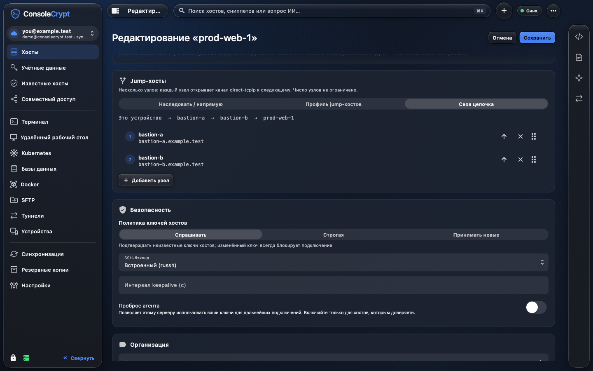

Своя цепочка из двух jump-хостов и итоговый маршрут к хосту.

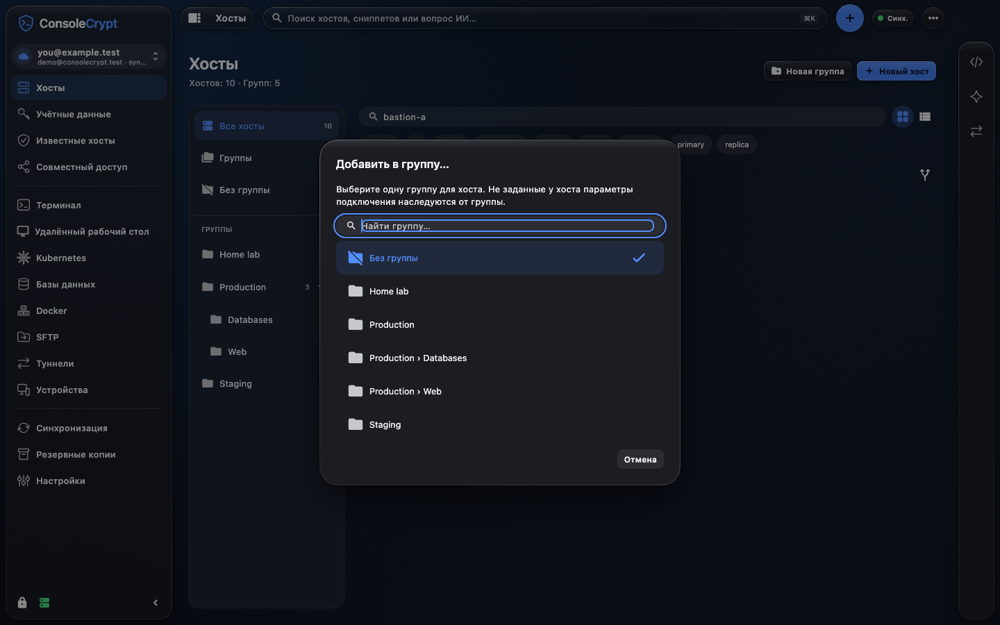

Добавление демонстрационного хоста в существующую группу.

<a name="credentials"></a>

## 13. Пароли, ключи и учётные данные

Учётные данные хранятся отдельно от хостов: один набор можно назначить нескольким подключениям.

1. В «Учётные данные → Новые учётные данные» выберите тип: пароль, новый SSH-ключ, импорт существующего ключа, SSH-сертификат (приватный ключ и сертификат OpenSSH) или SSH-агент — системный либо внешний по пути к сокету или каналу. При импорте ключ можно вставить или нажать «Выбрать файл…»: файл читается до 64 КБ и не копируется.

2. Новый ключ создаётся на устройстве как Ed25519, RSA 3072 или RSA 4096; приватная часть сразу попадает в хранилище, а публичный ключ показывается для добавления в authorized\_keys. Ключи FIDO2 пока не создаются.

3. Укажите понятное название. Назначьте учётные данные хосту или группе; для ключа с парольной фразой заполните её отдельно.

4. Откройте карточку для просмотра метаданных и публичного ключа. Секрет появляется только после явного действия; копирование требует осторожности с буфером обмена.

5. Скопированный секрет не попадает в историю буфера и на другие устройства и очищается по таймеру из «Настройки → Безопасность», если буфер не был заменён другим значением. Изменение настройки действует на следующие копирования; если приложение закрылось раньше срока, очистка завершится при следующем запуске. Подробнее — в главе «Скриншоты, защита экрана и буфер обмена».

> **Обратите внимание**
>
> Не помещайте пароль или приватный ключ в название хоста, заметки или сниппет. Для передачи секрета коллеге используйте отдельный защищённый процесс «Поделиться», а не ИИ-чат.

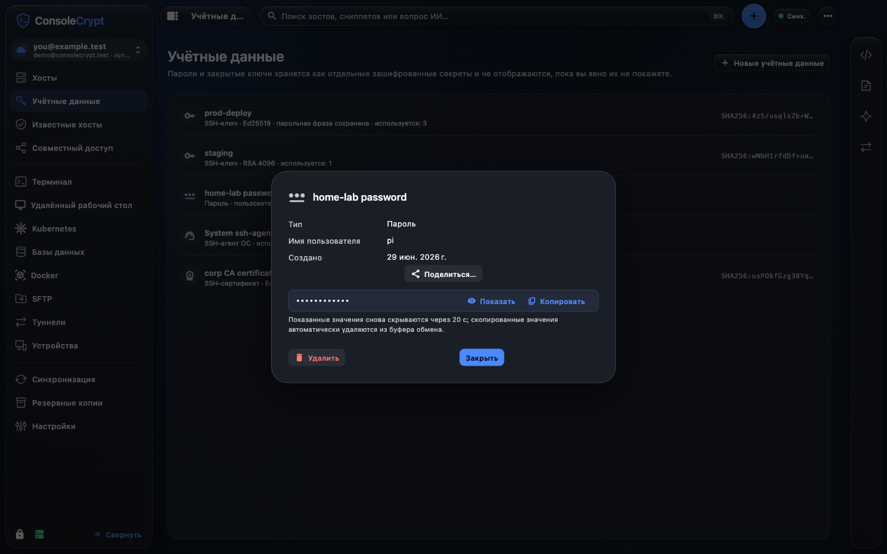

Учётные данные в демонстрационном хранилище; значения скрыты.

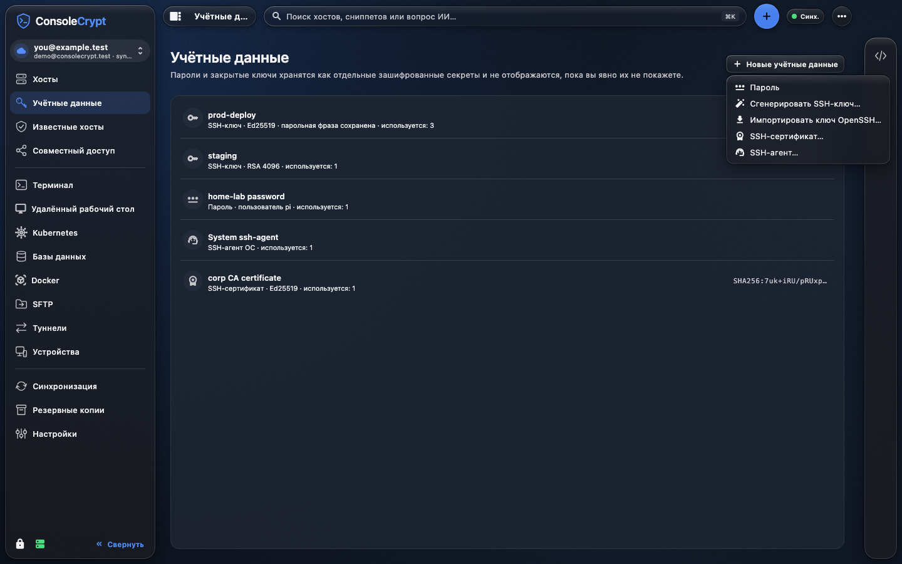

Выбор типа новых учётных данных.

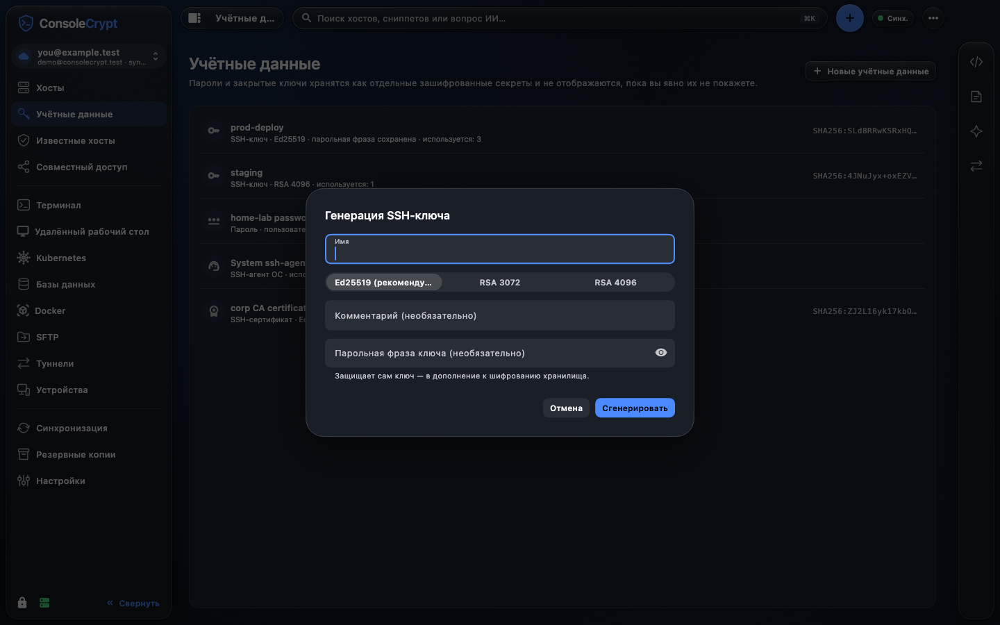

Создание SSH-ключа: название и алгоритм.

<a name="host-keys"></a>

## 14. Известные хосты и проверка SSH-ключа

Ключ сервера подтверждает, к какому SSH-хосту вы подключаетесь. Это отдельная проверка от доверия устройству ConsoleCrypt.

1. При первом подключении сверьте отпечаток ключа с администратором или доверенным источником и только затем примите его.

2. Сохранённые ключи находятся в отдельном боковом разделе «Известные хосты». Проверяйте адрес, алгоритм и отпечаток.

3. Если ключ изменился, подключение блокируется. Сначала выясните причину; удаляйте старую запись только после независимой проверки нового ключа.


Отдельный список известных SSH-хостов с демонстрационными отпечатками.

<a name="terminal"></a>

## 15. Терминал, вкладки и выделение

Во вкладке — терминальная сессия (SSH, а на macOS и Windows также локальная оболочка) или до четырёх сессий рядом, если разделить её на панели. На телефоне есть панель специальных клавиш, а на компьютере — горячие клавиши и контекстное меню.

1. Нажмите внутри терминала для ввода. Новое подключение открывается кнопкой «+». Когда вкладки не помещаются, прокручивайте полосу колёсиком или стрелками по краям. Рядом со стрелками показано общее число открытых вкладок в скобках.

2. Чтобы выделить несколько экранов вывода, удерживайте кнопку мыши и прокручивайте историю колёсиком. Можно вывести указатель за верхний или нижний край терминала: история начнёт прокручиваться автоматически, продолжая выделение.

3. Выделите текст и откройте меню правой кнопкой мыши. Доступны «Копировать», «Вставить», выделение всего, «Спросить ИИ» и сохранение выделенного в сниппет. Shift+F10 открывает меню с клавиатуры.

4. На телефоне используйте значок клавиатуры и «…» под терминалом. Рядом доступны Esc, Tab, Ctrl+C, Ctrl+D, Ctrl+L и стрелки; полоса прокручивается.

5. Многострочная вставка и управляющие символы требуют проверки. Проверьте хост и текст до подтверждения; команды после вставки выполняются по вашему действию.

6. Правый клик по вкладке открывает меню: переименовать, дублировать, закрыть, закрыть другие и вкладки справа. Фоновая вкладка, в которой появился новый вывод, подсвечивается, а в боковом меню рядом с числом вкладок появляется отдельный счётчик таких вкладок. В «Настройки → Терминал» выбираются шрифт (из установленных моноширинных) и подпись вкладки: имя из списка, адрес или имя компьютера, либо ничего.

7. На компьютере вкладку можно перетащить на другое место — в полосе сверху и в колонке слева; в колонке это делают и клавиши Alt+↑ / Alt+↓. Активная вкладка остаётся активной. Кнопка разделения на панели вкладок открывает ещё одну сессию к той же цели рядом — «Разделить вправо» (Cmd/Ctrl+Shift+\\) или «Разделить вниз» (Cmd/Ctrl+Shift+−), до четырёх панелей во вкладке; щелчок или Cmd/Ctrl+\] переводит ввод в другую панель, разделители перетаскиваются, крестик в заголовке закрывает панель.

8. При обрыве связи используйте переподключение в баннере вкладки. Буфер вывода сохраняется до закрытия вкладки; закрытие завершает эту сессию.

9. «Настройки → Терминал → Расположение вкладок»: «Сверху» или «Слева». Слева — столбец вкладок с названиями и адресами; перетащите его край, чтобы изменить ширину или свернуть до значков. Пока столбец открыт, боковая панель приложения свёрнута и остаётся такой, пока вы её не развернёте. Выбор сохраняется на этом устройстве.

> **Обратите внимание**
>
> После обновления откройте новую SSH-сессию. Встроенный SSH запрашивает UTF-8 для ввода и удаления кириллицы. Если символы всё ещё искажаются, проверьте UTF-8 локаль удалённого хоста: настройки его оболочки и SSH-сервера могут перекрывать запрос клиента.


Контекстное меню над выделением в демонстрационном терминале.


Вкладка, разделённая на две панели: слева команда, справа журнал того же хоста; у каждой панели своя сессия.


Меню вкладки по правому клику: переименовать, дублировать и закрыть.


«Настройки → Терминал»: шрифт, размер, цветовая схема и подпись вкладки.


Выделение текста в середине истории демонстрационного терминала.


Восемь открытых демонстрационных вкладок: навигация по полосе и счётчик.


Демонстрационный терминал Android с панелью специальных клавиш.

<a name="local-terminals"></a>

## 16. Локальные терминалы: zsh, PowerShell и WSL

На macOS и Windows можно открыть оболочку своего компьютера рядом с SSH-вкладками. Она запускается с вашими обычными правами пользователя и не требует сервера синхронизации.

1. В палитре Cmd+K / Ctrl+K выберите «Новый локальный терминал». На macOS сразу откроется zsh; на Windows появится выбор PowerShell, cmd и отдельных WSL-дистрибутивов.

2. Откройте «Терминал» и нажмите кнопку новой вкладки, Cmd+T на macOS или Ctrl+T на Windows. В группе «Локальные оболочки» выберите zsh, Windows PowerShell, Command Prompt либо установленный PowerShell 7. Общая кнопка «+» приложения по-прежнему выбирает SSH/RDP-хосты.

3. Каждый установленный WSL-дистрибутив отображается отдельно. Выберите Ubuntu, Debian или другой доступный дистрибутив; можно открыть несколько вкладок одной оболочки. Сам WSL клиент не устанавливает.

4. Проверяйте подпись «Этот компьютер» и имя WSL-дистрибутива, переключаясь между локальной и SSH-вкладкой. Ввод, изменение размера, Ctrl+C и интерактивные программы используют настоящий PTY/ConPTY. SFTP доступен для SSH-хоста, у локальной вкладки этого действия нет.

5. ИИ получает диалект активной оболочки и только явно выбранный контекст. AI-команды и сниппеты в локальную вкладку можно «Вставить» без Enter; автоматическое выполнение отключено. Проверьте текст и нажмите Enter сами, если хотите его выполнить.

6. Закрытие вкладки завершает её процесс. «Перезапустить оболочку» создаёт новую сессию. Блокировка хранилища, смена профиля и выход закрывают оболочку и её текущую foreground-группу. Отсоединённые фоновые процессы (например, nohup) не разыскиваются; весь WSL-дистрибутив не останавливается.

> **Обратите внимание**
>
> Локальные оболочки 0.5 доступны на macOS и Windows. Пакет macOS работает без App Sandbox и сохраняет прежние каталоги данных на месте; не удаляйте контейнер 0.4.1, модели, vault или Keychain. При конфликте двух каталогов или ошибке доступа запуск останавливается до создания нового профиля. Снимки ниже — виджеты с синтетическими профилями, не доказательство нативного запуска WSL.


Новый локальный терминал в палитре команд.


Выбор локальной zsh и SSH-хостов: настоящий интерфейс с демонстрационными профилями.


SSH и локальная zsh рядом. Текст терминала синтетический; пользовательские команды не выполнялись.


Windows-вариант выбора PowerShell, cmd и двух WSL-дистрибутивов в widget-тесте на macOS. Оболочки не запускались.

<a name="shortcuts"></a>

## 17. Горячие клавиши

Основной модификатор — ⌘ на macOS и Ctrl на Windows/Linux. Копирование на Windows не занимает Ctrl+C: эта комбинация прерывает команду. Сочетания приложения можно переназначить в «Настройки → Горячие клавиши»: нажмите «Изменить» и новую комбинацию с ⌘/Ctrl или Alt. Если она занята другой командой, у той сочетание снимется; если её использует система или терминал, появится предупреждение. «Восстановить по умолчанию» возвращает таблицу ниже.

| Действие | macOS | Windows / Linux |
| --- | --- | --- |
| Найти хост, сниппет или действие | ⌘K | Ctrl+K |
| Новая вкладка SSH | ⌘T | Ctrl+T |
| Закрыть активную вкладку | ⌘W | Ctrl+W |
| Новый хост | ⌘N | Ctrl+N |
| Заблокировать хранилище | ⌘L | Ctrl+L |
| Настройки | ⌘, | Ctrl+, |
| Сниппеты | ⌘. | Ctrl+. |
| Копировать в терминале | ⌘C | Ctrl+Shift+C |
| Вставить в терминал | ⌘V | Ctrl+V; в Windows также Shift+Insert |
| Разделить терминал вправо | ⌘⇧\\ | Ctrl+Shift+\\ |
| Разделить терминал вниз | ⌘⇧− | Ctrl+Shift+− |
| Следующая панель терминала | ⌘\] | Ctrl+\] |

> **Обратите внимание**
>
> Комбинации приложения обрабатываются раньше терминала. Чтобы отправить Ctrl+L удалённой оболочке, на телефоне используйте одноимённую кнопку панели клавиш.


«Настройки → Горячие клавиши»: каждое действие можно переназначить или вернуть по умолчанию.

<a name="sftp"></a>

## 18. SFTP: передача и просмотр файлов

Откройте SFTP из меню хоста или бокового раздела. Файлы передаются непосредственно между вашим устройством и SSH-хостом.

1. Выберите хост и подключитесь. На компьютере используйте локальную и удалённую панели; на телефоне — переключение области и системный выбор файла.

2. Выделите файл и выберите загрузку или скачивание. Следите за передачами в панели активности; там отображаются ход выполнения и отмена.

3. Файлы можно перетаскивать: из Finder или Проводника в список хоста — загрузка, из списка хоста в локальную панель — скачивание, на папку или в строку пути — перенос на сервере. На macOS и Windows файлы из списка хоста можно перетащить прямо в Finder или Проводник: файл скачивается во временную папку, передаётся системе и удаляется, ход виден в «Передачах». Папки так не переносятся — скачайте их командой «Скачать»; на Linux перетаскивания наружу нет.

4. Для чтения откройте «Быстрый просмотр». Номера строк находятся в отдельной колонке: при выделении и копировании текста они не попадают в буфер.

5. Папка, которую SSH-пользователь не может прочитать, помечается «Нет доступа» вместо пустого списка. Из Docker путь тома или монтирования на SSH-хосте открывается сразу в SFTP.

6. Меню действий (кнопка на панели или правый клик) собирает всё для выбранных файлов: открыть, открыть в программе, быстрый просмотр, скачать, загрузить сюда, новая папка и новый файл, переименовать, дублировать, удалить, «Свойства», скопировать путь или имя и обновить.

7. «Свойства» показывают размер, расположение, владельца и права. Права меняются флажками «Чтение», «Запись», «Выполнение» для владельца, группы и остальных или восьмеричным кодом; «Применить» сохраняет их на сервере. Для символической ссылки права относятся к объекту, на который она указывает.

8. Путь в верхней строке можно отредактировать или скопировать; поиск фильтрует текущую папку. Колонки, «Сначала папки» и показ скрытых файлов настраиваются в заголовке списка, а неудавшиеся передачи можно повторить из панели активности.


Быстрый просмотр демонстрационного файла с отдельной колонкой номеров строк.


Меню действий для выбранного файла на демонстрационном хосте.


«Свойства» файла: размер, владелец и права с восьмеричным кодом.


Локальная панель слева и удалённый хост справа; показан демонстрационный «диск» /Users/demo.


Панель «Передачи»: скачивания и загрузка завершены, у неудачной передачи есть кнопка повтора.

<a name="sftp-editor"></a>

## 19. SFTP: редактор по умолчанию

На компьютере файл можно открыть во внешнем редакторе. ConsoleCrypt запоминает выбранную программу на этом устройстве.

1. В «Настройки → SFTP → Редактор по умолчанию» нажмите «Выбрать программу» и укажите установленный VS Code, Zed или другой редактор.

2. Действия «Открыть» и «Открыть в редакторе» используют этот выбор. «Открыть в программе…» позволяет выбрать другую программу для отдельного файла; «Системный редактор» сбрасывает настройку.

3. Файлы, которые при открытии могли бы выполнить код (скрипты, ярлыки, .exe, .command, .desktop и т. п.), ConsoleCrypt никогда не запускает. «Открыть» сначала предупреждает «Этот файл может выполнить код», затем «Открыть как текст» открывает файл в текстовом редакторе. Если редактор не найден, предлагается «Выбрать редактор…». Загруженные файлы помечаются как полученные из интернета (Windows) и помещаются в карантин (macOS).

4. Прочитайте предупреждение перед первым открытием: рабочая копия хранится локально, а каждое сохранение загружается на удалённый сервер автоматически.

5. При изменении удалённого файла другим пользователем решите конфликт в панели редактирования. Завершите редактирование через ConsoleCrypt, чтобы закончить загрузку и удалить рабочую копию.

> **Обратите внимание**
>
> Автосохранение, резервные копии и облачные функции внешнего редактора находятся вне контроля ConsoleCrypt. Каталог рабочих копий помечен CACHEDIR.TAG и .nobackup, поэтому borg, restic, tar и другие программы резервного копирования, которые учитывают эти метки, его пропускают; на macOS он исключён из Time Machine. Эта настройка предназначена для компьютеров; на мобильных платформах работа с файлами зависит от системных возможностей.


Локальная настройка запомненного редактора в демонстрационном клиенте.


«Открыть» для скрипта: файл откроется как текст и не будет запущен.

<a name="tunnels"></a>

## 20. SSH-туннели

Туннель использует SSH-соединение к выбранному хосту. Есть локальное перенаправление, удалённое перенаправление и динамический SOCKS5.

1. Откройте «Туннели» и создайте туннель. Выберите хост, тип, адрес и порт прослушивания; для локального или удалённого типа задайте целевой адрес и порт.

2. Предпочитайте 127.0.0.1 для локального сервиса, который нужен только вам. При адресе не из loopback (например, 0.0.0.0) форма показывает предупреждение «Привязка не к loopback-интерфейсу», и сохранить туннель можно только после отметки «Я понимаю, что этот туннель доступен из сети». Для удалённого перенаправления такой адрес работает, только если на SSH-сервере разрешён GatewayPorts.

3. Запустите туннель переключателем и проверьте его состояние: строка показывает число активных соединений и время работы, а при ошибке — её причину. После завершения работы остановите его. «Запускать автоматически после разблокировки» поднимает туннель при каждом открытии хранилища на этом устройстве.

> **Обратите внимание**
>
> Определение туннеля может синхронизироваться вместе с хранилищем; запущенный туннель работает на конкретном устройстве. На телефоне работа в фоне зависит от ограничений ОС.


Демонстрационные определения туннелей и их состояния.


Удалённое перенаправление на 0.0.0.0: предупреждение и обязательное подтверждение.

<a name="snippets"></a>

## 21. Сниппеты, переменные и базовые наборы

Сниппет — сохранённая команда или шаблон. Откройте инструмент значком &lt;/&gt; справа или горячей клавишей.

1. Нажмите «Новый сниппет», укажите имя, команду, тип, теги и при необходимости набор. В шаблоне используйте переменные вида {{service}}: для каждой можно задать описание и значение по умолчанию.

2. Уровень риска — «Только чтение», «Изменяющая», «Разрушительная» или «Неизвестно» — решает, как строго подтверждается запуск: изменяющие и разрушительные команды выполняются только после отметки, что вы проверили команду. «Только чтение» не получают команды, которые сами запускают другие программы или пишут файлы: \`env -S\`, \`fd -x\`, \`rg --pre\`, \`sed\` с \`e\`/\`w\`, \`awk\` с \`\| getline\`, \`git -c\` — уровень считается по вложенной команде или как «Неизвестно». Для хостов команды с политикой «Спрашивать перед опасными командами» отметка нужна всегда.

3. «Базовые наборы» предлагает «Диагностика Linux», Docker, Kubernetes и наборы для баз данных: SQL · PostgreSQL, SQL · MySQL/MariaDB и SQL · ClickHouse (по 20 запросов), Redis, MongoDB и SQLite (по 15), Cassandra / ScyllaDB (17) — активные и долгие запросы, блокировки, размеры, индексы, репликация и тяжёлые запросы. Добавляйте нужные наборы явно; команды становятся обычными объектами вашего хранилища.

4. Сниппеты баз данных выполняются и внутри psql, mysql, clickhouse-client, redis-cli и mongosh в SSH-сессии: многострочный запрос уходит одной вставкой, а изменяющие команды требуют подтверждения. В рабочей области базы кнопка «Сниппеты» (⌘J / Ctrl+J) вставляет сниппет этого движка в редактор, ничего не выполняя.

5. Редактируйте, переносите в другой набор или удаляйте команды. Удаление набора удаляет его сниппеты после подтверждения и синхронизируется; примеры не возвращаются сами.

6. Перед использованием заполните переменные и проверьте итоговую команду: окно переменных показывает её предпросмотр. «Вставить» вставляет её в терминал без Enter; «Запустить» открывает подтверждение с хостом, командой и уровнем риска. «Запустить в нескольких терминалах…» из меню сниппета выполняет команду в выбранных открытых вкладках терминала после отдельного подтверждения.

> **Обратите внимание**
>
> Изменения сниппетов синхронизируются в профиле с сервером. В локальном профиле они остаются локально. Полученный от коллеги сниппет также не выполняется автоматически.


Базовые наборы: Linux, Docker, Kubernetes и наборы для баз данных.


Редактор сниппета: шаблон с переменными, их значения по умолчанию и уровень риска.


Перед запуском: значения переменных и предпросмотр итоговой команды.


Подтверждение разрушительной команды: хост, команда и обязательная отметка.


Фильтрация и управление наборами сниппетов.

<a name="ai"></a>

## 22. ИИ-чат и отправляемый контекст

Вы сами выбираете провайдера, контекст и последующее действие. Ответ модели не запускает команды.

1. В «Настройки → ИИ-провайдеры» нажмите «Добавить провайдера»: выберите тип, адрес, модель и при необходимости ключ API (он хранится в хранилище), затем «Сохранить и проверить». Один провайдер отмечается как используемый по умолчанию. Для удалённого провайдера проверьте адрес и его политику обработки данных.

2. «Приватность по умолчанию» задаёт профиль скрытия данных; в окне провайдера можно выбрать свой профиль для конкретного провайдера.

3. «Строгий» профиль скрывает секреты, адреса, имена хостов, пользователей и БД. «Стандартный» сохраняет метаданные хостов; «Локальный» даёт больше контекста, продолжая скрывать секреты.

4. Выделите нужный текст терминала и выберите «Спросить ИИ» либо включите добавление выделения в чате. Проверьте контекст перед «Отправить»; не вставляйте секреты в свободный текст.

5. Перед «Вставить» или «Выполнить…» проверьте предложенную команду и целевой хост. Для исполнения приложение запрашивает подтверждение; оцените команду самостоятельно.

6. Кнопка «История разговоров» в шапке чата показывает разговоры этой сессии и сохранённые в хранилище. Выберите разговор, чтобы продолжить его: сообщения вернутся в чат, а модель снова получит прежние ходы (со скрытыми, как и раньше, данными). Там же разговор можно удалить.

7. Ответы отображают Markdown: заголовки, списки, выделение и код; команды из блоков кода показываются карточками с действиями. Значок внизу бокового меню показывает, кто отвечает по умолчанию: встроенная модель (чип), локальный сервер (сервер) или облачный API (глобус); по нажатию открываются настройки. Чип зелёный, только пока встроенная модель действительно работает: при запуске он синий, при ошибке красный, а не запущенная модель показана серым — она стартует с первым запросом.

> **Обратите внимание**
>
> Подсистема ИИ не имеет API к парольной фразе и приватным ключам хранилища. Разговоры хранятся до блокировки хранилища; с настройкой «Хранить разговоры с ИИ в хранилище» каждый завершённый ход сохраняется в хранилище (и синхронизируется вместе с ним), а секреты, введённые в вопрос, заменяются метками. Блокировка хранилища или смена профиля очищает чат и отменяет текущий ответ; уже отправленный провайдеру контекст этим не удаляется.


ИИ-чат с выбранным контекстом демонстрационного терминала.


«Настройки → ИИ-провайдеры»: локальные и удалённый провайдеры, провайдер по умолчанию и приватность по умолчанию.


Добавление провайдера: адрес, модель, ключ API в хранилище и профиль приватности.

<a name="local-ai"></a>

## 23. Локальный ИИ: модели, своя GGUF и обновление

На macOS и Windows модель отвечает на вашем компьютере. Можно выбрать лёгкую Qwen2.5-Coder 1.5B, среднюю Qwen3.5 4B или мощную Qwen3.5 9B; уже скачанные модели сохраняются при обновлении. Можно добавить и свою модель GGUF.

| Вариант | Модель и загрузка | Общая ОЗУ: ориентир |
| --- | --- | --- |
| Лёгкая | Qwen2.5-Coder 1.5B Q4\_K\_M · 1,1 ГБ | 4 ГиБ |
| Средняя | Qwen3.5 4B Q4\_K\_M · 2,7 ГБ | 8 ГиБ |
| Тяжёлая | Qwen3.5 9B Q4\_K\_M · 5,7 ГБ | 16 ГиБ |

1. В настройках откройте «Встроенный локальный ИИ» и выберите модель. Звезда рекомендует вариант по общей памяти компьютера, но не меняет выбор автоматически. При неизвестном объёме или менее 4 ГиБ звезды нет. ОЗУ — ориентир, а не обещание скорости.

2. Нажмите «Установить локальный ИИ». Файлы проверяются по размеру и SHA-256; прогресс виден, загрузку можно отменить и продолжить. В Windows отдельно устанавливается движок; macOS включает небольшой движок в пакет. Большие файлы моделей не входят в установщик приложения.

3. Флажок «Использовать по умолчанию после установки» хранится только на этом устройстве. Снятие возвращает обычный выбор провайдера. После установки локальной модели при включённом default выбор другой, ещё не скачанной модели приводит к предложению установить её без незаметной отправки запроса в облако.

4. «Добавить свою модель (GGUF)…» выбирает файл GGUF на компьютере: приложение проверяет заголовок, копирует файл в папку моделей со сверкой SHA-256 и выбирает его, оригинал можно удалить. Своя модель помечена «Своя», объём памяти оценивается по размеру файла, а происхождение и лицензию проверяйте сами. «Удалить» убирает копию и возвращает выбор к Qwen2.5-Coder 1.5B.

5. Смена модели останавливает текущий процесс и сохраняет остальные GGUF-файлы. «Удалить» удаляет только выбранную модель и её частичные загрузки. Обновление или ремонт движка повторно использует проверенную модель; прежний Qwen2.5-Coder 1.5B и настройки default сохраняются.

6. Модель запускается при первом запросе либо кнопкой запуска. После 15 минут без запросов, блокировки vault, смены профиля или выхода процесс останавливается. Apple Silicon использует Metal; Intel Mac и Windows x64 — CPU. На Linux и мобильных платформах встроенная установка недоступна.

7. Откройте «Источники и лицензии моделей»: 1.5B опубликована Qwen, версии 4B/9B — GGUF-квантования Qwen от Unsloth; все три используют Apache-2.0. Лицензионный текст доступен без интернета.

> **Обратите внимание**
>
> Локальный запрос идёт только на 127.0.0.1 со случайным токеном; фильтрация контекста сохраняется. В локальном терминале AI-команда вставляется без Enter и выполняется вами вручную после проверки. На macOS не удаляйте прежний контейнер данных при обновлении 0.4.1 → 0.5: профиль и модель используются на месте. Снимки показывают синтетические состояния, не реальную загрузку или скорость ответов.


Три модели, размеры и ориентиры ОЗУ. Звезда 9B рассчитана для демонстрационных 16 ГиБ, а не измерена на пользовательском компьютере.


Выбор локальной модели и настройка default. Демонстрационный профиль.


Индикатор загрузки и проверки с отменой; прогресс синтетический.


Готовая выбранная модель и действия остановки и удаления; состояние процесса демонстрационное.

<a name="notes"></a>

## 24. Заметки, задачи и напоминания

«Заметки» — инструмент правой панели рядом со «Сниппетами» и «ИИ». Он открывается значком заметки, из палитры команд и из шапки на телефоне. Заметки шифруются на устройстве и синхронизируются вместе с хранилищем.

1. Вкладка «Объект» показывает заметки к тому, что открыто сейчас: SSH-хосту активной вкладки терминала, RDP-хосту, хосту SFTP, подключению к базе данных, ресурсу или контексту Kubernetes, выбранному Docker-контейнеру. «+» создаёт заметку, уже привязанную к этому объекту.

2. «Все» показывает все заметки и к чему они привязаны, «Задачи» — только задачи: просроченные выше и выделены, выполненные собраны отдельно. Поиск ищет по заголовку, тексту и меткам.

3. Текст пишется в Markdown, вкладка «Просмотр» показывает результат. Добавьте метки через запятую. Меню «…» заметки закрепляет её, откладывает напоминание на час («Напомнить через час»), привязывает к текущему объекту, к любому хосту («Привязать к…») или отвязывает и удаляет заметку. Переключатель «Задача» добавляет срок и отметку «Выполнено».

4. Изменения сохраняются сами через мгновение после ввода; кнопка «Сохранить» (⌘S / Ctrl+S) сохраняет сразу. Под ней виден статус: «Сохранено» или «Есть несохранённые изменения». Если заметку не удалось сохранить, при выходе из редактора приложение спросит «Выйти без сохранения?».

5. На карточке хоста в разделе «Хосты» видно, сколько у него заметок. Кнопка с числом или пункт «Заметки» в меню «…» хоста открывает его заметки без подключения. На вкладке «Объект» хост можно выбрать значком поиска или убрать выбор крестиком, а в поле «Привязка» редактора есть «Выбрать хост…».

6. «Напоминание» предлагает «Через час», «Сегодня в 18:00», «Завтра в 09:00», «Через неделю» или своё время. Пока приложение открыто, в срок появляется уведомление с кнопкой «Открыть»; число просроченных задач и сработавших напоминаний видно на значке «Заметок».

7. Текст из поля «Заметки» карточки хоста можно перенести в обычную заметку кнопкой «Перенести в заметки». Если объект заметки удалён, ушёл вместе с общим доступом или командой или привязан в более новой версии приложения, заметка остаётся с пометкой «Не привязана» и прежним именем объекта. Во «Все» фильтр «Показать → Не привязанные (N)» собирает такие заметки, а «Привязать к…» в их меню привязывает их снова.

8. Новые заметки всегда личные, в том числе о хостах команды: их видите только вы, и они остаются после выхода из команды.

> **Обратите внимание**
>
> Напоминания приходят и при закрытом приложении — системным уведомлением «Напоминание из ConsoleCrypt» без текста заметки: центр уведомлений не шифруется. Система держит до 64 ближайших напоминаний разблокированного профиля; при выходе из профиля они снимаются. На Android время может сдвинуться на несколько минут (экономия заряда), на Linux напоминания работают только при открытом приложении.


Заметки к SSH-хосту активной вкладки: просроченная задача, заметка с меткой и общие заметки хоста; все данные демонстрационные.


Вкладка «Задачи»: просроченные выше, у каждой задачи срок, напоминание и привязка.


Задача с Markdown, меткой, сроком и напоминанием; рядом кнопка «Сохранить» и статус «Сохранено».


Текст изменён: статус «Есть несохранённые изменения» до автосохранения или «Сохранить».


Число заметок на карточке хоста открывает его заметки без подключения.


Фильтр «Не привязанные»: заметка удалённого хоста old-db-1 и пункт «Привязать к…».


Меню заметки: закрепить, напомнить через час, отвязать от объекта и удалить.

<a name="teams"></a>

## 25. Команды

Команда — общее хранилище нескольких аккаунтов на одном сервере. Её хосты, группы, учётные данные и сниппеты видят все участники, а роль решает, кто может их менять. Названия, настройки и ресурсы команды зашифрованы сквозным шифрованием: сервер видит только состав участников. Команды доступны в профиле с синхронизацией на сервере 0.2.1 и новее (публичный sync.consolecrypt.dev их поддерживает); в локальном профиле раздела «Команды» нет.

| Ограничение сервера | По умолчанию |
| --- | --- |
| Команд на один аккаунт | 50 (CC\_MAX\_TEAMS\_PER\_ACCOUNT) |
| Участников в команде | 200 (CC\_MAX\_TEAM\_MEMBERS) |
| Срок приглашения | 7 дней |
| Приглашений от команды | не больше 20 в час |

1. Откройте «Настройки → Команды». Здесь собраны ваши команды с ролью и числом участников, входящие приглашения и кнопки «Создать команду» и «Обновить». Нажмите на команду, чтобы открыть её окно.

2. «Создать команду»: задайте название, описание и цвет из палитры или «Свой…». Создатель становится владельцем, команда появляется на всех ваших устройствах после разблокировки. Если сервер требует подтверждения почты, сначала подтвердите адрес.

3. На вкладке «Участники» нажмите «Пригласить участника»: укажите почту, роль и, при желании, комментарий. Комментарий не шифруется — сервер может его прочитать. Сервер не сообщает, есть ли такой аккаунт; приглашение и письмо получает только аккаунт с подтверждённой почтой (с сервером 0.2.4 и новее), а письмо уходит, только если на сервере настроена почта. Приглашение действует 7 дней, ожидающие приглашения можно отменить.

4. Приглашённый видит приглашение в «Настройки → Команды» и нажимает «Принять» (или «Отклонить»). Появляется код из 6 групп по 5 цифр — его нужно продиктовать администратору лично, по телефону или в мессенджере. Код охватывает ключ этого администратора: команда откроется, только если вас добавит именно он; команду, которую подсунул бы сервер, приложение не откроет и покажет «Команда на паузе».

5. У администратора в окне команды появляется «… принял(а) приглашение» и кнопка «Сверить код». Сравните все группы с экраном коллеги, отметьте совпадение и нажмите «Добавить в команду». Если коды различаются, нажмите «Коды не совпадают»: никто не будет добавлен, а приглашение отклоняется. Ключ команды получают ровно те ключи участника, по которым посчитан код на вашем экране: если после сверки сервер сообщит другие ключи или роль, добавление откажет с ошибкой «Коды проверки не совпадают» — откройте запрос и сверьте код заново.

6. Роли: «Владелец» один, он может назначать администраторов и передавать владение («Сделать владельцем»). «Администратор» приглашает редакторов и наблюдателей, меняет их роли, удаляет участников и меняет настройки. «Редактор» меняет ресурсы, «Наблюдатель» только просматривает и подключается — у его команды в списках пометка «Только чтение».

7. В разделе «Хосты» слева появляются «Личное» и каждая команда со своим цветом и числом хостов; у хостов команды в списке есть цветная метка. В разделе команды «Новая группа команды» создаёт группу в команде: всё, что создано в группе команды, принадлежит команде.

8. Меню «…» хоста предлагает «Копировать в команду…» и «Переместить в команду…» (в команды, где вы можете редактировать), а для хоста команды — «Переместить в личное». Выносить хост из команды (в личное или в другую команду) может только её владелец; остальные участники могут скопировать его себе. Нужные хосту учётные данные копируются вместе с ним; если такой же ключ уже лежит в хранилище, где окажется хост, используется он, а не ещё одна копия. Командные учётные данные отмечены в списке меткой команды. Вкладки терминала хостов команды отмечены полоской её цвета.

9. Вкладка «Настройки» команды: название, описание, цвет и политики. «Отмечать новые контексты Kubernetes и базы данных как рабочие (прод)» — новые подключения команды сразу считаются продом. «Не отправлять эти ресурсы ИИ-помощникам» — ресурсы команды не попадают в контекст ИИ. «Спрашивать перед опасными командами» — команды из сниппетов и ИИ на хостах команды выполняются только после отметки «Я проверил(а) эту команду…», даже если они только читают; текст, набранный в терминале вручную, не проверяется. Настройки меняют владелец и администраторы, остальные видят их только для чтения.

10. «Мой цвет для этой команды» меняет цвет только на ваших устройствах. «Покинуть команду» доступно всем, кроме владельца (сначала передайте владение). «Сменить ключ» вручную выпускает ключ нового поколения; номер поколения показан внизу вкладки.

11. Когда участник уходит или его удаляют, ключ команды меняется: новые ресурсы шифруются ключом нового поколения, и бывший участник их не прочитает. Если смена ключа ещё нужна, у администратора появляется пометка и предупреждение со «Сменить ключ». Вкладка «История» показывает подписанный журнал: кто, когда и кого добавил, удалил, повысил, передал владение или сменил ключ.

> **Обратите внимание**
>
> Каждое изменение состава подписывает администратор, и каждый клиент проверяет весь журнал сам. Если сервер покажет участника, которого никто не подписывал, или вернёт более старый состав, команда встанет на паузу «только чтение» с предупреждением, а ключи никому не будут переданы. Ключ команды приложение запоминает: если сервер выдаст другой ключ той же эпохи или новый ключ, не связанный цепочкой с прежним, команда тоже встанет на паузу. С сервером 0.2.4 и новее владелец или администратор подписывает отпечаток ключа команды, и новый участник открывает команду, только если ключ совпадает с ним. Удалённый участник сохраняет только то, что уже успел скачать. Политика «Очищать скопированные секреты через» сокращает время, на которое пароль учётных данных команды остаётся в буфере обмена; удлинить локальную настройку «Безопасность» она не может.


«Настройки → Команды»: входящее приглашение с комментарием и две команды с ролью и числом участников; все адреса демонстрационные.


Создание команды: название, описание и цвет.


Вкладка «Участники»: запрос на вступление со «Сверить код», роли участников и отправленное приглашение.


Приглашение участника: почта, роль и комментарий, который сервер может прочитать.


Приглашённый принял приглашение: код из 6 групп для сверки с администратором (код демонстрационный).


Администратор сверяет тот же код, отмечает совпадение и добавляет участника.


Вкладка «Настройки»: название, описание, цвет и политики команды.


Вкладка «История»: подписанный журнал добавлений, смены роли, удаления и смены ключа.


Хосты: разделы «Личное» и команд с их цветами, метки команд у хостов.


Раздел команды: только её группы и хосты, кнопка «Новая группа команды».


Меню личного хоста: «Копировать в команду…» и «Переместить в команду…».


Вкладки терминала хостов команд отмечены полосками цвета команды.


Политика «Спрашивать перед опасными командами»: даже безопасный сниппет на хосте команды требует отметки.

<a name="sharing-start"></a>

## 26. Совместный доступ: с чего начать

Делитесь отдельными элементами с проверенными устройствами людей на том же сервере. Ваше личное хранилище и его ключ не передаются.

1. Откройте «Совместный доступ». Вкладки «Я поделился» и «Доступно мне» показывают созданные и полученные элементы. При недоступной функции проверьте поддержку и настройки сервера.

2. В карточке «Доступ на другом устройстве» собраны добавление этого устройства и подтверждение другого. «Запросы устройств» и «Другие действия» находятся ниже; вкладки со списками остаются над карточкой.

3. В меню хоста или сниппета выберите «Поделиться…». Просмотрите данные: хост передаётся без личных учётных данных; заметки требуют отдельного внимания.

4. Найдите устройства коллеги по email и отметьте «Дать доступ этому устройству»: ключи устройства закрепляются на вашем устройстве со статусом «Выбран (не проверен)». Адрес почты и список устройств с сервера сами по себе не подтверждают подлинность ключей.

5. Нажмите «Проверить» рядом с устройством. Вкладка «Код безопасности» показывает 12 групп цифр, вычисленных из ключей обоих устройств; коллега открывает такую же проверку для вашего устройства и диктует свой код по телефону или лично, а вы вводите его — вставка отключена. Лично можно отсканировать «QR-код» коллеги или ввести его текст. После совпадения статус меняется на «Проверен» с датой.

6. Если сервер позже сообщит для известного устройства другие ключи, оно помечается «Ключи изменились»: новый доступ невозможен до повторной проверки. Секреты, kube-доступы и подключения к БД по умолчанию выдаются только проверенным устройствам — настройка «Совместный доступ: только проверенным» в «Настройки → Хранилище» (там же можно включить проверку и для хостов, групп и сниппетов). Она действует на новый доступ и новые устройства; у существующих получателей доступ сохраняется.

7. Оставьте «Чтение» для просмотра или явно выберите «Редактирование». Проверьте получателей и опубликуйте. Получатель в «Проверить и принять» видит владельца и при желании проверяет его тем же способом; элемент от непроверенного владельца помечен «Владелец не проверен», его хосты не подключаются автоматически. После обновления до 0.9.2 один раз показывается список получателей секретов, kube-доступов и БД, которых стоит проверить.

> **Обратите внимание**
>
> Доступность зависит от совместимого сервера, подтверждённой почты и доверия устройствам. На публичном sync.consolecrypt.dev включены общий доступ, группы, секреты и подтверждённое добавление новых устройств коллеги. Каждый элемент публикуется только по явному действию его владельца. На своём сервере совместный доступ по умолчанию выключен — флаги описаны в главе «Свой сервер: возможности, флаги и лимиты».


Совместный доступ: карточка устройств, «Отпечаток ключей моего устройства» и полученные элементы с пометкой «Владелец не проверен».


Устройство коллеги выбрано: статус «Выбран (не проверен)», кнопка «Проверить» и отпечаток ключей; данные демонстрационные.


Проверка устройства коллеги: код безопасности из 12 групп и код, введённый со слов коллеги; цифры демонстрационные.


Выбор прав: чтение или редактирование.


«Совместный доступ: только проверенным» в карточке «Хранилище»: секреты, kube-доступы и БД включены по умолчанию.


Разовый список получателей секретов, которых стоит проверить, и пометка «Владелец не проверен».

<a name="sharing-items"></a>

## 27. Общие хосты, группы и секреты

Каждый элемент имеет собственный доступ. Группа не выдаёт права ко всем вложенным данным автоматически.

1. Для полученного хоста создайте личную копию и назначьте свои учётные данные. Перед новым адресом или портом требуется отдельная проверка, включая цепочку jump-хостов.

2. Публикуя группу, явно выберите ссылки на уже независимо опубликованные элементы. Получатель увидит недоступные вложения как закрытые; добавление личного хоста в группу само по себе ничего не публикует.

3. Секрет публикуется отдельно из карточки учётных данных, с явным предупреждением. Основной пароль или ключ и парольная фраза SSH-ключа — отдельные элементы; скрытый предпросмотр не раскрывает значение.

4. Получатель явно показывает секрет или копирует его после актуальной проверки доступа. Показ ограничен по времени; блокировка, смена профиля и закрытие диалога убирают раскрытое значение.

> **Обратите внимание**
>
> «Чтение» разрешает увидеть и сохранить доступные данные, включая отдельно выданный секрет. Оно не может запретить копирование уже прочитанного. Секреты не добавляются в обычный JSON хоста, сниппет или контекст ИИ.


Отдельный диалог публикации секрета: значение скрыто, согласие ещё не дано.


«Проверить и принять»: владелец, его устройство, статус ключей и кнопка «Проверить»; данные демонстрационные.

<a name="databases-sharing"></a>

## 28. Общие подключения баз данных

Сохранённым подключением к базе можно поделиться с проверенным устройством коллеги — так же, как хостом или контекстом Kubernetes. Нужен сервер синхронизации 0.1.15 или новее с включённой функцией; на sync.consolecrypt.dev она включена. Со старым сервером пункт не показывается. На своём сервере функцию включает флаг CC\_SHARED\_DB\_CONNECTIONS\_ENABLED (глава «Свой сервер: возможности, флаги и лимиты»).

1. В разделе «Базы данных» откройте меню «…» подключения и выберите «Совместный доступ». Блок «Что будет передано» показывает всё, что получит коллега: имя, движок, адрес, порт, базу, пользователя, вид маршрута и пометку «Прод». Режим TLS и ограничения тоже передаются.

2. Группа, история запросов, настройки ИИ и разрешения сеанса не передаются. Пароль и ключ клиента уходят только с отметкой «Передать сохранённый пароль и ключ клиента» и только если сервер поддерживает общие секреты.

3. Маршрут через SSH-хост, профиль переходов, прокси или туннель не передаётся: получатель выбирает свой. У проброса Kubernetes сохраняются пространство имён и нагрузка, а контекст выбирает получатель; у Docker сохраняется имя контейнера, а движок выбирает получатель. Такое подключение нельзя сохранить как прямое.

4. Найдите устройства коллеги по email, сверьте код устройства через независимый канал, выберите права и нажмите «Поделиться». Свои другие устройства получателями не выбираются: они получают общий доступ через подтверждённое подключение устройства, а устройство, которое сервер выдаёт за ваше, приложение отклонит.

5. У получателя подключение появляется вверху раздела «Базы данных», в блоке «Общие подключения», с меткой «Общее»; свои опубликованные помечены «Вы поделились». «Проверить и принять» подтверждает владельца, «Подробнее» открывает сохранение личной копии, участников и отзыв доступа. Пароль и ключ клиента импортируются в копию только по явной отметке.

6. Копия прод-подключения остаётся прод-подключением и открывается только на чтение. Подключения можно добавлять в общие группы.

7. Подключения к БД, как секреты и kube-доступы, по умолчанию выдаются только проверенным устройствам коллеги: сначала нажмите «Проверить» и сверьте код безопасности (см. «Совместный доступ: с чего начать»).

8. Подключениями SQLite и Cassandra / ScyllaDB поделиться с коллегами нельзя: пункта «Совместный доступ» у них нет. Между своими устройствами подключения Cassandra / ScyllaDB и SQLite через хост синхронизируются после «Синхронизировать через хранилище».

> **Обратите внимание**
>
> Отзыв доступа не отменяет уже скопированный пароль — смените его на сервере базы данных.


Общие подключения: полученные с меткой «Общее», своё — «Вы поделились», приглашение ждёт проверки.


Публикация подключения: что получит коллега; маршрут не передаётся, пароль — только по отметке.

<a name="shared-notes"></a>

## 29. Общие заметки к общим объектам

У общего хоста, подключения к базе данных или контекста Kubernetes есть общие заметки: их видят все участники. Нужен сервер синхронизации 0.2.0 или новее, на котором администратор включил общие заметки (CC\_SHARED\_NOTES\_ENABLED). На объект — до 500 заметок, каждая до 288 КиБ в зашифрованном виде.

1. Откройте общий объект и инструмент «Заметки» на вкладке «Объект». Под личными заметками появится блок «Общие заметки»; «+» в нём создаёт общую заметку.

2. Писать может любой участник. Изменить заметку может только автор, удалить — автор или владелец объекта. У каждой заметки видно, кто её автор: «Вы», «Владелец» или «Участник».

3. Заметка к Docker-контейнеру общего SSH-хоста или к ресурсу общего контекста Kubernetes видна только у этого контейнера или ресурса.

4. Пока владелец ни разу не открыл панель заметок для объекта, участники видят сообщение об ожидании. После исключения участника устройство владельца при следующем открытии панели перешифровывает заметки новым ключом.

5. Связь объекта с общим доступом запоминается при публикации и при сохранении личной копии. Для объектов, опубликованных до 0.9.0 (кроме скопированных хостов), опубликуйте или скопируйте объект заново.

> **Обратите внимание**
>
> Ключ общих заметок выдаёт и подписывает устройство владельца, а каждую заметку подписывает устройство автора: сервер не может прочитать текст, подменить ключ или выдать чужую заметку за вашу.


Блок «Общие заметки» у общего хоста: заметка участника и ваша заметка с кнопкой удаления.

<a name="sharing-devices"></a>

## 30. Новые собственные устройства коллеги

Разрешение касается только новых устройств уже проверенного коллеги. Оно не приглашает других людей и не повышает права.

1. Владелец элемента открывает «Новые собственные устройства», выбирает проверенное опорное устройство коллеги, предел прав, срок и число добавлений. По умолчанию используется ручное подтверждение; автоматическое включается явно.

2. Передайте публичный пакет разрешения новому устройству. В карточке «Доступ на другом устройстве» нажмите «Добавить это устройство»: оно проверяет пакет и создаёт запрос с правами чтения по умолчанию.

3. На уже проверенном устройстве коллеги нажмите «Подтвердить устройство», откройте пакет и введите код (6 групп по 5 цифр) с экрана нового устройства — на этом шаге код не показывается и не подставляется. Затем передайте подтверждённый пакет обратно; при «Продолжить добавление устройства» новое устройство так же вводит код с экрана подтверждающего.

4. Новое устройство продолжает добавление и отвечает на проверку владения ключом через «Запросы устройств». В ручном режиме владелец подтверждает запрос; автоматический действует только в заранее разрешённых пределах.

> **Обратите внимание**
>
> Для выполнения процесса владелец должен быть в сети с открытым хранилищем. В обоих режимах требуется полная сверка кода; импорт пакета сам по себе не выдаёт доступ. Публичный пакет содержит открытые ключи и подписи, а не слова восстановления или приватные ключи. На своём сервере эту возможность включает флаг CC\_SHARING\_OWNER\_ONLINE\_ENROLLMENT\_ENABLED.


Настройка разрешения новых устройств: ручное подтверждение остаётся исходным вариантом.


«Подтвердить другое устройство»: код вводится с экрана другого устройства, вставка и автоподстановка отключены; данные демонстрационные.

<a name="sharing-revoke"></a>

## 31. Отзыв, очередь и восстановление доверия

Владелец управляет участниками. Редактор изменяет содержимое, а доступ участников остаётся под контролем владельца.

1. Откройте управление доступом элемента и отзовите нужное устройство. Для новых данных меняется ключ; ранее прочитанные копии остаются у получателя.

2. Чтобы остановить дальнейшее добавление устройств, отзовите разрешение новых устройств. Уже принятые устройства отзываются отдельно.

3. Проверьте очередь отправки: подписи и изменения, ожидающие сети, можно повторить явно. Удаление задания из очереди не отменяет уже опубликованное изменение.

4. При предупреждении об устаревшем состоянии используйте явное восстановление доверия с владельцем и сохранённым публичным пакетом. Не удаляйте системные ключи для обхода проверки.

5. Удалить общий элемент может только владелец: «Удалить общий объект» сразу закрывает доступ получателям. В течение 30 дней его можно восстановить: «Я поделился» → «Недавно удалённые» → «Восстановить». Восстановленный элемент снова передаётся тем же людям, кроме вышедших, и они принимают его заново.

6. Получатель может выйти из общего доступа кнопкой «Выйти из общего доступа» в карточке элемента или во входящем приглашении. Элемент перестаёт приходить на все его устройства, сохранённые личные копии остаются, а владелец видит, кто вышел.

7. Если общую запись не удаётся прочитать, она скрывается, а над списком появляется предупреждение с числом таких записей; остальные элементы показываются как обычно.

> **Обратите внимание**
>
> Если секрет мог утечь, отзыв в ConsoleCrypt не заменяет смену пароля или SSH-ключа на целевом сервере. Ни ручное, ни автоматическое добавление устройств не стирает сохранённые получателем данные. Восстановление удалённого и выход из общего доступа требуют сервера синхронизации 0.1.17 или новее; со старым сервером эти кнопки не показываются.


«Недавно удалённые»: общие элементы можно восстановить в течение 30 дней.


«Управление доступом»: проверенное устройство коллеги и его роль; будущие изменения шифруются новым ключом.

<a name="settings-overview"></a>

## 32. Настройки: что где находится

«Настройки» открываются в левом меню или сочетанием ⌘, / Ctrl+,. Это одна прокручиваемая страница из карточек; часть карточек появляется только там, где функция доступна. Настройки внешнего вида, терминала, горячих клавиш и редактора хранятся на устройстве, а данные хранилища — в зашифрованном профиле.

| Карточка | Что в ней |
| --- | --- |
| Профили | Список профилей, «Добавить профиль», переименование и удаление с этого устройства. |
| Аккаунт и синхронизация (или «Синхронизация» у локального профиля) | Сервер, способ входа, аккаунт, устройство; смена пароля аккаунта, отключение, выход. У локального профиля — включение синхронизации. |
| Хранилище | Автоблокировка, разблокировка устройством, подтверждение действий биометрией, «Совместный доступ: только проверенным», смена парольной фразы, новый комплект восстановления, резервные копии, «Заблокировать сейчас». |
| Команды | Команды профиля и приглашения; только на сервере с командами. |
| Оформление | Тема, эффект стекла, размер текста, цвета, боковая и правая панели, язык, открытие последнего профиля. |
| Безопасность | Очистка буфера обмена (на Android — и в фоне) и защита от скриншотов и записи экрана. |
| Локальный ИИ и ИИ-провайдеры | Встроенная модель (где доступна), провайдеры, приватность по умолчанию. |
| Терминал | История команд, размер и семейство шрифта, цветовая тема, подпись и расположение вкладок, буфер прокрутки. |
| Горячие клавиши и SFTP | Переназначение сочетаний и редактор по умолчанию — на компьютере. |
| Командная строка | «Установить команды CLI»: команда consolecrypt-cli в терминале — на компьютере. |
| Обновления и О программе | Проверка обновлений, версия, автор и лицензии. |

1. Карточки находятся в порядке таблицы. Главы этого руководства описывают каждую подробно: «Хранилище, восстановление и биометрия», «Команды», «Цвета, размер текста и эффект стекла», «Скриншоты и защита экрана», «ИИ-чат», «Терминал», «Горячие клавиши», «Обновления клиента».

2. Буфер прокрутки терминала хранится только на этом устройстве и никогда не синхронизируется. Карточка «Удалённый рабочий стол» появляется только на телефоне.


Верх страницы «Настройки»: профили, аккаунт и синхронизация, хранилище.


«Терминал»: история команд, шрифт, цветовая тема, подпись вкладки и буфер прокрутки.


«Безопасность» и «ИИ-провайдеры»: очистка буфера, локальные и удалённый провайдеры, приватность по умолчанию.

<a name="cli"></a>

## 33. Командная строка: consolecrypt-cli

consolecrypt-cli — консольный клиент ConsoleCrypt. Он входит в установщики для macOS, Windows и Linux и работает с теми же профилями, что и приложение.

1. Откройте «Настройки → Командная строка» и нажмите «Установить команды CLI». На macOS появится ссылка /usr/local/bin/consolecrypt-cli (система может спросить пароль администратора), на Windows папка bin программы добавится в PATH пользователя, на Linux появится ссылка ~/.local/bin/consolecrypt-cli.

2. Откройте новое окно терминала и выполните consolecrypt-cli --help. Есть команды для профилей, хостов, учётных данных, SSH (интерактивно или одной командой после --), туннелей, SFTP, синхронизации, устройств, резервных копий и ИИ; флаги --profile, --json и --offline.

3. Парольную фразу и другие секреты команда спрашивает сама; для скриптов их можно передать переменными окружения (CC\_PASSPHRASE и другие из docs/public/CLI.md). «Удалить команды CLI» убирает только то, что создал ConsoleCrypt.

[Команды и флаги consolecrypt-cli ↗](../docs/public/CLI.md)

> **Обратите внимание**
>
> На телефонах командной строки нет. Если на Linux папки ~/.local/bin нет в PATH, раздел подскажет это — добавьте её в настройки оболочки.


«Настройки → Командная строка» до установки: что делает команда и кнопка «Установить команды CLI».

<a name="appearance"></a>

## 34. Цвета, размер текста и эффект стекла

Настройки внешнего вида сохраняются на этом устройстве. Размер текста интерфейса и шрифт терминала регулируются отдельно.

1. В «Настройки → Внешний вид» выберите системную, светлую или тёмную тему и уменьшите или увеличьте масштаб текста относительно базовых 100%.

2. Настройте акцент и фон через спектр или значение цвета; сброс возвращает исходную тему. В разделе терминала задайте его шрифт, размер и буфер прокрутки.

3. Для терминала выберите готовую палитру или «Настроить / импортировать…». Поддерживаются ConsoleCrypt JSON и цветовые пресеты iTerm; можно отдельно менять фон, текст, курсор, выделение и ANSI-цвета.

4. Переключите стекло: прозрачное, по умолчанию, тонированное или непрозрачное. Если эффекты упрощены, посмотрите сообщение о производительности и системные настройки прозрачности.

5. Выпадающие списки во всём приложении выполнены в том же стиле стекла с компактным шрифтом. Меню, подсказки и диалоги окрашиваются в выбранный цвет фона.

> **Обратите внимание**
>
> Окна безопасности остаются непрозрачными. Системное уменьшение прозрачности и режим производительности могут ограничить эффект; выбор палитры терминала не обязан менять интерфейс.


Настройки темы, масштаба и стекла демонстрационного интерфейса.

<a name="right-panel"></a>

## 35. Правая панель: пузыри или единая область

Сниппеты, заметки, ИИ и пробросы портов находятся в правой панели инструментов. Выберите удобное поведение в настройках внешнего вида.

1. «Пузыри» открывает инструмент отдельной всплывающей карточкой. Кнопка закрытия убирает карточку.

2. «Единая панель» разворачивает общую рабочую область справа. На широком экране можно изменить её ширину и продолжать работу с терминалом рядом.

3. Закончив работу с инструментом, закройте его и щёлкните внутри активного терминала, чтобы продолжить ввод. Это возвращает ввод в SSH-сессию после работы с полями палитры или правой панели.

4. Переключайтесь между значками сниппетов, ИИ и пробросов портов. Панель пробросов показывает запущенные пробросы Kubernetes и Docker вместе и открывается сама после запуска нового. На узком экране инструмент открывается поверх рабочей области, чтобы его элементы оставались доступными.


Два режима правой панели в настройках.


Развёрнутая панель сниппетов рядом с демонстрационным терминалом.


Развёрнутая панель ИИ рядом с демонстрационным терминалом.

<a name="screenshots"></a>

## 36. Скриншоты, защита экрана и буфер обмена

Возможность запретить захват экрана зависит от ОС. Настройка разрешения сохраняется только на текущем устройстве. Скопированные секреты не попадают в историю буфера и удаляются по таймеру.

| Платформа | Поведение |
| --- | --- |
| Android | В настройках безопасности включите «Разрешить скриншоты». По умолчанию захват запрещён; переключатель также влияет на запись экрана и превью недавних приложений. |
| macOS | Скриншоты разрешены. Современная macOS не даёт приложению надёжного способа полностью запретить скриншоты и запись; рабочего переключателя запрета нет. |
| iOS | Универсального запрета скриншотов нет. Превью приложения при уходе в фон закрывается защитной заставкой; физический iPhone проверяется отдельно. |
| Windows | «Настройки → Безопасность → Скрывать окно от записи экрана»: «Никогда», «Когда видны секреты» (по умолчанию) или «Всегда». Пока показаны пароль, ключ или слова восстановления, окно не попадает в скриншоты, запись и демонстрацию экрана. |

1. Там же «Очищать буфер обмена» задаёт, когда скопированный секрет удаляется из буфера: от 30 секунд (по умолчанию) до 1 дня. Политика команды может только сократить срок. Очистка срабатывает и после перезапуска приложения и не трогает то, что вы скопировали позже в других программах.

2. Секреты — пароли, ключи, раскрытые значения Kubernetes Secret и переменных Docker, чувствительные ячейки баз, слова восстановления — копируются защищённо: они не попадают в историю буфера и облачный буфер Windows (Win+V), не уходят на iPhone и iPad через универсальный буфер обмена, помечаются для менеджеров буфера как секрет, а в Linux не попадают в выделение для вставки средней кнопкой. При закрытии окна (Windows) или выходе из приложения (macOS, Linux) секрет удаляется.

3. Выделение в терминале и логах и результаты запросов тоже не попадают в историю буфера и на другие устройства, но по таймеру не удаляются; выделение, похожее на секрет (password=…, токен, приватный ключ), копируется как секрет. Если защищённый буфер недоступен, приложение сообщает «Не удалось безопасно скопировать» и ничего не копирует.

4. Android не даёт свёрнутому приложению прочитать буфер, поэтому переключатель «Очищать буфер в фоне, даже если нельзя проверить, что там наш секрет» (включён по умолчанию) очищает его по сроку без проверки — может пропасть и текст, скопированный за это время в другом приложении. Если его выключить, секрет остаётся в буфере, пока вы не вернётесь в ConsoleCrypt. В режиме энергосбережения очистка может задержаться примерно до 10 минут.

> **Обратите внимание**
>
> Не делайте снимки раскрытых секретов или комплекта восстановления. Все изображения этого руководства созданы на демонстрационных данных. Программа, которая успела прочитать буфер до очистки, или менеджер буфера, не учитывающий пометки, могли сохранить секрет.


Android: срок очистки буфера, очистка в фоне и разрешение скриншотов в демонстрационном интерфейсе; это снимок интерфейса, а не проверка на физическом телефоне.


«Очищать буфер обмена»: от 30 секунд до 1 дня после копирования секрета.


Раздел безопасности на macOS: время очистки буфера обмена и пояснение об ограничении ОС.


Windows: «Скрывать окно от записи экрана» — «Никогда», «Когда видны секреты» или «Всегда».

<a name="backups"></a>

## 37. Резервные копии и восстановление

Синхронизация не заменяет резервную копию. Сохраняйте зашифрованный файл отдельно от устройства и комплект восстановления отдельно от файла.

1. В «Резервные копии» экспортируйте хранилище в файл .ccbackup. На компьютере можно настроить папку и расписание автоматических копий; мобильные возможности ограничены системным выбором файлов.

2. Для восстановления выберите файл на стартовом экране или в разделе резервных копий. Сначала проверьте информацию о копии.

3. Откройте копию парольной фразой либо комплектом восстановления и новой парольной фразой. Восстановление создаёт новый локальный профиль на этом устройстве; существующие профили не затрагиваются. Чтобы снова синхронизировать данные, включите синхронизацию в этом профиле.

> **Обратите внимание**
>
> При переносе на другой сервер не удаляйте исходный профиль до проверки восстановления. Локальные настройки редактора, внешнего вида и буфер терминала не становятся синхронизируемыми данными хранилища.


Зашифрованные резервные копии и расписание в демонстрационном клиенте.


Восстановление со стартового экрана: файл .ccbackup открывается в новый локальный профиль.

<a name="about"></a>

## 38. Версия, автор и лицензии

В разделе «О программе» собраны сведения об установленном приложении: версия, номер сборки, автор и лицензии.

1. Откройте «Настройки → О программе». На macOS это окно также доступно из меню ConsoleCrypt.

2. При обращении в поддержку укажите версию и номер сборки из этого окна вместе с вашей операционной системой. Они помогают определить, какое обновление установлено.

3. В профиле с синхронизацией окно показывает и строку «Исходный код вашего сервера синхронизации:» — ссылку, которую сервер сообщает о себе (требование AGPL-3.0 для сетевых сервисов).

4. Лицензии клиента и сервера показаны отдельно; в интерфейсе обе обозначены AGPL-3.0. Проверка новых версий находится в разделе «Обновления».


Окно «О программе»: версия, автор и обозначения лицензий клиента и сервера.

<a name="updates"></a>

## 39. Обновления клиента

На Windows, macOS, Android и Linux (копия из DEB или RPM, с 0.9.9) в «Настройки → Обновления» есть проверка при запуске и ручная проверка. Проверка не устанавливает обновление сама.

1. Отключите автоматическую проверку, если хотите проверять вручную. Нажмите «Проверить обновления» и просмотрите новую версию и описание.

2. Сохраните резервную копию и завершите важные сессии перед установкой. При загрузке через приложение пакет проверяется по подписанным сведениям и контрольной сумме; установка требует вашего действия.

3. На Windows «Скачать и установить» загружает и проверяет установщик, затем ConsoleCrypt закрывается, установщик обновляет приложение и запускает его снова. SSH-сеансы закрываются, профили и хранилища сохраняются. Копия, распакованная из ZIP-архива, сама не обновляется: скачайте установщик или новый архив со страницы «Скачать». На Android используется системная установка APK.

4. При переходе на Windows с версии 0.8.5 и более ранних обновление через приложение может не установиться. Один раз скачайте версию 0.8.6 со страницы «Скачать» и установите её вручную поверх прежней — профили и хранилища сохранятся. Следующие обновления устанавливаются из приложения.

5. На Linux «Скачать и установить» проверяет пакет по отдельной подписанной ленте Linux и SHA-256, затем система спрашивает пароль администратора, и apt, dnf или zypper устанавливают его. Нажмите «Перезапустить», чтобы открыть новую версию; профили, хранилища и связка ключей сохраняются. Закрытое окно пароля отменяет установку. Без pkexec или при ошибке установите DEB или RPM со страницы «Скачать» вручную (глава «Установка Linux»).

6. В ConsoleCrypt 0.2.2 и новее на macOS после загрузки выберите новое имя или папку для DMG в системном диалоге «Сохранить и открыть». После открытия DMG завершите приложение, перенесите новую копию в Applications и подтвердите замену.

7. Отмена диалога оставляет проверенную загрузку для повторной попытки. Для сохранения выберите новое имя: существующий файл не перезаписывается.

[Полная инструкция обновления клиента ↗](../docs/public/UPDATES.md)

> **Обратите внимание**
>
> Если на macOS ConsoleCrypt не открывается после обновления через старое приложение, один раз скачайте актуальный DMG через браузер. Закройте ConsoleCrypt и замените его в Applications. Повторная загрузка через старую кнопку не устранит блокировку. Хранилище и связку ключей удалять не нужно. После первого запуска заменённой копии следующие обновления используют системный диалог «Сохранить и открыть».


Проверка обновлений с отдельным переключателем проверки при запуске.

<a name="server-account"></a>

## 40. Аккаунт: пароль, отключение и личный кабинет

Веб-кабинет управляет аккаунтом публичного сервера. Работа с расшифрованными хостами, ключами и сниппетами остаётся в приложении.

1. Откройте «Личный кабинет» и используйте email и пароль нашего публичного сервера (включая существующие аккаунты consolecrypt.evsikov.net). Здесь можно подтвердить email, изменить пароль аккаунта и отозвать устройства.

2. Для закрытого контура разверните совместимый сервер из отдельной серверной части репозитория. Инструкции Docker и Helm предназначены для администратора.

3. В клиенте создайте профиль с HTTPS-адресом своего сервера и войдите или зарегистрируйтесь, если сервер открыт для регистрации; на корпоративном сервере вход идёт через вашу организацию. Настройки почты, резервных копий сервера и доступности общего доступа задаёт администратор.

4. В приложении «Настройки → Аккаунт и синхронизация» показывают сервер, способ входа, аккаунт и имя этого устройства. «Изменить пароль аккаунта» запрашивает текущий и новый пароль (не короче 10 символов); парольная фраза хранилища при этом не меняется. На корпоративном сервере пароль меняется в вашей организации.

5. «Выйти» завершает сеанс этого устройства, «Выйти на всех устройствах…» — все сеансы аккаунта. «Отключиться (сохранить данные локально)…» превращает профиль в локальный и при желании отзывает это устройство на сервере.

> **Обратите внимание**
>
> Сервер видит аккаунты и служебные метаданные, хранит зашифрованные объекты и не имеет ключа их расшифровки. Учётная запись другого сервера не переносится через вход в этот веб-кабинет.


«Настройки»: профили, «Аккаунт и синхронизация» с действиями аккаунта и хранилище.


«Изменить пароль аккаунта»: парольная фраза хранилища при этом не меняется.

<a name="kubernetes-connections"></a>

## 41. Kubernetes: подключения и доступ

Импортируйте существующие контексты и храните доступы в зашифрованном хранилище. Запросы к кластеру идут с вашего устройства.

1. Откройте Kubernetes, нажмите импорт kubeconfig и выберите файл или вставьте YAML. На компьютере доступны несколько файлов и сканирование папки.

2. Отметьте контексты, проверьте сервер, пользователя, namespace и способ входа. Для рабочего кластера включите «Прод». Исходный файл не меняется.

3. При exec-авторизации просмотрите путь, аргументы и SHA-256 бинарного файла. Импорт сам не запускает команду; первый запуск требует отдельного разрешения.

4. При необходимости настройте SSH или прокси, затем подключитесь. На телефоне используйте token, client certificate или OIDC; внешние exec-плагины доступны на компьютере.

5. Для коллег откройте совместный доступ и выберите контекст. Учётные данные исключены по умолчанию; включайте их только отдельным осознанным действием.

[Подробная инструкция Kubernetes ↗](../docs/public/KUBERNETES.md)

> **Обратите внимание**
>
> Кластеры синхронизируются в зашифрованном виде. Экспорт kubeconfig создаёт отдельный файл, который может содержать секреты.


Интерфейс Kubernetes с демонстрационными данными.


Интерфейс Kubernetes с демонстрационными данными.


Импорт kubeconfig: контексты демонстрационного файла, способ входа, отметка «Прод» и файл сертификата, который нужно разрешить отдельно.

<a name="kubernetes-resources"></a>

## 42. Kubernetes: ресурсы и изменения

Живой список и карточки показывают объекты доступных API, включая установленные CRD.

1. На компьютере слева находится навигатор: кластеры и сворачиваемые группы ресурсов, пользовательские ресурсы по API-группам и избранное. Кластер открывается на обзоре с узлами, запущенными подами, проблемами, графиками CPU и памяти и состояниями подов. Если metrics-server не установлен, обзор предложит базовую версию; для локальных кластеров включите --kubelet-insecure-tls. Правый клик по кластеру: переименовать, свойства, тест/прод, цвет метки, поделиться и экспорт kubeconfig.

2. Выберите namespace и тип ресурса. Используйте поиск, фильтр и настройки колонок; список обновляется автоматически.

3. Откройте объект: доступны состояние, YAML, события и связанные ресурсы. Workloads поддерживают историю rollout и сравнение ревизий.

4. Для изменения YAML откройте редактор и нажмите «Применить»: изменения сначала проверяются на сервере, затем показываются diff и подтверждение паролем хранилища. При отказе видно, какой контроллер владеет полем или какие поля отклонены. Конфликт владения полями требует отдельного решения.

5. Удаление, restart, масштабирование, cordon/drain и debug-контейнер выполняются после подтверждения паролем хранилища — имя ресурса вводить не нужно. Значения Secret скрыты и раскрываются отдельно.

6. В контексте «Прод» изменения заблокированы. На компьютере можно открыть временное окно записи на 10 минут, подтвердив его паролем хранилища; массовые изменения в production всё равно запрещены.

[Подробная инструкция Kubernetes ↗](../docs/public/KUBERNETES.md)

> **Обратите внимание**
>
> Права Kubernetes RBAC сохраняются. Метрики появляются при доступном metrics-server; отсутствие данных или прав отображается явно.


Интерфейс Kubernetes с демонстрационными данными.


Интерфейс Kubernetes с демонстрационными данными.


Изменение YAML: после «Проверить на сервере» видна разница, а применение требует отдельного подтверждения.


История развёртываний: сравнение двух ревизий Deployment по изменённым полям.

<a name="kubernetes-logs-shell"></a>

## 43. Kubernetes: логи, shell и туннели

Логи, shell и port-forward встроены в клиент и не требуют внешнего kubectl.

1. В карточке Pod выберите контейнер и откройте логи. Можно включить поток, фильтровать строки и посмотреть предыдущий запуск контейнера.

2. В workload откройте логи связанных Pod. Сохраните результат в файл на компьютере или через системный обмен на телефоне.

3. Запущенные пробросы портов собраны в правой панели вместе с пробросами Docker: у каждого — статус, локальный адрес с кнопкой копирования, Pod и порт, трафик и остановка. Панель открывается сама после запуска проброса, а в шапке кластера есть кнопка «Пробросы: N».

4. Откройте терминал Pod. Автовыбор пробует bash, ash и sh; отдельный выбор позволяет задать команду. В production нужен соответствующий доступ контекста.

5. Создайте port-forward для нужного порта. Используйте показанный локальный адрес и остановите туннель после работы.

6. У Pod со стандартным портом базы данных (PostgreSQL, MySQL, MariaDB, ClickHouse, Redis, MongoDB) есть кнопка «Подключиться к БД». Она открывает сохранённое подключение с тем же маршрутом или форму в «Базах данных» с маршрутом через Kubernetes: к самому Pod для StatefulSet, иначе к единственному Service или Deployment — так подключение переживёт перезапуск подов. Проброс восстанавливается при каждом подключении.

7. На Android активные туннели видны в уведомлении с кнопкой остановки. Выпуск для iOS пока отложен. Блокировка хранилища закрывает сессии.

[Подробная инструкция Kubernetes ↗](../docs/public/KUBERNETES.md)


Интерфейс Kubernetes с демонстрационными данными.


Интерфейс Kubernetes с демонстрационными данными.


Pod с PostgreSQL и кнопкой «Подключиться к БД». Демонстрационные данные.


Логи Pod в карточке ресурса: выбор контейнера, предыдущий запуск, поток, фильтр и уровни.


Терминал Pod в нижней панели: контейнер и адрес Pod в заголовке; вывод демонстрационный.


Проброс порта Pod: адрес на этом устройстве и список активных пробросов справа.

<a name="kubernetes-gitops"></a>

## 44. Kubernetes: GitOps и проблемы

Flux и Argo CD отображаются по доступным CRD. Обзор объединяет состояние, зависимости и переходы к проблемным объектам.

1. Откройте GitOps и выберите источники, Kustomizations, HelmReleases или другие доступные группы. Поиск сужает список.

2. Используйте карту ресурсов и зависимости для перехода от источника к workload. Статус и события помогают понять причину ошибки.

3. Для Flux выберите «Синхронизировать сейчас», «Синхронизировать вместе с источником» или «Приостановить/Возобновить синхронизацию» — подсказка у кнопки объясняет, что сделает Flux. Проверьте объект и подтвердите действие паролем хранилища. Для Argo доступны sync и refresh.

4. Причина приостановки и напоминание задаются отдельно. Напоминание не возобновляет объект автоматически.

5. При необходимости включите уведомления Flux и историю событий для контекста. История хранится локально до семи дней; уведомления работают внутри открытого приложения.

6. Раздел «Проблемы» собирает диагностику Pod, workloads, узлов и GitOps. Откройте объект, логи или объяснение ИИ из найденной проблемы.

[Подробная инструкция Kubernetes ↗](../docs/public/KUBERNETES.md)

> **Обратите внимание**
>
> Если части API недоступны по RBAC или достигнут лимит данных, обзор помечается неполным.


Интерфейс Kubernetes с демонстрационными данными.


GitOps на телефоне с демонстрационными данными. Панель фильтров прокручена; для поиска прокрутите её к началу.

<a name="kubernetes-helm"></a>

## 45. Kubernetes: Helm

Просматривайте сохранённые Helm-релизы и сравнивайте их с текущим кластером.

1. Откройте Helm, выберите namespace и релиз. История показывает статус, chart и номер ревизии.

2. Откройте values и манифест. Все строковые values скрываются, как и поля с именами учётных данных. Вычисленные values могут быть неполными для зависимостей chart.

3. Сравните две ревизии или выберите сравнение с кластером. Недоступные и скрытые данные отмечаются отдельно.

4. Для rollback на компьютере требуется установленный helm и отдельное подтверждение паролем хранилища. Production-ограничения действуют и для этой операции.

[Подробная инструкция Kubernetes ↗](../docs/public/KUBERNETES.md)

> **Обратите внимание**
>
> Сравнение с кластером читает сохранённый манифест и живые объекты; оно не выполняет dry-run и не заменяет диагностику drift контроллера.


Интерфейс Kubernetes с демонстрационными данными.


Интерфейс Kubernetes с демонстрационными данными.

<a name="kubernetes-terminal-ai"></a>

## 46. Kubernetes: терминал контекста и ИИ

Контекст остаётся явным и для локальных команд, и для помощи ИИ.

1. На компьютере откройте терминал контекста и выберите оболочку. Заголовок показывает кластер и namespace по умолчанию; вкладка остаётся на этом контексте при навигации.

2. kubectl и Flux используют временный kubeconfig локального прокси. Реальные ключи кластера не записываются в этот файл, а ограничения «Прод» проверяются прокси.

3. Если CLI не найден, просмотрите предложение установки, точную команду и способ установки. Источник пакета задаётся настройками пакетного менеджера. Выполнение требует отдельного подтверждения.

4. Откройте ИИ из панели Kubernetes или карточки проблемы. Проверьте провайдера и разрешите чтение данных кластера.

5. Обсудите ресурсы, события и хвосты логов. Предложенные команды и YAML выполняются только после вашего действия через обычные проверки.

[Подробная инструкция Kubernetes ↗](../docs/public/KUBERNETES.md)

> **Обратите внимание**
>
> Внешний провайдер получает выбранные очищенные данные. Для WSL требуется доступ к loopback-прокси Windows; неподходящий сетевой режим не открывает прокси наружу.


ИИ в Kubernetes: вопрос о падающем Pod, прочитанные логи и события и ответ локальной модели; ответ подготовлен для демонстрации.

<a name="databases-connections"></a>

## 47. Базы данных: подключения и маршруты

Раздел «Базы данных» работает с PostgreSQL, MySQL и MariaDB, ClickHouse, Redis, MongoDB, Cassandra и ScyllaDB, а также с файлами SQLite. Драйверы встроены в приложение, подключения хранятся в зашифрованном хранилище, а запросы идут с вашего устройства прямо в базу.

1. Откройте «Базы данных» в боковом меню и нажмите «Новое подключение к БД». Укажите имя, движок, адрес, порт, базу (для Redis — номер), пользователя и пароль. «Проверить подключение» покажет версию сервера ещё до сохранения.

2. Пароль можно сохранить в хранилище или вводить при каждом открытии — тогда он используется один раз и нигде не остаётся. В блоке «Защита TLS» по умолчанию проверяются сертификат и имя сервера; для локального адреса и проброса порта режим сам переключается на «Предпочитать шифрование».

3. Шифрование не отключается молча. «Предпочитать шифрование» обходится без TLS только внутри туннеля или проброса (SSH-хост, профиль переходов, SSH-туннель, Kubernetes, Docker) и на этом компьютере. Напрямую к другому хосту без TLS подключение завершится ошибкой, и пароль не уйдёт; если открытое соединение допустимо, выберите «Отключить TLS» явно.

4. PostgreSQL в режиме «Требовать шифрование» привязывает пароль к TLS-соединению (SCRAM-SHA-256-PLUS), поэтому перехватчик с поддельным сертификатом пароль не получит. Для серверов с аутентификацией md5 или password есть переключатель «Разрешить вход без привязки к TLS (менее безопасно)», по умолчанию он выключен. По сети без TLS PostgreSQL не отправляет пароль открытым текстом.

5. Фактическая защита видна в шапке рабочей области и на карточке подключения: «TLS (проверен)», «TLS (без проверки сертификата)», «Без TLS — защищено туннелем» или «Без TLS».

6. В блоке «Маршрут подключения» выберите путь к базе: напрямую, через сохранённый SSH-хост или профиль SSH-переходов, через сохранённый SSH-туннель, проброс порта Kubernetes (Pod, Service, Deployment или StatefulSet) или контейнер Docker. Туннель и пробросы поднимаются сами при подключении, уже запущенные используются повторно. Сохранённый туннель с сетевым адресом прослушивания для подключения к базе запускается только на 127.0.0.1.

7. Если адрес — localhost, а порт совпадает с локальным портом сохранённого туннеля, форма предложит использовать этот туннель. Через туннель TLS по-прежнему проверяет исходное имя сервера базы.

8. «Импорт подключения» принимает строку подключения (postgres://, mysql://, clickhouse://, redis://, mongodb://, mongodb+srv://, cassandra:// или scylla://, sqlite:///путь/к/файлу.db) или файл .pgpass. Перед сохранением проверьте найденные подключения: для каждого можно отметить «Прод», выбрать маршрут и решить, сохранять ли пароль.

9. Для рабочих баз включите «Прод — только чтение, запись лишь во временном окне». В блоке «Группа» задайте группу, метки и цвет: цвет виден на плитке и в шапке рабочей области. Поиск находит подключение по имени, адресу, базе, движку и меткам, а метки над списком работают как фильтры.

10. Переключатель справа от поиска меняет плитки на компактный список, как в разделе «Хосты»; выбор запоминается на этом устройстве. Значок рядом с именем показывает маршрут, меню «…» открывает подключение, изменение и удаление.

[Подробная инструкция по базам данных ↗](../docs/public/DATABASES.md)

> **Обратите внимание**
>
> Подключения синхронизируются между устройствами только в зашифрованном виде; сервер синхронизации не видит ни пароли, ни запросы. Сами запросы идут с устройства к базе по выбранному маршруту. Подключения SQLite к файлу на этом компьютере остаются только здесь; подключения Cassandra / ScyllaDB и SQLite через хост переносятся в хранилище пунктом «Синхронизировать через хранилище» — см. следующую главу.


Демонстрационные подключения: значки маршрута, цвет, метка «ПРОД», фильтры по меткам и значок «Только на этом устройстве» у SQLite и Cassandra.


Те же подключения компактным списком.


Выбор маршрута в форме подключения: SSH-хост, профиль переходов, Kubernetes, туннель или контейнер Docker.

<a name="databases-sqlite-cassandra"></a>

## 48. Базы данных: SQLite, Cassandra и ScyllaDB

SQLite — это файл, а не сервер; Cassandra и ScyllaDB работают по CQL. Оба движка появились в 0.9.2. С 0.9.9 подключения Cassandra / ScyllaDB и SQLite через хост можно перенести в хранилище, а файл SQLite на этом компьютере остаётся только здесь.

1. Для SQLite нажмите «Новое подключение к БД», выберите движок «SQLite» и в «Где находится файл» — «Этот компьютер» (macOS, Windows, Linux). Укажите путь или нажмите «Выбрать файл…». Новый пустой файл создаёт только «Создать новую базу…»: к несуществующему файлу приложение не подключится, а файл, который не является базой SQLite (или зашифрованная база), не откроет.

2. Файл на сервере, в контейнере или поде открывается через «SSH-хост», «Docker-контейнер» или «Под Kubernetes»: запросы выполняет программа sqlite3 (3.16 или новее) там, где лежит файл, а сам файл никуда не копируется. Для прод-контекста Kubernetes нужно разрешение на выполнение команд. На телефоне доступны только эти варианты.

3. «Только чтение» включено по умолчанию: файл открывается только для чтения, и ни один запрос не может его изменить. Без флажка действуют обычные правила — проверка изменений, а для прода временное окно записи. ATTACH, VACUUM INTO, загрузка расширений и изменяющие PRAGMA запрещены всегда.

4. Структура файла: «Таблицы», «Представления», «Индексы», «Последовательности» (счётчики AUTOINCREMENT), «Триггеры таблиц» и «Типы данных». У таблицы — «Колонки» в виде «имя (ТИП)», «Ключи», «Внешние ключи», «Индексы», «Ссылки» (внешние ключи других таблиц на эту) и «Триггеры». DDL, сведения об объекте, план EXPLAIN QUERY PLAN, экспорт и правка ячеек по первичному ключу или rowid работают как у других движков.

5. Для Cassandra и ScyllaDB выберите движок «Cassandra / ScyllaDB» (порт 9042): «Адрес» — первый контактный узел, «Keyspace (пространство ключей)» — keyspace по умолчанию. В «Параметрах драйвера» задайте «Дополнительные контактные узлы», «Локальный дата-центр», уровни согласованности чтения (по умолчанию LOCAL\_ONE) и записи (LOCAL\_QUORUM) и «Строк на страницу» (500).

6. При прямом подключении запросы распределяются по всем узлам дата-центра первого ответившего контактного узла и при отказе узла переходят на другие; через SSH, туннели и пробросы сеанс работает через один узел. У ScyllaDB при прямом подключении сеанс открывает соединение на каждый шард узла (shard-aware порт 19042), а если этот порт недоступен — работает через обычный порт. Через туннели держите узлы в одной локальной сети с компьютером или используйте один узел. Если задан локальный дата-центр, контактный узел должен находиться в нём.

7. Запросы пишутся на CQL, и каждый разбирается в приложении до отправки: SELECT, DESCRIBE, LIST и USE читают, INSERT, UPDATE, DELETE и BATCH проходят проверку изменений, DROP и TRUNCATE считаются опасными, а GRANT, REVOKE и управление ролями на проде запрещены даже в окне записи. SELECT с ALLOW FILTERING или без WHERE и LIMIT сначала просит подтверждения. Следующая страница результата загружается только по «Загрузить ещё».

8. Структура Cassandra: keyspace с репликацией → таблицы, материализованные представления, пользовательские типы, функции и агрегаты → колонки с пометками PARTITION KEY, CLUSTERING ASC/DESC и STATIC. Ячейку можно править, если результат содержит весь первичный ключ: строки обновляются через UPDATE … IF EXISTS, строки одной партиции — одним условным BATCH (все или ни одна). Разные партиции меняются не вместе — окно проверки об этом предупреждает.

> **Обратите внимание**
>
> «Только на этом устройстве»: в 0.9.2 подключения SQLite и Cassandra / ScyllaDB не синхронизируются, не попадают в хранилище и его резервные копии, ими нельзя поделиться, а история их запросов остаётся локальной — версии приложения до 0.9.1 включительно не умеют их открывать. Подключение и пароль хранятся в локальной базе профиля, зашифрованные ключами хранилища. С 0.9.9 пункт «Синхронизировать через хранилище» переносит Cassandra и SQLite через хост в хранилище, когда все устройства аккаунта работают на 0.9.2 или новее; файл SQLite на этом компьютере остаётся здесь.


Файл SQLite на этом компьютере: таблица items с колонками «имя (ТИП)», внешними ключами, ссылками и триггером; ниже папки последовательностей, триггеров таблиц и типов данных. Сеанс только для чтения.


Подключение SQLite: файл на этом компьютере, «Только чтение» включено, пометка «Только на этом устройстве».


Cassandra / ScyllaDB: контактные узлы, локальный дата-центр, уровни согласованности и пояснение, какие узлы использует сеанс.

<a name="databases-queries"></a>

## 49. Базы данных: структура, запросы и результаты

Нажмите на подключение, чтобы открыть рабочую область: слева структура базы, справа вкладки запросов, редактор и таблица результатов. Границы панелей перетаскиваются. Основной модификатор — ⌘ на macOS и Ctrl на Windows и Linux.

| Действие в редакторе | macOS | Windows / Linux |
| --- | --- | --- |
| Выполнить выделение или оператор на строке курсора | ⌘↵ | Ctrl+Enter |
| Выполнить весь скрипт | ⌥X или ⇧⌘↵ | Alt+X или Ctrl+Shift+Enter |
| Дополнить у курсора | ⌃Space | Ctrl+Space |
| Форматировать запрос | ⇧⌘F | Ctrl+Shift+F |
| Закомментировать строки | ⌘/ | Ctrl+/ |
| Поиск и замена | ⌘F | Ctrl+F |
| Отменить запрос | ⌘. | Ctrl+. |
| EXPLAIN | ⌘E | Ctrl+E |
| История запросов | ⌘H | Ctrl+H |
| ИИ-помощник | ⌘I | Ctrl+I |
| Вставить сниппет | ⌘J | Ctrl+J |

1. Структура загружается по мере раскрытия и раскладывает объекты по папкам: таблицы, представления, функции, последовательности, словари; у таблицы — колонки, индексы, ограничения и триггеры. Раскрытая таблица обведена рамкой, ключевые колонки отмечены значками. Поиск фильтрует уже загруженные объекты, соседняя кнопка сворачивает всё.

2. В меню объекта — «Первые 100 строк», «Показать DDL», «Вставить имя» и «Сведения об объекте». Для коллекции MongoDB есть «Схема по выборке документов»: типы полей и доля документов, в которых поле встречается.

3. Двойной щелчок по таблице или «Первые 100 строк» сразу выполняют запрос и показывают данные внизу — во вкладке просмотра «имя — данные». Такая вкладка одна и переиспользуется для следующей таблицы; если изменить её текст, она становится обычной вкладкой.

4. «Сведения об объекте» для PostgreSQL, MySQL/MariaDB, ClickHouse и Redis собраны по разделам: владелец, оценка числа строк, размеры данных и индексов, число колонок и индексов, ключи секционирования и сортировки, последние VACUUM и ANALYZE, для ключа Redis — тип, TTL, длина и память. Размеры показаны в КиБ/МиБ, оценки помечены «≈», «Копировать» копирует всё текстом. Где сведений нет, пункт меню скрыт.

5. DDL показывается с подсветкой и номерами строк, каждый оператор (CREATE TABLE, каждый CREATE INDEX) отделён чертой. Окно подстраивается под ширину экрана; длинные строки переносятся с отступом, а если выключить «Переносить строки», прокручиваются вбок — выбор запоминается. «Копировать» копирует весь текст, «Открыть в редакторе» добавляет его в текущую вкладку ниже написанного; ничего не выполняется.

6. Редактор нумерует строки, подсвечивает синтаксис и дополняет ключевые слова, таблицы и колонки, в том числе по псевдониму: o. после FROM orders o. Кнопка «+» над редактором открывает новую вкладку запроса.

7. Кнопка «Сниппеты» на панели редактора (⌘J / Ctrl+J) открывает «Вставить сниппет» — ваши сниппеты для этого движка с поиском. Выбранный запрос после заполнения переменных добавляется в текущую вкладку ниже написанного; ничего не выполняется.

8. «Выполнить» и ⌘↵ / Ctrl+Enter запускают выделенный фрагмент, а без выделения — оператор на строке курсора, как в привычных SQL-клиентах. Операторы разделяются точкой с запятой и пустыми строками; с любой строки многострочного оператора выполняется он целиком, а на пустой строке — ближайший оператор выше. Стрелка рядом предлагает «Весь скрипт»: операторы выполняются по очереди и останавливаются на первой ошибке. Переменные вида {{name}} заполняются в отдельном окне и передаются драйверу параметрами, а не вклеиваются в текст.

9. Результат — компактная таблица с номерами строк. Колонки сортируются, фильтруются, закрепляются и скрываются; в заголовке — значок типа и ключ у ключевых колонок, NULL показан как \[NULL\], длинное значение открывается целиком. Сначала загружается порция строк, остальное — кнопкой «Загрузить ещё» или с панели под результатом (см. «Базы данных: прод, изменения, история и экспорт»). На телефоне результат показан карточками записей.

10. Переключатель слева от результата показывает его как «Таблица», «Текст» (выровненная моноширинная таблица до 2000 строк, которую удобно выделить и скопировать) или «Запись» (одна строка формой «поле → значение»; ⇧↵ открывает её для текущей строки). Вид запоминается для вкладки.

11. Щелчок по ячейке выделяет её рамкой, ⌘C / Ctrl+C копирует значение. Щелчок по номеру строки выбирает строку, Shift+щелчок расширяет выбор, ⌘/Ctrl+щелчок добавляет или убирает строку, Esc снимает выбор. В строке состояния появляется «Выбрано строк: N», а копирование, экспорт и ИИ-помощник работают с выбранными строками.

12. EXPLAIN строит дерево плана: у каждого шага строки и стоимость, полоса показывает долю самого шага, «JSON» открывает исходный план. «Выполнить с ANALYZE» добавляет реальное время, но действительно выполняет запрос, поэтому доступно только для непрод-подключений и требует подтверждения. У Cassandra/ScyllaDB вместо EXPLAIN — «Трассировка запроса»: запрос выполняется один раз с трассировкой, а дерево показывает шаги и задержки каждого узла.

13. Redis: ключи раскладываются по папкам по разделителю «:» и читаются порциями через SCAN, у ключа видны тип и TTL. Команда KEYS не выполняется — вместо неё предлагается такой же SCAN, который добавляется в текущую вкладку. MongoDB: команды пишутся в привычном синтаксисе оболочки, например db.orders.find({ status: "paid" }).

> **Обратите внимание**
>
> Значения колонок с именами вроде password, token или secret скрыты. Скопированные из результата данные удаляются из буфера по таймеру из настроек безопасности.


Рабочая область: раскрытая таблица orders, запрос с подсветкой и результат на демонстрационных данных; в шапке — статус TLS и «Разблокировать прод».


Трассировка запроса в ScyllaDB: координатор и две реплики, шаги каждого узла со временем; самый долгий шаг отмечен.


Вкладка просмотра «orders — данные»: первые строки таблицы показаны сразу.


Вид «Запись»: третья строка результата формой «поле → значение».


«Вставить сниппет» (⌘J / Ctrl+J): поиск по сниппетам PostgreSQL с уровнем риска.


Сведения о таблице orders: разделы, размеры в МиБ, оценки со знаком «≈».


План EXPLAIN: шаги, оценка строк и стоимости, полосы показывают долю каждого шага.


DDL таблицы orders: подсветка, номера строк, операторы разделены чертой, кнопка переноса строк.


Выбраны три строки: в строке состояния «Выбрано строк: 3».

<a name="databases-changes"></a>

## 50. Базы данных: прод, изменения, история и экспорт

Прод-подключение работает только на чтение, а любое изменение сначала показывается вам. В непрод-сессии запись включается явно, в проде — только во временном окне.

1. Прод защищён в два слоя. На сервере PostgreSQL и MySQL/MariaDB выполняют запросы в транзакции только для чтения, а ClickHouse получает readonly. В приложении каждый запрос разбирается до отправки: изменяющие команды и попытки снять защиту не уходят на сервер. Если изменить прод всё же нужно, откройте временное окно записи — см. главу «Базы данных: запись в прод».

2. Кнопка «Проверить права» в шапке рабочей области сообщает, подтверждена ли защита на сервере и может ли роль писать. Для прода лучше роль только для чтения: SELECT или pg\_read\_all\_data в PostgreSQL, SELECT в MySQL, профиль readonly в ClickHouse, ACL +@read -@write в Redis, роль read в MongoDB.

3. Непрод-подключение тоже открывается в режиме «Только чтение». Кнопка с замком в шапке разрешает запись до закрытия подключения. Изменяющий или опасный запрос (DROP, TRUNCATE, UPDATE или DELETE без WHERE, FLUSHALL, удаление коллекции) показывается в окне «Подтверждение запроса» блоком кода с подсветкой и номерами строк, его можно выделить и скопировать. Выполнить запрос можно только после ввода пароля хранилища; неверный пароль ничего не выполняет.

4. Под результатом — панель инструментов. «Обновить» (F5, ⌘R / Ctrl+R) заново выполняет последний читающий запрос вкладки после новой проверки, а меню рядом включает автообновление: каждые 5, 10, 30 секунд, 1 или 5 минут. Оно повторяет только читающие запросы (в том числе на проде) и пропускает такт, пока есть несохранённые изменения, выполняется запрос или окно скрыто.

5. Шестерёнка и поле «Строк за раз» задают размер следующей порции (1–1000, запоминается для подключения); рядом «Загрузить следующую порцию» и «Загрузить все строки». Стрелки переходят к первой, предыдущей, следующей и последней строке. Строка состояния показывает, сколько строк получено, время выполнения, дату и время окончания, «есть ещё», выбранные строки и несохранённые изменения.

6. На компьютере, когда запись разрешена (непрод-сессия или прод с открытым окном записи), строки результата простого SELECT из одной таблицы PostgreSQL, MySQL или MariaDB можно менять, добавлять и удалять. Строка определяется первичным ключом, а без него — первым уникальным ключом из NOT NULL-колонок; иначе кнопки неактивны, а подсказка объясняет почему. Без права записи двойной щелчок открывает просмотр значения.

7. Двойной щелчок по ячейке (или Enter, F2) правит её на месте: Enter оставляет значение, Esc отменяет, Tab переходит к следующей ячейке; тип берётся из колонки, NULL — отдельный переключатель. Изменённые ячейки подсвечены жёлтым. «Добавить строку» (⌥⌘N / Ctrl+Alt+N) добавляет зелёную строку с «+»: колонки, которые заполнит сервер, показаны как \[ПО УМОЛЧАНИЮ\], обязательные нужно заполнить. «Дублировать строку» (⌘D / Ctrl+D) копирует строку без ключа. «Удалить строку» (⌘⌫ / Ctrl+Delete) зачёркивает строку красным (или все выбранные), повторное нажатие снимает отметку.

8. До «Сохранить» (⌘S / Ctrl+S) ничего не выполняется. Проверка показывает DELETE, UPDATE и INSERT по ключу с самими значениями и требует пароль хранилища (или Touch ID, Windows Hello, отпечаток); затем всё выполняется одной транзакцией, где каждый оператор должен изменить ровно одну строку, иначе откатывается всё. «Показать SQL» в меню кнопки «Сохранить» открывает эти операторы, чтобы скопировать их или вставить в редактор; «Отменить изменения» (⌥⌘Z / Ctrl+Alt+Z) сбрасывает правки. Если уйти с несохранёнными изменениями — запустить запрос снова, обновить, закрыть вкладку, — приложение спросит: сохранить, отменить или остаться.

9. «История запросов» хранит текст, время, длительность, число строк и ошибки, но не значения параметров и не данные. Есть фильтры «Успешные», «С ошибками» и «Избранное». По умолчанию история зашифрована и хранится только на этом устройстве; её можно включить в синхронизацию или отключить. Запрос из истории сохраняется как сниппет, а {{name}} становятся его переменными.

10. Скопируйте ячейку, строку, выделение или весь загруженный результат. «Экспорт результата» заново выполняет запрос на чтение и потоком пишет в файл все строки — CSV, TSV, JSON, NDJSON, Markdown или SQL INSERT, с прогрессом и отменой. В CSV и TSV формулы для табличных редакторов экранируются (флажок «Экранировать формулы (для Excel)», включён по умолчанию), а SQL INSERT экранирует кавычки и обратную косую черту по правилам каждой базы. Изменяющий запрос для экспорта не повторяется.

> **Обратите внимание**
>
> Защита в приложении дополняет права базы, но не заменяет их. Главное ограничение для прода — учётная запись только для чтения.


Несохранённые изменения: изменённая ячейка (жёлтым), удаляемая строка (красным) и новая строка (зелёным); «Сохранить (3)» и панель под результатом.


Правка в прод-таблице в открытом окне записи: изменённая ячейка подсвечена, следующая открыта для ввода.


Проверка правок: UPDATE с самими значениями и поле пароля хранилища.

<a name="databases-production"></a>

## 51. Базы данных: запись в прод

Прод-подключение открывается только на чтение. Если изменить прод всё же нужно, откройте временное окно записи: оно действует несколько минут и только в этом сеансе.

1. Нажмите «Разблокировать прод» в шапке рабочей области. Введите пароль хранилища — или подтвердите Touch ID, Windows Hello либо отпечатком, если включено «Подтверждать действия биометрией», — и выберите срок: 5, 15 или 30 минут. Подтверждение проверяется в ядре приложения.

2. Пока окно открыто, в шапке горит красная метка «Запись в прод до ЧЧ:ММ» с обратным отсчётом и кнопкой «Заблокировать». Каждый изменяющий запрос по-прежнему показывается на проверку и выполняется только после ввода пароля хранилища. Ячейки результата можно править прямо в таблице.

3. Окно закрывается само по истечении срока, по кнопке «Заблокировать», при отключении, блокировке хранилища или смене профиля. Чтения и в открытом окне идут в транзакциях только для чтения.

4. Роль только для чтения сервер не пропустит и в открытом окне: после разблокировки приложение проверяет права и предупреждает, если роль не может писать. Изменения, сделанные в окне, отмечены в истории запросов меткой «Изменение в проде».

> **Обратите внимание**
>
> На телефонах окно записи недоступно. Для повседневной работы с продом лучше учётная запись базы только для чтения: тогда случайное изменение невозможно даже в открытом окне.


Разблокировка прода: пароль хранилища и срок окна записи.


Открытое окно записи: красная метка со временем окончания, обратный отсчёт и кнопка «Заблокировать».

<a name="databases-designer"></a>

## 52. Базы данных: конструктор таблиц и импорт CSV

Таблицу можно создать или изменить без ручного SQL, а данные из CSV — загрузить в таблицу. В обоих случаях до вашего подтверждения на сервере ничего не выполняется.

1. «Создать таблицу…» есть в меню схемы (PostgreSQL), базы данных (MySQL/MariaDB, ClickHouse, SQLite), keyspace (Cassandra/ScyllaDB) и папки «Таблицы», а также кнопкой в шапке рабочей области; для MongoDB пункт называется «Создать коллекцию…». «Изменить структуру…» в меню таблицы загружает её текущую структуру. Для Redis конструктора нет.

2. Конструктор открывается вкладкой «Конструктор: имя» рядом с вкладками запросов: имя, схема или база, комментарий и разделы «Столбцы», «Ключи», «Внешние ключи», «Индексы», «Проверки», «Параметры» и «DDL». Для столбца задайте имя, тип (список типов движка с поиском или свой), длину и масштаб, NOT NULL, значение по умолчанию (готовые варианты вроде now() или gen\_random\_uuid()), автоинкремент, первичный ключ, уникальность и комментарий. Обычный текст в значении по умолчанию становится строкой: active превращается в 'active'.

3. Пока вы проектируете, изменения копятся в черновике. Новая таблица и её столбцы сразу видны в дереве зелёным с точкой, изменённые — оранжевым; щелчок по ним возвращает к конструктору. Есть отмена последнего шага и «Отменить все изменения», а ошибки — пустые или повторяющиеся имена, тип без длины, ORDER BY для MergeTree — подсвечиваются сразу. Раздел «DDL» показывает итоговый скрипт.

4. «Сохранить изменения» (⌘S / Ctrl+S) открывает окно «‹таблица› — сохранить изменения» со всем скриптом — это и есть подтверждение. Окно предупреждает об удалении данных или перестройке таблицы и просит пароль хранилища; действует обычная защита прода, нужно открытое окно записи. «Открыть в редакторе» и «Копировать» ничего не выполняют.

5. В PostgreSQL скрипт выполняется одной транзакцией: при ошибке не меняется ничего. В MySQL/MariaDB, ClickHouse и MongoDB DDL не транзакционный — окно предупреждает об этом и при ошибке показывает, какие операторы уже применены. При закрытии вкладки с несохранёнными изменениями конструктор спросит «Сохранить / Не сохранять / Отмена».

6. SQLite: переименования, новые столбцы в конце и индексы меняются через ALTER TABLE; остальные изменения пересоздают таблицу одной транзакцией — строки и индексы сохраняются, проверка внешних ключей на это время отключается. Таблицу с триггерами, вычисляемыми столбцами или COLLATE конструктор не пересоздаёт: такие изменения делаются в редакторе. В «Параметрах» есть STRICT и WITHOUT ROWID. Cassandra/ScyllaDB: первичный ключ обязателен, «Столбцов ключа в ключе партиции» отделяет ключ партиции от кластерных столбцов, порядок кластеризации задаётся как «at DESC»; есть коллекции, счётчики, вторичные индексы по одному столбцу, TTL и gc\_grace\_seconds. Ключ, порядок кластеризации и типы после создания не меняются, переименовать можно только столбцы ключа.

7. Импорт CSV для PostgreSQL, MySQL, MariaDB, SQLite, ClickHouse, Cassandra/ScyllaDB, MongoDB и Redis на компьютере: «Импорт данных…» на панели под результатом (в таблицу результата) или «Импорт из CSV…» в меню таблицы, коллекции, базы Redis или папки ключей; запись должна быть разрешена. В MongoDB столбец может создать новое поле, в Redis столбцы становятся ключом и значением или полями хеша. Мастер из пяти шагов: файл CSV, TSV или текст до 200 МБ (читается потоком на этом устройстве); «Параметры чтения» с просмотром первых 100 строк — кодировка, разделитель (определяется сам), кавычки, строка заголовка, пропуск строк, что считать NULL, десятичный разделитель и порядок дат.

8. Дальше «Столбцы»: каждый столбец файла попадает в столбец таблицы с тем же именем или пропускается, а первые 1000 строк проверяются по типам — неподходящие значения показаны примерами. В «Параметрах импорта» выберите: добавлять, добавлять с пропуском существующих ключей или добавлять и обновлять по ключу; размер пакета; при ошибочной строке — остановиться или пропустить её с отчётом ‹файл›.errors.csv; одну транзакцию на файл или на пакет; «Сначала удалить все строки таблицы» (выключено). Затем обычная проверка с паролем хранилища и загрузка с прогрессом и отменой.

9. SQLite через sqlite3 на хосте (SSH, Docker, Kubernetes) и Cassandra/ScyllaDB пишут без общей транзакции: каждая команда фиксируется сразу, поэтому варианта «одна транзакция на файл» нет, а остановленный импорт оставляет уже записанные строки. В Cassandra «добавлять» и «добавлять с пропуском существующих» не перезаписывают строки с тем же ключом (INSERT … IF NOT EXISTS), «добавлять и обновлять» — обычный INSERT, а «Сначала удалить все строки» — TRUNCATE. Счётчики (counter) не импортируются. ClickHouse принимает строки пакетами INSERT без общей транзакции, «Сначала удалить все строки» — TRUNCATE TABLE. MongoDB пишет документы в коллекцию: новые поля появляются по заголовкам, «добавлять с пропуском существующих» и «добавлять и обновлять» сопоставляют по \`\_id\`. Redis пишет в базу или папку ключей строками (SET) или хешами (HSET), без транзакции.

10. «Создать таблицу из CSV…» в меню схемы (PostgreSQL) или базы (MySQL, SQLite, ClickHouse — таблица MergeTree) строит простой CREATE TABLE по первым строкам файла; его можно скопировать или открыть в редакторе и выполнить через обычную проверку. Для Cassandra пункта нет: таблице CQL нужен первичный ключ.

11. В PostgreSQL конструктор снимает identity у столбца и переключает ALWAYS ↔ BY DEFAULT, а в «Параметрах» есть UNLOGGED. В ClickHouse он переименовывает таблицу и снимает значение по умолчанию и комментарий столбца. Комментарии с апострофом сохраняются во всех движках, кроме комментариев MySQL с обратной косой чертой — такие конструктор не принимает.

> **Обратите внимание**
>
> Отмена импорта откатывает открытую транзакцию: при транзакции на пакет сохраняются только завершённые пакеты. Значения, похожие на формулы, импортируются как есть. Пока идёт импорт, другие запросы этого подключения ждут.


Конструктор новой таблицы invoices: столбцы с типами, NOT NULL и значениями по умолчанию; черновик таблицы и её столбцы видны в дереве зелёным.


«Сохранить изменения»: весь скрипт, пометка о транзакции и пароль хранилища перед выполнением.


Импорт CSV, шаг 2 из 5: кодировка, разделитель, NULL, десятичный разделитель и просмотр первых строк файла.


Шаг 3 из 5: столбцы файла сопоставлены по именам, manager\_note пропускается, для total показаны значения с десятичной запятой.

<a name="databases-ai"></a>

## 53. Базы данных: ИИ-помощник

Помощник составляет, объясняет, исправляет и ускоряет запросы. Он работает с провайдером из «Настройки → ИИ» и ничего не выполняет сам.

1. Откройте панель кнопкой ИИ в шапке рабочей области или сочетанием ⌘I / Ctrl+I. Выберите провайдера и задачу: составить, объяснить, исправить или оптимизировать запрос по плану EXPLAIN, перевести в другой диалект, сделать сниппет с переменными, предложить типовые запросы или объяснить выбранные строки.

2. Опишите, что нужно, и нажмите «ИИ-помощник». В окне «Проверьте контекст ИИ» отметьте, что можно передать: метаданные схемы, явно выбранные строки, выборку до 20 строк или один запрос на чтение до 50 строк. По умолчанию всё выключено, а без согласия модель не получает ни схему, ни данные.

3. Ответ приходит черновиком с пояснением и списком переданного контекста. «Принять черновик» добавляет его в текущую вкладку редактора ниже написанного — запуск остаётся за вами, с обычными проверками. «Уточнить» продолжает разговор, «Отклонить» убирает черновик.

4. Пароли, строки подключения и адреса серверов модель не получает никогда. Для внешних провайдеров со строгой приватностью имена таблиц и колонок заменяются псевдонимами перед отправкой и восстанавливаются в ответе. Для прод-подключений черновики DDL только показываются.

> **Обратите внимание**
>
> Кнопка со щитом в панели отзывает выданное согласие для текущего подключения.


ИИ-помощник: черновик запроса по описанию; модели переданы только имена двух таблиц.

<a name="docker-containers"></a>

## 54. Docker: хосты и контейнеры

Раздел Docker подключается к движку на этом компьютере или на сохранённом SSH-хосте. К удалённому движку клиент обращается через SSH-подключение хоста.

1. Откройте Docker в боковом меню. В списке — «Этот компьютер» и сохранённые SSH-хосты; найдите нужный и нажмите «Подключиться». В шапке появятся версия движка, платформа и число запущенных контейнеров.

2. Если у SSH-пользователя нет прав на сокет Docker, это видно сразу: приложение покажет команду добавления пользователя в группу docker. Выполните её на хосте сами и подключитесь снова — новая группа действует в новых SSH-сессиях. Если sshd запрещает проброс сокета, включите AllowStreamLocalForwarding yes или установите на хосте docker CLI.

3. Контейнеры сгруппированы по compose-проектам, запущенные — сверху, отдельные контейнеры — в конце. Заголовок группы показывает, сколько запущено, и сворачивает её. Фильтр ищет по имени и образу, переключатель «Все / Запущенные / Остановленные» сужает список.

4. В строке контейнера видны состояние, проверка здоровья, образ, короткий ID и порты. Кнопки запускают, останавливают и перезапускают контейнер, открывают логи и терминал. В меню «…» — пауза, принудительное завершение, удаление, проброс порта, сведения и копирование ID. Завершение и удаление требуют подтверждения; именованные тома при удалении сохраняются.

[Подробная инструкция по Docker ↗](../docs/public/DOCKER.md)

> **Обратите внимание**
>
> Действия выполняются с правами пользователя Docker на хосте: приложение не повышает права и не запускает sudo. Смена профиля и блокировка хранилища закрывают сессию Docker.


Выбор движка: этот компьютер или сохранённый SSH-хост.


Демонстрационные контейнеры по compose-проектам с фильтром состояния.

<a name="docker-details"></a>

## 55. Docker: сведения, логи, тома и пробросы

Нажмите на контейнер, чтобы открыть его сведения справа, не теряя список.

1. Вкладка «Обзор» показывает образ, команду, перезапуски, порты, сети с IP-адресами, монтирования, метки и переменные окружения. «JSON» — полный ответ inspect с кнопкой копирования.

2. Пароли, токены и ключи скрыты не только в переменных окружения, но и в адресах, командах и аргументах, метках, на вкладке JSON и в просмотре compose. Ссылки вида ${POSTGRES\_PASSWORD} остаются видны — это не сам секрет.

3. «Показать секреты» в переменных и «Показать полностью» на вкладке JSON запрашивают пароль хранилища. Скопированный текст сам удаляется из буфера обмена, «Скрыть секреты» снова прячет значения, а раскрытое забывается при закрытии карточки, обновлении и блокировке хранилища.

4. Вкладка «Логи» следит за новыми строками, stderr выделен цветом. Доступны пауза (новые строки копятся), отметки времени, поиск с числом совпадений, копирование показанных строк и очистка. «Терминал» открывает оболочку внутри контейнера отдельной вкладкой: автовыбор пробует bash, ash и sh, либо укажите оболочку сами.

5. Вид «Тома» показывает тома по compose-проектам и контейнеры, которые их используют; неиспользуемые помечены. Путь тома или монтирования открывается в SFTP этого SSH-хоста, а для локального Docker — в файловом менеджере. Тома Docker Desktop хранятся внутри его виртуальной машины, поэтому их папку с компьютера не открыть.

6. «Пробросить порт» связывает локальный порт с портом контейнера; 0 выбирает свободный порт. Для SSH-хоста проброс идёт через SSH-подключение. Запущенные пробросы Docker и Kubernetes собраны в общей правой панели «Проброс портов»: адрес с копированием, трафик и остановка.

7. У контейнера со стандартным портом базы данных есть кнопка «Подключиться к БД». Если подключение с таким маршрутом уже сохранено, оно сразу откроется в «Базах данных». Иначе появится форма с движком, портом, маршрутом и — если они есть в окружении — именем базы и пользователем; останется ввести пароль. Опубликованный порт сохраняется как обычный адрес, а для неопубликованного проброс восстанавливается при каждом подключении.


Сведения контейнера: порты, сети, монтирования, метки и скрытые секреты окружения.


Вкладка JSON: пароль в команде скрыт, полный текст — после пароля хранилища.


Тома по проектам и контейнеры, которые их используют.


Проброс порта контейнера в общей правой панели.


«Подключиться к БД»: форма с маршрутом «Контейнер Docker», осталось ввести пароль.

<a name="docker-compose"></a>

## 56. Docker: compose-проекты

Меню заголовка compose-группы управляет всем проектом и открывает его файлы.

1. Нажмите «…» в заголовке проекта или щёлкните по нему правой кнопкой мыши. «Запустить все» запускает только остановленные контейнеры; «Остановить все» и «Перезапустить все» сообщают, сколько контейнеров затронут, и ждут подтверждения.

2. «Показать YAML» открывает файлы проекта вкладками, с номерами строк и подсветкой; вверху указаны папка проекта и файлы окружения. Файл, который SSH-пользователь не может прочитать, помечается отдельно. Пароли и токены в файлах скрыты; «Показать полностью» открывает исходный текст после пароля хранилища. Копирование идёт через буфер с автоочисткой.

3. Чтобы изменить файлы, нажмите «Изменить YAML» и введите пароль хранилища: compose-файлы могут содержать пароли и определяют, что запущено на хосте. Разрешение на правку действует ограниченное время; после него пароль спросят снова.

4. «Сохранить и применить» сначала проверяет конфигурацию на хосте командой compose config. При ошибке ничего не сохраняется. Затем рядом с файлом остаётся резервная копия вида compose.yaml.bak-ГГГГММДД-ЧЧММСС, файл записывается, и проект обновляется командой compose up -d; её вывод виден в окне. «Сохранить без применения» оставляет запущенные контейнеры на прежней конфигурации.

5. Если файл изменился на хосте после открытия, сохранение отменяется: скопируйте свои правки и откройте файл заново. Без прав на запись файл не меняется.

6. Сохранение защищено от подмены файлов. Временный файл и резервная копия создаются без перехода по символическим ссылкам, а до и после замены приложение сверяет, что это всё ещё записанный им файл. Если файл подменили, сохранение прерывается, а исходный файл восстанавливается из резервной копии. Если каталог проекта доступен на запись другим пользователям, перед сохранением появится предупреждение.

> **Обратите внимание**
>
> Проекты, контейнеры которых не хранят меток compose с путями к файлам (старые версии compose или другие инструменты), просмотр и правку YAML не поддерживают.


Меню compose-проекта: YAML и действия со всеми контейнерами.


Файлы compose вкладками с номерами строк: пароли скрыты, «Показать полностью» и правка — после пароля хранилища.

<a name="server-setup"></a>

## 57. Свой сервер: Kubernetes

Сервер нужен для синхронизации устройств и совместной работы. Для локальной работы клиента он не требуется. Ни сайт продукта, ни аналитика для установки собственного сервера не нужны.

1. Подготовьте Kubernetes, Helm, PostgreSQL 16 и домен с HTTPS. Для небольшой установки можно использовать встроенную PostgreSQL из Helm chart; подробные варианты описаны в инструкции ниже.

2. Скачайте исходники. Храните kubeconfig, пароль базы и SMTP-пароль вне репозитория. Создайте namespace и Secret с URL вашей PostgreSQL из приватного файла.

3. Скопируйте пример Helm values в приватный каталог. Задайте адрес образа и его неизменяемый digest, свой домен, IngressClass, TLS и существующий Secret базы. Оставьте обязательные подписи запросов включёнными.

4. Проверьте values через helm lint и установите chart. Пример ниже рассчитан на внешний PostgreSQL и уже настроенный TLS Ingress; реальные домены и пути подставьте свои.

5. Ingress должен пропускать только /v1, /healthz и /readyz, передавать WebSocket /v1/events/ws, принимать тела запросов до 16 МиБ и не менять путь, параметры и тело: запросы подписаны. Порт метрик 9090 в Ingress не публикуйте.

6. Проверьте /readyz и /v1/meta: в ответе видны server\_version, protocol\_version и возможности сервера. Для команд нужен сервер 0.2.1, для корпоративного входа и общих заметок — 0.2.0; если версия старше, закрепите в values свежий digest образа (см. «Свой сервер: резервные копии, обновления и команды»). В клиенте выберите подключение к серверу и укажите базовый HTTPS-адрес без /v1. Войдите или зарегистрируйтесь и проверьте синхронизацию на втором устройстве.

7. Все настройки сервера в Helm задаются блоками values: config (возможности, лимиты, квоты, токены, Argon2), auth (корпоративный вход), mail (почта), database (подключение и пул), migrations и metrics. Chart превращает их в переменные CC\_\* в ConfigMap; пустое значение "" не передаётся, и действует значение сервера по умолчанию. Ключи без собственного пути (например, CC\_TEAMS\_ENABLED и лимиты команд) задаются в extraEnv. Таблица соответствия — в главе «Свой сервер: справочник параметров» и главе «Свой сервер: установка и параметры по способам».

8. Для почты настройте SMTP с TLS и отдельным Secret (mail.transport: smtp); без почты администратор подтверждает адреса командой admin verify-email. Команды включены по умолчанию, а совместный доступ, общие заметки и защита от входа с нового устройства включаются отдельными флагами — см. «Свой сервер: возможности, флаги и лимиты». Настройте резервные копии PostgreSQL и проверяйте восстановление до обновлений.

### 1. Исходники и Secret базы

Пример для sh/bash/zsh. Файл database-url содержит строку подключения вашей базы; команда читает его, не выводя содержимое.

```text
git clone https://github.com/evsikovas/consolecrypt-server.git
cd consolecrypt-server
kubectl --kubeconfig /private/path/kubeconfig.yaml create namespace consolecrypt
kubectl --kubeconfig /private/path/kubeconfig.yaml -n consolecrypt create secret generic consolecrypt-database \
  --from-file=database-url=/private/path/database-url
```

### 2. Проверка и установка Helm chart

Сначала заполните приватный файл values.yaml по полной инструкции. Пример работает с Helm 3 и 4. Перед обновлением сохраните резервную копию базы: откат Helm не отменяет миграции.

```text
helm lint server/helm/consolecrypt-server -f /private/path/values.yaml
helm upgrade --install consolecrypt server/helm/consolecrypt-server \
  --namespace consolecrypt \
  --kubeconfig /private/path/kubeconfig.yaml \
  -f /private/path/values.yaml \
  --history-max 10 --wait --timeout 10m
```

### 2a. Почта и основные флаги в values.yaml

Фрагмент приватного values-файла. Пароль SMTP лежит в существующем Secret; trustProxyHeaders: auto включает доверие X-Forwarded-For, когда включён Ingress.

```text
config:
  registrationOpen: true
  requireEmailVerification: true
  requireRequestProof: true
  trustProxyHeaders: auto
mail:
  transport: smtp
  from: "ConsoleCrypt <no-reply@example.com>"
  smtp:
    host: smtp.example.com
    port: 587
    tls: starttls
    username: mailer@example.com
    existingSecret: consolecrypt-smtp
    existingSecretPasswordKey: smtp-password
metrics:
  enabled: true
```

### 3. Проверка работающего API

Используйте свой домен. /readyz подтверждает готовность базы, /v1/meta показывает версию и протокол сервера.

```text
curl --fail https://sync.example.com/readyz
curl --fail https://sync.example.com/v1/meta
```

[Как задать любой параметр: Compose, docker run, Helm, JSON, systemd →](#server-settings)

[Справочник всех параметров: пути Helm, значения по умолчанию, допустимые значения →](#server-reference)

[Исходный файл на GitHub: HOSTING.md — полная установка Helm, HTTPS, почта, копии ↗](https://github.com/evsikovas/consolecrypt-server/blob/main/docs/public/HOSTING.md)

> **Обратите внимание**
>
> Учётные записи разных серверов независимы. Сервер хранит зашифрованные данные и служебные метаданные, не расшифровывает хранилище и не участвует в SSH-соединениях. Не переносите действующие хранилища без резервной копии.


Подключение клиента: выберите сервер или начните работать локально.


Синхронизация: подключённый профиль, состояние и действия для проверки обмена данными.

<a name="server-docker"></a>

## 58. Свой сервер: Docker Compose

На одном Linux-сервере можно запустить ConsoleCrypt без Kubernetes: готовый образ сервера, PostgreSQL 16 и Caddy для HTTPS. База и сертификаты сохраняются в постоянных томах Docker.

1. Подготовьте Linux-сервер AMD64 или ARM64 с Docker Engine, Docker Compose 2.24.4 или новее, Git и Python 3.9 или новее. Укажите домен, направьте его DNS на сервер и освободите входящие TCP-порты 80 и 443 для HTTPS (UDP 443 Caddy использует для HTTP/3, он необязателен). Другой proxy не должен занимать эти порты.

2. Скачайте пример и запустите генератор конфигурации. Он создаёт случайные пароли базы и приватный server.env вне репозитория, спрашивает настройки SMTP и отказывается перезаписывать существующий файл. Сохраняйте этот файл при обновлениях.

3. Проверьте конфигурацию и запустите профиль https. Compose загрузит готовый образ сервера, поднимет PostgreSQL и Caddy. Сборка Rust и Helm не нужны; миграции базы выполняются сервером при запуске.

4. Проверьте /readyz и /v1/meta по своему HTTPS-домену. PostgreSQL не публикует порт на хосте, а HTTP-порт API доступен только на 127.0.0.1. Клиенты подключаются через Caddy; не открывайте 8080 в интернет.

5. В клиенте выберите свой сервер и введите https://sync.example.com без /v1. Создайте учётную запись, проверьте доставку почты и синхронизацию двух устройств. В этом примере подтверждение email обязательно; без SMTP (генератор с --mail-disabled) администратор подтверждает адрес командой admin verify-email. Чтобы закрыть регистрацию, задайте CC\_REGISTRATION\_OPEN=false в server.env и пересоздайте сервис server.

6. Проверьте server\_version в /v1/meta: пример закреплён за проверенным образом и может отставать от последнего выпуска. Для команд нужен сервер 0.2.1, для корпоративного входа и общих заметок — 0.2.0; как сменить образ, описано в главе «Свой сервер: резервные копии, обновления и команды». Флаги совместного доступа задаются в server.env, а настройки, которых нет в compose.yaml (лимиты команд, корпоративный вход), — в отдельном compose.override.yaml; какие ключи куда записывать, описано в главе «Свой сервер: установка и параметры по способам».

7. Если на хосте уже работает свой HTTPS reverse proxy, уберите --profile https и направьте proxy на http://127.0.0.1:8080 (порт меняет CC\_HTTP\_PORT). Proxy должен перезаписывать X-Forwarded-For, передавать WebSocket /v1/events/ws, принимать тела до 16 МиБ и не менять путь, параметры и тело подписанных запросов.

8. Настройте резервные копии PostgreSQL и проверяйте восстановление (команды — в главе «Свой сервер: резервные копии, обновления и команды»). Перед обновлением сохраняйте базу, приватную конфигурацию и текущий digest образа. Имя Compose-проекта — consolecrypt-selfhost: другое имя создаст другую базу. Перезапуск контейнеров сохраняет данные; down -v и docker volume prune удаляют их.

### 1. Пример и приватная конфигурация

Команды для терминала Linux, Bash или zsh. Замените sync.example.com своим доменом. Генератор запрашивает пароль SMTP без отображения на экране.

```text
git clone --depth 1 https://github.com/evsikovas/consolecrypt-server.git consolecrypt-server-docker
cd consolecrypt-server-docker
export CC_INSTALL_DIR="$HOME/.config/consolecrypt-docker"
export CC_API_DOMAIN="sync.example.com"
python3 server/deploy/docker/init-config.py \
  --directory "$CC_INSTALL_DIR" --domain "$CC_API_DOMAIN"
```

### 2. Запуск с HTTPS

В том же терминале определите помощник cc\_compose. config --quiet проверяет файл без вывода паролей; Caddy получает сертификат для указанного домена.

```text
cc_compose() {
  docker compose --env-file "$CC_INSTALL_DIR/server.env" \
    -f server/deploy/docker/compose.yaml --profile https "$@"
}
cc_compose config --quiet
cc_compose pull
cc_compose up -d --wait --wait-timeout 180
cc_compose ps
```

### 3. Проверка и подключение клиента

Ожидаются HTTP 200, ready в /readyz и JSON с версией в /v1/meta. Для клиента используйте этот же домен с https://. Если сертификат ещё не получен, проверьте DNS, порты и журнал Caddy по полной инструкции.

```text
curl --fail "https://$CC_API_DOMAIN/readyz"
curl --fail "https://$CC_API_DOMAIN/v1/meta"
```

[Какой ключ в server.env, а какой в compose.override.yaml →](#server-settings-compose)

[Справочник всех параметров: пути Helm, значения по умолчанию, допустимые значения →](#server-reference)

[Исходный файл на GitHub: HOSTING.md — полная установка Docker ↗](https://github.com/evsikovas/consolecrypt-server/blob/main/docs/public/HOSTING.md#docker-compose)

> **Обратите внимание**
>
> Этот Compose запускает сервер синхронизации. Он не расшифровывает хранилища и не передаёт SSH-трафик. Приватный server.env содержит пароли: не публикуйте его и не прикладывайте к отчётам. Не запускайте генератор заново для существующей базы. Для смены SMTP измените server.env и пересоздайте контейнер сервера; пересборка образа не нужна.


В клиенте выберите свой сервер и укажите его HTTPS-адрес.

<a name="server-settings"></a>

## 59. Свой сервер: установка и параметры по способам

Каждая настройка сервера — переменная CC\_\*, а их полный список с путями Helm, значениями по умолчанию и допустимыми значениями — в главе «Свой сервер: справочник параметров». Здесь — куда записать ключ при каждом способе установки (Docker Compose, docker run, Helm, JSON-файл и systemd), как применить и проверить изменение, и готовые примеры: общие заметки и команды, вход через Entra ID и Active Directory, перевод лимитов в enforce, увеличение квот.

| Способ | Куда записать | Как применить |
| --- | --- | --- |
| Docker Compose: ключи, которые compose.yaml подставляет через ${…} | Приватный server.env | cc\_compose up -d --wait --wait-timeout 180 server |
| Docker Compose: все остальные ключи и ключи с готовым значением в compose.yaml | services.server.environment в приватном compose.override.yaml (второй -f в cc\_compose) | Та же команда; значения override заменяют одноимённые значения compose.yaml |
| docker run | -e CC\_КЛЮЧ=значение или --env-file с приватным файлом | Пересоздать контейнер: docker rm -f, затем тот же docker run |
| Kubernetes / Helm | Блоки config, auth, mail, database, migrations и metrics файла values; ключи без пути Helm — extraEnv | helm upgrade с полным values-файлом; поды перезапускаются сами при изменении настроек |
| Бинарный файл / systemd | Приватный JSON (--config или CC\_CONFIG\_FILE) или Environment= в unit-файле | systemctl restart consolecrypt-server: перечитывания на лету нет |
| Секреты корпоративного входа | Только файлы: CC\_OIDC\_CLIENT\_SECRET\_FILE, CC\_OIDC\_TOKEN\_KEY\_FILE, CC\_LDAP\_BIND\_PASSWORD\_FILE и сертификаты CC\_OIDC\_CA\_FILE, CC\_LDAP\_CA\_FILE | Смонтировать только для чтения, доступно UID 65532, перезапустить сервер |

**В этой главе:** [Как задать любой параметр](#server-settings-rules) · [Docker Compose](#server-settings-compose) · [docker run без Compose](#server-settings-docker-run) · [Kubernetes: Helm](#server-settings-helm) · [JSON-файл, бинарный файл и systemd](#server-settings-native) · [Пример: общие заметки и команды](#server-settings-example-notes) · [Пример: корпоративный вход через Entra ID](#server-settings-example-entra) · [Пример: вход через Active Directory (LDAP)](#server-settings-example-ldap) · [Пример: лимиты запросов из observe в enforce](#server-settings-example-limits) · [Пример: поднять квоты](#server-settings-example-quotas)

<a id="server-settings-rules"></a>

### Как задать любой параметр

Имена параметров везде одинаковые — переменные `CC_*` из
[глава «Свой сервер: справочник параметров»](#server-reference). Правила для всех способов установки:

- переменная окружения процесса важнее значения из JSON-файла, а пустая
  переменная означает «не задано» (действует значение по умолчанию);
- переменная с опечаткой в имени молча игнорируется, а неверное **значение**
  останавливает запуск с сообщением `invalid configuration: <КЛЮЧ>: …`;
- изменения применяются только после перезапуска процесса (кроме
  `admin limits set`, см. [квоты и лимиты](#server-config));
- секреты enterprise-входа — только файлами (`*_FILE`), пароли базы и SMTP — через
  окружение или приватный JSON-файл.

Проверить результат можно тремя способами: строка `starting` в журнале сервера
содержит действующую конфигурацию (пароли скрыты); `/v1/meta` показывает
регистрацию, подтверждение почты, режим входа, команды и защиту устройств;
`admin limits show` и `admin auth status` показывают лимиты, квоты и вход.

<a id="server-settings-compose"></a>

### Docker Compose

Compose передаёт серверу только переменные из блока `environment:` сервиса
`server`. Файл `server.env` подставляется в `compose.yaml` (`--env-file`), но сам в
контейнер не попадает: строка `CC_LIMIT_PUSH_ACCOUNT_RATE=600/min` в
`server.env` ничего не изменит, если `compose.yaml` её не использует.

**1. Ключи, которые меняются в `server.env`.** В `compose.yaml` они записаны как
`${КЛЮЧ:-значение}`: `CC_DATABASE_PASSWORD`, `CC_RUN_MIGRATIONS`,
`CC_REGISTRATION_OPEN`, `CC_MAIL_TRANSPORT`, `CC_MAIL_FROM`, `CC_SMTP_HOST`,
`CC_SMTP_PORT`, `CC_SMTP_TLS`, `CC_SMTP_USERNAME`, `CC_SMTP_PASSWORD`,
`CC_OBJECT_SHARING_ENABLED`, `CC_SHARED_GROUPS_ENABLED`, `CC_SHARED_SECRETS_ENABLED`,
`CC_SHARED_KUBE_CONTEXTS_ENABLED`, `CC_SHARED_DB_CONNECTIONS_ENABLED`,
`CC_SHARED_NOTES_ENABLED`, `CC_SHARING_OWNER_ONLINE_ENROLLMENT_ENABLED`,
`CC_DEVICE_PROTECTION_ENABLED`, `CC_NEW_DEVICE_MAIL_ENABLED`,
`CC_DEVICE_QUARANTINE_DAYS`, `CC_TEAMS_ENABLED`, `CC_RATE_LIMIT_MODE`,
`CC_QUOTAS_V2_ENABLED`, `CC_MAX_DEVICES_PER_ACCOUNT`, `CC_MAX_VAULT_OBJECTS`.
Кроме них `server.env` содержит переменные самого Compose: `CC_SERVER_VERSION`,
`CC_SERVER_IMAGE`, `CC_DOMAIN`, `CC_HTTP_PORT`, `CC_POSTGRES_ADMIN_PASSWORD`.
Значения со знаками `$`, `#`, пробелами или кавычками записывайте в одинарных
кавычках.

**2. Все остальные ключи — в `compose.override.yaml`.** Это и ключи, которых нет в
`compose.yaml` (лимиты `CC_LIMIT_*`, `CC_MAX_VAULT_BYTES`, `CC_MAX_TEAM_MEMBERS`,
`CC_AUTH_*`, `CC_OIDC_*`, `CC_LDAP_*`, сроки хранения…), и ключи, которые
`compose.yaml` задаёт жёстко: `CC_DATABASE_URL`, `CC_DATABASE_CONNECT_TIMEOUT_SECS`,
`CC_LISTEN_ADDR`, `CC_METRICS_LISTEN`, `CC_PUBLIC_URL`,
`CC_REQUIRE_EMAIL_VERIFICATION`, `CC_REQUIRE_REQUEST_PROOF`,
`CC_TRUST_PROXY_HEADERS`, `CC_EVENT_BUS`, `CC_HSTS`, `CC_LOG_FORMAT`. Значения
`environment:` из override-файла заменяют одноимённые значения `compose.yaml`.
Файл лежит в приватном каталоге рядом с `server.env`; значения записывайте
строками в кавычках:

```yaml
# $CC_INSTALL_DIR/compose.override.yaml
services:
  server:
    environment:
      CC_MAX_VAULT_BYTES: "2147483648"
      CC_LIMIT_PUSH_ACCOUNT_RATE: "600/min"
      CC_LOG: "info,sqlx=warn"
```

Подключите его вторым `-f` (без него Compose файл из другого каталога не читает)
и используйте эту функцию для **всех** команд — обновления, `admin`, резервных
копий:

```sh
cc_compose() {
  docker compose --env-file "$CC_INSTALL_DIR/server.env" \
    -f "$CC_COMPOSE_FILE" -f "$CC_INSTALL_DIR/compose.override.yaml" \
    --profile https "$@"
}
```

Пути внутри override-файла пишите абсолютными. Можно добавить сервису и
`env_file: [/абсолютный/путь/extra.env]`, но значения из `environment:`
`compose.yaml` важнее `env_file`, поэтому ключи из списков выше всё равно задаются
в `environment:`.

**3. Файлы секретов** (только ключи `*_FILE` enterprise-входа и CA-сертификаты).
Compose без Swarm монтирует `secrets:` как обычные файлы в `/run/secrets/<имя>` с
владельцем и правами хоста. Сервер в образе работает как UID 65532 и только
читает их:

```sh
sudo chown 65532:65532 "$CC_INSTALL_DIR"/secrets/*
sudo chmod 0400 "$CC_INSTALL_DIR"/secrets/*
```

```yaml
services:
  server:
    environment:
      CC_OIDC_CLIENT_SECRET_FILE: /run/secrets/oidc-client-secret
    secrets: [oidc-client-secret]
secrets:
  oidc-client-secret:
    file: /home/admin/.config/consolecrypt-docker/secrets/oidc-client-secret
```

Вместо `secrets:` подойдёт и монтирование только для чтения:
`volumes: ["/home/admin/.config/consolecrypt-docker/secrets:/run/secrets/consolecrypt:ro"]`.
Пароли базы и SMTP остаются в `server.env`: сервер не читает их из файлов.

**4. Применить и проверить.**

```sh
cc_compose config --quiet
cc_compose up -d --wait --wait-timeout 180 server
cc_compose logs --no-log-prefix server | grep '"starting"' | tail -n 1
curl --fail --silent --show-error "$CC_API_ORIGIN/v1/meta" | python3 -m json.tool
cc_compose exec -T server /usr/local/bin/consolecrypt-server admin limits show
```

`up -d` пересоздаёт контейнер, только если его конфигурация изменилась; данные
в томах сохраняются. Не используйте `down -v`.

<a id="server-settings-docker-run"></a>

### docker run без Compose

Те же ключи передаются флагами `-e КЛЮЧ=значение` или файлом `--env-file`. Учтите:
`docker run --env-file` берёт значения буквально, **кавычки не снимаются**, поэтому
`server.env` от `init-config.py` (значения в кавычках) для него не подходит —
пишите значения без кавычек. Пароли удобнее держать в приватном JSON-файле,
смонтированном только для чтения:

```sh
sudo install -d -m 0750 /etc/consolecrypt
sudo install -m 0400 -o 65532 -g 65532 server.json /etc/consolecrypt/server.json
docker run -d --name consolecrypt-server --restart unless-stopped \
  --read-only --cap-drop ALL --security-opt no-new-privileges:true \
  -p 127.0.0.1:8080:8080 \
  -v /etc/consolecrypt/server.json:/etc/consolecrypt/server.json:ro \
  -v /etc/consolecrypt/secrets:/run/secrets/consolecrypt:ro \
  -e CC_TRUST_PROXY_HEADERS=true \
  "ghcr.io/evsikovas/consolecrypt-server:$CC_SERVER_VERSION" \
  --config /etc/consolecrypt/server.json serve
```

`CC_SERVER_VERSION` — версия выпуска сервера (как в примере Docker Compose).
Образ уже задаёт `CC_LISTEN_ADDR=0.0.0.0:8080`, `CC_METRICS_LISTEN=0.0.0.0:9090`,
`CC_LOG_FORMAT=json` и `CC_SOURCE_CODE_URL`; переменные окружения контейнера
важнее JSON-файла, поэтому эти четыре ключа меняйте флагом `-e`, а не в файле.
Изменение параметров — `docker rm -f consolecrypt-server` и тот же `docker run`
(данные в PostgreSQL, контейнер их не хранит). Команды администратора:
`docker exec consolecrypt-server /usr/local/bin/consolecrypt-server --config
/etc/consolecrypt/server.json admin …`.

<a id="server-settings-helm"></a>

### Kubernetes: Helm

Chart превращает блоки values в переменные `CC_*`: несекретные — в ConfigMap,
URL базы и SMTP-пароль — в Secret или ссылки `secretKeyRef` на ваш Secret.
Соответствие каждого `CC_*` пути values дано в столбце «Helm»
[глава «Свой сервер: справочник параметров»](#server-reference). Пустые строки в values пропускаются — тогда
действует значение сервера по умолчанию.

| Что | Где в values |
|---|---|
| флаги, токены, квоты, лимиты, WebSocket, обслуживание, журнал | `config.*` (`config.rateLimit.limits` — `CC_LIMIT_*`) |
| enterprise-вход | `auth.*`, секреты — `auth.oidc.existingSecret` / `auth.ldap.existingSecret` |
| почта | `mail.*`, пароль — `mail.smtp.existingSecret` |
| база данных | `database.*` или `postgresql.*`, миграции — `migrations.*` |
| метрики | `metrics.enabled` (`CC_METRICS_LISTEN`) |
| ключи без пути в chart (`CC_TEAMS_ENABLED`, `CC_MAX_TEAMS_PER_ACCOUNT`, `CC_MAX_TEAM_MEMBERS`, `RUST_LOG`, `OTEL_*`, внешний `CC_DATABASE_PASSWORD`) | `extraEnv` |

```yaml
extraEnv:
  - name: CC_MAX_TEAM_MEMBERS
    value: "50"
  - name: CC_DATABASE_PASSWORD          # пароль внешней базы отдельно от URL
    valueFrom:
      secretKeyRef: {name: consolecrypt-database, key: password}
```

Переменные из `extraEnv` (раздел `env` контейнера) важнее ConfigMap chart
(`envFrom`), а `extraEnvFrom` подключается после ConfigMap chart и тоже
перекрывает его. Пользуйтесь этим только для ключей без собственного пути —
иначе значение в values и действующее значение разойдутся.

Применение — `helm upgrade` с **полным** приватным values-файлом: pods
перезапускаются сами, потому что меняется контрольная сумма ConfigMap. После
изменения содержимого вашего существующего Secret перезапустите их вручную:

```sh
cc_helm upgrade consolecrypt server/helm/consolecrypt-server \
  -f "$CC_INSTALL_DIR/values.yaml" --history-max 10 --wait --timeout 10m
cc_kubectl rollout restart deployment/consolecrypt   # только после смены Secret
cc_kubectl get configmap consolecrypt -o yaml        # несекретные CC_* как их видит pod
cc_kubectl exec deployment/consolecrypt -- /usr/local/bin/consolecrypt-server admin limits show
```

<a id="server-settings-native"></a>

### JSON-файл, бинарный файл и systemd

Без контейнеров настройки удобнее хранить в приватном JSON-файле
(`--config /etc/consolecrypt/server.json` или переменная `CC_CONFIG_FILE`). Файл —
один JSON-объект, значения только строками, права `0600` или `0400`, владелец —
пользователь службы. Неизвестный или повторённый ключ, неверный JSON или
недоступный файл останавливают запуск без вывода содержимого. `CC_LOG`,
`RUST_LOG` и `OTEL_*` в файл не принимаются — задайте их в окружении службы.
Пример — [server.example.json](https://github.com/evsikovas/consolecrypt-server/blob/main/server/deploy/native/server.example.json),
unit-файл — [consolecrypt-server.service](https://github.com/evsikovas/consolecrypt-server/blob/main/server/deploy/native/consolecrypt-server.service),
подробности — [native/README.md](https://github.com/evsikovas/consolecrypt-server/blob/main/server/deploy/native/README.md).

```json
{
  "CC_DATABASE_URL": "postgres://consolecrypt@127.0.0.1:5432/consolecrypt?sslmode=disable",
  "CC_DATABASE_PASSWORD": "<пароль базы>",
  "CC_LISTEN_ADDR": "127.0.0.1:8080",
  "CC_METRICS_LISTEN": "127.0.0.1:9090",
  "CC_TRUST_PROXY_HEADERS": "true",
  "CC_REQUIRE_EMAIL_VERIFICATION": "true",
  "CC_MAIL_TRANSPORT": "smtp",
  "CC_MAIL_FROM": "ConsoleCrypt <no-reply@example.org>",
  "CC_SMTP_HOST": "smtp.example.org",
  "CC_SMTP_USERNAME": "mailer@example.org",
  "CC_SMTP_PASSWORD": "<пароль SMTP>",
  "CC_RATE_LIMIT_MODE": "enforce"
}
```

Переменную окружения для службы добавляют drop-in файлом
(`sudo systemctl edit consolecrypt-server`):

```ini
[Service]
Environment=CC_LOG=info,sqlx=warn
```

После правки файла или окружения: `sudo systemctl restart consolecrypt-server`,
затем `sudo -u consolecrypt consolecrypt-server --config
/etc/consolecrypt/server.json healthcheck` и
`journalctl -u consolecrypt-server | grep starting | tail -n 1`. Пароль базы можно
не хранить в JSON-файле: если пароля нет ни в `CC_DATABASE_PASSWORD`, ни в URL,
драйвер берёт стандартную переменную `PGPASSWORD` из окружения службы.

<a id="server-settings-example-notes"></a>

### Пример: общие заметки и команды

Общие заметки требуют основного флага совместного доступа; команды включены по
умолчанию и от него не зависят.

Docker Compose — в `server.env`, затем `cc_compose up -d --wait --wait-timeout 180 server`:

```dotenv
CC_OBJECT_SHARING_ENABLED=true
CC_SHARED_NOTES_ENABLED=true
CC_TEAMS_ENABLED=true
```

Лимиты команд — в `compose.override.yaml`:

```yaml
services:
  server:
    environment:
      CC_MAX_TEAMS_PER_ACCOUNT: "20"
      CC_MAX_TEAM_MEMBERS: "50"
```

Helm:

```yaml
config:
  requireRequestProof: true
  objectSharingEnabled: true
  sharedNotesEnabled: true
extraEnv:
  - name: CC_TEAMS_ENABLED
    value: "true"
  - name: CC_MAX_TEAM_MEMBERS
    value: "50"
```

JSON: `"CC_OBJECT_SHARING_ENABLED": "true", "CC_SHARED_NOTES_ENABLED": "true",
"CC_MAX_TEAM_MEMBERS": "50"`. Проверка: `/v1/meta` → `capabilities.teams: true`;
поддержку заметок клиент видит в `/v1/shares/capabilities` (`supports_notes_v1`).

<a id="server-settings-example-entra"></a>

### Пример: корпоративный вход через Entra ID

Регистрация приложения в Entra ID описана в
[глава «Свой сервер: корпоративный вход — рецепты»](#server-idp-entra). Redirect URI —
`https://sync.example.org/v1/auth/oidc/callback`.

Docker Compose. Секреты:

```sh
mkdir -p "$CC_INSTALL_DIR/secrets"
( umask 077
  openssl rand -hex 32 > "$CC_INSTALL_DIR/secrets/oidc-token-key"
  read -rs CC_SECRET && printf '%s' "$CC_SECRET" > "$CC_INSTALL_DIR/secrets/oidc-client-secret"
  unset CC_SECRET )
sudo chown 65532:65532 "$CC_INSTALL_DIR"/secrets/*
sudo chmod 0400 "$CC_INSTALL_DIR"/secrets/*
```

`$CC_INSTALL_DIR/compose.override.yaml` (замените `/home/admin/.config/consolecrypt-docker`
своим `$CC_INSTALL_DIR`):

```yaml
services:
  server:
    environment:
      CC_PUBLIC_URL: https://sync.example.org
      CC_AUTH_MODE: enterprise
      CC_AUTH_PROVIDER: oidc
      CC_AUTH_DISPLAY_NAME: Example SSO
      CC_AUTH_ALLOWED_DOMAINS: example.org
      CC_OIDC_PRESET: entra
      CC_OIDC_ISSUER: https://login.microsoftonline.com/<tenant-id>/v2.0
      CC_OIDC_CLIENT_ID: <application-client-id>
      CC_OIDC_REQUIRED_CLAIM: roles=ConsoleCrypt.User
      CC_OIDC_CLIENT_SECRET_FILE: /run/secrets/oidc-client-secret
      CC_OIDC_TOKEN_KEY_FILE: /run/secrets/oidc-token-key
    secrets: [oidc-client-secret, oidc-token-key]
secrets:
  oidc-client-secret:
    file: /home/admin/.config/consolecrypt-docker/secrets/oidc-client-secret
  oidc-token-key:
    file: /home/admin/.config/consolecrypt-docker/secrets/oidc-token-key
```

```sh
cc_compose config --quiet
cc_compose up -d --wait --wait-timeout 180 server
cc_compose exec -T server /usr/local/bin/consolecrypt-server admin auth test
```

Caddy из примера отдаёт только API: ссылки в письмах на
`https://sync.example.org/account` вернут 404, коды из писем работают в приложении.

Helm. Secret и values:

```sh
cc_kubectl create secret generic consolecrypt-oidc \
  --from-file=client-secret="$CC_INSTALL_DIR/secrets/oidc-client-secret" \
  --from-file=token-key="$CC_INSTALL_DIR/secrets/oidc-token-key"
```

```yaml
config:
  publicUrl: https://sync.example.org
auth:
  mode: enterprise
  provider: oidc
  displayName: Example SSO
  allowedDomains: [example.org]
  oidc:
    preset: entra
    issuer: https://login.microsoftonline.com/<tenant-id>/v2.0
    clientId: <application-client-id>
    requiredClaim: roles=ConsoleCrypt.User
    existingSecret: consolecrypt-oidc
```

JSON или systemd — те же ключи, что в override-файле, а `*_FILE` указывают на
файлы с правами `0400`, принадлежащие пользователю службы, например
`/etc/consolecrypt/secrets/oidc-client-secret`.

<a id="server-settings-example-ldap"></a>

### Пример: вход через Active Directory (LDAP)

Подготовка учётки и сертификата — [глава «Свой сервер: корпоративный вход — рецепты»](#server-idp-ldap).
Docker Compose, `compose.override.yaml` (файлы `ldap-bind-password` и `ad-ca.pem` в
`$CC_INSTALL_DIR/secrets`, владелец 65532, права `0400`):

```yaml
services:
  server:
    environment:
      CC_AUTH_MODE: enterprise
      CC_AUTH_PROVIDER: ldap
      CC_AUTH_DISPLAY_NAME: ACME
      CC_AUTH_ALLOWED_DOMAINS: acme.com
      CC_LDAP_URL: ldaps://dc1.acme.local:636
      CC_LDAP_CA_FILE: /run/secrets/ad-ca.pem
      CC_LDAP_BIND_DN: CN=svc-consolecrypt,OU=Service,DC=acme,DC=local
      CC_LDAP_BIND_PASSWORD_FILE: /run/secrets/ldap-bind-password
      CC_LDAP_BASE_DN: DC=acme,DC=local
      CC_LDAP_REQUIRED_GROUP: CN=ConsoleCrypt,OU=Groups,DC=acme,DC=local
      CC_LDAP_MAX_FAILURES: "3"
      CC_LDAP_FAILURE_WINDOW_MINUTES: "30"
    secrets: [ldap-bind-password, ad-ca.pem]
secrets:
  ldap-bind-password:
    file: /home/admin/.config/consolecrypt-docker/secrets/ldap-bind-password
  ad-ca.pem:
    file: /home/admin/.config/consolecrypt-docker/secrets/ad-ca.pem
```

Контейнер должен разрешать DNS-имя контроллера домена; если Docker использует
другой DNS, добавьте сервису `dns:` или `extra_hosts:`. Проверка пользователя без
пароля: `cc_compose exec -T server /usr/local/bin/consolecrypt-server admin auth
test --login alice@acme.com`.

Helm:

```sh
cc_kubectl create secret generic consolecrypt-ldap \
  --from-file=bind-password="$CC_INSTALL_DIR/secrets/ldap-bind-password" \
  --from-file=ca.pem="$CC_INSTALL_DIR/secrets/ad-ca.pem"
```

```yaml
auth:
  mode: enterprise
  provider: ldap
  displayName: ACME
  allowedDomains: [acme.com]
  ldap:
    url: ldaps://dc1.acme.local:636
    bindDn: CN=svc-consolecrypt,OU=Service,DC=acme,DC=local
    baseDn: DC=acme,DC=local
    requiredGroup: CN=ConsoleCrypt,OU=Groups,DC=acme,DC=local
    maxFailures: 3
    failureWindowMinutes: 30
    existingSecret: consolecrypt-ldap
    caKey: ca.pem
```

<a id="server-settings-example-limits"></a>

### Пример: лимиты запросов из observe в enforce

1. Неделю после обновления до 0.2.2 смотрите метрику
   `cc_rate_limit_observed_total{limiter}` (порт метрик; в примере Docker он
   выключен — включите `CC_METRICS_LISTEN` в override-файле и опубликуйте порт
   только на `127.0.0.1`) или события аудита `limit_exceeded`.
2. Если обычные пользователи упираются в лимит, поднимите его, например
   `CC_LIMIT_PUSH_ACCOUNT_RATE=600/min`, или переопределите для одного аккаунта
   командой `admin limits set`.
3. Переключите режим.

Docker Compose: в `server.env` — `CC_RATE_LIMIT_MODE=enforce`, поднятые лимиты — в
`compose.override.yaml`:

```yaml
services:
  server:
    environment:
      CC_METRICS_LISTEN: 0.0.0.0:9090
      CC_LIMIT_PUSH_ACCOUNT_RATE: "600/min"
      CC_LIMIT_PUSH_ACCOUNT_BURST: "600"
      CC_LIMIT_RECIPIENT_LOOKUP_ACCOUNT_PER_DAY: "100"
    ports:
      - "127.0.0.1:9090:9090"
```

Helm:

```yaml
config:
  rateLimit:
    mode: enforce
    limits:
      push_account: {rate: "600/min", burst: 600}
      recipient_lookup_account: {perDay: 100}
```

После перезапуска вывод `admin limits show` начинается строкой
`request limits: enforce` и показывает действующие значения (переопределения
аккаунта отмечены `*`); отказы считает `cc_rate_limited_total{limiter}`.

<a id="server-settings-example-quotas"></a>

### Пример: поднять квоты

Для всего сервера. Docker Compose: `CC_MAX_VAULT_OBJECTS` и
`CC_MAX_DEVICES_PER_ACCOUNT` — в `server.env`, остальное — в override-файле:

```dotenv
CC_MAX_VAULT_OBJECTS=200000
CC_MAX_DEVICES_PER_ACCOUNT=40
```

```yaml
services:
  server:
    environment:
      CC_MAX_VAULT_BYTES: "4294967296"
      CC_MAX_VAULTS_PER_ACCOUNT: "100"
      CC_NEW_DEVICES_PER_ACCOUNT_PER_DAY: "20"
```

Helm:

```yaml
config:
  quotas:
    maxVaultBytes: 4294967296
    maxVaultsPerAccount: 100
    maxVaultObjects: 200000
    maxDevicesPerAccount: 40
    newDevicesPerAccountPerDay: 20
```

Для одного аккаунта — без перезапуска, не позже чем через 30 секунд:

```sh
cc_compose exec -T server /usr/local/bin/consolecrypt-server admin limits set \
  --email user@example.org max_vault_bytes=4294967296 max_vault_objects=200000
cc_compose exec -T server /usr/local/bin/consolecrypt-server admin limits show --email user@example.org
```

`CC_MAX_DEVICES_PER_ACCOUNT` не может быть больше 64, `CC_MAX_VAULT_BYTES` — меньше
1 MiB. Место на диске PostgreSQL планируйте с учётом квоты на хранилище и числа
аккаунтов.

[Исходный файл на GitHub: HOSTING.md ↗](https://github.com/evsikovas/consolecrypt-server/blob/main/docs/public/HOSTING.md)

> **Обратите внимание**
>
> server.env, override-файл с секретами, values-файл и JSON содержат пароли: не публикуйте их и не выводите docker compose config без --quiet. Доступ к Docker daemon или к Secrets кластера позволяет прочитать эти значения — ограничьте его администраторами.

<a name="server-enterprise"></a>

## 60. Свой сервер: корпоративный вход и общие заметки

Начиная с сервера 0.2.0 (протокол 1.9) сервер умеет работать в режиме enterprise: вход в аккаунты только через IdP по OpenID Connect или через Active Directory / LDAP. Это часть открытого сервера, без отдельной сборки и лицензии. Шифрование, хранилища, устройства, общий доступ и команды (сервер 0.2.1) работают в обоих режимах.

| Ключ (Helm) | По умолчанию | Что делает |
| --- | --- | --- |
| CC\_AUTH\_MODE (auth.mode) | standard | standard — вход по email и паролю аккаунта; enterprise — только через IdP или каталог |
| CC\_AUTH\_PROVIDER (auth.provider) | — | oidc или ldap; обязателен в режиме enterprise |
| CC\_AUTH\_DISPLAY\_NAME (auth.displayName) | — | Подпись кнопки входа в приложении, до 64 печатных символов |
| CC\_AUTH\_ALLOWED\_DOMAINS (auth.allowedDomains) | любые | Домены email через запятую или пробел; нужен для автоматической привязки существующих аккаунтов, обязателен для google |
| CC\_AUTH\_AUTO\_CREATE (auth.autoCreate) | true | Создавать аккаунт при первом входе; false — неизвестным пользователям отказ 403 |
| CC\_AUTH\_RECHECK\_MINUTES (auth.recheckMinutes) | 15 | Как часто перепроверять пользователя в IdP или каталоге, 1–1440 |
| CC\_AUTH\_RECHECK\_GRACE\_HOURS (auth.recheckGraceHours) | 24 | Сколько сессии работают при недоступном IdP или каталоге, 0–720 |
| CC\_PUBLIC\_URL (config.publicUrl) | — | Для OIDC обязателен https://…: IdP возвращает браузер на CC\_PUBLIC\_URL/v1/auth/oidc/callback |
| CC\_OIDC\_\* (auth.oidc.\*), CC\_LDAP\_\* (auth.ldap.\*) | — | Настройки провайдера, см. следующую главу; в режиме standard игнорируются |

1. Обновите сервер до 0.2.0 и сохраните резервную копию базы: миграция 0011 только добавляет таблицы. Проверьте аккаунты командой admin list-users.

2. OIDC: зарегистрируйте сервер в IdP как конфиденциальный клиент с адресом возврата https://&lt;сервер&gt;/v1/auth/oidc/callback, выберите пресет (entra, adfs, keycloak, google, okta или generic) и положите client secret и 32-байтовый ключ шифрования refresh token в Secret. Задайте config.publicUrl.

3. LDAP / AD: используйте ldaps:// (или ldap:// со STARTTLS), сервисную учётку для поиска и при необходимости обязательную группу. Порог неудачных входов сервера задайте меньше порога блокировки учёток в политике домена.

4. Включите auth.mode: enterprise (CC\_AUTH\_MODE=enterprise) и перезапустите сервер. При старте он проверяет IdP или каталог и падает с понятной ошибкой; admin auth status и admin auth test повторяют проверки. Пользователям нужен клиент 0.9.0 или новее. В Docker Compose ключи CC\_AUTH\_\*, CC\_OIDC\_\* и CC\_LDAP\_\* и файлы секретов задаются в отдельном compose.override.yaml; файлы секретов должны быть доступны пользователю контейнера (UID 65532), а для OIDC нужен CC\_PUBLIC\_URL.

5. После переключения регистрация, вход, сброс и смена пароля аккаунта отвечают enterprise\_auth\_required, а сеансы, открытые паролем, перестают обновляться: каждый пользователь один раз входит через IdP или AD. Существующий аккаунт с паролем привязывается автоматически, только если его домен есть в allowedDomains (CC\_AUTH\_ALLOWED\_DOMAINS); иначе вход завершится ошибкой identity\_conflict, и администратор привязывает его командой admin identity link (OIDC sub или objectGUID из AD). При привязке пароль аккаунта удаляется, прежние сеансы завершаются; устройства и хранилища сохраняются.

6. Отключённые в IdP или AD сотрудники теряют доступ к синхронизации не позже чем через auth.recheckMinutes (по умолчанию 15) + 1 минуту: сессии отзываются, приложение блокирует профиль. Если IdP или AD недоступен, сессии работают ещё auth.recheckGraceHours (по умолчанию 24 часа), затем обновление отвечает idp\_unavailable до восстановления источника.

7. Вход по LDAP защищает учётки домена от блокировки: после 3 неудачных попыток за 15 минут на логин (и 30 с одного IP) сервер отвечает 429, не обращаясь к AD. Для Google Workspace обязателен список допустимых доменов, а проверка MFA для него не поддерживается; для Entra ID нужен issuer с tenant id, /common не принимается.

8. Аварийного входа по паролю в режиме enterprise нет. Если IdP или AD неисправен, временно верните CC\_AUTH\_MODE=standard и задайте пароль командой admin set-password --email … --password-stdin; при повторном включении enterprise пароль снова удаляется при входе пользователя. admin identity unlink снимает привязку, admin session revoke завершает сеансы, admin list-users показывает способ входа каждого аккаунта.

9. Пошаговые рецепты для Entra ID, AD FS, Keycloak, Google Workspace, Okta, любого OIDC и Active Directory, правила первой привязки и таблица ошибок — в следующей главе «Свой сервер: корпоративный вход — рецепты».

10. Общие заметки включаются отдельно флагом sharedNotesEnabled (CC\_SHARED\_NOTES\_ENABLED) вместе с objectSharingEnabled — в любом режиме входа.

### Helm: вход через Entra ID

Фрагмент приватного values.yaml. Идентификаторы и имя Secret замените своими; секреты храните только в Secret.

```text
config:
  publicUrl: https://sync.example.com
  objectSharingEnabled: true
  sharedNotesEnabled: true
auth:
  mode: enterprise
  provider: oidc
  displayName: Acme SSO
  allowedDomains: [example.com]
  oidc:
    preset: entra
    issuer: https://login.microsoftonline.com/<tenant-id>/v2.0
    clientId: <application-id>
    requiredClaim: groups=<group-object-id>
    existingSecret: consolecrypt-oidc
```

### Проверка конфигурации

Kubernetes и Docker Compose (помощник cc\_compose из главы о Docker). --login для LDAP ищет пользователя, проверяет группу и отключение; с --password-stdin выполняется настоящий bind, который учитывается политикой блокировки домена. Для OIDC --login сразу перепроверяет аккаунт в IdP.

```text
kubectl -n consolecrypt exec deployment/consolecrypt -- \
  /usr/local/bin/consolecrypt-server admin auth status
kubectl -n consolecrypt exec deployment/consolecrypt -- \
  /usr/local/bin/consolecrypt-server admin auth test --login alice@example.com

cc_compose exec -T server /usr/local/bin/consolecrypt-server admin auth status
cc_compose exec -T server /usr/local/bin/consolecrypt-server admin list-users
```

[Рецепты: Entra ID, AD FS, Keycloak, Google Workspace, Okta, Active Directory →](#server-idp)

[Все ключи CC\_AUTH\_\*, CC\_OIDC\_\* и CC\_LDAP\_\* с проверками →](#server-reference-enterprise)

[Пример: Entra ID в Docker Compose и Helm →](#server-settings-example-entra)

> **Обратите внимание**
>
> Сервер авторизации только подтверждает личность. Ни IdP, ни AD, ни сервер синхронизации не получают ничего, чем можно расшифровать хранилище; после входа устройство — обычное новое устройство с защитой от входа с нового устройства.


Так клиент видит сервер в режиме enterprise с Active Directory.

<a name="server-idp"></a>

## 61. Свой сервер: корпоративный вход — рецепты

Полное руководство по enterprise-режиму: что нужно серверу от IdP, пошаговые рецепты для Microsoft Entra ID, AD FS 2016+, Keycloak, Google Workspace, Okta и любого OIDC-провайдера, Active Directory по LDAPS или STARTTLS, привязка аккаунтов при первом входе, команды, развёртывание, таблица ошибок и возврат к обычному входу. В примерах сервер — https://sync.acme.com, в угловых скобках — ваши значения; секреты храните только в файлах и Secret.

**В этой главе:** [Что не меняется: шифрование](#server-idp-encryption) · [Как это работает](#server-idp-how) · [Что нужно серверу от IdP](#server-idp-needs) · [Рецепты OIDC](#server-idp-oidc) · [Microsoft Entra ID](#server-idp-entra) · [AD FS 2016+](#server-idp-adfs) · [Keycloak](#server-idp-keycloak) · [Google Workspace](#server-idp-google) · [Okta](#server-idp-okta) · [Любой другой OIDC-провайдер](#server-idp-generic) · [Active Directory и LDAP](#server-idp-ldap) · [Первый вход и привязка аккаунтов](#server-idp-linking) · [Переход со standard на enterprise](#server-idp-switch) · [Проверка при старте и команды администратора](#server-idp-commands) · [Развёртывание](#server-idp-deployment) · [Диагностика ошибок](#server-idp-troubleshooting) · [Возврат в режим standard](#server-idp-standard) · [Ошибки для приложений (протокол 1.9)](#server-idp-errors)

<a id="server-idp-encryption"></a>

### Что не меняется: шифрование

Пароль аккаунта (а теперь вместо него — IdP или AD) только доказывает личность
серверу. Данные открывает пароль хранилища (Argon2id на клиенте), Recovery Key
или одобрение доверенного устройства:

- ни IdP, ни AD, ни сервер не получают ничего, чем можно расшифровать хранилище;
- после входа через IdP/AD устройство — обычное новое устройство: действуют правила
  защиты от входа с нового устройства (карантин, ограничение выдачи password
  envelope, письмо, если включено `CC_DEVICE_PROTECTION_ENABLED` и настроена почта);
- онбординг хранилища (пароль хранилища + Recovery Kit) и подключение второго
  устройства не меняются.

<a id="server-idp-how"></a>

### Как это работает

**OIDC.** Сервер — конфиденциальный клиент IdP, приложение — публичный клиент
сервера, PKCE (S256) на обоих участках:

1. Приложение открывает системный браузер на
   `GET /v1/auth/oidc/start?redirect_uri&code_challenge&state&device_id&login_hint`.
2. Сервер запоминает вход на 10 минут и перенаправляет на IdP со своими `state`,
   `nonce` и PKCE.
3. IdP возвращает браузер на `https://<сервер>/v1/auth/oidc/callback`. Сервер
   обменивает код, проверяет ID token (подпись RS256/PS256/ES256 через JWKS, точные
   `iss`, `aud`, `azp`, `exp`, `iat`, `nonce`, допуск часов 60 секунд), домен,
   группу и MFA, находит или создаёт аккаунт.
4. Браузер возвращается в приложение с одноразовым `login_code` (60 секунд,
   привязан к PKCE приложения и устройству), приложение получает обычные токены.

Допустимые адреса возврата в приложение: `http://127.0.0.1:{порт}/auth/callback`,
`http://[::1]:{порт}/auth/callback` (десктоп) и `consolecrypt://auth/callback`
(Android, iOS). Остальные отклоняются. В IdP регистрируется **только** адрес
сервера `/v1/auth/oidc/callback`, адреса приложений в IdP не нужны.

**LDAP / AD.** Приложение отправляет логин (email, UPN или `DOMAIN\user`) и пароль
домена на `POST /v1/auth/ldap/login` по TLS. Сервер ищет пользователя сервисной
учёткой, затем выполняет bind его DN с введённым паролем. Пароль не сохраняется
и не пишется в журнал. Ответы «нет пользователя» и «неверный пароль» одинаковы.

**Привязка аккаунта.** Аккаунт связан с внешним идентификатором — OIDC `(iss, sub)`
или `objectGUID` в AD. Email — только атрибут: смена адреса в AD не ломает аккаунт,
а чужой аккаунт с тем же email не захватывается (`identity_conflict`).

**Перепроверка (отключённые сотрудники).** Не чаще чем раз в
`CC_AUTH_RECHECK_MINUTES` сервер спрашивает IdP (обновлением refresh token IdP) или
AD (поиском по `objectGUID`), можно ли пользователю работать. Проверка идёт при
обновлении токена приложением и фоновым проходом раз в минуту для аккаунтов с
активными сессиями. Если пользователь отключён, удалён, вышел из группы или потерял
обязательный claim, все его сессии отзываются, приложение получает
`account_disabled` и блокирует синхронизированный профиль. Отключённый сотрудник
теряет доступ к синхронизации не позже чем через `CC_AUTH_RECHECK_MINUTES` + 1
минута. Если IdP или AD недоступен, сессии продолжают работать до
`CC_AUTH_RECHECK_GRACE_HOURS` после последней успешной проверки; дальше обновление
токена отвечает `503 idp_unavailable` (без отзыва), пока источник не вернётся.

<a id="server-idp-needs"></a>

### Что нужно серверу от IdP

Для любого OIDC-провайдера подготовьте:

| Что | Значение | Ключ |
|---|---|---|
| Публичный адрес сервера | `https://sync.acme.com` (тот, что вводится в клиенте, без `/v1`) | `CC_PUBLIC_URL` |
| Redirect URI в IdP | `https://sync.acme.com/v1/auth/oidc/callback` — посимвольно `CC_PUBLIC_URL` + `/v1/auth/oidc/callback`, тип клиента «Web» / confidential | — |
| Issuer | точно как в `https://<issuer>/.well-known/openid-configuration` (поле `issuer`, с завершающим `/` или без — как у IdP) | `CC_OIDC_ISSUER` |
| Client ID | идентификатор зарегистрированного приложения | `CC_OIDC_CLIENT_ID` |
| Client secret | файл с секретом; аутентификация `client_secret_basic` или `client_secret_post` | `CC_OIDC_CLIENT_SECRET_FILE`, `CC_OIDC_TOKEN_AUTH_METHOD` |
| Ключ шифрования refresh token | файл с 32 случайными байтами (`openssl rand -hex 32`) | `CC_OIDC_TOKEN_KEY_FILE` |
| Grant types | Authorization Code с PKCE S256 и Refresh Token | — |
| Scopes | `openid email profile offline_access` (у пресетов свои значения) | `CC_OIDC_SCOPES` |
| Claims в **ID token** | `sub`; адрес почты (`email`, `preferred_username` или `upn`); для ограничения доступа — `groups` или `roles`; для MFA — `amr`/`acr` | `CC_OIDC_EMAIL_CLAIM`, `CC_OIDC_REQUIRED_CLAIM`, `CC_OIDC_REQUIRE_MFA` |

Требования к IdP, которые сервер проверяет при старте: discovery по HTTPS,
совпадение `issuer`, `authorization_endpoint`, `token_endpoint` и `jwks_uri` по
HTTPS, хотя бы один ключ RS256/PS256/ES256 в JWKS и, если IdP перечисляет
методы PKCE, поддержка S256. Сервер читает claims только из ID token (userinfo не
запрашивается), поэтому группы, роли и почта должны попадать именно в ID token.

**Refresh token IdP** нужен для перепроверки отключённых сотрудников. Если IdP его
не выдал, пользователь просто входит через IdP заново раз в
`CC_AUTH_RECHECK_GRACE_HOURS`; `admin auth test --login <email>` в этом случае
сообщает `no IdP refresh token stored (request offline access)`.

<a id="server-idp-oidc"></a>

### Рецепты OIDC

Во всех рецептах сервер доступен по `https://sync.acme.com`, redirect URI в IdP —
`https://sync.acme.com/v1/auth/oidc/callback` (подставьте свой `CC_PUBLIC_URL`).
Сначала подготовьте файлы секретов:

```sh
install -d -m 700 /etc/consolecrypt/secrets
( umask 077
  openssl rand -hex 32 > /etc/consolecrypt/secrets/oidc-token-key
  # client secret из IdP, без перевода строки и без отображения на экране:
  read -rs CC_SECRET && printf '%s' "$CC_SECRET" > /etc/consolecrypt/secrets/oidc-client-secret
  unset CC_SECRET )
```

Владельцем файлов должен быть пользователь процесса сервера (в контейнере —
UID 65532, см. [развёртывание](#server-idp-deployment)). Ключ `oidc-token-key` не меняйте
без необходимости: при смене ключа сохранённые refresh token IdP становятся
нечитаемыми, и пользователи один раз входят заново. Client secret у многих IdP
имеет срок действия: заведите напоминание, при замене обновите файл и
перезапустите сервер.

Общий для всех рецептов набор ключей:

```dotenv
CC_AUTH_MODE=enterprise
CC_AUTH_PROVIDER=oidc
CC_AUTH_DISPLAY_NAME=Acme SSO
CC_AUTH_ALLOWED_DOMAINS=acme.com
CC_PUBLIC_URL=https://sync.acme.com
CC_OIDC_CLIENT_SECRET_FILE=/etc/consolecrypt/secrets/oidc-client-secret
CC_OIDC_TOKEN_KEY_FILE=/etc/consolecrypt/secrets/oidc-token-key
```

<a id="server-idp-entra"></a>

### Microsoft Entra ID

1. Microsoft Entra admin center → **App registrations → New registration**:
   имя «ConsoleCrypt Sync», **Accounts in this organizational directory only**
   (single tenant), Redirect URI — платформа **Web**,
   `https://sync.acme.com/v1/auth/oidc/callback`. Не выбирайте платформы «SPA» или
   «Mobile and desktop» — сервер является конфиденциальным клиентом.
2. На странице **Overview** скопируйте **Application (client) ID** →
   `CC_OIDC_CLIENT_ID` и **Directory (tenant) ID** → issuer
   `https://login.microsoftonline.com/<tenant-id>/v2.0`.
3. **Certificates & secrets → Client secrets → New client secret** — значение
   (не Secret ID) сохраните в файл `oidc-client-secret`. Запомните срок действия.
4. **API permissions**: Microsoft Graph, delegated `openid`, `email`, `profile`,
   `offline_access`. Нажмите **Grant admin consent**, чтобы сотрудники не видели
   запроса согласия.
5. **Token configuration → Add optional claim → ID → `email`**. По умолчанию
   пресет использует `preferred_username` (обычно UPN) как email. Если UPN не
   совпадает с почтовым адресом, задайте `CC_OIDC_EMAIL_CLAIM=email` — у
   пользователя должен быть заполнен атрибут mail.
6. Доступ только нужным людям — один из вариантов:
   - **App roles** (рекомендуется): **App roles → Create app role**, Allowed member
     types — Users/Groups, Value `ConsoleCrypt.User`; затем **Enterprise
     applications → ConsoleCrypt Sync → Users and groups → Add user/group** и
     назначьте роль группе. На сервере `CC_OIDC_REQUIRED_CLAIM=roles=ConsoleCrypt.User`;
   - **groups claim**: **Token configuration → Add groups claim → Security groups**,
     в ID token — **Group ID**; на сервере
     `CC_OIDC_REQUIRED_CLAIM=groups=<object-id группы>`. Если пользователь состоит
     более чем в 200 группах, Entra не кладёт `groups` в токен (overage), сервер
     пишет об этом предупреждение в журнал — используйте app roles или «Groups
     assigned to the application».
   Дополнительно включите **Enterprise applications → Properties → Assignment
   required = Yes**: тогда Entra не выдаст токен неназначенным пользователям.
7. MFA: требуйте её политикой **Conditional Access** для этого приложения.
   `CC_OIDC_REQUIRE_MFA=true` дополнительно проверяет `amr`/`acr` в ID token;
   включайте его, только если тестовый вход проходит — если IdP не сообщает
   метод входа, все входы получат `mfa_required`.

```dotenv
CC_OIDC_PRESET=entra
CC_OIDC_ISSUER=https://login.microsoftonline.com/<tenant-id>/v2.0
CC_OIDC_CLIENT_ID=<application-client-id>
CC_OIDC_REQUIRED_CLAIM=roles=ConsoleCrypt.User
```

Issuer `/common`, `/organizations` и `/consumers` пресет отклоняет: нужен tenant id.
Отключённый в Entra пользователь не может обновить refresh token, и сервер
отзывает его сессии при ближайшей перепроверке.

<a id="server-idp-adfs"></a>

### AD FS 2016+

1. AD FS Management → **Application Groups → Add Application Group →
   Server application** (или «Web browser accessing a web application» с
   confidential client). Скопируйте Client Identifier → `CC_OIDC_CLIENT_ID`.
   Redirect URI — `https://sync.acme.com/v1/auth/oidc/callback`.
2. **Configure Application Credentials → Generate a shared secret** — в файл
   `oidc-client-secret`.
3. Добавьте к группе **Web API** с identifier = client id сервера, политика
   доступа (например, «Permit specific group»), разрешения `openid`, `profile`,
   `email`, `allatclaims`.
4. Issuance Transform Rules для Web API: «Send LDAP Attributes as Claims» —
   `E-Mail-Addresses → email`, `User-Principal-Name → upn`; для доступа по группе —
   «Send Group Membership as a Claim» (например, `group` = `ConsoleCrypt`).
   Scope `allatclaims` (есть в пресете) нужен, чтобы эти claims попали в ID token.
5. Если сертификат AD FS выпущен внутренним CA, положите корневой сертификат (PEM)
   в `CC_OIDC_CA_FILE`.
6. Issuer — `https://adfs.acme.com/adfs`: проверьте поле `issuer` в
   `https://adfs.acme.com/adfs/.well-known/openid-configuration`.

```dotenv
CC_OIDC_PRESET=adfs
CC_OIDC_ISSUER=https://adfs.acme.com/adfs
CC_OIDC_CLIENT_ID=<client-id>
CC_OIDC_EMAIL_CLAIM=upn
CC_OIDC_REQUIRED_CLAIM=group=ConsoleCrypt
CC_OIDC_CA_FILE=/etc/consolecrypt/secrets/adfs-ca.pem
# CC_OIDC_TOKEN_AUTH_METHOD=client_secret_post   # если AD FS отклоняет Basic
```

AD FS сообщает MFA в `amr` как `http://schemas.microsoft.com/claims/multipleauthn`;
`CC_OIDC_REQUIRE_MFA=true` это понимает.

<a id="server-idp-keycloak"></a>

### Keycloak

1. Выберите realm (например, `acme`) → **Clients → Create client**: OpenID
   Connect, Client ID `consolecrypt-server`, **Client authentication: On**,
   Standard flow: On, Direct access grants: Off.
2. **Valid redirect URIs**: `https://sync.acme.com/v1/auth/oidc/callback`.
   **Advanced → Proof Key for Code Exchange Code Challenge Method: S256**.
3. **Credentials** → Client secret — в файл.
4. Почта: client scopes `email` и `profile` должны быть Default для клиента.
   Keycloak передаёт `email_verified`: если адрес не подтверждён, существующий
   аккаунт с паролем автоматически не привяжется (`email_not_verified`).
5. Группа: **Client scopes → consolecrypt-server-dedicated → Add mapper → By
   configuration → Group Membership**, Token Claim Name `groups`, **Full group
   path: Off** (иначе значение будет `/consolecrypt-users`), Add to ID token: On.
   Затем `CC_OIDC_REQUIRED_CLAIM=groups=consolecrypt-users`. Вместо группы можно
   использовать роль клиента и mapper «User Client Role».
6. Пользователь отключается в **Users → Enabled: Off** — его refresh token
   перестаёт работать, и сервер отзывает сессии при ближайшей перепроверке.

```dotenv
CC_OIDC_PRESET=keycloak
CC_OIDC_ISSUER=https://sso.acme.com/realms/acme
CC_OIDC_CLIENT_ID=consolecrypt-server
CC_OIDC_REQUIRED_CLAIM=groups=consolecrypt-users
```

<a id="server-idp-google"></a>

### Google Workspace

1. Google Cloud Console (проект вашей организации) → **APIs & Services → OAuth
   consent screen**: User type **Internal** (только пользователи вашей
   организации), scopes `openid`, `email`, `profile`.
2. **Credentials → Create credentials → OAuth client ID → Web application**,
   Authorized redirect URI — `https://sync.acme.com/v1/auth/oidc/callback`.
   Client ID → `CC_OIDC_CLIENT_ID`, Client secret — в файл.
3. Issuer задавать не нужно (`https://accounts.google.com`). Пресет сам запрашивает
   offline access (`access_type=offline`, `prompt=consent`); `offline_access` в
   `CC_OIDC_SCOPES` Google отвергает, и сервер не запустится с ним.
4. `CC_AUTH_ALLOWED_DOMAINS` обязателен: сервер пускает только аккаунты Workspace,
   чей `hd` из ID token входит в список. Личный аккаунт Google с «корпоративным»
   адресом `hd` не имеет и не войдёт.
5. Google не передаёт группы и MFA в ID token: ограничьте круг пользователей
   приложения средствами Admin console, 2-Step Verification включите политикой
   Workspace. `CC_OIDC_REQUIRE_MFA=true` для google сервер не примет.

```dotenv
CC_OIDC_PRESET=google
CC_AUTH_ALLOWED_DOMAINS=acme.com
CC_OIDC_CLIENT_ID=<client-id>.apps.googleusercontent.com
```

<a id="server-idp-okta"></a>

### Okta

1. Admin Console → **Applications → Create App Integration → OIDC - OpenID
   Connect → Web Application**. Grant type: Authorization Code и **Refresh Token**.
   Sign-in redirect URI — `https://sync.acme.com/v1/auth/oidc/callback`.
2. **Client authentication: Client secret**, **Require PKCE as additional
   verification** включите. Client ID и secret — в `CC_OIDC_CLIENT_ID` и файл.
3. **Assignments**: назначьте приложение группе. Для claim групп в ID token:
   **Sign On → OpenID Connect ID Token → Groups claim** — имя `groups`, фильтр
   Matches regex `ConsoleCrypt.*` (для собственного authorization server claim
   `groups` добавляется в **Security → API → Authorization Servers → Claims**).
4. Issuer — домен org (`https://acme.okta.com`) или authorization server
   (`https://acme.okta.com/oauth2/default`); он должен точно совпадать с `issuer`
   в discovery. Для `offline_access` на собственном authorization server scope
   должен быть разрешён политикой доступа.

```dotenv
CC_OIDC_PRESET=okta
CC_OIDC_ISSUER=https://acme.okta.com
CC_OIDC_CLIENT_ID=<client-id>
CC_OIDC_REQUIRED_CLAIM=groups=ConsoleCrypt-Users
```

<a id="server-idp-generic"></a>

### Любой другой OIDC-провайдер

Используйте `CC_OIDC_PRESET=generic` (значение по умолчанию). Проверьте:

1. Клиент — confidential, Authorization Code + PKCE S256, Refresh Token,
   redirect URI `https://sync.acme.com/v1/auth/oidc/callback`.
2. ID token подписан RS256, PS256 или ES256 и содержит `sub`, адрес почты
   (`email` или другой claim — `CC_OIDC_EMAIL_CLAIM`) и, если нужно, claim
   группы для `CC_OIDC_REQUIRED_CLAIM`.
3. Discovery `<issuer>/.well-known/openid-configuration` доступен серверу по
   HTTPS (внутренний CA — `CC_OIDC_CA_FILE`), его `issuer` посимвольно равен
   `CC_OIDC_ISSUER`.
4. Если IdP не принимает секрет в заголовке Basic, задайте
   `CC_OIDC_TOKEN_AUTH_METHOD=client_secret_post`.
5. Для MFA узнайте, какие `amr` или `acr` IdP пишет в ID token; нестандартные
   значения `acr` перечислите в `CC_OIDC_MFA_ACR_VALUES`.

```dotenv
CC_OIDC_PRESET=generic
CC_OIDC_ISSUER=https://idp.acme.com
CC_OIDC_CLIENT_ID=consolecrypt-server
CC_OIDC_SCOPES=openid email profile offline_access
CC_OIDC_REQUIRED_CLAIM=groups=consolecrypt-users
```

<a id="server-idp-ldap"></a>

### Active Directory и LDAP

1. **Сервисная учётка** с минимальными правами: обычный пользователь домена
   может читать каталог, административные права не нужны. Пароль без срока
   действия (или с вашей процедурой смены: обновите файл и перезапустите сервер):

   ```powershell
   New-ADUser -Name svc-consolecrypt -Path "OU=Service,DC=acme,DC=local" `
     -AccountPassword (Read-Host -AsSecureString) -Enabled $true -PasswordNeverExpires $true
   ```

   Пароль — в файл `ldap-bind-password`, DN — в `CC_LDAP_BIND_DN`.
2. **LDAPS**: у контроллеров домена должен быть сертификат (AD CS «Domain
   Controller» или «Kerberos Authentication»). Экспортируйте корневой сертификат CA
   в PEM — `CC_LDAP_CA_FILE`. Имя в `CC_LDAP_URL` должно совпадать с именем в
   сертификате контроллера (DNS-имя, а не IP). Проверить цепочку можно с хоста
   сервера: `openssl s_client -connect dc1.acme.local:636 -CAfile ad-ca.pem </dev/null`
   (ожидается `Verify return code: 0 (ok)`). Если доступен только порт 389,
   используйте `ldap://dc1.acme.local:389` и `CC_LDAP_STARTTLS=true`; простой
   `ldap://` без TLS сервер не примет.
3. **Фильтр поиска**: по умолчанию пользователь находится по `mail`,
   `userPrincipalName` или `sAMAccountName`, поэтому вводить можно email, UPN или
   `ACME\alice`. Если поиск находит несколько записей, вход отклоняется. Свой
   фильтр обязан содержать `{login}`.
4. **Группа доступа**, например `CN=ConsoleCrypt,OU=Groups,DC=acme,DC=local`;
   вложенные группы учитываются через правило AD `LDAP_MATCHING_RULE_IN_CHAIN`.
   Членство проверяется при входе и при каждой перепроверке.
5. **Стабильный идентификатор** — `objectGUID`: смена email, UPN или
   переименование учётки не ломает привязку. Для `admin identity link` берите его
   так: `(Get-ADUser alice).ObjectGUID`. Отключённые учётки (`userAccountControl`
   с флагом `ACCOUNTDISABLE`) не входят и теряют сессии при перепроверке.
6. **Проверка поиска** до включения режима (пароль запрашивается, а не
   передаётся аргументом):

   ```sh
   ldapsearch -H ldaps://dc1.acme.local:636 -D 'CN=svc-consolecrypt,OU=Service,DC=acme,DC=local' -W \
     -b 'DC=acme,DC=local' '(sAMAccountName=alice)' mail objectGUID userAccountControl
   ```

7. **Политика блокировки домена**: задайте `CC_LDAP_MAX_FAILURES` меньше порога
   блокировки (см. ниже).

```dotenv
CC_AUTH_MODE=enterprise
CC_AUTH_PROVIDER=ldap
CC_AUTH_DISPLAY_NAME=ACME
CC_AUTH_ALLOWED_DOMAINS=acme.com
CC_LDAP_URL=ldaps://dc1.acme.local:636
CC_LDAP_CA_FILE=/etc/consolecrypt/secrets/ad-ca.pem
CC_LDAP_BIND_DN=CN=svc-consolecrypt,OU=Service,DC=acme,DC=local
CC_LDAP_BIND_PASSWORD_FILE=/etc/consolecrypt/secrets/ldap-bind-password
CC_LDAP_BASE_DN=DC=acme,DC=local
CC_LDAP_REQUIRED_GROUP=CN=ConsoleCrypt,OU=Groups,DC=acme,DC=local
CC_LDAP_MAX_FAILURES=3
CC_LDAP_FAILURE_WINDOW_MINUTES=30
```

Простой `ldap://` без STARTTLS сервер отклоняет при старте: пароль домена не должен
идти по сети открытым текстом. Пустой пароль отклоняется до обращения к AD (иначе
это был бы анонимный bind).

Сервер рассчитан на Active Directory. С другим LDAP-каталогом задайте свой
`CC_LDAP_USER_FILTER`, `CC_LDAP_EMAIL_ATTR` и стабильный `CC_LDAP_ID_ATTR`
(например, `entryUUID`); проверка `CC_LDAP_REQUIRED_GROUP` использует правило AD
`LDAP_MATCHING_RULE_IN_CHAIN`, которое другой каталог может не поддерживать —
проверьте вход командой `admin auth test --login`.

**Защита учёток AD от блокировки через сервер.** Неудачные bind учитываются в
политике блокировки домена, поэтому злоумышленник мог бы блокировать сотрудников
через `/v1/auth/ldap/login`. Сервер считает попытки в PostgreSQL (общие для всех
реплик) — на введённый логин и на найденного пользователя AD (разные написания
одного логина — email, UPN, `DOMAIN\user` — считаются вместе): после
`CC_LDAP_MAX_FAILURES` попыток за `CC_LDAP_FAILURE_WINDOW_MINUTES` дальнейшие
попытки отклоняются **без обращения к AD** (`429 rate_limited` с `Retry-After`),
пока окно не пройдёт. Неизвестный логин ведёт себя так же, существование
пользователя не раскрывается. Успешный вход сбрасывает счётчик. Отдельно
считаются неудачные входы с одного IP (`CC_LDAP_MAX_FAILURES_PER_IP`).

> **Важно:** `CC_LDAP_MAX_FAILURES` должен быть **меньше порога блокировки учётной
> записи** в политике домена (Account lockout threshold), а
> `CC_LDAP_FAILURE_WINDOW_MINUTES` — не меньше окна сброса счётчика блокировки
> (Reset account lockout counter after). Иначе вход через сервер всё ещё может
> заблокировать учётку. Пример: порог домена 5 попыток за 30 минут →
> `CC_LDAP_MAX_FAILURES=3`, `CC_LDAP_FAILURE_WINDOW_MINUTES=30`.

<a id="server-idp-linking"></a>

### Первый вход и привязка аккаунтов

При каждом входе сервер ищет аккаунт так:

1. **Известная учётная запись** (`(iss, sub)` для OIDC, `objectGUID` для LDAP) —
   вход в привязанный аккаунт. Если адрес почты в IdP/AD изменился и не занят
   другим аккаунтом, адрес аккаунта обновляется.
2. **Новая учётная запись, а аккаунт с тем же адресом уже есть** (например,
   созданный в режиме standard). Он привязывается автоматически, только если:
   домен адреса есть в `CC_AUTH_ALLOWED_DOMAINS`; у аккаунта ещё нет внешней
   привязки; IdP не сообщил `email_verified=false`; аккаунт не отключён. Пароль
   аккаунта удаляется, сеансы, открытые паролем, завершаются, устройства и
   хранилища сохраняются. Иначе вход получает `409 identity_conflict` с причиной в
   журнале: `linked_to_other_identity`, `link_requires_allowed_domain` или
   `email_not_verified` — привяжите вручную:

   ```sh
   consolecrypt-server admin identity link --email alice@acme.com --subject <sub или objectGUID>
   ```

   `--subject` — значение claim `sub` из ID token пользователя (в Keycloak — ID
   пользователя в консоли, в Okta — id пользователя `00u…`; у Entra ID `sub` не
   совпадает с Object ID `oid`) или `objectGUID` для AD. Без `--issuer` используется
   настроенный `CC_OIDC_ISSUER` или base DN.
3. **Новая учётная запись без аккаунта** — создаётся аккаунт с подтверждённым
   адресом, если `CC_AUTH_AUTO_CREATE=true`. При `false` вход получает `403` с
   причиной `not_provisioned`: тогда входят только аккаунты, созданные заранее
   (в режиме standard) или привязанные командой `admin identity link`.

У учётной записи без адреса почты (`email_missing`) или с доменом вне
`CC_AUTH_ALLOWED_DOMAINS` вход отклоняется с `403 domain_not_allowed`.

<a id="server-idp-switch"></a>

### Переход со standard на enterprise

1. Обновите сервер до 0.2.0 или новее и сделайте резервную копию базы (миграция
   `0011_enterprise_auth` только добавляет таблицы и делает
   `users.password_hash` необязательным).
2. Зарегистрируйте приложение в IdP или создайте сервисную учётку в AD (рецепты
   выше), положите секреты в файлы/Secret.
3. Проверьте список аккаунтов: `admin list-users`. Решите, какие домены
   перечислить в `CC_AUTH_ALLOWED_DOMAINS`, чтобы существующие аккаунты
   привязались сами.
4. Включите `CC_AUTH_MODE=enterprise` и перезапустите сервер. Проверьте
   `admin auth status`, `admin auth test` и `"auth": {"mode": "enterprise", …}` в
   `/v1/meta`. Обновите приложения до версии с поддержкой enterprise-входа
   (клиент 0.9.0).
5. Выполните тестовый вход своим аккаунтом и проверьте `admin list-users`
   (колонка `sign_in`).

После включения:

- регистрация, вход по паролю аккаунта, сброс и смена пароля, подтверждение почты
  отвечают `403 enterprise_auth_required`; старые приложения показывают ошибку
  входа с текстом «обновите приложение»;
- сессии, открытые паролем до переключения, не обновляются
  (`enterprise_auth_required`): пользователь один раз входит через IdP/AD;
- существующие аккаунты привязываются по правилам
  [выше](#server-idp-linking);
- устройства и хранилища аккаунта сохраняются; устройство, которое уже было
  зарегистрировано, входит с подписью ключа устройства, как раньше.

<a id="server-idp-commands"></a>

### Проверка при старте и команды администратора

При старте сервер проверяет конфигурацию и падает с понятной ошибкой: для OIDC —
файлы секретов, discovery, совпадение `issuer`, JWKS с ключами RS256/PS256/ES256;
для LDAP — файлы, соединение, TLS, bind сервисной учётки, наличие base DN и группы.

```sh
consolecrypt-server admin auth status                       # режим, провайдер, последняя проверка, привязанные аккаунты
consolecrypt-server admin auth test                         # повторить проверки при старте
consolecrypt-server admin auth test --login alice@acme.com  # LDAP: найти пользователя, группа, отключён ли
consolecrypt-server admin auth test --login alice@acme.com --password-stdin   # LDAP: пробный bind
consolecrypt-server admin auth test --login alice@acme.com  # OIDC: перепроверить аккаунт в IdP сейчас
consolecrypt-server admin identity link --email alice@acme.com --subject <sub или objectGUID>
consolecrypt-server admin identity unlink --email alice@acme.com
consolecrypt-server admin session revoke --email alice@acme.com
consolecrypt-server admin list-users                        # колонка sign_in: password, oidc, ldap
```

OIDC `admin auth test --login` делает настоящую перепроверку: если IdP отказал,
сессии аккаунта отзываются. LDAP `--password-stdin` выполняет настоящий bind и
учитывается в политике блокировки домена. В Docker Compose и Kubernetes команды
запускаются внутри контейнера: `cc_compose exec -T server
/usr/local/bin/consolecrypt-server admin auth status` или `kubectl -n consolecrypt
exec deployment/consolecrypt -- /usr/local/bin/consolecrypt-server admin auth status`.

**Журнал**

В журнал сервера (и в `audit_events`) пишутся входы (`login`, `metadata.method` =
`oidc`/`ldap`), создание аккаунтов, привязки (`identity_linked`/`identity_unlinked`),
отказы с причиной (`login_failed`, `metadata.reason`: `domain_not_allowed`,
`email_missing`, `group_required`, `mfa_required`, `account_disabled`,
`not_provisioned`, `linked_to_other_identity`, `link_requires_allowed_domain`,
`email_not_verified`, а для неверного ID token — `iss`, `aud`, `azp`, `exp`,
`iat`, `nbf`, `nonce`, `sub`, `unknown_kid`, `bad_signature`, `unsupported_alg`,
`malformed`), отзывы сессий перепроверкой (`enterprise_access_revoked`) и
администратором. Пароли, client secret, токены и коды входа в журнал не попадают.
Метрики: `cc_enterprise_logins_total{method,result}`,
`cc_enterprise_rechecks_total{result}`, `cc_ldap_lockout_guard_total{scope}`,
`cc_oidc_jwks_refetch_total`.

<a id="server-idp-deployment"></a>

### Развёртывание

Полные примеры для каждого способа установки — в
[глава «Свой сервер: установка и параметры по способам»](#server-settings-example-entra).

**Helm**

```yaml
config:
  publicUrl: https://sync.acme.com
auth:
  mode: enterprise
  provider: oidc            # или ldap
  displayName: Acme SSO
  allowedDomains: [acme.com]
  oidc:
    preset: entra
    issuer: https://login.microsoftonline.com/<tenant-id>/v2.0
    clientId: <client-id>
    requiredClaim: roles=ConsoleCrypt.User
    existingSecret: consolecrypt-oidc   # ключи client-secret, token-key
  ldap:
    url: ldaps://dc1.acme.local:636
    bindDn: CN=svc-consolecrypt,OU=Service,DC=acme,DC=local
    baseDn: DC=acme,DC=local
    requiredGroup: CN=ConsoleCrypt,OU=Groups,DC=acme,DC=local
    existingSecret: consolecrypt-ldap   # ключ bind-password; caKey: ca.pem
    caKey: ca.pem
```

```sh
kubectl -n consolecrypt create secret generic consolecrypt-oidc \
  --from-file=client-secret=./oidc-client-secret --from-file=token-key=./oidc-token-key
kubectl -n consolecrypt create secret generic consolecrypt-ldap \
  --from-file=bind-password=./ldap-bind-password --from-file=ca.pem=./ad-ca.pem
```

Secret монтируется только для чтения в `/run/secrets/consolecrypt-auth`
(`defaultMode: 0440`, группа pod — 65532); chart сам подставляет пути `*_FILE`,
проверяет обязательные поля и отклоняет `ldap://` без `starttls: true` и OIDC без
`config.publicUrl` с `https://`. Остальные ключи (`scopes`, `emailClaim`,
`requireMfa`, `mfaAcrValues`, `tokenAuthMethod`, `caKey`, `userFilter`,
`emailAttr`, `idAttr`, `timeoutSecs`, `maxFailures`, `failureWindowMinutes`,
`maxFailuresPerIp`) описаны в `values.yaml` и [главе «Свой сервер: справочник параметров»](#server-reference).

**Docker Compose**

Основной `compose.yaml` из исходников не меняется. Настройки и секреты
enterprise-режима держите в **приватном** каталоге установки рядом с
`server.env` (`$CC_INSTALL_DIR` из [главы «Свой сервер: Docker Compose»](#server-docker)), а не в
клоне репозитория.

1. Сохраните секреты OIDC (или пароль служебной учётки LDAP и CA каталога) в
   `$CC_INSTALL_DIR/secrets/`. Compose без Swarm монтирует их как обычные файлы с
   владельцем и правами хоста, а сервер работает как UID 65532 — сделайте файлы
   читаемыми только для него:

   ```sh
   mkdir -p "$CC_INSTALL_DIR/secrets"
   ( umask 077
     openssl rand -hex 32 > "$CC_INSTALL_DIR/secrets/oidc-token-key"
     # client secret из IdP, без перевода строки:
     read -rs CC_SECRET && printf '%s' "$CC_SECRET" > "$CC_INSTALL_DIR/secrets/oidc-client-secret" )
   sudo chown 65532:65532 "$CC_INSTALL_DIR"/secrets/*
   sudo chmod 0400 "$CC_INSTALL_DIR"/secrets/*
   ```

2. Создайте `$CC_INSTALL_DIR/compose.override.yaml`. Пути указывайте
   **абсолютными**: относительные Compose отсчитывает от каталога первого
   файла, то есть от исходников. Замените `/home/admin/.config/consolecrypt-docker`
   на свой `$CC_INSTALL_DIR`:

   ```yaml
   services:
     server:
       environment:
         CC_PUBLIC_URL: https://sync.acme.com
         CC_AUTH_MODE: enterprise
         CC_AUTH_PROVIDER: oidc
         CC_AUTH_ALLOWED_DOMAINS: acme.com
         CC_OIDC_PRESET: keycloak
         CC_OIDC_ISSUER: https://sso.acme.com/realms/acme
         CC_OIDC_CLIENT_ID: consolecrypt-server
         CC_OIDC_CLIENT_SECRET_FILE: /run/secrets/oidc-client-secret
         CC_OIDC_TOKEN_KEY_FILE: /run/secrets/oidc-token-key
       secrets: [oidc-client-secret, oidc-token-key]
   secrets:
     oidc-client-secret:
       file: /home/admin/.config/consolecrypt-docker/secrets/oidc-client-secret
     oidc-token-key:
       file: /home/admin/.config/consolecrypt-docker/secrets/oidc-token-key
   ```

3. Подключите override-файл. Автоматически Compose подхватывает
   `compose.override.yaml` только из каталога проекта и только без `-f`; функция
   `cc_compose` из HOSTING.md передаёт `-f`, поэтому добавьте второй `-f`:

   ```sh
   cc_compose() {
     docker compose --env-file "$CC_INSTALL_DIR/server.env" \
       -f "$CC_COMPOSE_FILE" -f "$CC_INSTALL_DIR/compose.override.yaml" \
       --profile https "$@"
   }
   cc_compose config --quiet
   cc_compose up -d --wait --wait-timeout 180 server
   curl --fail --silent --show-error "$CC_API_ORIGIN/v1/meta" | python3 -m json.tool
   ```

   В `/v1/meta` должно появиться `"auth": {"mode": "enterprise", …}`. Проверьте
   настройку командой `cc_compose exec -T server /usr/local/bin/consolecrypt-server
   admin auth test`. Для LDAP вместо `CC_OIDC_*` задайте `CC_LDAP_*` и секреты
   `ldap-bind-password` (`CC_LDAP_BIND_PASSWORD_FILE`) и при необходимости
   `ldap-ca.pem` (`CC_LDAP_CA_FILE`).

Используйте эту же функцию для всех дальнейших команд (обновление, `admin`,
резервные копии): без второго `-f` Compose пересоздаст сервер в стандартном
режиме.

**Бинарный файл**

Те же ключи в приватном JSON (`--config /etc/consolecrypt/server.json`, права
0600) или в окружении службы; пути `*_FILE` указывают на файлы с правами 0600,
принадлежащие пользователю службы.

<a id="server-idp-troubleshooting"></a>

### Диагностика ошибок

| Что видно | Причина | Что сделать |
|---|---|---|
| Сервер не стартует: `OIDC sign-in requires CC_PUBLIC_URL (https://…)` | нет `CC_PUBLIC_URL` или он не `https://` | задайте публичный адрес сервера; в Helm — `config.publicUrl` |
| `CC_OIDC_ISSUER: Entra ID multi-tenant endpoints … are not allowed` | issuer с `/common`, `/organizations` или `/consumers` | `https://login.microsoftonline.com/<tenant-id>/v2.0` |
| `CC_OIDC_ISSUER: for adfs expected …/adfs`, `for keycloak expected …/realms/<realm>` | issuer не соответствует пресету | скопируйте `issuer` из discovery IdP |
| `OIDC discovery: issuer mismatch` | `CC_OIDC_ISSUER` отличается от `issuer` в discovery (часто — завершающий `/`) | скопируйте значение посимвольно |
| `OIDC discovery at …`: ошибка запроса или сертификата | сервер не достаёт IdP по HTTPS или не доверяет его CA | проверьте DNS, исходящий доступ и proxy; внутренний CA — `CC_OIDC_CA_FILE` |
| `… none of RS256, PS256, ES256` или `does not support PKCE S256` | IdP подписывает токены другим алгоритмом или без PKCE S256 | включите RS256/ES256 и PKCE S256 для клиента |
| `CC_OIDC_CLIENT_SECRET_FILE (…): cannot open the file` / `file is empty` | неверный путь, нет прав у UID 65532, пустой файл | проверьте монтирование, `chown 65532:65532`, `chmod 0400`, содержимое |
| `CC_OIDC_TOKEN_KEY_FILE (…): expected 32 random bytes …` | ключ не 64 hex, не base64 32 байт | `openssl rand -hex 32 > oidc-token-key` |
| `CC_OIDC_PRESET=google requires CC_AUTH_ALLOWED_DOMAINS` | для Google нет списка доменов | задайте домены Workspace |
| IdP показывает ошибку redirect URI | в IdP зарегистрирован другой адрес возврата | `CC_PUBLIC_URL` + `/v1/auth/oidc/callback`, тип клиента Web |
| `403 domain_not_allowed` (`email_missing`) | домен вне `CC_AUTH_ALLOWED_DOMAINS` или в ID token нет адреса | проверьте `CC_OIDC_EMAIL_CLAIM` (Entra: `email` vs `preferred_username`), атрибут mail, список доменов |
| `403 group_required` | нет claim из `CC_OIDC_REQUIRED_CLAIM` или пользователь вне группы `CC_LDAP_REQUIRED_GROUP` | добавьте claim в **ID token**, проверьте имя (Keycloak: Full group path Off), Entra: overage > 200 групп → app roles |
| `403 mfa_required` | IdP не сообщил MFA в `amr`/`acr` | включите MFA в политике IdP; при нестандартном `acr` — `CC_OIDC_MFA_ACR_VALUES`; иначе выключите `CC_OIDC_REQUIRE_MFA` |
| `409 identity_conflict` | адрес принадлежит аккаунту, привязанному к другой учётной записи, или домена нет в списке, или `email_verified=false` | `admin identity link` / `unlink`; добавьте домен в `CC_AUTH_ALLOWED_DOMAINS` |
| `403` с причиной `not_provisioned` | `CC_AUTH_AUTO_CREATE=false`, аккаунта нет | создайте/привяжите аккаунт или включите автосоздание |
| `503 idp_unavailable` | IdP/каталог недоступен дольше `CC_AUTH_RECHECK_GRACE_HOURS` | восстановите доступ; `admin auth status` покажет последнюю проверку |
| Сотрудник отключён, но ещё синхронизируется | перепроверка ещё не прошла или нет refresh token IdP | подождите до `CC_AUTH_RECHECK_MINUTES` + 1 мин; `admin session revoke`; `admin auth test --login` |
| `CC_LDAP_URL: plain ldap:// is refused` | `ldap://` без STARTTLS | `ldaps://…:636` или `CC_LDAP_STARTTLS=true` |
| `LDAP …: cannot connect (network or TLS certificate problem)` | сеть, порт, имя не совпадает с сертификатом, не тот CA | DNS-имя из сертификата, `CC_LDAP_CA_FILE`, `openssl s_client` |
| `LDAP TLS: no system root certificates found` | в образе нет нужного корня | задайте `CC_LDAP_CA_FILE` |
| `service account bind rejected (check CC_LDAP_BIND_DN and password)` | неверный DN или пароль сервисной учётки, учётка отключена | проверьте DN, файл пароля без лишних символов, состояние учётки |
| `LDAP base DN … not found` / `CC_LDAP_REQUIRED_GROUP … not found` | опечатка в DN | скопируйте DN из каталога |
| `401 invalid_credentials` при верном пароле | учётка отключена, заблокирована, пароль истёк или поиск нашёл несколько записей | проверьте учётку в AD; уточните `CC_LDAP_USER_FILTER` |
| `429 rate_limited` при входе LDAP | сработала защита от блокировки (`CC_LDAP_MAX_FAILURES` или `CC_LDAP_MAX_FAILURES_PER_IP`) | дождитесь окна `CC_LDAP_FAILURE_WINDOW_MINUTES`; проверьте, кто подбирает пароль |

<a id="server-idp-standard"></a>

### Возврат в режим standard

**Аварийного входа по паролю в enterprise-режиме нет.** Если IdP или AD недоступен
или настроен неверно, сначала `admin auth status` и `admin auth test`. Чтобы
временно пустить людей по паролю:

1. Задайте `CC_AUTH_MODE=standard` (в Helm — `auth.mode: standard`) и перезапустите
   сервер. Ключи `CC_OIDC_*` и `CC_LDAP_*` можно не удалять: в standard они не
   читаются, поэтому обратное переключение — смена одного ключа.
2. У привязанных аккаунтов пароля нет: задайте его командой
   `admin set-password --email … --password-stdin` (или выдайте код
   `admin reset-token --email …`). Пароль аккаунта по-прежнему не открывает
   хранилище.
3. Привязки к IdP/AD сохраняются. При повторном включении enterprise вход снова
   только через IdP/AD, а пароль удаляется при следующем входе пользователя.
   Чтобы снять привязку навсегда — `admin identity unlink --email …`.

<a id="server-idp-errors"></a>

### Ошибки для приложений (протокол 1.9)

| Код | HTTP | Когда |
|---|---|---|
| `enterprise_auth_required` | 403 | вход/регистрация/сброс по паролю на enterprise-сервере; сессия без привязки |
| `identity_conflict` | 409 | email принадлежит аккаунту другого источника или привязка требует администратора |
| `domain_not_allowed` | 403 | домен email не в `CC_AUTH_ALLOWED_DOMAINS` или у учётки нет email |
| `group_required` | 403 | нет обязательной группы/роли/claim |
| `mfa_required` | 403 | IdP не сообщил MFA |
| `idp_unavailable` | 503 | IdP или AD недоступен (повторить позже) |
| `account_disabled` | 403 | учётка отключена; все сессии отозваны |
| `invalid_credentials` | 401 | неверный логин/пароль AD, недействительный ID token, повтор или подмена `login_code` |
| `rate_limited` | 429 | лимит попыток (в том числе защита учёток AD от блокировки) |

Подробности протокола — в [PROTOCOL_CHANGELOG.md](https://github.com/evsikovas/consolecrypt-server/blob/main/PROTOCOL_CHANGELOG.md),
типы — в `cc_protocol::enterprise_auth`.

---

[Исходный файл на GitHub: ENTERPRISE.md ↗](https://github.com/evsikovas/consolecrypt-server/blob/main/docs/public/ENTERPRISE.md)

> **Обратите внимание**
>
> IdP и каталог только подтверждают личность. Шифрование хранилищ от них не зависит: ни IdP, ни AD, ни сервер не получают ключей хранилищ, а смена способа входа не меняет данные.

<a name="server-config"></a>

## 62. Свой сервер: возможности, флаги и лимиты

Возможности своего сервера включаются переменными CC\_\*. В Docker Compose они задаются в приватном server.env (для переменных, которые перечислены в compose.yaml) или в отдельном compose.override.yaml, в Helm — блоками config, auth и mail файла values, а для запуска без контейнеров — в окружении службы или приватном JSON-файле (--config). Значения ниже — значения сервера по умолчанию.

| Возможность | Переменная (Helm) | По умолчанию |
| --- | --- | --- |
| Регистрация новых аккаунтов | CC\_REGISTRATION\_OPEN (config.registrationOpen) | включена |
| Обязательное подтверждение email | CC\_REQUIRE\_EMAIL\_VERIFICATION (config.requireEmailVerification) | выключено; в примере Docker включено |
| Почта | CC\_MAIL\_TRANSPORT: smtp, file или disabled (mail.transport) | disabled; в примере Docker smtp |
| Подписи запросов устройств | CC\_REQUIRE\_REQUEST\_PROOF (config.requireRequestProof) | включены |
| Команды | CC\_TEAMS\_ENABLED (в Helm через extraEnv) | включены |
| Команд на аккаунт / участников в команде | CC\_MAX\_TEAMS\_PER\_ACCOUNT / CC\_MAX\_TEAM\_MEMBERS | 50 / 200 |
| Совместный доступ (основной флаг) | CC\_OBJECT\_SHARING\_ENABLED (config.objectSharingEnabled) | выключен |
| Общие группы и общие секреты | CC\_SHARED\_GROUPS\_ENABLED, CC\_SHARED\_SECRETS\_ENABLED | выключены |
| Общие контексты Kubernetes и подключения к базам | CC\_SHARED\_KUBE\_CONTEXTS\_ENABLED, CC\_SHARED\_DB\_CONNECTIONS\_ENABLED | выключены |
| Общие заметки | CC\_SHARED\_NOTES\_ENABLED (config.sharedNotesEnabled) | выключены |
| Новые устройства коллеги при участии владельца | CC\_SHARING\_OWNER\_ONLINE\_ENROLLMENT\_ENABLED | выключено |
| Защита от входа с нового устройства | CC\_DEVICE\_PROTECTION\_ENABLED (config.deviceProtection.enabled), карантин CC\_DEVICE\_QUARANTINE\_DAYS | выключена; карантин 14 дней |
| Корпоративный вход | CC\_AUTH\_MODE (auth.mode) | standard |
| Хранилищ на аккаунт / размер хранилища | CC\_MAX\_VAULTS\_PER\_ACCOUNT / CC\_MAX\_VAULT\_BYTES (не меньше 1 МиБ; config.quotas.maxVaultsPerAccount / maxVaultBytes) | 50 / 1 ГиБ |
| Квоты 0.2.2: объекты, надгробия, устройства | CC\_QUOTAS\_V2\_ENABLED (config.quotas.v2Enabled) | включены |
| Объектов в хранилище / стоимость надгробия | CC\_MAX\_VAULT\_OBJECTS / CC\_TOMBSTONE\_COST\_BYTES (0–1048576) | 100 000 / 256 байт |
| Устройств на аккаунт / новых устройств в сутки | CC\_MAX\_DEVICES\_PER\_ACCOUNT (1–64) / CC\_NEW\_DEVICES\_PER\_ACCOUNT\_PER\_DAY (0 — без ограничения) | 20 / 10 |
| Лимиты запросов | CC\_RATE\_LIMIT\_ENABLED, режим CC\_RATE\_LIMIT\_MODE: observe или enforce (config.rateLimit.enabled / mode) | включены, observe |
| WebSocket-подключений на аккаунт (на реплику) | CC\_WS\_MAX\_CONNECTIONS\_PER\_USER (config.websocket.maxConnectionsPerUser) | 32 |
| Метрики Prometheus (/metrics) | CC\_METRICS\_LISTEN (metrics.enabled) | порт 9090; в примере Docker выключены |

1. Совместный доступ выключен по умолчанию. Каждое расширение — группы, секреты, Kubernetes, базы данных, заметки, новые устройства коллеги — требует основного флага CC\_OBJECT\_SHARING\_ENABLED и включённых подписей запросов, иначе сервер не запустится. Включайте только нужное; выключение флага скрывает общие объекты и заметки, не удаляя их зашифрованное содержимое. Клиент узнаёт возможности авторизованным запросом /v1/shares/capabilities, а не по /v1/meta.

2. Команды (сервер 0.2.1) включены по умолчанию и не зависят от флагов совместного доступа. При CC\_TEAMS\_ENABLED=false маршруты команд отвечают 404, и клиенты скрывают раздел «Команды». Если подтверждение email обязательно, аккаунт без подтверждённой почты не может создать команду. Приглашения действуют 7 дней, команда отправляет не больше 20 в час, назначать администраторов может только владелец.

3. Защита от входа с нового устройства отправляет письма со ссылкой «Это не я», которая ведёт на страницу аккаунта CC\_PUBLIC\_URL/account. Перед включением выложите такую страницу и настройте почту; без SMTP письма не отправляются, остальная защита работает. В примере Docker CC\_PUBLIC\_URL пуст, а Caddy отдаёт только API.

4. Без почты (CC\_MAIL\_TRANSPORT=disabled) администратор подтверждает адреса командой admin verify-email и выдаёт одноразовый код сброса пароля командой admin reset-token. На локальном или тестовом сервере CC\_MAIL\_TRANSPORT=file записывает каждое письмо файлом &lt;время&gt;-&lt;тип&gt;-&lt;id&gt;.eml в CC\_MAIL\_DIR; код подтверждения лежит в verify\_email, код сброса — в password\_reset (как прочитать — HOSTING.md, «Письма без SMTP»). Чтобы закрыть сервер для новых людей, выключите регистрацию; на корпоративном сервере аккаунты создаются при первом входе через IdP или AD (CC\_AUTH\_AUTO\_CREATE).

5. Лимиты запросов (сервер 0.2.2) хранятся в PostgreSQL и общие для всех реплик. В режиме observe (по умолчанию) превышения только считаются в метрике cc\_rate\_limit\_observed\_total и журнале аудита (limit\_exceeded); в режиме enforce запрос получает 429 rate\_limited с Retry-After и details.limit. Лимиты входа и восстановления (auth\_ip, login\_email, login\_email\_total, recovery\_email, recovery\_email\_total) действуют в обоих режимах. Порядок перехода: неделю наблюдайте метрику, при необходимости поднимите пороги, затем задайте enforce. CC\_RATE\_LIMIT\_ENABLED=false выключает все лимиты запросов, но не квоты.

6. Каждый лимит настраивается четырьмя ключами: CC\_LIMIT\_&lt;ИМЯ&gt;\_RATE — N в естественном периоде лимита или N/s, N/min, N/hour, N/day (0 — без основного ограничения); \_BURST — ёмкость, целое не меньше 1 (по умолчанию — один период скорости); \_PER\_HOUR и \_PER\_DAY — дополнительные потолки (0 — нет). Например, CC\_LIMIT\_PUSH\_ACCOUNT\_RATE=600/min. Прежние CC\_RATE\_LIMIT\_AUTH\_PER\_IP\_PER\_MINUTE, CC\_RATE\_LIMIT\_LOGIN\_PER\_EMAIL\_PER\_MINUTE и CC\_RATE\_LIMIT\_RECOVERY\_PER\_EMAIL\_PER\_HOUR задают скорость auth\_ip, login\_email и recovery\_email, пока не задан новый ключ \_RATE. В памяти каждой реплики дополнительно работают CC\_RATE\_LIMIT\_AUTH\_PER\_IP\_PER\_MINUTE (30, первая ступень входа), CC\_RATE\_LIMIT\_PROOF\_PER\_DEVICE\_PER\_MINUTE (20) и CC\_RATE\_LIMIT\_READ\_PER\_DEVICE\_PER\_MINUTE (1200 чтений в минуту, 0 — выключено).

7. Квоты (CC\_QUOTAS\_V2\_ENABLED=true; false возвращает поведение 0.2.1): шифротекст плюс надгробия по CC\_TOMBSTONE\_COST\_BYTES каждое — не больше CC\_MAX\_VAULT\_BYTES на хранилище (413 vault\_quota), живые объекты и надгробия — не больше CC\_MAX\_VAULT\_OBJECTS (413 object\_limit), неотозванных устройств — CC\_MAX\_DEVICES\_PER\_ACCOUNT (403 device\_limit), новых устройств за сутки — CC\_NEW\_DEVICES\_PER\_ACCOUNT\_PER\_DAY (403 device\_daily\_limit). Удаление живого объекта принимается всегда. Отдельному аккаунту лимиты и квоты меняет admin limits set --email … ключ=значение (ключи &lt;имя&gt;\_rate, \_burst, \_per\_hour, \_per\_day и max\_vault\_bytes, max\_vault\_objects, max\_devices\_per\_account, new\_devices\_per\_account\_per\_day): работающие серверы применяют их в течение 30 секунд, лимиты входа так не меняются, admin limits reset снимает переопределения.

8. Docker Compose передаёт серверу только переменные, перечисленные в compose.yaml: регистрацию, почту, флаги совместного доступа и защиту устройств меняйте в server.env и пересоздавайте сервис server. Лимиты команд, корпоративный вход и другие ключи задайте в compose.override.yaml в приватном каталоге и подключите его вторым -f в помощнике cc\_compose. В Helm флаги лежат в блоке config, а переменные без собственного ключа (например, лимиты команд) — в extraEnv.

### Docker Compose: флаги в server.env

Строки приватного server.env: пример включает общий доступ и общие заметки и закрывает регистрацию. После правки пересоздайте только сервис server: cc\_compose up -d --wait --wait-timeout 180 server.

```text
CC_OBJECT_SHARING_ENABLED=true
CC_SHARED_NOTES_ENABLED=true
CC_REGISTRATION_OPEN=false
```

### Docker Compose: лимиты команд в compose.override.yaml

Файл в приватном каталоге $CC\_INSTALL\_DIR, рядом с server.env.

```text
# $CC_INSTALL_DIR/compose.override.yaml
services:
  server:
    environment:
      CC_MAX_TEAMS_PER_ACCOUNT: "20"
      CC_MAX_TEAM_MEMBERS: "50"
```

### Docker Compose: помощник cc\_compose с override-файлом

Без второго -f Docker Compose не читает override-файл из другого каталога. Используйте этот вариант помощника для всех команд.

```text
cc_compose() {
  docker compose --env-file "$CC_INSTALL_DIR/server.env" \
    -f server/deploy/docker/compose.yaml \
    -f "$CC_INSTALL_DIR/compose.override.yaml" --profile https "$@"
}
cc_compose config --quiet
cc_compose up -d --wait --wait-timeout 180 server
```

### Имена лимитов и значения по умолчанию

Имя лимита даёт ключи CC\_LIMIT\_&lt;ИМЯ&gt;\_\* (push\_account → CC\_LIMIT\_PUSH\_ACCOUNT\_RATE). \* — лимиты входа и восстановления: действуют и в режиме observe и не переопределяются для аккаунта. login\_email считает неудачные входы на почту из одной сети (/24 IPv4, /64 IPv6).

```text
push_device               120/min, burst 60
push_account              300/min
mutations_account         50000/hour
unknown_delete_account    1000/day
share_write_account       60/hour, burst 20
share_revision_account    600/hour
recipient_lookup_account  30/min + 300/day
enrollment_account        30/hour
trust_request_device      10/hour
trust_request_account     30/day
verification_account      20/hour
account_security          10/hour
ws_connect_account        60/min
auth_ip                *  30/min
login_email            *  10/min + 50/hour
login_email_total      *  200/hour
recovery_email         *  5/hour
recovery_email_total   *  20/day
```

### Docker Compose: enforce и квоты

Первые строки — в server.env (их подставляет compose.yaml), остальные — в compose.override.yaml. Затем cc\_compose up -d --wait --wait-timeout 180 server.

```text
# server.env
CC_RATE_LIMIT_MODE=enforce
CC_MAX_VAULT_OBJECTS=200000
CC_MAX_DEVICES_PER_ACCOUNT=30

# compose.override.yaml
services:
  server:
    environment:
      CC_MAX_VAULT_BYTES: "2147483648"
      CC_LIMIT_PUSH_ACCOUNT_RATE: 600/min
```

### Переопределения для одного аккаунта

Действуют без перезапуска, не позже чем через 30 секунд. В Kubernetes — через kubectl exec deployment/consolecrypt.

```text
cc_compose exec -T server /usr/local/bin/consolecrypt-server admin limits show --email user@example.com
cc_compose exec -T server /usr/local/bin/consolecrypt-server admin limits set \
  --email user@example.com push_account_rate=600/min max_vault_objects=200000
cc_compose exec -T server /usr/local/bin/consolecrypt-server admin limits reset --email user@example.com
```

### Helm: фрагмент values.yaml

Добавьте нужные ключи в свой полный values-файл и примените его той же командой helm upgrade --install.

```text
config:
  requireRequestProof: true
  objectSharingEnabled: true
  sharedNotesEnabled: true
  rateLimit:
    mode: enforce
    limits:
      push_account: {rate: "600/min", burst: 600}
  quotas:
    maxVaultObjects: 200000
extraEnv:
  - name: CC_MAX_TEAM_MEMBERS
    value: "50"
```

[Все 18 лимитов запросов и их ключи CC\_LIMIT\_\* →](#server-reference-limits)

[Квоты: хранилища, объекты, устройства →](#server-reference-sync)

[Пример: лимиты из observe в enforce →](#server-settings-example-limits)

> **Обратите внимание**
>
> Флаги меняют только то, что сервер разрешает. Сервер по-прежнему хранит лишь шифротекст и служебные метаданные: ни одна настройка не даёт ему ключей хранилищ, команд или общих объектов.


Клиент показывает «Команды», только если сервер их поддерживает.

<a name="server-reference"></a>

## 63. Свой сервер: справочник параметров

Все параметры сервера синхронизации: каждый ключ CC\_\* с путём в Helm, значением по умолчанию, допустимыми значениями, отметкой «секрет» и назначением, сгруппированные как в исходном справочнике; порядок источников настроек и проверки при запуске; все 18 лимитов запросов и команды администратора. Справочник сверяется с кодом сервера при каждом выпуске. Куда записать ключ при каждом способе установки — в главе «Свой сервер: установка и параметры по способам».

**В этой главе:** [Как сервер читает настройки](#server-reference-sources) · [Сеть, публичный адрес, TLS и proxy](#server-reference-network) · [База данных и пул соединений](#server-reference-database) · [Почта (SMTP)](#server-reference-mail) · [Регистрация, подтверждение адреса, токены и пароли аккаунтов](#server-reference-registration) · [Устройства и защита от входа с нового устройства](#server-reference-devices) · [Синхронизация, WebSocket и квоты](#server-reference-sync) · [Совместный доступ и команды](#server-reference-sharing) · [Лимиты запросов](#server-reference-rate-limits) · [Лимиты PostgreSQL: CC\_LIMIT\_&lt;ИМЯ&gt;\_\*](#server-reference-limits) · [Enterprise-вход: CC\_AUTH\_\*, CC\_OIDC\_\*, CC\_LDAP\_\*](#server-reference-enterprise) · [Общие ключи](#server-reference-auth) · [OIDC](#server-reference-oidc) · [LDAP / Active Directory](#server-reference-ldap) · [Наблюдаемость: метрики, журнал, трассировка](#server-reference-observability) · [Обслуживание и хранение данных](#server-reference-maintenance) · [Служебные переменные](#server-reference-service) · [Команды администратора](#server-reference-admin)

<a id="server-reference-sources"></a>

### Как сервер читает настройки

**Источники и приоритет.** Сервер читает переменные окружения `CC_*` и,
необязательно, приватный JSON-файл:

1. переменная окружения процесса (в том числе **явно пустая**);
2. значение из JSON-файла, указанного флагом `--config <путь>`, а без флага —
   переменной `CC_CONFIG_FILE`;
3. встроенное значение по умолчанию.

Пустое значение равно «не задано»: если в окружении есть `CC_X=` (пусто), сервер
использует значение по умолчанию **и не смотрит в JSON-файл** для этого ключа.
Из окружения читаются только известные ключи этого справочника; переменная с
опечаткой в имени молча игнорируется. В JSON-файле, наоборот, неизвестный или
повторённый ключ останавливает запуск.

**Формат значений.**

| Тип | Как записывать |
|---|---|
| логический | `true`/`false`, `1`/`0`, `yes`/`no`, `on`/`off` (строчными буквами) |
| целое число | десятичная запись без единиц и разделителей: `1073741824`, а не `1GiB` |
| длительность | целое число в единицах из имени ключа: `_SECS` — секунды, `_MINUTES` — минуты, `_HOURS` — часы, `_DAYS` — сутки |
| адрес | `хост:порт`, например `0.0.0.0:8080` или `[::]:8080` |
| список | через запятую и/или пробел (`CC_AUTH_ALLOWED_DOMAINS`, `CC_OIDC_MFA_ACR_VALUES`); `CC_OIDC_SCOPES` — через пробел |
| путь к файлу | абсолютный путь внутри контейнера или на хосте службы |

В JSON-файле все значения — строки, включая числа и логические значения:
`{"CC_MAX_VAULT_OBJECTS": "200000", "CC_HSTS": "true"}`.

**Проверка при запуске.** Неверное значение останавливает сервер с сообщением
`invalid configuration: <КЛЮЧ>: …`; значение в сообщение не попадает.
Проверяются диапазоны (они указаны в таблицах) и связи между ключами:

- любой флаг совместного доступа требует `CC_OBJECT_SHARING_ENABLED=true` и
  `CC_REQUIRE_REQUEST_PROOF=true`;
- `CC_REFRESH_TOKEN_TTL_SECS` не меньше `CC_ACCESS_TOKEN_TTL_SECS`;
- `CC_AUTH_MODE=enterprise` требует `CC_AUTH_PROVIDER` и ключей выбранного
  провайдера, OIDC — ещё и `CC_PUBLIC_URL` с `https://`.

Enterprise-режим дополнительно проверяет при старте сеть: discovery и JWKS
IdP или подключение, TLS и bind к каталогу (см. [главу «Свой сервер: корпоративный вход — рецепты»](#server-idp)).
При старте сервер пишет в журнал строку `starting` с действующей конфигурацией;
пароли и URL базы в ней скрыты. По ней удобно проверить, что ключ дошёл до
процесса.

**Когда применяются изменения.** Только при перезапуске процесса: файл и
окружение перечитываются не на лету. Исключение — переопределения лимитов
отдельного аккаунта (`admin limits set`), они действуют без перезапуска не позже
чем через 30 секунд.

**Секреты.** Секретные значения — `CC_DATABASE_URL` (если содержит пароль),
`CC_DATABASE_PASSWORD`, `CC_SMTP_PASSWORD` и файлы enterprise-входа. Сервер не
пишет их в журнал. Общего механизма `*_FILE` нет: переменных вида
`CC_DATABASE_PASSWORD_FILE` или `CC_SMTP_PASSWORD_FILE` сервер не знает. Из файла
читаются только пять ключей, которые сами являются путями:
`CC_OIDC_CLIENT_SECRET_FILE`, `CC_OIDC_TOKEN_KEY_FILE`,
`CC_LDAP_BIND_PASSWORD_FILE`, `CC_OIDC_CA_FILE`, `CC_LDAP_CA_FILE`. Пароли базы и
SMTP передавайте через окружение (Kubernetes `secretKeyRef`, приватный
`server.env`) или через приватный JSON-файл с правами `0600`.

**Какие команды читают конфигурацию.** `serve` (по умолчанию), `migrate` и
`admin …` загружают и проверяют всю конфигурацию, поэтому команде `admin` нужны
те же ключи, что и серверу (в контейнере они уже есть). `healthcheck` читает
только `CC_LISTEN_ADDR` и проверяет `http://127.0.0.1:<порт>/readyz`.

<a id="server-reference-network"></a>

### Сеть, публичный адрес, TLS и proxy

Сервер сам не завершает TLS и не имеет ключей сертификатов: HTTPS обеспечивает
reverse proxy или Ingress перед ним. Proxy должен передавать WebSocket
`/v1/events/ws`, принимать тела запросов до 16 MiB и не менять путь, query и
тело: они входят в подпись устройства.

| Переменная | Helm | По умолчанию | Значения | Секрет | Что делает |
|---|---|---|---|---|---|
| `CC_LISTEN_ADDR` | — (в chart всегда `0.0.0.0:8080`) | `0.0.0.0:8080` | `хост:порт` | нет | Адрес и порт HTTP/WebSocket API. На хосте без контейнера и proxy на той же машине задайте `127.0.0.1:8080`, чтобы API не был доступен напрямую. Порт берёт и `healthcheck`. |
| `CC_PUBLIC_URL` | `config.publicUrl` | не задан | URL `https://…` | нет | Публичный базовый адрес экземпляра (`https://sync.example.org`, без `/v1`). Из него строятся кнопки в письмах (`/account#action=verify`, `reset`, `deny-device`) и адрес возврата OIDC `CC_PUBLIC_URL/v1/auth/oidc/callback`. Без него письма содержат только код и не упоминают веб-страницу. Должен быть абсолютным `http(s)://` адресом без `?` и `#` (иначе сервер не запустится). Для OIDC обязателен и должен начинаться с `https://` (`http://` — только `127.0.0.1`/`localhost` для разработки). Страницу `/account` по этому адресу обслуживает ваш сайт или сам сервер (`CC_WEB_ACCOUNT=true`); если её нет, ссылки из писем вернут 404 — коды в письмах всё равно работают в приложении. |
| `CC_WEB_ACCOUNT` | `config.webAccount` | `false` | логическое | нет | Встроенная страница аккаунта на самом сервере: `GET /account` (+ `app.js`, `app.css`). Подтверждение email, новый пароль по коду из письма, «Это не я» для писем о новых устройствах — только через публичные эндпоинты с кодом, без входа, cookie и доступа к хранилищу; строгий same-origin CSP. Для self-hosted без сайта: включите и задайте `CC_PUBLIC_URL` равным адресу сервера, reverse proxy должен передавать `/account` и `/account/*`. Выключено — сервер остаётся только API. |
| `CC_TRUST_PROXY_HEADERS` | `config.trustProxyHeaders` (`auto` = `ingress.enabled`, `"true"`, `"false"`) | `false` | логическое | нет | Брать адрес клиента из **последнего** элемента `X-Forwarded-For` (то, что добавил ваш proxy). Включайте только при одном доверенном proxy, который перезаписывает или дополняет заголовок, и при закрытом прямом доступе к порту API — иначе клиент подделает адрес. Без него все лимиты по IP видят только адрес proxy. |
| `CC_HSTS` | `config.hsts` | `true` | логическое | нет | Добавлять `Strict-Transport-Security: max-age=63072000; includeSubDomains`. Выключайте, только если proxy сам ставит HSTS или поддомены должны оставаться доступными по HTTP. |
| `CC_SOURCE_CODE_URL` | `config.sourceCodeUrl` | адрес исходников сборки (образ задаёт его сам) | URL | нет | Ссылка на исходный код, которую `/v1/meta` отдаёт как `source_code_url` (AGPL-3.0 §13). Для официального образа не задавайте. Если вы запускаете **изменённый** сервер, укажите, где взять ваш исходный код. |

<a id="server-reference-database"></a>

### База данных и пул соединений

| Переменная | Helm | По умолчанию | Значения | Секрет | Что делает |
|---|---|---|---|---|---|
| `CC_DATABASE_URL` | `database.url`, `database.existingSecret` + `database.existingSecretKey` или встроенная `postgresql.*` | **обязателен** | `postgres://…` URL | да, если с паролем | URL PostgreSQL 16: `postgres://пользователь@хост:5432/база?sslmode=verify-full`. Для внешней базы используйте `sslmode=verify-full` и при собственном CA — `sslrootcert=<путь в контейнере>`. Пароль в URL нужно percent-encode; проще передать его отдельно в `CC_DATABASE_PASSWORD`. **Секрет**, если содержит пароль. В Helm `database.url` хранится в Secret chart, `existingSecret` — в вашем Secret. |
| `CC_DATABASE_PASSWORD` | только со встроенной базой (`postgresql.auth.password` / `existingSecret`); для внешней — `extraEnv` с `secretKeyRef` | не задан | строка | да | Пароль, который подставляется поверх URL; экранирование не нужно. **Секрет.** Если не задан ни здесь, ни в URL, драйвер использует стандартную переменную `PGPASSWORD`. |
| `DATABASE_URL` | — | не задан | `postgres://…` URL | да, если с паролем | Прежнее имя `CC_DATABASE_URL`, **только окружение**. Используется, если `CC_DATABASE_URL` не задан в окружении процесса; тогда оно важнее `CC_DATABASE_URL` из JSON-файла. **Секрет**, если содержит пароль. |
| `CC_DATABASE_MAX_CONNECTIONS` | `database.maxConnections` | `20` | целое ≥ 1 | нет | Размер пула на один процесс (pod), не меньше 1. Каждый процесс держит ещё одно соединение для `LISTEN/NOTIFY`. Следите, чтобы `реплики × (значение + 1)` было меньше `max_connections` PostgreSQL. Ожидание свободного соединения — 5 секунд. |
| `CC_DATABASE_CONNECT_TIMEOUT_SECS` | `database.connectTimeoutSecs` | `60` | секунды, целое | нет | Сколько секунд запуск повторяет попытки подключиться к недоступной базе (пауза растёт от 0,25 до 5 секунд), прежде чем завершиться с ошибкой. Действует для `serve`, `migrate` и `admin`. |
| `CC_RUN_MIGRATIONS` | `migrations.runAtStartup` | `true` | логическое | нет | Применять встроенные миграции при запуске (под advisory lock — безопасно для нескольких реплик). `false` — только если миграции выполняются отдельно (`consolecrypt-server migrate`, Helm `migrations.job.enabled`) или для заранее проверенного отката. Откат образа миграции не отменяет. |
| `CC_EVENT_BUS` | `config.eventBus` | `postgres` | `postgres`, `local` | нет | Как события реального времени доходят до WebSocket-клиентов: `postgres` (`LISTEN/NOTIFY`, работает с любым числом реплик) или `local` (внутри одного процесса, только одна реплика; chart запрещает `local` при `replicaCount > 1` и автомасштабировании). |

<a id="server-reference-mail"></a>

### Почта (SMTP)

Почта нужна для кодов подтверждения адреса и сброса пароля, писем защиты
устройств, предупреждений о неудачных входах и приглашений в команды.

| Переменная | Helm | По умолчанию | Значения | Секрет | Что делает |
|---|---|---|---|---|---|
| `CC_MAIL_TRANSPORT` | `mail.transport` | `disabled` | `disabled` (`none`), `smtp`, `file` | нет | `disabled` (или `none`) — письма не отправляются, администратор использует `admin verify-email` и `admin reset-token`; `smtp` — отправка через SMTP; `file` — только для разработки, каждое письмо записывается файлом в `CC_MAIL_DIR`. |
| `CC_MAIL_DIR` | `mail.file.dir` (emptyDir в pod) | `./.dev-mail` | путь к каталогу | нет | Каталог для `file`; путь относительно рабочего каталога процесса. Файлы создаются с правами `0600`. |
| `CC_MAIL_FROM` | `mail.from` | `ConsoleCrypt <no-reply@localhost>` | адрес `Имя <a@example.org>` | нет | Отправитель. Адрес должен быть разрешён вашим SMTP-сервером и DNS-записями отправителя. |
| `CC_MAIL_LANGUAGE` | `mail.language` | `ru` | `ru`, `en` | нет | Язык писем и встроенной страницы аккаунта. Письма уходят в HTML с текстовой альтернативой (UTF-8); код всегда показан для вставки в приложение, срок его действия берётся из настроек TTL. |
| `CC_SMTP_HOST` | `mail.smtp.host` | — | имя хоста | нет | Имя SMTP-сервера; обязательно при `smtp`. |
| `CC_SMTP_PORT` | `mail.smtp.port` | `587` | 1–65535 | нет | Порт SMTP (1–65535). |
| `CC_SMTP_TLS` | `mail.smtp.tls` | `starttls` | `starttls`, `tls`, `none` | нет | `starttls` (обычно 587), `tls` — неявный TLS (обычно 465), `none` — без шифрования, только для локального relay или тестового перехватчика писем. |
| `CC_SMTP_USERNAME` | `mail.smtp.username` | не задан | строка | нет | Логин SMTP. Пусто — без аутентификации (relay с доступом по IP). |
| `CC_SMTP_PASSWORD` | `mail.smtp.password` (Secret chart) или `mail.smtp.existingSecret` + `existingSecretPasswordKey` | не задан | строка | да | Пароль SMTP. **Секрет**: в Helm используйте `existingSecret`. |

<a id="server-reference-registration"></a>

### Регистрация, подтверждение адреса, токены и пароли аккаунтов

| Переменная | Helm | По умолчанию | Значения | Секрет | Что делает |
|---|---|---|---|---|---|
| `CC_REGISTRATION_OPEN` | `config.registrationOpen` | `true` | логическое | нет | Разрешить регистрацию новых аккаунтов. `false` — регистрация отвечает 403, `/v1/meta` сообщает `registration_open: false`; существующие аккаунты работают. В enterprise-режиме не действует: аккаунты создаёт первый вход через IdP/каталог (`CC_AUTH_AUTO_CREATE`). |
| `CC_REQUIRE_EMAIL_VERIFICATION` | `config.requireEmailVerification` | `false` | логическое | нет | Требовать подтверждённый адрес: без него вход, создание хранилища, команды и общего объекта отвечают `email_not_verified`. Нужна почта или `admin verify-email`. Пример Docker Compose включает его. |
| `CC_EMAIL_VERIFY_TTL_SECS` | `config.tokens.emailVerifyTtlSecs` | `172800` (48 ч) | секунды, целое | нет | Срок действия кода подтверждения адреса. |
| `CC_PASSWORD_RESET_TTL_SECS` | `config.tokens.passwordResetTtlSecs` | `3600` (1 ч) | секунды, целое | нет | Срок действия кода сброса пароля аккаунта (из письма или `admin reset-token`). |
| `CC_ACCESS_TOKEN_TTL_SECS` | `config.tokens.accessTtlSecs` | `900` (15 мин) | секунды, 60–86400 | нет | Срок жизни access token, 60–86400. Короче — быстрее действует отзыв, но чаще обновление. |
| `CC_REFRESH_TOKEN_TTL_SECS` | `config.tokens.refreshTtlSecs` | `2592000` (30 сут) | секунды, ≥ `CC_ACCESS_TOKEN_TTL_SECS` | нет | Срок жизни refresh token (сеанса устройства без обновления); не меньше access token. После него устройство входит заново. |
| `CC_ARGON2_MEMORY_KIB` | `config.argon2.memoryKib` | `19456` (19 MiB) | KiB, целое | нет | Память Argon2id для хэша **пароля аккаунта** (ключи хранилищ сервер не получает). Новые параметры применяются к новым хэшам; существующие проверяются со своими параметрами до смены пароля. |
| `CC_ARGON2_ITERATIONS` | `config.argon2.iterations` | `2` | целое ≥ 1 | нет | Число проходов Argon2id. |
| `CC_ARGON2_PARALLELISM` | `config.argon2.parallelism` | `1` | целое ≥ 1 | нет | Параллелизм Argon2id. |
| `CC_ARGON2_MAX_CONCURRENT` | `config.argon2.maxConcurrent` (`4`) | число CPU, не больше 4 | целое ≥ 1 | нет | Сколько хэшей считается одновременно (защита CPU и памяти от перегрузки входами), не меньше 1. Пиковая память ≈ `CC_ARGON2_MEMORY_KIB × CC_ARGON2_MAX_CONCURRENT` — держите её заметно ниже лимита памяти контейнера. |

<a id="server-reference-devices"></a>

### Устройства и защита от входа с нового устройства

| Переменная | Helm | По умолчанию | Значения | Секрет | Что делает |
|---|---|---|---|---|---|
| `CC_REQUIRE_REQUEST_PROOF` | `config.requireRequestProof` | `true` | логическое | нет | Требовать подпись каждого запроса ключом устройства (протокол 1.5): украденный токен бесполезен без ключа. `false` — временное исключение для старых клиентов: неверные подписи по-прежнему отклоняются, отсутствующие только считаются (`cc_request_proofs_total{result="missing"}`). Совместный доступ требует `true`. |
| `CC_DEVICE_REQUEST_TTL_SECS` | `config.tokens.deviceRequestTtlSecs` | `86400` (24 ч) | секунды, целое | нет | Сколько живёт запрос доверия нового устройства, ожидающий одобрения на доверенном устройстве. |
| `CC_DEVICE_PROTECTION_ENABLED` | `config.deviceProtection.enabled` | `false` | логическое | нет | Защита от входа с нового устройства: карантин, ограничение выдачи материала разблокировки неподтверждённым устройствам, письма «новое устройство», событие `device_registered`, отзыв неиспользованных устройств при сбросе пароля. Ссылки «Это не я» ведут на `CC_PUBLIC_URL/account`. Подробно — [глава «Защита от входа с нового устройства»](#device-protection). |
| `CC_NEW_DEVICE_MAIL_ENABLED` | `config.deviceProtection.newDeviceMail` | `true` | логическое | нет | Письма о новом устройстве (действует при включённой защите и настроенной почте). |
| `CC_DEVICE_QUARANTINE_DAYS` | `config.deviceProtection.quarantineDays` | `14` | сутки, 0–365 | нет | Карантин нового устройства в сутках, 0–365: в это время оно не может отзывать доверенные устройства, а смена пароля и «выход везде» с него не завершают сеансы доверенных устройств. `0` — без карантина. |
| `CC_ENVELOPE_LIMIT_ACCOUNT_PER_HOUR` | `config.deviceProtection.envelopesPerAccountPerHour` | `5` | целое ≥ 0, `0` — без лимита | нет | Сколько раз в час неподтверждённые устройства аккаунта могут получить материал разблокировки хранилища (`0` — без ограничения). Счётчики общие для всех реплик. |
| `CC_ENVELOPE_LIMIT_ACCOUNT_PER_DAY` | `config.deviceProtection.envelopesPerAccountPerDay` | `20` | целое ≥ 0, `0` — без лимита | нет | То же за сутки. |
| `CC_ENVELOPE_LIMIT_DEVICE_PER_HOUR` | `config.deviceProtection.envelopesPerDevicePerHour` | `3` | целое ≥ 0, `0` — без лимита | нет | То же для одного неподтверждённого устройства за час. |
| `CC_NEW_DEVICE_MAIL_PER_HOUR` | `config.deviceProtection.newDeviceMailsPerHour` | `10` | целое ≥ 0 | нет | Писем о новых устройствах на аккаунт в час; остальные входы часа сводятся в одно письмо. |

<a id="server-reference-sync"></a>

### Синхронизация, WebSocket и квоты

| Переменная | Helm | По умолчанию | Значения | Секрет | Что делает |
|---|---|---|---|---|---|
| `CC_SYNC_PAGE_BYTES` | `config.sync.pageBytes` | `8388608` (8 MiB) | байты, ≥ 65536 | нет | Бюджет байт одной страницы `changes`/`snapshot` и списков общего доступа, не меньше 65536. |
| `CC_QUOTAS_V2_ENABLED` | `config.quotas.v2Enabled` | `true` | логическое | нет | Квоты сервера 0.2.2: учёт надгробий и объектов, пределы устройств, удаление неизвестного объекта без надгробия. `false` возвращает поведение 0.2.1 (счётчики продолжают вестись). |
| `CC_MAX_VAULT_BYTES` | `config.quotas.maxVaultBytes` | `1073741824` (1 GiB) | байты, ≥ 1048576 | нет | Шифротекст плюс надгробия на одно хранилище, не меньше 1 MiB. Сверх — `413`, `details.reason = "vault_quota"`. |
| `CC_TOMBSTONE_COST_BYTES` | `config.quotas.tombstoneCostBytes` | `256` | байты, 0–1048576 | нет | Сколько байт квоты стоит каждое надгробие (удалённый объект), 0–1048576. |
| `CC_MAX_VAULT_OBJECTS` | `config.quotas.maxVaultObjects` | `100000` | целое ≥ 1 | нет | Живых объектов и надгробий в одном хранилище, не меньше 1. Сверх — `413`, `object_limit`. |
| `CC_MAX_VAULTS_PER_ACCOUNT` | `config.quotas.maxVaultsPerAccount` | `50` | целое ≥ 1 | нет | Хранилищ, которыми владеет аккаунт, не меньше 1. Сверх — `403`, `vault_limit`. |
| `CC_MAX_DEVICES_PER_ACCOUNT` | `config.quotas.maxDevicesPerAccount` | `20` | 1–64 | нет | Неотозванных устройств аккаунта, 1–64 (64 — предел получателей общего объекта). Вход с ещё одного — `403`, `device_limit`. |
| `CC_NEW_DEVICES_PER_ACCOUNT_PER_DAY` | `config.quotas.newDevicesPerAccountPerDay` | `10` | целое ≥ 0, `0` — без лимита | нет | Новых устройств аккаунта за любые 24 часа, `0` — без ограничения. Сверх — `403`, `device_daily_limit` с `details.until`. |
| `CC_WS_PING_INTERVAL_SECS` | `config.websocket.pingIntervalSecs` | `30` | секунды, ≥ 1 | нет | Интервал ping в WebSocket, не меньше 1. Уменьшите, если proxy закрывает «тихие» соединения быстрее. |
| `CC_WS_SESSION_RECHECK_SECS` | `config.websocket.sessionRecheckSecs` | `30` | секунды, 1–30 | нет | Как часто открытый WebSocket проверяет, что сеанс не отозван, 1–30: отзыв доходит до сокетов не позже чем за 30 секунд. |
| `CC_WS_MAX_CONNECTIONS_PER_USER` | `config.websocket.maxConnectionsPerUser` | `32` | целое ≥ 1 | нет | Одновременных WebSocket-подключений аккаунта на одну реплику, не меньше 1; сверх — `429`. |

Квоты отдельного аккаунта меняются без перезапуска: `admin limits set --email …
max_vault_bytes=… max_vault_objects=… max_devices_per_account=…
new_devices_per_account_per_day=…`. `CC_MAX_VAULTS_PER_ACCOUNT` так не
переопределяется.

<a id="server-reference-sharing"></a>

### Совместный доступ и команды

Все флаги совместного доступа выключены по умолчанию и требуют
`CC_OBJECT_SHARING_ENABLED=true` и `CC_REQUIRE_REQUEST_PROOF=true` (иначе сервер не
запустится). Выключение флага скрывает объекты этого типа, не удаляя их
шифротекст. Возможности клиент узнаёт авторизованным запросом
`/v1/shares/capabilities`. Подробности — [глава «Совместный доступ: с чего начать»](#sharing-start).

| Переменная | Helm | По умолчанию | Значения | Секрет | Что делает |
|---|---|---|---|---|---|
| `CC_OBJECT_SHARING_ENABLED` | `config.objectSharingEnabled` | `false` | логическое | нет | Основной механизм совместного доступа к хостам. |
| `CC_SHARED_GROUPS_ENABLED` | `config.sharedGroupsEnabled` | `false` | логическое | нет | Общие группы (коллекции). |
| `CC_SHARED_SECRETS_ENABLED` | `config.sharedSecretsEnabled` | `false` | логическое | нет | Отдельные общие секреты. |
| `CC_SHARED_KUBE_CONTEXTS_ENABLED` | `config.sharedKubeContextsEnabled` | `false` | логическое | нет | Общие подключения Kubernetes (`supports_kube_contexts`). |
| `CC_SHARED_DB_CONNECTIONS_ENABLED` | `config.sharedDbConnectionsEnabled` | `false` | логическое | нет | Общие подключения к базам данных (`supports_db_connections`). |
| `CC_SHARED_NOTES_ENABLED` | `config.sharedNotesEnabled` | `false` | логическое | нет | Общие заметки к общим объектам (`supports_notes_v1`): до 500 заметок на объект, до 288 KiB шифротекста на заметку. |
| `CC_SHARING_OWNER_ONLINE_ENROLLMENT_ENABLED` | `config.sharingOwnerOnlineEnrollmentEnabled` | `false` | логическое | нет | Добавление новых собственных устройств получателя при участии владельца. |
| `CC_TEAMS_ENABLED` | `extraEnv` | `true` | логическое | нет | Команды (общие хранилища, `/v1/teams/*`, `capabilities.teams` в `/v1/meta`). Не зависит от флагов совместного доступа. При `false` маршруты команд отвечают 404, данные сохраняются. |
| `CC_MAX_TEAMS_PER_ACCOUNT` | `extraEnv` | `50` | целое ≥ 1 | нет | Команд, в которых может состоять аккаунт, не меньше 1. |
| `CC_MAX_TEAM_MEMBERS` | `extraEnv` | `200` | целое ≥ 2 | нет | Участников одной команды, не меньше 2. |

<a id="server-reference-rate-limits"></a>

### Лимиты запросов

Лимиты защищают сервер от одного аккаунта, устройства или адреса. Большинство
лимитов хранится в PostgreSQL (token bucket по времени базы) и одинаково
действует на всех репликах; три лимита первой ступени живут в памяти каждой
реплики. При отказе — `429 rate_limited` с `Retry-After` и `details.limit`.

| Переменная | Helm | По умолчанию | Значения | Секрет | Что делает |
|---|---|---|---|---|---|
| `CC_RATE_LIMIT_ENABLED` | `config.rateLimit.enabled` | `true` | логическое | нет | `false` выключает **все** лимиты запросов (квоты остаются). Только для отладки. |
| `CC_RATE_LIMIT_MODE` | `config.rateLimit.mode` | `observe` | `observe`, `enforce` | нет | `observe` — превышения лимитов PostgreSQL и лимита чтений только считаются (`cc_rate_limit_observed_total{limiter}`, событие аудита `limit_exceeded` не чаще раза в час на аккаунт и лимит); `enforce` — отклоняются. Лимиты входа и восстановления (отмечены ниже) и первые ступени `CC_RATE_LIMIT_AUTH_PER_IP_PER_MINUTE` и `CC_RATE_LIMIT_PROOF_PER_DEVICE_PER_MINUTE` действуют в обоих режимах. Порядок: неделю наблюдайте метрику, при необходимости поднимите пороги, затем `enforce`. |
| `CC_RATE_LIMIT_AUTH_PER_IP_PER_MINUTE` | `config.rateLimit.authPerIpPerMinute` | `30` | целое, в минуту | нет | Первая ступень в памяти реплики: публичные запросы входа, регистрации и восстановления с одного IP (IPv6 — по /64) в минуту. Пока не задан `CC_LIMIT_AUTH_IP_RATE`, это же значение задаёт общий лимит `auth_ip`. |
| `CC_RATE_LIMIT_PROOF_PER_DEVICE_PER_MINUTE` | `config.rateLimit.proofPerDevicePerMinute` | `20` | целое, в минуту | нет | В памяти реплики: попыток подтверждения ключа (attest/approve) на устройство в минуту. |
| `CC_RATE_LIMIT_READ_PER_DEVICE_PER_MINUTE` | `config.rateLimit.readPerDevicePerMinute` | `1200` | целое, в минуту; `0` — выкл. | нет | В памяти реплики: авторизованных чтений (GET) на устройство в минуту; `0` — без лимита. Подчиняется `CC_RATE_LIMIT_MODE`. |
| `CC_RATE_LIMIT_LOGIN_PER_EMAIL_PER_MINUTE` | `config.rateLimit.loginPerEmailPerMinute` | не задан (`10`) | целое, в минуту | нет | Прежнее имя (до 0.2.2): частота лимита `login_email` в минуту (и его ёмкость). Если задан `CC_LIMIT_LOGIN_EMAIL_RATE`, игнорируется. |
| `CC_RATE_LIMIT_RECOVERY_PER_EMAIL_PER_HOUR` | `config.rateLimit.recoveryPerEmailPerHour` | не задан (`5`) | целое, в час | нет | Прежнее имя: частота `recovery_email` в час. Если задан `CC_LIMIT_RECOVERY_EMAIL_RATE`, игнорируется. |

<a id="server-reference-limits"></a>

### Лимиты PostgreSQL: CC\_LIMIT\_&lt;ИМЯ&gt;\_\*

У каждого лимита четыре ключа (`<ИМЯ>` — имя лимита заглавными буквами):

- `CC_LIMIT_<ИМЯ>_RATE` — частота основного bucket: `N` в естественном периоде
  лимита (указан в таблице) или `N/s`, `N/sec`, `N/min` (`N/m`), `N/hour` (`N/h`),
  `N/day` (`N/d`); дробное `N` допустимо; `0` — без основного bucket. Если задана
  только частота, ёмкость становится равной одному периоду этой частоты.
- `CC_LIMIT_<ИМЯ>_BURST` — ёмкость bucket (сколько запросов подряд), целое не
  меньше 1. По умолчанию — один период частоты, если в таблице не указан всплеск.
- `CC_LIMIT_<ИМЯ>_PER_HOUR`, `CC_LIMIT_<ИМЯ>_PER_DAY` — дополнительные потолки
  за час и за сутки, целые; `0` — нет потолка.

Лимит без частоты и потолков не ограничивает ничего. В Helm все четыре ключа
задаются блоком `config.rateLimit.limits`, например
`{push_account: {rate: "600/min", burst: 600, perHour: 0, perDay: 0}}` (поля
`rate`, `burst`, `perHour`, `perDay`). Для отдельного аккаунта —
`admin limits set --email … push_account_rate=600/min` (суффиксы `_rate`,
`_burst`, `_per_hour`, `_per_day`); лимиты входа так не переопределяются.

| Имя | Что ограничено | По умолчанию | Ключи |
|---|---|---|---|
| `push_device` | отправка изменений с одного устройства | 120/мин, всплеск 60 | `CC_LIMIT_PUSH_DEVICE_RATE`, `CC_LIMIT_PUSH_DEVICE_BURST`, `CC_LIMIT_PUSH_DEVICE_PER_HOUR`, `CC_LIMIT_PUSH_DEVICE_PER_DAY` |
| `push_account` | отправка изменений всеми устройствами аккаунта | 300/мин | `CC_LIMIT_PUSH_ACCOUNT_RATE`, `CC_LIMIT_PUSH_ACCOUNT_BURST`, `CC_LIMIT_PUSH_ACCOUNT_PER_HOUR`, `CC_LIMIT_PUSH_ACCOUNT_PER_DAY` |
| `mutations_account` | число изменений внутри отправок аккаунта | 50 000/час | `CC_LIMIT_MUTATIONS_ACCOUNT_RATE`, `CC_LIMIT_MUTATIONS_ACCOUNT_BURST`, `CC_LIMIT_MUTATIONS_ACCOUNT_PER_HOUR`, `CC_LIMIT_MUTATIONS_ACCOUNT_PER_DAY` |
| `unknown_delete_account` | удаление объектов, которых на сервере не было | 1000/сутки | `CC_LIMIT_UNKNOWN_DELETE_ACCOUNT_RATE`, `CC_LIMIT_UNKNOWN_DELETE_ACCOUNT_BURST`, `CC_LIMIT_UNKNOWN_DELETE_ACCOUNT_PER_HOUR`, `CC_LIMIT_UNKNOWN_DELETE_ACCOUNT_PER_DAY` |
| `share_write_account` | создание общих объектов | 60/час, всплеск 20 | `CC_LIMIT_SHARE_WRITE_ACCOUNT_RATE`, `CC_LIMIT_SHARE_WRITE_ACCOUNT_BURST`, `CC_LIMIT_SHARE_WRITE_ACCOUNT_PER_HOUR`, `CC_LIMIT_SHARE_WRITE_ACCOUNT_PER_DAY` |
| `share_revision_account` | ревизии общих объектов, смена доступа, общие заметки | 600/час | `CC_LIMIT_SHARE_REVISION_ACCOUNT_RATE`, `CC_LIMIT_SHARE_REVISION_ACCOUNT_BURST`, `CC_LIMIT_SHARE_REVISION_ACCOUNT_PER_HOUR`, `CC_LIMIT_SHARE_REVISION_ACCOUNT_PER_DAY` |
| `recipient_lookup_account` | поиск получателя по адресу почты | 30/мин и 300/сутки | `CC_LIMIT_RECIPIENT_LOOKUP_ACCOUNT_RATE`, `CC_LIMIT_RECIPIENT_LOOKUP_ACCOUNT_BURST`, `CC_LIMIT_RECIPIENT_LOOKUP_ACCOUNT_PER_HOUR`, `CC_LIMIT_RECIPIENT_LOOKUP_ACCOUNT_PER_DAY` |
| `enrollment_account` | добавление собственных устройств получателя | 30/час | `CC_LIMIT_ENROLLMENT_ACCOUNT_RATE`, `CC_LIMIT_ENROLLMENT_ACCOUNT_BURST`, `CC_LIMIT_ENROLLMENT_ACCOUNT_PER_HOUR`, `CC_LIMIT_ENROLLMENT_ACCOUNT_PER_DAY` |
| `trust_request_device` | запросы доверия с одного устройства | 10/час | `CC_LIMIT_TRUST_REQUEST_DEVICE_RATE`, `CC_LIMIT_TRUST_REQUEST_DEVICE_BURST`, `CC_LIMIT_TRUST_REQUEST_DEVICE_PER_HOUR`, `CC_LIMIT_TRUST_REQUEST_DEVICE_PER_DAY` |
| `trust_request_account` | запросы доверия всех устройств аккаунта | 30/сутки | `CC_LIMIT_TRUST_REQUEST_ACCOUNT_RATE`, `CC_LIMIT_TRUST_REQUEST_ACCOUNT_BURST`, `CC_LIMIT_TRUST_REQUEST_ACCOUNT_PER_HOUR`, `CC_LIMIT_TRUST_REQUEST_ACCOUNT_PER_DAY` |
| `verification_account` | сверка ключей: объявление одобряющего устройства, подписанные отпечатки ключа хранилища | 20/час | `CC_LIMIT_VERIFICATION_ACCOUNT_RATE`, `CC_LIMIT_VERIFICATION_ACCOUNT_BURST`, `CC_LIMIT_VERIFICATION_ACCOUNT_PER_HOUR`, `CC_LIMIT_VERIFICATION_ACCOUNT_PER_DAY` |
| `account_security` | смена пароля, перевыпуск комплекта восстановления, замена конверта | 10/час | `CC_LIMIT_ACCOUNT_SECURITY_RATE`, `CC_LIMIT_ACCOUNT_SECURITY_BURST`, `CC_LIMIT_ACCOUNT_SECURITY_PER_HOUR`, `CC_LIMIT_ACCOUNT_SECURITY_PER_DAY` |
| `ws_connect_account` | новые WebSocket-подключения аккаунта | 60/мин | `CC_LIMIT_WS_CONNECT_ACCOUNT_RATE`, `CC_LIMIT_WS_CONNECT_ACCOUNT_BURST`, `CC_LIMIT_WS_CONNECT_ACCOUNT_PER_HOUR`, `CC_LIMIT_WS_CONNECT_ACCOUNT_PER_DAY` |
| `auth_ip` (всегда действует) | публичные запросы входа, регистрации и восстановления с одного адреса, общий для реплик | 30/мин | `CC_LIMIT_AUTH_IP_RATE`, `CC_LIMIT_AUTH_IP_BURST`, `CC_LIMIT_AUTH_IP_PER_HOUR`, `CC_LIMIT_AUTH_IP_PER_DAY` |
| `login_email` (всегда действует) | **неудачные** входы на один адрес почты из одной сети (/24 IPv4, /64 IPv6) | 10/мин и 50/час | `CC_LIMIT_LOGIN_EMAIL_RATE`, `CC_LIMIT_LOGIN_EMAIL_BURST`, `CC_LIMIT_LOGIN_EMAIL_PER_HOUR`, `CC_LIMIT_LOGIN_EMAIL_PER_DAY` |
| `login_email_total` (всегда действует) | неудачные входы на адрес из всех сетей | 200/час | `CC_LIMIT_LOGIN_EMAIL_TOTAL_RATE`, `CC_LIMIT_LOGIN_EMAIL_TOTAL_BURST`, `CC_LIMIT_LOGIN_EMAIL_TOTAL_PER_HOUR`, `CC_LIMIT_LOGIN_EMAIL_TOTAL_PER_DAY` |
| `recovery_email` (всегда действует) | запросы сброса пароля на адрес из одной сети | 5/час | `CC_LIMIT_RECOVERY_EMAIL_RATE`, `CC_LIMIT_RECOVERY_EMAIL_BURST`, `CC_LIMIT_RECOVERY_EMAIL_PER_HOUR`, `CC_LIMIT_RECOVERY_EMAIL_PER_DAY` |
| `recovery_email_total` (всегда действует) | письма сброса на адрес из всех сетей (ответ всегда `202`) | 20/сутки | `CC_LIMIT_RECOVERY_EMAIL_TOTAL_RATE`, `CC_LIMIT_RECOVERY_EMAIL_TOTAL_BURST`, `CC_LIMIT_RECOVERY_EMAIL_TOTAL_PER_HOUR`, `CC_LIMIT_RECOVERY_EMAIL_TOTAL_PER_DAY` |

Чужие попытки не блокируют владельца: успешный вход лимиты почты не тратит, а
вход с известного устройства аккаунта ограничивается только адресом. Действующие
значения: `consolecrypt-server admin limits show` (с `--email` — для аккаунта).

<a id="server-reference-enterprise"></a>

### Enterprise-вход: CC\_AUTH\_\*, CC\_OIDC\_\*, CC\_LDAP\_\*

В режиме `standard` ключи провайдеров не читаются и не проверяются, поэтому
переход туда и обратно — смена одного `CC_AUTH_MODE`. Порядок настройки,
рецепты для IdP и каталога, команды и разбор ошибок — в [главе «Свой сервер: корпоративный вход — рецепты»](#server-idp).
В Helm блок `auth:`; секреты берутся из существующего Secret, который chart
монтирует только для чтения в `/run/secrets/consolecrypt-auth`, и пути `*_FILE`
chart подставляет сам.

<a id="server-reference-auth"></a>

### Общие ключи

| Переменная | Helm | По умолчанию | Значения | Секрет | Что делает |
|---|---|---|---|---|---|
| `CC_AUTH_MODE` | `auth.mode` | `standard` | `standard`, `enterprise` | нет | `standard` — email и пароль аккаунта; `enterprise` — вход только через IdP (OIDC) или каталог (LDAP), регистрация и пароли аккаунтов выключены. |
| `CC_AUTH_PROVIDER` | `auth.provider` | — | `oidc`, `ldap` | нет | `oidc` или `ldap`; обязателен в enterprise. |
| `CC_AUTH_DISPLAY_NAME` | `auth.displayName` | не задан | до 64 печатных символов | нет | Подпись кнопки входа в приложении («Войти через …»), до 64 печатных символов. |
| `CC_AUTH_ALLOWED_DOMAINS` | `auth.allowedDomains` (список) | пусто — любые | список доменов | нет | Допустимые домены почты (`acme.com, acme.ru`; `@` в начале отбрасывается, регистр не важен, поддомены не включаются). Нужен для автоматической привязки существующих аккаунтов с паролем; обязателен для пресета `google`. |
| `CC_AUTH_AUTO_CREATE` | `auth.autoCreate` | `true` | логическое | нет | Создавать аккаунт при первом входе новой учётной записи. `false` — входят только уже существующие или привязанные аккаунты, остальным `403` (`not_provisioned`). |
| `CC_AUTH_RECHECK_MINUTES` | `auth.recheckMinutes` | `15` | минуты, 1–1440 | нет | Как часто (1–1440 мин) перепроверять пользователя в IdP/каталоге. Отключённый сотрудник теряет синхронизацию не позже чем через это время + 1 минуту. |
| `CC_AUTH_RECHECK_GRACE_HOURS` | `auth.recheckGraceHours` | `24` | часы, 0–720 | нет | Сколько часов (0–720) сеансы живут, пока IdP/каталог недоступен; затем обновление отвечает `503 idp_unavailable`. |

<a id="server-reference-oidc"></a>

### OIDC

| Переменная | Helm | По умолчанию | Значения | Секрет | Что делает |
|---|---|---|---|---|---|
| `CC_OIDC_PRESET` | `auth.oidc.preset` | `generic` | `generic`, `entra`, `adfs`, `keycloak`, `google`, `okta` | нет | `generic`, `entra`, `adfs`, `keycloak`, `google`, `okta`: значения по умолчанию и проверки при старте (Entra — issuer с tenant id, без `/common`, `/organizations`, `/consumers`; AD FS — оканчивается на `/adfs`; Keycloak — содержит `/realms/`; Google — фиксированный issuer, обязательный список доменов, проверка `hd`). |
| `CC_OIDC_ISSUER` | `auth.oidc.issuer` | обязателен (у `google` — `https://accounts.google.com`) | URL `https://…` | нет | Точный issuer: посимвольно равен `issuer` в discovery и `iss` в ID token, включая завершающий `/`. Только `https://` (или `http://` на loopback для разработки), без query и fragment. |
| `CC_OIDC_CLIENT_ID` | `auth.oidc.clientId` | обязателен | строка | нет | Идентификатор клиента (приложения) сервера в IdP. |
| `CC_OIDC_CLIENT_SECRET_FILE` | `auth.oidc.existingSecret` + `clientSecretKey` (`client-secret`) | обязателен | путь к файлу | файл — да | Путь к файлу с client secret (UTF-8, завершающий перевод строки отбрасывается, до 64 KiB). **Секрет**: файл должен читать пользователь процесса (в контейнере UID 65532). |
| `CC_OIDC_TOKEN_KEY_FILE` | `auth.oidc.existingSecret` + `tokenKeyKey` (`token-key`) | обязателен | путь к файлу | файл — да | Путь к файлу с 32-байтовым ключом, которым в базе шифруются refresh token IdP (ChaCha20-Poly1305): 64 hex-символа (`openssl rand -hex 32`), base64 32 байт или 32 случайных байта. **Секрет.** При смене ключа сохранённые refresh token становятся нечитаемыми — пользователи один раз войдут заново. |
| `CC_OIDC_SCOPES` | `auth.oidc.scopes` | `openid email profile offline_access`; `adfs`: `openid email profile allatclaims`; `google`: `openid email profile` | список через пробел, с `openid` | нет | Scopes через пробел; `openid` обязателен. `offline_access` нужен для refresh token и перепроверки; Google его отвергает (пресет сам добавляет `access_type=offline` и `prompt=consent`). |
| `CC_OIDC_EMAIL_CLAIM` | `auth.oidc.emailClaim` | `email`; `entra`: `preferred_username`; `adfs`: `upn` | имя claim | нет | Claim ID token, используемый как адрес почты аккаунта (значение должно содержать `@`). |
| `CC_OIDC_REQUIRED_CLAIM` | `auth.oidc.requiredClaim` | не задан | `claim=значение` | нет | `имя=значение`: пускать только тех, у кого claim равен значению или (для массива, например `groups`, `roles`) содержит его. Иначе `403 group_required`. |
| `CC_OIDC_REQUIRE_MFA` | `auth.oidc.requireMfa` | `false` | логическое | нет | Требовать многофакторный вход: `mfa` или `http://schemas.microsoft.com/claims/multipleauthn` в `amr`, либо `acr` из `CC_OIDC_MFA_ACR_VALUES`. Иначе `403 mfa_required`. Для `google` без `acr`-значений не принимается. |
| `CC_OIDC_MFA_ACR_VALUES` | `auth.oidc.mfaAcrValues` | пусто | список | нет | Значения `acr`, которые считаются многофакторными (через запятую или пробел). |
| `CC_OIDC_TOKEN_AUTH_METHOD` | `auth.oidc.tokenAuthMethod` | `client_secret_basic` | `client_secret_basic` (`basic`), `client_secret_post` (`post`) | нет | Аутентификация сервера на token endpoint: `client_secret_basic` (`basic`) или `client_secret_post` (`post`). |
| `CC_OIDC_CA_FILE` | `auth.oidc.caKey` (ключ в том же Secret) | системные корни | путь к PEM-файлу | нет | PEM-сертификат дополнительного корневого CA для IdP за внутренним CA (например, AD FS). |

<a id="server-reference-ldap"></a>

### LDAP / Active Directory

| Переменная | Helm | По умолчанию | Значения | Секрет | Что делает |
|---|---|---|---|---|---|
| `CC_LDAP_URL` | `auth.ldap.url` | обязателен | `ldaps://…`, `ldap://…` | нет | `ldaps://dc1.acme.local:636` или `ldap://dc1.acme.local:389` вместе с `CC_LDAP_STARTTLS=true`. Простой `ldap://` без STARTTLS сервер отклоняет: пароль домена не должен идти открытым текстом. Имя хоста должно совпадать с сертификатом контроллера. |
| `CC_LDAP_STARTTLS` | `auth.ldap.starttls` | `false` | логическое | нет | STARTTLS для `ldap://`; с `ldaps://` недопустим. |
| `CC_LDAP_CA_FILE` | `auth.ldap.caKey` (ключ в том же Secret) | системные корни | путь к PEM-файлу | нет | PEM с корневым сертификатом CA домена (один или несколько сертификатов). |
| `CC_LDAP_BIND_DN` | `auth.ldap.bindDn` | обязателен | DN | нет | DN сервисной учётки для поиска и перепроверок, например `CN=svc-consolecrypt,OU=Service,DC=acme,DC=local`. Достаточно прав на чтение каталога. |
| `CC_LDAP_BIND_PASSWORD_FILE` | `auth.ldap.existingSecret` + `bindPasswordKey` (`bind-password`) | обязателен | путь к файлу | файл — да | Путь к файлу с паролем сервисной учётки. **Секрет.** |
| `CC_LDAP_BASE_DN` | `auth.ldap.baseDn` | обязателен | DN | нет | Где искать пользователей (`DC=acme,DC=local`). Также служит идентификатором источника для привязок: при его смене привязки нужно пересоздать. |
| `CC_LDAP_USER_FILTER` | `auth.ldap.userFilter` | `(&(objectClass=user)(\|(mail={login})(userPrincipalName={login})(sAMAccountName={login})))` | фильтр LDAP с `{login}` | нет | Фильтр поиска с `{login}`; должен начинаться с `(`. Ввод пользователя экранируется по RFC 4515, префикс `ДОМЕН\` отбрасывается. Если найдено несколько записей, вход отклоняется. |
| `CC_LDAP_EMAIL_ATTR` | `auth.ldap.emailAttr` | `mail` | имя атрибута | нет | Атрибут с адресом почты. |
| `CC_LDAP_ID_ATTR` | `auth.ldap.idAttr` | `objectGUID` | имя атрибута | нет | Стабильный идентификатор пользователя; для `objectGUID` хранится как строка GUID. Смена почты или имени не ломает привязку. |
| `CC_LDAP_REQUIRED_GROUP` | `auth.ldap.requiredGroup` | не задан | DN | нет | DN группы, членом которой (с учётом вложенных групп, правило AD `LDAP_MATCHING_RULE_IN_CHAIN`) должен быть пользователь; проверяется при входе и перепроверке. При старте сервер проверяет, что группа существует. |
| `CC_LDAP_TIMEOUT_SECS` | `auth.ldap.timeoutSecs` | `10` | секунды, 1–60 | нет | Таймаут соединения и операций, 1–60 секунд. |
| `CC_LDAP_MAX_FAILURES` | `auth.ldap.maxFailures` | `3` | 1–100 | нет | Неудачных входов на логин и на пользователя каталога за окно, 1–100; дальше сервер отвечает `429`, **не обращаясь к AD**. Держите **ниже** порога блокировки учётных записей домена. |
| `CC_LDAP_FAILURE_WINDOW_MINUTES` | `auth.ldap.failureWindowMinutes` | `15` | минуты, 1–1440 | нет | Окно счётчика неудачных входов, 1–1440 минут; не короче окна сброса счётчика блокировки в политике домена. |
| `CC_LDAP_MAX_FAILURES_PER_IP` | `auth.ldap.maxFailuresPerIp` | `30` | целое ≥ 0, `0` — без лимита | нет | Неудачных входов с одного IP за окно; `0` — без ограничения. |

<a id="server-reference-observability"></a>

### Наблюдаемость: метрики, журнал, трассировка

| Переменная | Helm | По умолчанию | Значения | Секрет | Что делает |
|---|---|---|---|---|---|
| `CC_METRICS_LISTEN` | `metrics.enabled` (`true` → `0.0.0.0:9090`, `false` → `off`) | `0.0.0.0:9090` | `хост:порт`, `off`, `disabled` | нет | Отдельный listener Prometheus (`GET /metrics`). `off` или `disabled` — выключить. Метрики без аутентификации: не публикуйте порт наружу и не включайте его в Ingress. Пример Docker Compose их выключает. |
| `CC_LOG_FORMAT` | `config.log.format` | `json` | `json`, `pretty` (`text`) | нет | Формат журнала в stderr: `json` или `pretty` (`text`). Команды `admin` всегда пишут в `pretty`. |
| `CC_LOG` | `config.log.filter` | `info,sqlx=warn` | фильтр EnvFilter | нет | **Только окружение** (в JSON-файл не принимается). Фильтр журнала в синтаксисе `tracing` EnvFilter: `info`, `debug,sqlx=warn`. Без него читается `RUST_LOG`. |
| `RUST_LOG` | `extraEnv` | — | фильтр EnvFilter | нет | **Только окружение.** Запасной фильтр журнала, если `CC_LOG` не задан. |
| `OTEL_EXPORTER_OTLP_ENDPOINT` | `extraEnv` | не задан | URL | нет | **Только окружение.** Включает экспорт трассировок OpenTelemetry (OTLP HTTP/protobuf), например `http://otel-collector:4318`. Действуют стандартные переменные `OTEL_*`. Спаны содержат только несекретные поля (request_id, маршрут, статус, UUID пользователя и устройства). |
| `OTEL_EXPORTER_OTLP_TRACES_ENDPOINT` | `extraEnv` | не задан | URL | нет | **Только окружение.** То же, отдельный адрес только для трассировок. |

<a id="server-reference-maintenance"></a>

### Обслуживание и хранение данных

Проход обслуживания удаляет устаревшие служебные записи. Он выполняется на одной
реплике за раз (advisory lock). Сроки хранения — в сутках, `0` — хранить
всегда, не больше 36500. Резервные копии сервер не делает: используйте
`pg_dump` по [главе «Свой сервер: установка и параметры по способам»](#server-settings).

| Переменная | Helm | По умолчанию | Значения | Секрет | Что делает |
|---|---|---|---|---|---|
| `CC_MAINTENANCE_INTERVAL_SECS` | `config.maintenance.intervalSecs` | `3600` | секунды, `0` — выкл. | нет | Период прохода обслуживания; `0` — выключить. |
| `CC_RETENTION_SESSION_DAYS` | `config.maintenance.retention.sessionDays` | `7` | сутки, 0–36500, `0` — всегда | нет | Сколько хранить отозванные и истёкшие сеансы. |
| `CC_RETENTION_SYNC_MUTATION_DAYS` | `config.maintenance.retention.syncMutationDays` | `30` | сутки, 0–36500, `0` — всегда | нет | Записи идемпотентности принятых изменений синхронизации. |
| `CC_RETENTION_AUDIT_DAYS` | `config.maintenance.retention.auditDays` | `365` | сутки, 0–36500, `0` — всегда | нет | Журнал аудита (`audit_events`). |
| `CC_RETENTION_DELETED_VAULT_DAYS` | `config.maintenance.retention.deletedVaultDays` | `30` | сутки, 0–36500, `0` — всегда | нет | Через сколько дней удаляется шифротекст удалённого хранилища. |
| `CC_RETENTION_DEVICE_REQUEST_DAYS` | `config.maintenance.retention.deviceRequestDays` | `90` | сутки, 0–36500, `0` — всегда | нет | Решённые и истёкшие запросы доверия устройств. |

<a id="server-reference-service"></a>

### Служебные переменные

| Переменная | Где | Что делает |
|---|---|---|
| `CC_CONFIG_FILE` | только окружение | Путь к приватному JSON-файлу настроек, если не передан `--config`. Файл: обычный, до 64 KiB, один JSON-объект с известными ключами и строковыми значениями, на Unix — права `0600` или `0400`. Не ищется в текущем каталоге, не исполняется, `$` и команды не подставляются. |

Переменные примера Docker Compose — их читает Compose, а не сервер:

| Переменная | Что делает |
|---|---|
| `CC_SERVER_VERSION` | Версия образа `ghcr.io/evsikovas/consolecrypt-server:<версия>`. |
| `CC_SERVER_IMAGE` | Полная ссылка на образ вместо версии, например с `@sha256:` digest. |
| `CC_DOMAIN` | Домен, на который Caddy получает сертификат. |
| `CC_HTTP_PORT` | Порт API на `127.0.0.1` хоста (по умолчанию `8080`). |
| `CC_POSTGRES_ADMIN_PASSWORD` | Пароль администратора PostgreSQL в контейнере базы (создаётся `init-config.py`). |
| `CC_POSTGRES_PASSWORD`, `CC_METRICS_PORT` | Только для `server/docker-compose.yml` разработки: пароль встроенной базы и порт метрик на хосте. |

<a id="server-reference-admin"></a>

### Команды администратора

Команды запускаются тем же бинарным файлом с той же конфигурацией
(`--config` — глобальный флаг): `docker compose … exec -T server
/usr/local/bin/consolecrypt-server admin …` или `kubectl exec deployment/… --
/usr/local/bin/consolecrypt-server admin …`. Они не дают доступа к содержимому
хранилищ.

| Команда | Что делает |
|---|---|
| `serve` | Запустить сервер (по умолчанию). |
| `migrate` | Применить миграции и выйти. |
| `healthcheck` | Проверить `/readyz` локального listener; код 0 — готов. |
| `admin list-users` | Аккаунты: статус, способ входа (`password`, `oidc`, `ldap`), подтверждение адреса, число устройств и хранилищ. |
| `admin verify-email --email …` | Отметить адрес подтверждённым (сервер без почты). |
| `admin reset-token --email …` | Напечатать одноразовый код сброса пароля аккаунта (срок — `CC_PASSWORD_RESET_TTL_SECS`). |
| `admin set-password --email … --password-stdin` | Задать пароль из первой строки stdin; все сеансы завершаются. |
| `admin disable-user --email …` / `admin enable-user --email …` | Отключить аккаунт с отзывом сеансов / включить снова. |
| `admin session revoke --email …` | Завершить все сеансы аккаунта. |
| `admin rotate-epoch --all` / `--vault <id>` | После восстановления базы из копии: сменить эпохи хранилищ, чтобы клиенты заметили откат. |
| `admin limits show [--email …]` | Действующие лимиты и квоты (сервера или аккаунта). |
| `admin limits set --email … ключ=значение…` | Переопределить лимиты и квоты аккаунта; действует не позже чем через 30 секунд. |
| `admin limits reset --email … [ключ…]` | Убрать переопределения (все без ключей). |
| `admin auth status` | Режим входа, провайдер, последняя проверка IdP/каталога, привязанные аккаунты. |
| `admin auth test [--login … [--password-stdin]]` | Повторить проверки запуска; с `--login` — найти пользователя LDAP (с `--password-stdin` — настоящий bind) или перепроверить аккаунт OIDC в IdP. |
| `admin identity link --email … --subject … [--issuer …]` | Привязать аккаунт к OIDC `sub` или `objectGUID`; пароль аккаунта удаляется, сеансы завершаются. |
| `admin identity unlink --email … [--subject …]` | Снять привязки аккаунта (или одну). |

---

[Исходный файл на GitHub: CONFIGURATION.md ↗](https://github.com/evsikovas/consolecrypt-server/blob/main/docs/public/CONFIGURATION.md)

> **Обратите внимание**
>
> Секретные значения — пароли базы и SMTP, URL базы с паролем и файлы enterprise-входа — не публикуйте и не храните в репозитории. Сервер не пишет их в журнал; файлы \*\_FILE должен читать только пользователь процесса сервера.

<a name="server-maintenance"></a>

## 64. Свой сервер: резервные копии, обновления и команды

Все постоянные данные сервера лежат в PostgreSQL. Резервная копия базы и приватной конфигурации — главное, что нужно для восстановления. Команды администратора работают с аккаунтами и сеансами, но никогда не дают доступа к содержимому хранилищ.

| Команда администратора | Что делает |
| --- | --- |
| admin list-users | Аккаунты: статус, способ входа (password, oidc, ldap), число устройств и хранилищ. |
| admin verify-email --email … | Отмечает почту аккаунта подтверждённой (сервер без SMTP). |
| admin reset-token --email … | Печатает одноразовый код сброса пароля аккаунта. |
| admin set-password --email … --password-stdin | Задаёт новый пароль аккаунта из stdin и завершает все сеансы. |
| admin disable-user / enable-user --email … | Отключает аккаунт с отзывом сеансов или включает его снова. |
| admin session revoke --email … | Завершает все сеансы аккаунта. |
| admin limits show \| set \| reset --email … | Действующие лимиты и квоты; переопределения для одного аккаунта (применяются в течение 30 секунд). |
| admin rotate-epoch --all \| --vault &lt;id&gt; | После восстановления базы: меняет эпохи хранилищ, чтобы клиенты заметили откат. |
| admin auth status \| test, admin identity link \| unlink | Корпоративный вход: проверки IdP или AD и привязка аккаунтов (глава о корпоративном входе). |

1. Регулярно делайте pg\_dump в формате custom и храните зашифрованные копии вне узла с базой. Отдельно сохраните server.env или values-файл, секреты и тома Caddy. Копия содержит метаданные аккаунтов, хотя содержимое хранилищ зашифровано.

2. Проверяйте восстановление в отдельной пустой базе, не подключённой к рабочим клиентам: сверьте таблицы, миграции, число записей и sharing\_instance.instance\_id. Список архива не заменяет пробное восстановление.

3. После аварийного восстановления закройте клиентский доступ, восстановите всю базу до запуска API и перед возвратом доступа выполните admin rotate-epoch --all: клиенты заметят откат и дозагрузят то, чего нет в копии. Эта команда не сбрасывает доверие общих элементов; UUID экземпляра сервера должен сохраниться.

4. Обновление: сделайте и проверьте копию, сохраните прежний digest и конфигурацию. Обновите клон (git pull) и в server.env замените CC\_SERVER\_VERSION на новую версию — или задайте CC\_SERVER\_IMAGE с digest из server-image.json, приложенного к выпуску на странице Releases репозитория consolecrypt-server. В Helm новая версия приходит с appVersion chart, для воспроизводимости закрепите image.digest. Образ сам сообщает ссылку на свои исходники: CC\_SOURCE\_CODE\_URL (config.sourceCodeUrl) задают только для изменённой сборки, строку от старого генератора удалите. Затем проверьте /readyz, /v1/meta, почту и синхронизацию двух устройств.

5. Миграции встроены в сервер и выполняются при старте; возврат к старому образу их не откатывает. CC\_RUN\_MIGRATIONS=false (в Helm migrations.runAtStartup: false и migrations.job.enabled: false) используйте только для заранее проверенного совместимого отката. Последние миграции: 0008 — защита устройств (0.1.16), 0009 — удаление общих объектов владельцем (0.1.17), 0010 — общие заметки и 0011 — корпоративный вход (0.2.0), 0012 — команды (0.2.1), 0013\_quotas\_limits — квоты и лимиты запросов (0.2.2; один раз пересчитывает объекты и надгробия каждого хранилища, на больших базах старт дольше).

6. Не меняйте major-версию PostgreSQL сменой тега, не используйте down -v, docker volume prune и helm uninstall и не удаляйте PVC ради обновления. /healthz отвечает без обращения к базе (проверка живости), /readyz проверяет базу, /v1/meta показывает версию, протокол и возможности; метрики Prometheus доступны на отдельном порту 9090.

### Docker Compose: копия и проверка

pg\_dump выполняется внутри контейнера PostgreSQL через локальный сокет, пароль не попадает в аргументы. Помощник cc\_compose — из главы о Docker.

```text
umask 077
CC_BACKUP_FILE="$CC_INSTALL_DIR/backups/consolecrypt-$(date -u +%Y%m%dT%H%M%SZ).dump"
mkdir -p "$CC_INSTALL_DIR/backups"
cc_compose exec -T postgres pg_dump -U postgres -d consolecrypt \
  --format=custom --no-owner --no-acl > "$CC_BACKUP_FILE"
cc_compose exec -T postgres pg_restore --list < "$CC_BACKUP_FILE" > "$CC_BACKUP_FILE.list"
```

### Docker Compose: обновление образа

Сначала обновите клон (git pull) и замените CC\_SERVER\_VERSION в server.env на новую версию (или CC\_SERVER\_IMAGE — на её digest).

```text
cc_compose config --quiet
cc_compose pull server
cc_compose up -d --wait --wait-timeout 180 server
curl --fail "https://$CC_API_DOMAIN/readyz"
curl --fail "https://$CC_API_DOMAIN/v1/meta"
```

### Команды администратора

Первая строка — Docker Compose, вторая — Kubernetes. После восстановления базы rotate-epoch выполняется до возврата клиентского доступа.

```text
cc_compose exec -T server /usr/local/bin/consolecrypt-server admin verify-email --email user@example.com
kubectl -n consolecrypt exec deployment/consolecrypt -- \
  /usr/local/bin/consolecrypt-server admin rotate-epoch --all
```

[Все команды администратора →](#server-reference-admin)

[Исходный файл на GitHub: HOSTING.md — резервные копии, восстановление и обновление ↗](https://github.com/evsikovas/consolecrypt-server/blob/main/docs/public/HOSTING.md)

> **Обратите внимание**
>
> Восстановление сервера из копии не заменяет клиентские резервные копии: зашифрованный файл .ccbackup и комплект восстановления каждого пользователя остаются его собственной страховкой.
