# ConsoleCrypt 使用指南

[Русский](ru.md) · [English](en.md) · [Español](es.md) · [README](../README.md) · [网站](https://consolecrypt.dev/guide?lang=zh)

分步操作指南附有真实界面截图，截图使用演示数据。部分历史截图以英语显示。版本详见[清单](../assets/guide/manifest.json)。

## 目录

**开始**

- [第一次发射和简介](#first-start)
- [Linux 安装: DEB、RPM和密钥环](#linux-install)
- [我需要哪个密码?](#passwords)
- [断层、恢复和生物鉴别](#vault)
- [同步和信任的设备](#devices)
- [防止在新设备上签字](#device-protection)
- [公司注册:SSO和主动目录](#enterprise-sign-in)

**你的工作空间**

- [主机: 添加、 查找和连接](#hosts)
- [RDP: Windows 远程桌面](#rdp)
- [手机上的 RDP: 触控板和键盘](#rdp-mobile)
- [快速搜索和连接](#quick-connect)
- [组合和跳转主机](#groups)
- [密码：KDBX、Vault 和 OpenBao](#password-manager)
- [密码生成器](#password-generator)
- [KDBX 超过WebDAV和同步](#password-webdav)
- [命令调色板中的密码](#password-palette)
- [密码、钥匙和全权证书](#credentials)
- [已知主机和SSH - 关键字校验](#host-keys)
- [终端、 标签和选择](#terminal)
- [本地终端: zsh、 PowerShell 和 WSL](#local-terminals)
- [键盘快捷键](#shortcuts)
- [SFTP: 传输和文件预览](#sftp)
- [SFTP: 默认编辑器](#sftp-editor)
- [SSH 隧道](#tunnels)
- [片段、变量和启动集](#snippets)
- [AI 聊天和您发送的背景](#ai)
- [本地AI:模型,你自己的GGUF和升级](#local-ai)
- [说明、任务和提醒](#notes)
- [Ansible 自动化](#automation)
- [仅终端模式](#terminal-only)
- [Kubernetes:连接和接入](#kubernetes-connections)
- [Kubernetes:资源和变化](#kubernetes-resources)
- [Kubernetes:原木、壳体和隧道](#kubernetes-logs-shell)
- [Kubernetes: GitOps 与问题](#kubernetes-gitops)
- [Kubernetes：Helm](#kubernetes-helm)
- [Kubernetes:上下文终端和AI](#kubernetes-terminal-ai)
- [数据库:连接和路线](#databases-connections)
- [数据库:SQLite、Cassandra和ScyllaDB](#databases-sqlite-cassandra)
- [数据库:结构、查询和结果](#databases-queries)
- [数据库:生产、变化、历史和导出](#databases-changes)
- [数据库:编写到制作](#databases-production)
- [数据库:表格设计器和 CSV 导入](#databases-designer)
- [数据库:AI助理](#databases-ai)
- [Docker:主机和集装箱](#docker-containers)
- [Docker:细节,日志,卷和前传.](#docker-details)
- [Docker:编写项目](#docker-compose)

**携手合作**

- [团队](#teams)
- [共享: 开始](#sharing-start)
- [共享主机、团体和秘密](#sharing-items)
- [共享数据库连接](#databases-sharing)
- [关于共享对象的共享注释](#shared-notes)
- [同事的新个人用具](#sharing-devices)
- [撤销、队列和信任恢复](#sharing-revoke)

**设置和维护**

- [设置: 在哪里](#settings-overview)
- [命令行:控制台crypt-cli](#cli)
- [颜色、文本大小和玻璃效果](#appearance)
- [右面板:泡泡或一个工作空间](#right-panel)
- [屏幕截图、屏幕保护和剪贴板](#screenshots)
- [备份和恢复](#backups)
- [版本、作者和许可证](#about)
- [客户端更新](#updates)
- [账户:密码、断开和网站账户](#server-account)
- [您自己的服务器 : Kubernetes](#server-setup)
- [您自己的服务器:Docker 编曲](#server-docker)
- [您自己的服务器:按方法的安装和参数](#server-settings)
- [您自己的服务器: 公司登录和共享便条](#server-enterprise)
- [自己的服务器:公司注册食谱](#server-idp)
- [您自己的服务器: 特性、 旗帜和限制](#server-config)
- [您自己的服务器: 配置引用](#server-reference)
- [您的服务器: 备份、 升级和命令](#server-maintenance)

<a name="first-start"></a>

## 1. 第一次发射和简介

本地启动或连接加密同步 。 配置文件包含它自己的金库,并在连接时,在选定的服务器上设置一个账户.

1. 从下载安装客户端 。 在macOS,拖动ConsoleCrypt到应用程序;在Windows,运行安装器;在Linux,安装Linux安装章中描述的DEB或RPM;在Android,在系统对话框中确认APK安装.

2. 在macOS和Windows上,应用开始于一个适合可用屏幕空间的大窗口. 为您的工作流程调整其大小, 以便终端和侧工具能够并存 。

3. 要在没有服务器的情况下工作,请选择“ 本地使用 ” , 命名配置文件并创建金库 。

4. 对于多个设备,请选择“连接到服务器”,检查它的HTTPS地址,并在账户中签名或创建账户。 服务器需要时验证您的电子邮件 。

5. 侧边栏顶端切换配置 。 设置允许您添加配置文件或启用同步;来自不同配置文件的数据将分开 。

6. 连接服务器时,先检查显示服务器版本,协议以及注册是否开放. 输入此设备的名称—它出现在您的设备列表中 。 “ 忘记账户密码吗 ? ”通过电子邮件而不是金库密码重新发送账户密码 。

7. “设置 – 配置”重新命名并删除配置 。 删除只删除此设备的配置文件, 需要“我理解无法撤销” 勾选; 同步配置文件在服务器上的加密金库不被触动,而本地金库只能从备份中返回 。 外观中的“在启动时打开最后一个配置文件” 复选框立即打开最后一个配置文件( 系统可能会要求键链访问) 。

**本章内容** [在 macOS 上安装应用](#first-start-macos-install)

<a id="first-start-macos-install"></a>

### 在 macOS 上安装应用

在 macOS 上打开 DMG。在 Finder 中将 ConsoleCrypt、ConsoleCrypt Terminal 或两者拖到同一行的 Applications 文件夹。然后从「应用程序」启动所需应用。ConsoleCrypt Terminal 会打开独立的终端界面。

> **注意**
>
> 账户门户服务于公共同步.consolecrypt.dev 并保留controupcrypt.evsikov.net账户. 使用您已有的电子邮件和密码 。 旧域目前无法使用,现有的配置地址不会自动更改. 在重新配置服务器前保存备份 。 其他服务器的账户不会自动出现在这里 。

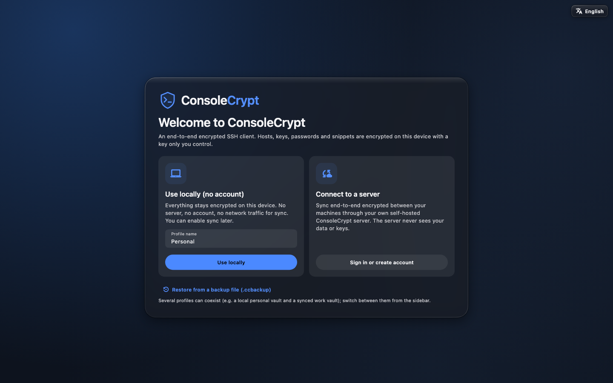

第一次发射:局部使用,服务器连接和恢复备份.

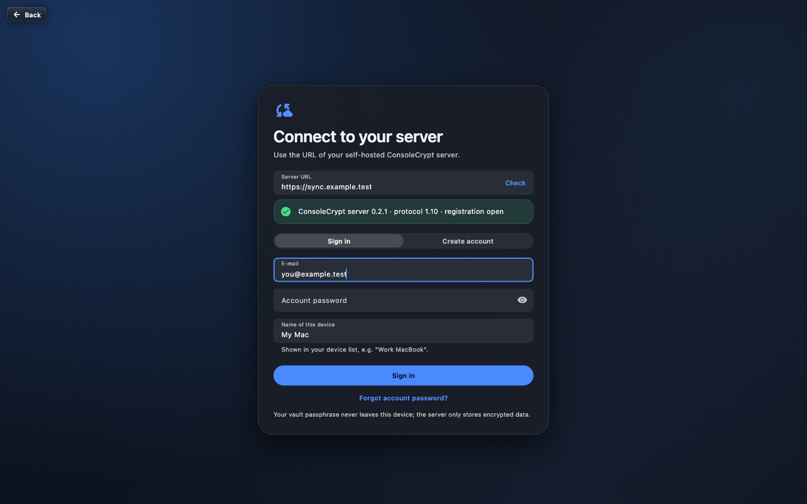

连接到您的服务器: 检查显示其版本和协议,然后用电子邮件和账户密码签名或注册 。

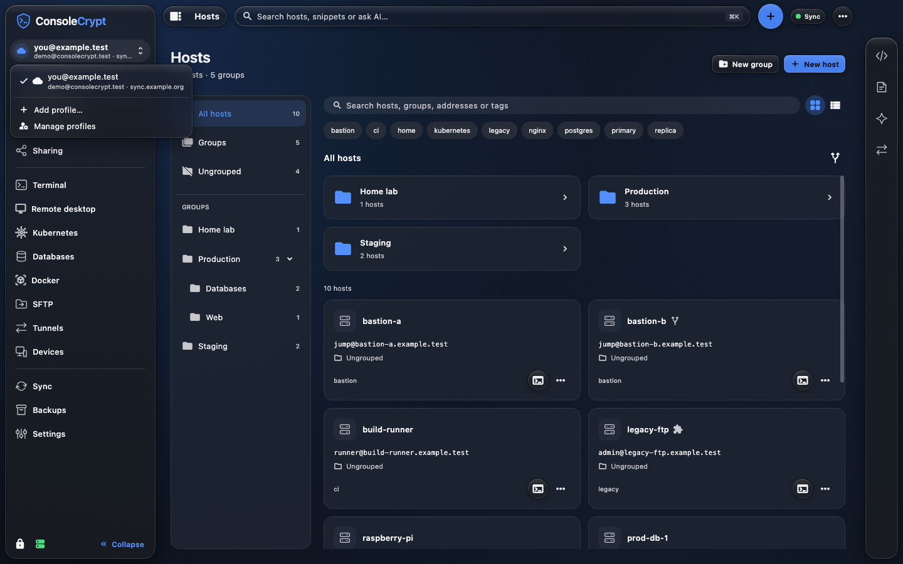

侧边栏上方的剖面切换器:活动剖面,“添加剖面......”和“管理剖面”。

<a name="linux-install"></a>

## 2. Linux 安装: DEB、RPM和密钥环

客户端的目标为x86-64(x64)图形桌面:Ubuntu 22.04,Debian 12和Fedora 43. 选择您分发的软件包; 软件包管理器检查依赖性 。

1. 在下载时,选择Ubuntu/Debian的DEB或Fedora的RPM. 检查发行注释中支持的系统版本和架构,然后将文件的SHA-256与已公布的校验和进行比较.

2. 在包含下载包的文件夹中打开终端 。 将下面的 Copycrypt.deb 或 Copycrypt.rpm 替换为您的确切文件名;只运行您的软件包格式的命令 。

3. 安装后,请从正常桌面会话中的应用程序菜单中打开ConsoleCrypt 。 不要用sudo运行客户端:它的密钥和设置属于您的用户.

4. 设备密钥需要使用特勤局运行,解锁的系统密钥环,如GNOME密钥环. 启动客户端前, 使用您的桌面工具创建并解锁默认密钥环 。 密钥环密码与您的ConsoleCrypt 账户密码和金库密码隔开 。

5. 从 0.9.14 开始,一个 DEB 或 RPM 复制的应用程序更新: 设置 → 更新 → 下载和安装,管理员密码,然后重新启动. 更新0.9.14本身和没有从包中手动安装的复制品:从下载器中下载新的DEB或RPM,并以同样的方式安装. 更新前, 保存加密备份并完成重要会话SSH ; 保留您的金库和密钥环 。

### Ubuntu / Debian – DEB 软件包

文件名是一个实例。 ptt从您配置的寄存器中安装本地软件包和可用的依赖 。

```text
sudo apt install ./consolecrypt.deb
```

### Fedora— RPM 软件包

文件名是一个实例。 dnf 安装本地软件包并检查依赖性 。 保持这些检查启用 。

```text
sudo dnf install ./consolecrypt.rpm
```

> **注意**
>
> 如果无法提供特勤服务或密钥环被锁定,请在桌面设置中解析其状态并重试 。 客户端不会掉回到普通文件中存储密钥 。 不要删除要清除错误的密钥环: 这样做可以删除设备的访问权限 。

<a name="passwords"></a>

## 3. 我需要哪个密码?

ConsoleCrypt有单独的访问层. 通过电子邮件重置您的账户密码不会解锁加密金库 。

| 什麽? | 目的 |
| --- | --- |
| 账户密码 | 签名到服务器和网站账户;可以通过电子邮件重置. |
| 默认密码句 | 解密设备上的数据,确认危险动作(如果允许,也使用触摸ID,WindowsHello或指纹). 服务器不知道 。 |
| 复原套件 | 丢失密码句后恢复金库访问权限 。 |
| macOS 键链密码 | 访问设备密钥的系统权限;通常是您的Mac用户账户密码. |
| SSH密码或密钥 | 签署到远程主机, 独立于同步服务器 。 |

1. 如果macOS在新建后请求访问登录的密钥链,请检查应用程序名称并使用该密钥链的密码 。 更改的应用程序签名可能需要重新获得许可。

2. 在Mac账户密码更改后,Keychain可能仍然会使用之前的密码. 在密钥链访问中选中它而不删除ConsoleCrypt 密钥 。

> **注意**
>
> 不要只为删除一个提示而重设密钥链:这样做可能会删除设备密钥. 先保留你的复原套件和加密备份

<a name="vault"></a>

## 4. 断层、恢复和生物鉴别

你的保险库在装置上解锁了 创建后配置锁定和解锁 。

1. 在“复原工具包”窗口中,“打印/另存为PDF”打开系统打印对话框:打印工作表或保存一个PDF。 保存的 PDF 和打印的工作表一样保密; 将其保存在云同步文件夹中 。

2. 保存恢复套件离线并完成单词检查. 它的单词和QR代码授权金库访问:不要通过电子邮件,聊天或AI发送.

3. 在电话上,恢复 Kit 的词仍然完整。 列数遵循屏幕宽度和文本大小,字下方为QR码. 滚动保存完整的套件 。

4. 锁紧的保险库打开口令,或启用时触摸ID,WindowsHello或指纹. 同一屏幕提供“忘却密码句?” , 签出“删除此简介......” 和“添加简介”。

5. " 忘记密码句? " 打开回收:输入工具包的24个字或其QR码文本,或读取QR: " 扫描QR " ,电话上装有相机,照片或截图上的QR(在设备上解码,无处发送),或在设备解锁的可信设备上,选择“这个可信任的设备”。 然后设置新的密码句.

6. 在“Settings → Vault” 中, 选择自动锁定间隔 。 “ 锁现在” 锁定金库 ; “ 变化密码句... ” 更改金库密码句 。

7. 一个新的金库密码句需要至少12个字符. 现有的金库仍然以其目前的密码句打开;在下一个密码句解锁时,用更强的Argon2id参数(至少64 MiB)重新包装了密钥.

8. 危险动作用金库密码句确认,而不是输入连接,上下文或资源名称: 更改数据库查询和单元格编辑, 解锁生产, YAML 应用,删除, 重新启动和缩放在 Kubernetes 中. 一个错误的密码句会运行任何内容,每次尝试后会清除字段, Enter确认 。

9. 如果装置打开,这些动作可以用Touch ID确认,Windows Hello或指纹: " Settings – Vault " 中的“确认有生物特征的动作”可以同时开启。 该确认提供了一个按钮,例如“先确认触摸ID”和“进入保险库密码句”作为倒数;如果支票被取消或失败,便出现密码句字段。 确认是单一用途,只涵盖该动作和物体。

10. 仍然需要库密码句来更改密码句,创建新的回收套件,关闭设备解锁,与备份合作,批准设备并更改账户或组织安全. 在Linux,键坐落于桌面键圈的地方,生物鉴别确认不提供.

11. 与此设备解锁默认关闭 。 要打开它,打开保险库的密码句,并在“Settings → Vault”中启用“Unlock with Touch ID”、“......Windows喂”或“......指纹”。 系统要求确认一次;首先在系统设置中设置生物鉴别技术.

12. What it protects: on Mac and iPhone the unlock key is held by the Secure Enclave, on Windows by Windows Hello, on Android by the Keystore. 系统只在您的指纹,面部或设备密码后才发布,所以没有您的确认,另一个程序就无法获得密钥. 添加指纹或重置Windows Hello开关设备解锁:用保险库密码解锁,再打开.

13. Linux没有这样的保护: 密钥坐落在桌面密钥环中,所以没有密码的解锁可以提供给在用户账户下运行的任何程序. 它在那里默认关闭,只有在警告之后才能打开。

14. 物理安全密钥(review,Windows和macOS):金库可以用USB FIDO2密钥打开,如YubiKey及其PIN. 解锁密码句并打开“Settings → Vault → 物理安全密钥”:输入PIN并两次触碰密钥。 然后锁屏提供“解锁安全密钥”;在PIN后,密钥眨眼等待触摸. On Windows, Windows 问PIN和触摸. 密钥仅将金库密钥密封在这个设备上的本地信封中;密码句和回收套继续工作.

15. 没有设备解锁,本地金库数据库只能用密码句或回收套件打开. 更新后,设备解锁将一直关闭,直到您用密码句解锁为止;然后该应用程序主动提出再次打开.

16. 该设备记得其金库钥匙的指纹,并对照它检查它收到的每一个钥匙——密码句、恢复钥匙或生物识别解锁、设备批准和允许同步。 如果服务器发送不同的密钥,则会出现“不同金库密钥”屏幕:设备上的数据保持不变,同步停止,无法接受“新”密钥。 不要输入该设备上的秘密; 选择“ 密码诊断” 并告诉服务器管理员 。

17. 如果在金库尚未解锁时丢失了工具包,则创建并保存一个“新回收套件......”。 之前的套装会停止工作.

> **注意**
>
> 设备解锁是此金库的一个设备设置:它不同步,也不替换您的密码句和回收套件 。 系统对话框可能会提供您的设备密码 。 物理 iPhone 上的面部识别仍然需要单独的验证.

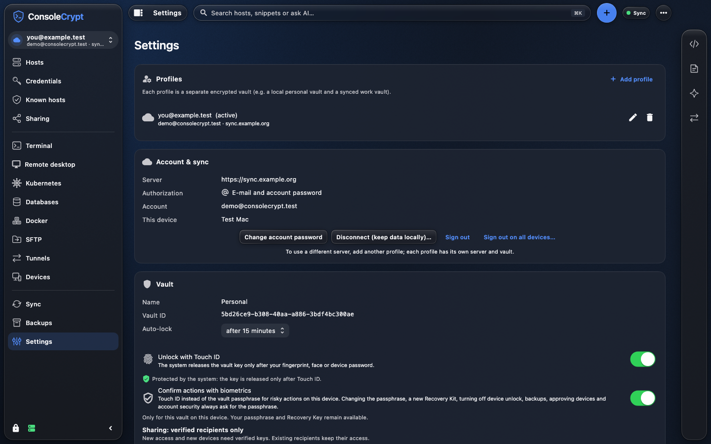

该系统在“确认有生物鉴别技术的行动”和“物理安全钥匙”旁边安装并保护无触摸ID;没有透露任何秘密。

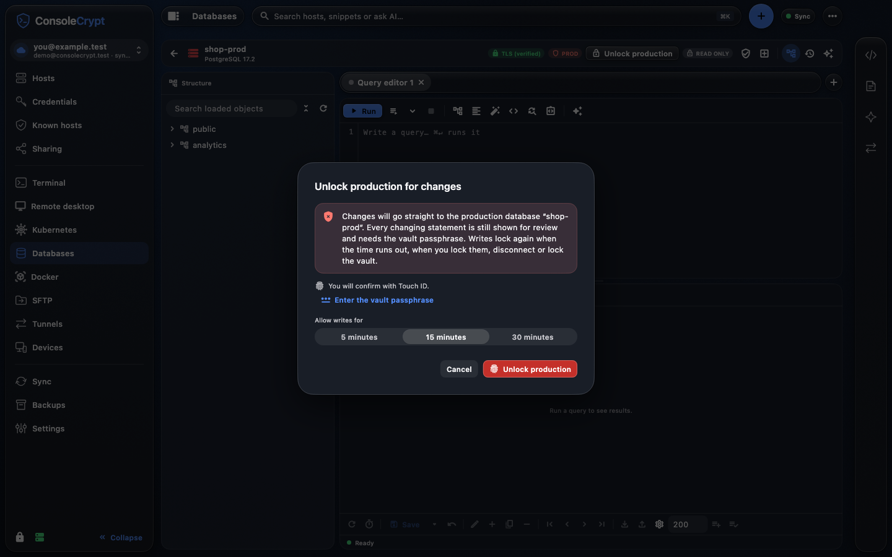

解锁生产用触摸ID确认;“进入保险库密码句”仍然是倒数。

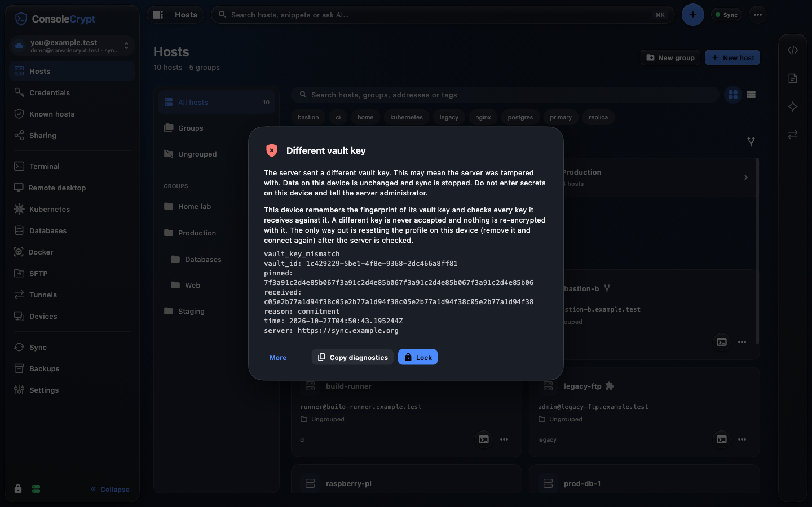

“不同金库密钥”:同步被停止,唯一的选择是Lock, Copy discriptions and More; 演示值。

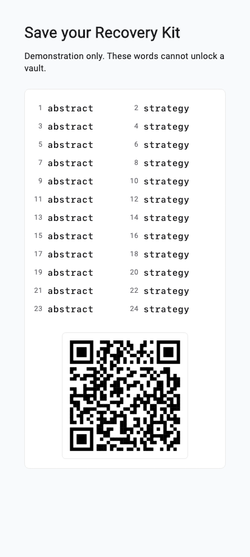

手机上的回收 Kit:下面有QR代码的整词. 插图仅包含演示数据.

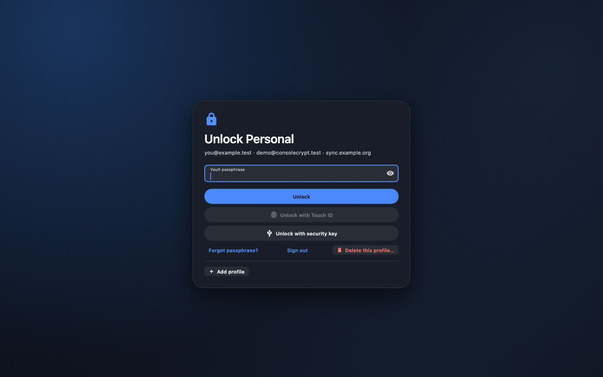

解锁屏幕:密码句、系统解锁、“解锁安全密钥”、“忘记密码句?” 和配置动作。

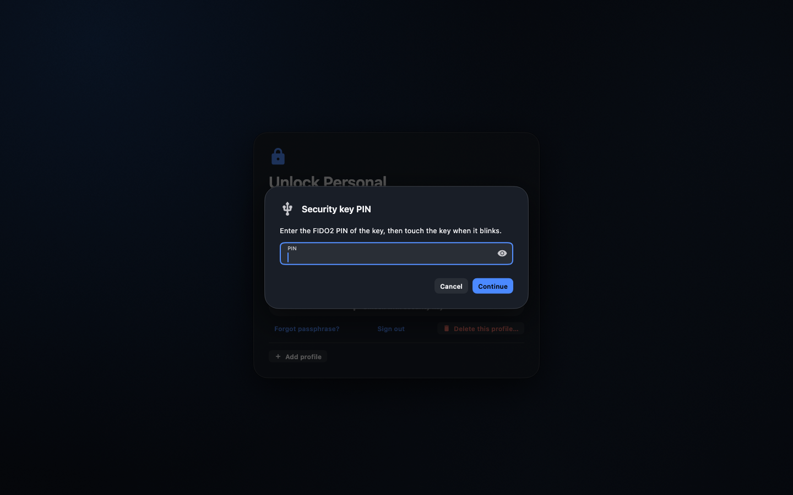

该应用程序要求安全密钥PINmacOS;在Windows,Windows上要求.

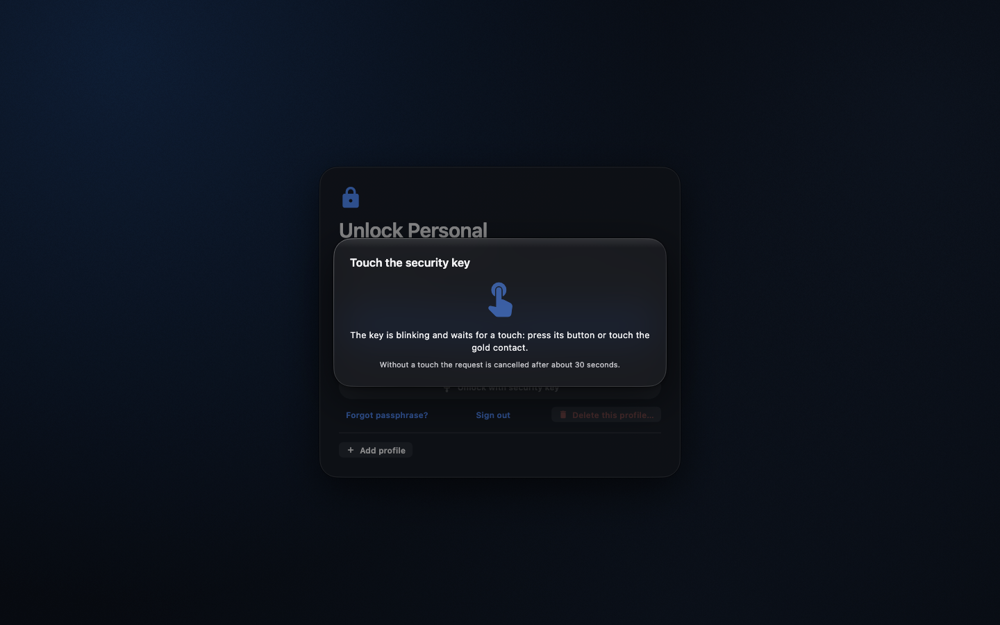

PIN之后,键会眨眼,等待触摸;应用程序说直到键解答.

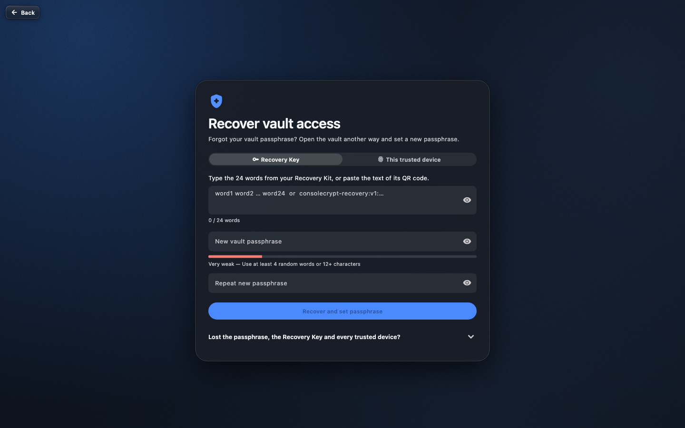

恢复访问:24字恢复键或此可信任的设备,然后是新的密码句.

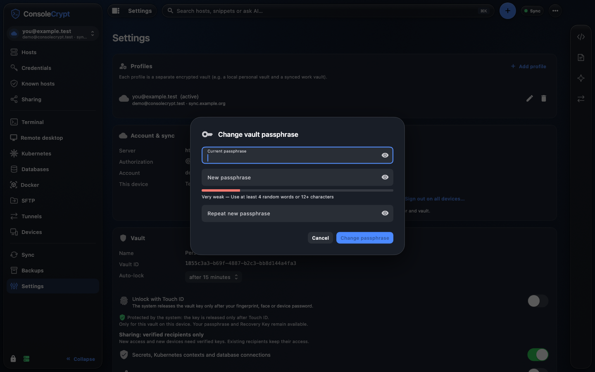

保险库设置中的“更改密码句......”

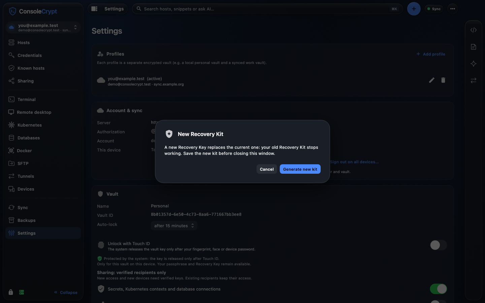

“新恢复套件......”:旧套件停止工作。

<a name="devices"></a>

## 5. 同步和信任的设备

签名并被允许解密金库是单独的动作. 新的设备需要批准。

1. 在第二个设备上,选择相同的服务器和账户. 当需要批准时,在已经信任的设备上打开“装置”。

2. 选择待决设备, 选择“ 验证和批准 ” , 并通过一个独立的通道比较两个设备上显示的全部代码 。

3. 在服务器0.2.2之后,一旦请求在一个可信任的设备上打开,新设备就显示从两个设备的密钥中计算出该设备的名称和相同的配对代码。 在新设备上, 将“ 代码匹配“ ...” 上的代码并选择“ 代码匹配 ” ;没有勾选,您无法确认 。 批准签名覆盖了金库钥匙,新设备用你确认的钥匙检查. 一旦服务器显示这个配对代码,它就不能回到旧的不受限制的方式——应用程序拒绝批准.

4. 使用一个较老的服务器,批准工作与以前一样,金库钥匙标记为“未确认的故障钥匙”。 在设备中选择“用密码句确认”或“地址 → 空格” , 并输入一次金库密码句 。 如果账户的另一个设备报告不同的密钥,设备会显示“一个设备收到不同的金库密钥”并带有“撤销”按钮。

5. 选中“所有 6 组完全匹配... ” 并选择批准 。 如果有任何组不同,请选择“ 编码不匹配 ” : 请求被拒绝,没有移交金库密钥 。

6. 在“系统化”中,检查联系,等待变化和冲突。 离线更改仍然是本地的,并在连接返回时发送. 顶部栏的同步指示器显示同样的情况:上一次同步、服务器、队列、“现在的同步”和“细节”。

7. “设置 → 账户和同步 → 断开连接( 保持本地数据 )... ” 将配置文件变为本地配置文件: 设备上的数据和服务器上的加密副本保持不变 。 “ 也同时取消服务器上的此设备 ” 。

8. 撤销客户端或网站账户中丢失的设备 。 重新连接需要获得新的批准。

9. 服务器可能限制同步 。 当它暂时限制请求时,指示器和同步显示“服务器暂时限制同步;恢复到HH:MM”:更改留在设备上,然后自己出去。 当服务器因金库对象或存储限制而拒绝更改时,"服务器不接受的更改"卡会解释为什么——删除你不再需要的项目并选择Retry.

10. 当您从新设备上签字时,服务器可能会回答“到达的装置限制(N)——撤销你不再使用的装置,然后再次签字”或“今天有太多的新装置”。 在...之后再试一次......”。 同事查询、 共享和添加您的设备, 显示请求有限时等待的秒数 。

11. 随着服务器0.2.4,从一个尚未信任的设备中删除金库,在7天后生效. 信任的设备显示“这个金库将被删除......”,并显示“保存金库”;如果你没有要求,请选择它并更改账户密码。

12. 在服务器上删除金库时,同步停止并命名原因( “在服务器上找不到错误 ” ) , 而不是永远重试 。 服务器上的数据如果无法进行真实性检查,则永远不会替换设备上的最后一份解密副本.

> **注意**
>
> 撤销结束会话和未来同步,但不能抹去先前读取的数据或更改SSH - 服务器密码. 在妥协后,替换主机本身上受影响的密码和密钥.

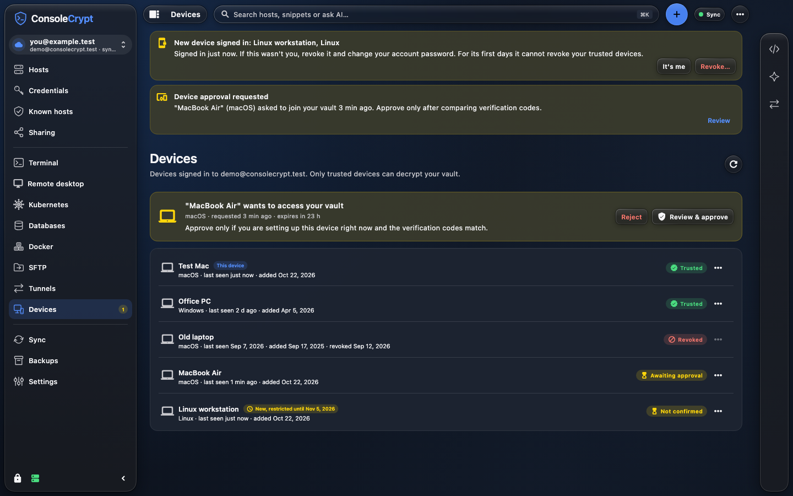

Demo设备列表;访问批准是一个单独的步骤.

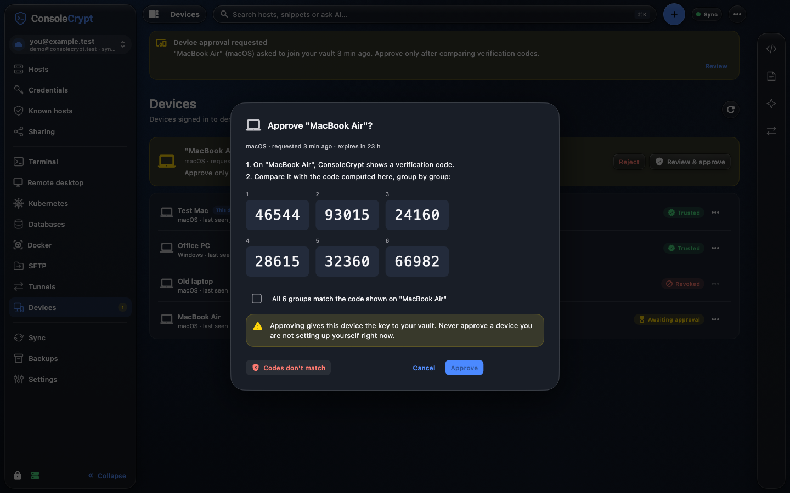

批准新设备:将6个代码组与新设备的屏幕进行比较;演示代码.

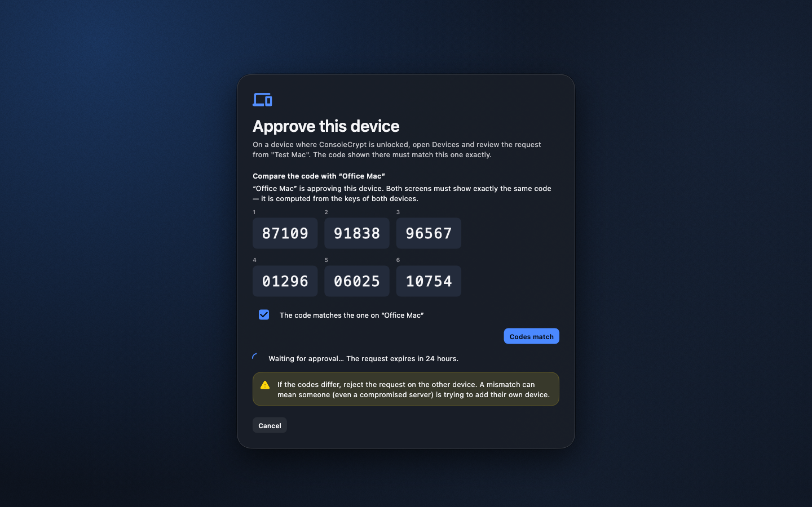

新设备:与“Office Mac”配对代码和强制匹配勾选;演示代码。

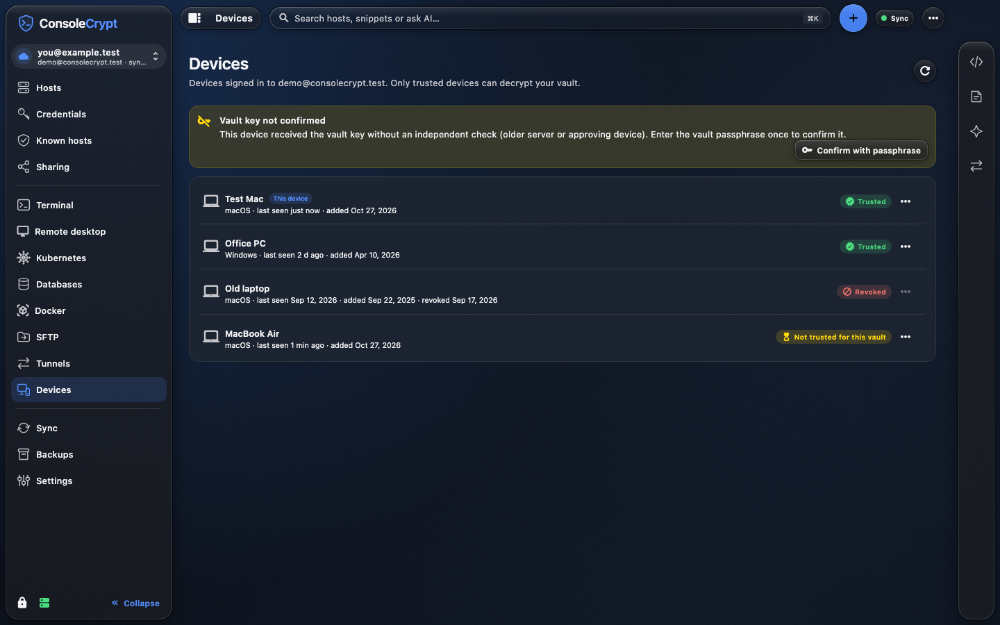

“未确认的”装置中的“密码确认”。

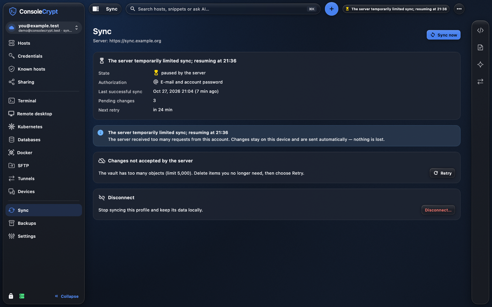

由服务器同步暂停直到显示时间;在对象限制上的变化等待重试.

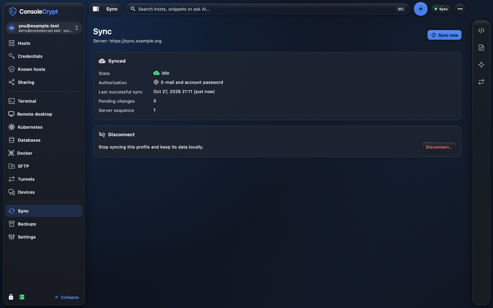

同步演示配置的状态和队列 。

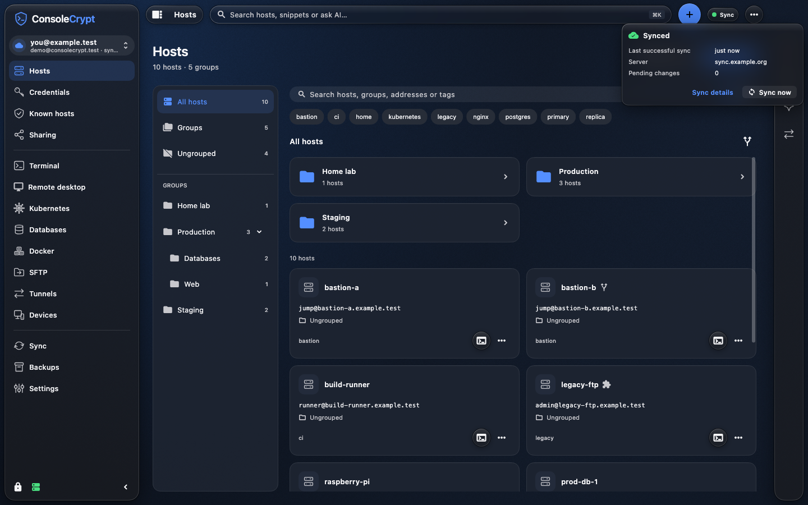

顶端栏中的同步指示器:最后一次同步,服务器和队列.

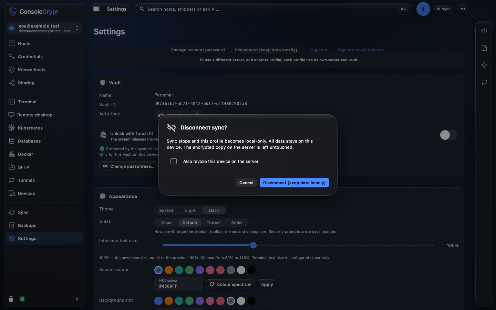

“断开( 保存本地数据)... ” ,可选取消此设备 。

<a name="device-protection"></a>

## 6. 防止在新设备上签字

如果有人从新设备中签入你的账户,你马上发现,设备被暂时限制. 这种保护需要同步服务器0.116或稍后.

1. 对于每个新设备,服务器都会向您的账户地址发送电子邮件. 电子邮件包含一个“不是我”的链接。

2. 您所信任的设备显示一个“ 签名的新设备” 通知, 并带有设备名称和系统 。 如果是你,请选择“是我”来驳回通知。

3. 在装置中,这种装置标有“未经证实”和“新装置,在......之前受限制”。 在最初的14天里,它不能撤销你所信任的装置或结束它们的会话,试图从新装置打开金库是受费率限制的。

4. 若不是你,请取消通知中的“ 退缩... ” 、 设备菜单或电子邮件中的“这不是我” 链接, 打开您的网站账户 。 然后更改你的账户密码:谁签了字,谁知道。

5. “设置 → 账户和同步 → 在所有设备上签名...” 账户的每个会话结束,包括这一会话。 设备再次使用账户密码签名;其本地数据被保存.

> **注意**
>
> 签名本身不会打开金库:新设备仍然需要通过对可信设备的代码检查得到批准. 在所有地方签名或从新设备中更改密码, 使信任的设备在最初的几天中不受影响 。


新的登录通知和标有“未确认”和“新,限制到......”的新装置;所有装置均为演示装置。

<a name="enterprise-sign-in"></a>

## 7. 公司注册:SSO和主动目录

同步服务器 0. 2. 0 , 以后只能通过您的组织授权服务器录用账户 。 客户端 0. 9. 0 检测服务器的模式并显示匹配表单 。 只有账户的注册更改 :您的金库密码句仍然打开金库 。

1. 选择“ 连接到服务器” ,请从您的管理员中输入地址HTTPS 并按下检查 。 公司服务器显示一个“公司登录”块,命名授权服务器;该模式不提供注册、账户密码和“忘却密码”。

2. SSO(OIDC):可选地输入您的电子邮件,并按“与......签署”。 您所在的组织在系统浏览器中打开登录页面,然后返回应用程序。 在签名时,该应用程序会显示与Cancel一起的等待状态.

3. 活动目录:输入您的登录(电子邮件, UPN 或 DOMAIN\\user) 和域密码 。 密码一旦通过TLS传送到服务器,就永远不会被存储,每次尝试后都会被清除出字段.

4. 新用户像往常一样在第一次登录后创建金库 。 一个已知的设备用金库密码句打开金库;一个新设备通过密码检查,恢复密钥或金库密码句获得批准.

5. 应用程序会记住每个服务器的登录方式和登录(绝不是密码):下次它们会被预先填充,提示“你最后一次签入...”会让人忘记。 设置、 同步和装置显示整体服务器, 并显示此设备在“ 认证” 下签名时 。

6. 如果您的组织禁用您的账户, 应用程序会显示“ 管理员禁用访问” 并锁定配置文件 。 设备的数据会保留加密;一旦恢复访问,您可以从设备中删除配置文件,或者再次签名.

[账户、同步和公司注册QQ](../docs/public/zh/SYNC_ACCOUNT.md)

> **注意**
>
> 您的组织密码不会打开金库, 授权服务器或同步服务器也不会收到金库密钥 。 签名错误——域名不允许,组缺失,需要第二个因子,身份已经链接到另一个账户,签名服务不可用——用普通话解释;联系您的管理员了解这些错误.

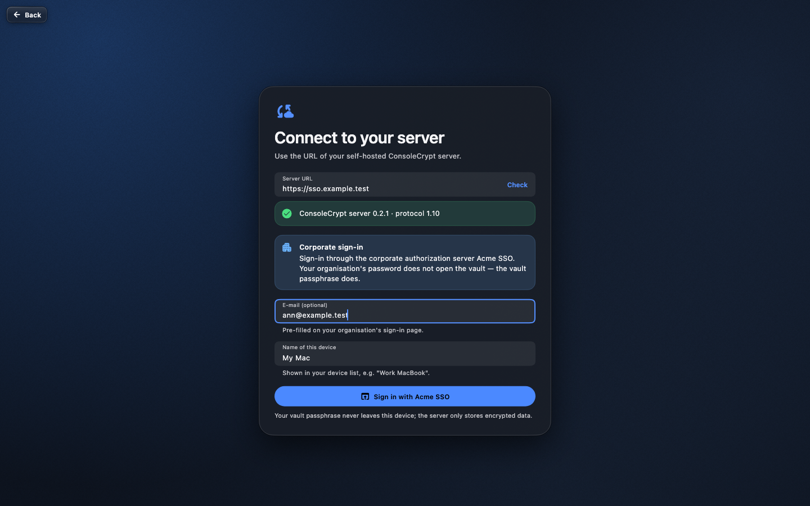

一个带有SSO签名的服务器:“Corporate sign-in”块,一个可选的电子邮件和“与Acme SSO签名”按钮;服务器是一个演示按钮。

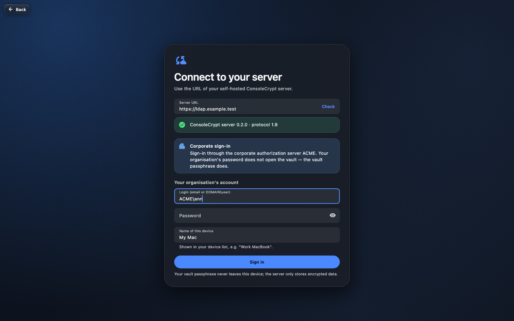

活动目录登录:域名登录和组织密码。

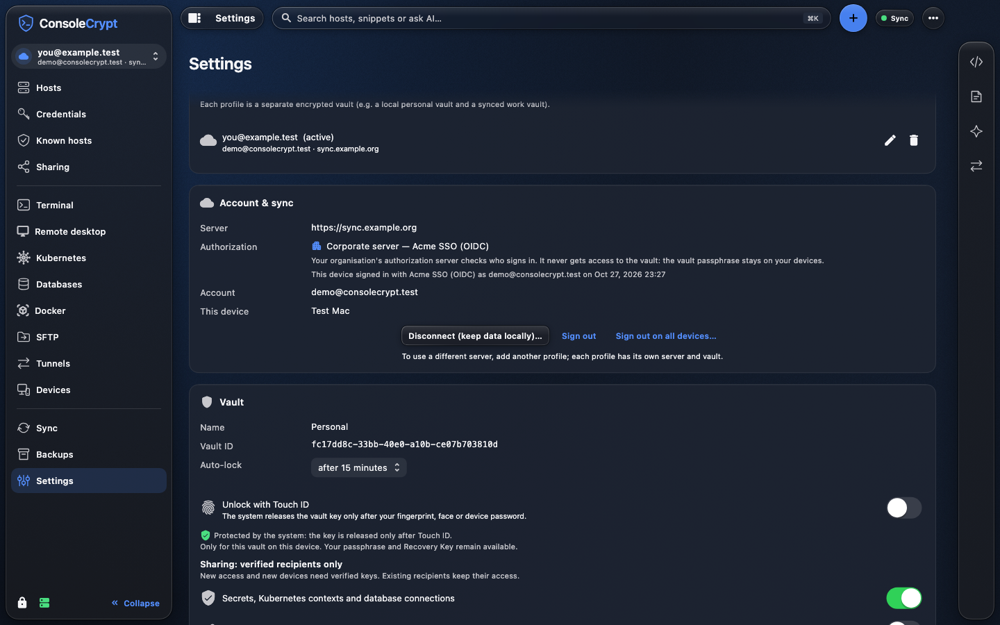

设置: 授权行命名公司服务器, 并显示此设备签名时 。

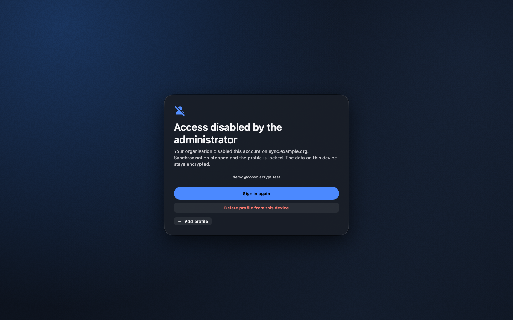

该账户被组织禁用: 配置文件被锁定, 数据被加密 。

<a name="hosts"></a>

## 8. 主机: 添加、 查找和连接

主机商店SSH或RDP连接设置. 卡片和列表行显示其地址,用户和组.

1. 打开“ hosts – New host”并首先选择SSH或RDP。 输入名称、地址、端口、用户名和证书。 SSH支持组默认和跳转主机;RDP默认使用密码,可选Windows域和端口3389.

2. 在桌面上,单击新格式SSH中的导入 - host格式. 它读作~/.ssh/ 已知\_hosts和/etc/sh/sh\_ 已知\_hosts onLinux/macOS,或%USERPROFILE\_\_.ssh\\\\\\\\\\\\hosts onWindows. 审查和选择地址;排除现有连接。 供应用户名和证书分别列出.

3. 导入在不导入密钥信任的情况下创建连接 。 隐藏的名称、图案、吊销的密钥和 CA 记录被跳过 。 第一次连接时通常验证服务器密钥 。

4. “ from ~/.ssh/config”在导入旁边读取您的 OpenSSH 配置(包括包含文件) 。 每个主机条目都与其地址,端口和用户成为主机;Host\*等通配符块作为默认应用. ProxyJump主机与所选主机一起导入,身份文件密钥可以立刻添加到金库中——加密密钥保留其密码句. 代理Command不支持 。

5. 搜索名称,地址,组和标签. 网格/列表切换会改变视图;打开组卡会显示其内容.

6. 单击主机卡或其连接图标的中心。 一个终端或远程桌面标签根据连接类型打开.

7. “...”菜单提供了连接SFTP , 编辑、删除和添加到一个已有的组中。 “ 共享... ” 出现在服务器支持时, “ 复制到团队... ” 和 “ 移动到团队... ” 出现在您有团队时( 参见 Teams) 。

8. 主机形式由卡片制成. 认证: 密码(在金库中保存或在连接时输入) , 密钥SSH (在这里选择、 生成或导入) , 代理( 系统SSH 或套接字路径) 或 “从组中继承 ” 。 “ 选择证书... ” 指定一个保存的密钥 。 如果密钥是加密的,其密码句没有保存,则连接显示“密钥“...”的密码句——仅用于此连接。

9. 安全性:主机密钥策略 – 询问(确认未知密钥),严格(只从已知主机中获取密钥)或接受新密钥(自动保存未知密钥);一个已更改的密钥总是阻断连接. 它还保留了SSH执行(“旧服务器的构建(russh)”或“系统OpenSSH(兼容性)”),保存间隔和“代理转发”——只允许您信任的主机使用。

10. 组织持有标记和自由文本注释 。 在底部,“ 有效的设置” 显示一个连接将实际使用什么—— 组、 用户、 端口、 证书和路由, 以及每个值来自何处; 诸如删除的跳转主机之类的问题也会出现在那里 。

[监控 SSH 会话中的主机负载](#terminal-ssh-monitoring)

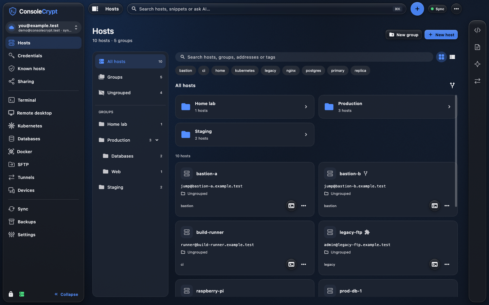

演示主机及其连接细节的概述.

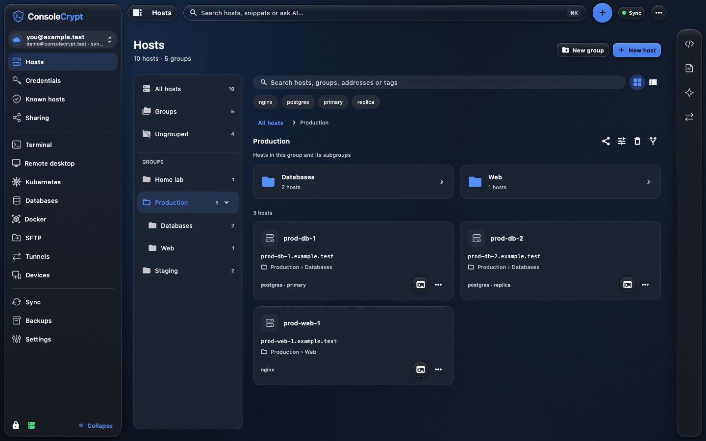

演示组中的主机:卡片,搜索和连接动作.

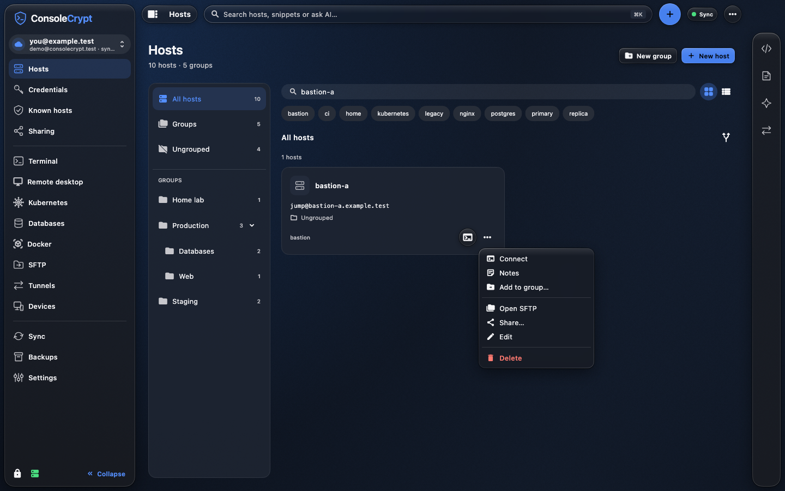

选定主机的动作菜单:连接,注释,组,SFTP,共享和编辑.

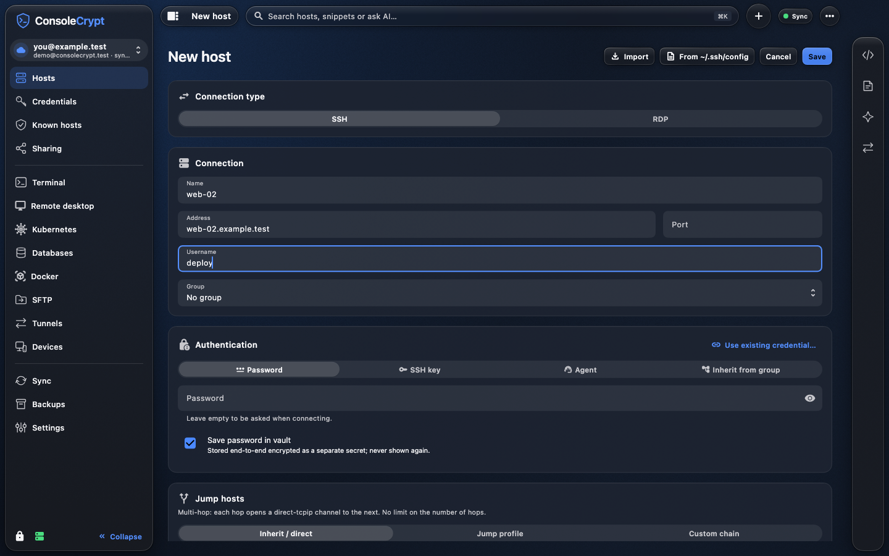

一个新的SSH主机:连接类型,地址,用户,组和认证.

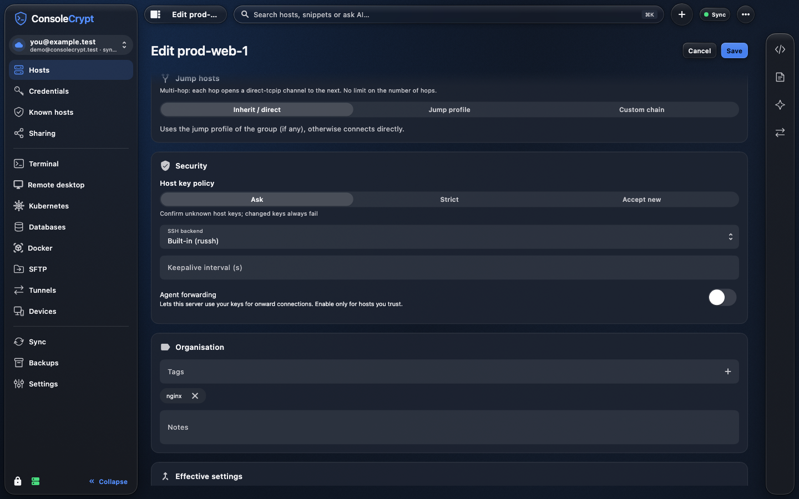

安全卡:主机密钥政策,SSH执行,保存和代理转发.

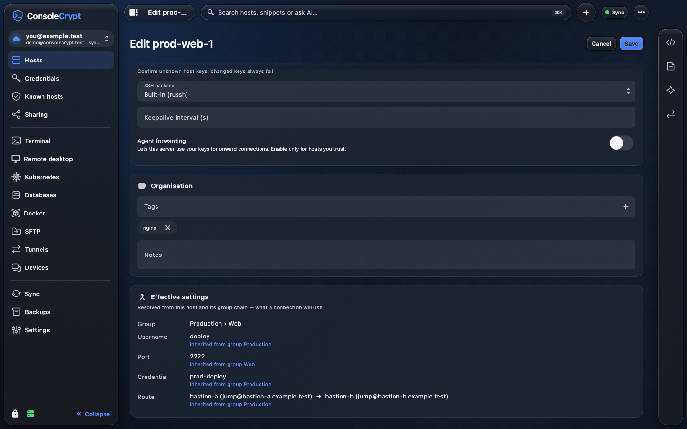

“有效环境”:将使用何种联系及其来源。

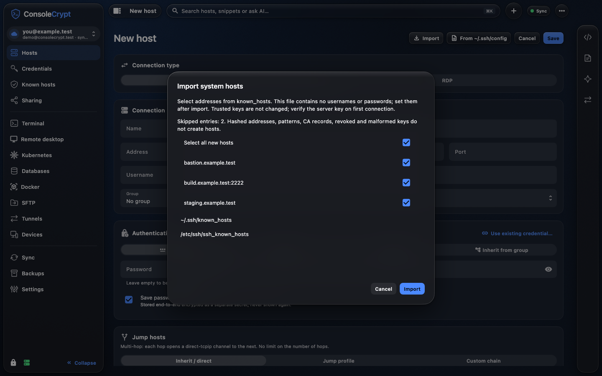

从已知的演示地址导入地址\_hosts:在保存前选择 。

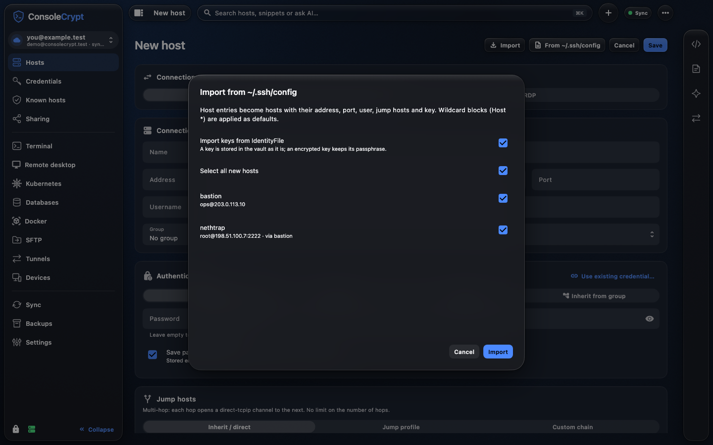

从~/.ssh/配置导入:主机条目有文档范围地址.

<a name="rdp"></a>

## 9. RDP: Windows 远程桌面

ConsoleCrypt现在支持RDP连接. 它直接连接到标准的微软RDP服务器;没有IronRDP加载需要安装在Windows上.

1. 在“住房”中,建立RDP连接。 输入地址,Windows用户名,密码和可选域. 在加密金库中保存密码,或者输入每次连接的密码 。 SSH 组默认不适用于RDP.

2. 连接前,审查地址,账户和证书指纹. 将指纹与服务器管理员进行比较 。 更改的主机细节需要重新确认 。

3. 在“远程桌面”下,使用标签旁的中央连接按钮或“+”来选择保存的 RDP主机。 打开桌面出现在标签条中 。 在它们之间切换,打开新的会话,关闭你不再需要的会话. 最多可同时进行四次区域发展方案会议。

4. 点击“ Full 屏幕”可以使用整个屏幕 。 通过移动到顶端边缘的蓝色指示器或按下Ctrl+Alt+Home,揭示顶端连接栏. 如果需要,请把栏杆扣上。 它允许您切换会话,管理权限,最小化窗口,恢复其先前的大小或者断开当前会话. 逃逸被送往远程计算机.

5. 启用选定会话的文本剪贴板访问 。 活动桌面中的 Ctrl+V (QQV on macOS)现在发送并粘贴本地文本到Windows,而不首先点击“Send”。 由于共享已禁用, Ctrl+V只使用远程Windows 剪贴板 。

6. “发送”提供的案文不粘贴,而“接收”则要求Windows提供案文。 仅更改本地剪贴板不会发送任何信息 。 支持最多64 KiB的文本;图像和文件不通过剪贴板传输.

7. OnmacOS,Windows和Linux,在会话权限中选择一个本地文件夹. 在Windows文件浏览器中重定向驱动器下等待“Folder连接”,然后打开ConsoleCrypt. 默认只读访问; 允许单独写入 。 其他本地文件夹和驱动器不共享 。

8. 如果文件夹不可用,请检查Windows 服务器驱动器调整策略 。 桌面仍然可以独立于文件夹访问。 替换文件夹会中断以前打开的文件上的操作 。

9. 文件交换支持高达256 MiB的文件,以及高达512 MiB的尝试写每个会话的文件. 达到极限后重新连接. 符号链接,原始时间戳和文件锁不转移.

10. 当会话面板完成时, 关闭文件夹或剪贴板访问 。 锁定金库(同时自动) 隐藏桌面并关闭对话框, 但不关闭会话:在解锁标签后继续 。 签名关闭连接并取消临时权限 。

> **注意**
>
> 在创建RDP主机之前,将每个工作空间设备更新到0.3版本或稍后版本. 年长的客户端无法看到RDP主机,但可以更改其相关的证书和组. RDP主机在运行当前客户端的设备之间同步 。 一个RDP主机可以和经核实的同事共享:主机菜单中的"共享"只在选中时发送地址,端口,用户和域名,以及注释和密码;0.9.14之前的客户端不会显示这样的卡. 无法在移动中重定向文件夹 。 剪贴板和驱动器的可用性也取决于Windows服务器政策.

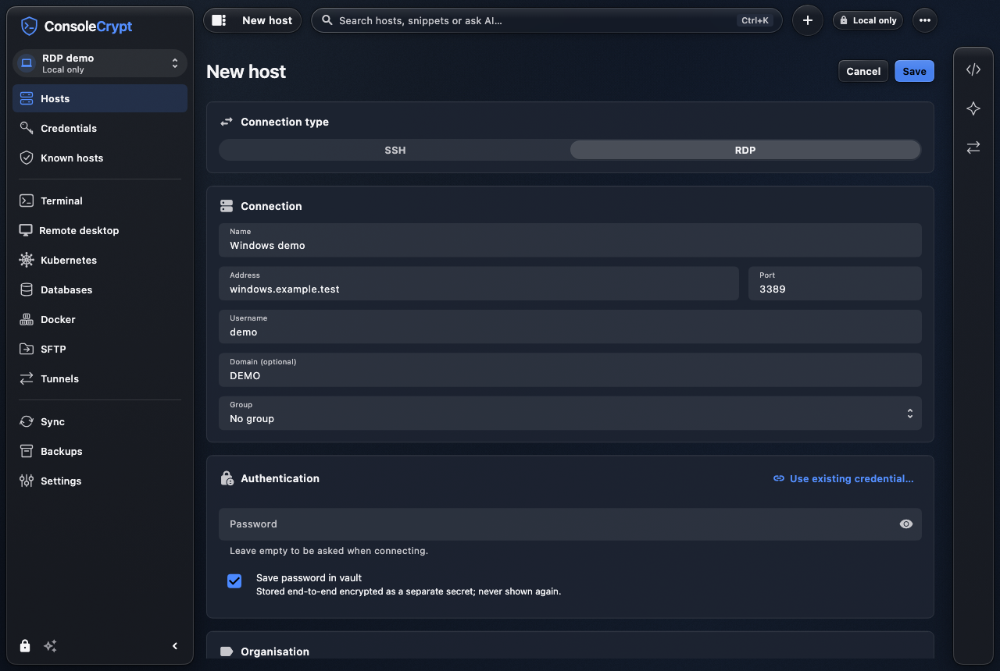

创建 RDP主机:Windows - 特定字段并保存密码在金库中 。 Demo数据.

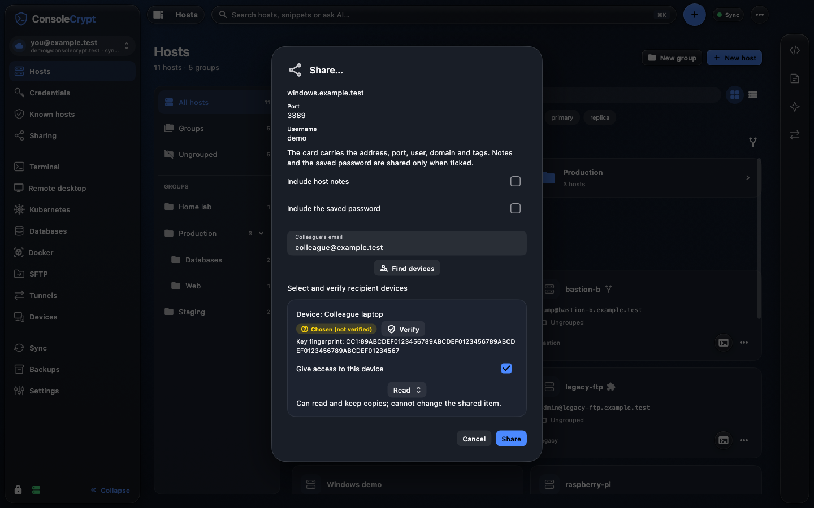

共享 RDP主机: 同事所看到的, 注释和密码选项以及所选择的接收器设备 。

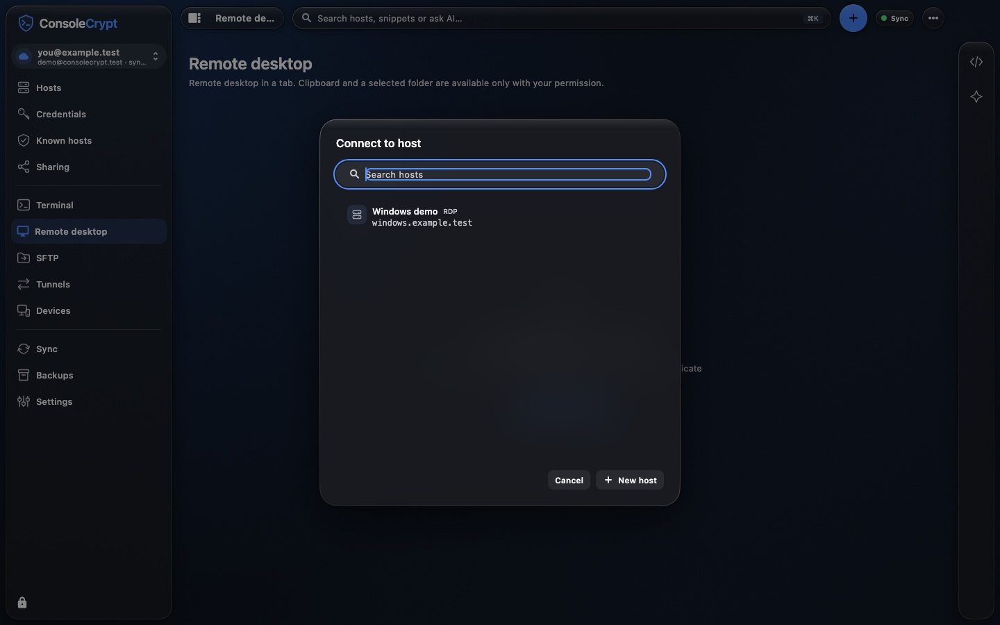

从远程桌面选择保存的 RDP主机 。

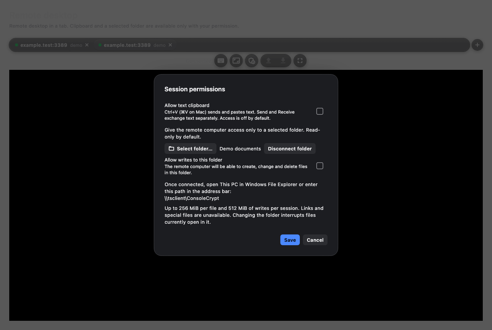

Demo会话权限:文本剪贴板和带有单独写权限的选定文件夹. 未显示桌面Windows 。


全屏连接栏:会话切换,权限和窗口控制. Demo数据.

<a name="rdp-mobile"></a>

## 10. 手机上的 RDP: 触控板和键盘

在电话中,连接的桌面自动打开全屏. Touchpad是默认:你的手指相对于其当前位置移动指针. 一个浮动按钮打开会话控件 。

| 触摸板手势 | 行动 |
| --- | --- |
| 动一个手指 | 移动指针; 抬起并按需要重新定位手指. |
| 短音响 | 在当前指针位置左键单击。 |
| 两只快水龙头 | 双击左键 。 |
| 双塔并按住第二个水龙头,或按住大约500毫秒 | 开始拖曳; 举起手指释放鼠标按钮 。 |
| 双指龙头 | 右击. |
| 将两根手指一起移动 | 不动指针而卷. |
| 键 | 缩放 1–4x; 视图沿着一个边缘附近的指针. |
| 两指双音响 | 将桌面安装到屏幕上 。 |
| 三指龙头 | 显示或隐藏键盘 。 |

1. 在边缘按下浮动按钮。 用键盘、触摸板或直接触摸、额外键、剪贴板、会话、方向和最小化等打开的格子。 将按钮拖放到一个方便的边缘;对于两个方向,其位置被分别记住.

2. 在直接触摸模式下,一个水龙头在你的手指下活动. 主机的选定模式只在此设备上被记住 。 附加的鼠标正常工作.

3. 键盘覆盖桌面而不缩小其长度. 一个额外的键条出现在它的上面;一个单独的工作表提供了F1-F12,箭头和快捷键. Tap Ctrl, Alt, Win 或 Shift 一次为下一个密钥,两次锁定修饰器,然后再次发布.

4. 如果键盘仍在编译一个单词,请先完成输入. 其他密钥在组成过程中不发送命令 。 切换会话,进入背景和锁定释放都持有密钥和鼠标按钮.

5. 移动 RDP 设置提供指针速度和加速,光标大小,清晰度,Windows尺度,方向和按钮隐藏. 当 RDP 服务器支持调整大小时, 分辨率会跟随屏幕;否则会话会保留其现有的分辨率 。

6. 在Android上,Back先隐藏键盘. 然后打开控件;在两秒内再按一次,可以不中断地最小化. 在最多四场课间换乘。 断线请求确认 。

> **注意**
>
> 平板电脑手动输入全屏,自动模式选择直接触摸. 启用屏幕阅读器后,可以直接触摸并保持按钮可见. 电话文件夹无法重定向 。 iOS发行只是一个模拟器构建;没有iPhone安装器. 屏幕截图使用带有绘图,合成Windows桌面的真部件;空区域保留给系统键盘.

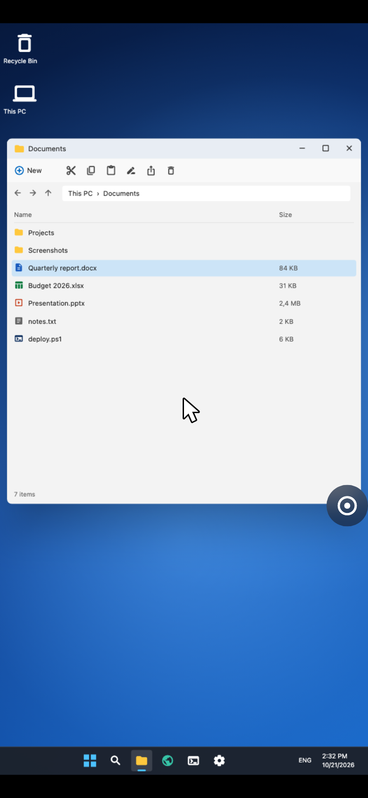

桌面和浮动按钮,隐藏永久面板.

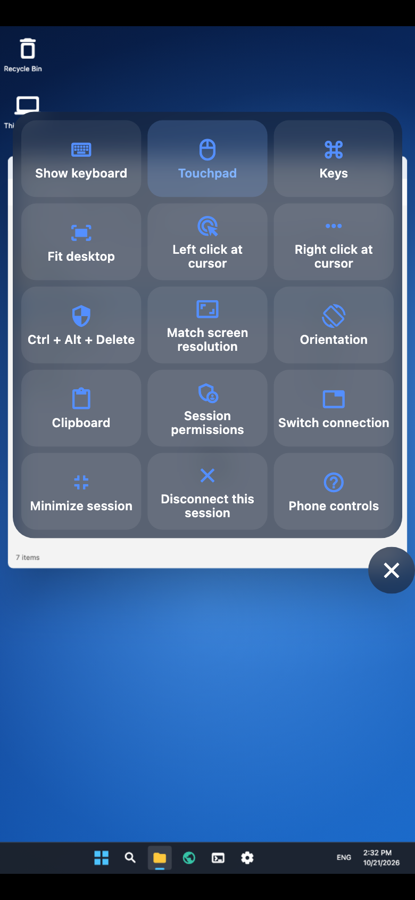

图像方向的会话控制 。

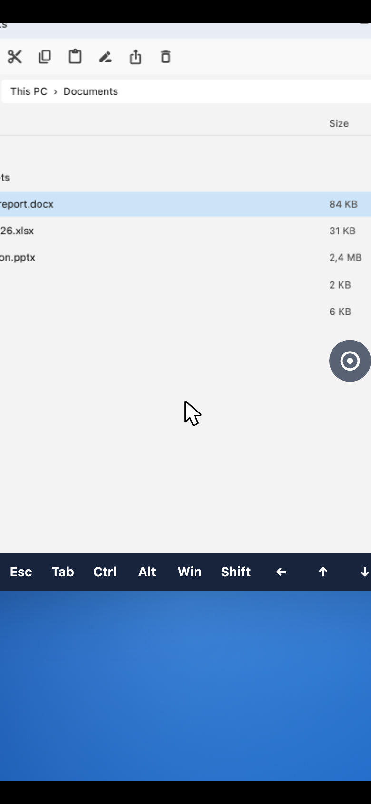

在预留的系统键盘区域上方的外键条.

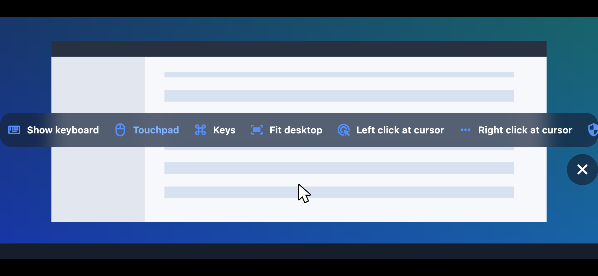

景观导向和会话控制.

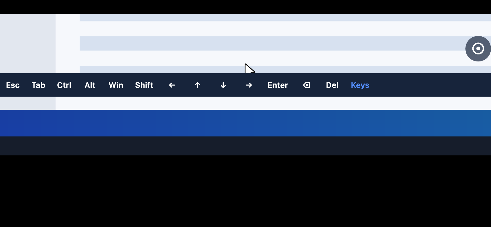

景观方向的密钥;桌面大小保持稳定.

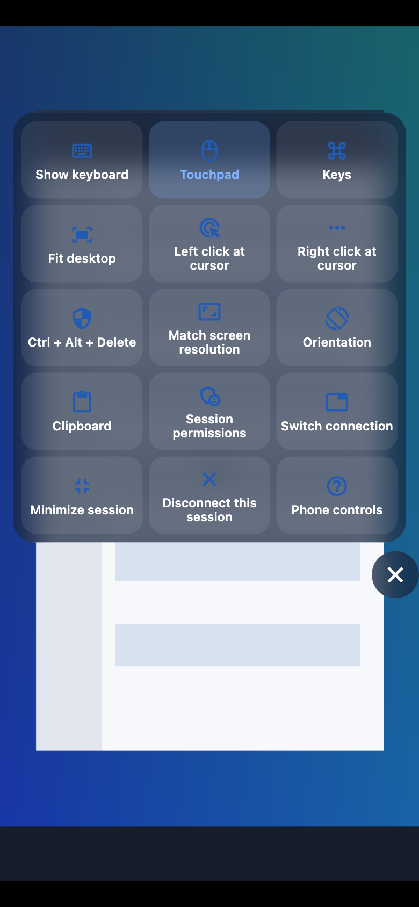

光主题中的相同控件 。

<a name="quick-connect"></a>

## 11. 快速搜索和连接

在应用程序中从任何地方找到一个保存的主机, 并打开一个SSH 或 RDP会话 。 命令调色板集合了主机,片段和快速动作.

1. 在顶端栏中,圆“ +” 按钮打开您保存的SSH 和 RDP主机 。 按名称或地址查找主机并选择连接. 如果尚未保存,请点击“新主机”。 搜索填补了区域标题和“+”按钮之间的可用空间;紧凑的“同步”状态出现在右边。

2. 按QQK在macOS或Ctrl+K在Windows/Linux上. 键入主机名称或IP地址;搜索还匹配其连接标签中显示的地址和用户名.

3. 看看Hosts集团 连接细节在每个名称下方:在选择前检查地址,用户名和端口.

4. 选择 QQ 和 QQ 的结果,然后按 Enter 键或单击其行 。 该应用程序根据主机类型打开一个SSH终端或RDP会话. 在第一个连接上,验证SSH主机密钥或RDP证书.

5. Esc关闭调色板. 如果没有找到主机,请在主机中添加并再次搜索.

> **注意**
>
> 已保存的主机搜索在本地运行 。 如果没有找到输入的名称或IP地址,Enter不会发送AI请求. 要使用AI,请明确单击其行或用箭头键选择并确认. 输入地址不会创建新的主机 。

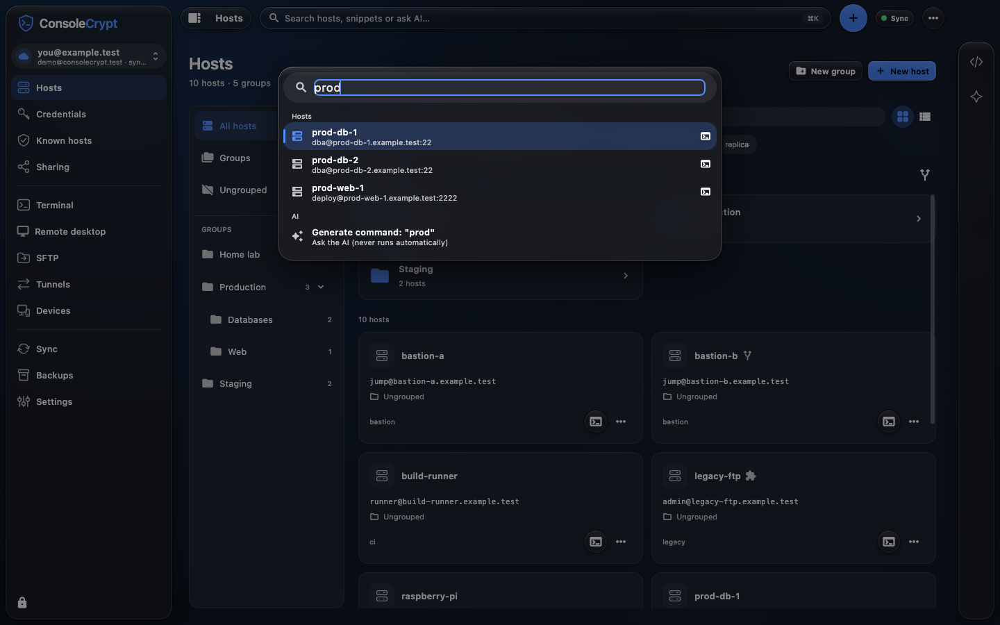

本地搜索命令调色板中保存的主机 。

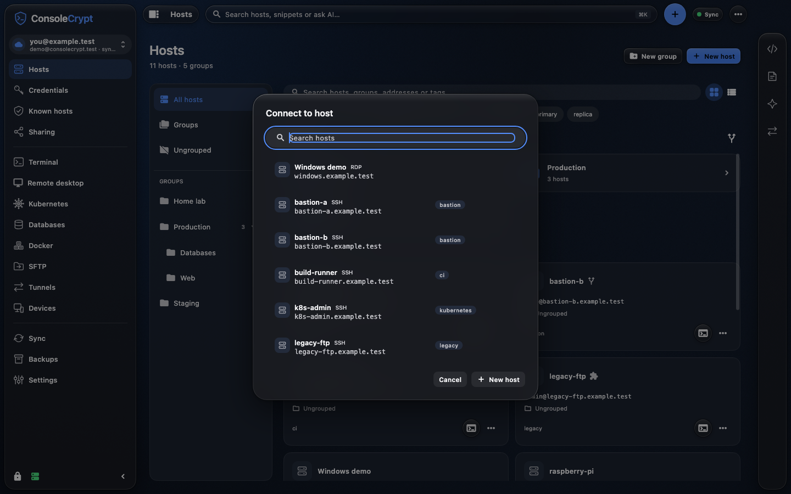

全球“+”:选择保存SSH和RDP主机。

<a name="groups"></a>

## 12. 组合和跳转主机

组组织您的目录并提供共同的设置 。 一个跳动宿主链通过中间机到达一个SSH宿主.

1. 在左菜单中打开“ Hosts ” 并点击“新组 ”。 东道方和集团共享一份清单;环境和项目使用巢组。

2. 设置一个组的常用用户名、 端口、 证书和跳转到主机配置 。 直接设定在主机上的值会压倒继承 。

3. 创建一个跳动主机配置文件,并按要求的顺序选择现有的主机. 将配置指定给一个组或单个主机 。

4. 在主机格式的跳跃主机卡中选择 " Inherit / direct " (组的配置,如果有的话), " 跳跃配置 " 或 " 海关链 " 。 自定义链从现有的主机中构建,并带有添加-hop按钮;对hop没有限制,由此产生的路由在链条下方显示.

5. 在移动或删除一个组之前,请检查所生成的继承设置 : 更改其父程序可以更改连接 。

> **注意**
>
> 客户端直接建立SSH连接,包括跳转主机. 同步服务器从不转发流量SSH. 私人团体和共享藏品是不同的对象;共享藏品解释如下.

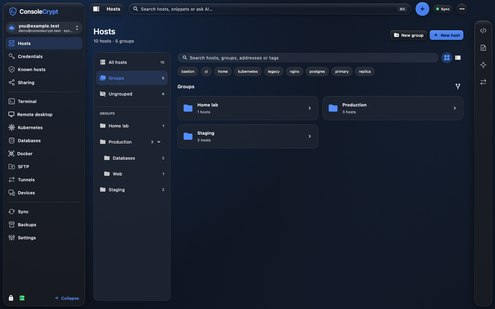

德莫集团盘点与工作空间导航.

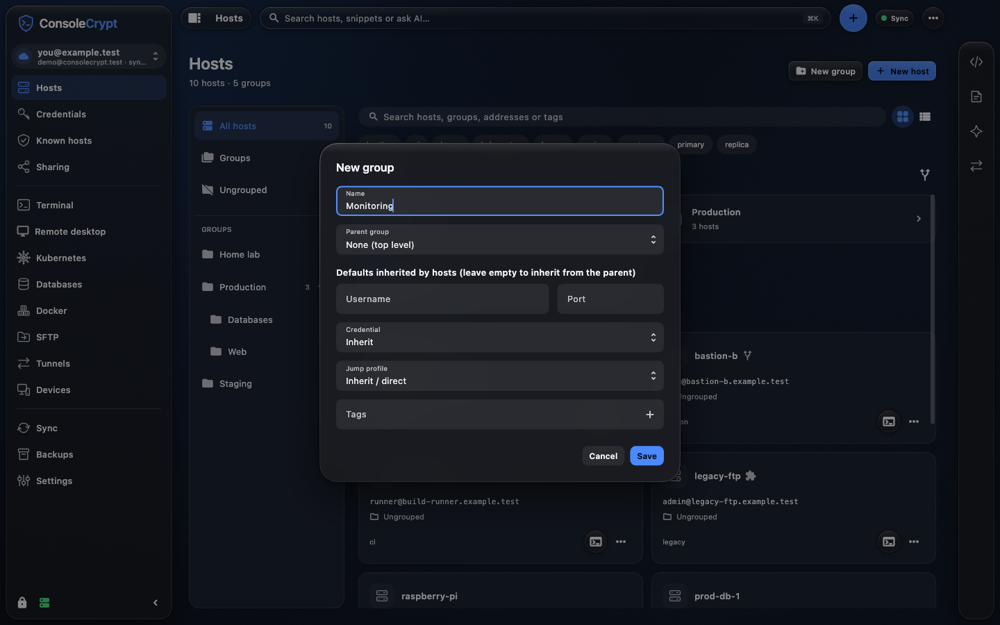

一个新的组:它的名称,父和默认为它的主机.

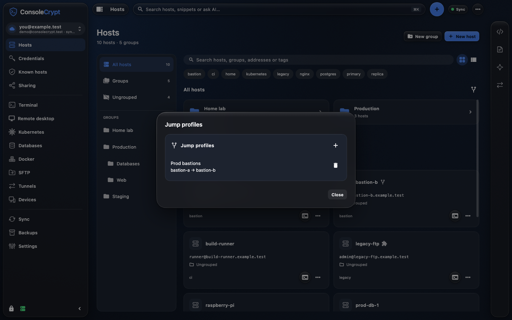

跳跃配置文件: 中间主机的命名链 。

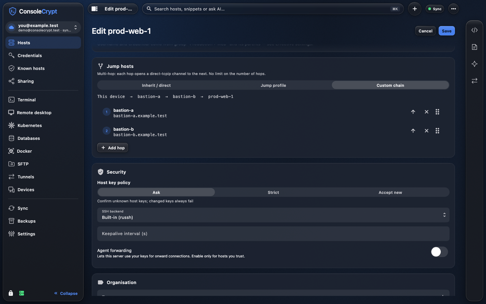

由两个跳转主机组成的自定义链以及由此形成的通往主机的路径.

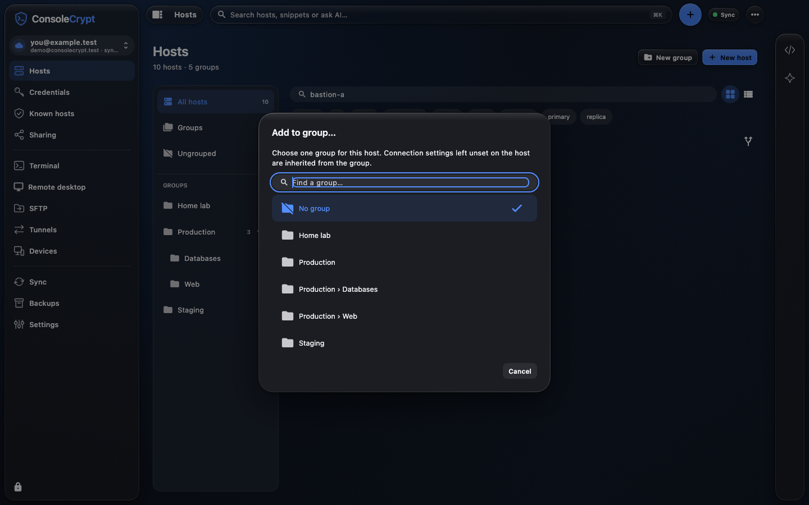

将演示主机添加到已有的组中 。

<a name="password-manager"></a>

## 13. 密码：KDBX、Vault 和 OpenBao

在「密码」中可以打开 KeePass KDBX 3/4 数据库，也可以连接 Vault 或 OpenBao 机密服务器。SSH 和 RDP 凭据有单独的栏目。

1. 自1.1.0起,左下方列表只显示解锁的数据库. +旁的小锁按钮打开其他记忆中的数据库. 选择一个可以解锁;其...菜单和WebDAV设置仍然在该拾取器中可用.

2. 所有条目和无文件夹都是条目过滤器,从实际文件夹树中分离出来. 没有文件夹显示存储在数据库根上的条目,因此无法将其重新命名为文件夹 。 回收桶与活动组分离. 字段卡比较紧凑,同时能容纳长的值和更大的文本.

3. 在欢迎屏幕上,选择CreateKDBX,OpenKDBX或ConnectWebDAV. 输入数据库密码,并在需要时选择密钥文件。 使用 +在密码数据库旁添加另一个数据库 。

4. 所选数据库的文件夹出现在左侧,有解锁的数据库和底部的其他人的拾取器. 按标题,用户名或URL在中间搜索条目,并在右边打开一张卡片. 拖动分隔符以调整列表和牌的大小 。

5. 添加条目并添加组创建内容 。 条目支持标题,用户名,URL,密码,注释和自定义字段. 确认一个表单立即保存加密文件;数据库名称旁边的状态显示结果.

6. 自1.0.4起, 使用文件夹的... 菜单或右键单击,在确认后重命名或删除 。 删除将文件夹,分组和条目移动到 KDBX 回收本; root 组和系统 bin本身被保护不被删除. 包含系统回收本的文件夹只能重新命名 。 在电话中,选择带有分组按钮的文件夹,然后打开相邻的... 菜单。 两者都改变自动保存,包括WebDAV数据库.

7. 在1.0.6中,系统回收箱有一个垃圾图标. 选择它或回收的文件夹并使用空回收桶, 也可以从本菜单中找到 。 确认在保存活动数据的同时删除所有回收组,子组和条目. 回收组或条目也经确认后永久删除。 空系统 binstay; 更改自动保存, 包括 WebDAV .

8. 从1.0.1开始,开放式卡片中的音符总是作为纯文本可见,包括多行. 密码和自定义的秘密字段保持遮掩;KDBX文件保持加密.

9. 右键单击一个条目打开其卡片,移动到另一个组或删除它. 您也可以将条目拖放到文件夹中 。 在电话上,用... ... 按钮或一个长的按键。

10. 右键单击一个数据库或使用.将其锁定、保存本地副本或从列表中删除; WebDAV 也设有连接设置 。 从列表中删除一个数据库并不删除其来源KDBX. 密码和密钥文件仍然可供重新打开 。

11. 在Android/iOS上,一个本地文件被导入到耐用的私人应用程序存储中. 自动保存更改该副本;通过系统拾取器保存本地副本导出 。 使用WebDAV从多个设备编辑一个远程文件.

12. 在第一个密码解锁后,通过WindowsApple系统保护或AndroidKeystore为这个设备上的这个数据库启用快速解锁. FIDO2/PRF可在Windows/macOS上查阅。 Linux生物特征快速解锁尚未实施; iOS模拟能力取决于其环境.

**本章内容** [导入与导出 KDBX 条目](#password-manager-kdbx-transfer) · [连接 Vault 或 OpenBao](#password-manager-vault-openbao)

<a id="password-manager-kdbx-transfer"></a>

### 导入与导出 KDBX 条目

1. 在「密码」中打开并解锁 KDBX 数据库。在数据库菜单中选择「导出为 CSV」或「导出为 JSON」。CSV 适用于用户名、密码和网址等标准字段。ConsoleCrypt JSON 还会保留自定义字段。两种文件都包含明文密码。
2. 在目标数据库的菜单中选择「导入 CSV 或 JSON」。选好文件后，核对条目数和目标数据库名称，再确认导入。CSV 文件须包含 title 和 password 表头或支持的别名。JSON 需使用 ConsoleCrypt 导出的格式。每个文件最多包含 10,000 条记录，大小上限为 16 MiB。
3. 导入后打开一条记录，核对群组和字段。以后可以从「密码」中的最近五个来源重新打开数据库或机密服务器。此列表支持本地 KDBX、WebDAV、Vault 和 OpenBao。

<a id="password-manager-vault-openbao"></a>

### 连接 Vault 或 OpenBao

1. 打开「密码 → Vault / OpenBao → 添加连接」，填写名称和服务器地址。通过网络连接时使用 HTTPS。使用 HTTP 时，令牌、密码和读取的机密在传输过程中均为明文。
2. 选择令牌或用户名和密码。在 Vault 设置中，如果 KV v1/v2 引擎使用不同的挂载路径，请填写实际路径。如果 userpass 挂载在其他位置，也请修改对应的认证路径，再连接。
3. 打开文件夹并选择机密。搜索可筛选当前文件夹。如果策略只允许读取而无权列出内容，输入该挂载点内机密的完整路径。选择字段可以显示或复制其值。也可以在命令面板按名称搜索连接，再逐级打开相同字段。
4. 要在另一台设备上使用此连接，请同步同一份个人配置。连接设置保存在加密保管库中。如果还要同步令牌或密码，勾选「将登录凭据保存到我的加密 ConsoleCrypt 保管库」。同步后，在另一台设备上打开连接并选择「使用已同步的凭据登录」。每台设备单独设置生物识别登录。


在「密码」的最近来源中选择 Vault 或 OpenBao 连接，即可重新访问其中的机密。

> **注意**
>
> KDBX文件没有发送到ConsoleCrypt同步服务器. 本地路径和快速解锁密钥属于此设备. 复制按钮在安全设置中使用共享的秘密剪贴板清除计时器 。


列表中仅保留未解锁的数据库;锁按钮打开其他被记住的数据库.


选择要解锁的数据库 。 其管理菜单在开机前可以使用.


KDBX欢迎:创建,开放或连接WebDAV.


带有演示数据的文件夹,条目列表和紧凑卡.


分组菜单:重命名或移动到回收站.


在不更改内容的情况下重命名选定的组。


确认将一组及其全部内容移动到KDBX回收站。


电话中选定的组菜单 。


系统回收桶:垃圾图标,一个删除的条目和清晰的按钮.


确认删除回收箱中的每个组和条目 。


永久删除单个回收组。


回收垃圾箱,并清除手机上的按钮。


条目编辑器和自定义字段;秘密被掩盖.


条目上下文菜单 。


为条目选择另一个文件夹 。


窄屏幕上的条目列表和触摸菜单.


入门卡在电话。

<a name="password-generator"></a>

## 14. 密码生成器

生成器可在管理器欢迎屏幕、开放数据库和密码编辑器上获取。 它运行在你的设备上,没有服务器。

1. 使用滑动器或数字选择从8到128的长度。 根据需要启用大写字母,小写字母,数字和特殊字符. 你可以排除类似的字符。

2. 再生成一个随机密码 。 该指标估计了生成设置的 en;它不是一次违反检查.

3. 在编辑器中,选择使用密码,然后保存条目. 单独打开时, 复制密码; 剪贴板遵循共享的安全设置 。


长度,字符集和 en估计;密码被蒙蔽.

<a name="password-webdav"></a>

## 15. KDBX 超过WebDAV和同步

在打开数据库之前配置WebDAV 。 ConsoleCrypt加密连接设置,并读取和保存您WebDAV服务器上的KDBX.

1. 除了一个解锁的WebDAV数据库设置按钮外, 先用密码打开数据库 。 WebDAV 设置单独同步;快速解锁密钥留在设备上.

2. 选择连接WebDAV,并输入一个名称,完整HTTPSURL以.kdbx结尾,一个用户名和一个WebDAV密码或app sord. 仅在主机地址或文件夹在网络打开前被拒绝.

3. 在保存连接后,如果需要,请使用其密码和密钥文件解锁数据库. 密码WebDAV和KDBX是不同的秘密. 打开可以取消;网络操作有超时.

4. 已确认的更改自动保存到WebDAV 。 安全写法使用ETag;没有可靠的ETag的服务器必须支持WebDAVLOCK. 外部更改的文件从不默默覆盖 。

5. 保存错误或冲突后,更改会留在开放数据库中。 在解决冲突前保存本地副本 。 重试保存手柄会临时出现网络错误,而不解除覆盖保护功能.

6. 在添加WebDAV连接之前,将每个设备更新到1.0.0. 设置存在于加密金库设置和密码中单独的加密密钥中。 较老的客户端在保存设置时可以放下一个不熟悉的字段.

7. 在电脑上连接 WebDAV 并同步配置。在手机上打开相同的配置，然后选择 WebDAV 数据库。「最近打开的数据库」最多显示此设备上最近打开的五个数据库。

8. 用主密码打开数据库。如果手机提供快速解锁，可为此数据库启用该功能，再使用指纹或系统 PIN 确认。

> **注意**
>
> ConsoleCrypt服务器0.2.4 / 协议 1.13已经传输这些加密对象;不需要新的API或数据库迁移. 它不会传输KDBX,密钥文件或快速解锁密钥.


用一个完整HTTPS文件的例子连接设置URL.

<a name="password-palette"></a>

## 16. 命令调色板中的密码

从包括终端在内的任何区域中查找用户名,密码或API密钥. 先选择条目,然后选择字段。

1. 用 Ctrl+K(Cmd+K on Mac) 或搜索按钮打开调色板并输入密码: (或本地化的密码标签后加一个冒号). 需要时可以从调色板直接打开一个KDBX.

2. 类型标题的一部分,用户名或 URL. 选择带有箭头的卡片并输入或点击。 这个步骤不会复制一个秘密。

3. 在下一个菜单中,选择一个密码,用户名,URL,注释或自定义字段,如API令牌. 只输入该字段并关闭调色板。 Esc返回条目列表.

4. 数据库必须解锁;锁定配置文件会关闭打开的数据库. 搜索结果中不显示秘密值 。 副本使用共享剪贴板清除计时器 。

[查找并复制 Vault 或 OpenBao 机密](#password-manager-vault-openbao)


在复制任何内容之前按标题查找条目 。


第二步:选择要复制的字段.

<a name="credentials"></a>

## 17. 密码、钥匙和全权证书

身份证明与主机是分开的:一个证书可以分配到多个连接上.

1. 在“证书\_新证书”中,选择一种类型:密码、新的SSH密钥、进口密钥、SSH证书(私人密钥加上其OpenSSH证书)或SSH代理——通过套接字或管道路径的系统之一或外部代理。 要导入密钥,请粘贴或选择“ 选择文件... ” :文件( 最多 64 KB ) 会被读取而不复制 。

2. 在设备上生成一个新的密钥为Ed25519,RSA 3072或RSA 4096;私有部分直接进入金库,公钥显示为授权的\_密钥. FIDO2 密钥尚未创建 。

3. 使用描述性名称. 指定证书给主机或组; 需要时单独输入密钥密码句 。

4. 打开元数据卡和公钥卡. 只有在明确动作后才会透露一个秘密; 仔细处理剪贴板副本 。

5. 复制后的秘密保留在剪贴板历史和其他设备之外,如果剪贴板没有替换到另一个值,则在“Settings → Security”中超时后清除。 更改设置会影响未来的拷贝;如果应用程序在截止日期前关闭,则在下次启动时清晰完成. 详细情况见“截图、屏幕保护和剪贴板”。

> **注意**
>
> 不要将密码或私钥放入主机名称,注释或片段. 使用单独的受保护共享工作流程与同事共享一个秘密,而不是AI聊天.


证书在演示金库中; 数值被掩盖 。


选择新证书的类型。


生成一个SSH密钥:名称和算法.

<a name="host-keys"></a>

## 18. 已知主机和SSH - 关键字校验

服务器密钥识别您正在连接的SSH主机 。 这与信任一个ConsoleCrypt设备是分开的.

1. 在第一次连接时,在接受前,先将密钥指纹与管理员或另一个信任的来源进行比较.

2. 保存的密钥出现在单独的“ 已知主机” 侧边栏部分 。 检查地址,算法和指纹.

3. 如果密钥更改, 连接会被屏蔽 。 先确定理由; 仅在独立验证新密钥后才会删除旧条目 。


一个单独的已知主机列表 带有演示指纹。

<a name="terminal"></a>

## 19. 终端、 标签和选择

标签会有一个终端会话SSH,加上macOS和Windows的本地贝壳,或者在分裂成扇形时,最多可以并排四个. 电话有一个特殊的键条;计算机有快捷键和上下文菜单.

1. 在Windows,macOS和Linux上,启用带有终端工具栏按钮或Ctrl+Shift+M / QQM的最小模式. 仅保留终端和顶端或左端标签 。 会话,输出和拆分面板保持完好; Ctrl+K / QQK 打开通常的命令调色板. 退出按钮或相同的快捷键可以恢复接口. 这个模式在电话中缺失.

2. AnSSH会话在左上角有一个OpenSFTP按钮. 同样的动作也在标签的右键菜单中,包括不活动标签,并打开该标签的服务器 。 它以最小模式工作,并保持终端会话. 本地终端没有SFTP按钮.

3. 点击终端内部键入 。 “+”按钮打开另一个连接。 当标签溢出时,用鼠标轮或它的边缘箭头滚动条形. 打开的标签总数在箭头旁边的括号中显示。

4. 要选择数个输出屏幕,请按住鼠标按钮,用方向盘滚动历史. 将指针移到终端顶端或底端边缘之外,在扩展选择时自动滚动 。

5. 选择菜单的文本和右键。 它提供复制,粘贴,选择全部,询问AI,并将选择保存为片段. Shift+F10从键盘中打开.

6. 在电话上,请使用终端下方的键盘图标和“...”。 Esc,Tab,Ctrl+C,Ctrl+D,Ctrl+L和箭头也可以在可滚动栏中找到.

7. 多行粘贴和控制字符需要审查. 在确认前检查目标和文本; 执行仍然是您的动作 。

8. 右键单击标签以重命名、复制、关闭、关闭其他标签或关闭右边的标签。 突出显示带有新输出的背景标签,侧边栏显示在标签计数旁边的此类标签的单独计数. 设置 → 终端设置字体(来自已安装的单空间字体)和标签字幕:列表名称,地址或计算机名称,或无.

9. 在桌面上可以拖曳标签到另一个地方,在左上方的条形带和列中;在列中的Alt+↑ / Alt+↓ 做同样的事情. 活动标签仍为活动 。 标签栏中的拆分按钮打开另一个会话到旁边的同一目标——“右侧”(Cmd/Ctrl+Shift+\\)或“下方”(Cmd/Ctrl+Shift+−),每个标签最多4个平板块;点击或Cmd/Ctrl+\]将输入移到另一个平板块,可以拖动分隔器,一个平板块标题中的十字会关闭它.

10. 断开后,请在标签旗下重新连接 。 输出缓冲直到标签关闭; 关闭结束该会话 。

11. “安排 · 终端 · 标签放置”:上端或左端。 左侧是带有名称和地址的标签的列;拖动它的边缘以更改宽度或折叠到图标中. 当列显示时, 应用程序侧边栏会一直折叠,直到您展开它 。 选择保留在这个设备上 。

**本章内容** [监控 SSH 会话中的主机负载](#terminal-ssh-monitoring)

<a id="terminal-ssh-monitoring"></a>

### 监控 SSH 会话中的主机负载

使用内置 SSH 客户端连接 Linux 主机。在终端右侧面板或手机上的会话工具中打开「监控」。查看 CPU、内存、磁盘占用和网络速率。收起面板再重新打开；只要 SSH 会话仍连接，采样就会持续。

[在 PowerShell 中粘贴多行文本](#local-terminals-powershell-paste)

> **注意**
>
> 更新后打开新会话SSH 。 内建SSH请求UTF-8输入和删除西里尔文本. 如果字符仍然损坏,请检查远程主机的 UTF-8 语言: 其 shell 和 SSH - 服务器设置可以覆盖客户端的请求 。


在演示终端中选择一个上下文菜单 。


最小模式带有顶标签和左侧的SFTP按钮.


带有左标签栏的最小模式;会话和输出继续工作.


Ctrl+K命令调色板在最小终端上仍然可用.


标签分为两个面板:左边是命令,右边是同一个主机的日志,每个面板都有自己的会话.


右键单击的标签菜单:重命名、复制和关闭。


“设置 – 终端”:字体、大小、彩色图案和标签字幕。


在演示终端的回滚历史中选择的文本 。


8个开放演示标签:条形导航和标签计数.


德莫Android终点站及其专用钥匙栏.

<a name="local-terminals"></a>

## 20. 本地终端: zsh、 PowerShell 和 WSL

在macOS和Windows上,您可以在这个计算机上打开一个外壳,同时打开SSH标签. 它作为普通OS用户运行,不需要同步服务器.

1. 在Cmd+K / Ctrl+K调色板中,选择新的本地终端. macOS立即打开zsh; Windows提供PowerShell,cmd和单个WSL分布.

2. 开放终端并使用其新塔布按钮,Cmd+T在macOS或Ctrl+T在Windows. 在本地贝壳下选择zsh, WindowsPowerShell, Command Point 或安装PowerShell 7. 该应用程序的全球“+”仍然打开了SSH/RDP主机拾取器。

3. 每个安装的WSL分布单独显示. 选择 Ubuntu, Debian 或其它可用的发行区;您可以为一个 shell 打开多个标签 。 客户端不安装WSL本身.

4. 在本地和 SSH 标签之间切换时,请检查此计算机标签和 WSL 分布名称 。 输入,调整大小,Ctrl+C和交互程序使用真实的PTY/ConPTY. SFTP是SSH-宿主动作,不在本地标签中.

5. AI接收活性壳体方言,且仅明确选择上下文. AI命令和片段可以插入本地标签,而不包含 Enter;自动执行被禁用. 如果您想要运行,请按“ 输入” 键。请检查文本并按“ 输入” 键 。

6. 关闭标签结束其进程 。 重新启动 shell 启动新会话 。 配置切换并退出关闭 shell 及其当前前景处理组 。 锁定金库(也自动)保持终端开放:本地和SSH标签解锁后继续. 不搜索断层/ 背面进程,如 nohup 等, 并且不停止整个 WSL 分布 。

**本章内容** [在 PowerShell 中粘贴多行文本](#local-terminals-powershell-paste)

<a id="local-terminals-powershell-paste"></a>

### 在 PowerShell 中粘贴多行文本

在 Windows 上打开本地 PowerShell 标签页，在空提示符处用终端的粘贴功能插入多行文本。可以用两行内容不同的 Write-Output 命令进行测试，执行前核对顺序。

> **注意**
>
> 当地炮弹在0.5支援macOS和Windows中. macOS 包件运行时没有App Sandbox,并重新使用现有的存储器;保留0.4.1 容器,型号,金库和键链. 冲突或不可读存储在创建新配置文件前停止启动 。 下面的截图使用带有合成配置图的部件,而不是本地的 WSL 运行 。


命令调色板中新建本地终端 。


选择本地 zsh 和 SSH主机: 与演示配置文件的真实接口 。


SSH和本地zsh并列. 终端文本是合成的;没有运行用户命令 。


Windows - PowerShell, cmd和两个WSL分布在一个macOS中的样式拾取器 - 主持部件测试. 没有弹壳跑掉。

<a name="shortcuts"></a>

## 21. 键盘快捷键

主要修饰词为QQ于macOS和Ctrl于Windows/Linux. 复制到 Windows不使用 Ctrl+C,它会中断一个命令 。 App快捷键可以在设置 → 键盘快捷键中重新映射:选择更改,并按新组合的QQ/Ctrl或Alt. 如果有另一个命令,则该命令失去它;如果系统或终端使用它,则警告你. 恢复默认值会带回下表 。

| 行动 | macOS (中文(简体) ). | Windows/Linux (中文(简体) ). |
| --- | --- | --- |
| 查找主机、 片段或动作 | ⌘K | Ctrl+K |
| 新建SSH 标签 | ⌘T | Ctrl+T |
| 关闭活动标签 | ⌘W | Ctrl+W |
| 新建主机 | ⌘N | Ctrl+N |
| 锁定金库 | ⌘L | Ctrl+L |
| 设置 | ⌘, | Ctrl+, |
| 片断 | ⌘. | Ctrl+. |
| 在终端复制 | ⌘C | Ctrl+Shift+C |
| 在终端粘贴 | ⌘V | Ctrl+V（在 Windows 上也可使用 Shift+Insert） |
| 将终端右侧分割 | ⌘⇧\\ | Ctrl+Shift+\\ |
| 将终端拆分 | ⌘⇧− | Ctrl+Shift+− |
| 下一个终端窗格 | ⌘\] | Ctrl+\] |

> **注意**
>
> 应用程序快捷键比终端输入优先. 要通过手机将Ctrl+L发送到远程外壳,请使用其特殊键按钮.


“ 设置 – 键盘快捷键 ” :每个动作都可以重塑或恢复到默认状态 。

<a name="sftp"></a>

## 22. SFTP: 传输和文件预览

从主机菜单或侧边栏打开SFTP 。 文件直接在设备与SSH主机之间行驶.

1. 选择主机并连接 。 在计算机上,使用本地和远程的面板;在电话上,切换区域并使用系统文件拾取器.

2. 选择文件并选择上传或下载。 活动小组显示转让进度和注销情况。

3. 文件可以拖曳:从Finder或Explorer上传到主机列表,从主机列表上传到本地面板下载,到文件夹或路径栏上移动到服务器. 在macOS和Windows上,来自主机列表的文件可以直接拖入Finder或Explorer:文件被下载到临时文件夹,交给系统并删除,在传输中取得进展. 文件夹不走这条路; 使用下载方式 。 Linux没有拖出。

4. 阅读时,请打开“快看”。 行号分别排在一条沟槽中,被排除在文本选择和复制之外.

5. 无法读取的文件夹SSH 被标记为无法访问, 而不是看起来是空的 。 从Docker开始,一个卷或挂载路径在一个SSH主机上直接打开SFTP.

6. 动作菜单(工具栏按钮或右键单击)为所选文件收集所有信息:打开,打开,快速查看,下载,上传,新建文件夹和新文件,重命名,复制,删除,获取信息,复制路径或名称并刷新.

7. Get Info 显示大小、位置、所有者和权限。 更改所有者、组和其他人的读、写和执行复选框的权限,或者使用八进制代码; 应用在服务器上保存。 对于符号链接,权限适用于它指向的项目.

8. 路径栏可以编辑或复制;搜索过滤当前文件夹. 列表标题中设置了列,“先写”并显示隐藏文件,失败的传输可以从活动面板中重新测试。


快速查找带有单独行码沟槽的演示文件 。


演示主机上选定文件的动作菜单 。


获取文件信息: 大小、 拥有者和带有八进制码的权限。 Get Info for a file: size, owner and percents with the ocal code.


左侧的本地面板和右侧的远程主机;演示“磁盘”/用户/演示文稿。


传输面板:下载和上传完成,失败的传输有一个重试按钮.

<a name="sftp-editor"></a>

## 23. SFTP: 默认编辑器

在计算机上,文件可以在外部编辑器中打开. ConsoleCrypt记得该设备上所选的应用程序.

1. 在“设置 → SFTP 的默认编辑器” 中,选择“ 选择应用程序” 并选择一个安装的 VS 代码、 Zed 或另一个编辑器。

2. “ 打开” 和“ 打开编辑器” 使用这个选择。 “ 打开... ”为一个文件选择另一个应用程序; “ 默认系统” 重排首选 。

3. ConsoleCrypt 从未运行其默认动作会执行代码(scripts, 快捷键,.exe,.command,.desktop和类似)的文件 。 “ 打开”首先警告“此文件可以运行代码”,然后“作为文本打开”在文本编辑器中打开文件 。 如果找不到编辑,则提供“选择编辑......”。 下载的文件标注为来自互联网Windows和隔离macOS.

4. 读取第一使用通知:本地存储一个工作副本,每个副本都会自动保存上传到远程服务器.

5. 如果另一个用户更改远程文件,则解决编辑面板中的冲突. 停止编辑通过ConsoleCrypt完成上传,删除工作副本.

> **注意**
>
> 外部编辑自动保存,备份和云的特性在ConsoleCrypt的控制之外. 工作拷贝文件夹载有CACHEDIR.TAG和.nobackup,因此borg, restic,tar和其他为他们致敬的备份工具跳过它;在macOS它被排除在Time Machine之外. 这种偏好是桌面系统;移动文件处理取决于系统能力.


演示客户端中被记住的编辑器本地偏好.


打开脚本:文件以文本形式打开,永不运行.

<a name="tunnels"></a>

## 24. SSH 隧道

一个隧道使用一个SSH连接到选定的主机. 本地转发、远程转发和动态SOCKS5可供使用。

1. 打开“隧道”并创建“隧道”。 选择主机,类型,监听地址和端口;对于本地或远程转发,指定目的地地址和端口.

2. 首选127.0.0.1为您提供当地服务。 非回路地址(如0.0.0.0)显示“无回路约束”警告,隧道只有在勾选“我知道这个隧道可以从网络到达”之后才能保存。 对于远程转发,这样的地址只有在SSH服务器允许GatewayPorts的情况下才有效.

3. 以开关启动隧道并检查其状态:行显示活动连接和运行时间,或出错后的原因. 完成后停止 。 “ 解锁后自动启动 ”每一次打开这个设备的金库, 都会打开隧道 。

**本章内容** [恢复 Docker 或 Kubernetes 端口转发](#tunnels-restore)

<a id="tunnels-restore"></a>

### 恢复 Docker 或 Kubernetes 端口转发

在从Docker或Kubernetes转发一个端口时,启用保存隧道. 预设出现在Tunnels中,在那里可以开始,停止或移除. 0号端口在每次启动时选择可用的本地端口.

在「隧道」中找到已保存的 Docker 或 Kubernetes 转发。核对主机或集群、目标资源和本地端口，然后点击启动。状态变为活动后，连接界面显示的本地地址。

> **注意**
>
> 普通SSH隧道定义可以与金库同步. 已保存Docker/Kubernetes 转发器会停留在本地到此剖面图和装置;一个运行中的隧道属于其启动地的装置. 在电话上,背景操作取决于OS的限制.


德莫隧道的定义和状态.


在创建一个Docker前置时保存一个预设; 仅演示数据 。


重新启动从隧道中挽救了前进.


0.0上远程转发:警告和必要的确认。

<a name="snippets"></a>

## 25. 片段、变量和启动集

片段是保存的命令或模板 。 打开右侧的&lt;/&gt;图标或它的快捷键的工具.

1. 选择“新片段” 并输入其名称、 命令、 类型、 标记和可选集 。 在模板中使用{{service}}}等变量;每个变量可以有一个描述和一个默认值.

2. 风险级别——只读,修改,破坏或未知——决定如何严格确认运行:修改和破坏性命令只在您选中命令后运行. 启动其他程序或自行编写文件的指令从不只读:\`env -S\`,\`fd -x\`,\`rg --pre\`,\`sed\`与\`e\`/\`w\`,\`awk\`与\`\| getline\`,\`git -c\`——关卡来自包裹的命令,或未知. 在使用“在运行危险命令之前先询问”策略的团队主机上,总是需要勾选。

3. “Starter套件”提供Linux诊断,Docker,Kubernetes和数据库集:SQL →PostgreSQL,SQL → MySQL/MariaDB和SQL → ClickHouse(各20个查询),Redis,MongoDB和SQLite(各15个查询),Cassandra/ScyllaDB(17)——主动和长期查询,锁定,大小,索引,复制和顶级查询. 明确添加集;其命令成为普通的金库对象.

4. 数据库片段也在 psql, mysql, clickhouse-client, redis-cli和mongosh 内部运行,在一个SSH会话中:多行查询作为一个粘贴发送,更改命令需要确认. 在数据库工作空间中,片段按钮(QQJ / Ctrl+J)在编辑器中插入该引擎的片段而不运行.

5. 编辑命令,将其移动到另一集或删除。 删除一组在确认后删除其片段, 并同步更改; 示例不会自动重现 。

6. 填充变量并在使用前检查已实现的命令: 变量对话框显示预览 。 “ 插入” 将其放在终端中而不输入; “ 运行” 打开主机、 命令和风险级的确认 。 “在多个终端中运行... ”在片段菜单中运行您在单独确认后选择的开放式终端标签中的命令 。

> **注意**
>
> 在服务器连接的配置中, 片段更改同步 。 他们留在当地 在当地的概况。 从同事那里收到的片段也从未自动执行。


启动包:Linux,Docker,Kubernetes和数据库集.


片段编辑器:包含变量,其默认值和风险水平的模板.


运行前:变量值和最终命令的预览.


确认一个破坏性命令:主机,命令和所需的勾选.


过滤和管理片段集 。

<a name="ai"></a>

## 26. AI 聊天和您发送的背景

您选择提供者、 上下文及随后的动作 。 模型的答案不会执行命令 。

1. 在“设置 – AI 提供者”中,选择“添加提供者”:选择类型、地址、模型,必要时选择API 密钥(放在金库中),然后选择“保存和测试”。 一个提供者被标记为默认值. 对于远程提供者,检查其地址和数据处理政策。

2. “ 默认隐私” 设置了编辑配置文件; 提供者对话框可以为该提供者设置不同的配置文件 。

3. 严格配置文件隐藏了秘密,地址,主机名,用户名和数据库名称. 标准保存主机元数据; local在隐藏秘密的同时提供更多的上下文.

4. 选择所需的终端文本并选择“ 询问 AI ” ,或者允许在聊天中附加选择 。 发送前审查上下文;不要将秘密粘贴到自由文本中 。

5. 在“插入”或“执行......”之前,审查拟议的命令和目标主机。 执行需要确认;自行评估命令.

6. 聊天头的“剪辑历史”按钮列出了本场会话和保存在金库里的会话。 选择一个来继续它:消息会回到聊天中,模型会再次得到之前的转折(和以前一样隐藏数据). 对话也可以删除。

7. Answers使Markdown:标题,列表,强调和代码;代码块中的命令作为有动作的牌出现. 侧边栏底部的图标显示默认答案:内置模型(芯片),本地服务器(服务器)或云API(globe);点击它打开设置. 芯片只在内置模型实际运行时为绿色:启动时为蓝色,出错后为红色,尚未运行时为灰色;开始为第一个请求.

> **注意**
>
> AI子系统没有API访问金库密码句或私人密钥. 对话持续到金库锁上;用“在金库中保持AI对话”每个完成的转弯都存储在金库中(并与金库同步),输入一个问题的秘密被占位符取代。 锁定金库或切换配置文件可以清除聊天并取消当前响应;这不会抹去已发送给提供者的上下文 。


从演示终端中选择上下文的 AI 聊天.


“安排 —— AI 提供者”:本地和远程提供者、默认提供者和默认隐私。


添加一个提供者:地址,型号,保存在金库中的API密钥和隐私简介.

<a name="local-ai"></a>

## 27. 本地AI:模型,你自己的GGUF和升级

在macOS,Windows和Linuxx64上,模型在你的计算机上解答. 选择 Light Quen2.5-coder 1.5B,中位 Quen3.5 4B 或 strong Quen3.5 9B,并保存整个更新的下载模型. 也可以加入自己的GGUF模型.

| 级别 | 模型和下载 | 记录和档案管理指导共计 |
| --- | --- | --- |
| 光线 | Quen2.5-编码器 1.5B Q4\_K\_M ^ 1.1 GB | 4个GiB |
| 中型 | Quen3.5 4B Q4\_K\_M − 2.7 GB | 8个GIB |
| 重型 | Quen3.5 9B Q4\_K\_M − 5.7 GB 单曲 | 16个吉布 |

1. 在设置中,打开 Built-in 本地 AI 并选择一个模型. 恒星推荐一个基于全系统RAM的阶梯,但绝不自动改变你的选择. 未知的RAM或小于4 GiB显示没有恒星. RAM 制导不是速度保证.

2. 选择安装本地 AI 。 文件按精确大小和SHA-256进行检查;进展可见,下载可以取消并恢复. Windows安装单独的运行时间; macOS包括其包中的小型运行时间. 大型模型文件不捆绑在应用程序安装器中 。

3. 安装后默认使用仅保存在此设备上 。 关掉它,回到你通常的供应商。 在启用本地默认安装本地模型后, 选择另一个未下载的模型请求安装, 而不是默默发送请求到云中 。

4. 添加您的模型( GGUF)...在计算机上选择一个 GGUF文件: 应用程序检查其标题,用 SHA-256 检查复制到模型文件夹中并选择它;您可以删除原件 。 您的模型是标记自定义, 内存指导是从文件大小估算出来的, 并且它的源头和许可证是你的检查。 删除副本,并将所选内容返回Qwen2.5-Coder 1.5B。

5. 切换模型会停止当前进程,并保留其他GGUF文件. 删除只删除所选模式及其部分下载。 更新或修复运行时间重用一个经过验证的模型;保留了原来的Quen2.5-Coder 1.5B和默认偏好.

6. 模型从第一个请求开始或从Start开始. 15分钟后停止, 保险库锁, 配置切换或退出。 苹果硅使用Metal;Intel Mac和Windowsx64使用CPU. 在Linux和移动平台上无法安装内置设备。

7. Open Model来源和许可:Quen发布1.5B GGUF,Unsloth提供Qwen 4B/9B的GGUF量化;所有三种都使用Apache-2.0. 离线可获取许可证文本 。

> **注意**
>
> 本地请求只使用127.0.0.1带有随机符号;上下文过滤仍然活跃. 在本地终端中, AI 命令会不输入而插入, 并在您审查后手动执行 。 Linux使用x64 CPU推论;GPU/CUDA和内置型号安装在Android/iOS上尚未支持. 在macOS上,在将0.4.1升级到0.5时保留先前的数据容器:配置图和模型被重新使用。 屏幕截图显示的是合成状态,而非真实的下载或响应速度.


Linuxx64:选择并安装本地CPU模型. 下载前合成状态.


三种型号,大小和内存指导. 9B星使用合成的16 GiB硬件,而不是对用户计算机的测量.


本地模式选择和默认偏好 。 Demo简介.


下载和验证进度与取消;进度是合成的.


所选模型已准备好有停止和删除动作;进程状态被模拟.

<a name="notes"></a>

## 28. 说明、任务和提醒

笔记是Spipets和AI旁边的右侧小板块工具. 用音符图标打开,从命令调色板或电话头打开. 笔记在设备上加密并与金库同步.

1. Object 标签显示关于当前打开内容的注释: 活动终端标签的SSH主机, RDP主机, SFTP主机, 数据库连接, Kubernetes 资源或上下文, 选中的Docker 容器 。 “ + ” 创建了一个已附于该对象上的注释 。

2. “所有”都列出每个附注及其所附内容;“任务”只列出任务,先列出逾期的任务,然后突出任务,然后将已完成的任务分别分类。 搜索覆盖标题,文本和标签.

3. 用 Markdown 写入文本; 预览标签显示结果 。 添加逗号分隔标记 。 一张纸条的 " ... " 菜单贴上它,打一个小时( " 一小时后重点 " ),将其贴在当前的物体或任何主机上( " 标记到... " ),或切除,并删除。 任务切换器增加了一个适当的时间和一个 Done 标记 。

4. 更改在输入后保存自己一瞬间;保存(QQS / Ctrl+S)同时保存. 以下地位为“保存的”或“未保存的改变”。 如果纸条无法保存,则让编辑们问“不省钱就离开?”

5. 在Hosts的一个主机卡显示主机有多少个音符. 在主机的“...”菜单中,带有数字的按钮,或“笔记”,打开其笔记而不连接。 在对象标签上,选择带有搜索图标的主机,或用十字架清除;编辑器的"附着"字段提供"选择主机...".

6. 提醒在1小时之内,今天18:00,明天9:00,一周或一个时间你选择。 当应用程序打开一个带有 Open 的通知时, 及时出现; Notes 图标计算了过期的任务和已关闭的提醒 。

7. 主机卡的免费文本便条变为一个带有 " 移动便条 " 的普通便条。 当一个注释的对象被删除,留下一个股份或一个团队,或者被一个更新的应用版本附着时,该注释会保留,标记为与对象的前名"没有联系". 总而言之,“显示 ——不链接(N)”收集这些笔记,而菜单中“附.”再次附上这些笔记。

8. 新的笔记总是针对个人的,也涉及团队主机:只有你看到他们,他们离开团队后就留下来.

> **注意**
>
> 提醒件也随着应用程序的关闭而发出,作为“从ConsoleCrypt发出的提醒件”的系统通知,没有说明件:通知中心没有加密。 该系统最多可保存64个离解锁配置文件最近的提醒;在配置文件外签字可将其删除。 在Android上,时间可能漂移几分钟(节省电池);在Linux上,提醒只在应用程序打开时工作。


关于活动标签主机SSH 的注释: 已过期的任务、 标记的注释和主机共享的注释;所有数据都是演示数据 。


任务标签:先过期,每个任务应有时间、提醒和附件。


与 Markdown 任务、 标签、 到期时间和提醒、 Save 和 “ 保存” 状态 。


编辑文本: 状态为“未保存的更改 ” , 直至自动保存或保存 。


音符依靠主机卡打开其音符而不连接.


“不连接”过滤器:一个已删除的主机旧db-1和“Attach to...”的说明。


一个音符的菜单:针,一个小时后提醒,从对象中分离并删除.

<a name="automation"></a>

## 29. Ansible 自动化

从剧本或角色创建项目、添加文件，并在运行前审阅 AI 建议。

1. 打开「自动化 → 库」。创建项目、导入 Git 仓库，或选择从 ConsoleCrypt 导出的 .ccproject 归档。加密归档需要输入导出时设置的密码。

2. 在「设置 → 清单来源」中选择 ConsoleCrypt 主机、清单文件（YAML 或 INI），或使用混合模式合并两种来源。

3. 点击运行按钮。选择 Runner 和剧本，手动勾选目标或使用「全选」，检查参数并确认运行。可在「任务」中查看状态和结果。

4. 打开「设置 → Runner 环境」，选择环境并点击查找。Windows 使用 WSL2，受支持的 Mac 使用本地 Python，远程执行则选择已保存的 SSH 主机。

5. 在手机上使用可访问的远程 Runner。若希望应用关闭后仍按时运行，请连接常驻服务器 Runner，并在「计划」选项卡中创建计划。

> **注意**
>
> 项目设置同步会在同一配置的设备之间传递加密设置和引用。使用 Git 或加密 .ccproject 归档传递项目文件，并在另一台设备上确认 Runner 和目标可用。


在资料库中选择项目和剧本，然后点击运行按钮。


在任务设置中选择 Runner 和目标，然后点击「验证项目和目标」。

<a name="terminal-only"></a>

## 30. 仅终端模式

在独立窗口中打开本地 Shell，选项卡可放置在左侧或顶部。

1. Windows：从开始菜单打开 ConsoleCrypt Terminal，或运行便携 ZIP 中的 ConsoleCrypt Terminal.cmd。macOS：通过 Finder 或 Spotlight 打开 ConsoleCrypt Terminal。Linux：在应用程序菜单中选择 ConsoleCrypt Terminal，或运行 consolecrypt --terminal-only。

2. 点击「+」或按 Ctrl+K（macOS 上为 ⌘K）打开命令面板，再选择已安装的 Shell。通过终端工具栏可更改选项卡位置。

[在 macOS 上安装应用](#first-start-macos-install)

<a name="teams"></a>

## 31. 团队

一个团队是同一服务器上几个账户共享的金库. 所有成员都可以看到其主机,组,证书和片段;角色决定谁可以更改它们. 团队名称,设置和资源是端到端加密的:服务器只看到谁是成员. Teams在服务器0.2.1或稍后的同步配置中可以提供(public syndate.consolecrypt.dev支持它们);一个本地配置中没有Teams部分.

| 服务器限制 | 默认 |
| --- | --- |
| 每个账户的小组数 | 50 CC\_MAX\_TEAMS\_PER\_ACCOUNT (中文(简体) ). |
| 每组成员 | 200 CC\_MAX\_TEAM\_MEMBERS (中文(简体) ). |
| 邀请使用寿命 | 7天时间 |
| 每个小组的邀请 | 每小时最多20小时 |

1. 开放“安排”-“团队”。 它列出你们的团队,包括你们的角色和成员计数、收到的邀请以及“创造团队”和刷新按钮。 单击一个团队打开窗口。

2. “创建团队”:设置调色板或“海关......”的名称、描述和颜色。 创作者成为主人,团队在解锁后出现在所有设备上. 如果服务器需要经过核实的电子邮件,请先核实您的地址 。

3. 在“成员”上,选择“邀请成员”:输入电子邮件、角色和可选的注解。 注释没有加密——服务器可以读取. 服务器不显示是否存在这样的账户;只有一个有经过核实的地址的账户才能得到邀请和电子邮件(服务器0.2.4及以后),并且邮件只有在服务器已经配置了邮件的情况下才能发送. 邀请书有效期为7天;待发邀请书可以取消.

4. 受邀者在“Settings → Teams”中看到邀请,并选择接受(或下降)。 出现了6组5位数的代码——当面、电话或信使向管理员宣读。 代码覆盖了管理员的密钥:团队只有在管理员添加你时才会打开;服务器组成的团队没有打开,并显示"团队被暂停".

5. 管理员的团队窗口显示 " .接受邀请 " ,并显示 " Compare代码 " 。 将每个组与你同事的屏幕进行比较,勾选确认,并选择“添加到团队”。 如果代码不同,请选择“代码不匹配 ” :没有人被添加,邀请被拒绝 。 团队密钥只转到成员密钥上,您屏幕上的代码是从:如果服务器在检查后报告其他密钥或另一个角色, 添加失败与“ 验证码不匹配 ”— 打开请求并再次比较代码 。

6. 角色:有一个所有人,可以指定管理人并交出所有权(“Make owner”)。 一个管理员邀请编辑和观众,改变他们的角色,删除成员和编辑设置. 一个编辑器会改变资源;一个查看器只查看和连接,他们的团队在列表中标记为“只读”。

7. 在Hosts中,侧边栏显示个人和每个团队的颜色和主机计数;团队主机在列表中带有有色标签. 在一个团队栏目中,"新团队组"在团队内部创建了一个团队:团队组中创建的所有东西都属于团队.

8. 一个东道主的“...”菜单提供了“团队行动......”和“团队行动......”(可以编辑的团队),以及“个人行动”的团队东道主。 复制主机需要的证书。 团队主机的终端标签在团队颜色中带有条纹. 只有队主可以带一个东道主出队(个人或另一组);其他成员可以抄袭. 当同一个密钥已经放在主机的金库中时,该密钥会被使用而不是另一个副本. 团队证书在名单中标注团队标签.

9. 团队的设置标签包含名称、描述、颜色和政策。 “ Mark new Kubernetes context and database as production ” 使团队的新连接制作立即开始。 “ 绝不将这些资源发送给AI助手 ” 将团队资源从 AI 语境中关闭。 “在运行危险命令之前先询问” 只在“我检查了此命令... ” 之后在团队主机上运行片段和 AI 命令, 即使是只读命令,您自己输入终端的文本也不会被检查 。 拥有者和管理员更改设置;其他人只看到这些设置。

10. “我的颜色”只改变设备上的颜色。除了所有者之外, 所有人都可以使用“ 离开的团队 ” 。 “ 旋转密钥” 手动发行新一代密钥; 生成编号在标签底部显示 。

11. 当一个成员离开或被移除时,团队密钥被旋转:新资源与下一代密钥加密,前成员无法读取. 如果轮换到期,管理人员会看到徽章和带有“旋转钥匙”的警告。 History标签显示已签名的日志:谁添加,删除或提升谁,移交所有权或旋转密钥,以及何时.

> **注意**
>
> 每一次会员变更都由一位管理员签名,每个客户端都会验证整个日志本身. 如果服务器显示一个成员无人签名,或者一个更年长的成员,则团队只暂停读取,并带有警告,没有发出密钥. 该应用程序也记得团队密钥:如果服务器为同一个时代交出另一个密钥,或者一个不连锁回前一个时代的新密钥,团队也被暂停. 使用服务器0.2.4,后来的主人或管理员在团队钥匙的指纹上签名,新成员只有在钥匙与之匹配的情况下才能打开团队. 一个被除名的成员只保留他们已经下载的东西. “事后保密”政策缩短了团队证书密码在剪贴板上停留的时间;它从未扩展本地安全设置。


“安排-小组”:收到邀请函时附有说明,两个小组由你和成员计数;所有地址均为演示地址。


创建团队:名称,描述和颜色.


成员制表:包含“Compare代码”、成员角色和发出邀请的合并请求。


邀请成员:电子邮件、角色和服务器可以读到的便条。


被邀请者接受:与管理员比较的6组代码(一个演示代码).


管理员比较相同的代码,勾选匹配并添加成员.


设置标签 : 团队的名称、 描述、 颜色和政策 。


History标签:签名的添加日志,角色更改,删除和密钥旋转.


主持人:个人和团队部分的颜色,在主持人上贴有团队标签.


团队部分:只有其团体和东道主,并设有“新团队小组”。


个人主机菜单: " 合作... " 和 " 行动起来... " 。


团队主机的终端标签在团队颜色中搭载条纹.


“在运行危险命令之前先询问”政策:即使一个团队主机上有一个无害的片段也需要勾选。

<a name="sharing-start"></a>

## 32. 共享: 开始

使用同一服务器上经核实的人的设备共享单个项目。 你的私人金库和钥匙没有共享

1. 开放“分享”项目,“由我分享”项目清单和“供我参考”项目清单。 如果无法使用,请检查服务器支持和配置 。

2. “在另一设备上访问”卡片组添加此设备并证实另一设备。“Device requests”和“ More acts”如下:项目列表标签放在卡片上方。

3. 在主机或片段菜单中选择“ 共享... ” 。 审查数据:在没有私人证书的情况下共享主机;特别注意说明。

4. 通过电子邮件查找你同事的装置,并将 " 访问此装置 " 标记为:设备的钥匙被固定在设备上,称为 " Chosen(未核实) " 。 电子邮件地址和服务器的设备列表无法自行证明密钥 。

5. 选择设备旁边的校验 。 " 安全号码 " 标签显示从两个设备的密钥中计算出来的12组数字;您的同事为您的设备打开同样的支票,并用电话或亲自读出它们的号码,您键入后——粘贴被禁用。 亲自扫描同事的 " QR码 " 或输入其文本。 一旦与日期相符,状态就与日期“核实”。

6. 如果服务器后来报告已知设备的其他密钥,则标记为“已更改的密钥”,在再次核实之前不会获得新的访问权限。 密件,Kubernetes上下文和数据库连接只到默认情况下的已验证设备——“Settings – Vault”中的“共享:仅验证的收件人”(还可以要求对主机,组和片段进行校验). 它适用于新接入和新设备;现有接收者保留其功能。

7. 保留“阅读”供观看,或明确选择“编辑”。 检查收件人并发布. 在“验证和接受”中,接收方看到所有者,可以以同样方式加以核实;未验证的拥有者的物品被标记为“未核实的Owner”,其主机从未自动连接。 在更新到0.9.2之后,一份一次性清单显示了需要核实的秘密接收者Kubernetes的背景和数据库。

> **注意**
>
> 可用性取决于兼容的服务器,经过验证的电子邮件和设备信任. 分享、组合、秘密和核实同事新设备的入场, 每件物品只能通过所有者的明确行动予以公布。 在您自己的服务器共享上默认关闭; 旗帜在“您自己的服务器: 特性、 旗帜和限制” 中描述 。


分享:设备卡,“我的设备钥匙指纹”,收到标有“未核实的Owner”的物品。


该同事的装置是: " Chosen(未经核实) " 、 " 验证按钮 " 和 " 关键指纹 " ;演示数据。


校验同事的装置:12组安全号码和同事阅读时输入的号码; 演示数字.


选择阅读器或编辑器访问权限 。


" 共享:只接受核实的收件人 " ,在Vault卡:秘密,Kubernetes上下文和数据库默认存在.


值得核查的秘密接收者一次性名单和“未核实的奥纳”标记。

<a name="sharing-items"></a>

## 33. 共享主机、团体和秘密

每个项目都有自己的访问权. 一个团体不会自动允许其所有儿童进入。

1. 对于接收到的主机,请创建私人副本并指定自己的证书. 新的地址或端口需要单独检查,包括它的跳转到主机链.

2. 在发布一组时,明确选择已经独立共享的项目的引用. 无法进入的儿童仍然被锁在接收者身上;在某个群体中增加一个私人主机并不发布.

3. 与证书卡单独公布秘密,并明确警告. 主密码或密钥和一个SSH-密钥密码句是独立的项目;蒙面预览显示没有值.

4. 接收者在重新访问检查后明确披露或复制该秘密. 曝光是时间限制的;锁定,切换配置文件并关闭对话框会删除所显示的值.

> **注意**
>
> 读者允许查看和保存可获取的数据,包括一个单独共享的秘密。 无法阻止复制已经读取的数据 。 秘密不放入普通主机JSON,片段或AI上下文.


单独的秘密发布对话框:该值被遮掩,没有给出同意.


“验证和接受”:所有者、其设备、密钥状态和验证按钮;演示数据。

<a name="databases-sharing"></a>

## 34. 共享数据库连接

保存的数据库连接可以和同事的验证设备共享,就像主机或Kubernetes上下文一样. 它需要同步服务器0.1.15或稍后启用该特性;同步.consolecrypt.dev已打开. 有了更古老的服务器,动作就被隐藏了. 在您自己的服务器上, CC\_SHARED\_DB\_CONNECTIONS\_ENABLED 旗帜打开它(参见“您自己的服务器: 特性、 旗帜和限制 ” )。

1. 在数据库中,打开连接的 " ... " 菜单并选择 " 共享 " 。 " 将共享什么 " 列出了同事收到的所有信息:名称、引擎、地址、端口、数据库、用户、路线类型和生产标记。 TLS模式和限制也共享.

2. 组,查询历史,AI设置和会话权限从未共享. 密码和客户端密钥只用“ 包含已保存的密码和客户端密钥” 来发送, 并且只有在服务器支持共享机密时才发出 。

3. 通过一个SSH主机,跳跃配置,代理或隧道的路线是不共享的:接收者选择自己的. AKubernetes向前保留其命名空间和工作量,而收件人选择上下文;aDocker向前保留容器名称,而收件人选择引擎. 这种连接不能保存为直接连接 。

4. 通过电子邮件查找同事的设备,通过一个独立的频道比较设备代码,选择角色和选择共享. 您自己的其他设备不被选中为收件人:它们通过一个经过验证的设备登录获得共享项目,而服务器呈现为您的设备被拒绝 。

5. 对于收件人来说,连接出现在数据库的顶端,“共享连接”下有一个“共享”徽章;您自己出版的徽章上写着“由您共享”。 “验证和接受”确认了所有人,“细节”打开了保存个人副本、成员和取消访问的功能。 密码和客户端密钥只有在明确选中时才会导入到副本中.

6. 制作连接的复制件仍为制作连接,并开放只读. 连接可以添加到共享组中.

7. 与秘密和Kubernetes上下文一样,数据库连接仅默认用于核实同事设备:首先选择验证并比较安全号(见“共享:开始”)。

8. SQLite 和 Cassandra / ScyllaDB 连接无法与同事共享:它们没有共享项目. 在您自己的设备中, Cassandra / ScyllaDB 和 SQLite 通- a- host 连接在“ 与金库同步” 之后同步 。

> **注意**
>
> 取消访问不会使已经复制的密码失效;在数据库服务器上更改它.


共享连接:接收到标记为“共享”的连接,您自己的“共享”连接,以及等待核查的邀请。


共享连接: 同事收到的东西; 路径不共享, 密码仅在选中时使用 。

<a name="shared-notes"></a>

## 35. 关于共享对象的共享注释

共享主机,数据库连接或Kubernetes上下文共享了每个成员都看到的音符. 这需要同步服务器0.2.0或稍后与管理员允许的共享注释CC\_SHARED\_NOTES\_ENABLED同步. 物体最多可容纳500个音符,每个音符最多可容纳288个KiB,加密.

1. 在对象标签上打开共享对象和 Notes 工具。 在您的个人笔记下,出现了一个“共享笔记”块;其“+”产生一个共享笔记。

2. 任何成员都可以写作. 只有作者编辑一个便条;作者或对象的所有人删除它. 每张纸条都显示其作者:你、业主或会员。

3. A note about a Docker container of a shared SSH host or a resource of a shared Kubernetes context shows only with that container or resource.

4. 在所有者为对象打开了一次音符面板之前,成员会看到一个等待的消息. 在成员被移除后,所有者设备会在小组下次打开时将笔记移动到一个新的密钥上.

5. 当您发布或保存个人副本时,会记住一个对象与其份额之间的链接. 对于在0.9.0前(除复制主机外)发布的对象,要再次发布或复制对象.

> **注意**
>
> 拥有者设备发布并签名共享便条密钥,作者设备在每张便条上签名:服务器既不能阅读文本,也不能替换钥匙,也不能将他人的便条当作你的.


共享主机的共享笔记块: 成员笔记和您自己的笔记及其删除按钮 。

<a name="sharing-devices"></a>

## 36. 同事的新个人用具

补助金只适用于属于已经核实的同事的新装置。 它不邀请其他人或提升权限。

1. 物品所有者打开 "新个人装置 " ,选择同事经核实的锚装置、角色上限、过期和入场限制。 手动批准是默认的;必须明确启用自动。

2. 将公共补助套件转发给新设备. 在“在另一个设备上访问”卡片中选择“添加此设备” :它检查软件包,并创建一个以Reader为默认请求的请求。

3. 在同事已经核实的设备上,选择 "确认另一个设备 " ,打开软件包,从新设备屏幕上打出代码(6组5位数)——在这一步骤上,代码既不显示也不填充。 然后返回被认可的软件包;在继续录入时,新设备同样会给确认设备上显示的代码打字.

4. 新设备继续注册,并通过“DEVice请求”应对密钥占有权挑战。 在手动模式下,所有者批准请求; 自动行动只在预先授权的限度内进行.

> **注意**
>
> 完成工作流程需要所有者在线使用一个解锁的金库. 两种模式都需要全码验证;仅导入一个包就不允许访问. 公共套件中包含公钥和签名,而不是回收词或私钥. 在您自己的服务器上, CC\_SHARING\_OWNER\_ONLINE\_ENROLLMENT\_ENABLED 旗帜打开了这个 。


配置新设备补助金:人工审批仍然是最初的选择。


"确认另一个设备 " : 代码是从另一个设备的屏幕中输入的; 粘贴和自动填充被关闭; 演示数据 。

<a name="sharing-revoke"></a>

## 37. 撤销、队列和信任恢复

业主管理参与者。 编辑器更改内容;参与者的访问权仍由所有者控制。

1. 打开一个项目的访问管理并取消适当的设备 。 未来数据的关键更改;以前已读副本保留在收件人手中。

2. 撤销新立方拨款 停止未来录取. 已经允许的设备必须分别取消 。

3. 检查出行队列:待签更改可以明确重试. 删除队列操作不会取消已发布的更改 。

4. 当警告停止状态时,使用与所有者和保存的公用套件的明确信任恢复. 不删除要绕过检查的系统密钥 。

5. 只有所有者可以删除一个共享项目 : “删除共享项目 ” 立即删除收件人的访问权限 。 从“我分享”到“最近删除”到“Restore”可恢复30天。 除了离开的人之外,一个被恢复的物品被再次与同样的人分享,他们再次接受.

6. 受款人可以凭此物品或收到邀请书的“份额”离开。 物品不再用所有设备运抵,节省了个人的复制品停留,车主看见谁走了.

7. 无法读取的共享条目被隐藏, 列表上方的警告显示有多少条目被跳过;其他项目显示为通常 。

> **注意**
>
> 如果一个秘密可能已经泄露,在ConsoleCrypt中撤销访问并不能取代更改密码或SSH目标服务器上的密钥. 无论是手动还是自动登录, 都无法删除收件人保存的数据 。 恢复已删除的项目, 并留下共享同步服务器 0.17 或稍后; 使用更旧的服务器,这些按钮会被隐藏 。


最近删除:共享项目可恢复30天.


" 管理人员访问 " :同事核实的装置及其作用;未来的更改用新的钥匙加密。

<a name="settings-overview"></a>

## 38. 设置: 在哪里

从侧边栏打开或带有QQ, / Ctrl+, 的设置. 它是一张滚动的卡片页;有些卡片只出现在有该功能的地方. 外观,终端,快捷键和编辑偏好都留在设备上,而金库数据则停留在加密配置中.

| 纸牌 | 它所持有的 |
| --- | --- |
| 简介 | 配置列表“ 添加配置” , 重命名并删除此设备 。 |
| 账户同步( 或同步本地配置文件) (S) | 服务器,签入方法,账号,设备;更改账户密码,断开,签出. 本地配置文件可提供同步功能 。 |
| 默认 | 自动锁,设备解锁,用生物鉴别技术确认动作,“共享:只确认收件人”,更改密码句,一个新的恢复工具箱,备份,“现在锁”。 |
| 团队 | 描述文件的团队和邀请函; 只在有团队的服务器上 。 |
| 外观 | 主题,玻璃效果,文本大小,颜色,侧边栏和右面板,语言,打开最后一个配置. |
| 警卫 | 剪贴板清除(在Android上,同样在背景中)和截图和屏幕记录保护. |
| 本地AI和AI供应商 | 内置模式(如有可用),提供者,默认隐私. |
| 终端 | 命令历史,字体大小和家族,颜色主题,标签字幕,回滚. |
| 键盘快捷键和SFTP | 重映射快捷键和默认编辑器——在计算机上. |
| 命令行 | “安装CLI命令”:计算机上的控制台crypt-cli终端命令。 |
| 更新和关于 | 更新检查,版本,作者和许可证. |

1. 单击设置区域标题以崩溃或扩展它。 设置和输入的值保持不变,每个区段会独立折叠.

2. 纸牌按表顺序排列. 本指南各章对每一章作了说明:“故障、恢复和生物鉴别学”、“团队”、“颜色、文本尺寸和玻璃效果”、“截图和屏幕保护”、“AI聊天”、“终端”、“键盘快捷键”、“计算机更新”。

3. 终端回滚停留在此设备上, 永远不同步 。 远程桌面卡只出现在手机上 。


设置的顶部:配置文件,账户和同步,金库.


终端:命令历史,字体,色彩主题,标签字幕和回滚.


安全和AI提供者:剪贴板清除,本地和远程提供者,默认隐私.

<a name="cli"></a>

## 39. 命令行:控制台crypt-cli

控制台crypt-cli是ConsoleCrypt命令行客户端. 它与macOS,Windows和Linux的安装器同船,并使用与应用程序相同的配置图进行工作.

1. 打开 " 设置 – 命令行 " 并选择 " 安装 CLI 命令 " macOS 获得链接 /usr/local/bin/consolecrypt-cli(系统可以要求管理员密码), Windows 向用户 PATH 添加应用程序的 bin 文件夹, Linux 获得链接 ~/.local/bin/consolecrypt-cli.

2. 打开新的终端窗口并运行控制台crypt-cli--help. 对剖面图、主机、证书、SSH(互动或 -- --之后的一个命令)、隧道、SFTP、同步、设备、备份和AI、旗帜--profile、--json和--offline都有命令。

3. 命令要求密码句和其他秘密本身;脚本可以在环境变量CC\_PASSPHRASE中传递,其他则在docs/public/CLI.md中传递. “删除 CLI 命令”只删除创建的内容ConsoleCrypt。

[控制台crypt-cli 命令和旗帜QQ](../docs/public/zh/CLI.md)

> **注意**
>
> 电话没有命令线 当~/.local/bin没有在Linux的PATH上时,该节会这样说;在您的 shell 设置中添加它.


安装前的“设置 / 命令线” : 命令做什么和“ 安装 CLI 命令” 按钮 。

<a name="appearance"></a>

## 40. 颜色、文本大小和玻璃效果

外观偏好被存储在这个设备上. 界面文本大小和终端字体大小分别调整.

1. 在“Settings −外观”中,选择System, Light 或 Dark,并比100%的基准减少或增加文本比例。

2. 使用频谱或颜色值设置重音和背景;重置恢复原主题. 终端部分控制其字体,大小和回滚缓冲.

3. 选择终端预设或“自定义/ 导入 ” 。 ConsoleCryptJSON和iTermal色彩预设得到支持;背景,文本,光标,选择和ANSI颜色可以单独调整.

4. 选择 Clear, Default, Tinted 或 Solid 玻璃 。 如果效果被简化,请检查性能消息和系统透明设置.

5. 整个应用程序的下拉列表使用同样带有紧凑型号的玻璃样式. 菜单、工具提示和对话框采用您选择的背景颜色。

> **注意**
>
> 安全对话不透明。 系统透明度的降低和性能模式可以限制玻璃效果;终端调色板的选择独立于接口.


演示界面中的主题,尺度和玻璃设置.

<a name="right-panel"></a>

## 41. 右面板:泡泡或一个工作空间

片段,笔记,AI和端口前置在右侧工具面板中. 在外观设置中选择它的行为 。

1. 泡泡打开工具作为单独的浮卡. 关上按钮就把它丢掉

2. 统一面板可以扩展右侧共享的工作空间. 在宽度显示上,调整其大小,并继续使用与它并列的终端.

3. 使用工具完成后,将其关闭并点击活动终端内部恢复打字. 在使用调色板或右板字段后,此返回输入到SSH会话 。

4. 在片段,AI和端口前置图标之间切换. 前进面板列表运行Kubernetes和Docker一起前进,并在新的面板开始时自行打开. 在狭义的屏幕上,工具打开工作空间,使其控制仍然可用。


设置中的两个右侧模式 。


扩展片段面板与演示终端并列.


扩展的AI面板与一个演示终端.

<a name="screenshots"></a>

## 42. 屏幕截图、屏幕保护和剪贴板

应用程序是否能够屏蔽屏幕捕获取决于OS. 抓取偏好是当前设备的局部偏好 。 复制后的秘密远离剪贴板历史,在超时后被删除 。

| 平台 | 行为 |
| --- | --- |
| Android (中文(简体) ). | 在安全环境中启用“ Allow 截图 ” 。 抓取默认被屏蔽; 切换也会影响录制和最近应用预览. |
| macOS (中文(简体) ). | 允许截图 。 现代macOS并没有为应用程序提供可靠的方式来屏蔽所有截图和录音;没有工作块切换. |
| iOS (中文(简体) ). | 没有通用的截图块。 应用程序切换器封面在背景时保护预览;物理-iPhone检查仍然分开. |
| Windows (中文(简体) ). | “设置 – 安全 – 隐藏窗口不被屏幕抓取 ” : 永远不要,尽管秘密被显示(默认)或总是。 在显示密码,密钥或恢复词时,窗口会远离截图,录音和屏幕共享. |

1. 在同一节中,“ 清除剪贴板” 设定从剪贴板上删除一个复制过的秘密:从30秒( 默认)到1天 。 团队政策只能缩短. 清除程序在应用程序重新启动后也会完成, 并且从不触及您稍后在其它应用程序中复制的东西 。

2. 秘密——密码,密钥,揭示Kubernetes 机密和Docker 环境值,敏感数据库单元格,恢复单词 —— 以受保护的方式复制:它们不出现在Windows剪贴板历史和云剪贴板(Win+V)中,不通过通用剪贴板发送给iPhone或iPad,被标记为剪贴板管理者的秘密,在Linux上,从不在中键选择中降落. 关闭窗口 Windows 或退出应用 macOS, Linux 解除秘密.

3. 终端和日志选择以及查询结果也远离剪贴板历史和其他设备,但被计时器不删除;一个看起来像一个秘密(password=.,一个符号,一个私人密钥)的选择被复制成一个秘密. 如果保护的剪贴板没有可用, 应用程序会说“不能安全地复制” , 并且没有复制任何内容 。

4. Android 不允许背景应用程序读取剪贴板,因此“ 打开背景剪贴板,即使无法校验这个秘密 ” (默认情况下)在截止日期前清除它, 无需检查, 也可以同时删除您在另一个应用程序中复制的文本 。 关闭它,秘密就一直存在直到你回到ConsoleCrypt. 在电池节能器中,清空时间可能到10分钟左右.

> **注意**
>
> 不要捕捉到秘密 或你的复苏套件。 本指南中的每个图像都使用演示数据. 在剪贴板被清除之前读取该剪贴板的应用程序,或者忽略提示的剪贴板管理器,可能已经保留了这个秘密.


Android:剪贴板清除时间,在背景中清除,并在演示界面中截图权限;这显示了UI,而不是在物理手机上执行.


“清除剪贴板”:复制一个秘密后30秒至1天。


macOS 安全部分:剪贴板清除时间和OS限制.


Windows:“从屏幕捕捉中隐藏窗口”——永远不要,尽管秘密被显示或永远。

<a name="backups"></a>

## 43. 备份和恢复

同步不替换备份 。 将加密文件与您的设备分开, 将回收套件与文件分开 。

1. 在“备份”中,导出金库为.ccup文件。 在计算机上,配置文件夹和自动备份时间表;移动能力取决于系统文件拾取器.

2. 要恢复,请从欢迎屏幕或备份区域中选择文件. 先审其信息.

3. 以密码解锁备份, 或用回收套件和新的密码解锁 。 恢复在此设备上创建新的本地配置文件; 现有配置文件不被触碰 。 要再次同步数据, 启用此配置文件的同步 。

> **注意**
>
> 移动到另一个服务器时,请保留原始配置文件,直到您验证恢复状态. 编辑器和外观偏好以及终端回滚不会成为同步的金库数据.


在演示客户端中加密备份和调度.


从欢迎屏幕恢复:一个.ccup文件打开为新的本地配置文件.

<a name="about"></a>

## 44. 版本、作者和许可证

大约显示已安装的应用程序的细节:其版本、构建编号、作者和许可证。

1. 开放“定居——关于”。 在macOS上,同一对话框也可以从ConsoleCrypt应用菜单中获取.

2. 当联系到支持时, 包含此对话框的版本和构建编号, 以及您的操作系统 。 他们识别你安装的更新。

3. 在同步配置中,对话框还显示“您同步服务器的源代码 :” , 连接服务器报告本身( 网络服务的 AGPL-3. 0 要求) 。

4. 客户端和服务器许可证分别列出;两者在界面中都标注为AGPL-3.0. 检查更新中的新版本 。


关于:版本,作者和客户端及服务器许可证标签.

<a name="updates"></a>

## 45. 客户端更新

在Windows、macOS、Android和Linux(从0.9.14开始的DEB或RPM副本)上,“Settings – Updates”提供启动检查和人工检查。 检查本身不会安装更新 。

1. RuStoreAndroid通过商店构建更新. 在其设置中使用 Open RuStore. 此变体不下载APK或请求允许安装其他应用程序. 下载版的普通APK仍然是单独的频道. 在从旧调试证书切换到新生产证书之前备份本地数据 。

2. 如果你喜欢人工检查,请关闭自动检查。 选择“ 检查更新” 并审查新版本和注释 。

3. 在安装前保存备份并完成重要会话 。 在通过应用程序下载时,会对照签名的元数据和检查和;安装需要您采取行动.

4. 在Windows上,“下载和安装”下载并验证安装器;然后ConsoleCrypt关闭,安装器更新应用程序并再次启动。 SSH会议结束;保存概况和金库。 从 ZIP 归档中解开的复制件无法更新自己:从下载下载下载安装器或一个新的归档. 普通AndroidAPK使用系统APK安装器;RuStore变体使用商店.

5. 在Windows上,从0.8.5或更早通过应用更新可能失败. 从下载器上下载0.8.6次,并在上一个版本上手动安装;配置图和金库保存. 后期更新从应用程序安装.

6. 在Linux上,下载并安装包与单独签名的Linuxfeed和SHA-256核对;系统然后要求管理员密码,然后pt,dnf或zypper安装. 选择重新开始打开新版本; 配置文件、 保险库和密钥环被保存 。 关闭密码对话框取消 。 没有pkexec,或者在错误中,手动从下载中安装DEB或RPM(见Linux安装章).

7. 使用ConsoleCrypt0.2.2或更新macOS,在下载后在系统“保存和打开”对话框中选择一个新的 DMG文件名或文件夹。 一旦DMG打开,退出应用程序,将新副本拖至应用程序,并确认替换.

8. 取消对话框可以让已核实的下载准备进行重试 。 保存时选择新文件名: 已经存在的文件永远不会被覆盖 。

[完整客户端更新指令QQ](../docs/public/zh/UPDATES.md)

> **注意**
>
> 如果ConsoleCrypt在旧应用程序更新后无法打开macOS,则通过您的浏览器下载一次最新的DMG. 退出ConsoleCrypt,并在应用程序中替换. 通过旧按钮再次下载不会清除块 。 保持你的金库和钥匙链。 在被替换的应用程序启动后, 稍后的更新会使用系统“ 保存和打开” 对话框 。


以单独的启动检查偏好更新检查 。

<a name="server-account"></a>

## 46. 账户:密码、断开和网站账户

网站账户管理您的公共服务器账户。 解密的主机,密钥和片段仍保留在应用程序中.

1. 打开“ 账户” , 并使用您的公共服务器电子邮件和账户密码, 包括已有的 Copercrypt. evsikov.net 账户 。 您可以在此校验电子邮件, 更改账户密码并取消设备 。

2. 对于私人环境,请从存储器的服务器组件中部署一个兼容的服务器. Docker和赫尔姆指令是针对管理员的.

3. 使用您的服务器HTTPS 地址创建客户端配置文件,如果服务器允许注册, 则在其中签名或注册; 公司服务器通过您的组织将您签名 。 管理员配置电子邮件,服务器备份和共享可用性.

4. 在应用程序中, “ 设置 – 账户和同步 ” 显示服务器、 登录方法、 账户和此设备的名称 。 “ 更改账户密码 ” 要求当前密码和新密码(至少 10 个字符 ) ;金库密码句不更改 。 在公司服务器上,密码在您的组织中被更改。

5. “ 签名” 结束此设备的会话; “ 在所有设备上签名... ” 结束账户的每次会话。 “ 断开( 保存本地数据... ) ” 将配置文件变成本地配置文件, 也可以在服务器上取消此设备 。

> **注意**
>
> 服务器查看账户和操作元数据,存储加密对象,没有解密密钥. 签名到此网站不会从另一个服务器转移账户 。


设置 : 配置文件、 账户和账户动作同步以及金库 。


“更改账户密码”:保险库密码句保持不变。

<a name="kubernetes-connections"></a>

## 47. Kubernetes:连接和接入

导入已有的上下文, 并将证书保存在您的加密金库中 。 集群请求来自您的设备 。

1. 打开Kubernetes , 选择 kubeconfig 导入并选择文件或粘贴YAML 。 桌面支持多个文件和文件夹扫描.

2. 选择上下文并审查服务器、用户、命名空间和认证。 标出生产集群. 原始文件未变.

3. 对于执行认证,请审查可执行路径,参数和SHA-256. 导入不运行命令;它的第一次执行需要单独的批准 。

4. 配置SSH或者需要时的代理,然后连接 。 在移动上使用令牌,客户端证书或OIDC;外部Exec插件需要桌面.

5. 要与同事共享,请打开共享访问并选择上下文. 默认情况下,全权证书不在此列,需要明确列入。

[完整Kubernetes 指令 QQ](../docs/public/zh/KUBERNETES.md)

[将容器部署到 Kubernetes](#docker-details-deploy-kubernetes)

> **注意**
>
> 集群连接同步为加密对象 。 导出一个 kubeconfig会创建一个可以包含秘密的单独文件.


Kubernetes与演示数据接口.


Kubernetes与演示数据接口.


kubeconfig 导入:演示文件的上下文,它们的认证,生产开关和需要单独批准的证书文件.

<a name="kubernetes-resources"></a>

## 48. Kubernetes:资源和变化

直播列表和细节显示来自可用API的对象,包括已安装的CRD.

1. 在桌面上,左侧的导航器列表集群和可折叠资源组,由 API 组和最喜欢的自定义资源. 一个集群打开一个带节点的概览,运行Pods,问题,CPU和内存图表以及Pod状态. 没有计量服务器,概览将提供一个基本概览;地方集群将打开--kubelet-insecure-tls。 右键单击一组,用于重命名、属性、测试/生产、颜色标签、共享和kubeconfig导出。

2. 选择命名空间和资源类型。 使用搜索、过滤和列设置;列表自动更新。

3. 打开一个对象以获取状态, YAML, 事件和相关资源. 所支助的工作量暴露出推出历史和修订对比。

4. 要编辑YAML,请打开编辑器并选择应用:更改先在服务器上验证,然后是diff和一个金库的密码句确认跟随. 拒绝显示哪个控制器拥有一个字段或哪个字段被拒绝 。 外地所有权冲突需要单独决定。

5. 删除,重新启动,缩放,警戒/排泄和调试容器需要用库口令确认;不需要资源名称打字. 秘密值被分别隐藏和揭示.

6. 生产环境区块写。 桌面允许用金库密码句确认一个10分钟的写窗;批量生产变异仍然被禁止.

[完整Kubernetes 指令 QQ](../docs/public/zh/KUBERNETES.md)

> **注意**
>
> Kubernetes 非洲区域局仍然适用。 计量要求有一个无障碍的计量服务器;缺失的数据或权限被明确报告。


Kubernetes与演示数据接口.


Kubernetes与演示数据接口.


编辑YAML:在“服务器上的数字”之后显示差异,应用需要单独确认。


推出历史:两次部署修订,按外地进行对比。

<a name="kubernetes-logs-shell"></a>

## 49. Kubernetes:原木、壳体和隧道

日志, shell 和端口转发被构建到客户端中,不需要外部的kubectl.

1. 在 Pod 细节和打开日志中选择一个容器。 流输出,过滤线或检查之前的容器运行.

2. 从工作量中打开相关的Pod日志 。 将输出保存到桌面上的文件或使用移动上的系统共享 。

3. 运行端口前方与Docker前方一起在右面板中直播:每个前方显示其状态,本地地址带有副本按钮,Pod和端口,流量和停止按钮. 面板在向前启动后打开,集群头有一个“Port Forwards: N”按钮。

4. 开波德终端. 自动选择尝试 bash, 灰和sh,或者明确选择一个命令 。 生产需要相应的上下文许可.

5. 为想要的端口创建前端口 。 使用显示的本地地址, 完成后停止隧道 。

6. 一个带有标准数据库端口PostgreSQL的Pod, MySQL, MariaDB, ClickHouse, Redis, MongoDB)有一个“连接到数据库”按钮. 它打开一个保存的连接到同一路由,或者一个数据库的表格,一个Kubernetes路由: 给Pod本身一个 StatefulSet,否则只能给它唯一的服务或部署,所以连接在Pod重启后幸存下来. 每一个连接上都恢复了前进方向。

7. 在Android上,主动隧道出现在带有停止动作的通知书中. iOS仅作为模拟建筑提供. 锁定金库会保留集群会话: pock 终端和端口前置持续运行,解锁区域后重开同一集群.

[完整Kubernetes 指令 QQ](../docs/public/zh/KUBERNETES.md)


Kubernetes与演示数据接口.


Kubernetes与演示数据接口.


APostgreSQL 带有“连接到数据库”按钮的Pod。 示范数据。


资源卡中的Pod日志:容器选择,前一次运行,跟随,过滤和关卡.


底层面板中的Pod终端:其头部的容器和Pod地址;输出为演示.


A Pod 端口向前:此设备上的地址和右侧的主动前方列表 。

<a name="kubernetes-gitops"></a>

## 50. Kubernetes: GitOps 与问题

Flux和Argo CD是从可用的CRD中发现的. 概览结合了状态,依赖性和与问题对象的链接.

1. 打开 GitOps 并选择源, Kustomizations, Helm Releases 或其他可用的组. 搜索缩小了列表。

2. 利用资源流动和依赖性从源头到工作量的导航。 现状和事件有助于解释失败。

3. 对于Flux,请现在就选择Sync,Sync with source或Pause/Resume同步——工具提示解释Flux会做什么. 检查对象并用金库密码句确认 。 Argo提供同步和刷新.

4. 设置暂停理由并分别提醒. 提醒永远不会自动恢复对象。

5. 可选启用上下文的Flux提醒和事件历史 。 历史在本地停留长达7天;在运行的应用程序内运行警报.

6. 问题收集了Pods,工作量,节点和GitOps的诊断. 从一个发现打开对象,日志或一个AI解释.

[完整Kubernetes 指令 QQ](../docs/public/zh/KUBERNETES.md)

> **注意**
>
> 当非洲区域局阻止某些读数或达到数据限制时,概览部分标出。


Kubernetes与演示数据接口.


GitOps在手机上播放演示数据. 过滤面板是滚动的;滚动到顶部使用搜索.

<a name="kubernetes-helm"></a>

## 51. Kubernetes：Helm

检查存储的Helm释放,并将其与当前集群进行比较.

1. 打开Helm,选择一个命名空间并释放. 历史显示了现状,图表和修订版.

2. 观察值与显. 所有字符串值和证书名称字段都被蒙蔽. 对于图表依赖性,计算出的数值可能不完整.

3. 比较两处修改或选择现场比较. 未提供和掩蔽的数据分别列出。

4. 桌面回滚需要安装方向盘,并用金库密码片单独批准。 生产限制也适用于这一作业。

[完整Kubernetes 指令 QQ](../docs/public/zh/KUBERNETES.md)

> **注意**
>
> 活性比较读取存储的明细表和活性物体;它不进行干燥或替换控制器漂移诊断.


Kubernetes与演示数据接口.


Kubernetes与演示数据接口.

<a name="kubernetes-terminal-ai"></a>

## 52. Kubernetes:上下文终端和AI

地方指挥部和大赦国际的援助情况仍然明确。

1. 在桌面上,打开上下文终端并选择一个 shell. 它的标题显示集群和默认的命名空间;标签在导航时保留了上下文.

2. kubectl和Flux为本地代理使用临时的kubeconfig. 实际的集群密钥不写入该文件,代理执行生产政策.

3. 如果缺少CLI,请审查安装选项,精确命令和安装方法. 软件包源遵循软件包管理器配置. 执行需要单独的批准。

4. 从Kubernetes面板打开AI或一个问题. 检查提供者并同意集群数据访问.

5. 讨论资源、事件和日志尾声。 建议的命令和YAML只有在您通过正常检查采取行动后才能执行。

[完整Kubernetes 指令 QQ](../docs/public/zh/KUBERNETES.md)

> **注意**
>
> 外部提供者接收选定的消毒数据。 WSL要求访问Windows回路代理;不兼容的网络从不暴露一个外部代理的收听器.


AI inKubernetes:一个关于一个失败的Pod,它所读的日志和事件以及当地模型的答案的问题;答案是脚本演示.

<a name="databases-connections"></a>

## 53. 数据库:连接和路线

数据库部分与 PostgreSQL, MySQL 和 MariaDB, ClickHouse, Redis, MongoDB, Cassandra 和 ScyllaDB 合作, 并拥有 SQLite文件. 驱动程序被构建在应用程序中,连接在加密的金库中进行直播,查询从您的设备直接转到数据库.

1. 侧边栏中打开数据库并选择“新数据库连接 ” 。 输入名称、 引擎、主机、 端口、 数据库( Redis 索引)、 用户名和密码。 “ 测试连接”在保存前显示服务器版本 。

2. 在库中保存密码或每次打开连接时输入密码;一次使用输入的密码而不保存. 在“TLS保护”下,证书和主机名默认得到核实;对于本地地址或端口,模式开关本身可“优先加密”。

3. “优先加密”只在隧道内或前方(SSH主机、跳跃剖面、SSH隧道、Kubernetes,Docker)和这台计算机上没有TLS。 直接连接到另一个没有 TLS 的主机,而密码没有发出;如果一个未加密的连接是可以接受的,请明确选择“ 残疾 TLS ” 。

4. 使用"要求加密"PostgreSQL将密码绑定在TLS连接(SCRAM-SHA-256-PLUS)上,因此带有伪造证书的拦截器无法获得. 使用md5 或密码认证的服务器需要“不装订(不安全) TLS 的 Allow sign- in”,默认关闭。 通过没有TLS的网络,PostgreSQL从不发送纯文本的密码.

5. 实际保护显示在工作空间头和连接卡上:“TLS(核实)”、“TLS(证书未核实)”、“无TLS——由隧道保护”或“无TLS”。

6. 在“连接路线”下,选择如何到达数据库:直接通过一个保存的SSH主机或SSH跳跃剖面,通过保存的SSH隧道,一个Kubernetes港口前方(Pod, Service, 部署或StatefulSet)或一个Docker集装箱。 隧道和前方隧道从连接开始;运行中的隧道被重新使用。 带网络绑定地址的保存隧道只有在数据库连接使用时才会在127.0.0.1上开始.

7. 当主机是本地主机,而端口匹配一个保存的隧道本地端口时,表格会提供使用该隧道. 通过任何途径,TLS仍然验证原始数据库主机名.

8. “进口连接”接受连接字符串(postgres://、mysql://、clickhouse://、redis://、mongodb://、mongodb+srv://、cassandra://或scylla://、sqlite:///path/to/file.db)或一个.pgpass文件。 保存前检查发现的连接:对每个连接, 标记生产, 选择一条路径,决定是否保留密码 。

9. 打开现场数据库的“制作——只读,只写在临时窗口”。 在“组”下设置组、标记和颜色;在卡片和工作空间头上显示颜色。 搜索匹配名称,主机,数据库,引擎和标记,列表上方的标记充当过滤器.

10. 切换到在卡片和紧凑列表之间搜索开关,如Hosts;此设备上记住选择 。 名称旁边的图标显示路线,“...”菜单连接、编辑或删除。

[完整的数据库指令 QQ](../docs/public/zh/DATABASES.md)

> **注意**
>
> 设备之间的连接只以加密形式进行;同步服务器既不看到密码,也不看到查询。 查询通过所选路线从设备前往数据库。 SQLite 连接到此计算机上的文件会停留在这里; Cassandra / ScyllaDB 和 SQLite-through- a- host 连接会用“ 与金库同步” 移动到金库中; 参见下一章 。


Demo连接:路由图标,彩色标签,PROD徽章,标签过滤器以及SQLite和Cassandra上的"仅此设备"图标.


与紧凑列表相同的连接 。


选择连接形式的路线:SSH宿主,跳跃剖面,Kubernetes,隧道或Docker容器.

<a name="databases-sqlite-cassandra"></a>

## 54. 数据库:SQLite、Cassandra和ScyllaDB

SQLite是一个文件,不是服务器;Cassandra和ScyllaDB会讲CQL. 两台发动机均以0.9.2到达. 从0.9.14起,Cassandra / ScyllaDB和SQLite通过-a-host连接可以移动到金库,而这个计算机上的SQLite文件则停留在这里.

1. 对于SQLite,选择“新数据库连接”,选择“SQLite”引擎,并将“文件位置”设置为“此计算机”macOS,Windows,Linux......)。 键入路径或使用“选择文件...”。 只有“ 创建新数据库... ” 才会创建空文件: app从未连接到缺失的文件, 拒绝一个不是 SQLite 数据库( 或加密数据库) 的文件 。

2. 服务器、容器或Pod上的文件通过“SSH主机”、“Docker容器”或“KubernetesPod”打开:sqlite3程序(3.16或较新)运行文件所在的查询,文件本身从未被复制。 一个生产Kubernetes上下文必须允许运行命令. 电话只能提供这些选择。

3. “只读” 默认为:文件只打开只读,没有查询可以更改它 。 没有它,通常的规则适用:修改经过审查,生产需要临时的写窗. ATTACH,VAUUM INTO,加载扩展和改变的纸盘总是被拒绝.

4. 文件的结构:表格、视图、索引、序列(AUTOINCREMENT计数器)、表格触发器和数据类型。 表格中包含显示为“名称(TYPE)、密钥、外国密钥、索引、参考文献(其他表格的外国密钥指向这里)和触发器的列。 DDL,对象细节,EXPLAIN QUERY PLAN树,导出和单元格编辑按主键或划线工作与其他引擎相同.

5. 对于Cassandra和ScyllaDB,选择“Cassandra / ScyllaDB”引擎(端口9042):“Host”是第一个联络点,“Keyspace”是默认的密钥空间。 在“司机设置”下,设置“更多联络点”、“本地数据中心”,读作(默认情况下为LOCAL\_ONE)和写作(LOCAL\_QUORUM)一致性和“每页倾角”(500)。

6. 直接地,请求分布在第一个联络点数据中心的每一个节点上,当一个节点失败时回答并移动到其他节点;通过SSH,隧道和转发会话通过一个节点工作. 随着ScyllaDB在一条直接路线上,会话打开了每个节点shard(shard-aware port 19042)的连接,当无法到达时会掉回正端口. 通过隧道将节点保留在计算机的局部网络上或使用一个节点. 拥有本地数据中心集,联系点必须在其中.

7. 查询用CQL写成,在发送之前,每个查询都在应用程序中解析:SELECT,DESCRIBE,List and USE read;INSERT,UPDATE,DELETE和BATCH经过更改审查;DROP和TRUNCATE计数为危险;GRAT,REVOKE和角色管理即使在写字窗口中也被拒绝生产. 一个有ALLOWE FILTERING的SELECT,或者没有在哪里和LIMIT, 要求先确认。 下一个结果页只加载到“更多损失”。

8. Cassandra结构:带有复制功能的键盘空间 – 表格、实际视图、用户类型、功能和集合 – 栏标注了Partition 关键字,CLUSTERING ASC/DESC和STATIC. 当结果持有整个主键时可以编辑一个单元格:行用 UPDATE 更新. IF EXISTS,以及一个有条件的BATCH(全部或无)中一个分区的行. 不同的分区不能一起改变——评论对此提出警告.

> **注意**
>
> “ 仅此设备” :在 0. 9.2 中, SQLite 和 Cassandra / ScyllaDB 连接不同步, 存储在金库或其备份中, 或共享,而他们的查询历史则保持本地状态,因为最多 0. 9.1 的 app 版本无法打开 。 连接及其密码保存在配置文件的本地数据库中,用金库的密钥加密。 自0.9.14起,“与金库同步”一旦账户的每个设备运行0.9.2或以后,就会将卡桑德拉和SQLite-通过-a-host连接移入金库;该计算机上的SQLite文件将留在此处。


此计算机上的 SQLite文件: 带有“ 姓名( TYPE) ” 列、 外来密钥、 引用和触发器的项目表;以下为序列、 表格触发器和数据类型文件夹 。 会话为只读.


SQLite 连接:此计算机上的一个文件, “只读” 和 “只读此设备 ” 注释 。


Cassandra / ScyllaDB:联系点,局部数据中心,一致性水平和一个会话使用的节点的注释.

<a name="databases-queries"></a>

## 55. 数据库:结构、查询和结果

点击连接打开其工作空间:左边的数据库结构,查询标签,编辑器和右边的结果网格. 拖动面板边框以调整其大小 。 主要修饰词为QQ在macOS和Ctrl在Windows和Linux.

| 编辑器动作 | macOS (中文(简体) ). | Windows/Linux (中文(简体) ). |
| --- | --- | --- |
| 运行选中项或护身符行上的语句 | ⌘↵ | Ctrl+Enter |
| 运行整个脚本 | ⌥X 或 ⇧⌘↵ | Alt+X 或 Ctrl+Shift+Enter |
| 完成在护身符 | ⌃Space | Ctrl+Space |
| 格式化查询 | ⇧⌘F | Ctrl+Shift+F |
| 切换行注释 | ⌘/ | Ctrl+/ |
| 查找和替换 | ⌘F | Ctrl+F |
| 取消查询 | ⌘. | Ctrl+. |
| 发言 | ⌘E | Ctrl+E |
| 查询历史 | ⌘H | Ctrl+H |
| 大赦国际助理 | ⌘I | Ctrl+I |
| 插入片段 | ⌘J | Ctrl+J |

1. 在桌面上,SQL结果有薄的垂直和水平滚动条. 绕过一个桌边来扩展滚动条,然后拖动它. 单元格编辑和粘贴栏继续工作。

2. 结构在您扩展时加载, 并将对象排序为文件夹: 表格、 视图、 函数、 序列、 词典; 表格中包含列、 索引、 约束和触发 。 扩展的表格是框式的,而关键栏则带有图标. 搜索过滤已装入的对象; 旁边的按钮会崩溃一切 。

3. 一个对象的菜单提供了 "审查前100行 " 、 " 显示DDL " 、 " 插入标识符 " 和 " 对象细节 " 。 MongoDB的一个收藏还有“抽样参考计划”:字段类型和包含每个字段的文件份额。

4. 双击一个表格或选择“审查前100行”将查询立即运行,并在一个名为“名称-数据”的预览标签中显示下面的数据。 有一个这样的标签, 重复用于下一个表格;一旦您编辑了它的文本,它就会变成一个普通的标签 。

5. PostgreSQL、MySQL/MariaDB、ClickHouse和Redis的“目标细节”按下列各节分类:所有者、估计行数、数据和索引大小、列数和索引数、分区和排序键、最后的VACUUM和ANALYZE,以及Redis键的种类、TTL、长度和内存。 规模以KiB/MiB表示,估计值以“QQ”和“Copy”作为文本复制。 无所显示的地方,菜单项会被隐藏 。

6. DDL用行号显示,每个语句(CREATE Table,每个CREATE INDEX)用一条规则分隔. 对话框遵循窗口宽度; 长行缩进, 关闭“ 垃圾行” 后滚动它们,这是人们记得的选择 。 “ 复制” 复制整个文本, “ 打开编辑器 ” 将其添加到现有文本下方的当前标签中;没有运行 。

7. 编辑器编号行,突出语法,并完成关键词,表格和列,包括通过一个别名:o. after from orders o. 编辑器上面的“ +” 打开另一个查询标签 。

8. 编辑器工具栏(QQJ / Ctrl+J)中的片段按钮打开“ 插入片段” :此引擎的片段, 并进行搜索 。 填充其变量后,所选查询会被添加到现有文本下方的当前标签中;没有运行。

9. “ Run” 和 QQ / Ctrl+Enter 执行选择, 或像在熟悉的 SQL 客户端一样,不使用 caret 线上的语句 。 语句以分号或空白行结尾;从多行语句的任何一行中,整个语句运行,在空白行中,上方最接近的语句运行. Run旁边的箭头提供了“全程脚本 ” : 语句逐一运行, 并在第一个错误时停止 。 {{name}}}等变量被填入单独的窗口,并作为驱动参数绑定,从未粘贴在文本中.

10. 结果是一个有行号的紧凑网格。 列可以进行排序,过滤,绑定和隐藏;头部在密钥列上携带一个类型glyph和一个密钥,NULL显示为\[NULL\],一个长的值完全打开. 第一行立即加载,其余部分加载“更多”或从结果下的工具栏中加载(见“数据库:生产、变化、历史和出口”)。 在电话中,结果作为记录卡出现.

11. 结果左侧的切换器显示为表格,文本(一个最多2000行的对齐单空表,易于选择和复制)或记录(一行作为字段~值表;QQ为当前行打开). 视图会被记住每个标签。

12. 点击单元格框,则QQC / Ctrl+C复制其值。 在行号上单击选择行,Shift+单击扩展选择,QQ/Ctrl+单击添加或删除一行,Esc清除选择. 状态行显示“选定:N行”,复制、导出和AI助手使用选定行。

13. EXPLAIN将计划画成一棵树:每一步都显示行数和成本,一个栏标出步数自己的份额,“JSON ” 打开了原始计划。 “ 执行 ANALYZE ” 增加了真实的时间,但实际上运行了查询,因此它只用于非生产连接,并首先要求确认。 Cassandra/ScyllaDB,“追踪查询”取代EXPLAIN:查询用追踪方式运行一次,树上显示每个节点的步骤和延迟.

14. Redis:按“:”分隔符将密钥分组到文件夹中,并用SCAN逐页读取;每个密钥都显示其类型和TTL. KeyS 永远不会运行; 以相应的SCAN 代替, 并添加到当前标签中 。 MongoDB:命令使用熟悉的 shell 语法,例如 db.ords.find({状态:"paid"}).

> **注意**
>
> 在诸如密码、信使或秘密等列中的值被掩盖。 从结果中复制的数据在安全设置中由计时器从剪贴板中清除.


工作空间:扩展的命令表,一个突出的查询及其在演示数据上的结果;标题显示TLS状态和解锁生产.


一个 ScyllaDB 查询追踪: 坐标和两个复制件,每个节点的步数随时间而出现;最慢的步数被标记.


" 顺序—— 数据 " 预览标签: 表格的第一行立即出现 。


记录视图:第三个结果行作为字段 ^ 值表.


“插入片段”(QQJ / Ctrl+J):搜索PostgreSQL片段及其风险程度。


orders 表的详细信息，包括分区、以 MiB 为单位的大小和带有“≈”标记的估算值。


一个EXPLAIN计划:步骤,估计行数和成本;栏显示每个步骤的份额.


命令表的DDL:突出显示,行号,按规则分开的语句和行-围线按钮.


选定的三行:状态行为“选定:3行”。

<a name="databases-changes"></a>

## 56. 数据库:生产、变化、历史和导出

生产连接是只读的,任何更改在运行前都会向您显示. 在非生产环节中明确打开写字机,只在临时窗口内进行生产。

1. 生产有两层保护. 在服务器上,PostgreSQL和MySQL/MariaDB在只读交易中运行查询,而ClickHouse只读. 在应用程序中,每个查询在发送前都会被解析:更改命令和试图解除保护的尝试永远不会到达服务器. 当生产必须改变时,打开一个临时写字窗口;见“数据库:写到生产”。

2. 工作空间头中的“检查权限” 报告服务器侧保护是否被验证, 以及角色是否可以写入 。 对于制作,偏爱只读角色: SELECT 或 pg\_read\_all\_data in PostgreSQL, SELECT in MySQL, ClickHouse 中只读配置, ACL QQ read -@write in Redis 中读角色和MongoDB中读角色.

3. 非生产连接也打开只读. 头部的锁按钮允许写入直到连接关闭. “审查查询”中显示一个变化中的或危险的查询(DROP、TRUNCATE、UPDATE或DELETE,不在何地、FLUSHALL, 丢弃一个收藏), 是一个带有可选择和复制的行号的突出的代码块。 它只在您输入金库密码句后运行;一个错误的密码句则不会运行 。

4. 工具栏位于结果下方。 刷新(F5, QQR / Ctrl+R)在重新检讨后再次运行标签页上最后一次读取的查询, 旁边的菜单每5, 10 或 30 秒, 1 或 5 分钟自动重新打开 。 它只重复读取查询(包括生产),在更改等待时跳过节拍,查询运行或窗口被隐藏.

5. 齿轮和 " 每一接头 " 字段将下页(1-1 000,每次连接时记住)的大小设为 " 下行 " 和 "所有行 " 。 箭头移动到第一,前,下和最后一行. 状态行显示已获取的行、已过期的时间、完成查询的日期和时间、“更多可用”、选定的行和待决更改。

6. 在桌面上,当允许写作时(非生产会话或使用开放的写作窗口制作),在PostgreSQL上的简单单表SELECT的行,MySQL或MariaDB可以更改,添加和删除. 一行由它的主键识别,或者在没有主键的情况下,由NOT NULL列的第一个独有键识别;否则按钮关闭,工具提示说明原因. 没有写入访问权限,双击打开了值查看器.

7. 双击一个单元格(或按 Enter 或 F2)以编辑它的位置: 输入保留值, Esc 取消和 Tab 移动到下一个单元格;该类型来自列, NULL是它自己的切换. 更改后的单元格为黄色。 “ 添加一行” (QQN / Ctrl+Alt+N) 添加一条标有“ +” 的绿行: 服务器填列显示 \[DEFAULT\], 需要填列 。 “ 复制一行” (XQD / Ctrl+D) 复制,不按键 。 “删除一行” (XQ / Ctrl+Delete)用红色(或每条选定的一行) 击出一行;按它再次清除标记 。

8. 在保存(QQS / Ctrl+S) 之前,无任何运行 。 评论中以键键显示 DELETE、UPDATE 和INSERT 的语句, 并询问金库密码句(或Touch ID, Windows Hello,一个指纹);然后每件都运行在一个交易中,每个语句必须完全修改一行, 或全部滚回。 保存按钮菜单中的“ 显示 SQL ” 打开语句复制或放到编辑器中; “ Discardchange ” (QQZ / Ctrl+Alt+Z) 将编辑器放下 。 带着待定的更改——再次运行,刷新,关闭标签——离开时询问是保存,丢弃还是停留.

9. “查询历史”保存文本、时间、持续时间、行数和错误,但不保存参数值或数据。 由成功过滤,有错误或偏好 。 默认历史会被加密, 并留在此设备上;您可以同步或关闭它 。 从历史中保存一个查询作为片段,它的{{name}}占位符成为片段变量 。

10. 复制单元格、行、 选择或整个加载结果 。 “ 输出结果” 将每个行的读查询和流到一个文件,如 CSV, TSV, JSON, NDJSON, Markdown 或 SQL INSERT, 并带有进度和取消 。 CSV和TSV在默认情况下逃出电子表格公式(“Excel)”,SQL INSERT为每个数据库正确逃出引文和回击。 更改的查询从不重复以导出 。

> **注意**
>
> 该应用程序的保护补充了数据库权限,但并不取代它们 。 对于生产,主要保障措施仍然是只读账户。


待修改:编辑的单元格(黄色),要删除的行(红色)和新行(绿色),结果下有Save (3)和工具栏.


在打开的写窗口中编辑一个制作表: 更改的单元格会突出显示, 下一个单元格会打开供输入 。


审查编辑:带有实际值的 UPDATE 语句和金库密码句字段.

<a name="databases-production"></a>

## 57. 数据库:编写到制作

生产连接打开只读 。 当生产必须更改时,打开一个临时的写窗口:它持续几分钟,只适用于本会话.

1. 在工作空间标题中选择“ 解锁生产 ” 。 输入保险库密码句——或用触摸ID确认,Windows在“确认生物特征”行动时,你好或指纹——并选择5、15或30分钟。 由应用核心检查确认.

2. 当窗口打开时,信头会显示一个红色的“Production write until HH:MM”徽章,上面有一个倒计时和锁键。 每一个更改的语句仍会显示以供审查, 仅在您输入金库密码句后运行 。 结果单元格可以在网格中右侧编辑。

3. 当时间耗尽时,在Lock,断开时,在金库锁上或配置图改变时,窗口会自行关闭. 打开时, 读数仍然在只读交易中运行 。

4. 服务器仍然拒绝只读角色:解锁后,应用程序检查权限,并在角色无法写入时发出警告. 窗口的改动在查询历史中标注为“生产变化”。

> **注意**
>
> 电话从没有写字窗口。 对于制作的日常工作,更喜欢只读的数据库账户:那么即使打开窗口,也不可能发生意外更改.


解锁制作:金库密码句和写窗的长度.


开放的写字窗口:红色的徽章带有结束时间,倒计时和锁扣.

<a name="databases-designer"></a>

## 58. 数据库:表格设计器和 CSV 导入

不写入 SQL 创建或更改表格,并加载 CSV 数据到表格中。 在这两种情况下,在确认之前,服务器上都不会有任何运行.

1. “创建表......”列在一个计划PostgreSQL、一个数据库(MySQL/MariaDB、ClickHouse、SQLite)、一个键盘空间(Cassandra/ScyllaDB)和表格文件夹的菜单中,并放在工作空间头的按钮上;对于MongoDB来说,它读作“创建集......”。 瑞迪斯没有设计师。

2. 设计者在查询标签旁边打开一个“ Design: name” 标签: 名称、 计划或数据库、 注释和列、 密钥、 外国密钥、 索引、 检查、 选项和 DDL 部分 。 对于每个列,设置名称,类型(引擎的可搜索列表或您自己的),长度和比例,NOT NULL,默认值(预设如现在()或gen\_random\_uuid())),自动增量,主键,独有性和注释. 默认中的纯文本变为字符串:活动变为“ 活动 ” 。

3. 在你设计的时候,修改会用草稿来收集。 新表及其列一时在树上以绿色显示,用一个点,用橙色修改;点击它们会带给你回到设计者. 您可以取消最后一步或“ 重审所有更改”, 并且立即标出问题—— 空名或重复名、无长度的类型、 命令合并( Order By for MergeTree) 。 DDL部分显示了由此产生的脚本.

4. “保存更改”(XQS / Ctrl+S)用整个脚本打开“XQTable ——保存更改”,这就是确认。 窗口会警告丢弃的数据或一个表格重写, 并询问金库密码句; 通常的制作守护程序适用,所以写窗口必须打开 。 “ 打开编辑器 ” 和“ 复制” 什么都没有运行 。

5. 在PostgreSQL上,脚本运行在一次交易中,所以失败会改变什么. 在 MySQL/ MariaDB 上, ClickHouse 和 MongoDB DDL不为交易: 窗口是这么说的,在失败时显示哪些语句已经应用了 。 关闭带有待决更改的标签会询问 Save,不要保存或取消 。

6. SQLite: 重命名, 结尾处的新列, 并用 ALTER TABLE 更改索引;其他更改则重建一个交易中的表格, 保留其行和索引, 此时关闭外国密钥执行 。 一个带有触发器,生成列或COLLATE的表格永远不会重建:在编辑器中做这样的修改. 选项提供STRICT 和没有ROWID。 Cassandra/ScyllaDB:需要主键,“分区键中的关键列”将分区键从集群列中分割开来,集群顺序写成“at DESC”;集合,计数器,单柱二级索引,TTL和gc\_grace\_seconds都有. 密钥,集群顺序和类型在创建后保持不变,只有密钥列可以重新命名.

7. CSV导入用于PostgreSQL, MySQL, MariaDB, SQLite, ClickHouse, Cassandra/ScyllaDB, MongoDB 和 Redis在桌面上: 输入结果下的工具栏上的“ 导入数据...” 或“从结果表中导入 CSV...”在表格、 收藏、 Redis 数据库或密钥文件夹的菜单中;必须允许写入 。 在MongoDB中,一列可以创建一个新字段;在Redis中,一列成为键和值或散列字段. 向导有五个步骤:一个CSV,TSV或文本文件,最高可达200 MB(读作此设备上的流);“读取设置”,预览了前100行——编码,分隔符(发现),引用字符,标题行,跳过行,什么算作NULL,小数分隔符和日期顺序.

8. 之后的列:每个文件列都到同名的表格列或被跳过,然后对照类型检查前1000行,样本值不合适. 在“导入选项”下,选择插入、插入跳过现有密钥,或按密钥插入和更新;批量大小;在坏行上,停止或跳过它,进入QQ文件%%.errors.csv报告;文件交易一次或每批一次;以及“先删除表格中的所有行” (关闭)。 然后来一个通常的检讨 与金库密码句 和运行 进步和取消。

9. SQLite通过一个主机上的sqlite3SSH,Docker,Kubernetes,和没有共享交易的Cassandra/ScyllaDB写入:每个语句都是自己承诺的,因此没有单文件的单文件选项,一个停止的导入保留了已经写入的行. 在Cassandra中,插入和插入跳过从不覆盖同一密钥的一行(INSERT......如果不是EXISTS),插入和更新是普通的INSERT,“先删除表格的所有行”是TRUNCATE。 柜台栏不进口。 ClickHouse在INSERT批次中按行进行,没有共享交易,“先删除表格的所有行”是一个TRUNCATE表。 MongoDB 将文档写入一个集合: 新的字段来自信头, 并且跳过\`\_id\` 并插入和更新匹配 。 Redis在数据库或密钥文件夹中写作字符串(SET)或散列(HSET),没有交易.

10. “从 CSV. 创建表格” , 在一个计划PostgreSQL 或数据库( MySQL, SQLite, ClickHouse with a MergeTreetable) 菜单中从文件的第一行创建一个简单的 CREATE Table;在编辑器中复制或打开并运行到通常的审查中。 Cassandra没有这样的项目: CQL表需要主键.

11. 在PostgreSQL中,设计师放弃了一个列身份,并开关了“由DEFAULT”开关,“选项”则提供UNLOGGED。 在 ClickHouse 中,它重命名表格并删除列默认值和注释 。 每个引擎中都会保存带有aposrape的评论,只有MySQL的评论带有反斜面,设计者拒绝.

> **注意**
>
> 取消一项进口可以回滚公开交易;每批一次交易,只保留已完成的批次。 类似公式的值是按原样导入的。 当导入运行时, 连接的其他查询会等待 。


设计新的发票表:有类型,NOT NULL和默认的列;草稿表及其列以绿色显示在树上.


“保存更改”:整个脚本、交易说明和金库密码句,然后再运行。


CSV导入,第2步 5: 编码, 分隔符, NULL,小数分隔符和文件第一行的预览 。


第 5 步 3 :按名称映射的文件列, 管理器\_注跳过, 以及带有小数逗号的总值 。

<a name="databases-ai"></a>

## 59. 数据库:AI助理

助理写、解释、修正和加快查询。 它使用来自 Sets → AI 的提供者,从不单独运行任何东西.

1. 在工作空间头或QQI / Ctrl+I 中打开带有 AI 按钮的面板. 选择提供者和任务:使用它的EXPLAIN计划来编写,解释,修复或优化一个查询,将其翻译为另一种方言,将其变成参数化的片段,建议实例查询或解释选定的行.

2. 说明你需要什么,并选择“AI助理”。 在“审查 AI 上下文”中,勾选可以共享的内容: 计划元数据、明确选定的行、最多20行的样本或最多50行的只读查询。 一切开始,未经同意,模型既不收到计划,也不收到数据。

3. 答案作为附有解释的草案和共同的上下文清单而到达。“接受草案”在现有的文本下面的当前编辑标签中添加了它;运行它取决于您,并按通常的检查。“参考”继续交谈,“拒绝”放弃了草案。

4. 密码,连接字符串和服务器地址从未发送到模型中. 对于有严格隐私的外部提供者,表格和列名在发送和回复前被替换为别名. 对于生产连接, DDL 草稿被显示但无法运行 。

> **注意**
>
> 面板中的屏蔽按钮取消了当前连接给出的同意.


AI助手:一个来自描述的查询草稿;只有两个表格名称与模型共享.

<a name="docker-containers"></a>

## 60. Docker:主机和集装箱

Docker段连接到此计算机或保存的SSH主机上的引擎. 通过主机的SSH连接到达一个远程引擎.

1. 如果SSH用户无法访问Docker套接字,您立即看到,同时看到将用户添加到插头组的命令. 自己在主机上运行并重新连接;新组适用于新的SSH会话. 如果 sshd 禁止 socket 转发,请设置允许 Stream Local Forwarding是, 或在主机上安装 Docker CLI 。

2. 集装箱按组装项目分类,首先使用运行的集装箱,最后使用独立集装箱。 组头显示有多少正在运行和崩溃的组. 过滤器匹配名称和图像, All / running /stopped 切换会缩小列表的大小 。

3. 每行显示容器的状态、健康检查、镜像、短 ID 和端口。行内按钮可启动、停止或重启容器，也可打开日志和终端。点按「…」可以暂停、强制终止、删除容器或转发端口。

**本章内容** [连接本地 Docker 引擎或通过 SSH 连接](#docker-containers-local-engine) · [删除容器并选择要清理的卷和网络](#docker-containers-remove)

<a id="docker-containers-local-engine"></a>

### 连接本地 Docker 引擎或通过 SSH 连接

在 Docker 中选择本机以使用 Windows、macOS 或 Linux 上的本地引擎，或选择已保存的 SSH 主机以使用远程引擎。检查列表上方的连接名称。Windows 上还可通过 WSL Containers 访问 WSL 中的容器。 列表顶部显示引擎版本、平台以及运行中的容器数量。

<a id="docker-containers-remove"></a>

### 删除容器并选择要清理的卷和网络

1. 在容器菜单中选择「删除容器」。核对名称和主机；如果容器正在运行，请确认可以先停止它。
2. 卷和网络默认均未选中。只勾选要删除的可选资源。受保护的资源旁会显示原因。共享卷、Docker 内置网络和绑定挂载的主机文件会保留。确认后逐项查看处理结果。


在删除对话框中可以单独选择卷和网络。共享网络与主机文件受到保护。

[完整Docker 指令 QQ](../docs/public/zh/DOCKER.md)

> **注意**
>
> 动作运行在主机上的用户权限Docker : app从未提升权限或运行 sudo 。 切换配置文件或锁定金库会关闭Docker会话.


选择一个引擎:这个计算机或一个保存的SSH主机.


按编曲项目分组的Demo容器,带有州过滤器.

<a name="docker-details"></a>

## 61. Docker:细节,日志,卷和前传.

单击一个容器打开右边的细节,同时保持列表的视图。

1. 概览标签显示图像、命令、重新启动、端口、有IP地址的网络、挂载、标签和环境变量。 JSON持有带有副本按钮的完整检查输出. 详情中的端口绑定每页显示 20 个。

2. 密码,令牌和密钥不仅在环境变量中被遮掩,而且在URL,命令和参数,标签,JSON标签和作曲视图中也被遮掩. 诸如美元({POSTGRES\_PASSWORD}美元)等参考文献保持可见:它们本身不是秘密。

3. JSON标签上的“显示环境的秘密”和“充分显示”标签要求金库密码句。 从剪贴板上复制的文本自动清除,“隐藏机密”再次掩盖了值,当细节关闭或重新装入时以及当金库锁定时,被忽略了所披露的数据。

4. 日志标签跟随新行, 其颜色为stderr 。 暂停( 保留了新行) , 时间戳, 以匹配计数搜索, 复制显示的行并清除 。 终端在容器内打开一个在自己的终端标签中的外壳:自动检测尝试击打,灰烬和sh,或者自己选择外壳.

5. " Volumes " 视图通过与使用它们的容器的编译项目列出批量;未使用的批量是标记的。 A volume or mount path opens in SFTP on that SSH host, or in the file manager for local Docker . Docker桌面将卷子保存在其虚拟机内,因此他们的文件夹无法从计算机中打开.

6. “前港”将当地港口与集装箱港口连接起来;0 选择免费港口。 在一个SSH主机上,远期通过SSH连接. 运行Docker和Kubernetes前置共享右手“Port Forwards”面板,并配有地址、副本按钮、流量和停止。

7. 一个装有标准数据库端口的容器有一个“连接到数据库”按钮。 如果已经保存了与同一路由的连接,它会立刻在数据库中打开 。 否则会出现一个带有引擎,端口和填充的路由的表单,加上环境存在时的数据库名称和用户;只有密码才存在. 已公布的端口作为普通地址保存;对于未公布的端口,在每个连接上恢复前端.

**本章内容** [将容器部署到 Kubernetes](#docker-details-deploy-kubernetes)

<a id="docker-details-deploy-kubernetes"></a>

### 将容器部署到 Kubernetes

1. 打开不依赖持久挂载的 Linux 容器，在详情中选择部署到 Kubernetes 的实验功能。选择已保存的 Kubernetes 上下文和命名空间。核对工作负载名称和容器内应用监听的 TCP 端口。
2. 向导会通过 Docker 在源镜像仓库中验证摘要，然后自动填入镜像。如果镜像只存在于本机，请先发布到集群节点可访问的仓库，再输入带标签或摘要的完整地址。对于私有仓库，可指定所选命名空间中已有的 imagePullSecret。
3. 使用模板或选择 AI 提供方。检查 YAML，尤其是 image、command、args 和 port。运行服务器检查以验证清单。节点会在 Pod 启动时拉取镜像并运行进程。确认后将创建单副本 Deployment 和内部 ClusterIP Service。
4. 检查就绪状态。对于 ImagePullBackOff，核对镜像地址及节点的拉取权限。对于 CrashLoopBackOff，检查启动命令、参数、退出码和重启次数。反复重启且退出码为 0 可能表示进程执行完毕后自行退出。打开已创建的 Deployment 可以查看 Pod 状态。


生成清单前，请确认集群上下文、命名空间、镜像摘要和应用端口。


集装箱详情:港口、网络、挂载、标签和掩盖的环境秘密。


JSON标签:命令中的密码是蒙面的;全文需要库口令.


按项目数量和使用它们的容器。


共享右侧面板中的容器端口向前 。


“连接到数据库”:带有Docker集装箱路线的表单;仅留下密码。

<a name="docker-compose"></a>

## 62. Docker:编写项目

编曲组头上的菜单控制整个项目并打开其文件.

1. 在项目标题上选择“...”或右键单击它。“从全部开始”只开始停止的容器;“从全部开始”和“从全部开始”都说有多少容器受到影响并等待确认。

2. “ViewYAML”打开项目文件,作为带有行号和突出显示的标签;项目文件夹和环境文件列在顶部。 无法读取的文件SSH 会被标记为此 。 文件的密码和令牌都蒙上面具;“完全显示”显示在金库密码句之后的原始文本。 复制要通过自我清除剪贴板进行.

3. 要编辑,请选择“编辑YAML”并输入金库密码句:编写文件可以包含密码,并决定主机运行内容。 编辑权限持续时间有限;之后再次询问密码句.

4. “保存和适用”首先用编曲配置验证主机上的配置;在错误上则不保存任何内容。 然后在文件旁边保留一个备份,如 compose.yaml.bak-YYYYMMDD-HHMMSS,文件被写入,项目被更新为 compose -d,其输出出现在窗口中。“不应用就保存”将运行的容器留在了上一个配置上。

5. 如果您打开了主机文件, 则拒绝保存: 复制您的编辑并再次打开文件 。 没有写权限,文件保持不变.

6. 保护保存不受文件互换的影响。 临时文件和备份是在不跟随符号链接的情况下创建的,替换之前和之后的应用程序检查文件仍然是它写的. 如果一个文件被互换,则保存站点并从备份中恢复原件. 如果其他用户可以写入工程文件夹,在保存前会出现警告.

> **注意**
>
> 其容器不带带有文件路径的编译标签(旧编译版本或其他工具)的项目无法显示或编辑其YAML.


编曲项目菜单:YAML和每个容器上的动作.


将文件编成带有行号的标签: 密码被遮掩; “ 全部显示” 和编辑需要库口令 。

<a name="server-setup"></a>

## 63. 您自己的服务器 : Kubernetes

一个服务器可以实现设备同步和协作. 客户端不需要一个供本地使用. 不需要产品网站或分析来运行自己的服务器.

1. 准备Kubernetes,Helm,PostgreSQL16和一个HTTPS域. 一个小的安装可以使用与Helm图捆绑的PostgreSQL;下面的完整指令描述两个选项.

2. 下载来源. 在寄存器外保留kubeconfig,数据库密码和SMTP密码. 从私人文件中创建包含您PostgreSQLURL 的命名空间和密件 。

3. 将示例 Helm 值复制到一个私有目录中 。 配置图像寄存器和不可变的文摘,您的域名, IngressClass, TLS 和现有的数据库Secret. 保持强制请求签名启用 。

4. 用方向盘擦拭并安装图表来验证数值 。 以下示例假设外部PostgreSQL 和已经配置的 TLS 入侵; 替换您自己的域和文件路径 。

5. 入侵者应只通过/v1,/healthz和/readyz,转发/v1/events/ws WebSocket,接受16米以下的请求机构,绝不重写路径,查询或正文:请求是签名的. 不要通过入侵号发布公尺端口9090.

6. 请检查access-readyz和/v1/meta:答复显示服务器\_version,协议\_version和服务器的能力. 团队需要服务器0.2.1,企业签名和共享笔记需要0.2.0;如果版本更老,请在您的值中刻上更新的图像摘要(见“你的服务器:备份、升级和命令”)。 在客户端中,选择一个服务器连接并输入其基址HTTPS,不设/v1. 在第二个设备上签名或注册并测试同步 。

7. Helm中的所有服务器设置都来自值块:配置(特性,限制,配额,符号,Argon2),auth(公司签名),邮件,数据库(连接和池),迁移和度量. 图表在 CfigMap 中将它们变成 CCQQ 变量;一个空的“ ” 未被通过, 服务器默认适用 。 没有自己路径的键(例如CC\_TEAMS\_ENABLED和团队限制)进入外Env. 映射表在“你自己的服务器:配置参考”和“你自己的服务器:按方法的安装和参数”中。

8. 对于电子邮件,请用 TLS 和单独的密件( mail. transport: smtp) 配置 SMTP;没有邮件, 管理员用管理员验证- 电子邮件验证地址 。 团队默认在运行,而共享、共享注释和新设备保护则启用单独的旗帜——见“你自己的服务器:特性、旗帜和限制”。 计划PostgreSQL 备份和在升级前核实恢复.

### 1. 来源和数据库

sh/bash/zsh的示例. 数据库- url文件包含您的数据库连接字符串; 命令读取时不打印其内容 。

```text
git clone https://github.com/evsikovas/consolecrypt-server.git
cd consolecrypt-server
kubectl --kubeconfig /private/path/kubeconfig.yaml create namespace consolecrypt
kubectl --kubeconfig /private/path/kubeconfig.yaml -n consolecrypt create secret generic consolecrypt-database \
  --from-file=database-url=/private/path/database-url
```

### 2. 验证和安装 Helm 图表

完成您的私人值。 yaml 使用完整的指令 。 这个例子与Helm 3和4合作. 升级前备份数据库:一个 Helm 滚回不会取消迁移 。

```text
helm lint server/helm/consolecrypt-server -f /private/path/values.yaml
helm upgrade --install consolecrypt server/helm/consolecrypt-server \
  --namespace consolecrypt \
  --kubeconfig /private/path/kubeconfig.yaml \
  -f /private/path/values.yaml \
  --history-max 10 --wait --timeout 10m
```

### 第2a条。 邮件和核心标记值. yaml

私有值文件的片段 。 SMTP 密码存在于已有的密件中; 信任Proxyheaders:当入侵被启用时, 自动信任X- Forwarded- For 。

```text
config:
  registrationOpen: true
  requireEmailVerification: true
  requireRequestProof: true
  trustProxyHeaders: auto
mail:
  transport: smtp
  from: "ConsoleCrypt <no-reply@example.com>"
  smtp:
    host: smtp.example.com
    port: 587
    tls: starttls
    username: mailer@example.com
    existingSecret: consolecrypt-smtp
    existingSecretPasswordKey: smtp-password
metrics:
  enabled: true
```

### 3. 检查运行中的 API

使用自己的域名. /readyz确认数据库准备状态; /v1/meta报告服务器版本和协议.

```text
curl --fail https://sync.example.com/readyz
curl --fail https://sync.example.com/v1/meta
```

[如何设置任何参数: 编曲, 插头运行, Helm, JSON, systemd ~](#server-settings)

[每一个服务器参数: Helm 路径、 默认值、 允许值 ~](#server-reference)

[GitHub的來源檔案:HOSTING.md——全赫尔姆安装,HTTPS,电子邮件,备份 QQ](https://github.com/evsikovas/consolecrypt-server/blob/main/docs/public/HOSTING.md)

> **注意**
>
> 不同服务器上的账户是独立的. 服务器存储加密数据和业务元数据,从不解密您的金库,也从不携带SSH连接. 在移动之前备份已有的金库 。


客户端连接:选择服务器或开始本地工作.


同步:用于检查数据交换的连接配置文件、状态和行动。

<a name="server-docker"></a>

## 64. 您自己的服务器:Docker 编曲

Run ConsoleCrypt on a single Linux server without Kubernetes : a prebuilt server image, PostgreSQL 16 and Caddy for HTTPS . 数据库数据和证书以连续(Docker册)保存。

1. 准备一台AMD64或ARM64Linux服务器,配有Docker发动机,Docker编成2.24.4或更新,Git和Python 3.9或更新. 将您的域名的 DNS 指向服务器, 并为 HTTPS 提供 80 和 443 的 TCP 端口( Caddy 将 UDP 443 用于可选HTTP ) 。 任何其他代理人都不得持有这些端口.

2. 下载示例并运行配置生成器 。 它在寄存器外创建了随机数据库密码和一个私人服务器.env,询问SMTP设置,并拒绝覆盖一个已有文件. 升级时保留此文件 。

3. 验证配置并启动 https 配置 。 编译下载预建的服务器图像并开始PostgreSQL和凯迪. Rust build and Helm 不需要;服务器启动时运行数据库迁移.

4. 通过您的HTTPS域检查/readyz和/v1/meta. PostgreSQL没有公布宿主港口;API的HTTP港口只受127.0.0.1的约束. 客户端通过凯迪连接;不要将8080端口暴露在互联网上.

5. 在客户端中,选择自己的服务器并输入https://sync.example.com,不使用/v1. 创建一个账户, 检查电子邮件发送和两个设备之间的同步 。 这个例子需要电子邮件验证;没有SMTP(拥有--mail-disabled的生成器),管理员用管理员验证电子邮件验证一个地址. 要关闭注册, set CC\_REGISTRATION\_OPEN = 假在 server.env 并重新创建服务器服务.

6. 请检查access-date=中的日期值 (帮助) /v1/meta中的服务器版本:示例将一个已测试的图像标定,并可能落后于最新发布的版本. 团队需要服务器0.2.1,企业登录和共享笔记需要0.2.0;"你的自己的服务器:备份,升级和命令"解释改变图像. 共享旗帜进入 server.env,而构成. yaml 的设置则不列出(团队限制, 公司签名) 进入一个单独的 compose. override. yaml; “您自己的服务器:通过方法的安装和参数” 解释哪个键会到哪里 。

7. 如果主机已经运行了自己的HTTPS反向代理,请放下--profilehttps并指示代理机在http://127.0.0.1:8080CC\_HTTP\_PORT更改端口. 代理必须覆盖X- Forwarded-For,转发 /v1/events/ws WebSocket,接受最多16 MiB 的天体,并且永远不改变所签名请求的路径,查询或正文.

8. 时间表PostgreSQL 备份和测试恢复(命令在“你自己的服务器:备份、升级和命令”中)。 在升级前,保存数据库,私人配置和当前图像摘要. Confose 工程名称是控制台crypt-selfhost:另一个名称创建另一个数据库. 重启容器保存数据; 下 -v 和  docker 体积 prune删除它 。

### 1. 示例和私人配置

aLinux终端,Bash或zsh的指令. 用您的域名替换同步. example.com 。 生成器请求SMTP密码而不显示.

```text
git clone --depth 1 https://github.com/evsikovas/consolecrypt-server.git consolecrypt-server-docker
cd consolecrypt-server-docker
export CC_INSTALL_DIR="$HOME/.config/consolecrypt-docker"
export CC_API_DOMAIN="sync.example.com"
python3 server/deploy/docker/init-config.py \
  --directory "$CC_INSTALL_DIR" --domain "$CC_API_DOMAIN"
```

### 2. 从HTTPS开始

在同一终端中,定义 cc\_compose 帮助器. config --quiet在不打印密码的情况下验证文件; Caddy为您选择的域获取证书.

```text
cc_compose() {
  docker compose --env-file "$CC_INSTALL_DIR/server.env" \
    -f server/deploy/docker/compose.yaml --profile https "$@"
}
cc_compose config --quiet
cc_compose pull
cc_compose up -d --wait --wait-timeout 180
cc_compose ps
```

### 3. 检查和连接您的客户端

期待HTTP200,从/readyz和/v1/meta版本JSON准备完毕. 在客户端中使用相同的域名https://. 如果证书尚未准备好,请使用完整的指令检查 DNS, 端口和 Caddy 日志 。

```text
curl --fail "https://$CC_API_DOMAIN/readyz"
curl --fail "https://$CC_API_DOMAIN/v1/meta"
```

[哪个键进入服务器.env,哪个键进入编曲. override.yaml ~](#server-settings-compose)

[每一个服务器参数: Helm 路径、 默认值、 允许值 ~](#server-reference)

[GitHub的源文件: HOSTING.md – full Docker 安装 QQ](https://github.com/evsikovas/consolecrypt-server/blob/main/docs/public/HOSTING.md#docker-compose)

> **注意**
>
> 此编译设置运行同步服务器 。 它从不解密金库或载运SSH流量. 私人服务器.env包含密码:不发布或附加到报表中. 不再运行已有数据库的生成器 。 要更改 SMTP 设置, 编辑 server.env 并重新创建服务器容器; 不需要重建图像 。


在客户端中选择自己的服务器并输入其HTTPS地址.

<a name="server-settings"></a>

## 65. 您自己的服务器:按方法的安装和参数

每个服务器设置都是 CCQQ 变量; 带有 Helm 路径、 默认值和允许值的完整列表在“您自己的服务器: 配置引用 ” 中 。 本章显示每个安装方法(Docker Compose, docker run,Helm, aJSON文件和系统d)的键放在何处,如何应用和验证一个变化,并工作实例:共享注释和团队,与Entra ID和 Active Directory的签名,切换限制执行,提高配额.

| 方法 | 放在哪里? 放在哪儿? 放在哪里? 放在哪里? 放在哪里? 放在哪里? | 如何适用 |
| --- | --- | --- |
| Docker 作曲:按键作曲.yaml插值为${...} | 私人服务器.env | cc\_ 构成 - d --wait --wait-timeout 180 服务器 |
| Docker 作曲:在作曲中具有固定值的所有其他密钥和密钥. yaml | 服务服务服务 服务服务 服务服务 服务 服务 服务 服务 服务 服务 服务 服务 服务 服务 服务 服务 服务 服务 服务 服务 服务 服务 服务 服务 服务 服务 服务 服务 服务 服务 服务 服务 服务 服务 服务 服务 服务 服务 服务 服务 服务 服务 服务 服务 服务 服务 服务 服务 服务 服务 服务 服务 服务 服务 服务 服务 服务 服务 服务 服务 服务 服务 服务 服务 服务 服务 服务 服务 服务 服务 服务 服务 服务 服务 服务 服务 服务 服务 服务 服务 服务 服务 服务 服务 服务 服务 服务 服务 服务 服务 服务 服务 服务 服务 服务 服务 服务 服务 服务 服务 服务 服务 服务 服务 服务 服务 服务 服务 服务 服务 服务 服务 服务 服务 服务 服务 服务 服务 服务 服务 服务 服务 服务 服务 服务 服务 服务 服务 服务 服务 服务 服务 服务 服务 服务 服务 服务 服务 服务 服务 服务 服务 服务 服务 服务 服务 服务 服务 服务 服务 服务 服务 服务 服务 服务 服务 服务 服务 服务 服务 服务 服务 服务 服务 服务 服务 服务 服务 服务 服务 服务 服务 服务 服务 服务 服务 服务 服务 | 相同的命令; 覆盖值替换 compose. yaml 的相同密钥 |
| 插头运行 | -eCC\_KEY=值或--env-file带有私人文件 | 重新创建容器: docker rm -f,然后同样的 docker 运行 |
| Kubernetes / Helm | 值文件的配置、 认证、 邮件、 数据库、 迁移和 公尺块;没有 Helm 路径的密钥进入 extraEnv | 带有完整值文件的控舵升级; 设置改变时自动滚动 |
| 二进制/ 系统d | 单位文件中的私密文件JSON (--config 或 CC\_CONFIG\_FILE ) 或 Environment= | systemctl 重新启动控制台crypt-server:在苍蝇上没有重新加载 |
| 公司注册机密 | 只存档:CC\_OIDC\_CLIENT\_SECRET\_FILE,CC\_OIDC\_TOKEN\_KEY\_FILE,CC\_LDAP\_BIND\_PASSWORD\_FILE和证书CC\_OIDC\_CA\_FILE,CC\_LDAP\_CA\_FILE | 仅挂载可读, 由 UID 65532 读取, 重新启动服务器 |

**本章内容** [每种方法的规则](#server-settings-rules) · [Docker Compose](#server-settings-compose) · [单独使用 docker run](#server-settings-docker-run) · [Kubernetes：Helm](#server-settings-helm) · [JSON文件、二进制和系统d](#server-settings-native) · [实例:共享说明和团队](#server-settings-example-notes) · [示例:企业注册Entra ID](#server-settings-example-entra) · [示例: 活动目录( LDAP) 登录](#server-settings-example-ldap) · [示例:从观察到执行的请求限制](#server-settings-example-limits) · [实例:提高配额](#server-settings-example-quotas)

<a id="server-settings-rules"></a>

### 每种方法的规则

- 参数名称随处可见: `CC_*`变量
  [“你自己的服务器:配置参考”] #server-reference.
- 进程环境胜过JSON文件;一个空变量表示“不
  设置“(默认适用)。
- 其名称中带有类型字的变量被默默忽略;无效的**值**
  以`invalid configuration: <KEY>: …`停止开头.
- 更改仅在重新启动后适用(`admin limits set`除外)。
- 企业机密只是文件`*_FILE`;数据库和SMTP密码去
  通过环境或私人JSON文件。 没有其他的`*_FILE`
  变种.

要验证: `starting` 日志行显示有效的配置( 密码)
已编辑); `/v1/meta` 显示注册、地址核查、登录模式、
`admin limits show`和`admin auth status`显示
限制、配额和签入。

<a id="server-settings-compose"></a>

### Docker Compose

仅通过服务器的`environment:`块`server`
`server.env`被插入`compose.yaml``--env-file`,但确实如此。
未到达容器本身:`CC_LIMIT_PUSH_ACCOUNT_RATE=600/min`
`server.env`除非`compose.yaml`使用它,否则什么都不会改变.

1. ** 钥匙在`server.env`**年更改——写为`${KEY:-value}`
   `compose.yaml`: `CC_DATABASE_PASSWORD`, `CC_RUN_MIGRATIONS` (中文(简体) ).
   `CC_REGISTRATION_OPEN`, `CC_MAIL_TRANSPORT`, `CC_MAIL_FROM`, `CC_SMTP_HOST`, (英语).
   `CC_SMTP_PORT`,`CC_SMTP_TLS`,`CC_SMTP_USERNAME`,`CC_SMTP_PASSWORD`,七条.
   共享旗帜,`CC_DEVICE_PROTECTION_ENABLED`,`CC_NEW_DEVICE_MAIL_ENABLED`,
   `CC_DEVICE_QUARANTINE_DAYS`, `CC_TEAMS_ENABLED`, `CC_RATE_LIMIT_MODE`, (英语).
   `CC_QUOTAS_V2_ENABLED`, `CC_MAX_DEVICES_PER_ACCOUNT`, `CC_MAX_VAULT_OBJECTS`, (英语).
   加上康普斯自己的`CC_SERVER_VERSION`,`CC_SERVER_IMAGE`,`CC_DOMAIN`,
   `CC_HTTP_PORT`, `CC_POSTGRES_ADMIN_PASSWORD` (中文(简体) ). 引用含有`$`,`#`的数值,
   空格或引用单引号。
2. **其他钥匙都放在一个私人钥匙`compose.override.yaml`旁边。
   `server.env`——`compose.yaml`未列出的密钥`CC_LIMIT_*`,
   `CC_MAX_VAULT_BYTES`, `CC_MAX_TEAM_MEMBERS`, `CC_AUTH_*`, `CC_OIDC_*`, (英语).
   `CC_LDAP_*`,保留.)及其硬码`CC_DATABASE_URL`键,
   `CC_DATABASE_CONNECT_TIMEOUT_SECS`, `CC_LISTEN_ADDR`, `CC_METRICS_LISTEN`, (英语).
   `CC_PUBLIC_URL`, `CC_REQUIRE_EMAIL_VERIFICATION`, `CC_REQUIRE_REQUEST_PROOF`, (英语).
   `CC_TRUST_PROXY_HEADERS`,`CC_EVENT_BUS`,`CC_HSTS`,`CC_LOG_FORMAT`. 那个...
   覆盖值`environment:` 取代同名值 。 写入值为
   引用字符串和路径作为绝对路径,并包含一个
   第二`-f`条,在每个命令中:

   ```sh
   cc_compose() {
     docker compose --env-file "$CC_INSTALL_DIR/server.env" \
       -f "$CC_COMPOSE_FILE" -f "$CC_INSTALL_DIR/compose.override.yaml" \
       --profile https "$@"
   }
   ```

   `env_file:`)条在服务工作上也是,但是`compose.yaml`'s
   `environment:`胜过`env_file`,所以上面列出的键仍然属于
   `environment:` (中文(简体) ).
3. ** 保密文件** (企业`*_FILE` 密钥和 CA 证书):非 Swarm
   将挂载`secrets:`作为普通文件, 与主机`/run/secrets/<name>`
   拥有者和模式 。 图像以 UID 65532 运行,所以
   `sudo chown 65532:65532 "$CC_INSTALL_DIR"/secrets/*`和 (中文(简体) ).
   `sudo chmod 0400 "$CC_INSTALL_DIR"/secrets/*` (中文(简体) ). 只读绑定挂载
   (`…/secrets:/run/secrets/consolecrypt:ro`) 工也.
4. ** 核准和核实**:

   ```sh
   cc_compose config --quiet
   cc_compose up -d --wait --wait-timeout 180 server
   cc_compose logs --no-log-prefix server | grep '"starting"' | tail -n 1
   curl --fail --silent --show-error "$CC_API_ORIGIN/v1/meta" | python3 -m json.tool
   cc_compose exec -T server /usr/local/bin/consolecrypt-server admin limits show
   ```

   `up -d` 只有当容器的配置改变时才重新创建; 音量
   数据保存。 永远不要使用`down -v`.

<a id="server-settings-docker-run"></a>

### 单独使用 docker run

以`-e KEY=value`或`--env-file`通过密钥. 注意`docker run --env-file`
从字面上取值,**不带引用**,所以引用`server.env`
由`init-config.py`书写,不符合它——写出未引用的值. 密码是
较容易保存在私密JSON文件上只读 :

```sh
sudo install -d -m 0750 /etc/consolecrypt
sudo install -m 0400 -o 65532 -g 65532 server.json /etc/consolecrypt/server.json
docker run -d --name consolecrypt-server --restart unless-stopped \
  --read-only --cap-drop ALL --security-opt no-new-privileges:true \
  -p 127.0.0.1:8080:8080 \
  -v /etc/consolecrypt/server.json:/etc/consolecrypt/server.json:ro \
  -v /etc/consolecrypt/secrets:/run/secrets/consolecrypt:ro \
  -e CC_TRUST_PROXY_HEADERS=true \
  "ghcr.io/evsikovas/consolecrypt-server:$CC_SERVER_VERSION" \
  --config /etc/consolecrypt/server.json serve
```

`CC_SERVER_VERSION`是服务器的发布(如DockerCompose example).
图像已经设定`CC_LISTEN_ADDR=0.0.0.0:8080`,
`CC_METRICS_LISTEN=0.0.0.0:9090`,`CC_LOG_FORMAT=json`和`CC_SOURCE_CODE_URL` ;
容器环境胜过JSON文件,所以用`-e`更改这四个文件.
要改变参数, `docker rm -f consolecrypt-server` 运行相同
`docker run`再次(数据生活于PostgreSQL. 管理员命令 :
`docker exec consolecrypt-server /usr/local/bin/consolecrypt-server --config
/etc/溶解/服务器.json admin.`。

<a id="server-settings-helm"></a>

### Kubernetes：Helm

图表将值块变为`CC_*`变量:非机密变量变为(a)
CfigMap, 数据库URL 和 SMTP 密码为密件或 `secretKeyRef`
提到你的。 [“你的服务器:配置参考”]的“赫尔姆”一栏#server-reference
绘制每个密钥。 空字符串被省略,所以服务器默认适用.

| 什麽? | 在价值方面 |
|---|---|
| 旗帜、标志、配额、限制、WebSocket、维护、记录 | `config.*` `config.rateLimit.limits` − `CC_LIMIT_*`) (中文(简体) ). |
| 企业注册 | `auth.*`; 秘密`auth.oidc.existingSecret`/`auth.ldap.existingSecret` 互联网档案馆的存檔,存档日期2013-12-02. |
| 邮件 | `mail.*`; 密码 `mail.smtp.existingSecret` |
| 数据库 | `database.*`或`postgresql.*`;迁移`migrations.*` |
| 计量 | `metrics.enabled` `CC_METRICS_LISTEN` (中文(简体) ). |
| 没有图表路径的密钥 `CC_TEAMS_ENABLED`, `CC_MAX_TEAMS_PER_ACCOUNT`, `CC_MAX_TEAM_MEMBERS`, `RUST_LOG`, `OTEL_*`,一个外部的 `CC_DATABASE_PASSWORD` | `extraEnv` (中文(简体) ). |

```yaml
extraEnv:
  - name: CC_MAX_TEAM_MEMBERS
    value: "50"
  - name: CC_DATABASE_PASSWORD          # external database password apart from the URL
    valueFrom:
      secretKeyRef: {name: consolecrypt-database, key: password}
```

`extraEnv`(集装箱的`env`)胜过图ConfigMap`envFrom`;
`extraEnvFrom`在图配置图之后添加,并覆盖它。 使用( U)
仅针对没有自身路径的密钥, 或数值和有效设置漂移
分开 应用`helm upgrade` 和** 完整** 私有值文件 – pockes
自行滚动,因为配置映射校验和会更改;在更改后
已存在的密件的内容, 运行“ kubectl ” 启动
部署/溶解`. ` kubectl 得到配置图控制台 Crypt - o yaml ' 显示
非机密`CC_*` 值,如 pock 所见 。

<a id="server-settings-native"></a>

### JSON文件、二进制和系统d

没有容器,则将设置保存在私密文件JSON中(`--config)
/etc/consolecrypt/server.json` or `CC_CONFIG_FILE `): 1JSON对象,字符串值
只,模式`0600`或`0400`,属于服务用户所有. 未知的或重复的
键,无效JSON 或无法读取的文件不打印即可停止启动
内容.`CC_LOG`,`RUST_LOG`和`OTEL_*`在文件中不被接受——设置.
在服务环境中,有滴入(`sudo systemctl 编辑)
控制台crypt-server `, ` [Service] ` / ` 环境= CC_LOG=info,sqlx=warn'). 见
[server.example.json] https://github.com/evsikovas/consolecrypt-server/blob/main/server/deploy/native/server.example.json, (中文(简体) ).
[系统单位] https://github.com/evsikovas/consolecrypt-server/blob/main/server/deploy/native/consolecrypt-server.service和
(原始内容 https://github.com/evsikovas/consolecrypt-server/blob/main/server/deploy/native/README.md. 经编辑后:
`sudo systemctl restart consolecrypt-server`,然后,
`sudo -u consolecrypt consolecrypt-server --config /etc/consolecrypt/server.json healthcheck` (中文(简体) ).
如果`CC_DATABASE_PASSWORD`和URL都没有数据库密码,则
驱动程序从服务环境读取标准`PGPASSWORD`。

<a id="server-settings-example-notes"></a>

### 实例:共享说明和团队

共享音符需要主共享旗;团队默认独立运行
说到做到 Docker Compose, `server.env` (then `cc_compose up -d --wait
--wait-timeout 180服务器 ' :

```dotenv
CC_OBJECT_SHARING_ENABLED=true
CC_SHARED_NOTES_ENABLED=true
CC_TEAMS_ENABLED=true
```

`compose.override.yaml`中的团队限制:

```yaml
services:
  server:
    environment:
      CC_MAX_TEAMS_PER_ACCOUNT: "20"
      CC_MAX_TEAM_MEMBERS: "50"
```

赫尔姆:

```yaml
config:
  requireRequestProof: true
  objectSharingEnabled: true
  sharedNotesEnabled: true
extraEnv:
  - name: CC_TEAMS_ENABLED
    value: "true"
  - name: CC_MAX_TEAM_MEMBERS
    value: "50"
```

JSON:‘'CC_OBJECT_SHARING_ENABLED':‘真',‘CC_SHARED_NOTES_ENABLED':‘真',‘真',‘真'.
"CC_MAX_TEAM_MEMBERS":"五十"". 请检查access-date=中的日期值 (帮助) `capabilities.teams: true` in `/v1/meta`;
客户端在`/v1/shares/capabilities``supports_notes_v1`中看到音符支持.

<a id="server-settings-example-entra"></a>

### 示例:企业注册Entra ID

按[“你的服务器:公司注册配方”]#server-idp-entra所述,对应用程序进行登记。
与重定向URI`https://sync.example.org/v1/auth/oidc/callback`.

Docker 作曲——秘密:

```sh
mkdir -p "$CC_INSTALL_DIR/secrets"
( umask 077
  openssl rand -hex 32 > "$CC_INSTALL_DIR/secrets/oidc-token-key"
  read -rs CC_SECRET && printf '%s' "$CC_SECRET" > "$CC_INSTALL_DIR/secrets/oidc-client-secret"
  unset CC_SECRET )
sudo chown 65532:65532 "$CC_INSTALL_DIR"/secrets/*
sudo chmod 0400 "$CC_INSTALL_DIR"/secrets/*
```

`$CC_INSTALL_DIR/compose.override.yaml` (替换)
`/home/admin/.config/consolecrypt-docker`与你的`$CC_INSTALL_DIR`:

```yaml
services:
  server:
    environment:
      CC_PUBLIC_URL: https://sync.example.org
      CC_AUTH_MODE: enterprise
      CC_AUTH_PROVIDER: oidc
      CC_AUTH_DISPLAY_NAME: Example SSO
      CC_AUTH_ALLOWED_DOMAINS: example.org
      CC_OIDC_PRESET: entra
      CC_OIDC_ISSUER: https://login.microsoftonline.com/<tenant-id>/v2.0
      CC_OIDC_CLIENT_ID: <application-client-id>
      CC_OIDC_REQUIRED_CLAIM: roles=ConsoleCrypt.User
      CC_OIDC_CLIENT_SECRET_FILE: /run/secrets/oidc-client-secret
      CC_OIDC_TOKEN_KEY_FILE: /run/secrets/oidc-token-key
    secrets: [oidc-client-secret, oidc-token-key]
secrets:
  oidc-client-secret:
    file: /home/admin/.config/consolecrypt-docker/secrets/oidc-client-secret
  oidc-token-key:
    file: /home/admin/.config/consolecrypt-docker/secrets/oidc-token-key
```

然后`cc_compose config --quiet`,`cc_compate-d--wait--wait-timeout180
服务器` and ` cc_ compose exec - T 服务器 /usr/local/bin/consolecrypt- server 管理员
验证检验 ' 。 Caddy这个例子只服务于API,所以邮件链接到
`https://sync.example.org/account`回答404;邮件中的代码在app中工作.

赫尔姆:

```sh
cc_kubectl create secret generic consolecrypt-oidc \
  --from-file=client-secret="$CC_INSTALL_DIR/secrets/oidc-client-secret" \
  --from-file=token-key="$CC_INSTALL_DIR/secrets/oidc-token-key"
```

```yaml
config:
  publicUrl: https://sync.example.org
auth:
  mode: enterprise
  provider: oidc
  displayName: Example SSO
  allowedDomains: [example.org]
  oidc:
    preset: entra
    issuer: https://login.microsoftonline.com/<tenant-id>/v2.0
    clientId: <application-client-id>
    requiredClaim: roles=ConsoleCrypt.User
    existingSecret: consolecrypt-oidc
```

JSON或系统化:与超载文件相同的密钥;`*_FILE`路径点在
由服务用户拥有模式`0400`的文件。

<a id="server-settings-example-ldap"></a>

### 示例: 活动目录( LDAP) 登录

编制服务账户和证明,如:
[“你自己的服务器:公司注册配方”] #server-idp-ldap. Docker 编剧,
`compose.override.yaml` `ldap-bind-password`和`ad-ca.pem`),以
`$CC_INSTALL_DIR/secrets`,所有者65532,模式`0400`:

```yaml
services:
  server:
    environment:
      CC_AUTH_MODE: enterprise
      CC_AUTH_PROVIDER: ldap
      CC_AUTH_DISPLAY_NAME: ACME
      CC_AUTH_ALLOWED_DOMAINS: acme.com
      CC_LDAP_URL: ldaps://dc1.acme.local:636
      CC_LDAP_CA_FILE: /run/secrets/ad-ca.pem
      CC_LDAP_BIND_DN: CN=svc-consolecrypt,OU=Service,DC=acme,DC=local
      CC_LDAP_BIND_PASSWORD_FILE: /run/secrets/ldap-bind-password
      CC_LDAP_BASE_DN: DC=acme,DC=local
      CC_LDAP_REQUIRED_GROUP: CN=ConsoleCrypt,OU=Groups,DC=acme,DC=local
      CC_LDAP_MAX_FAILURES: "3"
      CC_LDAP_FAILURE_WINDOW_MINUTES: "30"
    secrets: [ldap-bind-password, ad-ca.pem]
secrets:
  ldap-bind-password:
    file: /home/admin/.config/consolecrypt-docker/secrets/ldap-bind-password
  ad-ca.pem:
    file: /home/admin/.config/consolecrypt-docker/secrets/ad-ca.pem
```

容器必须解决域控制器的DNS名称(添加`dns:`或
`extra_hosts:`如果Docker使用另一个解析器,则改为服务. 向上查找用户
没有密码 : “ cc_ compine exec-T 服务器/usr/local/bin/consolecrypt- server”
行政认证测试--login alice@acme.com ' 。

赫尔姆:

```sh
cc_kubectl create secret generic consolecrypt-ldap \
  --from-file=bind-password="$CC_INSTALL_DIR/secrets/ldap-bind-password" \
  --from-file=ca.pem="$CC_INSTALL_DIR/secrets/ad-ca.pem"
```

```yaml
auth:
  mode: enterprise
  provider: ldap
  displayName: ACME
  allowedDomains: [acme.com]
  ldap:
    url: ldaps://dc1.acme.local:636
    bindDn: CN=svc-consolecrypt,OU=Service,DC=acme,DC=local
    baseDn: DC=acme,DC=local
    requiredGroup: CN=ConsoleCrypt,OU=Groups,DC=acme,DC=local
    maxFailures: 3
    failureWindowMinutes: 30
    existingSecret: consolecrypt-ldap
    caKey: ca.pem
```

<a id="server-settings-example-limits"></a>

### 示例:从观察到执行的请求限制

1. 升级到0.2.2表`cc_rate_limit_observed_total{limiter}`后一周
   (度量衡端口;Docker实例将其关闭——启用`CC_METRICS_LISTEN`
   或仅公布于`127.0.0.1`或
   `limit_exceeded` 审计活动。
2. 如果普通用户达到极限,则提高(例如.
   `CC_LIMIT_PUSH_ACCOUNT_RATE=600/min` 或用一个账户推翻它
   `admin limits set` (中文(简体) ).
3. 切换模式。 Docker 编: `CC_RATE_LIMIT_MODE=enforce` in `server.env`,,
   在`compose.override.yaml`中提高限值:

```yaml
services:
  server:
    environment:
      CC_METRICS_LISTEN: 0.0.0.0:9090
      CC_LIMIT_PUSH_ACCOUNT_RATE: "600/min"
      CC_LIMIT_PUSH_ACCOUNT_BURST: "600"
      CC_LIMIT_RECIPIENT_LOOKUP_ACCOUNT_PER_DAY: "100"
    ports:
      - "127.0.0.1:9090:9090"
```

赫尔姆:

```yaml
config:
  rateLimit:
    mode: enforce
    limits:
      push_account: {rate: "600/min", burst: 600}
      recipient_lookup_account: {perDay: 100}
```

重启后`admin limits show`以`request limits: enforce`开始;
列出有效值(账户覆盖标记`*`);拒绝为
计于`cc_rate_limited_total{limiter}`.

<a id="server-settings-example-quotas"></a>

### 实例:提高配额

整个服务器 Docker 编: `CC_MAX_VAULT_OBJECTS`和
`CC_MAX_DEVICES_PER_ACCOUNT`在`server.env`中,其余的在覆盘中:

```dotenv
CC_MAX_VAULT_OBJECTS=200000
CC_MAX_DEVICES_PER_ACCOUNT=40
```

```yaml
services:
  server:
    environment:
      CC_MAX_VAULT_BYTES: "4294967296"
      CC_MAX_VAULTS_PER_ACCOUNT: "100"
      CC_NEW_DEVICES_PER_ACCOUNT_PER_DAY: "20"
```

赫尔姆:

```yaml
config:
  quotas:
    maxVaultBytes: 4294967296
    maxVaultsPerAccount: 100
    maxVaultObjects: 200000
    maxDevicesPerAccount: 40
    newDevicesPerAccountPerDay: 20
```

一个账户,不重新启动( 30 秒内应用) :

```sh
cc_compose exec -T server /usr/local/bin/consolecrypt-server admin limits set \
  --email user@example.org max_vault_bytes=4294967296 max_vault_objects=200000
cc_compose exec -T server /usr/local/bin/consolecrypt-server admin limits show --email user@example.org
```

`CC_MAX_DEVICES_PER_ACCOUNT`不能超过64,`CC_MAX_VAULT_BYTES`不能是
低于1米B. 计划PostgreSQL 磁盘空间,每层配额和数量
账户。

[来源文件于 GitHub : HOSTING.md QQ](https://github.com/evsikovas/consolecrypt-server/blob/main/docs/public/HOSTING.md)

> **注意**
>
> server.env,一个带有秘密的覆盖文件,值文件和JSON文件包含密码:从不发布密码,没有--quiet就永远不打印 docker 编译配置. 访问Docker守护进程或集群密件会揭示这些值——将其限制在管理员.

<a name="server-enterprise"></a>

## 66. 您自己的服务器: 公司登录和共享便条

由于服务器0.2.0(protocol 1.9),服务器可以在企业模式下运行:账户签名只能通过OpenID Connection IdP或Active Directory / LDAP进行. 它是开源服务器的一部分,没有单独的构建或许可证. 加密、金库、设备、共享和团队(服务器0.2.1)在两种模式中都起作用。

| 密钥 (赫尔姆) | 默认 | 它会做什么? |
| --- | --- | --- |
| CC\_AUTH\_MODE(auth.mode) (英语). | 标准 | 标准——电子邮件和账户密码; 企业——只通过IDP或目录 |
| CC\_AUTH\_PROVIDER(自动提供商) | — | oidc 或 ldap; 企业模式中需要的 |
| CC\_AUTH\_DISPLAY\_NAME (auth.displayName) (英语). | — | 应用程序中登录按钮的标签, 最多64个可打印字符 |
| CC\_AUTH\_ALLOWED\_DOMAINS(auth.allowedDomains) (中文(简体) ). | 任何 | 用逗号或空格分隔的电子邮件域; 需要自动链接已有的账户,对 google 强制 |
| CC\_AUTH\_AUTO\_CREATE (auth.autoCreate) (英语). | 真实 | 在第一个登录上创建账户; 假拒绝未知用户为 403 |
| CC\_AUTH\_RECHECK\_MINUTES (auth.recheckMinutes) (英语). | 15 | 用户使用 IDP 或目录重新检查的次数, 1– 1440 |
| CC\_AUTH\_RECHECK\_GRACE\_HOURS (auth.recheck GraceHours) (英语). | 24 | IDP 或目录无法访问时,会话存续多久, 0 - 720 |
| CC\_PUBLIC\_URL (中文(简体) ). publicUrl. | — | OIDC的强制操作https://…: IdP 返回浏览器为 CC\_PUBLIC\_URL /v1/auth/oidc/ callback |
| CC\_OIDC\_\* (auth.oidc.\*), CC\_LDAP\_\* (auth.ldap.\*) (中文(简体) ). | — | 提供者设置, 参见下一章;在标准模式中忽略 |

1. 将服务器升级到0.2.0,并首先备份数据库:迁移0011只添加表格. 与管理列表用户审查账户。

2. OIDC: 将服务器与您的 IdP 注册为机密客户端, 重定向 URI https:// &lt;server&gt; /v1/auth/oidc/ callback, 选择一个预设( entra, adfs, keycloak, google, okta 或通用), 并将客户端的密钥和一个32字节的刷新密钥插入一个密钥中. 设定配置. publicUrl.

3. LDAP / AD:使用ldaps://(或ldap:// with SSTATLS),是一个用于搜索的服务账户,可选择需要的组. 将服务器失败的登录限制控制在域名关闭阈值以下 。

4. 设置 auth.mode:企业CC\_AUTH\_MODE=企业,并重新启动服务器. 它在启动时检查 IDP 或目录, 并出现明显的错误失败; 管理认证状态和 管理认证测试 重复检查 。 用户需要客户端0.9.0或更晚. 用Docker编译,将CC\_AUTH\_\*,CC\_OIDC\_\*和CC\_LDAP\_\* 密钥和秘密文件放入单独的编曲.override.yaml;秘密文件必须由容器用户(UID 65532)读取,OIDC需要CC\_PUBLIC\_URL.

5. 开关后,注册,签入,密码重置和密码更改回答企业\_auth\_required,会话开通后密码停止刷新:每一次通过IDP或AD的用户标志. 现有的密码账户只有在其域为允许域CC\_AUTH\_ALLOWED\_DOMAINS时才会自动链接;否则登录失败与身份\_冲突,管理员将它与管理员身份链接(OIDC子或AD对象GUID). 链接会删除账户密码并结束较早的会话;设备与金库会保存.

6. IDP或AD中被禁员工在auth.recheckMinutes(默认情况下为15人)+1分钟内失去同步访问:他们的会话被取消,应用程序会锁定配置文件. 如果 IDP 或 AD 无法访问,会话会持续为 auth.recheckGraceHours 工作(默认为24小时), 之后刷新答案 idp\_ 无法使用,直到源返回 。

7. LDAP 签名- 保护域名账户不被锁定:在每次登录15分钟内3次尝试失败(每IP30次)后,服务器在不联系AD的情况下回答429次. Google工作空间需要允许域列表,不支持MFA检查;Entra ID需要与租户id的发行者,/common被拒绝.

8. 企业模式中没有紧急密码登录。 如果 IdP 或 AD 失败, 临时切换到 CC\_AUTH\_MODE = 标准, 并设置一个密码 , 并带有 admin set-password --email... --password-stdin ;一旦企业再次启动, 密码会在用户的下一个登录中被移除 。 admin 身份解开链接, admin会话撤销结束会话, admin list-users 显示每个账户的登录方法 。

9. Entra ID、AD FS、Keycloak、Google Workspace、Okta、任何OIDC供应商和主动目录的分步配方、首条链接规则和一个错误表都在下一章“你自己的服务器:公司注册配方”中。

10. 共享注释与共享NotesEnabled旗CC\_SHARED\_NOTES\_ENABLED和对象SharingEnabled分别启用,使用两种签名模式。

### Helm:用 Entra ID 登录

你私人价值的碎片 将标识符和机密名称替换为您自己;只将机密保存在机密中 。

```text
config:
  publicUrl: https://sync.example.com
  objectSharingEnabled: true
  sharedNotesEnabled: true
auth:
  mode: enterprise
  provider: oidc
  displayName: Acme SSO
  allowedDomains: [example.com]
  oidc:
    preset: entra
    issuer: https://login.microsoftonline.com/<tenant-id>/v2.0
    clientId: <application-id>
    requiredClaim: groups=<group-object-id>
    existingSecret: consolecrypt-oidc
```

### 检查配置

Kubernetes和Docker 编曲(cc\_compact helper from the Docker). 对于LDAP, --login 查看用户, 其组和残废状态;它与 --password-stdin 执行一个真正的绑定值, 以计算域锁定政策 。 对于OIDC,--login立即与IDP重新核对账户.

```text
kubectl -n consolecrypt exec deployment/consolecrypt -- \
  /usr/local/bin/consolecrypt-server admin auth status
kubectl -n consolecrypt exec deployment/consolecrypt -- \
  /usr/local/bin/consolecrypt-server admin auth test --login alice@example.com

cc_compose exec -T server /usr/local/bin/consolecrypt-server admin auth status
cc_compose exec -T server /usr/local/bin/consolecrypt-server admin list-users
```

[食谱: Entra ID, AD FS, Keycloak, Google 工作空间, Okta, Active Directory –](#server-idp)

[每一个CC\_AUTH\_\*,CC\_OIDC\_\*和CC\_LDAP\_\* 关键及其检查 −](#server-reference-enterprise)

[示例:Entra ID 与 Docker Compose 和 Helm −](#server-settings-example-entra)

> **注意**
>
> 授权服务器只证明身份 。 IDP,AD或同步服务器都没有收到解密一个金库的任何信息;在签名后,设备是被新设备保护覆盖的普通新设备.


客户端如何看待带有Active Directory的企业模式中的服务器.

<a name="server-idp"></a>

## 67. 自己的服务器:公司注册食谱

完整的企业-模式指南:服务器需要的来自IDP,微软Entra ID,AD FS 2016+,Keycloak,Google Workspace,Okta和任何OIDC提供商,LDAPS或STARTLS的Active Directory,账号在初始登录时连接,命令,部署,故障排除表和切换回标准登录. 在示例中,服务器是https://sync.acme.com,角括号标记了自己的值;只将秘密保存在文件和机密中.

**本章内容** [加密不改变](#server-idp-encryption) · [如何运作](#server-idp-how) · [服务器需要的 IDP](#server-idp-needs) · [OIDC 食谱](#server-idp-oidc) · [微软 Entra ID](#server-idp-entra) · [AD FS 2016年+ 数据](#server-idp-adfs) · [键盘](#server-idp-keycloak) · [谷歌工作空间](#server-idp-google) · [大冈](#server-idp-okta) · [任何其他 OIDC 供应商](#server-idp-generic) · [活动目录和 LDAP](#server-idp-ldap) · [第一个登录和账户链接](#server-idp-linking) · [从标准切换到企业](#server-idp-switch) · [启动检查和行政管理命令](#server-idp-commands) · [部署](#server-idp-deployment) · [解决问题](#server-idp-troubleshooting) · [切换到标准模式](#server-idp-standard) · [应用软件错误( 1.9 规范)](#server-idp-errors)

<a id="server-idp-encryption"></a>

### 加密不改变

账户密码——或现在的IDP或AD——只向服务器证明身份.
数据由金库密码句( 客户端上的Argon2id) 恢复密钥打开
或来自可信设备的认可。 IDP、AD 或服务器都没有收到
任何解密金库的东西 在 IDP/AD 签名后, 设备是普通的
新设备,由新设备保护覆盖。

<a id="server-idp-how"></a>

### 如何运作

**OIDC.** 服务器是IDP的机密客户端,应用程序是公众
服务器的客户端,两条腿都有PKCE(S256). 应用程序打开系统
浏览器在`/v1/auth/oidc/start` ; 服务器用它自己的方向重定向到 IDP
`state`, `nonce`和PKCE; IDP返回浏览器到
`https://<server>/v1/auth/oidc/callback`;服务器交换代码,验证
识别标志(RS256/PS256/ES256/256)通过JWKS、精确`iss`、`aud`、`azp`签名,
`exp`, `iat`, `nonce`, 60 s clock skew), 域名, 组名和 MFA, 并且发现或
创建账户; 浏览器一次性返回应用程序`login_code`
(60 s,绑定在应用程序的PKCE和装置上). 只有服务器的
`/v1/auth/oidc/callback`注册于IDP; app的回转和
`consolecrypt://auth/callback`地址没有.

** LDAP / AD.** 应用程序发送登录(电子邮件、UPN或`DOMAIN\user`)和
域密码为`POST /v1/auth/ldap/login`,通过TLS. 服务器找到用户
与服务账户连接,然后用给定的密码绑定为用户的DN。
密码从不存储或登录。 “没有这样的用户” 和“ 错误的密码” 外观
同样的。

** 账户链接。** 账户与外部身份挂钩——OIDC`(iss, sub)`
或AD`objectGUID`. 电子邮件只是一个属性: 更改的地址确实
不打破账户, 和别人的账户 与同一地址是永远不会
`identity_conflict` (中文(简体) ).

** 重新检查( leavers) 。** 服务器最多每询问一次`CC_AUTH_RECHECK_MINUTES` 。
IDP(通过刷新 IDP 刷新符号) 或 AD(通过搜索
`objectGUID`),用户是否仍然可以工作——在应用符号刷新和在a.
有活动会话的账户,背景通过每分钟一次。 残疾者或
删除的用户, 离开组或丢失所需要求的用户, 拥有全部
取消会话; app接收`account_disabled` 并锁定同步
配置在`CC_AUTH_RECHECK_MINUTES`内+1分钟。 当IP或AD是
无法到达时,会话会持续为`CC_AUTH_RECHECK_GRACE_HOURS`
上次成功检查;然后刷新答案`503 idp_unavailable` (没有)
撤销),直到源头恢复.

<a id="server-idp-needs"></a>

### 服务器需要的 IDP

| 什麽? | 数值 | 密钥 |
|---|---|---|
| 公共服务器URL | `https://sync.acme.com`(用户在客户端中输入的,没有`/v1`). | `CC_PUBLIC_URL` (中文(简体) ). |
| 在 IDP 上重定向 URI | `https://sync.acme.com/v1/auth/oidc/callback`— 确切的`CC_PUBLIC_URL`+`/v1/auth/oidc/callback`,客户端类型"Web"/ 机密 | — |
| 发行人 | `https://<issuer>/.well-known/openid-configuration` `issuer`字段,有或没有线索`/`,如IdP所写) | `CC_OIDC_ISSUER` (中文(简体) ). |
| 客户身份 | 注册申请的编号 | `CC_OIDC_CLIENT_ID` (中文(简体) ). |
| 客户端秘密 | 机密文件; `client_secret_basic`或 `client_secret_post` | `CC_OIDC_CLIENT_SECRET_FILE`, `CC_OIDC_TOKEN_AUTH_METHOD` (中文(简体) ). |
| 刷新签名封存密钥 | 带有32个随机字节的文件 `openssl rand -hex 32` 。 | `CC_OIDC_TOKEN_KEY_FILE` (中文(简体) ). |
| 补助金类型 | 使用 PKCE S256 的授权代码,并刷新托肯 | — |
| 范围 | `openid email profile offline_access` (预设有自己的). | `CC_OIDC_SCOPES` (中文(简体) ). |
| 以**ID 代号提出的索赔** | `sub`;电子邮件`email`,`preferred_username`或`upn`);`groups`或`roles`,以限制进入;`amr`/`acr`,供外交部使用 | `CC_OIDC_EMAIL_CLAIM`, `CC_OIDC_REQUIRED_CLAIM`, `CC_OIDC_REQUIRE_MFA` (中文(简体) ). |

在启动时,服务器检查:发现超过HTTPS,匹配`issuer`,HTTPS
`authorization_endpoint`,`token_endpoint`和`jwks_uri`,至少一个RS256,
JWKS中的PS256或ES256键,如果IDP列出PKCE方法,则S256键. 索赔为:
只从 ID 符号(没有用户信息呼叫) 读取,所以组、 角色和电子邮件
必须是在身份标识符中。 IdP** 新鲜的标志** 权力离开者重新检查;无
它的用户只需每`CC_AUTH_RECHECK_GRACE_HOURS`一次通过IDP再次签名,
和`admin auth test --login <email>`报告`未存储 IDP 刷新令牌'
(要求离线访问)`。

<a id="server-idp-oidc"></a>

### OIDC 食谱

所有食谱都假设服务器在`https://sync.acme.com`,所以IDP重定向URI
编号`https://sync.acme.com/v1/auth/oidc/callback`。 先准备秘密文件
(由服务器处理用户拥有— UID 65532在容器中):

```sh
install -d -m 700 /etc/consolecrypt/secrets
( umask 077
  openssl rand -hex 32 > /etc/consolecrypt/secrets/oidc-token-key
  # the IdP client secret, without a newline and without echoing it:
  read -rs CC_SECRET && printf '%s' "$CC_SECRET" > /etc/consolecrypt/secrets/oidc-client-secret
  unset CC_SECRET )
```

不需要不旋转`oidc-token-key` : 存储的 IDP 刷新令牌变为
无法读取,用户再次签名. 许多IPs过期客户端机密:设置
提醒,然后替换文件并重新启动服务器。 每根密钥共享
食谱 :

```dotenv
CC_AUTH_MODE=enterprise
CC_AUTH_PROVIDER=oidc
CC_AUTH_DISPLAY_NAME=Acme SSO
CC_AUTH_ALLOWED_DOMAINS=acme.com
CC_PUBLIC_URL=https://sync.acme.com
CC_OIDC_CLIENT_SECRET_FILE=/etc/consolecrypt/secrets/oidc-client-secret
CC_OIDC_TOKEN_KEY_FILE=/etc/consolecrypt/secrets/oidc-token-key
```

<a id="server-idp-entra"></a>

### 微软 Entra ID

1. 微软Entra管理中心 →**App 注册 →新注册**:名称
   "ConsoleCryptSync",**本组织目录中只有账户**
   (单一租户),将URI重定向于**Web**平台:
   `https://sync.acme.com/v1/auth/oidc/callback` (中文(简体) ). 不要选择“ SPA” 或“ 移动和
   桌面“ ” —— 服务器是一个保密客户端。
2. ** 概览** 复制** 申请(客户)ID**_`CC_OIDC_CLIENT_ID`和
   ** 董事(租户)身份证** —— 发行人
   `https://login.microsoftonline.com/<tenant-id>/v2.0` (中文(简体) ).
3. ** 证书和机密 → 客户机密 → 新的客户机密**: 存储值
   (不是秘密身份)在`oidc-client-secret`. 说明失效日期。
4. ** API 权限**:微软图授权`openid`,`email`,`profile`,
   `offline_access`;** 行政部门同意**因此,雇员认为没有迅速同意。
5. ** 配置 +可选索赔 + ID + `email`**。 预设用途
   `preferred_username`(通常是UPN)作为电子邮件;如果UPN与邮件不同
   地址,设置`CC_OIDC_EMAIL_CLAIM=email`(用户需要邮件属性).
6. 限制进入——其中之一:
   - ** App 角色**(建议):** App 角色** 创建 App 角色**,允许成员
     types Users/Groups, value `ConsoleCrypt.User`; then **Enterprise applications
     → ConsoleCrypt Sync → Users and groups → Add user/group** and assign the role
     to a group. On the server: `CC_OIDC_REQUIRED_CLAIM=roles=ConsoleCrypt.User`;
   - ** 集团索赔**:** Token配置 → 添加集团索赔 → 安全
     groups**, **Group ID** in the ID token; on the server
     `CC_OIDC_REQUIRED_CLAIM=groups=<group-object-id>`. For users in more than 200
     groups Entra omits `groups` (overage) and the server logs a warning — use app
     roles or "Groups assigned to the application".
   还设置了**企业应用程序 → 属性 → 需要指定=是**
   Entra没有给未指定的用户发任何令牌 。
7. 外务省:要求该应用程序有**有条件的接入**政策。
   `CC_OIDC_REQUIRE_MFA=true` 身份证代号中的额外支票`amr`/`acr`;
   如果 IDP不报告
   方法,每个登录都得到`mfa_required`.

```dotenv
CC_OIDC_PRESET=entra
CC_OIDC_ISSUER=https://login.microsoftonline.com/<tenant-id>/v2.0
CC_OIDC_CLIENT_ID=<application-client-id>
CC_OIDC_REQUIRED_CLAIM=roles=ConsoleCrypt.User
```

预设拒绝`/common`,`/organizations`和`/consumers` 发行人:一名租户.
需要身份证。 Entra 中已禁用的用户已无法刷新, 服务器
在下次重新检查时撤销他们的会话 。

<a id="server-idp-adfs"></a>

### AD FS 2016年+ 数据

1. ADFS 管理 →** 应用程序组 → 添加应用程序组 → 服务器
   应用程序**(或“Web浏览器访问一个具有机密性的网络应用程序”)
   客户端). 复制客户标识符 → `CC_OIDC_CLIENT_ID` 。 重定向 URI :
   `https://sync.acme.com/v1/auth/oidc/callback` (中文(简体) ).
2. ** 配置应用程序 证书 – 生成一个共享的秘密** –
   `oidc-client-secret`存档.
3. 添加一个**Web API**到带有标识符的组 = 服务器的客户端 ID, a
   访问控制策略(例如“ 许可证特定组” ) 和权限
   `openid`, `profile`, `email`, `allatclaims` (中文(简体) ).
4. 发布网络API的变换规则:"发送LDAP属性作为索赔" -
   `E-Mail-Addresses → email`, `User-Principal-Name → upn`;按组别限制,
   "将集团成员作为债权"(例如`group`=`ConsoleCrypt`). 那个...
   `allatclaims`范围(在预设中)将这些索赔放入ID符中.
5. 如果 AD FS 证书来自内部 CA,请将根证书放入
   (PEM) in `CC_OIDC_CA_FILE` (中文(简体) ).
6. 发行商是`https://adfs.acme.com/adfs`——检查`issuer`字段.
   `https://adfs.acme.com/adfs/.well-known/openid-configuration` (中文(简体) ).

```dotenv
CC_OIDC_PRESET=adfs
CC_OIDC_ISSUER=https://adfs.acme.com/adfs
CC_OIDC_CLIENT_ID=<client-id>
CC_OIDC_EMAIL_CLAIM=upn
CC_OIDC_REQUIRED_CLAIM=group=ConsoleCrypt
CC_OIDC_CA_FILE=/etc/consolecrypt/secrets/adfs-ca.pem
# CC_OIDC_TOKEN_AUTH_METHOD=client_secret_post   # if AD FS rejects Basic
```

ADFS在`amr`和`http://schemas.microsoft.com/claims/multipleauthn`中报告外交部,
它`CC_OIDC_REQUIRE_MFA=true`已经接受。

<a id="server-idp-keycloak"></a>

### 键盘

1. 选择域名(例如 `acme`) →** Clients → 创建客户端**: OpenID Connect,
   客户端ID`consolecrypt-server`,** 客户端认证:On**,标准流量:
   直接进入补助金:关闭。
2. ** Valid重定向铀RI**:`https://sync.acme.com/v1/auth/oidc/callback`.
   ** 高级编码交换码质疑方法的证明钥匙:S256**。
3. ** 证书** 客户秘密 秘密文件。
4. 电子邮件:`email`和`profile`客户端范围必须是客户端的默认.
   Keycloak 发送`email_verified`;未验证地址块自动连接
   的密码账户`email_not_verified`。
5. 组:** 亮度瞄准镜 → 控制台-服务器专用瞄准镜 → 添加映射器 → 由
   • 小组成员**,托肯索赔名称`groups`,** 全部小组
   路径: Off**(否则值为`/consolecrypt-users`),添加到ID符号:On.
   后来`CC_OIDC_REQUIRED_CLAIM=groups=consolecrypt-users`. 客户角色
   "用户客户端角色"映射器也有效.
6. 禁用使用** 用户 → 启用: 关闭**: 其刷新令牌停止工作
   ,服务器在下次重新检查时撤销会话。

```dotenv
CC_OIDC_PRESET=keycloak
CC_OIDC_ISSUER=https://sso.acme.com/realms/acme
CC_OIDC_CLIENT_ID=consolecrypt-server
CC_OIDC_REQUIRED_CLAIM=groups=consolecrypt-users
```

<a id="server-idp-google"></a>

### 谷歌工作空间

1. Google Cloud Console(您组织的一个项目) →** APIs& Services →
   OAuth 同意屏幕**:用户类型** 内部**,范围`openid`,`email`,
   `profile` (中文(简体) ).
2. ** 证书 / 创建证书 / OAuth 客户端 ID / 网络应用程序**,
   授权重定向 URI `https://sync.acme.com/v1/auth/oidc/callback` 。 客户身份
   ~ `CC_OIDC_CLIENT_ID`,客户秘密~文件.
3. 不需要发行商`https://accounts.google.com`. 预设请求离线
   访问本身(`access_type=offline`,`prompt=consent`);谷歌拒绝
   `offline_access` in `CC_OIDC_SCOPES` 服务器拒绝从它开始.
4. `CC_AUTH_ALLOWED_DOMAINS`是强制性的:只有工作空间账户的ID标志
   `hd`在列表中可以签入. 一个消费谷歌的账户
   公司外观地址没有`hd`,被拒绝。
5. Google 既不将团体也不将 MFA 输入ID 符号: 限制谁可以使用 。
   应用在管理控制台上,执行工作空间的2-Step校验政策。
   服务器拒绝`CC_OIDC_REQUIRE_MFA=true`google.

```dotenv
CC_OIDC_PRESET=google
CC_AUTH_ALLOWED_DOMAINS=acme.com
CC_OIDC_CLIENT_ID=<client-id>.apps.googleusercontent.com
```

<a id="server-idp-okta"></a>

### 大冈

1. 管理控制台 →** 应用程序 → 创建 App 集成 → OIDC - OpenID
   连接 – Web 应用程序**. 赠款类型:授权代码和**
   (原始内容存档于2018-09-29). Token**. 登录重定向URI:`https://sync.acme.com/v1/auth/oidc/callback` .
2. ** 客户端认证:客户端秘密**;开启** 要求 PKCE作为额外
   核查**。 客户身份和秘密 – `CC_OIDC_CLIENT_ID` 和文档。
3. ** 指派**:将该应用程序分配给一个团体。 对于一个团体,在身份证上声称:
   ** OpenID Connect ID Token 上的签名 → 团体索赔** 名称`groups`,过滤器
   匹配 regex `ConsoleCrypt.*`(在自定义授权服务器上添加
   `groups`根据**Security → API → 授权服务器 → 索赔**。
4. 发行者为Org域`https://acme.okta.com`或授权.
   服务器( `https://acme.okta.com/oauth2/default`) 和必须匹配`issuer` 。
   准确的发现。 在自定义授权服务器上,访问策略必须
   允许`offline_access`范围。

```dotenv
CC_OIDC_PRESET=okta
CC_OIDC_ISSUER=https://acme.okta.com
CC_OIDC_CLIENT_ID=<client-id>
CC_OIDC_REQUIRED_CLAIM=groups=ConsoleCrypt-Users
```

<a id="server-idp-generic"></a>

### 任何其他 OIDC 供应商

使用`CC_OIDC_PRESET=generic`( 默认) 并检查: 客户端是
密码 + PKCE S256 和刷新Token 和
上方重定向URI;ID符号与RS256,PS256或ES256签署并携带
`sub`,电子邮件`email`或另一索赔——`CC_OIDC_EMAIL_CLAIM`,如果
`CC_OIDC_REQUIRED_CLAIM`号索赔;发现
`<issuer>/.well-known/openid-configuration`可以到达HTTPS(内部CA:
`CC_OIDC_CA_FILE`),及其`issuer`等于`CC_OIDC_ISSUER`. 如果IP拒绝
基本头条中的秘密, 设置`CC_OIDC_TOKEN_AUTH_METHOD=client_secret_post` 。
关于外交部,请查一下IdP的哪些`amr`/`acr`非标准写作和清单`acr`
在`CC_OIDC_MFA_ACR_VALUES`中数值。

```dotenv
CC_OIDC_PRESET=generic
CC_OIDC_ISSUER=https://idp.acme.com
CC_OIDC_CLIENT_ID=consolecrypt-server
CC_OIDC_SCOPES=openid email profile offline_access
CC_OIDC_REQUIRED_CLAIM=groups=consolecrypt-users
```

<a id="server-idp-ldap"></a>

### 活动目录和 LDAP

1. ** 服务账户**有最小的权利:普通域名用户可以读取
   目录; 不需要管理权限 。 使用非过期密码( 或您的)
   旋转程序:更新文件,重新启动服务器). 将密码存储于
   `ldap-bind-password`, DN in `CC_LDAP_BIND_DN`.
2. ** LDAPS**:域控制器需要证书(AD CS"域控制器"或
   "克尔伯罗斯认证"). 导出 root CA作为 PEM → `CC_LDAP_CA_FILE`. 那个...
   主机在`CC_LDAP_URL`中必须匹配控制器证书(一个DNS名称,而不是一个
   (原始内容存档于2018-09-25). IP. 从服务器主机检查 :
   `openssl s_client -connect dc1.acme.local:636 -CAfile ad-ca.pem </dev/null`
   (预期`Verify return code: 0 (ok)`). 只有389号端口可供使用
   `ldap://dc1.acme.local:389`和`CC_LDAP_STARTTLS=true` ; 平原`ldap://`无
   TLS被拒绝.
3. ** 搜索过滤器**:默认情况下,用户由`mail`、`userPrincipalName`或
   `sAMAccountName`,因此人们可以输入电子邮件,UPN或`ACME\alice`. 几个
   匹配拒绝登录。 自定义过滤器必须包含`{login}` 。
4. ** 进入组**,例如`CN=ConsoleCrypt,OU=Groups,DC=acme,DC=local`;筑巢。
   组合通过AD规则`LDAP_MATCHING_RULE_IN_CHAIN`计数。 成员为:
   在登录和每次重新检查时检查。
5. ** Stable id**:`objectGUID`——更改后的电子邮件、UPN或账户重命名不
   断开链接。 对于`admin identity link`
   `(Get-ADUser alice).ObjectGUID` (中文(简体) ). 已停用账户`userAccountControl`
   `ACCOUNTDISABLE`) 无法在下次重新检查时签名并丢失会话.
6. **在切换前测试搜索**(密码是提示的,而不是传递为
   论点:
   `ldapsearch -H ldaps://dc1.acme.local:636 -D '<service account DN>' -W -b 'DC=acme,DC=local' '(sAMAccountName=alice)' mail objectGUID userAccountControl` (中文(简体) ).
7. ** 域关闭政策**: 将`CC_LDAP_MAX_FAILURES`保留在禁闭线以下
   门槛值(见下文)。

```dotenv
CC_AUTH_MODE=enterprise
CC_AUTH_PROVIDER=ldap
CC_AUTH_DISPLAY_NAME=ACME
CC_AUTH_ALLOWED_DOMAINS=acme.com
CC_LDAP_URL=ldaps://dc1.acme.local:636
CC_LDAP_CA_FILE=/etc/consolecrypt/secrets/ad-ca.pem
CC_LDAP_BIND_DN=CN=svc-consolecrypt,OU=Service,DC=acme,DC=local
CC_LDAP_BIND_PASSWORD_FILE=/etc/consolecrypt/secrets/ldap-bind-password
CC_LDAP_BASE_DN=DC=acme,DC=local
CC_LDAP_REQUIRED_GROUP=CN=ConsoleCrypt,OU=Groups,DC=acme,DC=local
CC_LDAP_MAX_FAILURES=3
CC_LDAP_FAILURE_WINDOW_MINUTES=30
```

在与AD联系之前拒绝空密码( 将是一个匿名密码)
(b) 约束)。 服务器是为 Active Directory 构建的; 另有 LDAP目录集
您的 `CC_LDAP_USER_FILTER`, `CC_LDAP_EMAIL_ATTR` 和一个马厩
`CC_LDAP_ID_ATTR`(例如`entryUUID`); `CC_LDAP_REQUIRED_GROUP`使用AD规则
`LDAP_MATCHING_RULE_IN_CHAIN`,另一个目录可能不支持的——用
`admin auth test --login` (中文(简体) ).

** 锁门警卫。** 失败将计数与域锁门政策挂钩,所以
攻击者可以把员工锁在外面通过`/v1/auth/ldap/login`. 服务器数
尝试在PostgreSQL中(由所有复制品分摊),每个输入的登录和每个目录
用户(电子邮件、UPN和`DOMAIN\user`拼写数一起计算)。 之后
`CC_LDAP_MAX_FAILURES` 内部的失败`CC_LDAP_FAILURE_WINDOW_MINUTES`
拒绝尝试**不与AD**`429 rate_limited`联系
`Retry-After`),直到窗口通过;未知的登录行为相同,所以
不存在,并且一个成功的登录重置计数器。 失败
每个客户IP分别计算`CC_LDAP_MAX_FAILURES_PER_IP`.**保留.
`CC_LDAP_MAX_FAILURES` 低于域名的账户关闭阈值和
`CC_LDAP_FAILURE_WINDOW_MINUTES`至少是"重置账户锁门柜台"
在“时间”之后**——例如,域阈值为每30分钟5个——`CC_LDAP_MAX_FAILURES=3`,
`CC_LDAP_FAILURE_WINDOW_MINUTES=30` (中文(简体) ).

<a id="server-idp-linking"></a>

### 第一个登录和账户链接

1. ** 已知身份**(`(iss, sub)`或`objectGUID`):在链接上签名。
   账户。 如果 IDP/AD 电子邮件已更改而没有其他账户使用,则
   账户地址更新。
2. **新身份,一个地址相同的账户存在**(例如,在
   标准模式 :它只有在域处于
   `CC_AUTH_ALLOWED_DOMAINS`,该账户还没有外部身份,IDP做了
   而不报告`email_verified=false`,账户不禁被禁用。 账户
   密码被移除, 密码会话结束, 设备和金库被保留 。 否则
   登录答案`409 identity_conflict` 原因在日志中
   `linked_to_other_identity`, `link_requires_allowed_domain`, (中文(简体) ).
   `email_not_verified`——手动联系.
   `consolecrypt-server admin identity link --email alice@acme.com --subject <sub or objectGUID>`
   `--subject`是用户的ID代号`sub`的主张——Keycloak中的用户代号.
   控制台, Okta 中的 `00u…` 用户代号;在 Entra ID `sub` 中不是对象代号
   `oid`——或AD`objectGUID`;没有`--issuer`配置
   `CC_OIDC_ISSUER`或使用基 DN).
3. **新身份,无账户**:创建有经核实地址的账户
   当`CC_AUTH_AUTO_CREATE=true`. 与`false` 签入的回答`403`有原因
   `not_provisioned` ; 仅以标准模式预先创建或链接的账户
   与`admin identity link` 签入。

无电子邮件的身份`email_missing`或有外部域名的身份
`CC_AUTH_ALLOWED_DOMAINS`以`403 domain_not_allowed`拒绝.

<a id="server-idp-switch"></a>

### 从标准切换到企业

1. 升级到服务器0.2.0或稍后,并备份数据库(迁移)
   `0011_enterprise_auth`只增加表格和制作`users.password_hash`
   (可选)).
2. 在 IDP 注册应用程序或创建 AD 服务账户(见上文);
   将秘密放入文件 /一个秘密 。
3. 与`admin list-users`一起审查账户,并决定进入哪些领域
   `CC_AUTH_ALLOWED_DOMAINS`因此,现有的账户相互连接。
4. 设定`CC_AUTH_MODE=enterprise` 并重新启动 。 检查`admin auth status`,
   `admin auth test`和`"auth": {"mode": "enterprise", …}`,载于`/v1/meta`.
   将应用程序更新为有企业签名的版本(客户端0.9.0).
5. 使用自己的账户签名并检查`sign_in`栏
   `admin list-users` (中文(简体) ).

登记、密码签入、密码重设、更改和地址
校验答案`403 enterprise_auth_required`;会话打开密码
停止刷新,因此每个用户通过 IDP/ AD 、 设备及金库一次签名
保存,并像以前一样使用其设备密钥设置一个已注册的设备标志。

<a id="server-idp-commands"></a>

### 启动检查和行政管理命令

启动时, 服务器验证配置并失败, 并显示清晰
消息:对于 OIDC , 秘密文件、 发现、 匹配`issuer` 和 JWKS
使用 RS256/PS256/ES256 键;对于 LDAP ,文件、连接、 TLS 、 服务
账户绑定,基 DN 和组。

```sh
consolecrypt-server admin auth status                       # mode, provider, last check, linked accounts
consolecrypt-server admin auth test                         # repeat the start-up checks
consolecrypt-server admin auth test --login alice@acme.com  # LDAP: find the user, group, disabled state
consolecrypt-server admin auth test --login alice@acme.com --password-stdin   # LDAP: a real bind
consolecrypt-server admin auth test --login alice@acme.com  # OIDC: re-check the account at the IdP now
consolecrypt-server admin identity link --email alice@acme.com --subject <sub or objectGUID>
consolecrypt-server admin identity unlink --email alice@acme.com
consolecrypt-server admin session revoke --email alice@acme.com
consolecrypt-server admin list-users                        # sign_in column: password, oidc, ldap
```

OIDC`admin auth test --login`进行真正的重新检查:如果IDP拒绝,
账户的会话被取消。 LDAP`--password-stdin` 执行一个真正的绑定
计数到域锁定政策。 使用Docker 编曲或Kubernetes 运行
在容器内的命令( `cc_ compes exec - T' 服务器)
/usr/local/bin/consocrypt-server admin... `, ` kubectl -n 控制台crypt exec
(c) 部署/溶解 -- -- /usr/当地/宾/溶解-服务器管理员. ' 。

The log and `audit_events` record sign-ins ( `login` , `metadata.method` ), account
创建、链接、拒绝`login_failed`与`metadata.reason`,相同值
如上文俄文部分所述,重新检查撤销
(`enterprise_access_revoked`)和管理员撤销——从不密码,客户端
秘密、信使或登录代码。 度量衡:`cc_enterprise_logins_total{method,result}`,
`cc_enterprise_rechecks_total{result}`, `cc_ldap_lockout_guard_total{scope}`, (中文(简体) ).
`cc_oidc_jwks_refetch_total` (中文(简体) ).

<a id="server-idp-deployment"></a>

### 部署

- ** Helm**:俄罗斯部分显示的`auth:`块;秘密来自一个
  现有机密`client-secret`和`token-key`适用于国际开发部,`bind-password`和
  LDAP 的可选 CA 密钥
  `/run/secrets/consolecrypt-auth` (中文(简体) ). 图表包含`*_FILE`路径和
  refuses `ldap://` without `starttls: true` and OIDC without an `https://`
  `config.publicUrl` (中文(简体) ).
- ** Docker 作曲**:私密保管钥匙和秘密
  `compose.override.yaml`在`server.env`旁边, 隐藏秘密作为编曲
  UID 65532 拥有的密件, 模式 0400, 并添加到第二个`-f` 。
  至`cc_compose`(俄文部分显示完整文件)。
- ** Binary**: 私密文件JSON中相同的密钥`--config`,模式0600或
  服务环境; `*_FILE` 路径指向服务用户拥有的文件
  与模式0600。

完整的工作实例:“你自己的服务器:按方法分列的安装和参数”#server-settings 。

<a id="server-idp-troubleshooting"></a>

### 解决问题

| 症状 | 原因 | 修补 |
|---|---|---|
| 无开始:`OIDC sign-in requires CC_PUBLIC_URL (https://…)` | `CC_PUBLIC_URL`失踪或未失踪`https://` | 设置公共服务器URL;在 Helm`config.publicUrl` |
| `CC_OIDC_ISSUER: Entra ID multi-tenant endpoints … are not allowed` (中文(简体) ). | `/common`,`/organizations`或`/consumers`发行商. | `https://login.microsoftonline.com/<tenant-id>/v2.0` (中文(简体) ). |
| `CC_OIDC_ISSUER: for adfs expected …/adfs`, `for keycloak expected …/realms/<realm>` (中文(简体) ). | 发行器不符合预设 | 复制`issuer`从IP的发现 |
| `OIDC discovery: issuer mismatch` (中文(简体) ). | `CC_OIDC_ISSUER`与发现`issuer`(常为后继`/`)不同. | 复制字符为字符 |
| `OIDC discovery at …`:请求或证书错误 | 服务器无法通过 HTTPS 到达 IDP或者不信任它的 CA | 检查DNS、Egress和代理;内部CA → `CC_OIDC_CA_FILE` |
| `… none of RS256, PS256, ES256` 或 `does not support PKCE S256` (中文(简体) ). | 另一种签名算法或没有 PKCE S256 | 为客户提供RS256/ES256和PKCE S256 |
| `CC_OIDC_CLIENT_SECRET_FILE (…): cannot open the file`/`file is empty` (中文(简体) ). | 错误路径, UID 65532 无法读取, 空文件 | 请检查date=中的日期值 (帮助) Mount, `chown 65532:65532`, `chmod 0400`, 内容 |
| `CC_OIDC_TOKEN_KEY_FILE (…): expected 32 random bytes …` (中文(简体) ). | 不是64个十六进制字符或32字节的基数64 | `openssl rand -hex 32 > oidc-token-key` (中文(简体) ). |
| `CC_OIDC_PRESET=google requires CC_AUTH_ALLOWED_DOMAINS` (中文(简体) ). | Google没有域列表 | 列表工作空间域 |
| IDP 显示重定向 URI 错误 | 注册了另一个重定向 URI | `CC_PUBLIC_URL`+`/v1/auth/oidc/callback`,Web客户端类型 |
| `403 domain_not_allowed` `email_missing` (中文(简体) ). | 域名外`CC_AUTH_ALLOWED_DOMAINS` 或 ID 符号中无地址 | 检查`CC_OIDC_EMAIL_CLAIM`(Entra:(`email` vs `preferred_username`)),邮件属性,域名列表 |
| `403 group_required` (中文(简体) ). | `CC_OIDC_REQUIRED_CLAIM`索赔失踪,或用户在外`CC_LDAP_REQUIRED_GROUP` | 将索赔放入**ID令牌**, 检查其值( Keycloak: Full group path Off); Entra 超過 200 群 ~ app 角色 |
| `403 mfa_required` (中文(简体) ). | 在`amr`/`acr`中,报告未报告外交部。 | 在综合方案下执行外交部;非标准`acr`-`CC_OIDC_MFA_ACR_VALUES`;否则`CC_OIDC_REQUIRE_MFA`关闭 |
| `409 identity_conflict` (中文(简体) ). | 地址属于链接到其他地方的账户,域名没有列出,或者`email_verified=false` | `admin identity link`/`unlink` ;将域名添加到`CC_AUTH_ALLOWED_DOMAINS`. |
| `403` 理由 `not_provisioned` (中文(简体) ). | `CC_AUTH_AUTO_CREATE=false`,无账户 | 创建/链接账户或启用自动创建 |
| `503 idp_unavailable` (中文(简体) ). | IdP/Directory 无法达到的时间超过`CC_AUTH_RECHECK_GRACE_HOURS` | 恢复访问; `admin auth status` 显示最后的检查 |
| 离开者仍然同步 | 重新检查尚未运行,或者没有 IDP 刷新令牌 | 最多等待`CC_AUTH_RECHECK_MINUTES`+1分钟; `admin session revoke` ; `admin auth test --login` |
| `CC_LDAP_URL: plain ldap:// is refused` (中文(简体) ). | `ldap://`无STARTLS | `ldaps://…:636` 或 `CC_LDAP_STARTTLS=true` (中文(简体) ). |
| `LDAP …: cannot connect (network or TLS certificate problem)` (中文(简体) ). | 网络、 端口、 证书中没有的主机名、 错误的 CA | 证书的 DNS 名称, `CC_LDAP_CA_FILE`, `openssl s_client` |
| `LDAP TLS: no system root certificates found` (中文(简体) ). | 图像缺少所需的根 | 套数`CC_LDAP_CA_FILE` |
| `service account bind rejected (check CC_LDAP_BIND_DN and password)` (中文(简体) ). | 错误 DN 或密码, 已禁用服务账户 | 检查 DN,一个没有额外字符的密码文件, 账户状态 |
| `LDAP base DN … not found`/`CC_LDAP_REQUIRED_GROUP … not found` (中文(简体) ). | DN 中的打字符 | 从目录复制 DN |
| `401 invalid_credentials`有正确的密码 | 账户已禁用、 锁定、 密码已过期, 或搜索找到多个条目 | 检查 AD; 窄`CC_LDAP_USER_FILTER` 中的账户 |
| `429 rate_limited`在 LDAP 的登录 | `CC_LDAP_MAX_FAILURES`或`CC_LDAP_MAX_FAILURES_PER_IP`)) | 等待`CC_LDAP_FAILURE_WINDOW_MINUTES` ; 查找谁在猜测密码 。 |

<a id="server-idp-standard"></a>

### 切换到标准模式

企业模式没有紧急密码签入**。 如果 IDP 或 AD 则
由`admin auth status`和`admin auth test`开始。 改为:
暂时让人用密码进来:

1. set `CC_AUTH_MODE=standard`(赫尔姆语:`auth.mode: standard`)并重新启动. 那个...
   `CC_OIDC_*`和`CC_LDAP_*`密钥可能停留:标准模式不读,所以
   切换后是单键变化.
2. 链接账户没有密码: 设置一个
   `admin set-password --email … --password-stdin` (或发布编码与
   `admin reset-token --email …` (英语). 账户密码仍未打开 a
   保险库。
3. 链接被保存。 一旦企业模式恢复运行, 签入的 IDP/ AD 只会再次启用
   并在用户下次登录时删除密码。 删除链接
   不错: `admin identity unlink --email …`.

<a id="server-idp-errors"></a>

### 应用软件错误( 1.9 规范)

`enterprise_auth_required`(403)`identity_conflict`(409)`domain_not_allowed`
(403),`group_required`,`mfa_required`,(403),`idp_unavailable`,(503),
`account_disabled`(403)`invalid_credentials`(401)`rate_limited`(429)——见:
和[PROTOCOL_CHANGELOG.md](https://github.com/evsikovas/consolecrypt-server/blob/main/PROTOCOL_CHANGELOG.md)中的表格。

[来源文件于 GitHub: ENTERPRISE.md QQ](https://github.com/evsikovas/consolecrypt-server/blob/main/docs/public/ENTERPRISE.md)

> **注意**
>
> IDP和目录只证明身份. Vault加密并不依赖于它们:无论是IDP,AD还是服务器都没有收到金库密钥,更改登录方法不会改变数据.

<a name="server-config"></a>

## 68. 您自己的服务器: 特性、 旗帜和限制

您自己的服务器功能被打开了 CCQQ 变量 。 使用 Docker Compose它们进入私人服务器. env(用于变量组成. yaml lists) 或单独编译. override. yaml; 由 Helm 输入您值文件的配置、 认证和邮件块;没有容器进入服务环境或一个私人文件JSON --config ) 。 下面的值是服务器默认值 。

| 特性 | 变量 (赫尔姆) | 默认 |
| --- | --- | --- |
| 新账户登记 | CC\_REGISTRATION\_OPEN(配置:登记开放) | 打开 |
| 需要的电子邮件验证 | CC\_REQUIRE\_EMAIL\_VERIFICATION(配置.require电子邮件验证) | 关闭;在Docker 实例中 |
| 邮件 | CC\_MAIL\_TRANSPORT: smtp,文件或已禁用(mail.transport) | 已禁用; Docker 实例中的 smtp |
| 设备请求签名 | CC\_REQUIRE\_REQUEST\_PROOF(配置. require RequestProof) (中文(简体) ). | 打开 |
| 团队 | CC\_TEAMS\_ENABLED(通过在Helm的extraEnv) | 打开 |
| 每个账户的小组/每个小组的成员 | CC\_MAX\_TEAMS\_PER\_ACCOUNT/CC\_MAX\_TEAM\_MEMBERS (中文(简体) ). | 50 / 200 |
| 共享(主旗) | CC\_OBJECT\_SHARING\_ENABLED(配置.objectSharingEnabled) (中文(简体) ). | 关 |
| 共享团体和共享秘密 | CC\_SHARED\_GROUPS\_ENABLED, CC\_SHARED\_SECRETS\_ENABLED (中文(简体) ). | 关 |
| 共享Kubernetes上下文和数据库连接 | CC\_SHARED\_KUBE\_CONTEXTS\_ENABLED, CC\_SHARED\_DB\_CONNECTIONS\_ENABLED (中文(简体) ). | 关 |
| 共享注释 | CC\_SHARED\_NOTES\_ENABLED(配置. shared Notes Enabled) (中文(简体) ). | 关 |
| 一个同事的新设备与所有者在线 | CC\_SHARING\_OWNER\_ONLINE\_ENROLLMENT\_ENABLED (中文(简体) ). | 关 |
| 新设备保护 | CC\_DEVICE\_PROTECTION\_ENABLED(配置.device Protection.university),检疫CC\_DEVICE\_QUARANTINE\_DAYS | 关闭;14天隔离 |
| 公司注册 | CC\_AUTH\_MODE(auth.mode) (英语). | 标准 |
| 每个账户/保险库大小的空档 | CC\_MAX\_VAULTS\_PER\_ACCOUNT/CC\_MAX\_VAULT\_BYTES(至少1 MiB;config.quotas.maxVaultsPercount / maxVaultBytes) (中文(简体) ). | 50 / 1 吉贝 |
| 6.2.2 配额:物品、墓碑、装置 | CC\_QUOTAS\_V2\_ENABLED(config.quotas.v2Enabled) (中文(简体) ). | 打开 |
| 每个金库/墓碑费用 | CC\_MAX\_VAULT\_OBJECTS/CC\_TOMBSTONE\_COST\_BYTES (0–1048576) (中文(简体) ). | 100 000 / 256 字节 |
| 每天每个账户/新设备的装置 | CC\_MAX\_DEVICES\_PER\_ACCOUNT(1-64)/CC\_NEW\_DEVICES\_PER\_ACCOUNT\_PER\_DAY(0=无限制) | 20 / 10 |
| 请求限制 | CC\_RATE\_LIMIT\_ENABLED,模式CC\_RATE\_LIMIT\_MODE:观察或执行(config.rateLimit.suplied / 模式) | 上,观察 |
| 每个账户的 WebSocket 连接(每份复制) | CC\_WS\_MAX\_CONNECTIONS\_PER\_USER(config.websocket.max ConnectionsPerUser) (中文(简体) ). | 32 |
| Prometheus 度量衡(/度量) | CC\_METRICS\_LISTEN (计量. | 端口 9090;在Docker 中关闭 |

1. 分享是默认关闭的。 每个扩展——团体,秘密,Kubernetes,数据库,笔记,同事的新设备——都需要主旗CC\_OBJECT\_SHARING\_ENABLED并请求打开签名,否则服务器拒绝启动. 只启用您需要的东西; 关闭一个旗子会隐藏共享的对象和注释而不删除其加密内容 。 客户从经认证的/v1/shares/能力而不是从/v1/meta学习能力.

2. 团队(server 02.1)默认上线,不依赖于共享旗. 与CC\_TEAMS\_ENABLED=假 团队路线答404 客户隐藏团队部分. 如果需要电子邮件验证,一个没有经过核实的地址的账户不能创建团队. 请柬持续7天,一个团队每小时最多发送20个,只有所有者可以指定管理员.

3. New-device protection sends emails with a “This wasn’t me” link to the account page at CC\_PUBLIC\_URL /account. 在打开前公布这样的页面并配置邮件;没有SMTP,则不会发送电子邮件,而其余的保护工作也正常进行. 在Docker例子中CC\_PUBLIC\_URL是空的,凯迪只服务API.

4. 没有邮件(CC\_MAIL\_TRANSPORT = 残废),管理员用管理员校验-电子邮件验证地址,并用管理员重置-taken发布一次性密码重置令牌. 在本地服务器或测试服务器上CC\_MAIL\_TRANSPORT=file将每条消息写成&lt;time&gt;-&lt;kind&gt;-&lt;id&gt;.eml输入CC\_MAIL\_DIR;确认代码在验证\_电子邮件中,重新设置密码在密码\_重置中(如何读取:HOSting.md,“没有SMTP的邮件”). 要关闭服务器到新来者,请关闭注册;在公司服务器账户上,通过IDP或ADCC\_AUTH\_AUTO\_CREATE在首次登录时创建.

5. 请求限制(服务器0.2.2)生活在PostgreSQL,由所有复制品共享. 在观察模式(默认)中,过量请求只计算在cc\_rate\_limit\_oboaded\_total rimit和审计日志(limit\_excovered)中;在执行模式中,请求得到429 rate\_limit,并附带Retry-after和细节.limit. 签名和恢复限制(auth\_ip,登录\_email,登录\_email\_total,恢复\_email,恢复\_email\_total)在两种模式中都适用. 要切换: 监视度量表一周, 必要时提高阈值,然后设置执行 。 CC\_RATE\_LIMIT\_ENABLED = 假关闭每一次请求限制,但不关闭配额.

6. 每个限制有四个键:CC\_LIMIT\_&lt;NAME&gt;\_RATE——每个限制的自然期N或N/s,N/min,N/hour,N/day(0=无主桶);\_BURST——容量,整数至少为1(默认:率的1期);\_PER\_HOUR和\_PER\_DAY——额外上限(0=无). 例如CC\_LIMIT\_PUSH\_ACCOUNT\_RATE = 600/min. (中文(简体) ). 较老的CC\_RATE\_LIMIT\_AUTH\_PER\_IP\_PER\_MINUTE,CC\_RATE\_LIMIT\_LOGIN\_PER\_EMAIL\_PER\_MINUTE和CC\_RATE\_LIMIT\_RECOVERY\_PER\_EMAIL\_PER\_HOUR设置了auth\_ip,登录\_email和recovery\_email率,而新的\_RATE密钥则未设置. 每部复制品还保留内膜限制:CC\_RATE\_LIMIT\_AUTH\_PER\_IP\_PER\_MINUTE(30,第一个登录阶段),CC\_RATE\_LIMIT\_PROOF\_PER\_DEVICE\_PER\_MINUTE(20)和CC\_RATE\_LIMIT\_READ\_PER\_DEVICE\_PER\_MINUTE(1200读每分钟,0=关闭).

7. 定额CC\_QUOTAS\_V2\_ENABLED=真;假还原0.2.1行为:密码加墓碑,每座金库CC\_TOMBSTONE\_COST\_BYTES不得超过CC\_MAX\_VAULT\_BYTES,活物加墓碑CC\_MAX\_VAULT\_OBJECTS,活体装置CC\_MAX\_DEVICES\_PER\_ACCOUNT,活体装置(403),日新装置CC\_NEW\_DEVICES\_PER\_ACCOUNT\_PER\_DAY,(403)天新装置(403)天新装置. 删除活对象总是被接受的. admin limits--email... key=值变化限制和1个账户的配额(键&lt;name&gt;\_rate,\_burst,\_per\_hour,\_per\_fault\_bytes, max\_vault\_objects, max\_devices\_per\_count, new\_devices\_per\_count\_per\_pay):运行中的服务器在30秒内应用它们,登录限制不能这样更改,admin limits 重置取消覆盖.

8. Docker Compose只通过 compose.yaml 中列出的变量: 更改注册,邮件,在 Server.env 中共享旗帜和设备保护,并重新创建服务器服务. 在您的私人目录中将团队限制, 公司签名和其他密钥插入一个 compose. override. yaml , 并在 cc\_ compose 帮助器中添加为 second -f 。 在赫尔姆,旗帜生活在配置块中,没有自己密钥(如团队限制)的变量会进入extraEnv.

### Docker 编曲:服务器中的旗帜.env

私家服务器的行. env:此示例允许共享和共享笔记并关闭注册. 编辑后,只重现服务器服务:cc\_compet up -d--wait--wait-timeout180服务器.

```text
CC_OBJECT_SHARING_ENABLED=true
CC_SHARED_NOTES_ENABLED=true
CC_REGISTRATION_OPEN=false
```

### Docker 作曲:编曲中的团队限制. override.yaml

一个在服务器.env旁边的私密$CC\_INSTALL\_DIR目录中的文件.

```text
# $CC_INSTALL_DIR/compose.override.yaml
services:
  server:
    environment:
      CC_MAX_TEAMS_PER_ACCOUNT: "20"
      CC_MAX_TEAM_MEMBERS: "50"
```

### Docker Compose：通过 cc\_compose 加载覆盖文件

没有第二个 -f, Docker Compose不从另一个目录读取一个覆盖文件 。 对所有命令使用此帮助 。

```text
cc_compose() {
  docker compose --env-file "$CC_INSTALL_DIR/server.env" \
    -f server/deploy/docker/compose.yaml \
    -f "$CC_INSTALL_DIR/compose.override.yaml" --profile https "$@"
}
cc_compose config --quiet
cc_compose up -d --wait --wait-timeout 180 server
```

### 限制名称和默认值

限制名称生成CC\_LIMIT\_&lt;NAME&gt; QQ密钥( push\_ account → CC\_LIMIT\_PUSH\_ACCOUNT\_RATE ) 。\* 标记登录和回收限制: 它们在观察模式下也适用, 并且不能被每个账户覆盖 。 登录\_ 电子邮件计算一个网络的每个电子邮件的登录失败( 24 IPv4 ), 64 IPv6 )。

```text
push_device               120/min, burst 60
push_account              300/min
mutations_account         50000/hour
unknown_delete_account    1000/day
share_write_account       60/hour, burst 20
share_revision_account    600/hour
recipient_lookup_account  30/min + 300/day
enrollment_account        30/hour
trust_request_device      10/hour
trust_request_account     30/day
verification_account      20/hour
account_security          10/hour
ws_connect_account        60/min
auth_ip                *  30/min
login_email            *  10/min + 50/hour
login_email_total      *  200/hour
recovery_email         *  5/hour
recovery_email_total   *  20/day
```

### Docker 编:执行和配额

第一行进入server.env(compose.yaml interpolated them),其余进入compose.override.yaml. 然后运行 cc\_ compose - d --wait --wait-timeout 180 服务器.

```text
# server.env
CC_RATE_LIMIT_MODE=enforce
CC_MAX_VAULT_OBJECTS=200000
CC_MAX_DEVICES_PER_ACCOUNT=30

# compose.override.yaml
services:
  server:
    environment:
      CC_MAX_VAULT_BYTES: "2147483648"
      CC_LIMIT_PUSH_ACCOUNT_RATE: 600/min
```

### 超过一个账户

它们在30秒内不重新启动而适用。 在(Kubernetes年),他们通过kubetl exec部署/溶解运行.

```text
cc_compose exec -T server /usr/local/bin/consolecrypt-server admin limits show --email user@example.com
cc_compose exec -T server /usr/local/bin/consolecrypt-server admin limits set \
  --email user@example.com push_account_rate=600/min max_vault_objects=200000
cc_compose exec -T server /usr/local/bin/consolecrypt-server admin limits reset --email user@example.com
```

### Helm: a value.yaml 碎片

将您需要的密钥添加到您的完整值文件, 并应用同样的舵控升级--install 命令 。

```text
config:
  requireRequestProof: true
  objectSharingEnabled: true
  sharedNotesEnabled: true
  rateLimit:
    mode: enforce
    limits:
      push_account: {rate: "600/min", burst: 600}
  quotas:
    maxVaultObjects: 200000
extraEnv:
  - name: CC_MAX_TEAM_MEMBERS
    value: "50"
```

[所有18项请求的限制及其(CC\_LIMIT\_项)\* 密钥 →](#server-reference-limits)

[配额:金库、物品、设备](#server-reference-sync)

[示例：将限制模式从 observe 切换为 enforce →](#server-settings-example-limits)

> **注意**
>
> 旗帜只更改服务器允许的 。 服务器仍然只存储密码文本和操作元数据:没有设置会给它提供金库,团队或共享对象的密钥.


客户端仅在服务器支持时显示Teams.

<a name="server-reference"></a>

## 69. 您自己的服务器: 配置引用

每个同步服务器参数:每个 CCQQ 密钥及其 Helm 路径,默认,允许值, 密旗和目的, 分组为源引用; 配置源的顺序和启动检查;所有 18 请求限制和管理员命令 。 每次发布时都会对照服务器代码检查引用. 将每种安装方法的密钥放置在“自己的服务器:按方法安装和参数”中。

**本章内容** [服务器如何读取其设置](#server-reference-sources) · [网络,公共URL,TLS和代理](#server-reference-network) · [数据库和连接池](#server-reference-database) · [邮件( SMTP)](#server-reference-mail) · [登记、地址核查、代号及账户密码](#server-reference-registration) · [设备和新设备保护](#server-reference-devices) · [同步、 WebSocket 和配额](#server-reference-sync) · [共享和团队](#server-reference-sharing) · [请求限制](#server-reference-rate-limits) · [PostgreSQL 限制:CC\_LIMIT\_ &lt;NAME&gt; QQ](#server-reference-limits) · [企业注册号:CC\_AUTH\_\*,CC\_OIDC\_\*,CC\_LDAP\_\*](#server-reference-enterprise) · [常见密钥](#server-reference-auth) · [奥伊德科组织(OIDC)](#server-reference-oidc) · [LDAP / 活动目录](#server-reference-ldap) · [可观察性:指标、日志、追踪](#server-reference-observability) · [维护和保留数据](#server-reference-maintenance) · [服务变量](#server-reference-service) · [管理员命令](#server-reference-admin)

<a id="server-reference-sources"></a>

### 服务器如何读取其设置

** 来源和优先。** 服务器读取`CC_*`环境变量,以及,
可选的私密文件JSON :

1. 过程环境(包括**显式空**变量);
2. JSON文件由`--config <path>`提供,或者,没有旗帜,由
   `CC_CONFIG_FILE` (中文(简体) ).
3. 内置默认值。

空值表示“未设定 ” :在环境中有 `CC_X=`(空) 。
服务器使用默认** 而不查看 JSON文件** 。 仅
此引用的已知密钥从环境读取; 变量带有
其名称中的字典被默默忽略。 相比之下,在JSON文件中,一个未知的
或重复的密钥停止启动。

** 价值格式。**

| 类型 | 怎么写呢? |
|---|---|
| 布尔 | `true`/`false`,`1`/`0`,`yes`/`no`,`on`/`off`(下个案例) |
| 整数 | 无单位或分隔符的纯小数:`1073741824`,而不是`1GiB` |
| 持续时间 | 键命名单位的整数:(`_SECS`秒),(`_MINUTES`分钟),(`_HOURS`小时),(`_DAYS`天) |
| 地址 | `host:port`,例如`0.0.0.0:8080`或`[::]:8080` |
| 列表 | 逗号和/或空格分离`CC_AUTH_ALLOWED_DOMAINS`,`CC_OIDC_MFA_ACR_VALUES`); `CC_OIDC_SCOPES`)是空格分离. |
| 文件路径 | 容器内或服务主机上的绝对路径 |

在JSON文件中,每个值都是字符串,数字和布尔包括:
`{"CC_MAX_VAULT_OBJECTS": "200000", "CC_HSTS": "true"}` (中文(简体) ).

** 启动时的参数。** 无效值将服务器停止使用
`invalid configuration: <KEY>: …` ; 数值本身从未被打印. 范围
(表格中列出)和交叉键规则检查:

- 每个共享旗帜需要`CC_OBJECT_SHARING_ENABLED=true`和
  `CC_REQUIRE_REQUEST_PROOF=true` (中文(简体) ).
- `CC_REFRESH_TOKEN_TTL_SECS`必须至少是`CC_ACCESS_TOKEN_TTL_SECS`.;
- `CC_AUTH_MODE=enterprise` 需要`CC_AUTH_PROVIDER`和提供者的钥匙;
  OIDC还需要一个`https://``CC_PUBLIC_URL`.

企业模式也在启动时检查网络:IDP的发现和
JWKS, 或目录连接, TLS 和绑定(见
[“你自己的服务器:公司注册配方”] #server-idp]。 启动时, 服务器登录 a`starting`
与有效配置、密码和数据库URL相一致,已重新编辑 -
快速确认一个键到达进程的方法。

**当更改适用时。** 仅在进程重新启动时;文件或文件均不启用。
环境在运行时被重新读取 。 例外是每个账户的限额
超过`admin limits set`,在30秒内适用而不重新启动。

** 保密值为`CC_DATABASE_URL` (当其中包含密码时),
`CC_DATABASE_PASSWORD`, `CC_SMTP_PASSWORD`和企业签入档案. 那个...
服务器从不登录它们。 没有通用`*_FILE` 机制: 服务器有
不详`CC_DATABASE_PASSWORD_FILE`或`CC_SMTP_PASSWORD_FILE`. 只有五把钥匙,
这些路径本身,指向文件:`CC_OIDC_CLIENT_SECRET_FILE`,
`CC_OIDC_TOKEN_KEY_FILE`, `CC_LDAP_BIND_PASSWORD_FILE`, `CC_OIDC_CA_FILE`, (英语).
`CC_LDAP_CA_FILE` (中文(简体) ). 通过环境传送数据库和 SMTP 密码
(a) Kubernetes`secretKeyRef`,私人`server.env`或私人JSON档案
与模式`0600`.

** 哪个命令读取了配置。** `serve`(默认), `migrate`和
`admin …`加载并验证整个配置,所以`admin`需要相同的配置.
键作为服务器(在容器内) 。 `healthcheck`
仅读`CC_LISTEN_ADDR`和探测器`http://127.0.0.1:<port>/readyz`.

<a id="server-reference-network"></a>

### 网络,公共URL,TLS和代理

服务器不终止 TLS 且没有证书设置: 逆向
代理或前方的入侵HTTPS提供. 代理必须转发
`/v1/events/ws`WebSocket,接受16米以下的请求体并离开路径,
查询和身体未受影响:它们由设备签名覆盖。

| 变量 | 赫尔姆 | 默认 | 数值 | 秘密( A) | 它会做什么? |
|---|---|---|---|---|---|
| `CC_LISTEN_ADDR` (中文(简体) ). | ——(图表总是使用`0.0.0.0:8080`). | `0.0.0.0:8080` | `host:port` (中文(简体) ). | 无 | HTTP/WebSocket API的地址和端口. 在一个没有容器的主机上,在同一个机器上的代理,使用`127.0.0.1:8080`,所以API不能直接到达. `healthcheck`使用它的端口. |
| `CC_PUBLIC_URL` (中文(简体) ). | `config.publicUrl` (中文(简体) ). | 未设置 | `https://…`URL (中文(简体) ). | 无 | 公共基础URL,案例`https://sync.example.org`,没有`/v1`. 邮件按钮(`/account#action=verify`,`reset`,`deny-device`)和OIDC重定向URI`CC_PUBLIC_URL/v1/auth/oidc/callback`都是从它建造的. 没有它,邮件只携带一个代码,从不提及网页. 必须是绝对的`http(s)://`URL没有`?`或`#`(否则服务器不会启动). 为国际开发组织所需要,必须从`https://``http://`开始,只用于`127.0.0.1`/`localhost`发展。 此来源的`/account`页面由您的网站或服务器本身`CC_WEB_ACCOUNT=true`提供;没有了一个,邮件链接回答404——邮件中的代码仍在应用中工作. |
| `CC_WEB_ACCOUNT` (中文(简体) ). | `config.webAccount` (中文(简体) ). | `false` (中文(简体) ). | 布尔 | 无 | 服务器本身的内建账户页:`GET /account` (+`app.js`, `app.css`). 确认电子邮件,用邮件编码设置新的密码,"这不是我"用于新设备邮件——只能通过基于公共代码的端点,没有登录,饼干或金库访问;严格的同源CSP. 对于一个没有网站的自托管服务器:打开并设定`CC_PUBLIC_URL`到服务器的URL;反向代理必须通过`/account`和`/account/*`. 关闭: 服务器只保留 API 。 |
| `CC_TRUST_PROXY_HEADERS` (中文(简体) ). | `config.trustProxyHeaders` `auto` = `ingress.enabled`, `"true"`, `"false"` (中文(简体) ). | `false` (中文(简体) ). | 布尔 | 无 | 从** last**`X-Forwarded-For` 条目中提取客户端地址(您的代理添加的地址 ) 。 启用时只能使用一个完全信任的代理服务器来设置或附加信头,并直接访问API端口关闭——否则客户端可以窥探其地址. 没有它,每个IP限制只看到代理地址。 |
| `CC_HSTS` (中文(简体) ). | `config.hsts` (中文(简体) ). | `true` (中文(简体) ). | 布尔 | 无 | 发送`Strict-Transport-Security: max-age=63072000; includeSubDomains`. 只有当代理设置 HSTS 本身或子域必须保持可达HTTP 时, 才会关闭 。 |
| `CC_SOURCE_CODE_URL` (中文(简体) ). | `config.sourceCodeUrl` (中文(简体) ). | 该建筑的源头URL(图像设置) | URL (中文(简体) ). | 无 | 源链接`/v1/meta`返回为`source_code_url`(AGPL-3.0§13). 保留它未设定的官方图像 。 如果您运行了** 已修改的** 服务器,请将其指向您已修改的源头 。 |

<a id="server-reference-database"></a>

### 数据库和连接池

| 变量 | 赫尔姆 | 默认 | 数值 | 秘密( A) | 它会做什么? |
|---|---|---|---|---|---|
| `CC_DATABASE_URL` (中文(简体) ). | `database.url`,`database.existingSecret`+`database.existingSecretKey`,或捆绑`postgresql.*`. | ** 所需** | `postgres://…`URL (中文(简体) ). | 是的,有密码 | PostgreSQL 16 URL: `postgres://user@host:5432/db?sslmode=verify-full` (中文(简体) ). 用于外部数据库使用`sslmode=verify-full`和私人CA,`sslrootcert=<path in the container>` . URL 内部的密码必须用%- 编码;在`CC_DATABASE_PASSWORD` 中单独传送更为简单。**当密码包含时, secret** 。 在赫尔姆(`database.url`年),保存在图中的秘密中,(`existingSecret`年)保存在你的. |
| `CC_DATABASE_PASSWORD` (中文(简体) ). | 仅与捆绑的数据库`postgresql.auth.password`/`existingSecret`一起使用;用于外部使用`extraEnv`并带有a`secretKeyRef` | 未设置 | 字符串 | 对 | 在URL顶端应用密码;不需要逃跑.**Secret.**当这个或URL都没有密码时,驱动程序会使用标准`PGPASSWORD`变量. |
| `DATABASE_URL` (中文(简体) ). | — | 未设置 | `postgres://…`URL (中文(简体) ). | 是的,有密码 | 遗产名称为`CC_DATABASE_URL`,**环境仅**. 当`CC_DATABASE_URL`不是在进程环境中时使用;然后从JSON文件中胜出`CC_DATABASE_URL`.**Secret** 包含密码时使用. |
| `CC_DATABASE_MAX_CONNECTIONS` (中文(简体) ). | `database.maxConnections` (中文(简体) ). | `20` | 整数% 1 | 无 | 每个过程的集合大小(pod),至少1. 每个进程都有一个连接`LISTEN/NOTIFY`. 保留`replicas × (value + 1)`于PostgreSQL下方的`max_connections`. 5秒后等待自由连接时间出局. |
| `CC_DATABASE_CONNECT_TIMEOUT_SECS` (中文(简体) ). | `database.connectTimeoutSecs` (中文(简体) ). | `60` | 秒, 整数 | 无 | 多少秒的启动持续重试一个无法到达的数据库(从0.25秒后退至5秒后退),然后以错误退出. 适用于`serve`,`migrate`和`admin`. |
| `CC_RUN_MIGRATIONS` (中文(简体) ). | `migrations.runAtStartup` (中文(简体) ). | `true` (中文(简体) ). | 布尔 | 无 | 在启动时应用内置的迁移(在咨询锁下——带有数个复制品的安全). 只有在迁移分开运行`consolecrypt-server migrate`,赫尔姆运行`migrations.job.enabled`或为回滚运行时才使用`false`. 将图像回滚不会取消迁移 。 |
| `CC_EVENT_BUS` (中文(简体) ). | `config.eventBus` (中文(简体) ). | `postgres` (中文(简体) ). | `postgres`, `local` (中文(简体) ). | 无 | 实时事件是如何到达WebSocket客户端的:`postgres``LISTEN/NOTIFY`,任何复制件的数量)或`local`(正在处理中,只有一份复制件;图表拒绝`local`与`replicaCount > 1`或自动缩放. |

<a id="server-reference-mail"></a>

### 邮件( SMTP)

邮件携带地址验证和密码重置代码,设备保护
邮件,失败的登录警告和团队邀请.

| 变量 | 赫尔姆 | 默认 | 数值 | 秘密( A) | 它会做什么? |
|---|---|---|---|---|---|
| `CC_MAIL_TRANSPORT` (中文(简体) ). | `mail.transport` (中文(简体) ). | `disabled` (中文(简体) ). | `disabled``none`, `smtp`, `file` (中文(简体) ). | 无 | `disabled` (或`none`):没有发送任何信息,运营商使用`admin verify-email`和`admin reset-token`; `smtp`:通过SMTP发送; `file`:仅开发,每条消息作为文件写入`CC_MAIL_DIR`. |
| `CC_MAIL_DIR` (中文(简体) ). | `mail.file.dir` (一个空Dir in the pock) (一个空Dir in the post) (一个空Dir) (一个空Dir in the pock) (一个空Dir) (一个空Dir (一个空Dir in the pock)) | `./.dev-mail` (中文(简体) ). | 目录路径 | 无 | `file`的目录;相对于进程工作目录. 文件以模式`0600`创建. |
| `CC_MAIL_FROM` (中文(简体) ). | `mail.from` (中文(简体) ). | `ConsoleCrypt <no-reply@localhost>` (中文(简体) ). | 地址`Name <a@example.org>` (中文(简体) ). | 无 | 发者. 您的 SMTP 服务器和发送者的 DNS 记录必须允许 。 |
| `CC_MAIL_LANGUAGE` (中文(简体) ). | `mail.language` (中文(简体) ). | `ru` (中文(简体) ). | `ru`, `en` (中文(简体) ). | 无 | 邮件语言和内置账户页的语言。 邮件是HTML,带有一个纯文本的选项(UTF-8);代码总是显示用于粘贴到应用程序,其有效性来自TTL设置. |
| `CC_SMTP_HOST` (中文(简体) ). | `mail.smtp.host` (中文(简体) ). | — | 主机名称 | 无 | SMTP主机名;需要使用`smtp`. |
| `CC_SMTP_PORT` (中文(简体) ). | `mail.smtp.port` (中文(简体) ). | `587` | 1–65535 | 无 | SMTP端口(1–65535). |
| `CC_SMTP_TLS` (中文(简体) ). | `mail.smtp.tls` (中文(简体) ). | `starttls` (中文(简体) ). | `starttls`, `tls`, `none` (中文(简体) ). | 无 | `starttls`(通常是587)`tls`——隐含的TLS(通常是465),`none`——没有加密,仅供本地继电器或测试邮件捕捉器使用. |
| `CC_SMTP_USERNAME` (中文(简体) ). | `mail.smtp.username` (中文(简体) ). | 未设置 | 字符串 | 无 | SMTP登录. 空:没有认证(一个IP授权的中继). |
| `CC_SMTP_PASSWORD` (中文(简体) ). | `mail.smtp.password`(图秘)或`mail.smtp.existingSecret`+`existingSecretPasswordKey` | 未设置 | 字符串 | 对 | SMTP密码.**Secret**:在Helm中使用`existingSecret`. |

<a id="server-reference-registration"></a>

### 登记、地址核查、代号及账户密码

| 变量 | 赫尔姆 | 默认 | 数值 | 秘密( A) | 它会做什么? |
|---|---|---|---|---|---|
| `CC_REGISTRATION_OPEN` (中文(简体) ). | `config.registrationOpen` (中文(简体) ). | `true` (中文(简体) ). | 布尔 | 无 | 允许新账户登记。 `false`:登记答复403和`/v1/meta`报告`registration_open: false`;现有账户继续运作。 在企业模式中被忽略,其中第一个IDP/Directory sign-in创建账户`CC_AUTH_AUTO_CREATE`. |
| `CC_REQUIRE_EMAIL_VERIFICATION` (中文(简体) ). | `config.requireEmailVerification` (中文(简体) ). | `false` (中文(简体) ). | 布尔 | 无 | 需要经过核实的地址:在没有地址的情况下,签入并创建一个金库,团队或共享项目答案`email_not_verified`. 需要邮件或 `admin verify-email` 。 Docker 作曲实例开启. |
| `CC_EMAIL_VERIFY_TTL_SECS` (中文(简体) ). | `config.tokens.emailVerifyTtlSecs` (中文(简体) ). | `172800`(48小时) | 秒, 整数 | 无 | 地址验证码的寿命 。 |
| `CC_PASSWORD_RESET_TTL_SECS` (中文(简体) ). | `config.tokens.passwordResetTtlSecs` (中文(简体) ). | `3600`(1小时) | 秒, 整数 | 无 | 账户密码的寿命重置代码(来自邮件或`admin reset-token`). |
| `CC_ACCESS_TOKEN_TTL_SECS` (中文(简体) ). | `config.tokens.accessTtlSecs` (中文(简体) ). | `900` (15分钟) | 秒, 60 - 86400 键 | 无 | 60–86400. 访问标志寿命 60–86400. 更短意味着更快的取消咬,但刷新更频繁. |
| `CC_REFRESH_TOKEN_TTL_SECS` (中文(简体) ). | `config.tokens.refreshTtlSecs` (中文(简体) ). | (`2592000`天)(30天) | 秒, \\`CC_ACCESS_TOKEN_TTL_SECS` | 无 | 刷新令牌寿命( 设备会话不刷新);至少访问令牌寿命 。 之后,装置又开始出现。 |
| `CC_ARGON2_MEMORY_KIB` (中文(简体) ). | `config.argon2.memoryKib` (中文(简体) ). | `19456` (19 MiB) (英语). | KiB, 整数 | 无 | 用于**账户密码** hashes(服务器从未获得金库密钥)的Argon2id内存. 新的参数适用于新的散列;现有的散列用自己的参数验证,直到密码更改为止. |
| `CC_ARGON2_ITERATIONS` (中文(简体) ). | `config.argon2.iterations` (中文(简体) ). | `2` | 整数% 1 | 无 | 阿尔贡2id通过. |
| `CC_ARGON2_PARALLELISM` (中文(简体) ). | `config.argon2.parallelism` (中文(简体) ). | `1` | 整数% 1 | 无 | 阿尔贡2id平行主义. |
| `CC_ARGON2_MAX_CONCURRENT` (中文(简体) ). | `config.argon2.maxConcurrent` `4` (中文(简体) ). | CPU数,最多4个 | 整数% 1 | 无 | Hashes同时计算(一个CPU和内存防洪),至少1个. 峰值记忆QQ`CC_ARGON2_MEMORY_KIB × CC_ARGON2_MAX_CONCURRENT`——保持远低于容器内存极限. |

<a id="server-reference-devices"></a>

### 设备和新设备保护

| 变量 | 赫尔姆 | 默认 | 数值 | 秘密( A) | 它会做什么? |
|---|---|---|---|---|---|
| `CC_REQUIRE_REQUEST_PROOF` (中文(简体) ). | `config.requireRequestProof` (中文(简体) ). | `true` (中文(简体) ). | 布尔 | 无 | 要求每一份请求都要与设备密钥(protocol 1.5):没有密钥,一个被盗的令牌是无用的. `false`是对老客户的临时例外:无效的证明仍然被拒绝,缺失的只是计算`cc_request_proofs_total{result="missing"}`. 分享需要`true`. |
| `CC_DEVICE_REQUEST_TTL_SECS` (中文(简体) ). | `config.tokens.deviceRequestTtlSecs` (中文(简体) ). | `86400`(24小时) | 秒, 整数 | 无 | 新设备的信托请求要等多久才能在可信设备上获得批准. |
| `CC_DEVICE_PROTECTION_ENABLED` (中文(简体) ). | `config.deviceProtection.enabled` (中文(简体) ). | `false` (中文(简体) ). | 布尔 | 无 | 防范新设备的签入:隔离,限制未信任设备的解锁材料,"新设备"邮件,`device_registered`事件,在密码重置上取消未使用的设备,"这不是我"链接指`CC_PUBLIC_URL/account`. 详细情况:[“防止新装置的登录”#device-protection]。 |
| `CC_NEW_DEVICE_MAIL_ENABLED` (中文(简体) ). | `config.deviceProtection.newDeviceMail` (中文(简体) ). | `true` (中文(简体) ). | 布尔 | 无 | "新设备"邮件(有保护并配置了邮件). |
| `CC_DEVICE_QUARANTINE_DAYS` (中文(简体) ). | `config.deviceProtection.quarantineDays` (中文(简体) ). | `14` | 天数,0-365天 | 无 | 0–365日内对新设备进行检疫:同时它不能取消可信赖的设备,并且从它中更改密码或“在任何地方签字”不会结束可信赖的设备的会话。 `0`:没有检疫。 |
| `CC_ENVELOPE_LIMIT_ACCOUNT_PER_HOUR` (中文(简体) ). | `config.deviceProtection.envelopesPerAccountPerHour` (中文(简体) ). | `5` | 整数 ^ 0, `0` =无限制 | 无 | 账户的不可信设备每小时可收到多少库锁材料(`0`=无限制). 柜台由所有复制品共享. |
| `CC_ENVELOPE_LIMIT_ACCOUNT_PER_DAY` (中文(简体) ). | `config.deviceProtection.envelopesPerAccountPerDay` (中文(简体) ). | `20` | 整数 ^ 0, `0` =无限制 | 无 | 每日一样. |
| `CC_ENVELOPE_LIMIT_DEVICE_PER_HOUR` (中文(简体) ). | `config.deviceProtection.envelopesPerDevicePerHour` (中文(简体) ). | `3` | 整数 ^ 0, `0` =无限制 | 无 | 每小时一个无人信任的设备也是这样 |
| `CC_NEW_DEVICE_MAIL_PER_HOUR` (中文(简体) ). | `config.deviceProtection.newDeviceMailsPerHour` (中文(简体) ). | `10` | 整数 ^ 0 | 无 | "新设备"邮箱每时每刻的帐号;该时间的后期签注被折叠成一个邮箱. |

<a id="server-reference-sync"></a>

### 同步、 WebSocket 和配额

| 变量 | 赫尔姆 | 默认 | 数值 | 秘密( A) | 它会做什么? |
|---|---|---|---|---|---|
| `CC_SYNC_PAGE_BYTES` (中文(简体) ). | `config.sync.pageBytes` (中文(简体) ). | `8388608`(8个米B) | 字节, {} 65536 | 无 | 1`changes`/`snapshot`页的字节预算和共享列表,至少65536. |
| `CC_QUOTAS_V2_ENABLED` (中文(简体) ). | `config.quotas.v2Enabled` (中文(简体) ). | `true` (中文(简体) ). | 布尔 | 无 | 服务器0.2.2配额:墓碑和物品核算,装置限制,删除一个没有墓碑的不明物品. `false`恢复0.2.1行为(计数器仍保留). |
| `CC_MAX_VAULT_BYTES` (中文(简体) ). | `config.quotas.maxVaultBytes` (中文(简体) ). | `1073741824`(1个GiB) | 字节,\ 1048576 | 无 | 每个保险库的密码加上墓碑,至少1米B. 超越: `413`, `details.reason = "vault_quota"`. |
| `CC_TOMBSTONE_COST_BYTES` (中文(简体) ). | `config.quotas.tombstoneCostBytes` (中文(简体) ). | `256` | 字节, 0–1048576 | 无 | 0–1048576,每块墓碑(删除对象)成本定额字节. |
| `CC_MAX_VAULT_OBJECTS` (中文(简体) ). | `config.quotas.maxVaultObjects` (中文(简体) ). | `100000` | 整数% 1 | 无 | 活物加墓碑每个金库,至少1个. 超越: `413`, `object_limit`. |
| `CC_MAX_VAULTS_PER_ACCOUNT` (中文(简体) ). | `config.quotas.maxVaultsPerAccount` (中文(简体) ). | `50` | 整数% 1 | 无 | 一个账户可能拥有的缺陷,至少1个。 超越: `403`, `vault_limit`. |
| `CC_MAX_DEVICES_PER_ACCOUNT` (中文(简体) ). | `config.quotas.maxDevicesPerAccount` (中文(简体) ). | `20` | 1–64 | 无 | 每个账户的非重发设备,1–64(64是共享项目的接收方限制). 还有一个: `403`, `device_limit`. |
| `CC_NEW_DEVICES_PER_ACCOUNT_PER_DAY` (中文(简体) ). | `config.quotas.newDevicesPerAccountPerDay` (中文(简体) ). | `10` | 整数 ^ 0, `0` =无限制 | 无 | 24小时内每个账户的新设备,`0`=无限制。 超越:`403`,`device_daily_limit`与`details.until`. |
| `CC_WS_PING_INTERVAL_SECS` (中文(简体) ). | `config.websocket.pingIntervalSecs` (中文(简体) ). | `30` | 秒数,% 1 | 无 | WebSocket ping 间隔,至少 1 . 如果您的代理机构提前关闭了闲置的连接,请放下它 。 |
| `CC_WS_SESSION_RECHECK_SECS` (中文(简体) ). | `config.websocket.sessionRecheckSecs` (中文(简体) ). | `30` | 秒, 1–30 时 | 无 | 打开的 WebSocket 检查其会话不被撤销的频率, 1–30 : 撤销在 30 秒内到达套接字 。 |
| `CC_WS_MAX_CONNECTIONS_PER_USER` (中文(简体) ). | `config.websocket.maxConnectionsPerUser` (中文(简体) ). | `32` | 整数% 1 | 无 | 每个复制品的每个账户同时设置WebSocket连接,至少1个;更多的答案`429`. |

单一账户变更的配额,不重新启动:`设定的监管限额--email.
最大值_字节_字节=... 最大值_字节_对象=... 最大值_ 设备_ 账户=...
new_devices_per_accounts_per_day=`. `CC_MAX_VAULTS_PER_ACCOUNT ‘不能为 .
以这种方式压倒。

<a id="server-reference-sharing"></a>

### 共享和团队

每个共享旗默认关闭,并需要`CC_OBJECT_SHARING_ENABLED=true`
和 `CC_REQUIRE_REQUEST_PROOF=true`(否则服务器不会启动). 转动
旗子关闭时隐藏此类对象,而不删除其密码文本。 客户
从认证`/v1/shares/capabilities`中学习能力。 细节 :
[“分享:开始”#sharing-start]。

| 变量 | 赫尔姆 | 默认 | 数值 | 秘密( A) | 它会做什么? |
|---|---|---|---|---|---|
| `CC_OBJECT_SHARING_ENABLED` (中文(简体) ). | `config.objectSharingEnabled` (中文(简体) ). | `false` (中文(简体) ). | 布尔 | 无 | 主机的主要共享机制. |
| `CC_SHARED_GROUPS_ENABLED` (中文(简体) ). | `config.sharedGroupsEnabled` (中文(简体) ). | `false` (中文(简体) ). | 布尔 | 无 | 共享团体(集资). |
| `CC_SHARED_SECRETS_ENABLED` (中文(简体) ). | `config.sharedSecretsEnabled` (中文(简体) ). | `false` (中文(简体) ). | 布尔 | 无 | 个人共享的秘密。 |
| `CC_SHARED_KUBE_CONTEXTS_ENABLED` (中文(简体) ). | `config.sharedKubeContextsEnabled` (中文(简体) ). | `false` (中文(简体) ). | 布尔 | 无 | 共享Kubernetes连接`supports_kube_contexts`. |
| `CC_SHARED_DB_CONNECTIONS_ENABLED` (中文(简体) ). | `config.sharedDbConnectionsEnabled` (中文(简体) ). | `false` (中文(简体) ). | 布尔 | 无 | 共享数据库连接`supports_db_connections`. |
| `CC_SHARED_NOTES_ENABLED` (中文(简体) ). | `config.sharedNotesEnabled` (中文(简体) ). | `false` (中文(简体) ). | 布尔 | 无 | 共享对象上的共享注释`supports_notes_v1`:每个对象最多500个注释,每个注释最多288个密码文本的KiB. |
| `CC_SHARING_OWNER_ONLINE_ENROLLMENT_ENABLED` (中文(简体) ). | `config.sharingOwnerOnlineEnrollmentEnabled` (中文(简体) ). | `false` (中文(简体) ). | 布尔 | 无 | 与所有者在线添加接收者的新个人设备. |
| `CC_TEAMS_ENABLED` (中文(简体) ). | `extraEnv` (中文(简体) ). | `true` (中文(简体) ). | 布尔 | 无 | 团队(共享金库,`/v1/teams/*`,`capabilities.teams` in `/v1/meta`). 独立于共享旗. 使用`false`的队伍路线回答404;数据保存. |
| `CC_MAX_TEAMS_PER_ACCOUNT` (中文(简体) ). | `extraEnv` (中文(简体) ). | `50` | 整数% 1 | 无 | 一个账户可能属于的团队,至少1个。 |
| `CC_MAX_TEAM_MEMBERS` (中文(简体) ). | `extraEnv` (中文(简体) ). | `200` | 整数% 2 | 无 | 一个小组的成员,至少2名。 |

<a id="server-reference-rate-limits"></a>

### 请求限制

限制保护服务器不受任何单一的账户,设备或地址的影响. 多数
限制在PostgreSQL (数据库时间上键入桶) 中存在, 并同样作用于
每份复制品;三个第一阶段的限制在每份复制品的记忆中直播. 拒绝
是`429 rate_limited`与`Retry-After`和`details.limit`.

| 变量 | 赫尔姆 | 默认 | 数值 | 秘密( A) | 它会做什么? |
|---|---|---|---|---|---|
| `CC_RATE_LIMIT_ENABLED` (中文(简体) ). | `config.rateLimit.enabled` (中文(简体) ). | `true` (中文(简体) ). | 布尔 | 无 | `false`关闭**所有**请求限制(quotasstay). 仅调试。 |
| `CC_RATE_LIMIT_MODE` (中文(简体) ). | `config.rateLimit.mode` (中文(简体) ). | `observe` (中文(简体) ). | `observe`, `enforce` (中文(简体) ). | 无 | `observe`:超过PostgreSQL限额,读数限额只计算`cc_rate_limit_observed_total{limiter}`,审计事件`limit_exceeded`,每个账户和限额最多每小时一次; `enforce`:被拒绝. 签注和回收限制(以下标注)和第一阶段`CC_RATE_LIMIT_AUTH_PER_IP_PER_MINUTE`和`CC_RATE_LIMIT_PROOF_PER_DEVICE_PER_MINUTE`在两种模式中都起作用。 程序:观察度量表一周,必要时提高阈值,然后`enforce`. |
| `CC_RATE_LIMIT_AUTH_PER_IP_PER_MINUTE` (中文(简体) ). | `config.rateLimit.authPerIpPerMinute` (中文(简体) ). | `30` | 每分钟整数 | 无 | 复制内存的第一阶段:每分钟IP(IPv6 per/64)公开登录,注册和恢复请求. 虽然`CC_LIMIT_AUTH_IP_RATE`是未设置的,但相同的值设定了共享`auth_ip`的限度. |
| `CC_RATE_LIMIT_PROOF_PER_DEVICE_PER_MINUTE` (中文(简体) ). | `config.rateLimit.proofPerDevicePerMinute` (中文(简体) ). | `20` | 每分钟整数 | 无 | 在复制内存中:每分钟每个设备的关键证明尝试(测试/认可). |
| `CC_RATE_LIMIT_READ_PER_DEVICE_PER_MINUTE` (中文(简体) ). | `config.rateLimit.readPerDevicePerMinute` (中文(简体) ). | `1200` | 整数,每分钟; `0`=关闭 | 无 | 在复制内存中:每个设备每分钟经认证的读数(GET); `0`=关闭. 追随`CC_RATE_LIMIT_MODE`. |
| `CC_RATE_LIMIT_LOGIN_PER_EMAIL_PER_MINUTE` (中文(简体) ). | `config.rateLimit.loginPerEmailPerMinute` (中文(简体) ). | 未设置 `10` ) | 每分钟整数 | 无 | 前0.2.2 名称:每分钟的速率(和容量)为`login_email`. 设定`CC_LIMIT_LOGIN_EMAIL_RATE` 时被忽略 。 |
| `CC_RATE_LIMIT_RECOVERY_PER_EMAIL_PER_HOUR` (中文(简体) ). | `config.rateLimit.recoveryPerEmailPerHour` (中文(简体) ). | 未设置 `5` ) | 整数,每小时 | 无 | 0.2.2前名:小时费率为`recovery_email`. 设定`CC_LIMIT_RECOVERY_EMAIL_RATE` 时被忽略 。 |

<a id="server-reference-limits"></a>

### PostgreSQL 限制:CC\_LIMIT\_ &lt;NAME&gt; QQ

每个限制有四个密钥`<NAME>`是大写中的限制名称:

- `CC_LIMIT_<NAME>_RATE`—主桶的速率: `N`每限自然
  期限(见表)或`N/s`,`N/sec`,`N/min`,`N/m`,`N/hour`,`N/h`,
  `N/day``N/d`);允许分级`N`; `0`=无主桶. 仅设定
  这一比率使能力达到这一比率的一个时期。
- `CC_LIMIT_<NAME>_BURST`——桶容量(连续请求),整数为:
  至少1个 默认:除非表格列出突起,否则是率的一个周期 。
- `CC_LIMIT_<NAME>_PER_HOUR`,`CC_LIMIT_<NAME>_PER_DAY`——加时和每日.
  上限,整数; `0`=无上限。

无费率和上限的限额无任何限制。 在赫尔姆,四把钥匙都来了
从`config.rateLimit.limits`开始,例如:
`{push_account: {rate: "600/min", burst: 600, perHour: 0, perDay: 0}}`(外地)
`rate`,`burst`,`perHour`,`perDay`. 一个账户:
`admin limits set --email … push_account_rate=600/min`(后缀`_rate`), ,.
`_burst`, `_per_hour`, `_per_day`; 登录限制不能以此方式被推翻.

| 名称 | 限制什么? | 默认 | 密钥 |
|---|---|---|---|
| `push_device` (中文(简体) ). | 从一个设备推出 | 120分/分钟,爆破60分 | `CC_LIMIT_PUSH_DEVICE_RATE`, `CC_LIMIT_PUSH_DEVICE_BURST`, `CC_LIMIT_PUSH_DEVICE_PER_HOUR`, `CC_LIMIT_PUSH_DEVICE_PER_DAY` (中文(简体) ). |
| `push_account` (中文(简体) ). | 从账户中的所有设备推出 | 300分/分钟 | `CC_LIMIT_PUSH_ACCOUNT_RATE`, `CC_LIMIT_PUSH_ACCOUNT_BURST`, `CC_LIMIT_PUSH_ACCOUNT_PER_HOUR`, `CC_LIMIT_PUSH_ACCOUNT_PER_DAY` (中文(简体) ). |
| `mutations_account` (中文(简体) ). | 账户内的变化按键 | 5万/小时 | `CC_LIMIT_MUTATIONS_ACCOUNT_RATE`, `CC_LIMIT_MUTATIONS_ACCOUNT_BURST`, `CC_LIMIT_MUTATIONS_ACCOUNT_PER_HOUR`, `CC_LIMIT_MUTATIONS_ACCOUNT_PER_DAY` (中文(简体) ). |
| `unknown_delete_account` (中文(简体) ). | 删除服务器从未拥有的对象 | 1 000/天(单位:千美元) | `CC_LIMIT_UNKNOWN_DELETE_ACCOUNT_RATE`, `CC_LIMIT_UNKNOWN_DELETE_ACCOUNT_BURST`, `CC_LIMIT_UNKNOWN_DELETE_ACCOUNT_PER_HOUR`, `CC_LIMIT_UNKNOWN_DELETE_ACCOUNT_PER_DAY` (中文(简体) ). |
| `share_write_account` (中文(简体) ). | 创建共享对象 | 60小时,爆破20小时 | `CC_LIMIT_SHARE_WRITE_ACCOUNT_RATE`, `CC_LIMIT_SHARE_WRITE_ACCOUNT_BURST`, `CC_LIMIT_SHARE_WRITE_ACCOUNT_PER_HOUR`, `CC_LIMIT_SHARE_WRITE_ACCOUNT_PER_DAY` (中文(简体) ). |
| `share_revision_account` (中文(简体) ). | 共享对象修改、访问更改、共享注释 | 600小时 | `CC_LIMIT_SHARE_REVISION_ACCOUNT_RATE`, `CC_LIMIT_SHARE_REVISION_ACCOUNT_BURST`, `CC_LIMIT_SHARE_REVISION_ACCOUNT_PER_HOUR`, `CC_LIMIT_SHARE_REVISION_ACCOUNT_PER_DAY` (中文(简体) ). |
| `recipient_lookup_account` (中文(简体) ). | 通过电子邮件地址查询收件人 | 30分钟和300天 | `CC_LIMIT_RECIPIENT_LOOKUP_ACCOUNT_RATE`, `CC_LIMIT_RECIPIENT_LOOKUP_ACCOUNT_BURST`, `CC_LIMIT_RECIPIENT_LOOKUP_ACCOUNT_PER_HOUR`, `CC_LIMIT_RECIPIENT_LOOKUP_ACCOUNT_PER_DAY` (中文(简体) ). |
| `enrollment_account` (中文(简体) ). | 添加收件人自己的设备 | 30小时/小时 | `CC_LIMIT_ENROLLMENT_ACCOUNT_RATE`, `CC_LIMIT_ENROLLMENT_ACCOUNT_BURST`, `CC_LIMIT_ENROLLMENT_ACCOUNT_PER_HOUR`, `CC_LIMIT_ENROLLMENT_ACCOUNT_PER_DAY` (中文(简体) ). |
| `trust_request_device` (中文(简体) ). | 一个设备提出的信任请求 | 10小时/小时 | `CC_LIMIT_TRUST_REQUEST_DEVICE_RATE`, `CC_LIMIT_TRUST_REQUEST_DEVICE_BURST`, `CC_LIMIT_TRUST_REQUEST_DEVICE_PER_HOUR`, `CC_LIMIT_TRUST_REQUEST_DEVICE_PER_DAY` (中文(简体) ). |
| `trust_request_account` (中文(简体) ). | 账户中所有设备提出的信任请求 | 30天/日 (单位:千美元) | `CC_LIMIT_TRUST_REQUEST_ACCOUNT_RATE`, `CC_LIMIT_TRUST_REQUEST_ACCOUNT_BURST`, `CC_LIMIT_TRUST_REQUEST_ACCOUNT_PER_HOUR`, `CC_LIMIT_TRUST_REQUEST_ACCOUNT_PER_DAY` (中文(简体) ). |
| `verification_account` (中文(简体) ). | 密钥校验: 批准- 破解通知, 签名的金库密钥指纹 | 20小时/小时 | `CC_LIMIT_VERIFICATION_ACCOUNT_RATE`, `CC_LIMIT_VERIFICATION_ACCOUNT_BURST`, `CC_LIMIT_VERIFICATION_ACCOUNT_PER_HOUR`, `CC_LIMIT_VERIFICATION_ACCOUNT_PER_DAY` (中文(简体) ). |
| `account_security` (中文(简体) ). | 密码更改、回收箱重发、更换信封 | 10小时/小时 | `CC_LIMIT_ACCOUNT_SECURITY_RATE`, `CC_LIMIT_ACCOUNT_SECURITY_BURST`, `CC_LIMIT_ACCOUNT_SECURITY_PER_HOUR`, `CC_LIMIT_ACCOUNT_SECURITY_PER_DAY` (中文(简体) ). |
| `ws_connect_account` (中文(简体) ). | 新建账户的 WebSocket 连接 | 60/min(60岁) | `CC_LIMIT_WS_CONNECT_ACCOUNT_RATE`, `CC_LIMIT_WS_CONNECT_ACCOUNT_BURST`, `CC_LIMIT_WS_CONNECT_ACCOUNT_PER_HOUR`, `CC_LIMIT_WS_CONNECT_ACCOUNT_PER_DAY` (中文(简体) ). |
| `auth_ip`(一直执行) | 一个地址的公开登录、登记和追回请求,由复制品共享 | 30分钟/分钟 | `CC_LIMIT_AUTH_IP_RATE`, `CC_LIMIT_AUTH_IP_BURST`, `CC_LIMIT_AUTH_IP_PER_HOUR`, `CC_LIMIT_AUTH_IP_PER_DAY` (中文(简体) ). |
| `login_email`(一直执行) | ** 在一个网络的一个电子邮件地址上签字失败(24IPv4,64IPv6) | 10/min和50/小时 | `CC_LIMIT_LOGIN_EMAIL_RATE`, `CC_LIMIT_LOGIN_EMAIL_BURST`, `CC_LIMIT_LOGIN_EMAIL_PER_HOUR`, `CC_LIMIT_LOGIN_EMAIL_PER_DAY` (中文(简体) ). |
| `login_email_total`(一直执行) | 从所有网络登录到地址失败 | 200小时 | `CC_LIMIT_LOGIN_EMAIL_TOTAL_RATE`, `CC_LIMIT_LOGIN_EMAIL_TOTAL_BURST`, `CC_LIMIT_LOGIN_EMAIL_TOTAL_PER_HOUR`, `CC_LIMIT_LOGIN_EMAIL_TOTAL_PER_DAY` (中文(简体) ). |
| `recovery_email`(一直执行) | 密码重置请求到一个网络的地址 | 5小时/小时 | `CC_LIMIT_RECOVERY_EMAIL_RATE`, `CC_LIMIT_RECOVERY_EMAIL_BURST`, `CC_LIMIT_RECOVERY_EMAIL_PER_HOUR`, `CC_LIMIT_RECOVERY_EMAIL_PER_DAY` (中文(简体) ). |
| `recovery_email_total`(一直执行) | 将邮件重置到来自所有网络的地址( 答案总是`202` ) | 20日(每日) (单位:千美元) | `CC_LIMIT_RECOVERY_EMAIL_TOTAL_RATE`, `CC_LIMIT_RECOVERY_EMAIL_TOTAL_BURST`, `CC_LIMIT_RECOVERY_EMAIL_TOTAL_PER_HOUR`, `CC_LIMIT_RECOVERY_EMAIL_TOTAL_PER_DAY` (中文(简体) ). |

其他人的尝试不会把店主锁起来:成功的签注是不会的
电子邮件限制, 账户已知设备之一的登录是有限的
只能通过地址。 有效值:`consolecrypt-server admin limits show`(与
`--email`,作为账户).

<a id="server-reference-enterprise"></a>

### 企业注册号:CC\_AUTH\_\*,CC\_OIDC\_\*,CC\_LDAP\_\*

在`standard`模式中,提供者密钥既不读也不验证,因此切换
前后仅是`CC_AUTH_MODE`的变迁. 设置命令、 IDP 和
目录配方、命令和故障排除:[“你的服务器:公司注册配方”#server-idp]。
在赫尔姆,这是`auth:`块; 秘密来自现有的秘密,即
图表在`/run/secrets/consolecrypt-auth`只读时挂载,图表填写
`*_FILE` 路径本身。

<a id="server-reference-auth"></a>

### 常见密钥

| 变量 | 赫尔姆 | 默认 | 数值 | 秘密( A) | 它会做什么? |
|---|---|---|---|---|---|
| `CC_AUTH_MODE` (中文(简体) ). | `auth.mode` (中文(简体) ). | `standard` (中文(简体) ). | `standard`, `enterprise` (中文(简体) ). | 无 | `standard`:电子邮件和账户密码; `enterprise`:仅通过IDP(OIDC)或目录(LDAP)进行登录;注册和账户密码关闭. |
| `CC_AUTH_PROVIDER` (中文(简体) ). | `auth.provider` (中文(简体) ). | — | `oidc`, `ldap` (中文(简体) ). | 无 | `oidc`或`ldap`;企业模式要求。 |
| `CC_AUTH_DISPLAY_NAME` (中文(简体) ). | `auth.displayName` (中文(简体) ). | 未设置 | 最多64个可打印字符 | 无 | 应用的登录按钮标签("Sign in with..."),最多64个可打印字符. |
| `CC_AUTH_ALLOWED_DOMAINS` (中文(简体) ). | `auth.allowedDomains`(名单) | 空 - 任意 | 域列表 | 无 | 允许的电子邮件域`acme.com, acme.ru`;一个线索`@`被丢弃,大小写不敏感,子域不包括在内. 需要自动连接现有密码账户;必须预先设置`google` |
| `CC_AUTH_AUTO_CREATE` (中文(简体) ). | `auth.autoCreate` (中文(简体) ). | `true` (中文(简体) ). | 布尔 | 无 | 在新身份的第一个登录`false`上创建一个账户:只有已有或链接的账户在登录;其他人都得到`403``not_provisioned`. |
| `CC_AUTH_RECHECK_MINUTES` (中文(简体) ). | `auth.recheckMinutes` (中文(简体) ). | `15` | 第1-1440分钟 | 无 | 如何频繁(1–1440 mine)在IDP/Directory重新检查用户. 残疾雇员在此期间+1分钟内失去同步。 |
| `CC_AUTH_RECHECK_GRACE_HOURS` (中文(简体) ). | `auth.recheckGraceHours` (中文(简体) ). | `24` | 0-720小时 | 无 | 在IdP/Directory无法到达的情况下,有多少小时(0–720)的会话存活;然后刷新答案`503 idp_unavailable`. |

<a id="server-reference-oidc"></a>

### 奥伊德科组织(OIDC)

| 变量 | 赫尔姆 | 默认 | 数值 | 秘密( A) | 它会做什么? |
|---|---|---|---|---|---|
| `CC_OIDC_PRESET` (中文(简体) ). | `auth.oidc.preset` (中文(简体) ). | `generic` (中文(简体) ). | `generic`, `entra`, `adfs`, `keycloak`, `google`, `okta` (中文(简体) ). | 无 | `generic` , `entra` , `adfs` , `keycloak` , `google` , `okta` : defaults and start-up checks (Entra: tenant-id issuer, no `/common` , `/organizations` , `/consumers` ; AD FS: ends with `/adfs` ; Keycloak: contains `/realms/` ; Google: fixed issuer, mandatory domain list, `hd` check). |
| `CC_OIDC_ISSUER` (中文(简体) ). | `auth.oidc.issuer` (中文(简体) ). | `google`: `https://accounts.google.com` (中文(简体) ). | `https://…`URL (中文(简体) ). | 无 | 精确发行者:字符在发现时等于`issuer`,在ID符中等于`iss`,跟踪`/`仅包含`https://`回路开发`http://`,没有查询或片段. |
| `CC_OIDC_CLIENT_ID` (中文(简体) ). | `auth.oidc.clientId` (中文(简体) ). | 所需经费 | 字符串 | 无 | 服务器的客户端(应用程序) id at the IDP. |
| `CC_OIDC_CLIENT_SECRET_FILE` (中文(简体) ). | `auth.oidc.existingSecret`+ `clientSecretKey` `client-secret` (中文(简体) ). | 所需经费 | 文件路径 | 文件 :是 | 带有客户端密钥的文件路径(UTF-8,跟踪新线已丢弃,最高可达64 KiB).**Secret**:进程用户必须能够读取(UID 65532在容器中). |
| `CC_OIDC_TOKEN_KEY_FILE` (中文(简体) ). | `auth.oidc.existingSecret`+ `tokenKeyKey` `token-key` (中文(简体) ). | 所需经费 | 文件路径 | 文件 :是 | 用32字节键封存数据库(Cha20-Poly1305)中的IDP刷新令牌的文件路径:64个hex字符`openssl rand -hex 32`,32字节的基数64,或32个随机字节.**Secret.** 更改它使得存储的刷新令牌无法读取——用户再次签名. |
| `CC_OIDC_SCOPES` (中文(简体) ). | `auth.oidc.scopes` (中文(简体) ). | `openid email profile offline_access`; `adfs` : `openid email profile allatclaims` ; `google` : `openid email profile`  . | 包含`openid`的空格分隔列表 | 无 | 需要空间分隔的瞄准镜`openid`. `offline_access` 提供了重新检查的刷新标志; Google 拒绝(预设添加`access_type=offline`和`prompt=consent`本身). |
| `CC_OIDC_EMAIL_CLAIM` (中文(简体) ). | `auth.oidc.emailClaim` (中文(简体) ). | `email`; `entra` : `preferred_username` ; `adfs` : `upn`  . | 索赔名称 | 无 | 用作账户电子邮件的ID代号索赔(价值必须包含`@`)。 |
| `CC_OIDC_REQUIRED_CLAIM` (中文(简体) ). | `auth.oidc.requiredClaim` (中文(简体) ). | 未设置 | `claim=value` (中文(简体) ). | 无 | `name=value` :只承认其主张值等于`groups`和`roles`等数组的特性,或包含该特性. 否则`403 group_required`. |
| `CC_OIDC_REQUIRE_MFA` (中文(简体) ). | `auth.oidc.requireMfa` (中文(简体) ). | `false` (中文(简体) ). | 布尔 | 无 | 需要多因子签注:`mfa`或`http://schemas.microsoft.com/claims/multipleauthn` in`amr`,或`acr`从`CC_OIDC_MFA_ACR_VALUES`. 否则`403 mfa_required`. 拒绝`google`,无`acr`值. |
| `CC_OIDC_MFA_ACR_VALUES` (中文(简体) ). | `auth.oidc.mfaAcrValues` (中文(简体) ). | 空 | 列表 | 无 | `acr` 计数为多因子的值(comma或空格分离). |
| `CC_OIDC_TOKEN_AUTH_METHOD` (中文(简体) ). | `auth.oidc.tokenAuthMethod` (中文(简体) ). | `client_secret_basic` (中文(简体) ). | `client_secret_basic` `basic`, `client_secret_post` `post` (中文(简体) ). | 无 | 服务器如何在符号端点认证:`client_secret_basic``basic`或`client_secret_post``post`. |
| `CC_OIDC_CA_FILE` (中文(简体) ). | `auth.oidc.caKey`(同一密钥) | 系统根 | 路径到 PEM文件 | 无 | 内部 CA 后面的 IDP 附加根 CA 的 PEM 证书(例如. (原始内容存档于2019-09-31). AD FS. |

<a id="server-reference-ldap"></a>

### LDAP / 活动目录

| 变量 | 赫尔姆 | 默认 | 数值 | 秘密( A) | 它会做什么? |
|---|---|---|---|---|---|
| `CC_LDAP_URL` (中文(简体) ). | `auth.ldap.url` (中文(简体) ). | 所需经费 | `ldaps://…`, `ldap://…` (中文(简体) ). | 无 | `ldaps://dc1.acme.local:636`,或`ldap://dc1.acme.local:389`与`CC_LDAP_STARTTLS=true`一起. Plain `ldap://`无STARTLS 被拒绝:域密码不得以清晰的文本行走. 主机名必须匹配域控制器的证书. |
| `CC_LDAP_STARTTLS` (中文(简体) ). | `auth.ldap.starttls` (中文(简体) ). | `false` (中文(简体) ). | 布尔 | 无 | STARTLS为`ldap://`;不允许与`ldaps://`. |
| `CC_LDAP_CA_FILE` (中文(简体) ). | `auth.ldap.caKey`(同一密钥) | 系统根 | 路径到 PEM文件 | 无 | 带有域根 CA 证书(一个或多个证书)的 PEM. |
| `CC_LDAP_BIND_DN` (中文(简体) ). | `auth.ldap.bindDn` (中文(简体) ). | 所需经费 | DNA | 无 | 用于搜索和重新检查的服务账户的DN,例如`CN=svc-consolecrypt,OU=Service,DC=acme,DC=local`. 读取目录的访问权限就够了 。 |
| `CC_LDAP_BIND_PASSWORD_FILE` (中文(简体) ). | `auth.ldap.existingSecret`+ `bindPasswordKey` `bind-password` (中文(简体) ). | 所需经费 | 文件路径 | 文件 :是 | 带有服务账户密码的文件路径 。**Secret.** |
| `CC_LDAP_BASE_DN` (中文(简体) ). | `auth.ldap.baseDn` (中文(简体) ). | 所需经费 | DNA | 无 | 何处搜索用户`DC=acme,DC=local`. 它还确定了身份链接的来源:在更改后,必须重新创建链接。 |
| `CC_LDAP_USER_FILTER` (中文(简体) ). | `auth.ldap.userFilter` (中文(简体) ). | `(&( 对象分类=用户) )\|(电子邮件={login}(用户主名={login}(sAMAcountName={login})))” | LDAP 过滤器为 `{login}` | 无 | 搜索过滤器为`{login}`;必须从`(`开始. 用户输入按 RFC 4515 跳出,并丢弃 a`DOMAIN\`前缀. 如果多个条目匹配,则拒绝登录 。 |
| `CC_LDAP_EMAIL_ATTR` (中文(简体) ). | `auth.ldap.emailAttr` (中文(简体) ). | `mail` (中文(简体) ). | 属性名称 | 无 | 持有电子邮件地址的属性 。 |
| `CC_LDAP_ID_ATTR` (中文(简体) ). | `auth.ldap.idAttr` (中文(简体) ). | `objectGUID` (中文(简体) ). | 属性名称 | 无 | 稳定的用户标识符; `objectGUID`作为GUID字符串存储. 更改后的电子邮件或名称不会断开链接. |
| `CC_LDAP_REQUIRED_GROUP` (中文(简体) ). | `auth.ldap.requiredGroup` (中文(简体) ). | 未设置 | DNA | 无 | 用户必须属于的组的DN(记账组数,AD规则`LDAP_MATCHING_RULE_IN_CHAIN`;在登录时检查并重新检查。 启动时, 服务器检查组是否存在 。 |
| `CC_LDAP_TIMEOUT_SECS` (中文(简体) ). | `auth.ldap.timeoutSecs` (中文(简体) ). | `10` | 秒, 1 - 60 键 | 无 | 连接和运行超时, 1–60 秒. |
| `CC_LDAP_MAX_FAILURES` (中文(简体) ). | `auth.ldap.maxFailures` (中文(简体) ). | `3` | 1–100 | 无 | 每个登录和窗口内每个目录用户的签名失败, 1–100; 之后服务器答`429`**不联系AD** 。 保持其** 低于** 域名的账户关闭阈值。 |
| `CC_LDAP_FAILURE_WINDOW_MINUTES` (中文(简体) ). | `auth.ldap.failureWindowMinutes` (中文(简体) ). | `15` | 第1-1440分钟 | 无 | 登录窗口失败, 1–1440分钟;不短于域名策略的锁定计数器重设时间. |
| `CC_LDAP_MAX_FAILURES_PER_IP` (中文(简体) ). | `auth.ldap.maxFailuresPerIp` (中文(简体) ). | `30` | 整数 ^ 0, `0` =无限制 | 无 | 窗口内每个IP的签名失败; `0` =无限制. |

<a id="server-reference-observability"></a>

### 可观察性:指标、日志、追踪

| 变量 | 赫尔姆 | 默认 | 数值 | 秘密( A) | 它会做什么? |
|---|---|---|---|---|---|
| `CC_METRICS_LISTEN` (中文(简体) ). | `metrics.enabled` `true` → `0.0.0.0:9090`, `false` → `off` ). | `0.0.0.0:9090` | `host:port`, `off`, `disabled` (中文(简体) ). | 无 | 分开的普罗米修斯听众`GET /metrics`. `off`或`disabled`将其关闭. 度量衡没有校正性:从不公布端口,也不通过入侵者路线. Docker 作曲例将其关闭. |
| `CC_LOG_FORMAT` (中文(简体) ). | `config.log.format` (中文(简体) ). | `json` (中文(简体) ). | `json`, `pretty` `text` (中文(简体) ). | 无 | stderr上的日志格式:`json`或`pretty``text`). `admin`命令总是日志`pretty`. |
| `CC_LOG` (中文(简体) ). | `config.log.filter` (中文(简体) ). | `info,sqlx=warn` (中文(简体) ). | 信封过滤指令 | 无 | ** 仅环境**(未在JSON文件中接受)。 日志过滤器在`tracing`EnvFilter语法中:`info`,`debug,sqlx=warn`. 没有它`RUST_LOG`就读了。 |
| `RUST_LOG` (中文(简体) ). | `extraEnv` (中文(简体) ). | — | 信封过滤指令 | 无 | ** 仅限环境。**当`CC_LOG`未设置时,倒转日志过滤器。 |
| `OTEL_EXPORTER_OTLP_ENDPOINT` (中文(简体) ). | `extraEnv` (中文(简体) ). | 未设置 | URL (中文(简体) ). | 无 | ** 仅限环境。** 允许OpenTeleometry微量导出(OTLP HTTP/protobuf),例如`http://otel-collector:4318`. 标准`OTEL_*`变量适用. Spans只携带非机密字段(request id,路由,状态,用户和设备UUID). |
| `OTEL_EXPORTER_OTLP_TRACES_ENDPOINT` (中文(简体) ). | `extraEnv` (中文(简体) ). | 未设置 | URL (中文(简体) ). | 无 | ** 仅限环境。** 相同,仅限跟踪终点。 |

<a id="server-reference-maintenance"></a>

### 维护和保留数据

维护通行证删除过期的簿记行. 它运行在一个复制品上 在一个
时间(咨询锁). 保留期为几天,`0`永远保持,最多为36500.
服务器不提供备份:使用`pg_dump`,如["你的自己的服务器:按方法安装和参数"#server-settings所述.

| 变量 | 赫尔姆 | 默认 | 数值 | 秘密( A) | 它会做什么? |
|---|---|---|---|---|---|
| `CC_MAINTENANCE_INTERVAL_SECS` (中文(简体) ). | `config.maintenance.intervalSecs` (中文(简体) ). | `3600` | 秒,`0`=关闭 | 无 | 维修通行证有效期; `0`关机. |
| `CC_RETENTION_SESSION_DAYS` (中文(简体) ). | `config.maintenance.retention.sessionDays` (中文(简体) ). | `7` | 0-36500,`0`=永远 | 无 | 被撤销和过期的会话保存多久 。 |
| `CC_RETENTION_SYNC_MUTATION_DAYS` (中文(简体) ). | `config.maintenance.retention.syncMutationDays` (中文(简体) ). | `30` | 0-36500,`0`=永远 | 无 | 已接受同步变化的频度记录。 |
| `CC_RETENTION_AUDIT_DAYS` (中文(简体) ). | `config.maintenance.retention.auditDays` (中文(简体) ). | `365` | 0-36500,`0`=永远 | 无 | 审计线索`audit_events`. |
| `CC_RETENTION_DELETED_VAULT_DAYS` (中文(简体) ). | `config.maintenance.retention.deletedVaultDays` (中文(简体) ). | `30` | 0-36500,`0`=永远 | 无 | 一个被删掉的保险库密码 被清理了几天后 |
| `CC_RETENTION_DEVICE_REQUEST_DAYS` (中文(简体) ). | `config.maintenance.retention.deviceRequestDays` (中文(简体) ). | `90` | 0-36500,`0`=永远 | 无 | 决定和过期的设备信任请求。 |

<a id="server-reference-service"></a>

### 服务变量

| 变量 | 何处 | 它会做什么? |
|---|---|---|
| `CC_CONFIG_FILE` (中文(简体) ). | 仅限环境 | 未给出私密路径JSON 设置文件时的路径`--config` 。 文件:正则,最高64 KiB,一个JSON已知键对象,有字符串值,模式`0600`或`0400`在Unix上. 它从未在工作目录中被抬头,从未执行,并且`$`或命令没有扩展. |

Docker 编曲的变量例——由编曲读取,而不是由服务器读取:

| 变量 | 它会做什么? |
|---|---|
| `CC_SERVER_VERSION` (中文(简体) ). | 图片版 `ghcr.io/evsikovas/consolecrypt-server:<version>`. |
| `CC_SERVER_IMAGE` (中文(简体) ). | 完整的图像参考而不是一个版本,例如带有一个`@sha256:`文摘. |
| `CC_DOMAIN` (中文(简体) ). | Domain Caddy 获得证书 。 |
| `CC_HTTP_PORT` (中文(简体) ). | 主机上的API端口`127.0.0.1`(默认值`8080`). |
| `CC_POSTGRES_ADMIN_PASSWORD` (中文(简体) ). | PostgreSQL数据库容器内管理员密码(由`init-config.py`创建). |
| `CC_POSTGRES_PASSWORD`, `CC_METRICS_PORT` (中文(简体) ). | 只用于开发`server/docker-compose.yml`:捆绑的数据库密码和主机度量衡端口. |

<a id="server-reference-admin"></a>

### 管理员命令

使用相同的二进制和相同的配置`--config`运行的命令是一个
全局旗号 : “ docker compose... exec - T 服务器 /usr/local/bin/consocrypt- server ”
admin... ` or ` kubectl 执行部署/ -- -- -- /usr/local/bin/consocrypt-server 管理员
…`. 他们从来不允许进入金库。

| 命令 | 它会做什么? |
|---|---|
| `serve` (中文(简体) ). | 运行服务器( 默认) 。 |
| `migrate` (中文(简体) ). | 应用迁移和退出。 |
| `healthcheck` (中文(简体) ). | 本地听众的探测器`/readyz`;退出代码0表示准备就绪. |
| `admin list-users` (中文(简体) ). | 账号:状态,登录方法`password`,`oidc`,`ldap`),地址验证,装置和金库清点. |
| `admin verify-email --email …` (中文(简体) ). | 标记已核实的地址(一个没有邮件的服务器) 。 |
| `admin reset-token --email …` (中文(简体) ). | 打印单用途账户密码重置代码(有效为`CC_PASSWORD_RESET_TTL_SECS`). |
| `admin set-password --email … --password-stdin` (中文(简体) ). | 设置第一个stdin 线的密码;所有会话结束 。 |
| `admin disable-user --email …`/`admin enable-user --email …` (中文(简体) ). | 禁用账户并撤销其会话 / 允许它再次使用 。 |
| `admin session revoke --email …` (中文(简体) ). | 结束账户的每一个会话。 |
| `admin rotate-epoch --all`/`--vault <id>` (中文(简体) ). | 在从备份中恢复数据库后: 旋转保险库时段, 客户端会注意到回滚 。 |
| `admin limits show [--email …]` (中文(简体) ). | 有效限制和配额(服务器或账户)。 |
| `admin limits set --email … key=value…` (中文(简体) ). | 超过账户的限制和配额;在30秒内适用。 |
| `admin limits reset --email … [key…]` (中文(简体) ). | 删除覆盖( 全部没有密钥) 。 |
| `admin auth status` (中文(简体) ). | 签名模式, 提供者, 最后一个 IDP/ Directory 检查, 链接账户 。 |
| `admin auth test [--login … [--password-stdin]]` (中文(简体) ). | 重复启动检查;使用`--login`查找一个LDAP用户(一个与`--password-stdin`真实绑定),或在IDP重新检查一个OIDC账户. |
| `admin identity link --email … --subject … [--issuer …]` (中文(简体) ). | 将账户链接到 OIDC `sub` 或 `objectGUID` ; 账户密码被删除,会话结束 。 |
| `admin identity unlink --email … [--subject …]` (中文(简体) ). | 删除账户链接( 或其中之一) 。 |

[GitHub的來源檔案: CONFIGULATION.md ↗ ↗.](https://github.com/evsikovas/consolecrypt-server/blob/main/docs/public/CONFIGURATION.md)

> **注意**
>
> 秘密值——数据库和SMTP密码,一个有密码的数据库URL和企业的登录文件——决不能公布或承诺. 服务器从未登录它们; QQFILE文件只能由服务器进程用户读取 。

<a name="server-maintenance"></a>

## 70. 您的服务器: 备份、 升级和命令

所有恒定服务器数据都存在PostgreSQL . 数据库备份加上私人配置是恢复需要的。 管理员命令管理账户和会话,但绝不允许访问金库内容.

| 行政命令 | 它会做什么? |
| --- | --- |
| 管理列表用户 | 账户:状态、登录方法(密码、oidc、ldap)、装置和金库计数。 |
| 管理员验证-电子邮件--email. | 将账户电子邮件标记为已验证(一个没有 SMTP 的服务器) 。 |
| admin重置键盘--email. | 打印一个单一用途账户密码重置符号。 |
| admin set-password --email... --password-stdin (英语). | 设置stdin 的新账户密码, 并签署全部会话 。 |
| 管理员禁用用户/启用用户--email... | 禁用账户并取消其会话,或再次启用。 |
| 行政会议撤销--email. | 签名账户的每个会话。 |
| 管理限制显示 QQ 设置 QQ 重置--email... | 有效的限制和配额;对一个账户的推翻(在30秒内适用)。 |
| admin rotate-epoch --all \| --vault &lt;id&gt; | 在数据库恢复后:旋转金库历程,使客户端检测回滚. |
| 管理认证状态 QQ 测试, 管理身份链接 QQ 解链接 | 公司签注:IDP或AD检查和账户链接(见公司签注章). |

1. 定期以自定义格式运行 pg\_dump,并将加密副本保存在数据库节点之外. 分别保存服务器.env或您的值文件,秘密和凯迪卷. 副本中包含账户元数据,尽管金库内容是加密的 。

2. 测试还原到一个单独的空数据库,没有活客户端使用:比较表格,迁移,行计数和共享\_instance.instance\_id. 归档列表不能取代测试恢复 。

3. 在灾难恢复后,关闭客户端访问,在启动API前恢复整个数据库,并在重新开放前运行管理员旋转时段--all:客户端注意回滚和重新加载备份所缺少的东西. 命令不会重置共享项目中的信任;必须保存服务器实例 UUID 。

4. 升级:制作并验证备份,保留之前的文摘和配置. 更新服务器.env中的克隆(git pull)和更改CC\_SERVER\_VERSION为新版本——或设置CC\_SERVER\_IMAGE,将服务器-图像.json的文摘附在控制台crypt-server寄存器的发行页面上. 在Helm中,新版本与图表 appVersion; pin image.digest 一起到达,用于复制. 图像报告自己的源链接:CC\_SOURCE\_CODE\_URL (config.sourceCodeUrl)仅用于修改的构造,旧生成器留下的一条线应该删除. 然后检查/readyz,/v1/meta,两个设备之间的邮件和同步.

5. 迁移被安装在服务器中,并在启动时运行;回到旧的图像并不能消除它们。 使用CC\_RUN\_MIGRATIONS=false(migrations.runAtStartup: false andmigrations.job.complied: false in Helm)只为您已经验证为兼容的回滚. 近期迁移:0008设备保护(0.1.16),0009所有者删除共享物品(0.1.17),0010共享笔记和0011公司签注(0.2.0),0012团队(0.2.1),0013\_quotas\_限制配额和请求限制(0.2.2;它盘点每个金库的物件和墓碑一次,所以大型数据库开始较慢).

6. 不要通过切换标记来更改PostgreSQL主要版本,并且不要使用下-v, docker vole prune 或 draw uninstall,或者删除PVC来升级. /health answers不触碰数据库(liveness),/readyz检查数据库,/v1/meta显示版本,协议和能力;Prometheus 度量衡在单独的端口9090上服务.

### Docker Compose:备份和检查

pg\_dump在PostgreSQL容器内部运行,超过其本地套接字,因此在参数中没有出现密码 。 cc\_compose helper来源于Docker章.

```text
umask 077
CC_BACKUP_FILE="$CC_INSTALL_DIR/backups/consolecrypt-$(date -u +%Y%m%dT%H%M%SZ).dump"
mkdir -p "$CC_INSTALL_DIR/backups"
cc_compose exec -T postgres pg_dump -U postgres -d consolecrypt \
  --format=custom --no-owner --no-acl > "$CC_BACKUP_FILE"
cc_compose exec -T postgres pg_restore --list < "$CC_BACKUP_FILE" > "$CC_BACKUP_FILE.list"
```

### Docker 作曲:提升图像

第一次更新了服务器.env中的克隆(git pull)和更改CC\_SERVER\_VERSION为新版本(或CC\_SERVER\_IMAGE为它的文摘).

```text
cc_compose config --quiet
cc_compose pull server
cc_compose up -d --wait --wait-timeout 180 server
curl --fail "https://$CC_API_DOMAIN/readyz"
curl --fail "https://$CC_API_DOMAIN/v1/meta"
```

### 管理员命令

第一行为Docker Compose,第二行为Kubernetes . 数据库恢复后,在客户端访问返回前旋转时间运行.

```text
cc_compose exec -T server /usr/local/bin/consolecrypt-server admin verify-email --email user@example.com
kubectl -n consolecrypt exec deployment/consolecrypt -- \
  /usr/local/bin/consolecrypt-server admin rotate-epoch --all
```

[每一个行政命令...](#server-reference-admin)

[GitHub的源文件:HOSTING.md——备份,恢复和升级QQ](https://github.com/evsikovas/consolecrypt-server/blob/main/docs/public/HOSTING.md)

> **注意**
>
> 从备份中恢复服务器不会取代客户端备份:每个用户的加密的.ccbackup文件以及恢复 Kit 仍然是他们自己的安全网.
